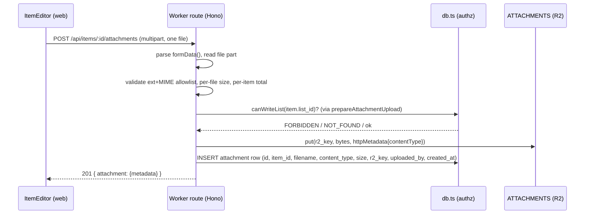

# Implementation Plan: File attachments on items (`feat/attachments`)

Status: REVISED (rev 2) — plan-review returned APPROVE WITH CHANGES; punch-list folded in.
Author: Architect. Source of truth: `docs/attachments-kickoff.md`.
Review: `docs/reviews/attachments-review.md`.

> Scope note: This plan resolves every open decision in the kickoff brief with rationale and
> gives the Coder an ordered, phased build. The ONLY infra/schema changes are the additive
> migration `0006_attachments.sql` and a new R2 binding in `wrangler.toml`. Production deploy
> is gated on the owner enabling R2 + creating the bucket (see §8), but development and tests
> are NOT blocked (local R2 emulation via miniflare).

> **Revision note (rev 2) — what changed from rev 1 per `docs/reviews/attachments-review.md`:**
> - **M1:** R2 test binding moved from `vitest.config.ts` (never loaded by the workspace) to the
>   worker project's inline `miniflare` block in `vitest.workspace.ts` (`r2Buckets: ["ATTACHMENTS"]`).
>   Phase 1 is now a **spike that PROVES `env.ATTACHMENTS` is usable in a worker test** before any
>   route work is built on it (§7.2).
> - **M2:** New web component tests are **colocated** (`web/src/components/AttachmentsEditor.test.tsx`,
>   `AttachmentsView.test.tsx`) to match the existing convention (`ItemEditor.test.tsx` et al.), NOT
>   under a `__tests__/` directory (§4, §7.8).
> - **m1:** Test-harness plan now adds `"attachment"` to `clearTables` (runs every `beforeEach`) in
>   `db.test.ts`, and documents that each worker test file carries its OWN inline DDL copy — the
>   harness does not read migration files, so `attachment` DDL must be duplicated into every new
>   worker test file that needs it (§4, §7.2, §7.8).
> - **m2:** OQ-2 (DOCX/XLSX) marked RESOLVED — owner locked "common docs" in the kickoff; DOCX/XLSX
>   are IN for v1 (§6).
> - **m3:** Pinned ONE `createAttachment` signature; `prepareAttachmentUpload` owns authz + caps
>   (enforced exactly once); `createAttachment` is INSERT-only (§5.4, §5.5).
> - **m4:** Download response `Content-Type` sourced ONLY from the DB column; `X-Content-Type-Options:
>   nosniff` added (§3.6, §7.4).
> - **m5/m6/n1/n2/n3:** TOCTOU-cap note, R2 pagination note, honest multipart-buffering wording,
>   expander-state-is-local note, and `Env` location wording folded in (§5.3, §3.4, §5.2, §3.7, §4).
> - **Unchanged (reviewer-validated, deliberately not touched):** P2-N1 cascade ordering, authz
>   mirroring (read=canReadList / write=canWriteList, 404-before-403, `uploaded_by` from JWT), the
>   `r2_key = items/<item_id>/<attachment_id>` scheme, threading `ATTACHMENTS` into
>   deleteItem/deleteList across all 3 call sites, locked zones untouched, additive `0006` only.

---

## 1. Problem statement and goals

A family member wants to attach files — screenshots (PNG/JPEG) and documents (a permission slip PDF, a
flyer, a spreadsheet) — to an item so the supporting material lives with the reminder instead
of in a separate email or photo roll.

Goals:

1. Store binary attachments in **Cloudflare R2** (LOCKED decision — D1 is the wrong place for
   blobs), bound to the Worker as `ATTACHMENTS`.
2. A new `attachment` table (metadata only) linked to `items` by FK.
3. Four authorized API routes: **upload, list, download, delete**, with authorization enforced
   in `db.ts` (project convention), mirroring the exact 200/403/404 semantics of
   `getItemForUser`/`getItems`.
4. Server-side validation of an explicit MIME + extension allowlist and size caps (never trust
   the client).
5. Cascade cleanup that satisfies the **P2-N1 HARD REQUIREMENT**: deleting an item (and by
   extension deleting a list) must remove the attachment rows AND the R2 objects, preserving
   the existing dispatch-cleanup ordering.
6. UI: an upload/view/remove control in `ItemEditor`, plus a **minimal, self-contained,
   read-only** attachment view (image thumbnails; filename + download link for docs) that does
   NOT pull in `feat/ui-redesign`.

Done conditions map to tests in §7.9.

## 2. Non-goals

- **Not** touched: Auth/Access verification, the reminder engine, push crypto
  (`channels/push.ts`), notification/location content builders. (LOCKED.)
- Attachments do **not** surface in notifications (email/push) or in notification deep links in
  v1. Noted as a future item in §6.
- **No** image thumbnailing/resizing on the server (no `sharp`/image transform in the Worker);
  thumbnails are rendered by the browser from the raw download stream, `` sized via CSS.
  Server-side thumbnailing is a future optimization (§6).
- **No** virus/malware scanning in v1 (single-family trusted allowlist of users). Noted as a
  future hardening item (§6).
- **No** magic-byte content sniffing as a hard gate in v1 (extension + declared Content-Type is
  the v1 gate); magic-byte sniffing is described as optional hardening in §5.3 with its tradeoff.
- **No** full `feat/ui-redesign` work. The read-only view is intentionally lean and can be
  absorbed/restyled by the redesign later.
- **No** editing of an attachment's bytes in place; the only mutations are upload (create) and
  delete. "Replace" = delete + upload.
- **No** multi-file drag-and-drop batching requirement; single-file-at-a-time upload is
  sufficient for v1 (the control may loop over selected files client-side, but each is a
  separate request — see §5.2).

## 3. Proposed design

### 3.1 Storage model

- **Metadata** lives in D1 in a new `attachment` table (§5.1). It is the source of truth for
  "what attachments does this item have" and carries authorization context (via `item_id` →
  `items.list_id` → list visibility).
- **Bytes** live in R2 under the `ATTACHMENTS` binding, keyed by an `r2_key` that is stored on
  the row. The row is authoritative; R2 is a content-addressed blob store keyed by that column.

### 3.2 `r2_key` scheme (RESOLVED)

Chosen scheme: **`items/<item_id>/<attachment_id>`** (no filename in the key).

Rationale:

- **Prefix-deletable on item removal.** All of an item's objects share the prefix
  `items/<item_id>/`, so the cascade can enumerate + delete them with a single
  `list({ prefix })` + `delete([...keys])` pass (see §3.4). This is the load-bearing reason the
  brief calls out.
- **Collision-free.** `attachment_id` is a server `crypto.randomUUID()` (project rule: server
  generates IDs, client never supplies them), so two files with the same original name on the
  same item never collide.
- **No user-controlled bytes in the key.** The sanitized original `filename` is stored in the
  DB column and used only for the download `Content-Disposition`; it is deliberately kept OUT of
  the R2 key so a hostile/odd filename can never affect key structure, prefix matching, or
  require key-escaping. (Storing the filename in the key would complicate prefix-delete and add
  an escaping burden for no benefit.)
- Content-Type and original filename travel in the DB row (and optionally in R2 object
  `httpMetadata`/`customMetadata` as defense in depth — see §5.4), not in the key. Note (m4):
  R2 object metadata is NEVER the authoritative source for the download response `Content-Type`;
  the DB column is (see §3.6).

### 3.3 Request flow (upload)



Ordering note (upload): R2 `put` runs BEFORE the DB `INSERT`. If the DB insert fails after a
successful `put`, we get an orphan R2 object with no row — that is the safe failure direction
(no dangling row that download would 404 on), and orphan objects are swept by prefix-delete when
the item is deleted, or by the optional orphan-sweep in §6. If `put` fails, no row is written and
the route returns 500. Authorization (`canWriteList`) is checked in `db.ts` BEFORE the `put` so a
non-writer never causes an R2 write (see §5.5 for the exact split).

### 3.4 Cascade cleanup (P2-N1) — the critical path

DB cascade (FK `ON DELETE CASCADE` or app-level delete) removes ROWS only. **R2 objects are a
separate network resource and are NOT touched by any DB cascade.** This must be explicit in code.

The existing `deleteItem` (db.ts ~L722) and `deleteList` (~L430) ordering is preserved; attachment
cleanup is **inserted as a new first-class step**, and — critically — R2 deletion happens via a
new `db.ts` helper that takes the R2 bucket binding as an argument (so `db.ts` stays the authz +
cleanup owner, consistent with how it owns dispatch cleanup).

Because `deleteItem`/`deleteList` today take only `(db, email, id)` and have no access to the R2
binding, this plan threads the `ATTACHMENTS` bucket into those two functions (and their callers
in `routes/items.ts` / `routes/lists.ts`). See §4 and §7.3 for the exact signature change and
its blast radius (the two route call sites plus `tests/unit/db.test.ts`).

New `deleteItem` ordering (additions in **bold**):

1. Resolve item; authz (`canWriteList`) — unchanged.
2. `deletePendingDispatchForItem` — unchanged (still FIRST among dispatch steps, P2-N1).
3. **Delete R2 objects for the item** via `deleteAttachmentObjectsForItem(bucket, itemId)` —
   `list({ prefix: 'items/<itemId>/' })` then `bucket.delete(keys)`. Best-effort (see §3.5).
4. **`DELETE FROM attachment WHERE item_id = ?`** (explicit app-level delete, same rationale as
   the existing explicit child deletes — do not rely on FK enforcement).
5. `DELETE FROM item_reminders` — unchanged.
6. `DELETE FROM item_occurrence_state` — unchanged.
7. `DELETE FROM items` — unchanged.

New `deleteList` ordering (additions in **bold**):

1. Resolve list; authz (owner-only) — unchanged.
2. `deletePendingDispatchForList` — unchanged (FIRST, uses subquery via items — must precede
   item deletion, P2-N1).
3. **Delete R2 objects for every item in the list.** Enumerate item ids
   (`SELECT id FROM items WHERE list_id = ?`) BEFORE items are deleted, then for each item id run
   the same prefix `list` + `delete` as step 3 of `deleteItem`. (Must precede the `DELETE FROM
   items` for the same reason dispatch purge must — once items are gone we've lost the id set.)
4. **`DELETE FROM attachment WHERE item_id IN (SELECT id FROM items WHERE list_id = ?)`**.
5. `DELETE FROM item_reminders …` — unchanged.
6. `DELETE FROM item_occurrence_state …` — unchanged.
7. `DELETE FROM items …` — unchanged.
8. `DELETE FROM lists …` — unchanged.

Placement rationale: R2 object deletion and the `attachment` row delete are added in the
"children first" region, strictly BEFORE `DELETE FROM items`, and AFTER the dispatch purge so the
load-bearing dispatch-before-items invariant (P2-N1) is untouched. The item-id enumeration for
`deleteList`'s R2 step is captured before any deletes for the same reason the dispatch subquery is.

**R2 `list` pagination (m6):** `deleteAttachmentObjectsForItem` relies on the per-item count cap
(`ATTACHMENT_MAX_ITEM_COUNT = 10`, §5.3): a single `list({ prefix })` returns all objects for an
item in one page, so no cursor loop is needed at v1 caps. **The Coder must add a guard so a future
cap bump can't silently orphan objects past the first page:** loop on `result.truncated` /
`result.cursor` in the helper (preferred — future-proof and cheap), OR add an explicit assertion
comment tying correctness to `ATTACHMENT_MAX_ITEM_COUNT`. Pick the cursor loop unless there is a
reason not to; either way it must be an explicit choice with a comment, not an unstated assumption.

### 3.5 R2-delete-failure handling (RESOLVED): best-effort + orphan-sweep note

Decision: **best-effort R2 delete; DB cleanup always proceeds; the operation does not fail if an
R2 delete errors.**

Rationale:

- The user's intent is "delete this item/list." Failing that whole operation because a blob-store
  call hiccuped would leave the item un-deletable and confuse the user, and would risk violating
  P2-N1 partway (dispatch already purged). The DB is the source of truth; a leftover R2 object
  with no row is inert (nothing references it) and cheap.
- Concretely: wrap the R2 `list`/`delete` in try/catch inside the helper; on error, `console.warn`
  with the item id + key count and continue. The item/list row deletion still happens.
- Orphaned objects are reclaimable two ways, both noted for the owner:
  1. A future **orphan-sweep** maintenance task (§6): `list` the `items/` prefix, diff against
     `SELECT r2_key FROM attachment`, delete keys with no row.
  2. R2 lifecycle rules (owner-configurable in dashboard) — out of scope to configure here.
- Tradeoff surfaced: we accept rare orphan objects (storage cost, negligible at family scale) in
  exchange for delete operations that never wedge. The alternative (fail-op on R2 error) is
  rejected because it makes item deletion depend on blob-store availability and can strand the
  P2-N1 ordering half-done.

### 3.6 Download flow

`GET /api/items/:id/attachments/:attachmentId` → authz `canReadList` → fetch row (scoped to the
item) → `bucket.get(r2_key)` → stream `object.body` back with:

- **`Content-Type`: the stored `content_type` DB column, and ONLY that (m4).** The response
  `Content-Type` is derived exclusively from the DB `content_type` value — which was written from
  the server-side allowlist at upload time — and is NEVER taken from `object.httpMetadata.contentType`
  or any client-influenced source. (Even though we may store `contentType` in R2 `httpMetadata` as
  defense-in-depth, it is not the authoritative source for the response header.)
- **`X-Content-Type-Options: nosniff` (m4)** on every download response, to defeat browser MIME
  sniffing (belt-and-suspenders with the forced `Content-Type`).
- `Content-Disposition`: `inline` for images (so thumbnails/`` render) and `attachment` for
  docs, with a sanitized `filename="…"`. Rationale: images should render inline in the read-only
  view; PDFs/docs are safer as downloads. Both use the same route; the disposition is chosen from
  the stored `content_type` (image/* → inline, else attachment).
- The route returns the R2 object's `httpEtag` as `ETag` (cheap correctness win; optional).

Security note: the download route serves same-origin under Access, and always sets an explicit
`Content-Type` from our allowlist (never `text/html`) plus `nosniff`, so there is no stored-XSS
vector from a maliciously-typed upload — the allowlist forbids HTML/SVG (see §5.3; SVG is
intentionally NOT in the allowlist because it can carry script).

### 3.7 UI surfaces

Two surfaces, both minimal and self-contained (no shadcn/Tailwind, matching the existing inline-
style components):

1. **`AttachmentsEditor`** (new component) rendered inside `ItemEditor`, only in **edit mode**
   (`item` is defined — i.e. the item already has an id). Rationale: attachments attach to an
   existing item id; in **create mode** there is no id yet. In create mode we render a short
   disabled hint: "Save the item first, then add attachments." (Simplest correct behavior; avoids
   a staging/temp-upload mechanism. Called out as a known v1 limitation in §6.) It:
   - lists existing attachments (calls `listAttachments(itemId)` on mount),
   - has a file `<input type="file">` + "Upload" that calls `uploadAttachment`, then refreshes,
   - has a "Remove" button per attachment that calls `deleteAttachment` then refreshes,
   - shows client-side pre-validation (extension + size) for a fast error, but the SERVER is the
     authority.

2. **`AttachmentsView`** (new component) — the **minimal read-only view**. Where it lives: an
   **expandable panel on the item row** in `ItemListView` (an "Attachments (n)" toggle that
   expands to show thumbnails + download links), rather than a new modal. Rationale: least
   invasive — no new routing, no modal/overlay infrastructure, no change to how items open
   (they still open into `ItemEditor` on Edit). The row already renders reminder counts; an
   attachment count + expander is the same shape. It:
   - shows an image `` thumbnail for `image/*` (src = the download URL, which returns
     `inline`), sized by CSS,
   - shows a filename + Download link for PDF/DOCX/XLSX/TXT,
   - is read-only (no upload/remove) — those live in the editor.
   - Only fetches the attachment list when expanded (lazy), to avoid N fetches on list render.

   **Expander state is component-local (n2).** The expand/collapse toggle is a per-row
   `useState` inside `ItemListView`/`AttachmentsView`. It does NOT touch `App`'s `activeView`
   (`AppView = "list" | "calendar" | "admin"`) nor the `initialOpenItem` one-shot guard, so it
   does NOT interact with the recently unified list/calendar/admin view state (commit f64c556).
   This is stated explicitly so a reviewer/QA does not suspect a regression in that shared state.

`AttachmentsView` and `AttachmentsEditor` may share a small presentational helper for the
thumbnail-vs-link decision, but stay independent components (editor is stateful/mutating; view is
read-only).

### 3.8 Authorization model (mirrors `db.ts` exactly)

- **Read** (list, download): allowed iff `canReadList(item.list_id)`.
- **Write** (upload, delete): allowed iff `canWriteList(item.list_id)`.
- **404 vs 403 ordering** mirrors `getItemForUser`: resolve the **item** first; absent → 404
  (no leak of whether the list exists); exists-but-not-readable/writable → 403. For the
  download/delete-by-attachment routes, also resolve the attachment row scoped to that item;
  a missing attachment → 404.
- `uploaded_by` is **always** the verified JWT identity (`c.get("user").email`), never from the
  request body (project HARD RULE).

## 4. Affected files and modules

New files:

- `migrations/0006_attachments.sql` — additive; creates the `attachment` table (§5.1).
- `web/src/components/AttachmentsEditor.tsx` — upload/list/remove control (edit mode).
- `web/src/components/AttachmentsView.tsx` — minimal read-only thumbnail/download panel.
- `tests/unit/attachments-validation.test.ts` — allowlist + size cap unit tests.
- `tests/unit/attachments-routes.test.ts` — route authz (200/403/404) + happy path against
  emulated R2.
- `tests/unit/attachments-cascade.test.ts` — deleteItem/deleteList remove rows AND R2 objects;
  `r2_key` scheme assertions.
- `web/src/components/AttachmentsEditor.test.tsx` — component test (select→upload→appears→remove).
  **Colocated** next to the component (M2), matching the existing convention
  (`web/src/components/ItemEditor.test.tsx`, `NotificationSetup.test.tsx`, `InstallBanner.test.tsx`).
  Do NOT place under `web/src/components/__tests__/` — that directory does not exist in the repo and
  breaks the colocation convention (the web project include glob `web/**/*.test.tsx` matches either
  location, so this is purely a convention fix, not a functional one).
- `web/src/components/AttachmentsView.test.tsx` — image thumbnail vs download link.
  **Colocated** next to the component (M2), same rule as above.

Modified files:

- `wrangler.toml` — add the `[[r2_buckets]]` binding (§5.6). (Prod/runtime binding.)
- `src/worker/env.ts` — add `ATTACHMENTS: R2Bucket` to the `Env` type. (n3: the `Env` type lives in
  `env.ts`; `index.ts` only imports it — do NOT add the field in `index.ts`.)
- `src/worker/types.ts` — add `Attachment`, `AttachmentRow`, `CreateAttachmentInput`,
  `mapAttachment` inputs; extend nothing existing (additive).
- `src/worker/db.ts` — add attachment CRUD + cascade helpers; **change `deleteItem` and
  `deleteList` signatures** to accept the R2 bucket (see below); insert the R2/attachment
  cleanup steps.
- `src/worker/routes/items.ts` — add the four attachment routes; pass `c.env.ATTACHMENTS` into
  the updated `deleteItem` call (existing delete handler ~L212).
- `src/worker/routes/lists.ts` — pass `c.env.ATTACHMENTS` into the updated `deleteList` call
  (~L89). (Read this file; it is the sole other caller of `deleteList`.)
- `web/src/types.ts` — add the browser-safe `Attachment` type.
- `web/src/apiClient.ts` — add `listAttachments`, `uploadAttachment` (multipart; does NOT use the
  JSON `request()` helper — see §5.2), `deleteAttachment`, and an `attachmentDownloadUrl(itemId,
  attachmentId)` URL builder for ``/links.
- `web/src/components/ItemEditor.tsx` — render `<AttachmentsEditor>` in edit mode.
- `web/src/components/ItemListView.tsx` — add the "Attachments (n)"/expander wiring for
  `<AttachmentsView>` (needs an attachment count; simplest is the view fetches lazily on expand,
  so the row need not know the count up front — render a neutral "Attachments" toggle. If a count
  is desired without an extra fetch, defer to §6 open question OQ-3). Expander state is local
  `useState` (n2 — does not touch `activeView`).
- `tests/unit/db.test.ts` — update the existing `deleteItem`/`deleteList` call sites (~L354, ~L432)
  for the new signature; **add the `attachment` table DDL to the inline `applyMigrations`** (the
  harness hard-codes schema, it does NOT read migration files); **add `"attachment"` to
  `clearTables` (~L130–143) ahead of `"items"`** so rows don't leak across tests (m1); assert no
  orphan attachment rows.

Test-config change (M1 — this replaces the rev-1 `vitest.config.ts` instruction, which was WRONG):

- `vitest.workspace.ts` — add `r2Buckets: ["ATTACHMENTS"]` to the **worker project's inline
  `miniflare` block** (lines ~14–27), alongside the existing `d1Databases: { DB: "local-test-db" }`.
  This is the file `npm test` (`vitest run` → workspace) actually loads. Its own comment states
  `vitest.config.ts` is deliberately NOT loaded as a workspace project, so editing `vitest.config.ts`
  would have NO effect on the tests. See §7.2 for the exact edit and the Phase-1 spike that proves
  `env.ATTACHMENTS` surfaces before any route test is written.

Explicitly NOT modified: `auth.ts`, reminder engine (`reminders/*`), `channels/push.ts`,
notification/digest content builders. `vitest.config.ts` is NOT modified (M1).

## 5. Data model and API changes

### 5.1 `attachment` table (migration `0006_attachments.sql`, additive)

```sql
-- Additive: file attachments on items (feat/attachments).
-- Metadata only; bytes live in R2 under r2_key. DB cascade removes rows, NOT R2 objects —
-- R2 cleanup is explicit in db.ts deleteItem/deleteList (P2-N1 pattern).
CREATE TABLE attachment (
  id           TEXT PRIMARY KEY,                                  -- server crypto.randomUUID()
  item_id      TEXT NOT NULL REFERENCES items(id) ON DELETE CASCADE,
  filename     TEXT NOT NULL,                                     -- sanitized original name (display + Content-Disposition)
  content_type TEXT NOT NULL,                                     -- from the validated allowlist
  size         INTEGER NOT NULL,                                  -- bytes
  r2_key       TEXT NOT NULL UNIQUE,                              -- 'items/<item_id>/<attachment_id>'
  uploaded_by  TEXT NOT NULL REFERENCES users(email),            -- verified JWT identity
  created_at   INTEGER NOT NULL                                   -- EpochMs UTC
);

CREATE INDEX idx_attachment_item ON attachment(item_id);
```

Notes:

- `ON DELETE CASCADE` on `item_id` mirrors the existing convention, but per M5-PROD-FK the
  **app-level delete in `db.ts` is authoritative** (we do not rely on FK enforcement being on).
- `r2_key UNIQUE` guards against accidental key reuse.
- All timestamps EpochMs UTC; id is a server UUID. Consistent with project conventions.
- **Test-harness duplication (m1):** the worker test harness does NOT read migration files — each
  worker test file hard-codes its schema in an inline `applyMigrations`. So this exact DDL (the
  `CREATE TABLE attachment` + `idx_attachment_item` index) must be copied into `applyMigrations` in
  `tests/unit/db.test.ts` AND into any new `attachments-*.test.ts` file that needs the table. See
  §7.2 (spike helper) and §7.8.

### 5.2 Upload request shape (RESOLVED): multipart/form-data

Decision: **`multipart/form-data`** with a single file field named `file`.

Rationale:

- Cloudflare Workers support `await request.formData()` natively; the file part is a `File`/`Blob`
  with `.name`, `.type`, `.size`, `.stream()`/`.arrayBuffer()`. This gives us the original
  filename and declared content-type in one parse without inventing header conventions.
- Multipart is the standard browser upload shape (`<input type="file">` → `FormData`), so the
  frontend stays idiomatic and testable.
- The alternative (raw body with filename/type in custom headers) is rejected: it loses the
  browser-native `FormData` path and forces manual header plumbing for no gain.

The `uploadAttachment` apiClient function therefore does NOT use the JSON `request()` helper
(which sets `Content-Type: application/json`); it builds a `FormData`, `fetch`es with
`credentials: "same-origin"`, and lets the browser set the multipart boundary. Error handling
mirrors `request()` (parse `{ error: { code, message } }` → `ApiError`).

Size-cap note for multipart parsing (n1 — honest wording): `await request.formData()` buffers the
FULL request body into memory before `file.size` is readable, so the per-file cap does NOT reject
"before buffering into memory" — it rejects **before the R2 `put`** (and before any further
processing). The real memory bound is the per-file cap (10 MB, §5.3). As a cheap early reject, the
route MAY also check the `Content-Length` request header up front and 400 before parsing when it
already exceeds the per-file cap; this is an optimization, not the primary gate. The primary gate
is: parse → read `file.size` → reject oversize → only then `put`.

### 5.3 Validation: allowlist + size caps (server-side, authoritative)

**MIME + extension allowlist (v1):**

| Type  | Extension(s)    | Content-Type                                                              |
|-------|-----------------|--------------------------------------------------------------------------|
| PNG   | `.png`          | `image/png`                                                              |
| JPEG  | `.jpg`, `.jpeg` | `image/jpeg`                                                             |
| PDF   | `.pdf`          | `application/pdf`                                                        |
| DOCX  | `.docx`         | `application/vnd.openxmlformats-officedocument.wordprocessingml.document` |
| XLSX  | `.xlsx`         | `application/vnd.openxmlformats-officedocument.spreadsheetml.sheet`      |
| TXT   | `.txt`          | `text/plain`                                                            |

DOCX/XLSX are **included for v1** — the owner locked "common docs" in the kickoff (see §6, OQ-2
RESOLVED). Validation rule (v1 gate): the file's **extension** (from the sanitized name) must be in
the allowlist AND the declared **Content-Type** must match that extension's allowed type(s). Anything
else → `VALIDATION` (400), the existing error contract. SVG, HTML, and executables are excluded
by omission (SVG deliberately — script-carrying).

- Content-Type match should be tolerant of `text/plain; charset=…` (compare the media type before
  `;`). For `.txt`, accept `text/plain` and also allow an empty/absent type by falling back to the
  extension (some browsers send `""` for `.txt`) — decision: if declared type is empty, derive the
  type from the extension and accept; if declared type is present it must match. This is documented
  so QA can test the empty-type `.txt` case.

**Magic-byte sniffing (optional hardening, NOT the v1 gate):** we could read the first few bytes
and confirm a signature (PNG `89 50 4E 47`, JPEG `FF D8 FF`, PDF `25 50 44 46`, ZIP/OOXML
`50 4B 03 04` for DOCX/XLSX). Tradeoff: stronger (defeats a renamed/mislabeled file) but adds code
+ per-format signature tables + a read-ahead of the stream, and DOCX/XLSX both sniff as generic ZIP
so it can't fully disambiguate them anyway. **Decision: extension+Content-Type is the v1 gate;
magic-byte sniffing is a documented future hardening** (family-trusted user set makes the risk low).

**Size caps (RESOLVED):**

- **Per-file: ≤ 10 MB** (`10 * 1024 * 1024`). Covers phone screenshots, permission-slip PDFs, and
  typical office docs comfortably; keeps multipart buffering bounded in the Worker.
- **Per-item total: ≤ 25 MB** across all attachments on the item. Enforced server-side by summing
  `SELECT COALESCE(SUM(size),0) FROM attachment WHERE item_id = ?` + the incoming file size and
  rejecting with `VALIDATION` if it would exceed the cap.
- **Per-item count: ≤ 10 files** (secondary guard so the sum check and the UI list stay sane; also
  the invariant the cascade helper's single-page `list` relies on — §3.4).
- **TOCTOU note (m5):** the per-item total/count check (`SELECT SUM(size)`/`COUNT` → then INSERT) is
  NOT atomic. Two concurrent uploads to the same item can each pass the 25 MB / 10-file check and
  both insert, slightly overshooting the cap. This is **best-effort under concurrency and acceptable
  at single-family scale** — no row locking / no transaction serialization is added for v1. Documented
  so it is not mistaken for a hard guarantee; a future hardening could serialize per-item.
- R2 free-tier friendliness: 10 GB stored / 1M Class-A ops per month on the free tier — these caps
  keep a family's usage far inside free limits. Caps live in one place
  (`src/worker/config.ts` constants: `ATTACHMENT_MAX_FILE_BYTES`, `ATTACHMENT_MAX_ITEM_BYTES`,
  `ATTACHMENT_MAX_ITEM_COUNT`, and the allowlist map) so they are trivially tunable.

All caps and the allowlist are enforced in the Worker (`db.ts`/route), never trusting the client.
The client does a friendly pre-check but the server rejects authoritatively.

### 5.4 `db.ts` functions (new)

All follow the `Result<T>` pattern and enforce authz internally (project convention). Signatures:

```ts
// Read (canReadList). Returns metadata list (no bytes).
export async function listAttachments(
  db: D1Database, email: string, itemId: string
): Promise<Result<Attachment[]>>

// Read single row scoped to item, for the download route (canReadList).
export async function getAttachmentForDownload(
  db: D1Database, email: string, itemId: string, attachmentId: string
): Promise<Result<Attachment>>   // NOT_FOUND if item or attachment absent; FORBIDDEN if not readable

// Authz + per-item cap guard. Enforces canWriteList + per-item total/count BEFORE any R2 put.
// This is the SINGLE authorization + cap check for the upload path (m3).
export async function prepareAttachmentUpload(
  db: D1Database, email: string, itemId: string, incomingSize: number
): Promise<Result<{ list_id: string }>>  // NOT_FOUND / FORBIDDEN / VALIDATION(cap) mirror

// Create (INSERT-only). Does NOT re-run authz or caps — prepareAttachmentUpload already did (m3).
// id + r2_key are generated in the route (server code) so the row matches the object already put.
export async function createAttachment(
  db: D1Database, email: string, itemId: string, id: string, input: CreateAttachmentInput, now: EpochMs
): Promise<Result<Attachment>>

// Delete (canWriteList). Deletes the row AND the R2 object (best-effort R2 per §3.5).
export async function deleteAttachment(
  db: D1Database, email: string, itemId: string, attachmentId: string, bucket: R2Bucket
): Promise<Result<void>>

// Cascade helper (no authz — called from within already-authorized deleteItem/deleteList).
// Best-effort R2 delete via prefix list+delete; never throws on R2 error (logs + continues).
// Pagination per §3.4/m6 (cursor loop or documented single-page-at-cap assumption).
export async function deleteAttachmentObjectsForItem(
  bucket: R2Bucket, itemId: string
): Promise<void>
```

`CreateAttachmentInput` = `{ filename: string; content_type: string; size: number; r2_key: string }`.

**PINNED upload contract (m3 — resolves the rev-1 "Coder picks one" latitude):**

- The `attachmentId` and `r2_key` are generated in the **route** (route is server code, so
  server-owns-IDs holds): `id = crypto.randomUUID()`, `r2_key = items/<itemId>/<id>`.
- **Authorization + per-item caps are enforced EXACTLY ONCE**, in `prepareAttachmentUpload`, BEFORE
  the R2 `put`. `createAttachment` is **INSERT-only**: it does NOT re-run `canWriteList` and does NOT
  re-check caps. (This matches how other `db.ts` creators check authz once, and guarantees the
  reviewer's "authz enforced exactly once, before any R2 write" property.)
- The pinned signature is `createAttachment(db, email, itemId, id, input, now)` with
  `input = { filename, content_type, size, r2_key }`. The rev-1 alternative
  `createAttachment(db, email, itemId, input, now)` (no explicit `id`) is REJECTED — it can't match
  the already-`put` object's key.
- `email` is passed through solely for `uploaded_by` (JWT identity), never from the body.

### 5.5 Route ↔ db.ts responsibility split (upload)

Pinned route order (m3 — no remaining Coder latitude on the authz-once point):

1. **Parse + validate file** (allowlist ext+MIME, per-file size) → `400 VALIDATION` on fail.
   (Optional cheap `Content-Length` pre-check per §5.2/n1.)
2. **Generate** `id = crypto.randomUUID()` and `r2_key = items/<itemId>/<id>`.
3. **`prepareAttachmentUpload(db, email, itemId, file.size)`** — the SINGLE authz + per-item cap
   check. Returns `NOT_FOUND` (→404) / `FORBIDDEN` (→403) / `VALIDATION` (→400 for cap) / ok.
4. On ok: **`bucket.put(r2_key, bytes, { httpMetadata: { contentType } })`**. (After authz, so a
   non-writer never triggers an R2 write.)
5. **`createAttachment(db, email, itemId, id, { filename, content_type, size, r2_key }, now)`** —
   INSERT-only, no second authz round-trip (m3).
6. Return `201 { attachment }`.

- The Coder MUST NOT let `uploaded_by` come from the body; it is `email` (JWT) passed to `db.ts`.
- **db.ts** owns: the authz decision + per-item cap query (in `prepareAttachmentUpload`), the
  INSERT (in `createAttachment`), and row→domain mapping. The route owns: multipart parse, file
  validation, ID/key generation, and the R2 `put`.

This split is spelled out so the reviewer can confirm authz is enforced exactly once, in db.ts,
before any R2 write.

### 5.6 `wrangler.toml` R2 binding

```toml
[[r2_buckets]]
binding = "ATTACHMENTS"
bucket_name = "family-scheduler-attachments"
```

- `binding = "ATTACHMENTS"` matches `Env.ATTACHMENTS: R2Bucket` (in `src/worker/env.ts`).
- `bucket_name` is the prod bucket the owner must create (see §8). Under `wrangler dev` /
  `vitest-pool-workers`, miniflare provides a **local emulated** R2 bucket for this binding.
  **However (M1):** the worker test pool in `vitest.workspace.ts` does NOT rely on wrangler bindings
  auto-surfacing — it declares `d1Databases` explicitly in its inline `miniflare` block, and the R2
  bucket must be declared the SAME way (`r2Buckets: ["ATTACHMENTS"]`). Adding the binding to
  `wrangler.toml` alone is NOT proven to surface `env.ATTACHMENTS` in tests — the Phase-1 spike
  (§7.2) verifies it. Dev (`wrangler dev`) does pick up the `wrangler.toml` binding via emulation.
- No `preview_bucket_name` needed (preview_urls is already false).

### 5.7 API routes (all under existing `/api/*` auth; mounted on `itemsRouter` at `/api`)

| Method | Path                                          | Authz          | Body / Response |
|--------|-----------------------------------------------|----------------|-----------------|
| POST   | `/api/items/:id/attachments`                  | `canWriteList` | multipart `file` → `201 { attachment }` |
| GET    | `/api/items/:id/attachments`                  | `canReadList`  | → `200 { attachments: Attachment[] }` |
| GET    | `/api/items/:id/attachments/:attachmentId`    | `canReadList`  | → streams bytes (`Content-Type` from DB + `X-Content-Type-Options: nosniff` + `Content-Disposition`) |
| DELETE | `/api/items/:id/attachments/:attachmentId`    | `canWriteList` | → `204` |

- All mounted on `itemsRouter` (already `app.route("/api", itemsRouter)` in `index.ts`), so no new
  router mount is needed. Path prefix `/items/:id/attachments` does not collide with the existing
  `/items/:id` or the reminders router (`/api/items/:id/reminders`, mounted separately).
- Status mapping reuses the existing pattern: `NOT_FOUND→404`, `FORBIDDEN→403`, `VALIDATION→400`.
- The download route returns a raw `Response` (like the existing `DELETE` 204), not `c.json`, and
  sets the response `Content-Type` from the DB column only + `nosniff` (m4).

### 5.8 Frontend types + apiClient

`web/src/types.ts` add:

```ts
export interface Attachment {
  id: UUID;
  item_id: UUID;
  filename: string;
  content_type: string;
  size: number;
  uploaded_by: Email;
  created_at: EpochMs;
  // r2_key intentionally NOT exposed to the client (internal storage detail).
}
```

`apiClient.ts` add: `listAttachments(itemId)`, `uploadAttachment(itemId, file)` (multipart, own
fetch), `deleteAttachment(itemId, attachmentId)`, and `attachmentDownloadUrl(itemId,
attachmentId)` returning the `/api/items/:id/attachments/:attachmentId` URL for ``/anchor use.

## 6. Risks, edge cases, and open questions

Risks / edge cases:

- **P2-N1 regression risk.** Changing `deleteItem`/`deleteList` is the highest-risk area. The new
  steps are inserted AFTER the dispatch purge and BEFORE `DELETE FROM items`; the existing
  dispatch-before-items invariant and its comments must be preserved verbatim. The cascade test
  (§7.9) asserts BOTH the existing "no orphan dispatch/reminders" AND the new "no orphan
  attachment rows + R2 objects gone."
- **Signature change blast radius.** `deleteItem`/`deleteList` gain an `R2Bucket` param. All call
  sites: `routes/items.ts` (~L212), `routes/lists.ts` (~L89), and `tests/unit/db.test.ts` (~L354,
  ~L432). The Coder must update all three or typecheck fails (that's the safety net).
- **Test cross-bleed (m1).** Adding `attachment` to `applyMigrations` WITHOUT adding it to
  `clearTables` (run every `beforeEach`) leaves rows between tests and makes "no orphan attachment
  rows" nondeterministic. `clearTables` must gain `"attachment"` ahead of `"items"` (reverse-FK
  order). See §4 and §7.2/§7.8.
- **R2 object without row / row without object.** Upload writes R2 before the row (§3.3), so a
  failed insert leaves an orphan object (inert, swept later) — acceptable. The reverse (row without
  object) should never happen on the happy path; download handles a missing object defensively
  (→ 404 with a clear message) rather than 500.
- **Multipart memory.** Per-file cap (10 MB) bounds Worker memory; the check runs after
  `formData()` buffers but before the R2 `put` (n1 — see §5.2 for the honest bound).
- **Per-item cap TOCTOU (m5).** Best-effort under concurrent uploads; acceptable at family scale
  (§5.3).
- **R2 `list` pagination (m6).** Cascade helper either loops the cursor or documents the
  single-page-at-cap assumption; no silent orphaning past page 1 on a future cap bump (§3.4).
- **Content-Disposition header injection.** The stored `filename` goes into a response header.
  Sanitize it (strip CR/LF, quotes, path separators) both at store time (for the DB) and when
  emitting the header; prefer RFC 5987 `filename*=UTF-8''…` encoding for non-ASCII. Documented so
  QA tests a filename with spaces/unicode.
- **SVG/HTML exclusion** is a deliberate XSS guard; do not add them to the allowlist without a
  separate security review. The download response also forces `Content-Type` from the DB column and
  sets `nosniff` (m4).
- **Create-mode attachments limitation.** Uploads require a saved item id; create mode shows a
  "save first" hint (§3.7). Acceptable v1 tradeoff; a future enhancement could stage uploads and
  attach on first save.

Future items (noted, out of scope):

- Attachments in notification content / deep links (LOCKED out of v1).
- Server-side image thumbnailing/resizing.
- Magic-byte content sniffing as a hard gate.
- Virus/malware scanning.
- Per-item cap serialization to close the TOCTOU window (m5) — not needed at family scale.
- Orphan-sweep maintenance task (§3.5) and/or R2 lifecycle rules.

Open questions (for the reviewer/owner — do NOT block the plan, but flag):

- **OQ-1:** Confirm the size caps (per-file 10 MB / per-item 25 MB / ≤10 files) suit the requester's
  documents (e.g. a large scanned PDF). Easily tunable via `config.ts` constants. (Non-blocking;
  architect default stands.)
- **OQ-2 — RESOLVED (m2).** DOCX/XLSX are **included for v1**. The kickoff (§2) explicitly locks
  "images + PDF + common docs … PNG, JPEG, PDF, DOCX, XLSX, plain text," so this is an owner-locked
  decision, not an open question. No owner action required; no round-trip needed.
- **OQ-3:** Should the item row show an attachment **count** without an extra fetch? That would
  require `getItems`/the items query to join an aggregate count — a small, additive change to the
  read path. Deferred: the lazy-on-expand view avoids it. If the owner wants the count badge
  up front, add `attachment_count` to the items read (additive) — flag for a follow-up.
  (Non-blocking.)

## 7. Step-by-step implementation checklist for the Coder

Work in ordered phases. Run `npm run typecheck` and `npm run lint` after each phase; run
`npm test` after phases that add/modify tests. Do NOT edit locked areas (auth, engine, push
crypto, notification builders).

### 7.1 Phase 0 — Read + branch

- [ ] Re-read `CLAUDE.md`, `docs/attachments-kickoff.md`, and this plan.
- [ ] Read `src/worker/routes/lists.ts` to confirm it is the only other `deleteList` caller and
      note where `c.env.ATTACHMENTS` must be threaded (~L89).
- [ ] Read `vitest.workspace.ts` (lines ~14–27) and `tests/unit/db.test.ts` (`applyMigrations` +
      `clearTables` ~L130–143) so the harness edits below are precise.
- [ ] Confirm `config.ts` location for the new constants.

### 7.2 Phase 1 — Infra + test-binding SPIKE (M1 — prove `env.ATTACHMENTS` BEFORE building on it)

Do the infra wiring AND prove the test binding works before any route/db work depends on it.

- [ ] Add `migrations/0006_attachments.sql` (§5.1). Additive only.
- [ ] Add `[[r2_buckets]]` block to `wrangler.toml` (§5.6).
- [ ] Add `ATTACHMENTS: R2Bucket` to the `Env` type in `src/worker/env.ts` (NOT `index.ts` — n3).
- [ ] **(M1) Add the R2 bucket to the WORKER PROJECT'S inline `miniflare` block in
      `vitest.workspace.ts`** (lines ~14–27), NOT to `vitest.config.ts` (which the workspace never
      loads). Concretely, extend the existing block:
      `miniflare: { d1Databases: { DB: "local-test-db" }, r2Buckets: ["ATTACHMENTS"] }`.
      Confirm the exact `@cloudflare/vitest-pool-workers` R2 emulation key name against the installed
      version (`^0.6.0`) — if `r2Buckets` differs, use the version-correct key.
- [ ] **(M1 SPIKE — must pass before Phase 3) Write a throwaway/first worker test that imports
      `{ env } from "cloudflare:test"` and asserts `env.ATTACHMENTS` is a usable R2 bucket** — e.g.
      `await env.ATTACHMENTS.put("spike/x", "hi")`, then `env.ATTACHMENTS.get("spike/x")` returns the
      bytes, then `delete`. Run `npm test` and confirm it passes. This PROVES the binding surfaces in
      the worker pool. Only after this is green do you build the route/cascade tests on top of it.
      (Fold the spike assertions into `attachments-cascade.test.ts` or keep a tiny
      `attachments-binding.test.ts`; either is fine — the point is to prove it early.)
- [ ] **(m1) Note for every worker test file:** the harness hard-codes schema inline (it does NOT
      read migration files). Each new `attachments-*.test.ts` that touches the `attachment` table must
      copy the `CREATE TABLE attachment` + index DDL (§5.1) into its own inline `applyMigrations`.
      Consider a tiny shared `tests/unit/_schema.ts` DDL-array export to avoid drift — but if you
      follow the existing per-file pattern, the DDL is duplicated deliberately.
- [ ] `npx wrangler d1 migrations apply family-scheduler --local` to apply `0006` locally;
      `npm run typecheck`.

### 7.3 Phase 2 — db.ts: types, config, CRUD, cascade (P2-N1)

- [ ] `src/worker/types.ts`: add `Attachment`, `AttachmentRow`, `CreateAttachmentInput`, and a
      `mapAttachment` row→domain shape (add the mapper in db.ts next to the others).
- [ ] `src/worker/config.ts`: add `ATTACHMENT_MAX_FILE_BYTES=10*1024*1024`,
      `ATTACHMENT_MAX_ITEM_BYTES=25*1024*1024`, `ATTACHMENT_MAX_ITEM_COUNT=10`, and the
      allowlist map (extension → allowed content-type(s)).
- [ ] `src/worker/db.ts`: add `mapAttachment`, `listAttachments`, `getAttachmentForDownload`,
      `prepareAttachmentUpload` (SINGLE authz + per-item cap guard returning `Result` — m3),
      `createAttachment` (**INSERT-only, `id` passed in from route, NO second authz check — m3**),
      `deleteAttachment`, `deleteAttachmentObjectsForItem` (best-effort R2 prefix delete, never
      throws — §3.5; pagination per m6/§3.4). Follow `Result<T>` + authz-in-db.ts.
- [ ] `src/worker/db.ts`: **change `deleteItem`** signature to
      `(db, email, id, bucket: R2Bucket)`; insert steps 3–4 of §3.4 (R2 prefix delete →
      `DELETE FROM attachment`) AFTER `deletePendingDispatchForItem` and BEFORE the existing
      child deletes. Preserve all existing comments/ordering.
- [ ] `src/worker/db.ts`: **change `deleteList`** signature to
      `(db, email, id, bucket: R2Bucket)`; enumerate item ids first, R2-delete per item, then
      `DELETE FROM attachment WHERE item_id IN (...)`, inserted AFTER
      `deletePendingDispatchForList` and BEFORE the existing child deletes (§3.4).
- [ ] `npm run typecheck` — this will flag the two call sites to fix next.

### 7.4 Phase 3 — routes/items.ts + routes/lists.ts

- [ ] Add the four routes (§5.7) to `itemsRouter`. Upload follows the PINNED order (§5.5): parse
      `formData()` → validate (allowlist + per-file cap) → generate `id` + `r2_key` →
      `prepareAttachmentUpload` (SINGLE authz + per-item caps) → `bucket.put` → `createAttachment`
      (INSERT-only). `uploaded_by = user.email` (JWT). Map error codes to statuses as the file
      already does.
- [ ] Download route streams `bucket.get(r2_key).body` with **`Content-Type` sourced ONLY from the
      DB `content_type` column (m4)**, `X-Content-Type-Options: nosniff` (m4), and `Content-Disposition`
      (inline for `image/*`, attachment otherwise) with a sanitized filename. Missing object → 404.
- [ ] Update the existing `DELETE /api/items/:id` handler (~L212) to pass `c.env.ATTACHMENTS` into
      `deleteItem`.
- [ ] `routes/lists.ts`: pass `c.env.ATTACHMENTS` into `deleteList` (~L89).
- [ ] `npm run typecheck && npm run lint`.

### 7.5 Phase 4 — apiClient + web types

- [ ] `web/src/types.ts`: add `Attachment` (no `r2_key`).
- [ ] `web/src/apiClient.ts`: add `listAttachments`, `uploadAttachment` (multipart, own fetch, own
      error mapping), `deleteAttachment`, `attachmentDownloadUrl`.
- [ ] `npm run typecheck` (web project).

### 7.6 Phase 5 — AttachmentsEditor + ItemEditor wiring

- [ ] Add `web/src/components/AttachmentsEditor.tsx` (edit-mode only; list + upload + remove;
      client pre-validation; refresh after mutations; create-mode hint).
- [ ] Render `<AttachmentsEditor itemId={item.id}>` in `ItemEditor` only when `item` is defined;
      show the "save first" hint otherwise.
- [ ] `npm run lint && npm run typecheck`.

### 7.7 Phase 6 — AttachmentsView + ItemListView wiring

- [ ] Add `web/src/components/AttachmentsView.tsx` (read-only; lazy fetch on expand; ``
      thumbnail for `image/*`, filename+Download link otherwise).
- [ ] Add an "Attachments" expander to the item row in `ItemListView.tsx` that mounts
      `<AttachmentsView itemId={item.id}>` when expanded. Expander state is **component-local
      `useState`** and MUST NOT touch `App`'s `activeView`/`initialOpenItem` (n2, §3.7).
- [ ] `npm run lint && npm run typecheck`.

### 7.8 Phase 7 — Tests

- [ ] `tests/unit/attachments-validation.test.ts`: allowlist accept (each type incl. DOCX/XLSX) +
      reject (e.g. `.exe`, `image/svg+xml`, mismatched ext/type); per-file oversize reject; per-item
      total oversize reject; per-item count reject; empty-type `.txt` accept.
- [ ] `tests/unit/attachments-routes.test.ts`: owner upload/list/download/delete → 200/201/204;
      non-owner on a PRIVATE item → 403; missing item → 404; missing attachment → 404;
      `uploaded_by` is the JWT identity even if a body tries to spoof it. Assert the download
      response `Content-Type` (from DB column) + `X-Content-Type-Options: nosniff` (m4) +
      `Content-Disposition`. Use the emulated R2 bucket proven in the Phase-1 spike.
- [ ] `tests/unit/attachments-cascade.test.ts`: upload → assert R2 object exists at
      `items/<id>/<attachmentId>` and `r2_key` matches; `deleteItem` → assert attachment ROW gone
      AND `bucket.get(r2_key)` is null; `deleteList` → same across multiple items. Include the
      best-effort case (R2 delete does not fail the op).
- [ ] **(m1) Each new worker test file above** that touches the `attachment` table must carry the
      `CREATE TABLE attachment` + index DDL in its OWN inline `applyMigrations` (the harness does not
      read migration files) — do not assume `db.test.ts`'s schema is shared.
- [ ] Update `tests/unit/db.test.ts`: new `deleteItem`/`deleteList` signatures (call sites ~L354,
      ~L432); **add the `attachment` DDL to the inline `applyMigrations`**; **add `"attachment"` to
      `clearTables` (~L130–143) AHEAD of `"items"` (m1)**; assert no orphan attachment rows after
      delete.
- [ ] `web` component tests — **colocated (M2):** `web/src/components/AttachmentsEditor.test.tsx`
      (select→upload→appears→remove) and `web/src/components/AttachmentsView.test.tsx` (image
      thumbnail vs download link). Do NOT create a `web/src/components/__tests__/` directory. Match
      the existing web harness (jsdom setup in `tests/setup/jsdom.setup.ts`); mock `apiClient`
      functions.
- [ ] `npm test` green; `npm run lint`; `npm run typecheck`.

### 7.9 Done-condition → test mapping

- Validation (accept incl. DOCX/XLSX / reject / oversize / count / empty-txt) →
  `attachments-validation.test.ts`.
- Route authz 200/403/404 + `uploaded_by` from JWT + download headers (`Content-Type` from DB +
  `nosniff` + `Content-Disposition`) → `attachments-routes.test.ts`.
- Cascade removes rows AND R2 objects; `r2_key` scheme; best-effort R2 → `attachments-cascade.test.ts`
  + updated `db.test.ts` (incl. `clearTables` no-bleed).
- Test binding surfaces `env.ATTACHMENTS` in the worker pool → Phase-1 spike (`attachments-binding`
  or folded into cascade test).
- Upload-control component behavior → `AttachmentsEditor.test.tsx` (colocated).
- Read-only view (thumbnail vs link) → `AttachmentsView.test.tsx` (colocated).
- Local E2E-ish (QA, emulated R2): upload image+PDF+docx, list, download one, delete one, delete
  item → confirm cleanup. (QA step, not a unit test.)
- Prod verification: DEFERRED to owner (needs R2 enabled — §8).

## 8. Deploy prerequisite (owner)

Development and tests are fully unblocked via miniflare's local R2 emulation. **Production deploy
is gated on the owner:**

1. Enable **R2** on the Cloudflare account (dashboard → R2 → activate; may require adding billing
   even though usage stays within the free tier).
2. Create the bucket **`family-scheduler-attachments`** (must match `bucket_name` in
   `wrangler.toml` §5.6).
3. Apply migration `0006_attachments.sql` to the production D1 (`wrangler d1 migrations apply
   family-scheduler` — remote).
4. Deploy the Worker (the `[[r2_buckets]]` binding attaches the bucket to `ATTACHMENTS`).

Until steps 1–2 are done, `wrangler deploy` will fail to bind `ATTACHMENTS` in prod — this is the
expected gate. Flag `0006` (schema) and the R2 binding (infra) for owner awareness; they are the
ONLY infra/schema changes in this feature.
