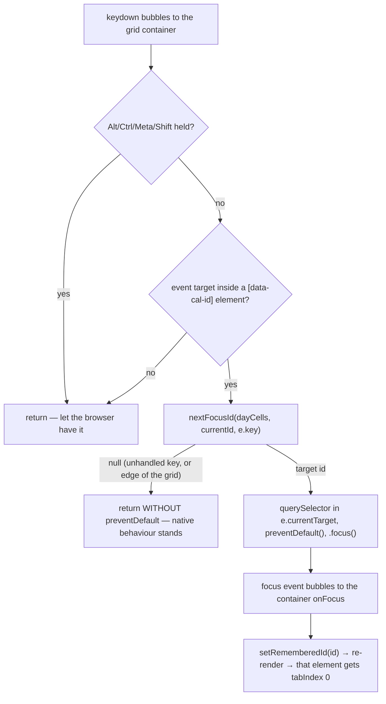

# Plan: Calendar roving `tabindex`

Slug: `calendar-roving-tabindex`
Type: frontend-only (`web/src` only). No Worker, no API, no schema, no migration, no deploy
prerequisite beyond the normal manual `wrangler deploy`.
Source: `docs/backlog.md:159` — "Calendar roving `tabindex` (deferred from `feat/item-view-mode`,
Decision 10)", updated 2026-08-22 after PR #20.

**Revision history**
- v1 (2026-08-22) — initial.
- v2 (2026-08-22) — all 11 required changes from `docs/reviews/calendar-roving-tabindex-review.md`
- v4 (2026-08-22) — round-3's two optional editorial items (C15 added to R5's list; its `document.body` assertion labelled a waypoint), plus the reviewer's third reason for C3's distinctness. Verdict: APPROVE.
- v3 (2026-08-22) — round-2 changes folded in by the orchestrating session (5 required + the recommended one). Blocking fix: `enterGrid` awaited nothing, so the ten tests funnelling through it would have Tabbed into a grid whose chips had not arrived. Added **C15** for the mouse route into the roving state — an implementation that updates `rememberedId` only from the keydown handler passed the entire previous suite.
  (round 1, APPROVE WITH CHANGES) folded in. The owner has decided to implement at §3's scope;
  go/no-go is settled and §1.4 is retained only as the record of why. §3's design is unchanged
  **except that Decision 7's discoverability hint is cut** (review §3), which moves the whole
  discoverability residual onto R3 rather than letting it fall between the two decisions.
  The substantive work was in §8: **nothing in v1's spec failed on a frozen `rovingId`** — an
  implementation with a broken or missing `handleGridFocus`, i.e. no working roving at all, passed
  every test — and separately C1's Shift+Tab step ran from `document.body`, C9's fallback half
  never established a remembered id, C10 carried the hollow-await antipattern
  `calendar-show-more.md` §5.2 exists to forbid, and the chip's `className` was pinned by nothing
  while §7 step 4 rewrites the JSX around it. §8.3 also gained a mechanical rule (never raw-
  `.focus()` a grid element) that v1 needed and did not have. §1.2 bullet 3 and Decision 4 rested
  on a false premise — "screen readers are not affected either way" is wrong for Tab — corrected in
  both places, with the residual accepted on the record in R3.

---

## 1. Problem statement and goals

### 1.1 The tab-stop count

`web/src/components/CalendarView.tsx:136-221` renders the month grid as a flat `Card` with
`grid-cols-7`. Every occurrence chip is a native `<button>` (`:184-201`), and since PR #20 every
day with more than three items also renders a `+N more` toggle `<button>` (`:202-217`). Every one
of these is a tab stop:

| Source | Count |
| --- | --- |
| Chips, collapsed | up to 3 × 31 = 93 |
| `+N more` toggles | 1 per day with >3 items |
| Chips revealed by expanding a day | unbounded (all of that day's items) |

The `item-view-mode` plan accepted this explicitly (§3.13, "Calendar tab-stop explosion... accept
and document"), and `calendar-show-more` Decision 5 accepted a second, related quirk: the toggle
sits *after* the chips in DOM order, so expanding a day inserts the revealed chips **above** the
still-focused toggle, and reaching them requires Shift+Tab backwards into content the user just
asked for.

### 1.2 The stated motivation is half wrong, and the plan says so up front

The backlog entry's reasoning is: "on mobile the bottom tab bar renders after the grid in DOM
order, so leaving the calendar by keyboard becomes tedious." Checked against `App.tsx`:

```
<div>                                    App.tsx:150
  <InstallBanner />                      :151
  <aside class="hidden ... md:flex">     :154   desktop sidebar: Primary nav + ListSidebar
  <header class="... md:hidden">         :190   mobile top bar: Lists sheet, New
  <main>  ... CalendarView ...           :223
  <nav class="fixed ... md:hidden">      :254   mobile bottom tab bar
```

- **On desktop (≥768px)** the `header` and the bottom `nav` are `display: none`, so they are not
  focusable. Every focusable chrome element — the whole primary nav and the list sidebar — sits
  **before** `<main>`. There is nothing focusable after the grid at all. So the specific pain the
  backlog describes ("tabbing out of the calendar to reach the tab bar") **does not exist on the
  surface that has a keyboard.**
- **On mobile (<768px)** the bottom tab bar really is after the grid — but that surface normally
  has no keyboard. The residual real cases are a browser window narrower than 768px, an iPad or
  iPhone with an external keyboard, and iOS Full Keyboard Access / Switch Control.
- **Screen readers are affected — in one direction only, and not the one that helps.**
  *Not helped:* iOS VoiceOver swipe navigation and desktop browse-mode/virtual-buffer reading both
  walk the accessibility tree and reach `tabindex="-1"` elements normally, so roving does nothing
  for a VoiceOver user swiping through 93 chips — which is the mobile sequential-navigation
  problem that actually exists on this product's primary surface.
  *Harmed:* **Tab is a first-class screen-reader navigation method** — NVDA and JAWS pass it
  through to the browser, and it is the standard way to move between interactive controls — so a
  Tab-navigating screen-reader user loses 92 of 93 chips from their tab sequence exactly as a
  sighted keyboard user does. Nothing becomes unreachable (browse mode and VO-arrow still reach
  every chip); the route changes, and they are told nothing about the new one.
  v1 of this plan said "screen readers are not affected either way." That was **false**, and it was
  load-bearing in Decision 4's rejection of a hint. The residual is accepted deliberately in R3
  now, rather than argued out of existence here.

**What is left after removing the wrong parts is still real, and it is what this plan targets:**

1. **Backwards escape.** Shift+Tab from a chip in the last week of the month to the month-nav
   buttons or the sidebar costs up to ~95 keystrokes today; it should cost one.
2. **Reaching a chip late in the month** costs a Tab per preceding chip.
3. **Decision 5's quirk** — revealed chips are behind the focus point.
4. Narrow-viewport / external-keyboard users get (1) against the bottom tab bar too.

### 1.3 Goals

- The whole month grid is **one tab stop**. Tab enters it once; Tab or Shift+Tab leaves it
  immediately from anywhere inside.
- Arrow keys move focus between the grid's interactive elements, with directions that match what
  the user sees.
- Every chip and the `+N more` toggle remain reachable and activatable by keyboard.
- **No change to the accessibility tree**, so screen-reader *announcement* cannot regress. Note the
  precision: the tab **sequence** is not part of the accessibility tree, and it does change for
  screen-reader users too (§1.2, R3). "Announcement cannot regress" is the claim; "screen-reader
  users are unaffected" is not.
- No change to the visual rendering of the grid.
- The 15 existing tests in `CalendarView.test.tsx` pass **unmodified** (see §8.1).

### 1.4 Is this worth doing? An honest answer, and the decision (settled)

The product is a two-adult family scheduler used mainly on an iPhone. On that surface this change
does nothing at all. Its entire beneficiary population is *sighted keyboard users on a desktop
browser* — which today is one person occasionally.

Against that, the change:

- adds a new pure module and ~50 lines of focus plumbing to the most-reviewed component in the
  repo, which has 15 protected tests;
- **removes** an ability that exists today (Tab reaching every chip) and replaces it with one that
  must be discovered (arrow keys), for sighted keyboard users **and** for Tab-navigating
  screen-reader users (§1.2). That is a net loss for anyone who does not try arrows, which is
  exactly the concern `ItemEditor.tsx:157-158` recorded when it declined Radix `RadioGroup` — see
  Decision 0, and R3, which accepts it;
- depends on focus-ring visibility under *programmatic* focus, which jsdom cannot verify and which
  can make the whole feature unusable if it fails (R2), so it leans harder on manual QA than the
  previous two calendar branches did.

I considered three smaller interventions before recommending this one; all three are written up in
§10 with the reasoning, and one of them (the skip link) is the option the task explicitly asked me
to weigh. Short version: **a skip link only helps someone who has not yet entered the grid, and on
desktop there is nothing after the grid to skip to** — so it addresses the part of the problem that
turned out not to exist, and not the parts that do.

v1's recommendation was: implement it, at the scope defined in §3 — item-level roving with no ARIA
grid and no month changes from the keyboard. That scope is roughly a third of the work of a full
APG grid and carries none of its announcement-regression risk.

> **DECIDED (2026-08-22): the owner has chosen to implement, at §3's scope.** Go/no-go is closed.
> This subsection is retained as the record of what the change is and is not worth, because that
> record is what R3's accepted residual and §10's rejected options are measured against — not as an
> open question. Do not reopen it; §10 option D exists for the historical record only.

---

## 2. Non-goals

- **No `role="grid"` / `role="row"` / `role="gridcell"`.** Decision 4 explains why, and §10 option C
  records what would make it worth revisiting.
- **No focusable day cells.** Decision 1.
- **No month change from the keyboard.** No PageUp/PageDown handling, no arrow-past-the-edge
  wrap-around into the adjacent month. Decision 2 gives the reason (it is the only feature that
  would force focus to move across a render, which is the single most dangerous mechanism in this
  change).
- **No change to the accessibility tree**: no new/changed `aria-label`, `aria-expanded`, `role`,
  `title`, or visible text on any chip or toggle. `tabindex` and a `data-` attribute are not
  exposed as content.
- **No change to any `className`** on the chips (`CalendarView.tsx:197`) or the toggle (`:213`).
  Both are pinned by prior plans as authoritative strings, and the toggle's is asserted verbatim by
  `CalendarView.test.tsx:398-400`.
- **No change to the fetch/merge/sort logic, the `expandedDays` state, `toggleDay`, the month-nav
  handlers, or `ItemModal` wiring.**
- **No new rendered element and no discoverability affordance** — no visible hint, no `sr-only`
  text, no `aria-describedby`. Decision 4 rejects the three announcement routes
  (i)-(iii) and Decision 7 (cut) removes the visual hint; R3 accepts the consequence. The visual diff of this change is empty.
- No changes outside `web/src` (plus `docs/**`). No Worker, API, schema, or `wrangler.toml` change.
- No new dependency. No `focus-trap`, no `roving-ux`, no headless-UI library.
- No skip link (§10 option A), no `inert`/`aria-hidden` on parts of the grid (§10 option B — it is
  actively wrong here).
- No change to `ItemListView`, whose row buttons are a genuinely short list and are not in scope.

---

## 3. Proposed design

### Decision 0 — why the calendar is different from `ItemEditor`'s radios

`ItemEditor.tsx:157-158` says:

```tsx
{/* Type radios (plan M4 — stay native): Radix RadioGroup would add arrow-key
    roving focus, a user-visible behavior change. */}
```

This repo has declined roving focus once, deliberately. That has to be answered, not stepped
around.

**First, a correction that strengthens rather than weakens the precedent.** The stated rationale is
not quite right on its own terms: the two inputs at `ItemEditor.tsx:161-167` share `name="type"`,
which makes them a native radio group, and browsers *already* implement roving `tabindex` for radio
groups (one tab stop, arrows move and select). Radix `RadioGroup` would not have introduced
arrow-key roving there; it was already present. So the literal claim does not survive checking.

**Second, the principle behind it does survive, and it is the right principle**: do not change
keyboard behavior a user already knows unless there is a problem worth the change. Applied here:

| | `ItemEditor` type radios | Calendar month grid |
| --- | --- | --- |
| Elements in the group | 2 | 93+ |
| Cost of tabbing through them | zero | the entire problem |
| Native platform behavior | already a composite (radio group) | none; a flat list of buttons |
| What the change would buy | nothing | goals 1-3 in §1.3 |

The precedent says "don't add a composite where the platform already gives you one and the tab cost
is zero." It does not say "never build a composite." The calendar is the opposite case on both
axes. **But the precedent's underlying worry — a user-visible keyboard behavior change — is real
here in a way it was not there.** v1 answered it with a discoverability hint (Decision 7); that hint
is cut, so the worry is answered instead by accepting it explicitly, on the record, in **R3**. The
honest summary is that this change makes the ItemEditor precedent's exact concern come true, in
exchange for goals 1-3, and says so rather than designing around it.

### Decision 1 — the roving unit is the individual interactive element, not the day cell

**Chips and `+N more` toggles rove. Day cells are the coordinate system, not focus targets.**

Rejected alternative: day cells as `gridcell`s with roving focus, and a two-level model to reach
the chips inside (Enter or F2 to enter a cell, Escape to return — the APG data-grid pattern).

Why the cell-level model loses here:

1. **A day cell has no action.** `CalendarView.tsx:171-175` carries an explicit verified comment
   that the cell `<div>` has no `onClick`. A focusable cell would be a focus stop where nothing can
   be done, and the whole point of this change is to *reduce* focus stops that lead nowhere.
2. **It adds keystrokes to the primary task.** Opening an item would become: Tab → arrows to the
   day → Enter → arrows to the chip → Enter → Escape (close modal) → Escape (leave the cell).
   Item-level roving is: Tab → arrows to the chip → Enter.
3. **It requires the ARIA grid structure** to be comprehensible (Decision 4), which is where the
   announcement-regression risk lives.
4. **It requires a mode.** "Am I in cell mode or content mode" is invisible state on screen; every
   implementation of it needs a visible focus distinction the current design does not have.

What the cell model would buy that this does not: navigation to **empty** days. That is worth
nothing today (Decision 6) and would be worth a lot the moment a day cell gets an action such as
"create on this day". §10 option C names that as the trigger to revisit.

**Consequence, stated plainly:** the chips inside a day are reached by arrowing to them, and there
is no "get out of the cell" gesture because you were never inside anything — Tab leaves the grid
from any element.

### Decision 2 — navigation model: 2D, day-linear horizontally, week-columnar vertically

Elements are identified by `(day, index-within-day)`. Element order within a day is exactly the
visual order: visible chips top to bottom, then the `+N more` toggle if present.

| Key | Behavior | Rationale |
| --- | --- | --- |
| `ArrowDown` | Next element **in the same day**. At the last one, jump to the first element of the next **non-empty day in the same column** (day + 7, +14, …). If none, do nothing. | Always moves visually downward. Day+7 is the same weekday by construction. |
| `ArrowUp` | Previous element in the same day. At the first one, jump to the **last** element of the previous non-empty day in the same column (day − 7, −14, …). If none, do nothing. | Mirror of `ArrowDown`. Landing on the *last* element is what makes Up/Down reversible. |
| `ArrowRight` | First element of the next non-empty day (day + 1, +2, …), **crossing week-row boundaries** in reading order. If none, do nothing. | "Next day", the calendar's own linear order. Saturday → next Sunday is correct. |
| `ArrowLeft` | First element of the previous non-empty day. If none, do nothing. | See asymmetry note below. |
| `Home` | First element of the first non-empty day of the month. | |
| `End` | Last element of the last non-empty day of the month. | |
| `PageUp` / `PageDown` | **Not handled.** Native page scroll is preserved. | See below. |
| Any key with `Alt`/`Ctrl`/`Meta`/`Shift` | **Not handled.** | Never hijack browser and OS shortcuts, and Shift+Arrow is a selection gesture. |
| `Enter` / `Space` / `Tab` / everything else | **Not handled.** | Native `<button>` activation and the native tab sequence must survive untouched. This is load-bearing: swallowing Enter would break every chip. |

**No column arithmetic is needed anywhere.** Because the grid is exactly 7 columns wide, `day ± 7`
is the same weekday by construction, regardless of `firstDayOfWeek`. The geometry helper therefore
does not take `firstDayOfWeek` at all — which removes an entire class of off-by-one bug. (Noting
this explicitly because its absence looks like an omission.)

**Deliberate asymmetry:** `ArrowLeft` lands on the previous day's **first** element while
`ArrowUp` lands on the previous day's **last**. Left/Right are *day*-level moves, so both directions
land at the day's canonical entry point (index 0); Up/Down are *element*-level moves, so they land
on the adjacent element. This is a decision, not an oversight, and §8.2 test P9 pins it.

**Why arrowing past the end of the month does not change month:** changing month means the target
element does not exist until after a re-render, which forces either `flushSync`, a "pending focus"
ref plus an effect, or a `useLayoutEffect`. Every one of those is a mechanism that can steal focus
on an *unrelated* re-render — and this component re-renders on a `reloadToken` refetch it does not
control (`CalendarView.tsx:30-32, 50-71`). The invariant in Decision 8 ("focus is only ever moved
synchronously, inside the keydown handler, to an element that already exists") is worth more than
PageUp/PageDown. The month is two Shift+Tabs and a Space away, and nothing in the product promises
otherwise.

### Decision 3 — how the `+N more` toggle participates, and how Decision 5 of the previous plan gets fixed

The toggle is simply the **last element in its day's order**. It is reached with `ArrowDown` from
the day's last chip and with `ArrowUp` from the next week's cell in the same column. `Enter` and
`Space` activate it natively; nothing in this plan touches its handler, its `aria-expanded`, its
labels, or its `className`.

**Focus does not move on expand.** That matches the APG disclosure pattern and matches
`calendar-show-more` Decision 5's rejection of a ref + `.focus()`.

**Roving navigation nevertheless fixes the quirk Decision 5 accepted.** After expanding, the
revealed chips are inserted directly above the still-focused toggle. Under the old model, reaching
them meant Shift+Tab backwards past the toggle into content that came *before* the focus point.
Under this model:

> `ArrowUp` from the toggle lands on the last revealed chip. One keystroke, and it moves *upward*,
> which is where the new content visibly is.

So the answer to "does roving nav fix that, and where does focus go after expanding?" is: **yes,
and focus stays on the toggle** — which is both the standards-correct behavior and, now, the
convenient one. `CalendarView.tsx:202-207` carries a comment saying this cost was accepted and "NOT
fixed with roving tabindex, which is a separate, larger, out-of-scope change". That comment is now
stale in its final clause and must be updated in step 5 of §7 — not deleted, since the DOM-order
fact it describes is still true and still the reason `Shift+Tab` behaves as it does.

**The toggle's identity is stable across expand/collapse** (`t-15` in both states, see §5.2), so the
tab stop stays on the toggle when the user expands the day. A naive index-based id would move the
tab stop to a chip while DOM focus sat on the toggle; §5.2 explains why the scheme avoids that.

### Decision 4 — ARIA: change nothing. No `role="grid"`.

**The grid gets no `role`, no `aria-label`, no `aria-rowindex`, no `aria-colindex`, and no
`columnheader`s. The chips and the toggle keep exactly the accessible names they have today.**

Reasons, strongest first:

1. **The requirement is "screen-reader announcement must not regress." The only way to guarantee
   that is to not touch the accessibility tree.** `tabindex` and `data-*` are not exposed as
   content. After this change a screen reader hears byte-identical output to today.
2. **`role="grid"` requires `role="row"` children**, and the grid has no row elements — it is a flat
   list of 7 × N `<div>`s laid out by `grid-cols-7` (`CalendarView.tsx:136`). Adding row wrappers
   breaks the CSS grid unless each wrapper is `display: contents`, and `display: contents` has a
   documented history of removing elements from the accessibility tree in exactly the browsers this
   family uses. jsdom cannot verify any of it. That is a large, unverifiable risk in service of a
   role nobody asked for.
3. **A correct grid would also need the weekday headers to become `columnheader`s
   (`CalendarView.tsx:137-144`) and the day cells to become `gridcell`s**, which changes what a
   screen reader says on every chip — the regression the requirement forbids.
4. **The chips' day-context `aria-label`s already do the job a `gridcell` would.**
   `CalendarView.tsx:193-195` adds `— ${monthLabel} ${day}` precisely because the day number is a
   sibling `<div>`. Under arrow navigation this gets *more* valuable, not less: a screen-reader user
   in focus mode arrowing between days hears the date on every move. **Do not remove or shorten
   those labels as part of this change.**

**What this costs, stated correctly this time.** Roving `tabindex` without a composite role is
non-standard: there is no announcement that arrow keys are available and no row/column position
information. Nothing becomes *unreachable* — all three navigation modes (Tab + arrows, browse mode,
VoiceOver swipe) still reach every chip — but the Tab route now reaches one chip instead of 93, for
sighted keyboard users **and for Tab-navigating screen-reader users alike** (§1.2), and nobody is
told. **v1 justified skipping any announcement with the claim that screen-reader users are
"unaffected by `tabindex`". That claim was false.** The decision to add no ARIA survives; the
justification is replaced below.

**Three ways to announce the arrow keys were considered. All three are rejected, and the residual
is accepted explicitly in R3 rather than left implicit here.**

- **(i) `aria-describedby` on the grid container** (the option the coordinator asked to be weighed).
  **Rejected on mechanism, not on taste: it would not be announced at all.** Decision 4 leaves the
  container role-less, and a description on a non-focusable `role="generic"` div is not surfaced by
  any screen reader — descriptions are announced when the element they belong to is focused or
  navigated to. To work it would have to move onto something the user actually lands on, which is
  option (ii).
- **(ii) `aria-describedby` on every chip and the toggle**, pointing at one visually-hidden
  sentence. This *does* get announced — and that is the problem. It appends "Arrow keys move
  between calendar items" to the announcement of **every** chip, on **every** move, which is
  precisely the announcement regression §2 forbids and the reason this decision exists. It is also
  **misleading in the mode most screen-reader users are in**: in NVDA/JAWS browse mode, arrow keys
  are consumed by the screen reader and never reach our keydown handler at all, so the sentence
  would be advertising a capability that does not apply until the user switches to focus mode.
  Announcing something false 93 times is worse than announcing nothing.
  *(A stateful variant — carry the description only on the roving element, and only until the user
  has focused the grid once — narrows the verbosity but not the browse-mode falsehood, and buys it
  with conditional ARIA that no test in this repo could hold honest. Rejected.)*
- **(iii) A visible, keyboard-only hint.** This was v1's Decision 7. **Cut** — see Decision 7 for
  the three reasons, one of which (it renders below the fold at the moment it fires) is fatal on its
  own.

**Consequence, and it is deliberate: nothing in this change tells anyone that arrow keys exist.**
That is the accepted residual, and it is written down as R3 with its own trigger for revisiting.
Decision 4 is a decision about semantics; R3 is where its cost is carried.

### Decision 5 — focus restoration after the item modal closes

`useItemModal` captures `document.activeElement` into `triggerRef` when a modal opens
(`ItemModal.tsx:42, 48, 53, 59`) and `handleCloseAutoFocus` (`:121-127`) restores focus to it on
close if `document.contains(trigger)` — because a programmatically-opened Radix Dialog/Sheet has no
`DialogTrigger` and will not do it by itself.

Three interactions, all handled by design rather than by new code:

1. **The restored element is also the tab stop.** Because roving state *follows focus* (Decision 8),
   the chip that opened the modal became the roving element when it was focused. It still has
   `tabIndex={0}` when focus is restored to it, so the tab sequence is coherent immediately —
   Shift+Tab from it goes to the month-nav buttons, Tab leaves the grid.
2. **The restore itself feeds the roving state.** `trigger.focus()` fires a focus event that bubbles
   to the grid container's `onFocus`, which re-affirms the same id. No special case, no effect.
3. **The known "focus lands on `document.body`" case is unchanged and slightly improved.**
   `item-view-mode` edge case 15: if an edit-save moves the item to another date, the refetch
   unmounts the chip, `document.contains(trigger)` is false, and Radix's default sends focus to
   `<body>`. That behavior is pre-existing and out of scope. What *this* change adds is that the
   remembered id is now also gone, so `resolveRovingId` falls back to the grid's first element and
   the next Tab re-enters the grid at a sensible place instead of nowhere.

**No new focus management is added for the modal. If the Coder finds themselves adding a
`useEffect` to restore roving focus after a modal close, stop — that is Decision 8's invariant being
violated.**

### Decision 6 — empty day cells and the leading blanks are not navigable

The leading blanks (`CalendarView.tsx:147-149`) and any day cell with no occurrences stay exactly as
they are: decorative `<div>`s with no `tabindex`, no `data-` attribute, and no role.

- They contain nothing and do nothing (Decision 1, reason 1).
- Arrow navigation skips them: every direction scans past empty days to the next day with content
  (Decision 2). "Skip", not "stop at" — so a month with items only on days 3 and 28 is two
  `ArrowRight`s wide, not 25.
- A month with **no** occurrences therefore contributes **zero** tab stops. The grid disappears from
  the tab sequence entirely, which is the correct outcome and is asserted by test C12.

Revisit if a day cell ever gets its own action; see §10 option C.

### Decision 7 — CUT. No discoverability affordance ships, and R3 carries the cost.

v1 specified a keyboard-only hint (`Arrow keys move between calendar items`) rendered under the
grid, `aria-hidden`, revealed by a `group-has-[:focus-visible]` Tailwind variant. **It is cut.** The
section number is retained so the cross-references in this plan and in the review thread still
resolve.

Three independent reasons, the third of which is fatal on its own:

1. **Its test had no discriminating power over its own claim.** The claim was "visible only while
   the grid holds a *keyboard* focus". v1's C12 asserted the text, the `aria-hidden` attribute and
   the class string — every one of which passes on a hint that is permanently visible, permanently
   invisible, or visible on mouse click. The entire behavioral contract rested on one manual check.
   By §8's own falsification standard that is the worst test-to-risk ratio in the plan.
2. **It was the only part of the change that altered the rendered page for every user** — including
   the iPhone user for whom §1.4 concedes the change does nothing — and the only part introducing a
   first-in-repo CSS pattern whose stated fallback (`group-focus-within`) had *different* behavior.
   A lot of surface for one sentence.
3. **It rendered below a 5-6 week grid, so on a short desktop window it sat below the fold at
   exactly the moment it fired.** A user who Tabs into the grid lands near the *top*. The hint would
   have been invisible precisely when it was supposed to be doing its job — on the surface where
   §1.4 says the entire beneficiary population lives. (Moving it above the `Card` would fix this
   one; it does not fix 1 or 2.)

**What replaces it: nothing.** That is the honest statement, and it must not be allowed to fall
through the gap between this decision and Decision 4 — Decision 4 rejected the three ARIA routes,
this decision cuts the visual one, and between them **no user of any kind is told that arrow keys
exist**. That combined residual is accepted deliberately and is written down once, in **R3**, with
the reasoning, the mitigating facts, and the trigger for revisiting. If R3 is ever deleted or
weakened, this decision has to be reopened with it.

### Decision 8 — implementation shape: derived `tabIndex`, focus-following state, zero `useEffect`s

Four rules, and the fourth is the one that matters:

1. **One state cell**: `const [rememberedId, setRememberedId] = useState<string | null>(null)`.
2. **`tabIndex` is derived, never written imperatively**:
   `const rovingId = resolveRovingId(dayCells, rememberedId)`, then each element renders
   `tabIndex={cell.id === rovingId ? 0 : -1}`. If the remembered element is gone (month nav,
   refetch, collapse), `resolveRovingId` falls back to the grid's first element — so a stale id can
   never leave the grid with zero tab stops.
3. **Roving state follows focus, via one delegated handler on the container.** Focus events bubble
   in React, so a single `onFocus` on the `Card` covers every chip and toggle, and it captures
   focus arriving by *any* route: arrow keys, mouse click, the modal's `triggerRef` restore, and a
   screen reader moving focus. No per-element handlers, no ref map.
4. **HARD INVARIANT — this change adds no `useEffect`, and calls `.focus()` in exactly one place:
   synchronously inside the keydown handler, on an element that already exists in the DOM.**
   The obvious wrong implementation is `useEffect(() => rovingEl?.focus(), [rovingId])`. It looks
   tidy and it steals focus on *every* re-render — including the `reloadToken` refetch after a save
   and the month-nav refetch, ripping focus off the `›` button the user is holding. Test C11's first
   half exists to fail on it. A secondary benefit: with no new effect there is no new
   `react-hooks/exhaustive-deps` surface, and the repo's "no new warnings" bar (`eslint.config.js:53`,
   baseline 0 errors / 2 warnings per `docs/backlog.md:147`) is met by construction.

Flow:



The `currentId` is read from the **event target**, not from `rememberedId`. If the two ever
disagree (a route that focused an element without our handler seeing it), the keyboard still moves
from where focus actually is.

---

## 4. Affected files and modules

| File | Change |
| --- | --- |
| `web/src/lib/calendarFocus.ts` | **New.** Pure geometry: `DayFocusables`, `nextFocusId`, `resolveRovingId`. No React, no DOM. |
| `web/src/lib/calendarFocus.test.ts` | **New.** 19 pure unit tests (§8.2). Collected by the existing `web/**/*.test.ts` glob (`vitest.workspace.ts:46`) — precedent: `web/src/lib/permissions.test.ts`, `itemDisplay.test.ts`, `rrule.test.ts`. |
| `web/src/components/CalendarView.tsx` | **Modified.** Precompute a `dayCells` array; add one state cell, two delegated handlers, `data-cal-id` + `tabIndex` on chips and the toggle; refresh the stale clause in the `:202-207` comment. **No new rendered element** (Decision 7 is cut), so the visual diff is empty. |
| `web/src/components/CalendarView.test.tsx` | **Appended to.** One new `describe` (§8.3). The 15 existing tests are **not** edited (§8.1). |
| `docs/backlog.md:159` | Close the entry in place when it ships — the repo's normal practice, and explicitly carved out of the scope rule in §9. |

**Not touched:** anything under `src/` (Worker), `migrations/`, `wrangler.toml`, `App.tsx`,
`ItemModal.tsx`, `ItemDetails.tsx`, `ItemListView.tsx`, `ItemEditor.tsx`, `web/src/components/ui/*`.
A diff outside the table above (plus `docs/**`) means the scope was misread — stop and report.

---

## 5. Data model and API changes

**None.** No D1 schema change, no migration, no route, no request or response shape, no
`apiClient.ts` change, no change to `OccurrenceEntry` or any type in `web/src/types.ts`. This
branch does not touch `src/` at all. `CLAUDE.md`'s Worker-side conventions (EpochMs, server-issued
IDs, `Result<T>`, Access-JWT identity, DB-layer authorization, pending-dispatch cleanup) are not
engaged by anything here.

The only new "data model" is internal to the client and lives in the new pure module:

### 5.1 `web/src/lib/calendarFocus.ts` — exported surface

```ts
/** One day of the rendered month, with the ids of its focusable elements in VISUAL order. */
export interface DayFocusables {
  day: number;      // 1-based day of month
  ids: string[];    // [] for a day with no occurrences
}

/** Which element a navigation key moves to, or null if the key is unhandled or there is
 *  nowhere to go. Pure: no DOM, no React. */
export function nextFocusId(
  days: DayFocusables[],   // EVERY day 1..numDays, ascending, empty days included
  currentId: string,
  key: string,
): string | null;

/** Which element should carry tabIndex={0}. Falls back to the grid's first element when the
 *  remembered one is gone; null only when the month has no focusable elements at all. */
export function resolveRovingId(
  days: DayFocusables[],
  rememberedId: string | null,
): string | null;
```

`nextFocusId` locates the current day with `days.find(d => d.ids.includes(currentId))` rather than
by index arithmetic, so a caller that passes a sparse or misordered array degrades to `null` instead
of pointing at the wrong element. It returns `null` — never throws — for an unknown key, an unknown
`currentId`, or an edge of the grid.

### 5.2 The element id scheme

| Element | Id | Example |
| --- | --- | --- |
| Chip at index `i` of day `d` | `` `c-${d}-${i}` `` | `c-15-0` |
| `+N more` toggle of day `d` | `` `t-${d}` `` | `t-15` |

Rendered as `data-cal-id`. Three properties are load-bearing:

1. **Stable across expand/collapse.** Expanding only *appends* (`visibleOccs` grows from 3 to N), so
   `c-15-0..2` keep their ids and the toggle stays `t-15`. A scheme that numbered the toggle by
   position (`c-15-3` collapsed, `c-15-5` expanded) would move the tab stop onto a chip while DOM
   focus sat on the toggle.
2. **Selector-safe by construction.** Both patterns match `/^[ct]-\d+(-\d+)?$/`, so
   `` `[data-cal-id="${id}"]` `` needs no `CSS.escape`. Do **not** switch the scheme to embed
   `occ.item_id` (a UUID) without revisiting that.
3. **Positional, not identity-bearing.** After a refetch, `c-15-1` may be a different item. That is
   correct: this is a focus *position*, not an item reference. Nothing reads an item out of an id.

---

## 6. Risks, edge cases, and open questions

### Risks

- **R1 — an effect steals focus (highest severity).** `useEffect(() => el.focus())` is the natural
  way to write this and it is wrong: the component re-renders on `reloadToken` refetches and month
  navs it does not initiate, and the effect would rip focus off whatever the user was on. Mitigated
  by Decision 8 rule 4 (zero effects) and by test C11, which asserts the `›` button *still has
  focus* after a month nav.
- **R2 — the focus ring does not appear when focus is moved programmatically.** If `:focus-visible`
  does not match after our `.focus()` call, the user arrows around a grid with **no visible focus
  indicator** — a WCAG 2.4.7 failure that would make the feature unusable, and one jsdom cannot see
  (it resolves no CSS). The spec says a UA *should* match `:focus-visible` when focus moves
  programmatically in response to a keyboard interaction, and our `.focus()` happens inside the
  keydown handler, so this is expected to work. **Verify in a real browser (manual check 1) before
  believing it.** If it fails: swap the chips' and toggle's `focus-visible:` ring classes for
  `focus:` — which puts a ring on mouse click too, an accepted cost against an invisible focus
  point. That would change strings pinned by `CalendarView.test.tsx:398-400` (the toggle) and by
  test C14 (the chip), and by `item-view-mode` §3.9 — so it is a plan revision, not a coder's
  judgement call.
  **Why not prove this with Playwright instead of an eyeball?** `el.matches(":focus-visible")` in a
  real Chromium is the obvious answer and it is unavailable: `package.json:14`'s `test:e2e` script
  runs `playwright test`, but there is no `playwright.config.*` and no spec file in the repo, so it
  no-ops and proves nothing (`docs/backlog.md:155`). Bootstrapping it is its own parked plan. This
  was considered and rejected on availability, not on merit — if Playwright ever lands, R2 is the
  first thing that should get a spec.
- **R3 — discoverability regression, ACCEPTED as a residual with no mitigation shipping.** This is
  the one thing the change takes away, and after Decision 7 was cut and Decision 4 rejected all
  three ARIA routes, **nothing in the product tells any user that arrow keys exist.** Stated
  precisely so it cannot be soft-pedalled later:
  - *Sighted keyboard users* can no longer Tab to chips 2..N. Arrows are the only route, and there
    is no affordance pointing at them.
  - *Tab-navigating screen-reader users* lose the same 92 of 93 chips from their tab sequence
    (§1.2). They are not told either — Decision 4 (ii) explains why an `aria-describedby` hint would
    be both an announcement regression and **actively misleading in browse mode**, where the screen
    reader consumes the arrow keys before the app ever sees them.
  - *Nobody loses access.* Browse mode, VoiceOver swipe, and VO/NVDA arrow navigation all still
    reach every chip, and every chip is still a native `<button>` that Enter and Space activate.
    This is a change of route and of discoverability, not of reachability — which is what makes it
    an acceptable residual rather than a WCAG 2.1.1 failure.
  - *Mitigating fact, stated without pretending it generalises:* arrow-key navigation of a month
    grid is a widespread convention (every date picker and calendar app), and the entire sighted-
    keyboard population of this application is the owner, who commissioned the change and is
    reading this plan. That is a real argument here and would be a worthless one in a product with
    users who did not ask for it.
  - **Trigger to revisit:** a second keyboard or screen-reader user, or any report of "I can't
    click the calendar without a mouse". The cheapest fixes at that point, in order, are the two
    intermediate options recorded at the end of §10 — not a re-run of Decision 7.
- **R4 — the geometry array and the render disagree.** If `dayCells` were computed from one
  expression and the JSX from another, `nextFocusId` would return ids for elements that are not on
  screen and arrows would silently do nothing. Mitigated by construction: §7 **step 4** builds
  `dayCells` **once** and renders from it, and the ids are generated from the same `visibleOccs` the
  chips map over.
- **R5 — `user.tab()` fidelity in jsdom.** Tests C1, C2, C3, C11 **and C15** depend on user-event
  honoring `tabindex="-1"` in its tab-order computation. **C15 depends on it more narrowly than the
  others**: it Tabs away from an element that is itself `tabindex="-1"` at that moment (the click
  focuses the toggle regardless of its tabindex — user-event's focusability test matches
  `button:not([disabled])`), and user-event v14's ordering branch for that case could plausibly send
  Tab to `document.body` or wrap it to `‹`. C15 fails against the keydown-handler implementation
  under **either** behavior, which is why it is sound — but if it behaves unexpectedly, that
  narrower dependency is the first thing to check. It does (v14, `package.json:42`), but if it
  misbehaves, fall back to asserting the `tabindex` attribute on every grid element and move the
  sequence proof to **manual check 2**. Say so in the test file rather than silently weakening the
  test — a `tabindex`-attribute suite proves the mechanism but not the outcome, and the plan should
  not pretend otherwise.
- **R6 — `[Space]` activation in jsdom.** There is repo precedent for Enter activating a button
  under user-event (`ItemListView.test.tsx:184-193`) but none for Space. If `[Space]` does not
  synthesize a click in this environment, keep the Enter coverage and move Space to manual check 4.
  Do **not** "fix" it by adding a keydown handler for Space — that would be re-implementing native
  button behavior and is exactly the class of bug `calendar-show-more` test 2 guards against.
- **R7 — scope creep into the ARIA grid.** The `role="grid"` on-ramp is one line and the rest is
  not. Decision 4 and §2 forbid it; §10 option C names the trigger condition so the decision is not
  re-litigated ad hoc mid-implementation.
- **R8 — re-render on every focus change.** `setRememberedId` in `onFocus` re-renders the whole
  grid (~100 nodes) once per focus move. Measured expectation: unnoticeable; React is diffing a
  `tabIndex` change on two elements. Do **not** pre-emptively add `useMemo`/`React.memo`/a day-cell
  child component — the extraction is a bigger change than the one being made and it would break
  the "one array feeds both render and geometry" property in R4.

### Edge cases

| # | Case | Behavior |
| --- | --- | --- |
| E1 | Month with zero occurrences | `dayCells` has all-empty `ids`; `resolveRovingId` returns `null`; nothing renders `tabIndex={0}`; the grid contributes no tab stops. No crash. Test C12. |
| **E2** | **Month nav with a remembered id — two branches, and the first one is the common case** | Focus is never *inside* the grid at this moment (the nav buttons are unreachable without leaving it), so nothing moves focus either way. What happens to the **tab stop** depends on whether the remembered id survives *positionally*, because §5.2's ids are deliberately positional: **(a) it survives** — `t-15` exists in any month whose day 15 has >3 items, `c-8-0` in any month with an item on day 8 — and the tab stop lands on the same *position* in the new month, pointing at a **different item**. This is correct under §5.2 property 3 (an id is a focus position, not an item reference) and it is what the existing `CalendarView.test.tsx:220-238` fixture would exercise. **(b) it is absent** — the new month has nothing at that position — and `resolveRovingId` falls back to the grid's first element. **Test C11 exercises branch (b) specifically**, by remembering `c-8-0` and navigating to a month whose only occurrences are on day 15. v1 of this plan stated branch (b) as if it were the general case; it is not, and a test written from that wrong premise would have been the coincidence-passing kind. |
| E3 | Refetch (`reloadToken`) removes the remembered element | Branch (b) of E2: fallback to the first element. Focus itself is wherever the browser left it (see E7). |
| E4 | Collapsing a day whose revealed chip was remembered | Only reachable by activating the toggle, which focuses the toggle first, so the remembered id is `t-{day}` and survives. Even if it did not, E3's fallback applies. |
| E5 | Arrow at the grid's edge | `nextFocusId` returns `null`, the handler returns **without** `preventDefault`, so the browser's native scroll still happens. Deliberate: a dead key is worse than a scroll. |
| **E5b** | **`Home`/`End` while focus is in the grid swallow the native page jump** | The handler `preventDefault`s whenever a target is found, and `Home`/`End` almost always find one — so jump-to-top / jump-to-bottom-of-page stops working for a keyboard user whose focus is in the grid, which on the Calendar view is most of the page. This is the standard composite-widget tradeoff (the same one every date picker and data grid makes) and it is **accepted**, but E5's careful note about preserving arrow-key scrolling implied a general rule that does not hold here. Disclosed in manual check 3 so QA sees it as designed behavior, not a bug. |
| E6 | Day with exactly 3 occurrences | No toggle (`dayOccs.length > 3`), so `ids` has 3 entries. Unchanged from PR #20. |
| E7 | Focused chip unmounts (save moves the item's date) | Pre-existing behavior: focus falls to `<body>` (`item-view-mode` edge case 15). Not made worse; the next Tab now re-enters the grid at its first element. |
| E8 | Two days in the same column, one empty between them | `ArrowDown` skips the empty one. Pure test P3. |
| E9 | `ArrowRight` from the last day of a week row | Moves to the next non-empty day, which is rendered at the start of the next row — reading order, not a dead end. **Coverage note (do not overstate this):** the pure module has no notion of rows at all (`DayFocusables` is a flat day list and `firstDayOfWeek` is deliberately not passed in), so P7 pins only "continues in day order, skipping empty days". That *implies* the row crossing given the 7-column layout, but nothing in jsdom observes it. The visual claim is manual check 3. |
| E10 | A chip clicked with the mouse | `onFocus` fires (or does not, depending on browser/platform button-focus behavior); either way the click handler is untouched and the modal opens. If focus did not move, the tab stop simply stays where it was. |
| E11 | February 28/29, 30- vs 31-day months | `dayCells` is built from `numDays` (`CalendarView.tsx:77`), and the fixture in §8.3 uses days ≤ 22, which exist in every month. |

### Open questions

**None.** Both of v1's open questions were answered before implementation and are recorded as
decisions rather than left open:

1. **Go / no-go (§1.4)** — **DECIDED: implement, at §3's scope** (owner, 2026-08-22). Do not
   reopen. §10 option D remains only as the record of what the alternative would have cost.
2. **Keep or cut the discoverability hint** — **DECIDED: cut** (Decision 7, on the reviewer's
   recommendation and three independent reasons). The residual it would have mitigated is accepted
   in R3, which is now the single place that cost is recorded.

Two things the Coder should raise rather than resolve alone, if they occur: **R2 failing in QA**
(the fallback rewrites class strings pinned by two tests and by another plan — that is a plan
revision), and **any existing test needing an edit** (§8.1 — that means the plan is wrong).

---

## 7. Step-by-step implementation checklist for the Coder

Each step compiles and leaves the suite green on its own, with one stated exception: **steps 4 and 5
must land in the same commit.** Step 4 (the `dayCells` refactor) alone is a harmless no-op; step 5
adds *both* the `tabIndex`/`data-cal-id` attributes and the handlers that make them navigable, and
shipping the attributes without the handlers would be a keyboard regression. Do not split step 5.
(v1 numbered this pair "3 and 4", which pointed at the pure-test file and the no-op refactor — a
coder following the numbers literally would have committed exactly the broken intermediate state the
sentence exists to prevent.)

1. **Read first**, in this order: `docs/plans/calendar-show-more.md` §5.2 (the testing rule this plan
   inherits), `web/src/components/CalendarView.tsx` in full, `web/src/components/CalendarView.test.tsx`
   in full, and §3 + §8 below. The most expensive mistakes available here are all in §5.2's class —
   and §8's own history proves it: v1 of this plan shipped a twelve-test spec, reviewed against that
   rule, in which **not one test failed on an implementation with no working roving at all**.

2. **Create `web/src/lib/calendarFocus.ts`** — the pure module described in §5.1, implementing
   Decision 2's table.
   - No React import, no DOM access, no `document`.
   - `nextFocusId` returns `null` for: an unknown key, a `currentId` not present in `days`, and any
     edge of the grid. It never throws.
   - Same-column scans step by 7. **Do not compute a column index**; see Decision 2.
   - `resolveRovingId(days, remembered)`: return `remembered` if some day's `ids` contains it;
     otherwise the first id of the first non-empty day; otherwise `null`. **No clamping to a nearby
     index** — considered and rejected as machinery for a case (§6 E3) where "the tab stop is at the
     top of the month instead of mid-month" is not a defect.
   - Comments explain *why* (per the global style rule): the day ± 7 identity, the Left/Right vs
     Up/Down asymmetry, and why `find` is used instead of `days[day - 1]`.
   - **The day ± 7 comment must name its precondition**, not just assert the identity. It holds
     because the grid's flow is exactly 7 weekday header cells (`CalendarView.tsx:137-144`) then
     `firstDayOfWeek` blanks then days `1..numDays` with no gaps, in a `grid-cols-7` container — so
     `column(d) = (firstDayOfWeek + d - 1) mod 7` and `column(d ± 7) = column(d)`, whatever
     `firstDayOfWeek` is. **Adding any other cell into that flow — a week-number column is the
     realistic example — silently breaks the column arithmetic while every test in §8 still passes**,
     because the pure tests have no rows and the component tests only assert day-to-day moves.
     Write the precondition down where the next person will be standing when they break it.

3. **Create `web/src/lib/calendarFocus.test.ts`** — all of §8.2. Green before touching the component.

4. **`CalendarView.tsx` — precompute `dayCells`** (no behavior change; the 15 existing tests must
   stay green after this step alone). Replace the inline `Array.from(...)` map at
   `CalendarView.tsx:152` with a `dayCells` array built **before** the `return`, and render from it:

   ```tsx
   // Built ONCE and used for BOTH the render below and the focus geometry, so the two can never
   // disagree about which elements exist (plan R4).
   const dayCells = Array.from({ length: numDays }, (_, i) => i + 1).map((day) => {
     const dayOccs = byDay[day] ?? [];
     const dayKey = `${year}-${month}-${day}`;
     const isExpanded = expandedDays.has(dayKey);
     const visibleOccs = isExpanded ? dayOccs : dayOccs.slice(0, 3);
     const hasToggle = dayOccs.length > 3;
     const hiddenCount = dayOccs.length - 3;
     const ids = [
       ...visibleOccs.map((_, i) => `c-${day}-${i}`),
       ...(hasToggle ? [`t-${day}`] : []),
     ];
     return { day, dayOccs, dayKey, isExpanded, visibleOccs, hasToggle, hiddenCount, ids };
   });
   ```

   Move `isToday`, `toggleLabel` and `toggleText` into this object too, or leave them in the JSX —
   either is fine, but **the expressions must be moved verbatim**. `toggleLabel`/`toggleText`
   (`CalendarView.tsx:161-169`) and the toggle's `className` (`:213`) are asserted
   character-for-character by existing tests 9 and 10, so a slip there fails loudly. **The chip's
   `className` (`:197`) is asserted by nothing today** — which is exactly the element this step's
   refactor moves and step 5 adds attributes to — so the safety net only exists once §8.3's **test
   C14** is written. If you are doing steps 4-5 before the tests, write C14 first. No `useMemo`
   (§6 R8).

5. **`CalendarView.tsx` — the roving mechanism** (same commit as step 4).
   - State: `const [rememberedId, setRememberedId] = useState<string | null>(null);`
   - Derived, after `dayCells`:
     ```tsx
     const dayFocusables = dayCells.map(({ day, ids }) => ({ day, ids }));
     const rovingId = resolveRovingId(dayFocusables, rememberedId);
     ```
   - Two handlers above the `return`, exactly as in Decision 8's diagram:
     ```tsx
     // Delegated: focus events bubble in React, so one handler covers every chip and toggle and
     // catches focus arriving by ANY route — arrow keys, mouse, the ItemModal triggerRef restore
     // (ItemModal.tsx:121-127), or a screen reader.
     const handleGridFocus = (e: React.FocusEvent<HTMLDivElement>) => {
       const el = (e.target as HTMLElement).closest<HTMLElement>("[data-cal-id]");
       if (el?.dataset.calId) setRememberedId(el.dataset.calId);
     };

     const handleGridKeyDown = (e: React.KeyboardEvent<HTMLDivElement>) => {
       // Never hijack browser/OS shortcuts, and Shift+Arrow is a selection gesture.
       if (e.altKey || e.ctrlKey || e.metaKey || e.shiftKey) return;
       const from = (e.target as HTMLElement).closest<HTMLElement>("[data-cal-id]");
       const currentId = from?.dataset.calId;
       if (!currentId) return;
       const nextId = nextFocusId(dayFocusables, currentId, e.key);
       if (!nextId) return; // unhandled key or edge of the grid: leave native behavior alone
       const next = e.currentTarget.querySelector<HTMLElement>(`[data-cal-id="${nextId}"]`);
       if (!next) return;
       e.preventDefault();
       next.focus();
     };
     ```
     `currentId` comes from the **event target**, not from `rememberedId` — see Decision 8.
   - On the `Card` (`CalendarView.tsx:136`): add `onFocus={handleGridFocus}` and
     `onKeyDown={handleGridKeyDown}`. `Card` forwards arbitrary div props (`ui/card.tsx:5-13`), so no
     wrapper is needed for this. **Do not add a `role` or `aria-label` to it** (Decision 4).
   - On each chip (`:184-201`) and the toggle (`:202-217`): add
     `data-cal-id={id}` and `tabIndex={id === rovingId ? 0 : -1}`. Nothing else on those elements
     changes — not the `className`, not the `aria-label`, not `title`, not `type`, not
     `aria-expanded`, not the `key`.
   - **Add no `useEffect`.** If you are writing one, re-read Decision 8 rule 4.
   - Update the stale final clause of the comment at `:202-207`: the DOM-order fact stays (it is
     still why Shift+Tab behaves as it does), but "NOT fixed with roving tabindex, which is a
     separate, larger, out-of-scope change" is now false — say instead that `ArrowUp` from the
     toggle reaches the revealed chips (Decision 3).

6. **Append the new `describe` to `CalendarView.test.tsx`** — all of §8.3, with its **own**
   `beforeEach`, and obeying §8.3's mechanical rules (never raw-`.focus()` a grid element; enter the
   grid the way a user does). **Never edit the file-level `beforeEach` at `:78-82` or any of the 15
   existing tests** (§8.1).
   *(v1 had a step here for the Decision 7 hint. Decision 7 is cut — there is no rendered element to
   add, and no `group/cal` wrapper. If you find yourself writing one, re-read Decision 7.)*

7. **Verify:** `npm run typecheck`, `npm run lint`, `npm test`, `npm run build` — all four, in that
   order. Lint must show no new errors **and no new warnings** (baseline 0/2).

8. **Hand to QA with §9's manual checklist.** Do not mark done on a green suite alone: R2 (the focus
   ring) is invisible to jsdom and can make the whole feature unusable while every test passes.

9. **After QA passes**, close `docs/backlog.md:159` in place, following the format of the other
   resolved entries, and note in it that `CalendarView.tsx:202-207`'s accepted cost from PR #20 is
   now mitigated, and that R3's discoverability residual was accepted (so the next reader does not
   file it as an oversight).

---

## 8. Tests

The governing rule is `docs/plans/calendar-show-more.md` §5.2 and it is inherited wholesale. Its
core is the falsification question — **"what would this assertion still pass on?"** — and its
worked examples all apply here, with one addition specific to this branch:

> **Keyboard behavior is the most derived-property-prone surface in the DOM.** `userEvent.click()`
> passes on a `<div role="button">` that is dead to Enter and Space. `getByRole("button")` matches
> computed role, not element type. And a test that asserts "focus moved" rather than "focus is on
> *this* element" passes on an implementation that moves focus somewhere wrong. **Every focus
> assertion in this plan names a specific element**, and several of them additionally assert that a
> specific *other* element does **not** have focus, because the plausible wrong implementations
> (DOM-order traversal instead of column traversal) land on a real element too.

> **The specific blind spot this branch has already fallen into once.** v1's twelve-test spec —
> written against the rule above and reviewed against it — contained **no test that failed on a
> frozen `rovingId`**: an implementation with a broken or missing `handleGridFocus`, i.e. one where
> the tab stop never moves and the roving pattern does not work at all, passed every single test.
> Arrow keys still moved DOM focus (C2-C8), Enter still opened items (C7), Shift+Tab still escaped
> (C1). The one observable difference is **re-entry** — where Tab puts you when you come back — and
> nothing looked at it. The lesson generalises past this file: *when a feature's defining property
> is "state persists between interactions", a suite of single-interaction tests can be complete,
> thorough, and blind.* Every table below therefore carries a falsification column, and §8.4 names
> which tests are load-bearing and what each one fails against.

Test ids used below: `P*` = pure module, `C*` = component.

### 8.1 Which existing tests change: none. Here is the audit.

All 15 tests in `CalendarView.test.tsx` pass **unmodified**. Audited individually against the diff:

| Existing test | Asserts | Why the diff cannot touch it |
| --- | --- | --- |
| Chip rendering (`:85-90`) | `tagName`, accessible name | Neither changes; `tabindex`/`data-*` are not part of either |
| Chip click → dialog (`:92-102`) | click opens the modal | `tabindex="-1"` elements are still click-focusable and the handler is untouched |
| R9 occurrence range (`:104-125`) | modal content | No modal change |
| HC1 unmount (`:129-141`) | no dialog after remount | No state moves out of the component |
| Month nav (`:145-156`) | heading text changes | Nav handlers untouched |
| `+N more` 1-10 (`:244-424`) | presence/absence by name, `tagName`, `type`, `aria-expanded`, exact `className`, text content vs accessible name | The plan changes **none** of those attributes. Step 4's refactor moves the *expressions* but requires them verbatim — and tests 9 and 10 are precisely what catches a slip |

**One gap in that safety net, and it is the reason test C14 exists.** The "moved verbatim" argument
is airtight for the **toggle** (`CalendarView.tsx:213` is pinned character-for-character by existing
test 9 at `:398-400`) and **empty for the chip**: nothing anywhere in the file asserts
`CalendarView.tsx:197`. The chip is the element step 4's refactor reorganises and step 5 adds two
attributes to, and its class string is also what R2's fallback would rewrite. C14 closes it.
"Existing tests catch it" was true of half the diff and was stated as if it were true of all of it.

Two mechanical notes: `getByRole` does not filter on `tabindex`, so every existing query still
resolves; and the container `onFocus` firing during `user.click()` adds one render inside RTL's
`act` wrapper, which is invisible to assertions.

**If any existing test needs editing to make the implementation pass, stop and report.** That means
either the implementation changed something §2 forbids, or the plan is wrong. Do not edit the test.

### 8.2 Pure tests — `web/src/lib/calendarFocus.test.ts`

Fixture: a synthetic 30-day month, built as an explicit `DayFocusables[]` (no dates, no `Date`, no
component). Days with content:

| Day | ids | Purpose |
| --- | --- | --- |
| 3 | `["c-3-0", "c-3-1"]` | column {3,10,17,24}, multi-element |
| 6 | `["c-6-0"]` | horizontal neighbor, with day 7 **empty** |
| 8 | `["c-8-0"]` | horizontal target across a week-row boundary from day 6 |
| 10 | `["c-10-0", "c-10-1", "c-10-2", "t-10"]` | the toggle day; same column as 3, 17, 24 |
| 17 | `[]` | **empty**, same column — the skip case |
| 24 | `["c-24-0"]` | column bottom |

All other days `[]`. **Do not add a second id to day 24** — it is simultaneously P4's column bottom,
P5's `ArrowUp` target and P8's last non-empty day, so perturbing it to serve `End` would ripple
through three other cases. `End`'s "last **element**" claim gets its own two-line fixture in P12b
instead.

| # | Case | Expected | What it would still pass on if written loosely |
| --- | --- | --- | --- |
| P1 | `ArrowDown` from `c-10-0` | `c-10-1` | Fails on an implementation where `ArrowDown` *always* jumps a week (the mirror mistake of P2's) — i.e. one that ignores the within-day axis entirely |
| P2 | `ArrowDown` from `t-10` (last in day) | `c-24-0` | Asserting "not null" would pass on a DOM-order implementation returning `c-11-…`; assert the **exact id**, and add `expect(result).not.toBe("c-11-0")`-style intent by keeping day 11 empty so only the correct answer exists |
| P3 | `ArrowDown` from `c-3-1` | `c-10-0`, **skipping nothing**; then from `t-10` → `c-24-0` **skipping empty day 17** | An implementation that stops at the first same-column day regardless of emptiness returns `null` here |
| P4 | `ArrowDown` from `c-24-0` (column bottom, `24 + 7 > 30`) | `null` | Fails on an implementation that wraps to the top of the column, and on one that returns `undefined` from an out-of-range lookup instead of an explicit `null` (assert `toBeNull()`, not `toBeFalsy()`) |
| P5 | `ArrowUp` from `c-24-0` | `t-10` — the **last** element of day 10 | An implementation that copy-pastes the Down branch returns `c-10-0`. This is the assertion that catches it |
| **P5b** | **`ArrowUp` from `c-3-0`** (`3 − 7 < 1`) | `null` | **The week-1 boundary, and the direction where the naive implementation is most dangerous:** `days[day - 1 - 7]` indexes negatively, and `Array.prototype.at(-5)` *wraps to the end of the array*, silently teleporting focus to the bottom of the month. Neither returns `null`. v1 covered the Down, Right and Left boundaries and omitted this one |
| **P5c** | **`ArrowUp` from `c-6-0`** (`6 − 7 < 1`, and a **different column** from P5b) | `null` | Guards a shared-guard mistake — e.g. a hardcoded `day > 7` check that happens to be right for one column, or a guard written against P5b's specific day |
| P6 | `ArrowUp` from `c-10-1` | `c-10-0` | Fails on an implementation where `ArrowUp` always jumps a week (P1's mirror) |
| P7 | `ArrowRight` from `c-6-0` | `c-8-0` — skips empty day 7 | A row-clamped implementation (`Math.floor((day-1)/7)`) returns `null`; a "next day, empty or not" implementation returns nothing focusable. **Do not describe this as proving a week-row crossing** — the module has no notion of rows (see §6 E9) |
| P8 | `ArrowRight` from `c-24-0` (last non-empty day) | `null` | Fails on a wrap-around-to-the-first-day implementation, which is a plausible reading of "next day" and would be visibly wrong |
| P9 | `ArrowLeft` from `c-10-0` | `c-8-0` — day 8's **first** element (there is only one; use day 3 as the source for the discriminating case: `ArrowLeft` from `c-6-0` → `c-3-0`, **not** `c-3-1`) | Pins Decision 2's deliberate Left/Up asymmetry. Without the `c-3-0`-not-`c-3-1` case, "mirror ArrowUp" passes |
| P10 | `ArrowLeft` from `c-3-0` (first non-empty day) | `null` | Wrap-around, as P8 |
| P11 | `Home` from `c-24-0` | `c-3-0` | Fails on `Home` = "first day of the current **week row**" (the APG-grid reading, and a reasonable guess for a coder who has read the APG page) and on `Home` = "first element of the current day" |
| P12 | `End` from `c-3-0` | `c-24-0` | Weak on its own: day 24 has one element, so "last day" and "last element of the last day" are indistinguishable here. That is what P12b is for |
| **P12b** | **`End` against a two-line local fixture** — `[{day:1, ids:["c-1-0"]}, {day:2, ids:["c-2-0","c-2-1","t-2"]}]` | `t-2` | Declared **inside the test**, not in the shared fixture (see the fixture note above). Fails on "last **day**'s first element", which passes P12 |
| P13 | `"Tab"`, `"PageDown"`, `"PageUp"`, `"a"`, `"Enter"`, `" "`, `"Escape"` | `null` for every one | **Load-bearing.** Proves the handler cannot hijack activation, the tab sequence, or the modal's Escape. Table-drive it — and note `" "` and `"Enter"` are the two whose absence would break every chip in the product |
| P14 | `currentId` not present (`"c-99-0"`), for **every** key in Decision 2's table | `null`, no throw | Post-refetch robustness (E3). Sweep the keys rather than testing one: the plausible bug is a branch that dereferences the located day before checking it was found, and only some branches do |
| **P14b** | **`nextFocusId([], "c-3-0", "ArrowDown")`** and the same against `[{day:1, ids:[]}]` | `null`, no throw | The empty-month input. v1 covered `resolveRovingId` on an empty month (P15) and left `nextFocusId` uncovered — and E1 is a crash-class edge case, so both entry points need it |
| P15 | `resolveRovingId`: remembered present → itself; remembered absent (`"c-99-0"`) → `c-3-0`; remembered `null` → `c-3-0`; all-empty `days` → `null` | four assertions | The absent→first case is E2 branch (b) at the unit level, and the all-empty case guards E1's crash. Note the *first two* are the pair that matters: an implementation that always returns the first id passes assertions 2-4 |

### 8.3 Component tests — new `describe` in `web/src/components/CalendarView.test.tsx`

**Fixture** (its own `beforeEach`, overriding `getOccurrences` only — never the shared one at
`:78-82`), following the union-fixture technique and its constraints from `calendar-show-more`
§5.1: distinct `item_id`, distinct title and distinct `occurrence_at` per occurrence; the union of
both months returned from every call; **and the one-sentence note that this arithmetic is only
correct because `LISTS` has exactly one entry (`:32-41`)** — `getOccurrences` is called once per
list and `flatMap` does not dedupe, so a second list would double every row.

| Day (current month) | Occurrences | Purpose |
| --- | --- | --- |
| 8 | 1 — `A1` | first grid element; same column as 15 and 22 |
| 9 | 1 — `B1` | the DOM-order neighbor that `ArrowDown` must **not** land on |
| 15 | 5 — `E1`..`E5` | the toggle day (3 visible + toggle collapsed) |
| 22 | 1 — `F1` | column bottom, for `ArrowUp`; **the last grid element**, for C2 |
| 15 (next month) | 2 — `N1`, `N2` | post-nav fallback (C11) |

**The next month must contain occurrences on day 15 and on NO other day** — in particular **not on
day 8**. C11 remembers `c-8-0` and then navigates; if next month had a day-8 item, `c-8-0` would
survive *positionally* (§6 E2 branch (a)), the fallback branch would never run, and the test would
pass on an implementation with no fallback at all. Two items rather than four so the next month's day 15 has no
toggle — that keeps the grid's element inventory predictable for the post-nav assertions. (An
earlier draft justified this by `t-15` surviving positionally; that argument does not apply, since
`rememberedId` is `c-8-0` at the nav and never `t-15`. The constraint stays, the reasoning was
wrong.)

**Give every occurrence an ascending `occurrence_at` within its day**, so `E1`..`E5` are the chips
at indices 0..4 and `N1` precedes `N2`. The component sorts merged results
(`CalendarView.tsx:66`), so without ascending hours the identity of "index 0" — which C3, C11 and
C14 all assert by title — would rest on V8's stable sort as an implicit contract. Same reason as
`calendar-show-more` §5.1; the difference is that here it decides *which element is the tab stop*,
not just which chips are visible.

Days ≤ 22 exist in every month including a 28-day February (§6 E11). Selector rules from
`calendar-show-more` §5.2 still apply in full: assert by title, never a literal month name, and for
the toggle use the day-suffix regex `/\+\d+ more items? — .+ 15$/` while collapsed and reuse the
handle across the flip.

**Two mechanical rules for this `describe`. Both are load-bearing and neither is obvious.**

1. **Never call `.focus()` directly on a grid element.** It fires the container's `onFocus`, which
   calls `setRememberedId` **outside** RTL's `act` wrapper. The reliable consequence is an "update
   not wrapped in act(...)" warning — that one always happens, and it is the reason the rule is
   absolute. A second, *conditional* consequence is that the re-rendered `tabIndex` can be left
   un-flushed before the next assertion; a following `await user.tab()` is itself act-wrapped and
   will flush first, so do not go looking for this one. **If you cannot reproduce the flush issue,
   the rule still stands** — it rests on the warning, not on the flush. Enter the grid the way a
   user does:

   ```tsx
   // The roving element is the first tab stop after ›. Focusing › directly is safe: it lives
   // outside the Card (CalendarView.tsx:123 vs :136), so it updates no state.
   async function enterGrid(user: ReturnType<typeof userEvent.setup>) {
     // Settle step — NOT optional. Chips arrive from an async fetch (CalendarView.tsx:50-71),
     // so without this a caller using enterGrid as its first statement after render() Tabs into
     // an empty grid. This findBy genuinely waits: `occurrences` starts [], so nothing matches
     // until the fetch resolves (contrast calendar-show-more.md's post-nav case, where the same
     // shape is hollow because stale state already satisfies it).
     const first = await screen.findByRole("button", { name: /A1/ });
     screen.getByRole("button", { name: "›" }).focus();
     await user.tab();
     expect(first).toHaveFocus();
   }
   ```

   The failure this prevents is loud rather than silent — but the natural remedy a coder reaches
   for is a raw `.focus()` on the chip, which this very rule forbids three lines up. C12 does not
   use the helper, so the `A1`-specific await inside it is safe.

   Then move with `user.keyboard(...)`, which is act-wrapped. Reach a specific start point by
   arrowing (`{End}` lands on `F1`; `{ArrowDown}` from `A1` lands on `E1`) rather than by focusing
   it. **The sanctioned exception**, if a start point is ever genuinely awkward to arrow to, is
   `await act(async () => { el.focus(); })` with `act` imported from `@testing-library/react` —
   never a bare `el.focus()`.
2. **Assert the intermediate landing whenever you arrow through one.** Several tests reach their
   start point via a move another test also covers (C5 arrows through C4's hop, C7/C8 through
   `{End}`). Asserting each landing costs one line and localises the failure; without it a single
   geometry bug reports as five unrelated failures.

| # | Test | Assertions | Falsification: what would still pass |
| --- | --- | --- | --- |
| **C1** | **One tab stop for the whole grid** | `await enterGrid(user)` → `expect(A1).toHaveFocus()`; `expect(A1).toHaveAttribute("tabindex", "0")`; `expect(B1).toHaveAttribute("tabindex", "-1")`. Then `await user.tab()` → assert **each** of `[A1, B1, E1, E2, E3, toggle, F1]` `.not.toHaveFocus()`, plus `expect(document.body).toHaveFocus()` | Asserting only "focus is somewhere else" after the second Tab passes on an implementation that made a *different* grid chip the second stop — naming all seven is the guard. `document.body` is the precise claim (nothing in this render is focusable after the `Card`: the `ItemModal` returns `null` when closed, `ItemModal.tsx:109`); if that proves environment-dependent, the seven negatives are the load-bearing part and the body assertion may be dropped. **The Shift+Tab direction is NOT here** — see C2. See R5 for the jsdom fallback |
| **C2** | **Escaping the grid backwards costs one keystroke — §1.3 goal 1, from the far end** | `await enterGrid(user)`; `{End}` → `expect(F1).toHaveFocus()`; `await user.tab({ shift: true })` → `expect(nextMonthBtn).toHaveFocus()` | **Must start from `F1` (day 22, the last grid element), not from `A1`.** Shift+Tab from `A1` reaches `›` on *every* implementation including one that never sets `tabindex="-1"`, because `A1` is first in DOM order — v1 made exactly that mistake, and additionally ran the step from `document.body` (where Shift+Tab goes to the document's *last* tabbable, not to `›`). From `F1` a no-roving implementation lands on the `+N more` toggle and this fails. Also gives `{End}` its only component-level coverage |
| **C3** | **THE ROVING TEST: the tab stop follows focus, and re-entry lands where you left** | `await enterGrid(user)` → `A1` focused. `{ArrowDown}` → `expect(E1).toHaveFocus()`; then **`expect(A1).toHaveAttribute("tabindex", "-1")` and `expect(E1).toHaveAttribute("tabindex", "0")`**. Then leave and come back: `screen.getByRole("button", { name: "›" }).focus(); await user.tab();` → `expect(E1).toHaveFocus()` **and** `expect(A1).not.toHaveFocus()` | **The test v1 did not have, and the reason this revision exists.** An implementation that computes `rovingId` once and never updates `rememberedId` — a broken or missing `handleGridFocus`, i.e. no roving at all — passes every other test in this file: arrows still move DOM focus, Enter still works, Shift+Tab still escapes. Re-entry is the *only* observable difference, and on the frozen implementation it lands on `A1`. The `tabindex` pair proves the transfer; the re-entry pair proves it is the transfer that matters |
| **C4** | **`ArrowDown` jumps a week, not a day** | `await enterGrid(user)`; `{ArrowDown}` → `expect(E1).toHaveFocus()` **and** `expect(B1).not.toHaveFocus()` | The whole geometry wiring. A DOM-order implementation lands on `B1` (day 9); the positive assertion alone would already fail, but the negative one names the specific wrong answer, which is what makes the failure diagnosable |
| **C5** | `ArrowDown` within a day | `await enterGrid(user)`; `{ArrowDown}` → assert `E1` (the intermediate landing, per mechanical rule 2); `{ArrowDown}` again → `expect(E2).toHaveFocus()` | Fails on an implementation where `ArrowDown` always jumps a week — the mirror of C4's bug, and the one C4 alone cannot see |
| **C6** | `ArrowRight` moves a day | `await enterGrid(user)`; `{ArrowRight}` → `expect(B1).toHaveFocus()` | Passes on both a correct implementation and a DOM-order one — that is fine, C4 discriminates. C6 exists so that a *column-only* implementation (one with no horizontal axis) fails somewhere |
| **C7** | `ArrowUp` lands on the previous cell's **last** element | `await enterGrid(user)`; `{End}` → assert `F1`; `{ArrowUp}` → `expect(toggle).toHaveFocus()` | A mirrored-Down implementation focuses `E1`. Also pins that the toggle is a roving participant at all (Decision 3) |
| **C8** | **Decision 5's quirk is fixed** | `await enterGrid(user)`; `{End}` → assert `F1`; `{ArrowUp}` → assert `toggle`; `{Enter}` → `E4` and `E5` are in the document **and** `expect(toggle).toHaveFocus()` (focus did **not** move on expand); then `{ArrowUp}` → `expect(E5).toHaveFocus()` | Asserting only that `E5` exists proves PR #20's behavior, not this one. The `toHaveFocus()` on the toggle pins "no focus move" (and would fail on a ref+`.focus()` implementation, which Decision 3 rejects); the `ArrowUp` pins the fix. Relies on the toggle's DOM node surviving the flip — the positional-stability property `calendar-show-more.md:354-361` establishes |
| **C9** | Enter still opens the right item after arrowing | `await enterGrid(user)`; `{ArrowRight}` → assert `B1`; `{Enter}` → `within(dialog).getByText("B1")` | Asserting merely that *a* dialog appeared passes if Enter opened the wrong chip. Also proves the keydown handler does not `preventDefault` Enter — the single most damaging slip available, since it would break every chip in the product |
| **C10** | Modifier keys are not hijacked | `await enterGrid(user)`; `{Shift>}{ArrowDown}{/Shift}` → `expect(A1).toHaveFocus()` | Cheap; pins Decision 2's last row. Fails on a handler that checks `e.key` before checking the modifiers |
| **C11** | **Month nav does not steal focus (R1's guard), and the stale id falls back (E2 branch b)** | `await enterGrid(user)` → `A1` focused, **establishing `rememberedId = "c-8-0"`**. `await user.click(nextMonthBtn)`; `await waitFor(() => expect(screen.queryByText("Loading…")).not.toBeInTheDocument())` (the settle signal — **not** a `findBy*` on a chip; `calendar-show-more` §5.2). Then `expect(nextMonthBtn).toHaveFocus()`. Then `await user.tab()` → `expect(N1).toHaveFocus()` | The first half fails on `useEffect(() => el.focus())` — the likeliest wrong implementation, and one that passes every other test here. **The `enterGrid` call is what makes the second half load-bearing:** v1 navigated with `rememberedId` still `null`, and `resolveRovingId(days, null)` and `resolveRovingId(days, <stale>)` return the same thing, so it passed on an implementation with no stale-id handling at all. With `c-8-0` remembered and the next month deliberately empty on day 8 (see the fixture note), the fallback branch is the only thing that can produce a tab stop |
| **C12** | Empty month | Own `describe`/`beforeEach` with `getOccurrences → { occurrences: [] }`. Render; **`await waitFor(() => expect(screen.queryByText("Loading…")).not.toBeInTheDocument())`**; `expect(screen.getAllByRole("button")).toHaveLength(2)` (only `‹` and `›`); then `screen.getByRole("button", { name: "›" }).focus(); await user.tab();` → `expect(document.body).toHaveFocus()`, and no throw | Guards the `resolveRovingId → null` deref (E1). **The settle signal is required:** v1 awaited `findByRole("heading")`, which resolves on the first attempt because the heading renders before any fetch — the hollow-await antipattern `calendar-show-more.md:314-331` was written to forbid and this plan inherits at §8's head. The button count is exact here on purpose: this is the one place where counting is precise rather than sweeping. `document.body` replaces v1's `expect(nextMonthBtn).not.toHaveFocus()`, which passed on essentially any outcome |
| **C13** | Focus restore after the modal closes | `await enterGrid(user)`; `{ArrowDown}` → assert `E1`; `{Enter}`; `await screen.findByRole("dialog")`; `{Escape}`; `await waitFor(() => expect(screen.queryByRole("dialog")).not.toBeInTheDocument())`; then `expect(E1).toHaveFocus()` **and** `expect(E1).toHaveAttribute("tabindex", "0")` | The `toHaveFocus` half re-proves `ItemModal.tsx:121-127` survives the change and is the load-bearing half (precedent: `ItemListView.test.tsx:196-209`). **Be honest about the other half:** the `tabindex` assertion is *confirmatory, not falsifiable* — `rememberedId` was already `c-15-0` from arrowing to `E1` before the modal opened, and nothing clears it while it is open, so the assertion passes even if the restore path never fed the roving state. Decision 5 point 2 is not observably falsifiable in this component; keep the assertion as a regression tripwire, do not describe it as proof |
| **C14** | **The chip's complete `className`, verbatim** | `expect(A1.className).toBe("mb-0.5 block w-full overflow-hidden text-ellipsis whitespace-nowrap rounded-sm bg-accent px-1 py-0.5 text-left text-[11px] hover:bg-accent/80 focus-visible:outline-none focus-visible:ring-2 focus-visible:ring-ring focus-visible:ring-offset-1 focus-visible:ring-offset-background")` — the string at `CalendarView.tsx:197` | **Nothing in the repo pins this today** (§8.1), and the chip is precisely what step 4's refactor reorganises, step 5 adds attributes to, and R2's fallback would rewrite. Modelled on existing test 9 (`CalendarView.test.tsx:398-400`), which exists for the toggle for the same reason. Assert the **whole** string, never a subset: `calendar-show-more` v6's lesson is that 2-of-14 classes passed on a control rendering at 16px. Losing the four `focus-visible:ring-*` classes here is the WCAG 2.4.7 / dark-mode-halo defect that branch already shipped once |
| **C15** | **Focus arriving by mouse also updates the roving state** | `await enterGrid(user)` (establishes `A1`); `await user.click(toggle)` — the `+N more` toggle, chosen because it opens no modal; `await user.tab()` → `expect(document.body).toHaveFocus()` — **a waypoint, not the claim** (see C1's identical hedge; if user-event wraps to `‹` here instead, relax this assertion rather than the next one); `await user.tab({ shift: true })` → `expect(toggle).toHaveFocus()`, **which is the load-bearing assertion** | **Closes the last uncovered route into `handleGridFocus`.** An implementation that calls `setRememberedId` inside `handleGridKeyDown` instead of via the delegated `onFocus` passes the *entire* rest of this suite — C3, C2 and C13 all pass on it, and C11 passes vacuously. Decision 8 rule 3 exists precisely to cover the mouse and modal-restore routes, and without this nothing observes either. The toggle avoids needing to dismiss a dialog mid-test. |

**Query the chips by title regex** (`getByRole("button", { name: /E5/ })`) and grab handles once,
per the inherited rules. Note the same positional-stability property the previous plan established:
chips and the toggle are updated in place across state flips, so a handle grabbed before an expand
is still valid after it (which C8 and C13 both rely on).

### 8.4 Which tests are load-bearing, and what each one fails against

Applying the falsification question to the suite as a whole, not just test by test. **If you are
short on time, the first five are the suite.**

| Test | Fails against |
| --- | --- |
| **C15** | `setRememberedId` called from the keydown handler rather than the delegated `onFocus` — i.e. roving that works only for keyboard arrivals. The modal-restore route into `handleGridFocus` remains unasserted; C15 covers the mouse route, which shares the same mechanism. |
| **C3** | A frozen `rovingId` — no working roving at all. **C2 also fails against it** (Shift+Tab from `F1` lands on `A1`, not `›`), so C3 is not the only guard — but C3 is the one that names the property, asserting the `tabindex` transfer directly rather than observing a side effect of it. C3's re-entry half also tests something **C2 cannot express**: whether roving state survives leaving and re-entering the grid, which is the actual user-facing property. And C2's stated purpose is a different implementation, so its frozen-`rovingId` coverage is *incidental* — the kind that gets refactored away by someone reading only the row's stated purpose. |
| **C4** + P2/P3 | DOM-order traversal instead of column traversal (the single likeliest geometry bug) |
| **C11** first half | `useEffect(() => el.focus())` — focus stolen on every unrelated re-render (R1) |
| **C11** second half | A missing stale-id fallback: the grid left with no tab stop after a month nav |
| **C2** | Any implementation that leaves the other grid elements tabbable — i.e. the change not working at all, measured from the far end of the month |
| C9 / P13 | A handler that swallows `Enter`/`Space`, breaking every chip in the product |
| C8 | A ref+`.focus()`-on-expand implementation, and the absence of Decision 3's fix |
| C14 / existing test 9 | Step 4's refactor silently altering a pinned class string |
| C1 | Leaving every chip tabbable (the pre-change state) |
| P5b / P5c / P14 / P14b / C12 | Crash-class bugs: negative indexing, `.at()` wrap-around, unguarded lookups, empty months |
| C5 / C6 / C7 / C10 / P1 / P6 / P11 / P12b | Single-axis or single-direction implementations — each covers one cell of Decision 2's table that no other test reaches |
| **C13** second half | *Nothing.* Confirmatory only, and labelled as such above. It is the one assertion in §8 that is kept despite being non-falsifiable, and the plan says so rather than counting it as coverage |

---

## 9. Done conditions

- `npm run typecheck` clean (both projects).
- `npm run lint` — no new errors **and no new warnings** (baseline 0 errors / 2 warnings,
  `docs/backlog.md:147`). Note there is no `jsx-a11y` plugin in `eslint.config.js`, so lint will
  **not** flag anything about keyboard handlers on a non-interactive container; do not read a clean
  lint as an accessibility signal.
- `npm test` fully green: the 15 existing `CalendarView.test.tsx` tests **unmodified**, plus §8.2's
  19 pure cases (P1-P15 including P5b, P5c, P12b, P14b) and §8.3's **C1-C15**. C3, C11 and C2 are
  the ones whose absence would make the rest of the suite decorative — see §8.4.
- `npm run build` succeeds.
- Application-code diff confined to the four `web/src` files in §4. `docs/**` is carved out
  (closing `docs/backlog.md:159` is expected work). Anything else means the scope was misread —
  stop and report.
- **Manual checks in a real browser. jsdom cannot verify any of these, and check 1 can invalidate
  the whole feature while the suite is green (R2).**
  1. **Focus ring, light and dark.** Tab into the grid, then arrow around. Every landing point must
     show a visible focus ring, and in dark mode it must have no white halo. If the ring is missing
     on arrow-driven focus, **stop** — that is R2, and the fix is a plan revision, not a patch.
  2. **One tab stop, both directions.** From the month `›` button: one Tab enters the grid, one more
     Tab leaves it. From a chip in the **last week of the month**, one Shift+Tab reaches `›`.
     Also the re-entry claim C3 automates: arrow somewhere mid-grid, Tab out, Shift+Tab back, and
     confirm you land where you left rather than at the top of the month.
  3. **Arrow semantics match the screen, and Home/End are disclosed.** Down moves visibly down
     (within a cell, then a week at a time); Up reverses it exactly; Right/Left move a day at a time
     and visibly wrap onto the next/previous week row; Home/End jump to the month's first/last item.
     **Expected and correct, not a bug: while focus is in the grid, `Home`/`End` no longer jump the
     *page* to top/bottom** (§6 E5b). Confirm that arrow keys at the grid's edges still scroll the
     page normally (E5) — that asymmetry is deliberate.
  4. **Enter and Space** both open a chip's modal and both toggle `+N more` (R6 — Space is the one
     with no automated coverage in this repo).
  5. **Scrolling.** In a short window, arrowing to the bottom of the month scrolls the focused chip
     into view rather than leaving focus off-screen.
  6. **iPhone regression sweep.** Tapping chips and `+N more` behaves exactly as before, and
     **nothing visual changed anywhere** — Decision 7 is cut, so the rendered diff should be empty.
  7. **VoiceOver on the iPhone (best effort, and the only real verification of Decision 4's
     no-regression claim).** Swipe navigation still reaches every chip and still announces
     "`<title>` — `<Month> <day>`". If the owner does not run VoiceOver, record it as unverified
     rather than as passed — the claim is a strong one and it deserves an honest status.
  8. **iOS Full Keyboard Access (best effort, same honesty rule as check 7).** FKA drives element
     navigation with its own arrow-key handling, so there is a plausible conflict with the new
     keydown handler that neither jsdom nor check 6 (taps only) can surface. §1.2 cites FKA as one
     of the residual real beneficiaries, so it earns a line here rather than a free pass. Zero users
     today; if it conflicts, record it and do **not** patch it under this branch.

---

## 10. Alternatives considered

**A — Skip link only ("Skip calendar grid"), ~10 lines.** The intervention the task asked me to
weigh. **Rejected as a substitute, and it is worth being precise about why**, because it is the
cheapest thing on this list: a skip link sits *before* the grid, so it only helps a user who has not
yet entered it — someone already 40 chips deep cannot use it to get out. And on desktop, where the
keyboards are, there is nothing after the grid to skip *to* (§1.2). So it addresses the part of the
backlog's stated problem that turns out not to exist, and none of goals 2-4. It would still be
strictly better than nothing if option D is chosen: a link targeting the mobile bottom `nav` helps
the narrow-viewport / external-keyboard case for almost no cost. Recorded as the consolation prize,
not as the recommendation.

**B — `aria-hidden` (or `inert`) on off-screen weeks. Rejected as not applicable, and harmful if
forced.** Nothing in the month grid is off-screen: all 5-6 week rows render at once, all visible.
There is no analogue of a collapsed accordion or a virtualized list here. And `aria-hidden` on
*visible, focusable* content is an outright accessibility defect — it hides the elements from
assistive technology while leaving them in the tab sequence, which is worse than the problem. The
`inert` attribute at least removes them from the tab order too, but making visible calendar entries
non-interactive to hit a tab-stop target inverts the goal. No version of this is right.

**C — Full APG grid: `role="grid"` + `role="row"` + `role="gridcell"`, cell-level roving, Enter to
enter a cell, Escape to leave. Rejected for now, with a named trigger to revisit.** It is the
standards-canonical answer and it would make empty days navigable. It costs: DOM row wrappers with
`display: contents` (a CSS/a11y-tree risk that jsdom cannot check, Decision 4 reason 2), a two-level
interaction mode with no visible state, a changed announcement on every chip (the regression the
requirement forbids), and roughly triple the implementation. **Revisit if a day cell ever gains its
own action** — a "create on this day" affordance, drag-and-drop, or a day detail view. At that point
the cell becomes a real target, Decision 1's reason 1 evaporates, and the grid semantics start
paying for themselves.

**D — Do nothing; close `docs/backlog.md:159` as WONTFIX.** **Not taken** — the owner chose to
implement (§1.4). Retained as the record of the alternative: the motivation as originally written
does not survive checking, the beneficiary population is one person on a desktop, and the change
*removes* a keyboard ability (Tab-to-every-chip) that some users may prefer. What would have made
this the right call, and what would make it wrong to have skipped: a second family member who
navigates by keyboard, a real screen-reader user, day cells gaining actions (option C), or the grid
growing a week/agenda view where the tab-stop count gets worse.

**E — Keep Tab working inside the focused day cell only** (roving between cells, native tabbing
within one). **Rejected**: it is a hybrid whose rules cannot be inferred from the screen — Tab means
"next cell" in one place and "next chip" in another, with no visible boundary. Two-behavior Tab is
worse than either behavior alone.

### Two intermediate options raised in review — recorded, not adopted

Round 1 of `docs/reviews/calendar-roving-tabindex-review.md` (§4, marked informational) observed
that A-E are all "full roving or nothing", and named two points in between. **Scope is settled at
§3's, so neither is adopted and neither is worked up here** — they are recorded so the next reader
does not have to re-derive them, and because R3 names them as the first things to reach for if the
discoverability residual ever bites:

- **Partial reduction — only the *first* chip of each day stays tabbable**, chips 2..N and the
  toggle get `tabindex="-1"`, arrows rove over everything as specified. Takes the count from ~93+
  to one per non-empty day (realistically <10 here), and keeps most of the Tab-to-a-day ability
  that R3 accepts losing. Strictly worse than §3 on goals 1-2, strictly better on R3. Needs no
  mechanism beyond what §3 already builds — it is a one-line change to the `tabIndex` expression,
  which is why it is the cheapest future response to R3.
- **A dedicated "leave the grid" key with all tab stops kept.** ~5 lines, no pure module, no ARIA
  question, no discoverability regression at all; delivers goal 1 only. `Escape` is the obvious
  binding and would need checking against the modal's Escape handling first.
