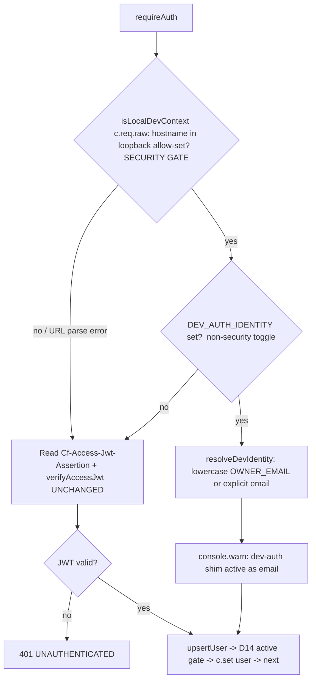

# Plan: Local-only development auth shim

Source of truth: `docs/dev-auth-shim-kickoff.md`. Branch: `feat/dev-auth-shim` off `main`.
Process: this plan → plan-review (gate: is the local-only gate un-forgeable and fail-closed?) → Coder → QA. **No production auth behavior changes by design.**

> **Amended (owner directive, resolving the plan-review Major).** The gate is now a **single load-bearing signal: the loopback request hostname.** The prior `request.cf` / `cf.colo` "keystone" (old Layer B) is **removed entirely** (see review Major and the Amendment log at the bottom for the one-line why). The `.dev.vars` sentinel is **demoted to a non-security on/off toggle + identity selector**. See §8 Amendment log for the full change list.

---

## 1. Problem statement and goals

`src/worker/auth.ts` enforces full Cloudflare Access JWT verification on every `/api/*` request (`requireAuth`, `src/worker/auth.ts:169-208`). Cloudflare Access only exists in front of the *deployed* Worker, so under `wrangler dev` on localhost there is no Access layer and every request fails with `401 UNAUTHENTICATED "Missing Access JWT"` (`src/worker/auth.ts:171-177`). This blocks all local manual QA and browser-driven testing (the previously-recorded gap), and will block the notifications + location feature which is frontend-heavy.

**Goals**

- In local development only, `requireAuth` accepts a simulated identity so the app is drivable end-to-end without a real Access token.
- The simulated identity flows through the **same** `upsertUser` path (`src/worker/auth.ts:187-192`) and produces the **same** `user` object the real path yields, so `requireAuth`, `requireAdmin`, the D14 active gate, and all routes behave identically.
- Default identity is `OWNER_EMAIL` (so admin / D14 paths are exercisable); a different test email can be selected via a mechanism that is only reachable once the local gate is already satisfied.
- **Non-negotiable:** the shim is provably impossible to activate against the deployed Worker. The gate fails closed — any doubt about locality means full Access verification runs.

## 2. Non-goals

- No change to `verifyAccessJwt` internals (issuer/aud/signature/exp) — `src/worker/auth.ts:72-149` stays byte-for-byte as-is.
- No change to `requireAdmin` (`src/worker/auth.ts:214-225`), the D14 active gate (`src/worker/auth.ts:198-203`), or the admin self-deactivation guard.
- No schema/migration change. No new feature code. No client (`web/src/`) change required (the client already sends normal requests; in local dev they simply succeed).
- No change to `wrangler.toml` `[vars]` (see §5 — deliberately never define the shim toggle in committed config).
- No production deploy of any auth behavior change.

## 3. Proposed design

### 3.1 The single load-bearing signal: the loopback request hostname

The security boundary is **one signal, fully reason-about-able in both directions**: the hostname the Worker was actually invoked on, read as `new URL(request.url).hostname`.

**Allow-set (exact, decided):** the shim's security gate returns `true` only when that hostname is one of:

```
"localhost"   |   "127.0.0.1"   |   "[::1]"
```

`URL.hostname` returns IPv6 literals **bracketed**, so the IPv6 loopback appears as the literal string `"[::1]"` (not bare `::1`). The bare `::1` form can never appear in a parsed `URL.hostname`, so it is intentionally omitted; including it would be dead code. These three are the complete set of hosts `wrangler dev` serves the Worker on locally.

**Why this is un-forgeable in production (forge-resistance — the load-bearing property).**
Cloudflare routes inbound traffic to the deployed Worker **by hostname**: the Worker is reachable only via its configured route/domain (the `workers.dev` hostname / custom domain in `wrangler.toml`, `APP_URL = https://family-scheduler.juniwar-dev.workers.dev`). A request whose hostname is a loopback literal (`localhost` / `127.0.0.1` / `[::1]`) is **never routed to the deployed Worker** — Cloudflare's edge matches routes on the real deployed hostname, so a request carrying a loopback host does not resolve to, and cannot be dispatched to, this Worker. Therefore `new URL(request.url).hostname` as observed *inside the deployed Worker* is always the deployed hostname, never a loopback literal. **This also closes the most sophisticated attacker angle — the SNI/`Host`(`:authority`) mismatch case:** an edge request whose `Host`/`:authority` does not match the Worker's routed authority (e.g. SNI is the workers.dev domain but the presented Host is `localhost`) is **rejected or normalized at the edge**, not dispatched to the Worker with a loopback authority. So there is no path that both routes to this Worker **and** yields `new URL(request.url).hostname === "localhost"`; client-supplied headers cannot drive `request.url` to contradict the dispatched hostname. An attacker cannot make `new URL(request.url).hostname === "localhost"` while still being routed to this Worker. This is the single check that carries the entire production-safety property.

**Why this is reliably true under `wrangler dev` (the functional direction).**
`wrangler dev` binds the local server to a loopback host and dispatches requests whose `request.url` hostname is `localhost` / `127.0.0.1` / `[::1]`. Unlike the removed `request.cf` signal, this holds regardless of wrangler/Miniflare version — the local server's bound host is definitional, not an implementation detail of an injected metadata object. So the gate is `true` locally and `false` in production, from **one** signal we can fully reason about, in both directions. (Review's own analysis reached the same conclusion: the loopback host is reliable in *both* directions; see review §"Is there a stronger/simpler signal?".)

**One signal beats two we cannot fully reason about.** The prior design AND-ed this host check with a `request.cf.colo` "edge keystone." That second signal's behavior under `wrangler ^4.0.0` local dev is unconfirmed and, per the review, **likely populated locally** (Miniflare attaches a placeholder `cf`, commonly `colo: "DFW"`) — which would have vetoed the shim *locally* and shipped a dead feature, while adding a failure mode we cannot prove either way. It is removed entirely (§8).

### 3.2 The `.dev.vars` sentinel is a non-security toggle — NOT a security layer

`DEV_AUTH_IDENTITY` (delivered via the gitignored `.dev.vars`, `.gitignore:4`) is **only**:

1. an **on/off convenience toggle** — unset/empty ⇒ shim off, the real Access path runs even locally; and
2. an **identity selector** — its value picks which test identity to assume.

It is explicitly **NOT load-bearing for the production-safety property.** The loopback-host check (§3.1) is the sole security boundary. **Even if an operator wrongly set `DEV_AUTH_IDENTITY` as a deployed secret** (`wrangler secret put`), every real request still arrives on the deployed hostname, so the host gate returns `false` and the shim stays inert — full `verifyAccessJwt` runs. The sentinel cannot re-open the gate.

Because the sentinel is not a security layer, it is read **only inside the already-gated branch**: the host check runs first; the sentinel value is consumed only after the host check has passed. In production the host check returns before the sentinel is ever read.

### 3.3 Why the anti-patterns are rejected

- **`DEV_MODE` / `BYPASS_AUTH` env var settable on the deployed Worker — REJECTED as the security gate.** From the Worker's perspective a `.dev.vars` value is indistinguishable from a deployed secret, so `DEV_AUTH_IDENTITY` is **never** the security boundary. It is a toggle read only *after* the un-forgeable loopback-host gate has already passed. The security property survives the sentinel being misconfigured as a prod secret (§3.2).
- **Trusting a client-supplied request header (e.g. `X-Dev-User`) — REJECTED.** No part of the gate reads a client header to decide locality. `new URL(request.url).hostname` reflects the routed hostname the Worker was invoked on, which Cloudflare will not route to a loopback literal (§3.1). Identity selection reads only the server-side `DEV_AUTH_IDENTITY` binding, and only *after* the host gate passes.
- **Absence-based / fail-open gate — REJECTED.** The gate is an affirmative proof of local (`hostname ∈ loopback allow-set`), else `false`. The default is always: run `verifyAccessJwt`. A URL-parse exception falls through to full verification (§3.4). No path defaults open.

### 3.4 Exact condition, evaluation order, and fail-closed walk

Two helpers matching the project's pure-function conventions. `isLocalDevContext` is the **injectable seam**: a pure boolean from the hostname alone, so the production-safety gate can be exercised (a) end-to-end through `requireAuth` and (b) as an isolated unit test.

```
// SECURITY GATE (the sole load-bearing signal). Pure; request-only.
isLocalDevContext(request): boolean
  let host: string
  try {
    host = new URL(request.url).hostname
  } catch {
    return false                                   // any URL/hostname parse error → fail closed
  }
  return host === "localhost" || host === "127.0.0.1" || host === "[::1]"

// Identity resolution. The sentinel (toggle + selector) is read ONLY after the gate passes.
resolveDevIdentity(env, request): string | null
  if (!isLocalDevContext(request)) return null     // SECURITY GATE first → fail closed
  const sel = env.DEV_AUTH_IDENTITY                 // read ONLY inside the gated branch (non-security)
  if (!sel) return null                             // toggle OFF (unset/empty) → real path runs
  // Lowercase BOTH branches for parity with the real path (auth.ts:142).
  const email = sel.includes("@") ? sel : env.OWNER_EMAIL
  return email.toLowerCase()
```

**Fail-closed boolean walk at the `src/worker/auth.ts:170` insertion point.** The shim branch is the first statement inside the `createMiddleware(async (c, next) => {` callback, **before** the `const token = …` read on line 171. It resolves an identity and returns only when **both**: (1) `isLocalDevContext(c.req.raw)` is `true` — hostname ∈ loopback allow-set, and (2) `DEV_AUTH_IDENTITY` is a non-empty value. In every other case — non-loopback host, URL parse error (caught → `false`), or toggle unset — `resolveDevIdentity` returns `null` and control falls through, **unchanged**, to the existing `Cf-Access-Jwt-Assertion` read + `verifyAccessJwt` block (lines 171-207). There is:

- **no absence-based fail-open** — activation requires an affirmative loopback host AND a present toggle;
- **no swallowed-exception fail-open** — the only exception source (`new URL(...)`) is caught and returns `false` (→ full verification), never activation;
- **no reachable production path that skips `verifyAccessJwt`** — production requests arrive on the deployed hostname, so the host gate returns `false` (§3.1) before the sentinel is even read.

### 3.5 requireAuth after the change (shim branch feeds the identical downstream path)

```
requireAuth(c, next):
  const devIdentity = resolveDevIdentity(c.env, c.req.raw)   // NEW — top of handler, before line 171
  if (devIdentity) {
    console.warn(`[dev-auth] shim active as ${devIdentity}`) // one-time activation log; email only, no secrets
    const user = await upsertUser(c.env.DB, devIdentity, c.env.OWNER_EMAIL, Date.now())  // SAME call as line 187
    if (!user.active) return 403 DEACTIVATED                 // SAME D14 gate (lines 198-203)
    c.set("user", user)                                      // SAME (line 205)
    return next()
  }
  // ---- everything below is the EXISTING code, unchanged (lines 171-207) ----
  const token = c.req.header("Cf-Access-Jwt-Assertion")
  if (!token) return 401 ...
  const result = await verifyAccessJwt(token, c.env)
  ...
```

The shim substitutes only the **identity source**. `upsertUser`, the D14 active check, and `c.set("user", …)` are the identical calls the real path uses, so `requireAdmin`, routes, and OWNER promotion behave identically. The `console.warn` fires only inside the already-gated branch: its **absence in deployed logs is a passive tripwire** — if `[dev-auth] shim active` ever appears in production logs, the gate has been breached and it is loud. It logs the resolved email only; it never logs the `DEV_AUTH_IDENTITY` binding contents beyond the (non-secret) identity email.

### 3.6 Gate decision flow



Production always follows the `G:no` edge to `verifyAccessJwt` (deployed hostname is never a loopback literal).

## 4. Affected files and modules

| File | Change | Locked? |
|------|--------|---------|
| `src/worker/auth.ts` | Add exported pure helpers `isLocalDevContext(request)` + `resolveDevIdentity(env, request)`; insert shim branch (with one-time `console.warn`) at top of `requireAuth`, before line 171. `verifyAccessJwt`, `requireAdmin`, D14 gate untouched. | `verifyAccessJwt` internals + authorization logic are locked and unchanged |
| `src/worker/env.ts` | Add optional `DEV_AUTH_IDENTITY?: string` to `Env`. | Not locked (type-only, additive) |
| `.dev.vars.example` | **APPEND** (do NOT overwrite) the `DEV_AUTH_IDENTITY` block alongside the existing `RESEND_API_KEY` / `VAPID_PRIVATE_KEY` entries. | Existing committed onboarding template — must be preserved |
| `wrangler.toml` | **No change.** Explicitly must NOT add `DEV_AUTH_IDENTITY` to `[vars]`. | — |
| `tests/unit/dev-auth-shim.test.ts` | **New** test file (see §7.1). Mounts the **real** `requireAuth` from `src/worker/auth.ts` — NOT the `testAuth` stub. | — |
| `docs/plans/dev-auth-shim.md` | This plan. | — |

Insertion point confirmed: `src/worker/auth.ts:170` (immediately inside `createMiddleware(async (c, next) => {`, before the `const token = …` on line 171).

## 5. Data model and API changes

- **No** schema/migration change; `users` table and `upsertUser` are untouched.
- **No** HTTP contract change: `/api/me` and all routes respond identically; only the identity source upstream differs, and only under the local host gate.
- **New binding:** `DEV_AUTH_IDENTITY` (optional string) — a **non-security toggle + selector** (§3.2). Provisioning: developers create a local `.dev.vars` (gitignored) containing e.g. `DEV_AUTH_IDENTITY="owner"`. Value semantics (evaluated only after the host gate passes):
  - contains `@` → treated as an explicit test email (lowercased) — exercises non-owner / member / deactivated flows;
  - any other non-empty value (e.g. `owner`) → resolves to `OWNER_EMAIL` (lowercased) → admin/D14 paths;
  - unset/empty → toggle off → real verification even locally.
- **`.dev.vars.example` — APPEND, do NOT clobber.** The file already exists (`RESEND_API_KEY`, `VAPID_PRIVATE_KEY`). The Coder must **add** the following block to the end of the existing file, leaving the existing entries and header intact:
  ```
  # Local-only dev auth shim (NON-SECURITY toggle). Loaded by `wrangler dev`, never deployed.
  # SECURITY: the shim's only security gate is the loopback request hostname (localhost/127.0.0.1/[::1]);
  # this toggle just switches the shim on locally and picks the identity. Setting it as a deployed
  # secret does NOT enable any bypass — the host gate keeps the shim inert in production.
  # Do NOT add this to wrangler.toml. Unset/empty => real Access verification even locally.
  #   "owner"            -> authenticate as OWNER_EMAIL (admin)
  #   "member@test.dev"  -> authenticate as that email (non-admin/member)
  DEV_AUTH_IDENTITY="owner"
  ```

## 6. Risks, edge cases, and open questions

- **Operator sets `DEV_AUTH_IDENTITY` as a prod secret (misconfiguration).** Non-issue for the security property: the loopback-host gate returns `false` for all deployed traffic regardless of the sentinel (§3.2). The `console.warn` tripwire would also surface it loudly if it somehow fired. Documented in the appended `.dev.vars.example` note.
- **`wrangler dev --remote` (edge preview).** Safe, but **not** because the hostname is necessarily non-loopback — depending on how the `--remote` proxy forwards `Host`/`:authority`, the edge Worker could in principle observe `localhost`. The correct reason it is not a production concern is that `--remote` is a **developer-authenticated, non-public preview context** (reachable only through the developer's own authenticated wrangler session, not a public URL; `wrangler.toml` sets `preview_urls = false`) combined with the **operator-controlled local `DEV_AUTH_IDENTITY` toggle** (a local `.dev.vars` value the developer themselves sets). Even in the corner case where the proxy forwards `Host: localhost` and the shim activates, it is the developer authenticating as their own chosen identity in their own preview — not a public bypass. **And regardless, the production-safety property for the DEPLOYED public Worker is entirely unaffected:** real public traffic arrives on the deployed hostname → host gate `false` → shim inert → full verification. The project's `dev`/`preview` scripts use local mode.
- **Host controllability in the vitest/miniflare harness — CONFIRMED.** The existing tests call `app.fetch(new Request(url, …), env)` directly (`tests/unit/auth-deactivated.test.ts:115`, `tests/unit/routing.test.ts:107`) with a JS-constructed `Request`. `request.url` is exactly the URL string passed to `new Request(...)`, so `new URL(request.url).hostname` is fully controlled by the test URL. This makes DC2 runnable **end-to-end through the real `requireAuth`**: a loopback URL activates the (host-gated) shim; a deployed-host URL forces full verification. No `cf` dependency remains, so there is no harness `cf` fragility.
- **`[::1]` host form** is handled explicitly (bracketed, as `URL.hostname` emits it).
- **Cron / scheduled handler** (`src/worker/index.ts:66-83`) does not pass through `requireAuth`, so it is unaffected.
- **Open question (non-blocking):** single var (`DEV_AUTH_IDENTITY`) doubles as toggle + selector (recommended, minimal surface). Because it is no longer a security layer, splitting it buys nothing; keeping one var. If plan-review disagrees, split into `DEV_AUTH` (toggle) + `DEV_AUTH_EMAIL` (selector), both still read only inside the host-gated branch; behavior identical.

No blocker: the loopback-host signal is genuine, un-forgeable in production (routing is by hostname), and reliably true under `wrangler dev` independent of wrangler version. This proceeds.

## 7. Step-by-step implementation checklist for the Coder

1. `src/worker/env.ts`: add `DEV_AUTH_IDENTITY?: string;` to the `Env` interface with a `// local-only dev auth shim toggle; NOT a security layer — host gate in auth.ts is the boundary` comment (the WHY).
2. `src/worker/auth.ts`: add exported pure helpers `isLocalDevContext(request: Request): boolean` and `resolveDevIdentity(env: Env, request: Request): string | null` exactly per §3.4. Comment the WHY: `isLocalDevContext` = the sole un-forgeable production-safety gate (routing is by hostname); the sentinel is a non-security toggle read only after the gate passes. Ensure the `new URL(...)` call is inside `try { … } catch { return false }` (fail closed).
3. `src/worker/auth.ts`: insert the shim branch at the top of `requireAuth` (before line 171) per §3.5, including the one-time `console.warn(\`[dev-auth] shim active as ${devIdentity}\`)` (log the resolved email only — never the raw binding or any secret). Do **not** modify `verifyAccessJwt`, `requireAdmin`, the D14 gate, or the existing token/verify block below the branch.
4. Confirm email-lowercase parity: the real path lowercases the JWT email at `src/worker/auth.ts:142` (`return { ok: true, value: { email: email.toLowerCase() } }`). `resolveDevIdentity` must lowercase **both** branches (explicit email and the `OWNER_EMAIL` default) to match — done via the single `email.toLowerCase()` return in §3.4.
5. **APPEND** the `DEV_AUTH_IDENTITY` block to the existing `.dev.vars.example` per §5 — do NOT overwrite the file or drop the `RESEND_API_KEY` / `VAPID_PRIVATE_KEY` entries. Do **not** create `.dev.vars` (developer-created, gitignored). Do **not** touch `wrangler.toml`.
6. Run `npm run typecheck` and `npm run lint` (per CLAUDE.md, after each meaningful change). Confirm `tsc --noEmit` accepts the `Request` typing of the helpers (no unguarded property access).
7. Add `tests/unit/dev-auth-shim.test.ts`. **CRITICAL — the load-bearing safety tests must exercise the REAL gate, not a stub.** Reuse from `tests/unit/auth-deactivated.test.ts` **only the harness mechanics**: the `cloudflare:test` `env`, the `applyMigrations(db)` helper, and the `app.fetch(new Request(url, …), mergedEnv)` call pattern. **Do NOT copy that file's `testAuth` stub middleware** (`auth-deactivated.test.ts:33-50`, mounted via `app.use("/api/*", testAuth)`) — that stub replaces `requireAuth` with a header-driven fake and never touches the shim gate or `verifyAccessJwt`. If T3/T4/T5 were run against the stub they would prove **nothing** about the shipped gate — a silent, load-bearing hole in an auth-bypass-adjacent feature. Instead, the new test **imports the real `requireAuth` from `src/worker/auth.ts`** and mounts it exactly as the production app wires it — `app.use("/api/*", requireAuth)` (mirroring `src/worker/index.ts`) — then routes `/api/me` (and, if useful, an admin route) behind it. Cover §7.1. Determinism note: T3 and T4 present **no** `Cf-Access-Jwt-Assertion` header, so once the shim declines to activate, `requireAuth` short-circuits at the "Missing Access JWT" 401 (`auth.ts:172-177`) **before** any `getAccessKeys`/JWKS fetch — so no live Access deployment or JWKS shaping is needed; the tests are deterministic. (T3 additionally proves the real loopback-host gate falls through to that real 401 path even with the sentinel present.)
8. Run `npm test`; confirm the new tests pass and existing tests stay green.
9. Manual (DC4): append `DEV_AUTH_IDENTITY="owner"` to a local `.dev.vars`, `npm run dev`, load the app, confirm `/api/me` returns the owner and admin paths render; this unblocks local browser QA.

### 7.1 Test list mapped to done-conditions (host-based)

> **All DC1/DC2 tests run through the REAL `requireAuth`** (imported from `src/worker/auth.ts` and mounted via `app.use("/api/*", requireAuth)`), never the `testAuth` stub (see step 7). T5 additionally unit-tests the `isLocalDevContext` seam in isolation.

**DC1 — Local works (shim active on loopback host):**
- `T1` Local happy path (owner): env `{ DEV_AUTH_IDENTITY: "owner", OWNER_EMAIL }`, request `http://localhost/api/me`, **no** JWT header → `200`, `body.user.email === OWNER_EMAIL` (lowercased), `role === "admin"`, `active === true`.
- `T2` Local selection (non-owner) + D14 parity: env `{ DEV_AUTH_IDENTITY: "member@test.dev", OWNER_EMAIL }`, request `http://127.0.0.1/api/me`, no JWT → `200`, `user.email === "member@test.dev"`, `role === "member"`. Then deactivate that user and re-request → `403 DEACTIVATED`. **This confirms the shimmed path still hits the D14 active-gate** (the shim substitutes identity SOURCE only, not authorization).

**DC2 — LOAD-BEARING production-safety (each fails if the host gate is later loosened). These MUST mount the real `requireAuth`; against the `testAuth` stub they would pass vacuously and prove nothing:**
- `T3` (deployed host, sentinel PRESENT — worst case) end-to-end through the **real** `requireAuth`: env `{ DEV_AUTH_IDENTITY: "owner", OWNER_EMAIL }`, request to a deployed-style host `https://family-scheduler.juniwar-dev.workers.dev/api/me` (a non-loopback host such as `https://scheduler.<domain>/...` is equivalent), no JWT → `401 UNAUTHENTICATED "Missing Access JWT"`. Proves that on a deployed host the real loopback-host gate returns `false` (so the shim is **inert even with the sentinel set**) and control falls through to the real `verifyAccessJwt` block, which short-circuits at the missing-JWT 401 before any JWKS fetch. Fails if the host gate is removed or the gate becomes sentinel-only. Runnable in the vitest-pool-workers/miniflare harness because host is controllable via the request URL (§6 — confirmed).
- `T4` (loopback host, sentinel UNSET — no accidental activation), through the **real** `requireAuth`: env **without** `DEV_AUTH_IDENTITY` (matching deployed `wrangler.toml` `[vars]`). The test must **explicitly assert/ensure `DEV_AUTH_IDENTITY` is unset** in the merged `env` (do not merely assume the base `cloudflare:test` env omits it) so the non-activation is unambiguously attributable to the missing toggle rather than to the host — this cleanly exercises the `if (!sel) return null` toggle-off branch. Request `http://localhost/api/me`, no JWT → `401 UNAUTHENTICATED`. Proves that on a loopback host the toggle absence still forces full verification. Fails if the gate ever defaults open.
- `T5` (seam unit test) — `isLocalDevContext` in isolation:
  - `isLocalDevContext({ url: "https://family-scheduler.juniwar-dev.workers.dev/api/me" } as unknown as Request) === false`
  - `isLocalDevContext({ url: "http://localhost/api/me" } as unknown as Request) === true`
  - `isLocalDevContext({ url: "http://127.0.0.1:8787/api/me" } as unknown as Request) === true`
  - `isLocalDevContext({ url: "http://[::1]/api/me" } as unknown as Request) === true`
  - `isLocalDevContext({ url: "not a url" } as unknown as Request) === false` (parse exception → fail closed)

**DC3 — Existing tests unchanged:** `npm test` keeps `tests/unit/auth-deactivated.test.ts` and `tests/unit/routing.test.ts` green (they use their own middleware / stubbed user and never exercise `requireAuth`, so the shim cannot affect them). QA must confirm.

**DC4 — Manual local drive:** per checklist step 9; QA sign-off must explicitly include that the shim is inert against the simulated deployed context (T3/T4).

## 8. Amendment log

- **Loopback host promoted to the SOLE primary keystone.** Security boundary is `new URL(request.url).hostname ∈ {"localhost","127.0.0.1","[::1]"}`. Un-forgeable in production because Cloudflare routes to the deployed Worker by hostname (a loopback host never reaches it), and reliably true under `wrangler dev` independent of wrangler/Miniflare version.
- **`request.cf` / `cf.colo` signal (old Layer B) dropped entirely.** Why: its behavior under `wrangler ^4.0.0` local dev is unconfirmed and likely populated locally (Miniflare placeholder, often `colo: "DFW"`) — which would have made the original gate a no-op locally, shipping a dead feature — so it added a failure mode without adding provable safety. One signal we can fully reason about beats two we cannot.
- **`.dev.vars` sentinel (`DEV_AUTH_IDENTITY`) demoted to a non-security on/off toggle + identity selector.** It is explicitly NOT load-bearing for production-safety; the host gate keeps the shim inert even if the sentinel were set as a deployed secret. Read only inside the already-host-gated branch.
- **`.dev.vars.example` — APPEND, not clobber.** Add the `DEV_AUTH_IDENTITY` block alongside the existing `RESEND_API_KEY` / `VAPID_PRIVATE_KEY` entries (review Minor: the file already exists; a Write would have destroyed it).
- **Activation logging added.** One-time `console.warn("[dev-auth] shim active as <email>")` inside the gated branch; logs the resolved email only, never secrets. Its absence in production logs is a passive tripwire.
- **Email-lowercase parity.** Real path lowercases the JWT email at `src/worker/auth.ts:142`; `resolveDevIdentity` now lowercases **both** the explicit-email and `OWNER_EMAIL` branches to match.
- **Injectable seam + host-based safety test.** `isLocalDevContext(request)` is a pure boolean seam so the production-safety gate is exercised end-to-end through `requireAuth` (T3/T4, host controllable via request URL) and as an isolated unit (T5).
- **Pass-2 fixes (test-integrity + rationale, no gate-design change).**
  - **Real-`requireAuth` test harness (Pass-2 #1, Major/test-integrity).** §4 table, step 7, and §7.1 now state explicitly that `tests/unit/dev-auth-shim.test.ts` imports and mounts the **real** `requireAuth` from `src/worker/auth.ts` via `app.use("/api/*", requireAuth)` (mirroring `src/worker/index.ts`), reusing from `auth-deactivated.test.ts` only the `cloudflare:test` env / `applyMigrations` / `app.fetch` mechanics — and must NOT copy that file's `testAuth` stub. Copying the stub would neuter the load-bearing DC2 safety tests (T3/T4/T5) into a silent hole. Added the determinism note that T3/T4 short-circuit at the missing-JWT 401 before any JWKS fetch.
  - **`--remote` safety rationale corrected (Pass-2 #2, Minor).** §6 no longer rests on "hostname necessarily non-loopback." It now rests on: developer-authenticated, non-public preview context + operator-controlled local `DEV_AUTH_IDENTITY` toggle, and notes the deployed public Worker's production-safety property is unaffected regardless.
  - **§3.1 SNI/Host-mismatch nit + T4 sentinel-unset assertion (Pass-2 #3, Nit).** §3.1 now names the SNI-vs-`Host`/`:authority` mismatch case and Cloudflare's edge reject/normalize behavior. §7.1 T4 now explicitly asserts/ensures `DEV_AUTH_IDENTITY` is unset in the merged env so the toggle-off branch is exercised unambiguously.

---

Sources (Cloudflare docs consulted; note the security property no longer depends on `.dev.vars` provenance — the loopback host is the boundary):
- [`.dev.vars` is local-only, never deployed — Environment variables · Cloudflare Workers docs](https://developers.cloudflare.com/workers/configuration/environment-variables/) — supports the toggle being convenient (normally absent in prod), not the security gate.
- [Secrets (local `.dev.vars` vs `wrangler secret put`) · Cloudflare Workers docs](https://developers.cloudflare.com/workers/configuration/secrets/)
