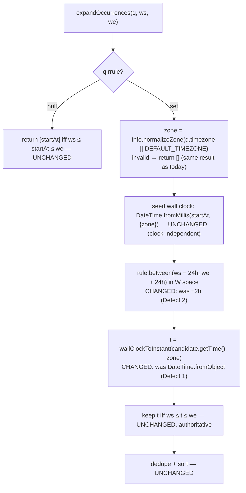

# Plan: fix/dst-fallback-ambiguous-time — clock-independent fall-back resolution + wall-clock window fix

- **Slug:** `dst-fallback-ambiguous-time` (the caller specified this path. The branch is already
  `fix/dst-fallback-ambiguous-time`, so the `fix-` convention is carried by the branch name.)
- **Type:** Bug fix, Worker only. Two defects in one function, both in scope by owner decision
  (2026-11-13).
- **Bug report:** `docs/bugs/dst-fallback-ambiguous-time.md`
- **Investigation:** `docs/bugs/dst-fallback-ambiguous-time-investigation.md`. I re-verified it
  against the code and found it correct on both mechanisms. §1.3 lists the claims I found wrong or
  incomplete.
- **Design decisions touched:** D10 and D11 in `docs/plans/family-scheduler-design.md`
  (`**D10 — Recurrence/timezone math approach` and `**D11 — Timezone conversion dependency`).
- **Touches `web/src/**`?** **No.** See AC-7 (§10.1) for what that means for e2e.
- **Revision:** v2, revised after `docs/reviews/dst-fallback-ambiguous-time-review.md` (round 1,
  APPROVE WITH CHANGES). §12 lists the changes per finding.
- **Path convention for citations:** `materialize.ts` and `send.ts` are
  `src/worker/reminders/materialize.ts` and `src/worker/reminders/send.ts`. `routes/items.ts`,
  `db.ts`, `config.ts`, `index.ts` and `recurrence.ts` are under `src/worker/`.

---

## 0. Referent table (every figure in this plan cites a row)

| Sym | What it measures | Units | Artifact | Extent / band | Tag / method |
|---|---|---|---|---|---|
| **W** | Candidate **wall-clock** time: an epoch value whose *UTC fields* equal the local wall-clock fields in the item's zone. This is what `rule.between` returns, i.e. `candidate.getTime()` | ms | `recurrence.ts` (`:48-57` builds DTSTART this way, `:73` produces candidates) | one candidate | definition |
| **t** | **Real instant** of an occurrence | UTC epoch ms | `expandOccurrences` output. Stored as `reminder_dispatch.occurrence_at` and `item_occurrence_state.occurrence_at` | one occurrence | definition |
| **off(x)** | The zone's UTC offset **at real instant x**, with local = UTC + off (so PST = −8 h) | h in prose, **minutes** in luxon `Zone#offset(ts)` | luxon `Zone#offset` | at instant x. **Not** the offset at "now", and **not** the offset at W read as an instant | definition |
| **ws, we** | Window bounds passed by the caller, real UTC, **inclusive** | ms | `expandOccurrences(q, windowStart, windowEnd)` | per call | definition |
| **B_old** | Current pre-filter buffer, applied **in W space** | 2 h | `recurrence.ts:61` `const bufferMs = 2 * 60 * 60 * 1000` | each end of the window | [quoted] |
| **B_new** | Proposed pre-filter buffer, applied in W space | 24 h | new code | each end of the window | [chosen] (§4.3) |
| **OFF_E / OFF_W** | Largest east and west real UTC offsets | +14 h (`Pacific/Kiritimati`). −11 h for the westernmost inhabited zone (`Pacific/Pago_Pago`); −12 h for `Etc/GMT+12` | tzdata | n/a | [quoted, tzdata, not measured here] |
| **Lost_start** | Length of the window's start that the pre-filter silently drops when off < −B_old | = \|off\| − B_old | h | LA: **5 h** (PDT), **6 h** (PST) | derived from code. Matches investigation probe D [measured there] |
| **Lost_end** | Length of the window's end that is dropped when off > +B_old | = off − B_old | h | Tokyo (+9): **7 h** | derived from code. **Not** run by the investigation ("Could not verify") |
| **L** | `LOOKAHEAD_DAYS` | 60 d | `src/worker/config.ts:8` | materialize window `[now, now + L]` | [quoted] |
| **G** | `GRACE_MINUTES` | 30 min | `src/worker/config.ts:9` | `sendDue` sends iff `now − G < fire_at ≤ now` | [quoted] |
| **CLOCK_S** | Pinned luxon clock, northern summer: `Date.UTC(2026, 6, 15, 12, 0)`. LA is on PDT, Sydney on AEST | ms | tests | n/a | [chosen] |
| **CLOCK_W** | Pinned luxon clock, northern winter: `Date.UTC(2026, 0, 15, 12, 0)`. LA is on PST, Sydney on AEDT | ms | tests | n/a | [chosen] |

**Epoch constants.** I computed each one by hand from `2026-01-01T00:00Z = 1767225600 s` plus day
counts, and cross-checked E1 against the bug report. The SQL in §4.8 includes a self-check query
(Q-0) that recomputes them inside D1.

| Id | Expression | Value (ms) | Meaning |
|---|---|---|---|
| E1 | `Date.UTC(2026,10,1,8,30)` | 1793521800000 | Nov 1 2026, 01:30 **PDT**, the earlier instant (D10's answer) [quoted, bug report, re-derived] |
| E2 | `Date.UTC(2026,10,1,9,30)` | 1793525400000 | Nov 1 2026, 01:30 **PST**, the later instant (rejected) |
| E3 | `[Date.UTC(2026,10,1,8,0), Date.UTC(2026,10,1,9,0))` | [1793520000000, 1793523600000) | LA 2026: the **earlier-instant** hour (01:00–01:59 PDT) |
| E4 | `[Date.UTC(2026,10,1,9,0), Date.UTC(2026,10,1,10,0))` | [1793523600000, 1793527200000) | LA 2026: the **later-instant** hour (01:00–01:59 PST). Fixed code never emits a recurring LA occurrence here |
| E5 | `[Date.UTC(2027,10,7,9,0), Date.UTC(2027,10,7,10,0))` | [1825578000000, 1825581600000) | LA 2027 later-instant hour. Nov 7 2027 is the first Sunday of November |
| E6 | E5.start − L | 2027-09-08T09:00Z | First materialize tick whose window can reach E5 |

---

## 1. Root cause (verified against the code, not taken on trust)

### 1.1 Defect 1: the ambiguous fall-back hour resolves by the date the code runs

`expandOccurrences` maps each candidate W to a real instant with
`DateTime.fromObject({...fields of W...}, { zone: tz })` (`src/worker/recurrence.ts:80-90`). In
luxon 3.7.2, `fromObject` seeds its offset guess with `zoneToUse.offset(Settings.now())`
(`node_modules/luxon/src/datetime.js:800-803`). It reads the clock on **every call**; there is no
cache on this path. `fixOffset` (`datetime.js:102-125`) returns the first self-consistent
candidate. Both offsets are self-consistent for an ambiguous wall time, so the guess decides the
result, and the guess is the offset in force **at the moment the code runs**.

- LA, Nov 1 01:30: a PDT clock gives E1, a PST clock gives E2. This is the investigation's mechanism,
  and I confirmed it in the source.
- **The defect is not specific to the northern hemisphere.** For `Australia/Sydney` the season
  mapping is reversed. A July clock (AEST, +10) picks the later instant and a January clock (AEDT,
  +11) picks the earlier one. U2 (§7) depends on this.
- The spring-forward gap is clock-independent. In the hole branch (`datetime.js:123-124`), luxon
  returns `localTS − min(o2, o3)`, which does not depend on the guess. The investigation's sweep
  confirms this.

### 1.2 Defect 2: the window pre-filter compares wall-clock time with real UTC

`rule.between(new Date(ws − B_old), new Date(we + B_old), true)` (`recurrence.ts:61-63`, `:73`)
filters **W**, but `ws`/`we` are **real** instants. Since t = W − off(t):

- **Start of window.** A candidate survives iff W ≥ ws − B_old, which is t ≥ ws − B_old − off. For
  off < −B_old (every zone west of UTC−2), occurrences with t in `[ws, ws + |off| − B_old)` are
  dropped. That interval is Lost_start: **5 h PDT / 6 h PST** for LA.
- **End of window.** A candidate survives iff W ≤ we + B_old, which is t ≤ we + B_old − off. For
  off > +B_old (every zone east of UTC+2), occurrences with t in `(we − (off − B_old), we]` are
  dropped. That interval is Lost_end: **7 h** for Tokyo.
- The real-instant filter at `:102` comes last and is correct. It cannot restore candidates that
  were never generated.

### 1.3 Investigation claims I found wrong or incomplete

1. **"The UNTIL rule (N6) is evaluated in the real-instant space, so it is unaffected."** The premise
   is **wrong**. `recurrence.ts` contains no UNTIL logic. `rrule` applies `UNTIL` inside `between`
   (`:73`) against **wall-clock-as-UTC** candidates. Line `:102` is only the window filter, and the
   comment at `:100-101` mislabels it as the N6 check. The conclusion still holds: rrule enforces
   UNTIL whatever the query window is, so widening the window does not change UNTIL behaviour. But
   D10's N6 rule (compare the UTC-mapped instant with UNTIL) **is not implemented**, and the
   existing N6 test (`tests/unit/recurrence.test.ts:78-108`) cannot tell the two semantics apart.
   This is out of scope; see OQ-1.
2. **"Past-`fire_at` rows are left inert by send's grace window, so this should not cause a flood."**
   This is **incomplete**. Rows with `fire_at` in `(now − G, now]` are **sent in the same tick**,
   because `index.ts:75-76` runs `sendDue` right after `materialize`. The number is bounded and the
   behaviour is intended (§4.7), but those rows are not inert.
3. **Completion row of the regression table ("existing `item_occurrence_state` rows for that instant
   become unmatched").** This is true, but it is observable **only for future-dated rows**.
   `item_occurrence_state` has one reader, `getCompletedOccurrences` (`db.ts:1363-1374`), and its
   only caller is `materialize.ts:46`, which only looks at occurrences ≥ now. The calendar route
   never reads completion state. So past rows, including any for Nov 1 2026, have no effect, and
   no repair is ever needed for them (§4.8).
4. **Fix option (b), "use luxon's `specificOffset` option".** This is an **undocumented internal**
   option. `@types/luxon` 3.7.2 has no `specificOffset` declaration (a grep of
   `node_modules/@types/luxon` finds none), so using it would need a cast and would depend on luxon
   internals within a `^3.5.0` range. I rejected it (§4.2).
5. **Incorrect comments beyond `:9` and `:92-94`.** `:8` names luxon as the mechanism, `:10` and
   `:100-101` claim UTC-space UNTIL handling, `:59-60` justifies a 2 h buffer as a DST allowance,
   and `:107` says the dedupe handles fall-back. In fact the dedupe handles **spring-forward**
   collisions for sub-daily rules: once the earlier instant is always chosen, fall-back cannot
   produce duplicates. All of these are corrected in §4.5.

I did **not** verify the investigation's git-history claims (no shell access).

---

## 2. Problem statement and goals

1. **G1.** A wall-clock time in a fall-back overlap always resolves to the **earlier** instant (D10),
   in every zone and hemisphere, **whatever the clock reads when the code runs**.
2. **G2.** `expandOccurrences(q, ws, we)` returns **every** occurrence with ws ≤ t ≤ we, for every
   real zone (offsets −12 h … +14 h), at both ends of the window.
3. **G3.** Spring-forward behaviour is unchanged: a gap time shifts forward by the gap (D10). §4.4
   proves this by argument and by tests that run under both clocks.
4. **G4.** All four consumers change together, because the fix stays inside `expandOccurrences`:
   materialize, digest, the calendar route, and the completion key. Each behaviour change is stated
   in §4.7.
5. **G5.** The tests are clock-independent and fail on the current code; §7 has the expected
   red/green pattern for the unfixed code. The suite stops being red from November to March.
6. **G6.** The misleading comments in `recurrence.ts` are corrected (§4.5).

## 3. Non-goals

- **Changing UNTIL semantics** (§1.3 item 1, OQ-1). The new code must leave UNTIL exactly as it is
  today: rrule applies it in wall-clock space.
- Changing the non-recurring path (`recurrence.ts:37-40`), `computeFireAt`, `materialize`, `send.ts`,
  `routes/items.ts`, `db.ts`, or any `web/src/**` file.
- Validating `timezone` on input. `isValidTimezone` exists but has no caller; that is a separate
  issue.
- Skipping the insert of reminder rows whose `fire_at` is already older than G (§4.7, option G2,
  rejected). It would change non-recurring behaviour as well.
- Fixing the `inserted` counter in `materialize.ts`, which counts insert *attempts* including
  ignored ones (OQ-5).
- A lint rule banning `DateTime.fromObject`/`DateTime.local` in `src/worker` (OQ-2, recommended as a
  follow-up).
- Client-side conversion (`ItemEditor`, `duplicateItem`). The investigation shows it does not depend
  on the clock.

---

## 4. Proposed design

### 4.1 Overview



Only one file changes: `src/worker/recurrence.ts`. No dependencies are added; luxon stays, per D11.

### 4.2 Decision 1: how a wall-clock time becomes an instant (Defect 1)

| Option | Mechanism | Clock-independent? | Verdict |
|---|---|---|---|
| **A1. Explicit resolver on `Zone#offset(ts)`** | Read the offsets **a day before and a day after** W. Each offset gives one candidate instant. Keep the self-consistent candidates; for an overlap take the earlier, for a gap shift forward. This is the same approach as Temporal's `"compatible"` disambiguation | **Yes.** `Zone#offset(ts)` is a pure function of its argument (`IANAZone.js:183-208`) | **Chosen** |
| A2. `DateTime.fromObject(obj, { zone, specificOffset: offBefore })` | Seeds luxon's guess deterministically | Yes | Rejected. Undocumented option, missing from `@types/luxon` (§1.3 item 4), and fragile across minor versions. Tests cannot tell it apart from A1; the rejection rests on maintainability, not output |
| A3. Keep `fromObject`, then post-correct by checking whether `t − 1h` has the same wall fields | Patch after the fact | Partly. Still runs the clock-dependent path | Rejected. Assumes a 1 h DST delta (Lord Howe uses 30 min) and keeps the hazard in the code |
| A4. Replace luxon with raw `Intl.DateTimeFormat` probing | Hand-rolled | Yes | Rejected. Contradicts D11 for no gain, since A1 already uses only the clock-free part of luxon |
| A5. Pin `Settings.now` globally in production to a fixed summer instant | Makes the guess constant | Yes, but **wrong** | Rejected. A northern-summer pin chooses the **later** instant for southern-hemisphere zones (§1.1). **U2 goes red on this build**, so the tests separate A1 from A5 |

**Algorithm (A1).** The new function is module-private in `recurrence.ts` and is tested through
`expandOccurrences`. It is not exported, because tests of a new export cannot be red on the current
code.

```ts
import { DateTime, IANAZone, Info, type Zone } from "luxon";

const MINUTE_MS = 60 * 1000;
const DAY_MS = 24 * 60 * MINUTE_MS;

// D10, made explicit and clock-independent. Do NOT use DateTime.fromObject here: its offset guess
// comes from Settings.now(), so an ambiguous time resolves by the date the code runs
// (docs/bugs/dst-fallback-ambiguous-time.md).
function wallClockToInstant(wallMs: number, zone: Zone): EpochMs {
  // Offsets in force well before and well after wallMs. A transition near wallMs lies between them.
  const offBefore = zone.offset(wallMs - DAY_MS); // minutes
  const offAfter = zone.offset(wallMs + DAY_MS);
  if (offBefore === offAfter) {
    return (wallMs - offBefore * MINUTE_MS) as EpochMs; // no transition nearby (the common case)
  }
  const valid = [offBefore, offAfter]
    .map((off) => ({ off, t: wallMs - off * MINUTE_MS }))
    .filter(({ off, t }) => zone.offset(t) === off)
    .map(({ t }) => t);
  if (valid.length > 0) return Math.min(...valid) as EpochMs; // overlap → earlier instant (D10)
  return (wallMs - offBefore * MINUTE_MS) as EpochMs;        // gap → shift forward by the gap (D10)
}
```

The Coder may restructure this, but the following properties are required:

- **(a)** No call to `DateTime.fromObject`, `DateTime.local` or `DateTime.now` anywhere in
  `recurrence.ts`.
- **(b)** The zone comes from `Info.normalizeZone(tz)` (public API, `@types/luxon` `info.d.ts:71`).
  It applies the same parsing as the current `fromObject`/`fromMillis` calls (`zoneUtil.js:13-34`):
  IANA names, `"utc"`, fixed offsets like `"UTC+5"`, and `"local"`/`"system"`. Using
  `IANAZone.create` instead would **regress** fixed-offset strings to `[]`.
- **(c)** `if (!zone.isValid) return [];` goes **after** the non-recurring early return, so the
  non-recurring path is untouched. Today an invalid zone already yields `[]`, by a different route:
  the invalid seed makes `dtstart.toISOString()` throw inside the `try` at `:66-71`. The result is
  the same.
- **(d)** Pass `candidate.getTime()` as `wallMs`. It equals `Date.UTC(getUTC*(...))` for these
  candidates, so the field decomposition at `:81-88` becomes unnecessary.
- **(e)** The seed (`:43`) keeps `DateTime.fromMillis(q.startAt, { zone })` with the normalized
  zone. `fromMillis` reads `zone.offset(startAt)` and does not depend on the clock.

**Assumption:** a zone has at most one transition inside the ±1 day sample around W. This
holds for every zone for current and future dates (Temporal makes the same assumption). If it ever
failed, the effect would be the gap branch's answer, not a crash.

**CPU.** The fast path makes 2 `offset()` calls per candidate. The current code makes at least 2:
the `offset(Settings.now())` guess plus one in `fixOffset`. Near a transition the new code makes 3–4
calls. The per-candidate cost therefore stays the same or drops. This was **not measured**
(Risk K4).

### 4.3 Decision 2: the window pre-filter (Defect 2)

| Option | Mechanism | Verdict |
|---|---|---|
| **W1. Widen the W-space query by a fixed buffer B_new = 24 h at each end** | rrule over-generates by about a day at each end. The real-instant filter at `:102` stays authoritative | **Chosen.** Short, zone-agnostic, and does not depend on resolving offsets at the window bounds |
| W2. Convert ws/we to W space exactly (`ws + off(ws)`, `we + off(we)`), plus a DST-delta margin | Precise | Rejected. More code and more edge cases, such as a bound inside a gap or overlap, or DST deltas of 30 min or 2 h. It gains nothing because `:102` decides anyway. Tests cannot tell it apart from W1, since both are correct; the rejection rests on simplicity |
| W3. Use rrule's native `tzid` | Real-time expansion | Rejected by D10 ("`rrule`'s native tz handling is limited, so do not rely on it for DST") |

**Why 24 h.** The start end needs B ≥ \|OFF_W\|, up to 12 h. The end needs B ≥ OFF_E = 14 h. A
24 h buffer covers both with at least 10 h to spare. The investigation's suggestion of "about
±14 h" would also work, but with zero margin on the east side. U11 and U12 test the buffer itself
rather than its output: each places an occurrence exactly on a window bound in an extreme zone, so
each has a minimum buffer below which it fails. Those minimums are stated once, in the U11/U12 rows
of §7.2.

**Cost.** For a daily rule over the 60-day materialize window, the wider query adds about 2
candidates, roughly 3 %. `rule.between` iterates from DTSTART anyway, so its cost depends mainly on
how long the series has run, not on window width.

**UNTIL and COUNT are unaffected.** rrule applies both independently of the query window, so
widening the window cannot add an occurrence past UNTIL or beyond COUNT (§1.3 item 1).

### 4.4 Decision 3: spring-forward is unchanged, and how that is proven

- **Argument.** For a gap, no candidate is self-consistent, and A1 returns `W − offBefore`. Luxon's
  hole branch returns `localTS − min(o2, o3)`. Across a gap the offset increases, so the minimum is
  the pre-transition offset, `offBefore`. **The results are identical.** For every non-ambiguous,
  non-gap W exactly one offset is self-consistent. Luxon converges to it, and A1 returns it through
  the fast path or the filter. **So the only output that changes is the choice inside an overlap.**
- **Tests.** U4 (LA, existing case (i), both clocks), U6 (Berlin, east of UTC, both clocks) and U5
  (Mar 8 quarter-hour sweep, both clocks) are GUARDS, green on today's code. Sabotage S2 (gap →
  `offAfter`) turns U4 and U6 red (§7.5).

### 4.5 Decision 4: comment corrections in `recurrence.ts` (comments only, no behaviour)

| Where | Current claim | Replace with (intent; the Coder words it) |
|---|---|---|
| `:8` | gap → "shift forward by the gap (luxon default)" | gap → shift forward by the gap, **done explicitly by `wallClockToInstant`** |
| `:9` | overlap → "choose the earlier of the two instants (luxon default)" | overlap → the earlier instant, **chosen explicitly**. Not luxon's default: `DateTime.fromObject` picks the offset in force at `Settings.now()`, i.e. it depends on the date the code runs (cite this plan) |
| `:10` | "UNTIL: compare each candidate's UTC-mapped instant against the UNTIL UTC instant (N6)" | UNTIL is applied **by rrule in wall-clock space**. That differs from D10/N6, which is not implemented; see this plan's OQ-1 |
| `:59-60` | "DST shifts can move a UTC occurrence by up to ±1h, so add a 2h buffer" | W and real time differ by the zone's full UTC offset (up to +14 h / −12 h), so query W space with a 24 h buffer and let the real-instant filter decide |
| `:92-94` | "luxon resolves … ambiguous times … by choosing the earlier offset" | delete (superseded by the resolver's doc comment) |
| `:100-101` | "Apply the UNTIL constraint in UTC space (N6)" | "Authoritative window filter in real-instant space (not UNTIL)" |
| `:107` | "fall-back ambiguous time can produce two identical UTC instants" | sub-daily rules can map two wall times to one instant at a spring-forward gap (02:30 → 03:30 collides with the real 03:30). Fall-back cannot produce duplicates once the earlier instant is always chosen |

### 4.6 Decision 5: UNTIL is deliberately left alone

The client encodes UNTIL as UTC midnight of the chosen date (`web/src/lib/rrule.ts:39-43`).
Wall-clock comparison (today's behaviour) excludes occurrences **on** the UNTIL date unless they are
at 00:00. D10/N6's real-instant comparison would, for LA, also exclude occurrences after
16:00/17:00 local **on the day before**. Neither matches the "until Thu, Dec 31" wording the UI
shows. Choosing between them is a product decision with visible effects, so it is **out of scope**
(OQ-1). This plan does not change UNTIL, and the window change provably does not affect it (§4.3).

### 4.7 Behaviour change for every consumer

| Consumer | Today | After the fix | Persists? |
|---|---|---|---|
| **materialize** (`materialize.ts:54-63`, every 5 min, window `[now, now + L]`) | West zones: occurrences with t in `[now, now + Lost_start)` are never materialized. Items **created, retimed, reminder-edited, list-flipped or un-completed** within about 5–6 h of an occurrence get **no reminder** for it. East zones: the last Lost_end of the 60-day window is delayed by one or more ticks (no loss). Ambiguous hour: depends on the season of the tick | Every occurrence with now ≤ t ≤ now + L gets rows. The ambiguous hour always gets E1-style (earlier) instants | **Yes**: `reminder_dispatch` |
| **sendDue** (code unchanged) | n/a | Sees the newly materialized near-term rows. Sends iff `now − G < fire_at ≤ now` (`db.ts:1403-1420`) | status only |
| **daily digest** (`send.ts:221-224`, `:249-258`, cron `0 14 * * *`) | LA "today" section is missing recurring occurrences between cron time and +5/6 h, i.e. **06:00–11:59 PST / 07:00–11:59 PDT local** | Those appear. East zones gain occurrences near the end of the 48 h window | No |
| **GET occurrences** (`routes/items.ts:77-86`) → calendar month view (`web/src/components/CalendarView.tsx:57-58`, window = browser-local month) | LA: recurring occurrences at **00:00–04:59 PDT / 00:00–05:59 PST on day 1** of the viewed month are missing. **This includes every all-day recurring item:** they are stored at browser-local midnight (`web/src/components/ItemEditor.tsx:276`), so for west-of-UTC users they have **never** appeared on day 1. East zones lose late occurrences on the last day | Present, all-day day-1 occurrences included. This is probably the most visible change in the PR and deploy note. Production had 0 all-day recurring items on 2026-11-13 (§4.8.1). The response shape is unchanged | No |
| **completion key** (`db.ts:1151-1172`, key = `occurrence_at` the client received) | Ambiguous-hour key depends on the season when the calendar was read. It may then disagree with materialize's key, so a completed occurrence still gets its reminder | Keys agree across seasons (C6) | **Yes**: `item_occurrence_state` |

**Duplicates.** The dispatch UNIQUE key is `(item_reminder_id, occurrence_at, channel,
recipient_email)` (`migrations/0001_init.sql:57`). A "duplicate reminder" can only happen if the
**same** occurrence is materialized under two different `occurrence_at` values. The window fix
changes **which** instants are returned, never their values, so newly found near-term occurrences
cannot collide with existing rows. The resolver changes values **only inside an overlap**. As of
deploy there are no future-dated rows in an overlap (§4.8), and from deploy onward every tick
produces the earlier instant. **So the fix cannot create duplicates.** C1 asserts an exact row
count, which would catch a stray shifted copy. C5 and C6 pin the overlap value across seasons.

**Stale or immediately-due reminders on first deploy (the "burst" question).** On the first tick
t₀ after deploy, materialize inserts rows only for occurrences with t ∈ [t₀, t₀ + Lost_start) whose
rows are missing. In steady state those rows exist, because earlier ticks inserted them while the
occurrence was more than Lost_start away. The rows that are still missing are exactly the cases the
bug suppressed: recent create/retime/reminder edits, list visibility flips, un-completions, and
newly active users. For each such row:

| `fire_at` relative to t₀ | What happens | Bound |
|---|---|---|
| `> t₀` | Sent on time at a later tick | correct behaviour |
| `∈ (t₀ − G, t₀]` | **Sent in the same tick** (`index.ts:75-76`) | at most **G = 30 min late**, and only for an occurrence that **has not started** (t ≥ t₀) |
| `≤ t₀ − G` | Inserted as `pending`, **never sent** (inert, the same as a non-recurring item created late today) | 0 sends |

No reminder can be sent for an occurrence already in the past, because the window starts at `now`
(`materialize.ts:61`) and the real-instant filter is authoritative (C4 guards this). This is the same
contract that already holds for non-recurring items. **The guard is the existing grace predicate.**
C3 proves it on a recurring row, and sabotage S7 shows C3 depends on it. No new guard code is
proposed. I considered and rejected **G2**, a materialize-side skip of rows with
`fire_at ≤ now − G`: it would change non-recurring row creation and the existing tests that count
rows, and it would only remove inert rows, never a send.

*Deploy-time tip (optional, not a gate):* deploying late in the evening, local time, keeps even the
30-minute-late class close to empty, because few occurrences fall in the next six hours.

### 4.8 Existing data: whether a repair is needed (resolved against the owner's 2026-11-13 check: none; the decision rule remains the deploy gate)

**Which rows the fixed code reads.** It reads only rows **dated in the future**:

- `reminder_dispatch`: `sendDue` selects `fire_at ∈ (now − G, now]`. Past rows are history or inert.
- `item_occurrence_state`: read only by materialize, which only compares against occurrences
  t ≥ now (§1.3 item 3).

So **past-dated rows can never mismatch the fixed code**, including any stored at E2 for Nov 1 2026.
**A repair is needed only if a future-dated row holds a later-instant (overlap) value.**

**Horizons differ by table (review F5).**

- **Dispatch rows** are written only by materialize, which looks at most L = 60 days ahead. So a
  future later-instant dispatch row can exist only for a fall-back within 60 days of a tick.
- **Completion rows** come from whatever the calendar route returned when the user clicked, for
  **any** future month. The 60-day horizon does **not** apply to them. A completion is judged
  against the later-instant hour of **its own item's zone, in any year**.

#### 4.8.1 Owner's read-only production check (run 2026-11-13, aggregate counts only)

| Count | Value | What it settles |
|---|---|---|
| `recurring_items` | 1 | the population is a single item |
| `recurring_items_with_reminders` | 1 | that item has reminders |
| `items_tz_not_LA` | 0 | **Q-A resolved:** only `America/Los_Angeles`, so no other zone's rule applies (no escalation under OQ-4) |
| `fallback_hour_dispatch_rows_2026_11_01` | 0 | Q-I: no dispatch row in E3 ∪ E4 at all. Nobody received a reminder at either instant of the Nov 1 2026 overlap |
| `fallback_hour_reminders_with_2_occ` | 0 | no reminder was materialized at both instants, so there were no duplicates |
| `recurring_first_occ_within_6h_of_create` | 1 | the item's first occurrence fell within ~6 h of its creation |
| `…of_those_no_dispatch_for_first_occ` | 1 | that first occurrence has **no** dispatch row |
| `recurring_timed_before_6am_local` | 0 | no timed recurring item has a local start time before 06:00 |
| `recurring_all_day_items` | 0 | the all-day day-1 effect (§4.7) has no current production instance |

**Reading the 1/1 pair.** It is consistent with the window defect having dropped the
first-occurrence reminder: an item created less than about 6 h before an LA occurrence gets no row
(§1.2). It is **not proven**. Two other explanations fit: the reminder's `fire_at` was already in
the past at creation (outside the window entirely), or an edit purged the pending rows and none
were regenerated. In every case that occurrence is **in the past**. The fixed code never
materializes past occurrences (C4), so there is nothing to repair or resend.

**What this check did not run: the all-years completion predicate (Q-B' below).** That does not
change the conclusion for the data as it stood on 2026-11-13. A later-instant LA completion needs an
occurrence whose **local** time is 01:00–01:59 on a fall-back Sunday. The single recurring item is
LA, not all-day, and not timed before 06:00 local. Every rule the client can produce is DAILY,
WEEKLY or MONTHLY (`web/src/lib/rrule.ts` `Freq`), so all its occurrences keep that wall time and
none can fall at 01:xx. **So Q-B' must be 0 for that data.** One assumption: the item's rule is not
a sub-daily `HOURLY`/`MINUTELY` rule, which only the API can create. The check did not report the
rule's FREQ.

**Resolution: no repair is needed against the 2026-11-13 data.** Data can change before deploy
(new items, edits, completions), so **the decision rule below stays the deploy gate**. Whoever
deploys re-runs Q-0, Q-A, Q-B' and Q-C' read-only immediately before deploying. They are cheap, and
for this data they are expected to return 0.

**What the queries return.** DevOps runs them with
`npx wrangler d1 execute family-scheduler --remote --command "<SQL>"`. Every query returns only
aggregates, timestamps or zone names; none returns titles or emails.

```sql
-- Q-0 (self-check of the constants in §0; expected: 1793523600000, 1793527200000, 1825578000000, 1825581600000)
SELECT CAST(strftime('%s','2026-11-01 09:00:00') AS INTEGER)*1000 AS e4_start,
       CAST(strftime('%s','2026-11-01 10:00:00') AS INTEGER)*1000 AS e4_end,
       CAST(strftime('%s','2027-11-07 09:00:00') AS INTEGER)*1000 AS e5_start,
       CAST(strftime('%s','2027-11-07 10:00:00') AS INTEGER)*1000 AS e5_end;
-- Q-0b (self-check of the Q-B'/Q-C' predicate on E2 and on E5.start; expected 11|0|01|09, then 11|0|07|09)
SELECT strftime('%m',1793525400,'unixepoch') AS m, strftime('%w',1793525400,'unixepoch') AS w,
       strftime('%d',1793525400,'unixepoch') AS d, strftime('%H',1793525400,'unixepoch') AS h;
SELECT strftime('%m',1825578000,'unixepoch') AS m, strftime('%w',1825578000,'unixepoch') AS w,
       strftime('%d',1825578000,'unixepoch') AS d, strftime('%H',1825578000,'unixepoch') AS h;

-- Q-A: which zones do recurring items use?
SELECT timezone, COUNT(*) AS n FROM items WHERE rrule IS NOT NULL GROUP BY timezone;

-- Q-B: every FUTURE completion of a recurring occurrence (timestamps + zone only)
SELECT i.timezone, s.occurrence_at
FROM item_occurrence_state s JOIN items i ON i.id = s.item_id
WHERE i.rrule IS NOT NULL
  AND s.occurrence_at >= CAST(strftime('%s','now') AS INTEGER)*1000
ORDER BY s.occurrence_at;

-- Q-B' (the deciding completion check for LA, ANY year): Q-B restricted to LA's later-instant hour.
-- Under the current US rule, LA falls back on the first Sunday of November at 09:00Z. The
-- later-instant hour (01:00-01:59 PST) is therefore 09:00-09:59Z on that Sunday, and no other LA
-- wall time maps there. E4 and E5 are instances of this predicate.
SELECT COUNT(*) AS n
FROM item_occurrence_state s JOIN items i ON i.id = s.item_id
WHERE i.rrule IS NOT NULL
  AND s.occurrence_at >= CAST(strftime('%s','now') AS INTEGER)*1000
  AND i.timezone = 'America/Los_Angeles'
  AND strftime('%m', s.occurrence_at/1000, 'unixepoch') = '11'
  AND strftime('%w', s.occurrence_at/1000, 'unixepoch') = '0'
  AND CAST(strftime('%d', s.occurrence_at/1000, 'unixepoch') AS INTEGER) <= 7
  AND strftime('%H', s.occurrence_at/1000, 'unixepoch') = '09';

-- Q-C' (the deciding dispatch check for LA): FUTURE pending dispatch rows in any LA later-instant
-- hour (same predicate). It needs no date gate. The reviewer's analysis (review §2, "No-repair
-- conclusion") shows it is 0 whenever it is run: a PST-clock tick never sees an overlap within
-- 60 days except during the overlap hour itself, which is then already past. Before E6
-- (2027-09-08T09:00Z) it is 0 by construction as well.
SELECT COUNT(*) AS n
FROM reminder_dispatch d JOIN items i ON i.id = d.item_id
WHERE i.rrule IS NOT NULL AND d.status = 'pending'
  AND d.occurrence_at >= CAST(strftime('%s','now') AS INTEGER)*1000
  AND i.timezone = 'America/Los_Angeles'
  AND strftime('%m', d.occurrence_at/1000, 'unixepoch') = '11'
  AND strftime('%w', d.occurrence_at/1000, 'unixepoch') = '0'
  AND CAST(strftime('%d', d.occurrence_at/1000, 'unixepoch') AS INTEGER) <= 7
  AND strftime('%H', d.occurrence_at/1000, 'unixepoch') = '09';

-- Q-I (informational, optional): what happened on Nov 1 2026 (E3 vs E4)
SELECT CASE WHEN d.occurrence_at < 1793523600000 THEN 'earlier(E3)' ELSE 'later(E4)' END AS which,
       d.status, COUNT(*) AS n
FROM reminder_dispatch d JOIN items i ON i.id = d.item_id
WHERE i.rrule IS NOT NULL AND i.timezone = 'America/Los_Angeles'
  AND d.occurrence_at >= 1793520000000 AND d.occurrence_at < 1793527200000
GROUP BY which, d.status;
```

**Decision criterion.**

Evaluate **row 1 first**: if it matches, stop there. Otherwise evaluate **each of rows 2–5
independently**: every row whose condition holds fires (row 3 fires only when its derived count
is > 0, so a non-LA zone with zero affected rows does not skip the LA checks in rows 4–5).
**Row 6 applies only if none of rows 2–5 fired.**

| # | Result | Action |
|---|---|---|
| 1 | Q-0 or Q-0b does not return the expected values | **Stop.** Do not run any repair; report it |
| 2 | Q-A lists a DST zone other than `America/Los_Angeles`, **and** Q-B returns **any** future row in that zone (any year; the 60-day horizon does not apply to completions) | **Escalate to the owner.** No repair SQL is written for non-LA zones |
| 3 | Q-A lists a DST zone other than LA whose next fall-back is **within L = 60 days after the deploy date** (this gate applies to dispatch only) | Derive that zone's later-instant hour the way E4/E5 were derived. Count future pending dispatch rows in it (Q-C' with the zone and hour changed). If > 0, **escalate to the owner** |
| 4 | Q-B' > 0 | Run **R-1** after deploy, with a backup first (runbook step 1) |
| 5 | Q-C' > 0 | Run **R-2** after deploy, with a backup first |
| 6 | otherwise (LA only, or zones without DST; Q-B' = 0; Q-C' = 0) | **No repair.** This is the expected outcome, and the 2026-11-13 data meets it (§4.8.1) |

If rows 4 and 5 both fire, run R-1 before R-2. If row 2 or 3 escalates, wait for the owner's
decision before running R-1 or R-2.

R-1 and R-2 are written **as predicates, with no placeholders**. `wrangler d1 execute --command`
has no bind parameters, so a `?id`/`?late` template would need hand-substituted literals, which is
error-prone (review F5). Both assume LA's 1 h DST delta, which is why non-LA zones escalate (rows 2
and 3).

```sql
-- R-1 (conditional on Q-B' > 0): move future LA later-instant completions to the earlier instant.
-- Step 1: move each row whose earlier-instant twin does not already exist.
UPDATE item_occurrence_state SET occurrence_at = occurrence_at - 3600000
 WHERE occurrence_at >= CAST(strftime('%s','now') AS INTEGER)*1000
   AND item_id IN (SELECT id FROM items WHERE rrule IS NOT NULL AND timezone = 'America/Los_Angeles')
   AND strftime('%m', occurrence_at/1000, 'unixepoch') = '11'
   AND strftime('%w', occurrence_at/1000, 'unixepoch') = '0'
   AND CAST(strftime('%d', occurrence_at/1000, 'unixepoch') AS INTEGER) <= 7
   AND strftime('%H', occurrence_at/1000, 'unixepoch') = '09'
   AND NOT EXISTS (SELECT 1 FROM item_occurrence_state s2
                   WHERE s2.item_id = item_occurrence_state.item_id
                     AND s2.occurrence_at = item_occurrence_state.occurrence_at - 3600000);
-- Step 2: delete the leftovers (rows whose earlier twin already existed). Re-run Q-B' afterwards; it must be 0.
DELETE FROM item_occurrence_state
 WHERE occurrence_at >= CAST(strftime('%s','now') AS INTEGER)*1000
   AND item_id IN (SELECT id FROM items WHERE rrule IS NOT NULL AND timezone = 'America/Los_Angeles')
   AND strftime('%m', occurrence_at/1000, 'unixepoch') = '11'
   AND strftime('%w', occurrence_at/1000, 'unixepoch') = '0'
   AND CAST(strftime('%d', occurrence_at/1000, 'unixepoch') AS INTEGER) <= 7
   AND strftime('%H', occurrence_at/1000, 'unixepoch') = '09';
-- Step 3: honour the moved completions by removing any pending dispatch for a completed future occurrence.
-- This invariant already holds in normal operation (completeItem purges, materialize skips),
-- The DELETE is table-wide (any pending future dispatch for a completed occurrence), not limited to
-- rows step 1 touched; anything else it matches already violated the invariant, so removing it is intended.
DELETE FROM reminder_dispatch
 WHERE status = 'pending'
   AND occurrence_at >= CAST(strftime('%s','now') AS INTEGER)*1000
   AND EXISTS (SELECT 1 FROM item_occurrence_state s
               WHERE s.item_id = reminder_dispatch.item_id AND s.occurrence_at = reminder_dispatch.occurrence_at);

-- R-2 (conditional on Q-C' > 0): drop future pending LA later-instant dispatch rows.
-- The fixed materialize writes the earlier-instant rows.
DELETE FROM reminder_dispatch
 WHERE status = 'pending'
   AND occurrence_at >= CAST(strftime('%s','now') AS INTEGER)*1000
   AND item_id IN (SELECT id FROM items WHERE rrule IS NOT NULL AND timezone = 'America/Los_Angeles')
   AND strftime('%m', occurrence_at/1000, 'unixepoch') = '11'
   AND strftime('%w', occurrence_at/1000, 'unixepoch') = '0'
   AND CAST(strftime('%d', occurrence_at/1000, 'unixepoch') AS INTEGER) <= 7
   AND strftime('%H', occurrence_at/1000, 'unixepoch') = '09';
```

**No migration file is used.** Migrations also run on local and test databases, and this is a
one-off that is conditional on production data. R-1 and R-2 are not item or list deletes, so
CLAUDE.md's P2-N1 ordering rule does not apply; they delete no parent rows.

---

## 5. Affected files and modules

| File | Change |
|---|---|
| `src/worker/recurrence.ts` | Add `wallClockToInstant` (module-private), normalize the zone with `Info.normalizeZone` and check validity, set B_new = 24 h, correct the comments in §4.5 |
| `tests/unit/recurrence.test.ts` | Run the existing (i) and (ii) under both pinned clocks with exact `toEqual`. Add U2, U3, U5–U14 |
| `tests/unit/recurrence-consumers.test.ts` (new) | C0–C7 (real local D1 via vitest-pool-workers; F1 network layers, §7.1) |
| `tests/unit/occurrences-http.test.ts` (new) | H1 (calendar route, `app.fetch` harness) |
| **No change** | `materialize.ts`, `send.ts`, `routes/items.ts`, `db.ts`, `config.ts`, migrations, `wrangler.toml`, `package.json`, `web/src/**`, `e2e/**` |
| `docs/plans/family-scheduler-design.md` D10/D11 wording | **Orchestrator follow-up, not the Coder** (OQ-3): "This is luxon's default" and "matches luxon's default" are false for `fromObject`. The design should say the rule is implemented explicitly |

## 6. Data model and API changes

- **Schema: none.** No migration.
- **API shape: none.** `GET /api/lists/:id/items?from&to` returns the same shape. Its **contents**
  gain the occurrences listed in §4.7, and overlap-hour values become season-independent.
- **Email content:** the digest gains entries (§4.7).
- **Data repair:** conditional, see §4.8. The expected outcome is none.

---

## 7. Test plan

### 7.1 Harness

- **Command on this machine:** `NODE_EXTRA_CA_CERTS= npm test`. `~/.zshenv` points
  `NODE_EXTRA_CA_CERTS` at a bundle that workerd cannot parse; without the override no test runs.
  This is a local workaround unrelated to the bug. To run a subset:
  `NODE_EXTRA_CA_CERTS= npx vitest run --project worker <files>` (project name from
  `vitest.workspace.ts:17`).
- **Clock pinning: luxon `Settings.now`** (public setter, `@types/luxon` `settings.d.ts:28`). It is
  exactly the input Defect 1 reads, and `fromObject` reads it on every call
  (`datetime.js:800`), so no cache reset is needed. Save `const REAL_LUXON_NOW = Settings.now;` at
  module scope and restore it in a top-level `afterEach`. Use `describe.each([["CLOCK_S", CLOCK_S], ["CLOCK_W", CLOCK_W]])`.
  - **Where the pin is set (review F4): in a `beforeEach` inside each `describe.each` body**, i.e.
    `describe.each(CLOCKS)("%s", (_, clock) => { beforeEach(() => { Settings.now = () => clock; }); it(…); })`.
    **Never** assign `Settings.now` directly in the `describe` body. That runs at collection time,
    so every test would run under the last clock collected, and under the real clock after the
    first `afterEach`.
  - **Tests that switch clocks mid-test** (C6 only) assign `Settings.now` explicitly inside the
    `it`, before each phase. The top-level `afterEach` still restores it.
  - **Not `vi.useFakeTimers`/`vi.setSystemTime`.** Whether vitest's fake `Date` reaches luxon's
    default `() => Date.now()` inside workerd under `@cloudflare/vitest-pool-workers` 0.6 is
    unverified, and it is not needed. The Coder must not rely on it.
  - **How the pin is proven to reach `src/`:** if the pin is not effective, the unfixed-code run
    (§7.4) shows U1/U2/U3/C5 red or green **identically for both clocks**, rather than the
    required split (one clock red, the other green). The split itself proves the pin works, in
    whichever season the run happens. §7.4 lists the causes to check, in order.
- **D1 fixtures:** copy `applyMigrations`/`clearTables` from `tests/unit/archive-db.test.ts:25-105`.
  It includes `archived_at`, `location_kind`, the dispatch UNIQUE key and `item_occurrence_state`.
  Each test file owns its DDL, which is the repo convention. Use neutral fixture strings
  (`owner@example.com`, `"Recurring fixture"`) and no personal data.
- **Outbound network: fail closed (review F1, HARD REQUIREMENT for every new or modified test).**
  *Why:* the worker pool loads `.dev.vars` into `env`, and the test log prints "Using vars defined
  in .dev.vars". So `env.RESEND_API_KEY` is the **real** key, and `wrangler.toml:44` sets the real
  sender domain. The v1 plan's "fall back if the spy does not intercept" could only detect a miss
  **after** a real `POST https://api.resend.com/emails` had gone out. Three independent layers
  apply, so no single mis-wiring can reach Resend:
  1. **Dummy credentials, passed explicitly.** Every `sendDue`/`sendDailyDigest` call in the new
     tests receives
     `const TEST_ENV = { ...env, RESEND_API_KEY: "test-not-a-real-key", EMAIL_FROM: "test@example.com" } as Env;`
     and **never** the bare pool `env`.
  2. **Network disabled first, in `beforeEach`, before anything can send:**
     `fetchMock.activate(); fetchMock.disableNetConnect();` (`import { fetchMock } from "cloudflare:test"`).
     An outbound request that nothing intercepts then **throws** instead of leaving the machine.
     `sendEmail` catches the throw as a transient failure (`channels/email.ts:45-47`), so the
     test fails on its assertions, loudly and offline. Deactivate in `afterEach`
     (`fetchMock.deactivate()`).
  3. **Capture, installed in the same `beforeEach` after layer 2:**
     `spy = vi.spyOn(globalThis, "fetch").mockImplementation(() => Promise.resolve(new Response("{}", { status: 200 })))`,
     with a fresh `Response` per call and `vi.restoreAllMocks()` in `afterEach`. Read the captured
     body with a cast, because `tests/unit/**` is typechecked (`tsconfig.worker.json:6`) and
     `init.body` is `BodyInit | null | undefined`:
     `JSON.parse((spy.mock.calls[i][1] as RequestInit).body as string)`.
     **If the spy does not intercept under workerd**, layer 2 makes C2 and C7 go red offline. The
     Coder then captures through a `fetchMock` interceptor instead:
     `fetchMock.get("https://api.resend.com").intercept({ path: "/emails", method: "POST" }).reply(200, (opts) => { captured.push(JSON.parse(String(opts.body))); return {}; }).persist()`.
     Layer 2 stays on. Record which capture method was used.
  - **C0 (GUARD, harness self-test)** proves layer 2 is live; see §7.3.
  - Only `recurrence-consumers.test.ts` needs these layers. `recurrence.test.ts` and
    `occurrences-http.test.ts` make no outbound calls. All C-tests use reminders with
    `channel_push: false`, so `sendPush` is never reached.
- **HTTP (H1):** follow the `buildTestApp()` and `DEV_AUTH_IDENTITY` harness in
  `tests/unit/items-archive-http.test.ts:23-28` and `:122`.
- **"Assert the thing, not the derived property"** (project memory): every test asserts **exact
  instants**: `toEqual` on arrays, exact `(occurrence_at, fire_at, status)` DB rows, exact digest
  lines. Never `length` or `toContain` alone. Existing test (ii) is strengthened from `toContain`
  to `toEqual`.

### 7.2 Unit tests: `tests/unit/recurrence.test.ts` (`TZ_LA = "America/Los_Angeles"`)

| Id | Setup | Exact expectation | Label |
|---|---|---|---|
| **U1** (rewraps existing (ii)), both clocks | start `Date.UTC(2026,9,31,8,30)`, `FREQ=DAILY`, window `[Date.UTC(2026,9,31,0,0), Date.UTC(2026,10,2,23,59)]` | `toEqual([Date.UTC(2026,9,31,8,30), E1, Date.UTC(2026,10,2,9,30)])` | TEST |
| **U2**, both clocks | `Australia/Sydney`, start `Date.UTC(2026,3,2,15,30)` (Apr 3 02:30 AEDT), `FREQ=DAILY`, window `[Date.UTC(2026,3,2,0,0), Date.UTC(2026,3,5,12,0)]` | `toEqual([Date.UTC(2026,3,2,15,30), Date.UTC(2026,3,3,15,30), Date.UTC(2026,3,4,15,30)])`. The Apr 5 02:30 overlap resolves to the AEDT instant 15:30Z, not the AEST 16:30Z (transition at `Date.UTC(2026,3,4,16,0)`) | TEST. Separates A1 from A5 |
| **U3**, both clocks | LA, start `Date.UTC(2026,10,1,7,0)` (Nov 1 00:00 PDT), `FREQ=MINUTELY;INTERVAL=15;COUNT=96`, window `[Date.UTC(2026,9,31,12,0), Date.UTC(2026,10,2,12,0)]` | `toEqual` the 96 values `{Date.UTC(2026,10,1,7,0) + k·15 min, k = 0..7} ∪ {Date.UTC(2026,10,1,10,0) + k·15 min, k = 0..87}`, i.e. no value in E4 and all of E3. (v1's extra "CLOCK_S array equals CLOCK_W array" assertion is **dropped** (review F4): both clocks `toEqual` the same literal, which implies it) | TEST (mechanism: clock-independence across the whole day) |
| **U4** (rewraps existing (i)), both clocks | existing (i) inputs | `toEqual([Date.UTC(2026,2,7,10,30), Date.UTC(2026,2,8,10,30), Date.UTC(2026,2,9,9,30)])` | GUARD (spring direction) |
| **U5**, both clocks | LA, start `Date.UTC(2026,2,8,8,0)` (Mar 8 00:00 PST), `FREQ=MINUTELY;INTERVAL=15;COUNT=96`, window `[Date.UTC(2026,2,7,12,0), Date.UTC(2026,2,9,12,0)]` | `toEqual` the 92 values `{Date.UTC(2026,2,8,8,0) + k·15 min, k = 0..91}` (a 23 h local day; the 02:xx slots collide with 03:xx) | GUARD (dedupe + spring clock-independence) |
| **U6**, both clocks | `Europe/Berlin`, start `Date.UTC(2026,2,27,1,30)` (Mar 27 02:30 CET), `FREQ=DAILY`, window `[Date.UTC(2026,2,27,0,0), Date.UTC(2026,2,30,0,0)]` | `toEqual([Date.UTC(2026,2,27,1,30), Date.UTC(2026,2,28,1,30), Date.UTC(2026,2,29,1,30)])`. Mar 29 02:30 is in the gap → 03:30 CEST = 01:30Z | GUARD (east-of-UTC gap) |
| **U7** | LA, start `Date.UTC(2026,4,20,10,0)` (03:00 PDT), `FREQ=DAILY`, window = the Jun 1 local day `[Date.UTC(2026,5,1,7,0), Date.UTC(2026,5,2,6,59,59)]` | `toEqual([Date.UTC(2026,5,1,10,0)])` | TEST (family zone, start of window) |
| **U8** | as U7, window `[Date.UTC(2026,5,1,10,0), Date.UTC(2026,5,1,11,0)]` | `toEqual([Date.UTC(2026,5,1,10,0)])` (inclusive start) | TEST |
| **U9** | as U7, window `[Date.UTC(2026,5,1,10,0) + 1, Date.UTC(2026,5,1,11,0)]` | `toEqual([])` | GUARD (real-instant filter is authoritative) |
| **U10** | `Asia/Tokyo`, start `Date.UTC(2026,4,20,11,0)` (20:00 JST), `FREQ=DAILY`, window = the Jun 1 JST day `[Date.UTC(2026,4,31,15,0), Date.UTC(2026,5,1,14,59,59)]` | `toEqual([Date.UTC(2026,5,1,11,0)])` | TEST (east of UTC, end of window). Fails for B < 5 h 00 m 01 s (W = Jun 1 20:00:00 against `we` = 14:59:59.000) |
| **U11** | `Pacific/Kiritimati` (+14, no DST), start `Date.UTC(2026,4,20,9,59,59)` (23:59:59 local), `FREQ=DAILY`, window = the Jun 1 local day `[Date.UTC(2026,4,31,10,0), Date.UTC(2026,5,1,9,59,59)]`. The occurrence sits **exactly on `we`** | `toEqual([Date.UTC(2026,5,1,9,59,59)])` | TEST. **Threshold, stated only here: fails for any B < 14 h** (W = Jun 1 23:59:59 = `we` + 14 h; equality passes because the bound is inclusive). This is the full OFF_E, per review N2 |
| **U12** | `Pacific/Pago_Pago` (−11, no DST), start `Date.UTC(2026,4,20,11,0)` (00:00:00 local), `FREQ=DAILY`, window = the Jun 1 local day `[Date.UTC(2026,5,1,11,0), Date.UTC(2026,5,2,10,59,59)]`. The occurrence sits **exactly on `ws`** | `toEqual([Date.UTC(2026,5,1,11,0)])` | TEST. **Threshold, stated only here: fails for any B < 11 h** (W = Jun 1 00:00 = `ws` − 11 h) |
| **U13** | `timezone: "Not/AZone"`, `FREQ=DAILY`, any window containing start | `toEqual([])` and does not throw | GUARD (existing behaviour) |
| **U14** (review F6) | `timezone: "UTC+5"` (a luxon fixed-offset specifier; reachable because the editor's timezone field is free text, `web/src/components/ItemEditor.tsx:307-312`), start `Date.UTC(2026,5,1,4,0)` (09:00 local), `FREQ=DAILY`, window `[Date.UTC(2026,5,1,0,0), Date.UTC(2026,5,3,0,0)]` | `toEqual([Date.UTC(2026,5,1,4,0), Date.UTC(2026,5,2,4,0)])` | GUARD (green on current code). It is the criterion for §4.2 property (b): S8 turns it red |
| existing | non-recurring ×2, (iii) `computeFireAt`, N6 | unchanged | GUARD (existing) |

### 7.3 Consumer tests: `tests/unit/recurrence-consumers.test.ts` and `occurrences-http.test.ts`

Shared fixture: one active user, `owner@example.com`, and a **private** list owned by that user, so
there is exactly one recipient. Item: LA, `FREQ=DAILY`. Every reminder uses
`channel_email: true, channel_push: false`. Every test starts from **fresh tables**
(`beforeEach` → `clearTables`). Every `sendDue`/`sendDailyDigest` call takes `TEST_ENV`, never
the pool `env` (§7.1, F1).

**Row assertions (review N4).** Assert the selected row set with `toEqual`, for example
`expect((await db.prepare("SELECT occurrence_at, fire_at, status FROM reminder_dispatch WHERE item_id = ? AND occurrence_at = ?").bind(id, occ).all()).results).toEqual([{ occurrence_at: occ, fire_at: …, status: … }])`.
Never write `row!.status`: on the unfixed code the row is absent, and the test would then fail on a
TypeError instead of a value.

| Id | Setup | Exact expectation | Label |
|---|---|---|---|
| **C0** network guard is live (F1) | layers 1–2 of §7.1 active, spy **not** installed for this test (or restored first). Call `fetch("https://example.invalid/")` | Rejects, and the error is fetchMock's "net connect disabled / not matched" error (the Coder records the observed name and message and asserts on its stable part, e.g. `MockNotMatchedError` or `net.connect`), **not** a DNS failure. `.invalid` never resolves (RFC 2606), so even a broken guard sends nothing anywhere | GUARD (harness). It goes red if `disableNetConnect()` is removed (S9) |
| **C1** materialize, near-term | start `Date.UTC(2026,10,10,16,0)` (08:00 PST), reminder offset 15, `materialize(db, Date.UTC(2026,10,13,13,0), DEFAULT_ENGINE_CONFIG)` | The row set for `occurrence_at = Date.UTC(2026,10,13,16,0)` `toEqual`s `[{ occurrence_at: Date.UTC(2026,10,13,16,0), fire_at: Date.UTC(2026,10,13,15,45), status: "pending" }]`. `MIN(occurrence_at)` equals it. `COUNT(*) = 60` (Nov 13 – Jan 11; Jan 12 16:00Z > now + 60 d = Jan 12 13:00Z) | TEST |
| **C2** within grace → sent | same item; now `Date.UTC(2026,10,13,15,50)`; `materialize`, then `sendDue(db, TEST_ENV, now, DEFAULT_ENGINE_CONFIG)` | Row set for `Date.UTC(2026,10,13,16,0)` `toEqual`s `[{ …, fire_at: Date.UTC(2026,10,13,15,45), status: "sent" }]`. Exactly one captured send, whose body `to` is `["owner@example.com"]` | TEST (intended late-within-G send) |
| **C3** beyond grace → inert | **separate test (fresh tables)**: an item with the same start and now as C2 but reminder offset **60** (fire `Date.UTC(2026,10,13,15,0)`, 50 min before now); `materialize`, then `sendDue(db, TEST_ENV, …)` | Row set for `Date.UTC(2026,10,13,16,0)` `toEqual`s `[{ …, fire_at: Date.UTC(2026,10,13,15,0), status: "pending" }]`. **Zero** captured sends | TEST, and the guard for the "burst" bound (S7) |
| **C4** past occurrence never materialized | item as C1; now `Date.UTC(2026,10,13,16,1)` | No row with `occurrence_at = Date.UTC(2026,10,13,16,0)`. `MIN(occurrence_at) = Date.UTC(2026,10,14,16,0)` | GUARD |
| **C5** ambiguous hour, both clocks | start `Date.UTC(2026,9,25,8,30)` (01:30 PDT), reminder 15, now `Date.UTC(2026,9,31,12,0)` | Rows with `occurrence_at ∈ [Date.UTC(2026,10,1,7,0), Date.UTC(2026,10,1,11,0))` are **exactly one**: `(E1, Date.UTC(2026,10,1,8,15))` | TEST |
| **C6** completion key across seasons, two orders (W→S, S→W) | C5's item. Under clock A: `keys = expandOccurrences(q, Date.UTC(2026,10,1,0,0), Date.UTC(2026,10,2,0,0))`, which is exactly what the route returns (`routes/items.ts:77-91`). `completeItem(db, owner, id, keys[0], true, now)`. Switch to clock B, then `materialize(db, Date.UTC(2026,9,31,12,0), …)` | `keys` equals `[E1]`. **Zero** dispatch rows in `[Date.UTC(2026,10,1,7,0), Date.UTC(2026,10,1,11,0))` | TEST (the investigation's cross-season mismatch) |
| **C7** daily digest "today" | start `Date.UTC(2026,10,10,16,0)`, title `"Recurring fixture"`; `sendDailyDigest(db, TEST_ENV, Date.UTC(2026,10,13,14,0))` | One captured send. In its `text`, the lines starting with `- Recurring fixture (` are exactly 2, and their date parts equal `{formatOccurrenceTime(Date.UTC(2026,10,13,16,0), TZ_LA, false), formatOccurrenceTime(Date.UTC(2026,10,14,16,0), TZ_LA, false)}`. The expected strings come from the shared formatter on purpose: formatting is not under test and ICU spacing (U+202F) varies. **The instants are what is asserted** | TEST |
| **H1** calendar route, June | start `Date.UTC(2026,4,20,10,0)` (03:00 PDT); `GET /api/lists/:id/items?from=Date.UTC(2026,5,1,7,0)&to=Date.UTC(2026,6,1,6,59,59)` | `occurrences.map(o => o.occurrence_at)` `toEqual` `[Date.UTC(2026,5,d,10,0) for d = 1..30]` | TEST |

### 7.4 Red-proof on the unfixed code (required, Coder)

Write all tests **before** touching `src/worker/recurrence.ts` and run them. The expected per-test
outcome on the **unfixed** code is below. Every RED must fail on an **assertion of the wrong value
or a missing value**. A setup or import error does not count, and the Coder must fix the test.
Every GREEN must pass.

| Expected RED on unfixed code (16) | Expected GREEN on unfixed code (15 new + 4 existing) |
|---|---|
| U1[CLOCK_W] (Nov 1 = E2) | U1[CLOCK_S] |
| U2[CLOCK_S] (Apr 5 = 16:30Z) | U2[CLOCK_W] |
| U3[CLOCK_W] (E4 values instead of E3) | U3[CLOCK_S] |
| U7, U8, U10, U11, U12 (`[]`) | U4 ×2, U5 ×2, U6 ×2 |
| C1 (59 rows, Nov 13 missing) | U9, U13, U14 |
| C2, C3 (row set `[]`) | C0, C4 |
| C5[CLOCK_W] (row at E2) | C5[CLOCK_S] |
| C6[W→S], C6[S→W] (row created) | existing (iii), N6, non-recurring ×2 |
| C7 (one line, Nov 14 only), H1 (29 values, Jun 1 missing) | |

On the unfixed code, C7 still **sends** a digest (with one entry), while C2 sends nothing because
its row is absent. Under the F1 layers, every send goes to the spy or fails offline. Nothing
reaches Resend on either the fixed or the unfixed code.

If any test lands in the wrong column, stop and resolve it before implementing. If U1/U2/U3/C5 are
**red under both clocks or green under both**, check these causes **in this order** (review F4):

1. **The pin is assigned outside `beforeEach`**, e.g. directly in the `describe.each` body. This is
   the likely cause, and the fix is §7.1's placement.
2. The top-level `afterEach` restores the clock **before** the test body runs (a hook-order
   mistake).
3. Only then suspect module identity: the test and `src/` loading different luxon copies (K1).

Paste the run summary into the implementation notes.

### 7.5 Sabotage checks (required, Coder; revert each one afterwards)

| Id | Sabotage (on the **fixed** code) | Must turn red |
|---|---|---|
| S1 | Overlap picks `Math.max` (the later instant) | U1, U2, U3 (both clocks each), C5 (both clocks), **and C6**: C6 asserts the completion key equals `[E1]` (§7.3), so it is red too. v3 listed C6 as staying green, which contradicted §7.3; corrected after implementation and QA observed it (10 red) |
| S2 | Gap branch uses `offAfter` | U4, U6 |
| S3a | B_new back to 2 h | U7, U8, U10, U11, U12, C1, C2, C3, C7, H1 |
| S3b | B_new = 13.5 h (this buffer would have passed every v1 buffer test; review N2) | U11 (proves the buffer is checked as a mechanism, up to the full +14 h) |
| S3c | B_new = 10.5 h | U11 and U12 (U12 is the west-side buffer check) |
| S4 | Remove the real-instant filter (`recurrence.ts:116` as implemented) | 21 red, observed by the Coder and QA: `recurrence.test.ts` (i)/U4 ×2, (ii)/U1 ×2, U2 ×2, U6 ×2, U7, U8, U9, U10, U11, U12, U14; `recurrence-consumers.test.ts` C1, C4, C6 ×2, C7; `occurrences-http.test.ts` H1. With the ±24 h buffer, out-of-window candidates leak through once the filter is gone, which shows the filter is load-bearing. Correctly green: U3 and U5 (capped by COUNT=96), C2, C3 and C5 (narrow slices), and U13 (still `[]`). v3 listed only U9/C4 |
| S5 | Remove the dedupe `Set` | U5 |
| S6 | Replace the resolver with the old `DateTime.fromObject` call, keeping the window fix | U1[W], U2[S], U3[W], C5[W], C6 ×2 |
| S7 | Remove `AND fire_at > ?` from `getDueDispatch` (`db.ts:1414`) **and** its bind argument `now - graceMs` (`:1417`), temporarily. Otherwise D1 rejects the extra bind and the red result proves nothing | C3 (on the assertion, not on an exception). C3 then **sends**: under F1 the send goes to the spy or fails offline |
| S8 (review F6) | Build the zone with `IANAZone.create(tz)` instead of `Info.normalizeZone(tz)` | U14 (expected to return `[]`, because `IANAZone` rejects `"UTC+5"` as invalid). The Coder records the observed failure in the implementation notes rather than assuming it |
| S9 (review F1) | Remove `fetchMock.disableNetConnect()` from the consumer file's `beforeEach` | C0 (the error becomes a DNS failure, not fetchMock's). `.invalid` keeps this sabotage itself offline |

**What each criterion would still pass on** (the sweep from the Architect rules, run on the whole
table):

- C6 also catches S1: it asserts the completion key equals `[E1]` (§7.3), so a resolver that
  consistently picks the later instant turns it red in both orders (observed after implementation;
  v3 wrongly listed this as a blind spot).
- U5 stays green under S2, because gap slots collide whichever way they shift. That is why U4 and
  U6, not U5, guard the gap direction.
- W2 (exact window conversion) and A2 (`specificOffset`) would pass every test. They were rejected
  for maintainability, not correctness, and the plan says so (§4.2, §4.3).
- U13 and U9 are GUARDS: no reachable single-line sabotage of the new code turns U13 red, because
  the invalid seed already yields `[]`. It protects visible behaviour against a refactor that
  moves seed construction out of the `try`.
- U14 is a GUARD that **does** separate the chosen approach from a rejected one: `Info.normalizeZone`
  versus `IANAZone.create`, via S8 (review F6). C0 is a harness GUARD and has no product
  behaviour. S9 shows it can fail.

---

## 8. Risks, edge cases, and open questions

### 8.1 Risks

- **K1. luxon module identity under vitest-pool-workers.** If the test and `src/` loaded separate
  luxon copies, the `Settings.now` pin would not reach production code. §7.4's red/green split
  detects this.
- **K2. `vi.spyOn(globalThis, "fetch")` under workerd.** Unverified in this repo; worker tests have
  no fetch-mocking precedent. Since F1 this is a **capture** risk, not a leak risk: dummy
  credentials and `disableNetConnect()` make a mis-wired spy fail offline (§7.1). The fallback
  capture is a `fetchMock` interceptor.
- **K2b. `fetchMock` itself** (vitest-pool-workers 0.6) is assumed to intercept `fetch` calls made
  by `src/` code imported into the test isolate. C0 verifies that the net guard is live in this
  runtime before any C-test relies on it.
- **K3. ICU zone data in the test runtime** for `Pacific/Kiritimati` and `Pacific/Pago_Pago`. These
  are standard IANA zones and the risk is low. If either is unknown, U11/U12 return `[]` after the
  fix. **Escalate; do not silently swap zones**, because the buffer thresholds in §7.2 depend on
  these offsets.
- **K4. Cron CPU.** Per §4.2, the per-candidate `offset()` calls should be the same or fewer, and
  the window adds about 3 % more candidates for daily rules. Not measured. The plan tier and CPU
  limit were not checked.
- **K5. Visible behaviour changes** (§4.7):
  - more digest entries;
  - recurring items appearing on day 1 of the month view, **including every all-day recurring
    item**, which west-of-UTC users have never seen on day 1 (review N7);
  - near-term reminders that used to be suppressed, some sent up to G late.

  All of these are intended fixes. Mention them in the PR and the deploy note.

### 8.2 Edge cases

- **An item stored at the later instant** (API-created, e.g. `start_at = E2` with `FREQ=DAILY`).
  Its seed wall clock is 01:30, so its Nov 1 occurrence is now E1, **one hour before `start_at`**.
  D10 requires this. The client cannot create such an item, because `new Date("…T01:30")` parses
  to the earlier instant (investigation Q4).
- **Sub-daily rules** (`HOURLY`/`MINUTELY`, API-only). The repeated real hour is not generated,
  because expansion works on wall-clock slots. The behaviour is unchanged, except that the emitted
  hour is now always the earlier one.
- **Fixed-offset and `local` zone strings** keep working through `Info.normalizeZone` (§4.2 (b)).
- **Windows whose start falls inside an overlap.** The earlier instant may be < ws while the later
  one is ≥ ws. The fixed code returns the earlier instant, which is filtered out; it does not fall
  back to the later one. This is correct, because the occurrence is at the earlier instant.
- **materialize log `inserted=`** counts attempts, not real inserts, so it cannot measure the
  first-tick effect. Use Q-E below if a measurement is wanted.

```sql
-- Q-E (optional, read-only, run just before and ~10 min after deploy): near-term pending rows
SELECT COUNT(*) AS n FROM reminder_dispatch
WHERE status = 'pending'
  AND occurrence_at >= CAST(strftime('%s','now') AS INTEGER)*1000
  AND occurrence_at <  CAST(strftime('%s','now') AS INTEGER)*1000 + 6*3600*1000;
```

### 8.3 Open questions (none blocks the Coder)

- **OQ-1. UNTIL semantics.** D10/N6 says to compare the UTC-mapped instant with UNTIL. The code
  compares wall-clock time (rrule). The UI says "until <date>" while the rule excludes that date's
  occurrences. **Recommendation:** file a separate bug, where the owner chooses inclusive-local-date
  semantics. Not in this change.
- **OQ-2.** Add an ESLint `no-restricted-properties` rule banning `DateTime.fromObject`,
  `DateTime.local` and `DateTime.now` in `src/worker/**`, so the clock-dependent path cannot come
  back. Recommended as a small follow-up. Left out to keep this fix minimal.
- **OQ-3.** Amend the D10 bullets ("This is luxon's default" / "matches luxon's default") and D11
  ("including the gap/overlap disambiguation D10 relies on") in `family-scheduler-design.md`. This
  is an **orchestrator** edit to `docs/plans/`, followed by plan review, per the
  orchestrator-edits-plans convention.
- **OQ-4.** Non-LA DST zones escalate to the owner under decision-table rows 2 and 3 (§4.8). This
  is **moot for the 2026-11-13 data** (`items_tz_not_LA = 0`) unless that changes before deploy.
- **OQ-5.** `materialize`'s `inserted` counter overcounts. Separate issue.
- **OQ-6. Existing tests and `.dev.vars` secrets (review F1, scope note).** Every worker-pool test
  gets the real `.dev.vars` values in `env`. That includes `RESEND_API_KEY` and, presumably, the
  VAPID private key (I checked key names only, through the reviewer's report; not values). I
  grepped `tests/` for `sendDue`, `sendDailyDigest`, `sendEmail`, `sendPush` and `scheduled(`.
  **No existing test calls any of them** (the only hit is a comment in `digest-content.test.ts:2`),
  so I found **no current exposure**. The hazard is latent: the next test that reaches a send path
  with the pool `env` repeats it. **Recommendation, separate change:** a repo-wide worker setup file
  that activates `fetchMock` with `disableNetConnect()` for every worker test, and/or a test-only
  override of secret bindings in the pool config (`miniflare.bindings`). Not in this plan.

---

## 9. Step-by-step implementation checklist for the Coder

- [ ] 1. Re-read `CLAUDE.md`. Work on `fix/dst-fallback-ambiguous-time`. Touch **no** file under
      `web/src/**`, `e2e/**`, `migrations/`, `wrangler.toml` or `package.json`.
- [ ] 2. Baseline: `NODE_EXTRA_CA_CERTS= npm test`. Record the counts. While PST is in effect the
      only failure should be existing test (ii); the investigation measured 389 tests with 1
      failing [quoted].
- [ ] 3. Write U1–U14 (§7.2), C0–C7 and H1 (§7.3), following the §7.1 harness rules. Do not
      change `src/`. **Before writing any C-test that sends**, put the F1 layers in place
      (`TEST_ENV`, then `fetchMock.activate()` + `disableNetConnect()` in `beforeEach`, then the
      spy). Run C0 alone first and confirm it passes. No new test may ever receive the bare pool
      `env` on a send path.
- [ ] 4. Red-proof (§7.4):
      `NODE_EXTRA_CA_CERTS= npx vitest run --project worker tests/unit/recurrence.test.ts tests/unit/recurrence-consumers.test.ts tests/unit/occurrences-http.test.ts`.
      The result must match the §7.4 table exactly. Save the summary.
- [ ] 5. Implement §4.2 (resolver, `Info.normalizeZone`, validity check after the non-recurring
      return, `candidate.getTime()`) and §4.3 (B_new = 24 h, the real-instant filter unchanged) in
      `src/worker/recurrence.ts`.
- [ ] 6. Apply every comment correction in §4.5.
- [ ] 7. Confirm `grep -nE "DateTime\.(fromObject|local|now)\(" src/worker/recurrence.ts` returns
      nothing. This matches **calls** only; the comments §4.2 and §4.5 prescribe mention
      `DateTime.fromObject` without `(` and must stay (review F2).
- [ ] 8. `npm run typecheck`, `npm run lint`, `NODE_EXTRA_CA_CERTS= npm test`. All must be green
      with zero failures.
- [ ] 9. Run sabotage checks S1–S9 (§7.5), one at a time, reverting each. Record red/green per
      check. After the last one, confirm `git diff` shows no change to `src/worker/db.ts` (S7)
      or to the consumer test's `beforeEach` (S9).
- [ ] 10. `npm run build` (part of the pre-PR gate `typecheck && lint && test && build`).
- [ ] 11. Write the implementation notes (PR body or `docs/process/dst-fallback-ambiguous-time-impl-notes.md`):
      the baseline, the red-proof summary, the sabotage table, and any harness fallback taken
      (K1/K2/K3).
- [ ] 12. Do **not** run any production query (Q-0, Q-0b, Q-A, Q-B, Q-B', Q-C', Q-I, Q-E) or
      R-1/R-2. They are DevOps steps (§10.2).

## 10. QA acceptance criteria and DevOps steps

### 10.1 QA

| AC | Criterion | How |
|---|---|---|
| AC-1 | Gates are green: `npm run typecheck`, `npm run lint`, `NODE_EXTRA_CA_CERTS= npm test` with **zero** failures, `npm run build` | run them. Record the new test count against the step-2 baseline |
| AC-2 | The tests are clock-independent: `recurrence.test.ts` contains no assertion that depends on the real date, and every DST case runs under CLOCK_S and CLOCK_W | read the test file |
| AC-3 | The red-proof matches §7.4 exactly | review the Coder's recorded run. If QA's rules allow a throwaway `git worktree` of `main` with only the three test files copied in, re-run it there. Do not modify the feature branch |
| AC-4 | The sabotage table (S1–S9) is recorded and every listed test went red | review the notes |
| AC-5 | `recurrence.ts` contains **no call** to `DateTime.fromObject`/`local`/`now`. Comments that mention them are expected and allowed. The comments at the §4.5 locations are corrected | `grep -nE "DateTime\.(fromObject|local|now)\(" src/worker/recurrence.ts` returns nothing, then read `git diff main -- src/worker/recurrence.ts` |
| AC-6 | **After all sabotage is reverted**, the code diff lists exactly `src/worker/recurrence.ts`, `tests/unit/recurrence.test.ts`, `tests/unit/recurrence-consumers.test.ts` and `tests/unit/occurrences-http.test.ts`. Docs (this plan, the review, QA report, `.approved`, implementation notes) are excluded by the path filter. Run it **on the committed branch**: `git diff` does not list untracked files | `git diff --stat main -- src web e2e migrations wrangler.toml package.json package-lock.json tests` |
| AC-9 (F1) | No new or modified test can reach the real Resend API: every `sendDue`/`sendDailyDigest` call in the new tests takes `TEST_ENV` (dummy key and sender), `fetchMock.activate()` + `disableNetConnect()` run in `beforeEach` before any send, and C0 passes | read `tests/unit/recurrence-consumers.test.ts`; `grep -nE "(sendDue|sendDailyDigest)\(" tests/unit/recurrence-consumers.test.ts` (call sites only, not the import line) shows only `TEST_ENV` arguments |
| AC-7 | **e2e: not required, and the QA report must say so.** The branch does not touch `web/src/**` (CLAUDE.md: `test:e2e` is mandatory only for such branches). e2e intercepts all `/api/*` (`page.route()`), and its fixtures are all non-recurring (`e2e/fixtures/api-mocks.ts`), so it could not observe this change anyway | state it in the report |
| AC-8 (recommended, local) | Calendar day 1 shows an early-morning recurring item. Under `npm run dev` with the dev-auth shim (`docs/dev-fixtures.md`), create a daily recurring item at 03:00 `America/Los_Angeles` and navigate to **next** month. Day 1 shows it. The same check on `main` shows day 1 empty. **The browser must be on `America/Los_Angeles`**, because the month window is browser-local (`web/src/components/CalendarView.tsx:57-58`; review N6). Optionally repeat with a daily **all-day** item (N7) | browser, local only. The qa subagent cannot reach production |

### 10.2 DevOps (after `docs/qa/dst-fallback-ambiguous-time.approved` exists)

1. Back up remote D1 (runbook step 1). Immediately before deploying, run **Q-0, Q-0b, Q-A, Q-B'
   and Q-C'** read-only, plus Q-B if Q-A lists a non-LA DST zone. Apply the §4.8 decision table.
   The expected outcome is row 6, no repair, which is what the owner's 2026-11-13 check implies
   (§4.8.1). These checks are re-run because data can change before deploy.
2. There are **no migrations**. Deploy per `docs/runbooks/deploy.md` (build, then
   `npx wrangler deploy`).
3. If the decision table calls for R-1 or R-2, run it **after** the deploy, then re-run Q-B' and
   Q-C'. Both must be 0.
4. `npx wrangler tail`: the first two `*/5` ticks show no errors. **Read the `send={…}` summary**
   that `index.ts:77` logs on those ticks (review N9). Its `sent` count directly shows the bounded
   late-send class from §4.7, which `inserted=` cannot (OQ-5). A non-zero `sent` on the first tick
   is expected only if a recurring occurrence starts within about 30 minutes plus the reminder
   offset. Optionally compare Q-E before and after the deploy.

---

## 11. Self-check manifest (what I verified, and how; what I did not)

**Verified**

- **Citations, re-read during this session:** `recurrence.ts` `:8-10`, `:43`, `:48-57`, `:59-63`,
  `:66-71`, `:73`, `:80-90`, `:92-94`, `:100-102`, `:107-108`. `materialize.ts:38`, `:46`,
  `:54-63`, `:61`. `send.ts:221-224`, `:249-258`. `routes/items.ts:77-91`. `db.ts:1151-1172`,
  `:1363-1374`, `:1377-1397`, `:1403-1420` (predicate at `:1414`). `config.ts:8-9`.
  `index.ts:71-77`. `migrations/0001_init.sql:57`. `CalendarView.tsx:57-58`.
  `web/src/lib/rrule.ts:39-43`. `vitest.workspace.ts:17`, `:27`. `archive-db.test.ts:25-105`.
  `items-archive-http.test.ts:23-28`, `:122`. `recurrence.test.ts:16-36`, `:41-61`, `:78-108`.
  luxon `datetime.js:100-125`, `:800-803`, `zoneUtil.js:13-34`, `IANAZone.js:183-208`. `@types/luxon`
  `info.d.ts:71`, `settings.d.ts:19-28`. Design D10 and D11 by heading.
- **`item_occurrence_state` readers:** grepped `src/`. One reader (`getCompletedOccurrences`), one
  caller (`materialize.ts:46`). This is the basis of §4.8's "past rows are inert".
- **No other luxon construction:** grepped `src/`, `tests/`, `web/src`. Only `recurrence.ts`
  imports luxon.
- **`specificOffset`:** absent from `@types/luxon` (grep).
- **Epoch arithmetic:** E1–E6 and every `Date.UTC` expected value in §7.2 and §7.3 were re-derived
  by hand: offset arithmetic, local-day bounds, and transition instants (LA Mar 8 10:00Z / Nov 1
  09:00Z; Berlin Mar 29 01:00Z; Sydney Apr 4 16:00Z). Weekdays checked from Jan 1 2026 = Thursday:
  Mar 8 and Nov 1 2026 are Sundays, Mar 29 2026 is the last Sunday of March, Apr 5 2026 is the
  first Sunday of April, and Nov 7 2027 is the first Sunday of November 2027.
- **Counts:** C1 = 60 (Nov 13–30: 18, Dec: 31, Jan 1–11: 11). U3 = 96 (8 + 88). U5 = 92. H1 = 30.
- **Buffer thresholds:** stated once each, in the §7.2 rows (U10, U11, U12); not repeated here
  (review N1). Re-derived in v2 for the tightened U11 and U12. U11: W = Jun 1 23:59:59 local equals
  `we` + 14 h. U12: W = Jun 1 00:00 local equals `ws` − 11 h. U7 needs B ≥ 4 h.
- **U14 (v2):** `"UTC+5"` parses through `FixedOffsetZone.parseSpecifier` (`zoneUtil.js:24`). Under
  both old and new code the expected values are 04:00Z on Jun 1 and Jun 2. Jun 3 04:00Z is outside
  `we`. On the old code, W = Jun 2 09:00 ≤ `we` + 2 h, so U14 is green there too.
- **R-1/R-2 predicate (v2):** after 2007 the US fall-back is on the first Sunday of November at
  02:00 PDT = 09:00Z. The later-instant hour is therefore 09:00–09:59Z on that Sunday, and no other
  LA wall time maps into it. Q-0b checks the predicate against E2 and E5.start. R-1 step 1 moves
  rows out of the predicate, so step 2 deletes only the leftovers.
- **F1 exposure in existing tests:** grepped `tests/` for send entry points; none called (OQ-6).
- **Red/green predictions (§7.4):** derived by tracing the current code by hand for each test,
  including that U1, U3, C5 and C6 do not also trip the window defect, and that U2's window end
  was chosen so the east-end loss cannot cause a false red.
- **Criteria sweep (§7.5):** every TEST names a broken build that is reachable from this change.
  GUARDs are labelled. The known blind spots (U5/S2, W2, A2, U13) are stated.
- **Privacy:** no personal names, emails or real items. The SQL returns aggregates, timestamps and
  zone names only.

**Not verified**

- **No test, probe or query was executed.** I had no shell. Every red/green prediction is from
  reading the code.
- Whether `Settings.now` pinning, `vi.spyOn(globalThis, "fetch")`, `fetchMock`'s
  `disableNetConnect()` error shape, and the Kiritimati/Pago Pago zone data behave as assumed under
  `@cloudflare/vitest-pool-workers` 0.6 / workerd (K1, K2, K2b, K3). C0 is the runtime check for
  the net guard.
- That `.dev.vars` holds the real `RESEND_API_KEY`. Taken from the reviewer and the coordinator; I
  did not open `.dev.vars`.
- CPU cost per cron tick (K4), and the Workers plan tier.
- That D1's SQLite supports `strftime('%s', …)` and the `'unixepoch'` modifier as used. Both are
  standard SQLite, and Q-0/Q-0b check them.
- The investigation's git-history claims, and its 389-test baseline (quoted, not re-measured).
- **Production data:** I did not query it. §4.8.1 records the owner's 2026-11-13 aggregate counts
  as reported to me. The completion-table conclusion there assumes the single recurring item's rule
  is not sub-daily, which those counts do not report.

---

## 12. Revision log

### v2 (2026-11-13), after `docs/reviews/dst-fallback-ambiguous-time-review.md` round 1 (APPROVE WITH CHANGES)

| Finding | What changed | Where |
|---|---|---|
| **F1** (REQUIRED) real `RESEND_API_KEY` in the test env; fail-open interception | Three layers, required for every new test: (1) explicit `TEST_ENV` with a dummy key and sender for every `sendDue`/`sendDailyDigest` call; (2) `fetchMock.activate()` + `disableNetConnect()` in `beforeEach`, before any send, as a **permanent** net guard rather than a fallback; (3) spy capture, with a `fetchMock` interceptor as the fallback capture. Added harness GUARD **C0** with sabotage **S9**, **AC-9**, risk K2b, and checklist step 3's ordering. Existing-test exposure is recorded as **OQ-6** (none found; latent hazard; out of scope) | §7.1, §7.3 (C0, C2, C3, C7), §7.4, §7.5, §8.1, §8.3, §9, §10.1 |
| **F2** (REQUIRED) grep goes red on the prescribed comments | Grep matches calls only: `grep -nE "DateTime\.(fromObject|local|now)\("`. AC-5 is reworded to "no call to" | §9 step 7, AC-5 |
| **F3** (REQUIRED) AC-6 red on every correct build | Path-filtered diff, evaluated after reverting all sabotage, expecting exactly one source file and three test files | AC-6, §9 step 9 |
| **F4** (REQUIRED) `Settings.now` pin placement | Pin goes in `beforeEach` inside each `describe.each`. Mid-test switching is explicit (C6 only). §7.4's both-red/both-green diagnosis now checks placement first, then hook order, then module identity. U3's cross-clock equality is dropped as implied | §7.1, §7.2 U3, §7.4 |
| **F5** (REQUIRED) repair table horizon | Horizons split: the 60-day horizon gates dispatch only, and completions are judged in any year. Added the all-years LA predicate (Q-B', Q-C') with a self-check (Q-0b). Non-LA DST zones with any future completion escalate. The table is ordered (first match applies). R-1/R-2 are rewritten as predicates, so no bind placeholders need hand substitution | §4.8 (Q-0b, Q-B', Q-C', decision table, R-1, R-2), §10.2 |
| **F6** (REQUIRED) `Info.normalizeZone` had no criterion | Added GUARD **U14** (`"UTC+5"`) and sabotage **S8** (`IANAZone.create`). Updated §7.4 counts | §7.2, §7.4, §7.5 |
| Owner's prod check (coordinator item 3) | Recorded the nine counts, interpreted the 1/1 pair (consistent with the window defect, unproven, past occurrence, nothing to repair), and explained why the un-run F5 completion predicate cannot be non-zero for that data (1 LA item, not all-day, not before 06:00, client-producible rules). Repair resolved as **none** against the 2026-11-13 data; the decision rule stays the deploy gate | §4.8.1, §10.2 step 1, §11 |
| **N1** U11 threshold stated three ways | Stated once, in its §7.2 row. §4.3 and §11 now point there. U10's bound corrected to 5 h 00 m 01 s | §4.3, §7.2, §11 |
| **N2** buffer tests proved only 13 h / 10.5 h | **Applied.** U11 now puts the occurrence on `we` at 23:59:59 local (needs the full 14 h). U12 puts it on `ws` at 00:00 local (needs 11 h). S3b is now 13.5 h, which v1 would have passed, and S3c is 10.5 h | §7.2, §7.5 |
| **N3** citations drop directories | Added a path-convention line in the header. Fully qualified the new and edited citations | header, §4.7 |
| **N4** row assertions could TypeError | C1–C3 assert the selected row set with `toEqual`; `row!.status` is banned | §7.3 |
| **N5** spy body typecheck | Cast specified | §7.1 |
| **N6** AC-8 depends on browser zone | Browser must be on `America/Los_Angeles` | AC-8 |
| **N7** all-day day-1 effect | Added to §4.7 (calendar row) and K5. Production has 0 such items | §4.7, §8.1 |
| **N8** C2/C3 sharing a DB | C3 is a separate test with fresh tables | §7.3 |
| **N9** observability | DevOps reads the `send={…}` summary from `index.ts:77` on the first ticks | §10.2 step 4 |
| Cosmetic (review §2, bracket width) | §4.2's assumption wording changed to "inside the ±1 day sample around W" | §4.2 |

**NITs declined:** none. N3 is applied as a header convention plus fully qualified paths in the
edited text, rather than by rewriting every v1 citation. This is a deliberate partial, to avoid
churning approved text.

**Points I disagree with in the review:** none of substance. One refinement to F1: the review
offered `fetchMock` + `disableNetConnect()` as the *fallback*. v2 makes it an always-on layer in
`beforeEach`, because a fallback is only adopted after a miss has been observed, and observing a
miss is the leak F1 describes.

### v3 (orchestrator edit, 2026-11-13) — round-2 re-review findings

| Finding | Change | Where |
|---|---|---|
| **N-R2-1** (REQUIRED) decision-table evaluation contradiction | Row 1 gates and stops; rows 2–5 are each evaluated independently (row 3 fires only when its count > 0); row 6 applies only if none of rows 2–5 fired. Escalation blocks R-1/R-2. Stray empty table header removed | §4.8 decision criterion |
| N-R2-2 | §5 `recurrence.test.ts` row now lists U14 | §5 |
| N-R2-3 | AC-6 must run on the committed branch (untracked files are invisible to `git diff`) | AC-6 |
| N-R2-4 | AC-9 grep matches call sites only (`\(`), excluding the import line. **Declined:** renumbering the ACs into order, because other sections reference them by number and renumbering risks broken references for no behavioural gain | AC-9 |
| N-R2-5 | S8 states its expected mechanism and requires the Coder to record the observed failure rather than assume it | §7.5 S8 |
| N-R2-6 | R-1 step 3 comment now says the DELETE is table-wide and why that is intended | §4.8 R-1 |

### v4 (orchestrator edit, 2026-11-13) — post-implementation correction (QA nit 2)

| Finding | Change | Where |
|---|---|---|
| QA nit 2 / Coder deviation | S1's and S4's predicted red sets corrected to the observed ones (S1 also reddens C6, as §7.3 implies; S4 reddens all 21 exact-`toEqual` window tests). Documentation only: no change to design, tests or ACs | §7.5 S1, S4 |

### v5 (orchestrator edit, 2026-11-13) — round-4 re-review findings

| Finding | Change | Where |
|---|---|---|
| **F-R4-1** (REQUIRED) stale passages contradicting the corrected S1 row | The §7.5 sweep bullet now says C6 also catches S1; "C6/S1" removed from the §11 blind-spot list | §7.5 sweep, §11 |
| N-R4-1 | The S4 row lists the explicit 21 red tests and the ones correctly green, and cites the filter at `recurrence.ts:116` (as implemented) instead of `:102` | §7.5 S4 |
