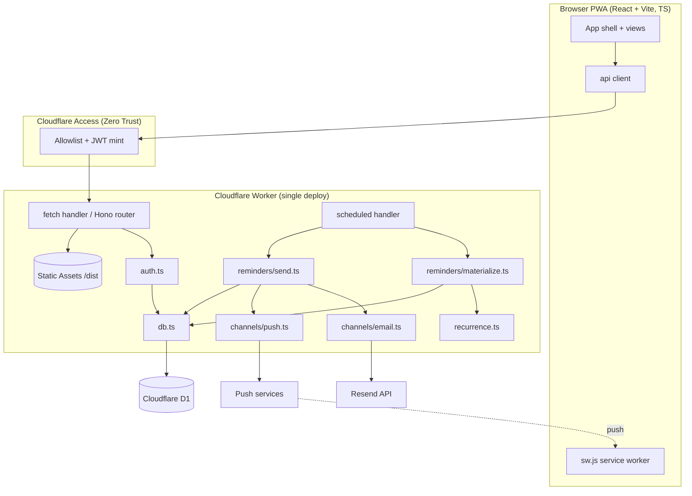

# Family Scheduler: Implementation Design

Architect's implementation design for the Family Scheduler PWA. This plan designs **within** the locked build spec (`docs/family-scheduler-build-spec.md`) and traces back to `docs/original-requirements.md`. The stack and high-level design are LOCKED; nothing here proposes changing them. Where the spec is underspecified or internally inconsistent, the issue is surfaced in **Section 5 (Flags & Inconsistencies)** rather than silently fixed, and a recommended resolution (or a question) is given.

Audience: the Plan-Reviewer, then the Coding agent.

> **Revision note (2026-06-28):** amended in place to fold in the adversarial review (`docs/reviews/family-scheduler-design-review.md`). Changes touch Decisions D7/D10 (extended), add D13, add Flags F14/F15, rework §2.6 admin, adjust `db.ts` signatures (`completeItem`, `setUserActive`, `upsertUser`, four dispatch-cleanup helpers), update several Phase done-criteria, and reconcile the stale O1/admin narrative. A second amendment pass (Pass-2 Minors P2-N1/N2/N3) made the deletion-vs-cascade ordering explicit, qualified the reactivation claim, and documented the fate of aged-out `pending` rows. No locked decision was changed.

> **Revision note (2026-06-28, owner deactivation-access amendment):** the owner changed the meaning of deactivation: a deactivated user (`active = 0`) must NOT be able to use the app at all, not merely be muted from reminders. This supersedes D6's prior "does not block sign-in" wording. Added **Decision D14** (app-level access enforcement in `requireAuth`), introduced the typed error code **`DEACTIVATED` → HTTP 403** (added to the §2 code→status table and the `Result<T>` union in Appendix 6.1), updated §1.2 (`requireAuth` ordering + active check), §1.3 (frontend "account deactivated" handling), §2 global conventions, the §2.1 `GET /api/me` note, §2.6 / D6 admin self-deactivation cross-references, Flag F5, and the done-criteria of Tasks 1.1 and 6.4. The reminder-audience behavior (migration `0003`, `listActiveUsers`) is unchanged. This raised the resolved-decision count from 13 to 14.

---

## 0. Document map

1. Component & interface design
2. API route contracts
3. Resolved open decisions
4. Phase-by-phase task breakdown
5. Flags & inconsistencies
6. Appendix: shared types and config constants

Conventions used throughout:

- All timestamps are epoch milliseconds, UTC (`EpochMs`). Display is converted to a timezone on the client.
- IDs are generated with `crypto.randomUUID()` inside the Worker. The client never supplies IDs.
- All interfaces favor pure functions and explicit return-value error handling (`Result<T>`), reserving thrown exceptions for programmer errors and unexpected failures that map to HTTP 500.
- "Active user" is defined in Decision D6; the access consequences of `active = 0` are defined in Decision D14.

---

## 1. Component & interface design

### 1.1 System decomposition



Two entry points share one module set:

- **`fetch` handler** — serves the PWA static assets and the `/api/*` JSON API. Every `/api/*` request passes through Access (network layer) and through `auth.ts` (in-Worker JWT verification).
- **`scheduled` handler** — the reminder engine. Runs on cron, does **not** pass through Access, and uses the same `db.ts`, `recurrence.ts`, and channel modules.

### 1.2 Worker modules

Each module lists: responsibility, public interface, owned state, collaborators.

#### `worker/index.ts` — entry + router

- **Responsibility:** Wire the Hono app for `/api/*`, fall through to Static Assets for everything else, and route cron events in `scheduled`.
- **Public interface:**
  ```ts
  export default {
    fetch(request: Request, env: Env, ctx: ExecutionContext): Promise<Response>;
    scheduled(event: ScheduledController, env: Env, ctx: ExecutionContext): Promise<void>;
  };
  ```
  - `fetch`: if `url.pathname` starts with `/api/`, delegate to the Hono app; else `return env.ASSETS.fetch(request)` (SPA fallback to `index.html` for unknown non-asset paths).
  - `scheduled`: branch on `event.cron`. `"*/5 * * * *"` → run reminder engine (`materialize` then `sendDue`). The digest cron (Decision D4) → run `sendDailyDigest`.
- **Middleware ordering (load-bearing for admin auth — Item 3a):** `requireAuth` is registered globally first via `app.use('/api/*', requireAuth)`; it verifies the JWT, upserts the user, enforces the `active` access check (D14), and sets `c.set('user', User)`. The admin sub-router (`routes/admin.ts`) additionally applies `requireAdmin`. Because Hono runs middleware in registration order and `/api/*` is registered before any concrete route, `requireAdmin` can never execute before `requireAuth` (see §2.6).
- **Owned state:** none (stateless). Holds the singleton Hono instance.
- **Collaborators:** `routes/*`, `auth.ts`, `reminders/*`.

#### `worker/auth.ts` — Cloudflare Access verification

- **Responsibility:** Verify the `Cf-Access-Jwt-Assertion` JWT on every `/api` request; resolve and upsert the user; enforce app-level access for deactivated users (D14); expose a Hono middleware.
- **Public interface:**
  ```ts
  interface AccessIdentity { email: string }

  // Verifies signature against team JWKS and checks aud + exp + iss. Pure given a fetched JWKS.
  export async function verifyAccessJwt(
    token: string,
    env: Env,
    now?: EpochMs
  ): Promise<Result<AccessIdentity>>;

  // Cached JWKS fetch from `${ACCESS_TEAM_DOMAIN}/cdn-cgi/access/certs`.
  export async function getAccessKeys(env: Env): Promise<JsonWebKey[]>;

  // Hono middleware. Strict ordering (D14):
  //   1. verify the Access JWT       -> 401 UNAUTHENTICATED on missing/invalid/expired token
  //   2. resolve/upsert the user     -> includes the OWNER_EMAIL promotion-to-admin step (O1/N5)
  //   3. check user.active           -> 403 DEACTIVATED if active === false (account deactivated)
  //   4. else c.set('user', User) and proceed
  // The active check runs AFTER the upsert so the owner is always seeded active+admin and can never be
  // locked out by this gate; combined with the admin self-deactivation guard (§2.6 / D7 / D14) the sole
  // admin cannot 403-lock themselves out of the whole app.
  export const requireAuth: MiddlewareHandler;

  // Hono middleware: must run AFTER requireAuth (guaranteed by mount order — see index.ts & §2.6);
  // 403 FORBIDDEN if c.get('user').role !== 'admin'. (O1)
  export const requireAdmin: MiddlewareHandler;
  ```
- **Owned state:** in-memory JWKS cache keyed by `kid` with a short TTL (e.g. 10 min). Cache is best-effort per isolate.
- **Collaborators:** `db.ts` (`upsertUser`), Web Crypto (`crypto.subtle.importKey`/`verify` over RS256).
- **Notes:** Never trust `Cf-Access-Authenticated-User-Email` alone (spec §13). The `email` claim from the verified JWT is the identity. Lowercase-normalize the email before use and storage. The `DEACTIVATED` 403 in step 3 applies uniformly to ALL `/api/*` routes because the check lives in the shared middleware — there are NO per-route changes. Relationship to network-level blocking (D14): this app-level 403 stops app usage immediately even while the Access cookie/JWT is still valid; for full removal of access, DevOps also removes the email from the Cloudflare Access allowlist. The two are complementary, not redundant. Reactivation (admin sets `active = 1`) restores access on the very next request — the upsert reads the now-active row, step 3 passes, and the request proceeds; no re-login is required.

#### `worker/db.ts` — data access + authorization

- **Responsibility:** All D1 reads/writes, with authorization enforced here (not only in the UI/route). Owns the SQL.
- **Public interface (selected; full set in Appendix):**
  ```ts
  // upsertUser: INSERT … ON CONFLICT(email) DO UPDATE. (O1, N5)
  //  - On insert: role='admin' iff normalized email === ownerEmail else 'member'; active=1 (D6).
  //  - On conflict (existing row, every login): promote role→'admin' iff email===ownerEmail
  //    (fixes an owner row created as 'member' before OWNER_EMAIL was set — N5);
  //    NEVER downgrade other roles, and NEVER reset `active` or overwrite `display_name`
  //    (so a deactivated user stays deactivated and prior name edits survive re-login).
  //  Note (D14): requireAuth performs the active-access 403 AFTER calling this; the owner is seeded
  //  active=1 here, so the owner is never gated out by the active check.
  export async function upsertUser(db: D1Database, email: string, ownerEmail: string, now: EpochMs): Promise<User>;
  export async function getUser(db: D1Database, email: string): Promise<User | null>;
  export async function updateDisplayName(db: D1Database, email: string, name: string): Promise<User>;
  export async function listActiveUsers(db: D1Database): Promise<User[]>; // WHERE active = 1 (D6)

  // Admin-only operations (callers gated by requireAdmin). (O1)
  export async function listAllUsers(db: D1Database): Promise<User[]>;                                    // full roster, incl. inactive
  // setUserActive: self-deactivation guard + side effect (D7/M1/D14). If callerEmail===targetEmail && !active
  //   → Result error VALIDATION, no write. When active=false: also deletes the user's pending dispatch
  //   rows (deletePendingDispatchForRecipient) in the same operation.
  export async function setUserActive(db: D1Database, callerEmail: string, targetEmail: string, active: boolean): Promise<Result<User>>;
  export async function adminUpdateDisplayName(db: D1Database, targetEmail: string, name: string): Promise<Result<User>>;

  export async function getVisibleLists(db: D1Database, email: string): Promise<List[]>;
  export async function createList(db: D1Database, email: string, input: CreateListInput, now: EpochMs): Promise<List>;
  export async function updateList(db: D1Database, email: string, id: string, patch: UpdateListInput): Promise<Result<List>>;
  // deleteList: ORDERING IS A HARD REQUIREMENT (P2-N1). reminder_dispatch is intentionally NOT FK-bound to
  //   items/lists (the engine controls its lifecycle), so it is NOT cascade-deleted. Must purge pending
  //   dispatch for every item in the list (deletePendingDispatchForList) BEFORE issuing the `DELETE FROM lists`
  //   that fires the items/reminders FK cascade — otherwise the items are gone, the dispatch lookup matches
  //   nothing, and pending rows orphan (and fire at the old time). Order: cleanup → then cascade.
  export async function deleteList(db: D1Database, email: string, id: string): Promise<Result<void>>;

  // Authorization helpers used by item routes:
  export async function canReadList(db: D1Database, email: string, listId: string): Promise<boolean>;
  export async function canWriteList(db: D1Database, email: string, listId: string): Promise<boolean>;

  export async function getItems(db: D1Database, email: string, listId: string): Promise<Result<ItemWithReminders[]>>;
  export async function createItem(db: D1Database, email: string, input: CreateItemInput, now: EpochMs): Promise<Result<ItemWithReminders>>;
  export async function updateItem(db: D1Database, email: string, id: string, patch: UpdateItemInput, now: EpochMs): Promise<Result<ItemWithReminders>>;
  // deleteItem: ORDERING IS A HARD REQUIREMENT (P2-N1). Same rationale as deleteList — reminder_dispatch has
  //   no FK to items (intentionally; engine owns its lifecycle), so purge the item's pending dispatch
  //   (deletePendingDispatchForItem) BEFORE issuing the `DELETE FROM items` that cascades the reminders.
  //   Order: cleanup → then cascade.
  export async function deleteItem(db: D1Database, email: string, id: string): Promise<Result<void>>;
  export async function replaceReminders(db: D1Database, email: string, itemId: string, reminders: ReminderInput[]): Promise<Result<ItemReminder[]>>;
  // completeItem: completed=true sets completion + purges that occurrence's pending dispatch (M3);
  //   completed=false clears completion (un-complete) and lets materialize re-create rows. See note below.
  export async function completeItem(db: D1Database, email: string, itemId: string, occurrenceAt: EpochMs | null, completed: boolean, now: EpochMs): Promise<Result<void>>;

  // Push subscriptions
  export async function upsertSubscription(db: D1Database, email: string, sub: SubscriptionInput, now: EpochMs): Promise<PushSubscription>;
  export async function deleteSubscriptionByEndpoint(db: D1Database, email: string, endpoint: string): Promise<void>;
  export async function deleteSubscriptionById(db: D1Database, id: string): Promise<void>;
  export async function getSubscriptionsForUser(db: D1Database, email: string): Promise<PushSubscription[]>;

  // Reminder engine support
  export async function getActiveItemsWithReminders(db: D1Database): Promise<ItemWithReminders[]>; // items with >=1 reminder; non-recurring items whose completed_at is set are excluded (M3). Per-occurrence completion is applied inside materialize.
  export async function getCompletedOccurrences(db: D1Database, itemId: string): Promise<EpochMs[]>; // M3: occurrence_at list from item_occurrence_state, for materialize's per-occurrence skip
  export async function insertDispatchIgnore(db: D1Database, row: NewDispatchRow): Promise<void>; // INSERT OR IGNORE
  export async function getDueDispatch(db: D1Database, now: EpochMs, graceMinutes: number): Promise<ReminderDispatch[]>;
  export async function markDispatch(db: D1Database, id: string, status: 'sent' | 'failed', now: EpochMs): Promise<void>; // UPDATE … WHERE id=? AND status='pending' (N8)
  export async function deletePendingDispatchForItem(db: D1Database, itemId: string): Promise<void>;                       // D7: timing/reminder change, item delete (on delete, MUST run BEFORE the items FK cascade — P2-N1)
  export async function deletePendingDispatchForList(db: D1Database, listId: string): Promise<void>;                       // D7/M1: list visibility flip, list delete (on delete, MUST run BEFORE the lists FK cascade — P2-N1)
  export async function deletePendingDispatchForRecipient(db: D1Database, recipientEmail: string): Promise<void>;         // D7/M1: user deactivation
  export async function deletePendingDispatchForOccurrence(db: D1Database, itemId: string, occurrenceAt: EpochMs): Promise<void>; // M3: per-occurrence completion
  ```
  **`completeItem` semantics (M2):**
  - `completed=true`, non-recurring (`occurrenceAt=null`): set `items.completed_at=now`; then `deletePendingDispatchForItem(itemId)`.
  - `completed=true`, recurring (`occurrenceAt` required): upsert `item_occurrence_state(item_id, occurrence_at, completed_at=now)`; then `deletePendingDispatchForOccurrence(itemId, occurrenceAt)`.
  - `completed=false`, non-recurring: clear `items.completed_at=NULL`. No dispatch action — the next materialize run re-creates pending rows for still-future occurrences.
  - `completed=false`, recurring: delete the `item_occurrence_state` row. No dispatch action — materialize re-creates.
- **Owned state:** none beyond the D1 binding passed in. Pure data-mapping functions.
- **Collaborators:** D1 binding. Authorization rule (spec §5): shared lists readable/writable by all active users; private lists and their items restricted to the owner. `canReadList`/`canWriteList` centralize this.
- **Error contract:** Returns `Result<T>` with typed error codes (`NOT_FOUND`, `FORBIDDEN`, `CONFLICT`, `VALIDATION`) so routes map cleanly to HTTP status. Throws only on infrastructure failure (→ 500). (The `DEACTIVATED` code (D14) is produced by the `requireAuth` middleware, not by these db functions; it is included in the shared code→status table and the `Result<T>` union for a single source of truth — §2, Appendix 6.1.)

#### `worker/recurrence.ts` — RRULE expansion

- **Responsibility:** Expand an item into occurrence start times within a window, correct across DST.
- **Public interface:**
  ```ts
  export interface OccurrenceQuery {
    startAt: EpochMs;        // item.start_at
    rrule: string | null;    // item.rrule (RFC 5545)
    timezone: string;        // IANA tz
    allDay: boolean;
  }
  // Pure. Returns occurrence start instants (UTC epoch ms), inclusive of windowStart..windowEnd.
  export function expandOccurrences(q: OccurrenceQuery, windowStart: EpochMs, windowEnd: EpochMs): EpochMs[];
  ```
- **Owned state:** none (pure).
- **Collaborators:** the `rrule` npm package; a timezone helper (Decision D11 picks **luxon** for wall-clock↔UTC conversion). Algorithm: treat `start_at` as the seed wall-clock time in `timezone`; expand RRULE in floating/local space; convert each local occurrence back to UTC at that date's offset so DST shifts are honored. Non-recurring items (`rrule === null`) return `[startAt]` iff it falls in the window.
- **DST/boundary handling:** the disambiguation rules for non-existent and ambiguous local times, the `UNTIL` normalization, and three concrete expected-value test cases are specified in Decision D10. Those three cases plus a near-`UNTIL` DST case are mandated unit tests in Task 5.1.

#### `worker/reminders/materialize.ts` — Phase A

- **Responsibility:** For each item with reminders, expand occurrences over `[now, now + LOOKAHEAD_DAYS]`, compute `fire_at`, resolve recipients per the audience rule, and `INSERT OR IGNORE` dispatch rows.
- **Public interface:**
  ```ts
  export async function materialize(db: D1Database, now: EpochMs, config: EngineConfig): Promise<{ inserted: number }>;
  // Audience rule helper (pure given inputs):
  export async function resolveRecipients(db: D1Database, item: Item, list: List): Promise<string[]>;
  ```
- **Owned state:** none.
- **Collaborators:** `db.ts`, `recurrence.ts`. Audience rule (spec §4): private list → owner only; shared list → every active user (`resolveRecipients` calls `listActiveUsers`). One dispatch row per (recipient, enabled channel). Idempotency comes from the `UNIQUE(item_reminder_id, occurrence_at, channel, recipient_email)` constraint + `INSERT OR IGNORE`.
- **Completion awareness (M3):** materialize must NOT create dispatch rows for already-completed work. For a non-recurring item, skip it entirely if `items.completed_at` is set (already filtered out by `getActiveItemsWithReminders`). For a recurring item, skip any occurrence whose `occurrence_at` appears in `getCompletedOccurrences(itemId)`. This makes "completing a task stops its reminders" durable across re-runs, not just at the moment of completion.

#### `worker/reminders/send.ts` — Phase B

- **Responsibility:** Select due pending dispatch rows and send them; mark `sent`/`failed`; prune dead push subscriptions.
- **Public interface:**
  ```ts
  export async function sendDue(db: D1Database, env: Env, now: EpochMs, config: EngineConfig): Promise<SendSummary>;
  export async function sendDailyDigest(db: D1Database, env: Env, now: EpochMs): Promise<SendSummary>; // Decision D4
  ```
- **Owned state:** none.
- **Collaborators:** `db.ts`, `channels/email.ts`, `channels/push.ts`. Selection predicate (spec §9 Phase B): `status='pending' AND fire_at <= now AND fire_at > now - GRACE_MINUTES`. For `channel='push'`, fan out to all of the recipient's subscriptions (Decision D8); on 404/410, delete that subscription row.
- **Failure classification (Decision D13 / M5):** transient errors (network/429/5xx) leave the row `pending` so the next run retries it within grace; permanent 4xx → `failed`. A push row whose recipient has zero subscriptions is a `sent` no-op (nothing to retry, not an error). `markDispatch` updates `WHERE id=? AND status='pending'`, so a row purged by a concurrent edit (N8) is not clobbered.
- **Aged-out pending rows (P2-N3):** a `pending` row whose `fire_at` slips past the grace window — e.g. transient failures that never succeeded inside grace, or engine downtime spanning the `fire_at` — is simply skipped by `sendDue`'s `fire_at > now − GRACE_MINUTES` predicate. **Chosen behavior: leave it inert as `pending`; there is NO sweep to a terminal state.** Rationale: at family scale these are rare and bounded, harmless to the hot send query, and a reclassification sweep is not worth an added cron/task — they are accepted as inert debris. Consequence to note: a "pending backlog" count therefore mixes genuinely-stuck future rows with aged-out ones; acceptable at this scale.
- **Digest audience (Item 3c):** `sendDailyDigest` iterates `listActiveUsers` only — inactive users get no digest, consistent with the materialize audience.

#### `worker/channels/email.ts` — Resend (single integration point)

- **Public interface:**
  ```ts
  export interface EmailMessage { to: string; subject: string; html: string; text: string }
  export async function sendEmail(msg: EmailMessage, env: Env): Promise<Result<void>>;
  ```
- **Responsibility:** POST to `https://api.resend.com/emails` with `RESEND_API_KEY` and `EMAIL_FROM`. The ONLY email integration point so a later SES swap is one file (spec §8). Distinguishes transient (5xx/429/network) from permanent (4xx) failures in its `Result` so `send.ts` can apply D13.

#### `worker/channels/push.ts` — Web Push (VAPID, WebCrypto)

- **Public interface:**
  ```ts
  export interface WebPushTarget { endpoint: string; p256dh: string; auth: string }
  export interface PushResult { ok: boolean; statusCode: number; gone: boolean } // gone => 404/410 => delete sub
  export async function sendPush(target: WebPushTarget, payload: PushPayload, env: Env): Promise<PushResult>;
  ```
- **Responsibility:** Build the VAPID JWT (ES256 via WebCrypto), encrypt the payload (`aes128gcm`), POST to the endpoint. Returns `gone: true` for 404/410. See Decision D2 for the library/approach.

#### `worker/routes/*.ts`

Thin Hono sub-routers that validate input, call `db.ts` / engine helpers, and map `Result` errors to HTTP. No business logic beyond shaping. Files: `lists.ts`, `items.ts`, `reminders.ts`, `subscriptions.ts`, `me.ts`, `admin.ts` (mounted behind `requireAdmin`, O1). Contracts in Section 2.

### 1.3 Frontend components (React + Vite, TS)

State is client-side; auth is handled by Access (the browser already carries the Access cookie/JWT to same-origin `/api`). The app discovers identity via `GET /api/me`.

| Component | Responsibility | Key props / state | Collaborators |
|---|---|---|---|
| `App` | Shell, routing between List view and Calendar view, loads `me`; renders a dedicated "account deactivated" screen when the API reports `DEACTIVATED` (D14) | `user`, `lists`, `selectedListId`, `view`, `deactivated` | `apiClient`, all views |
| `apiClient` | Typed fetch wrapper for `/api/*`; throws typed errors; same-origin so Access cookie rides along; surfaces a distinct `DEACTIVATED` error (HTTP 403, code `DEACTIVATED`) separate from generic `FORBIDDEN`/errors so `App` can render the deactivated state (D14) | — | Worker API |
| `ListSidebar` | Show owned + shared lists, create/rename/recolor/visibility toggle | `lists`, callbacks | `apiClient` |
| `ItemListView` | List of items for selected list; complete/edit/delete | `items`, `selectedListId` | `ItemEditor` |
| `CalendarView` | Month grid; expands occurrences via `?from&to`; click day/item | `from`, `to`, `occurrences` | `apiClient` |
| `ItemEditor` | Create/edit item: title, location, notes, start/end, all-day, timezone, RRULE, reminders | `draft: ItemDraft` | `ReminderEditor`, `RecurrenceEditor` |
| `ReminderEditor` | N reminders; each = offset (value + unit days/hrs/min) + email/push toggles | `reminders: ReminderInput[]` | — |
| `RecurrenceEditor` | Build/parse a limited RRULE subset (none/daily/weekly-by-day/monthly + UNTIL/COUNT) | `rrule: string \| null` | `rrule` |
| `InstallBanner` | iOS + non-standalone detection; one-time "Add to Home Screen" nudge | `dismissed` (localStorage) | — |
| `NotificationSetup` | Request permission on gesture, subscribe via `pushManager`, POST `/api/subscriptions` | `permission`, `subscribed` | `apiClient`, SW |
| `AdminPanel` | Roster + active toggle + name edit; rendered only when `me.role === 'admin'` | `users` | `apiClient` |
| `sw.js` | `push` → `showNotification`; `notificationclick` → focus/open `APP_URL` deep link | — | — |

Reminder offset UI: the unit (days/hours/minutes) reduces to `offset_minutes` before sending (spec §4: "days/hours/minutes all reduce to minutes").

**Deactivated-account handling (UI requirement — D14):** because `requireAuth` now returns `403 { error: { code: "DEACTIVATED" } }` on EVERY `/api/*` request for a deactivated user (including `GET /api/me`), the app cannot bootstrap normally for such a user. `apiClient` must detect the `DEACTIVATED` code distinctly (not collapse it into a generic error/`FORBIDDEN`), and `App` must render a clear "account deactivated" state (e.g. "Your account has been deactivated. Contact the family admin.") rather than a generic error or an empty shell. This is a frontend-only UX affordance; enforcement is server-side in `requireAuth` regardless of what the UI does.

**CalendarView fan-out (N7):** `GET /api/lists/:id/items?from&to` is per-list, so the month view issues one request per visible list in parallel (`Promise.all`) and merges the returned occurrences client-side. There is no aggregate occurrences endpoint by design — acceptable at family scale. The Coder should not invent an undocumented aggregate route.

### 1.4 Data model types

Full SQL is the spec's `0001_init.sql` plus the additions in Decision D5 (per-occurrence completion) and Decision D6 (active flag). Canonical TypeScript types are in the Appendix (Section 6.1).

---

## 2. API route contracts

**Global conventions**

- Base path `/api`. Every route is behind Cloudflare Access (network) AND `requireAuth` middleware (in-Worker JWT verification). There are no public routes.
- Content type `application/json` for request and response bodies (except where noted).
- **Auth failure (all routes):** missing/invalid/expired Access JWT → `401` `{ "error": { "code": "UNAUTHENTICATED", "message": "..." } }`.
- **Deactivated account (all routes — D14):** a verified user whose `active = 0` → `403` `{ "error": { "code": "DEACTIVATED", "message": "Account deactivated" } }`, emitted by `requireAuth` AFTER JWT verification and user upsert, BEFORE any route handler runs. This applies uniformly to every `/api/*` route (it lives in the shared middleware); no per-route handling is needed. It is distinct from the role-based `403 FORBIDDEN` returned by `requireAdmin`.
- **Error envelope (all routes):** `{ "error": { "code": string, "message": string, "details"?: unknown } }`.
- Standard error codes → status: `VALIDATION` → 400, `UNAUTHENTICATED` → 401, `FORBIDDEN` → 403, `DEACTIVATED` → 403, `NOT_FOUND` → 404, `CONFLICT` → 409, `INTERNAL` → 500.
- `email` identity always comes from the verified JWT, never from the body. (Exception: admin routes name a *target* user; see §2.6 / F14.)
- Timestamps in/out are `EpochMs` (number). Booleans serialize as JSON `true`/`false` (DB stores 0/1).

### 2.1 `me`

#### `GET /api/me`
- **Auth:** any authenticated AND active user. (A deactivated user is rejected by `requireAuth` with `403 DEACTIVATED` before this handler runs — D14 — so this endpoint never returns a body for an inactive account.)
- **Params:** none.
- **Success `200`:**
  ```json
  {
    "user": { "email": "a@b.com", "display_name": "Mom", "role": "member", "active": true, "created_at": 1719500000000 },
    "lists": [ { "id": "uuid", "name": "Shared", "color": "#22aa66", "owner_email": "a@b.com", "visibility": "shared", "created_at": 1719500000000 } ]
  }
  ```
  `user` mirrors the `User` type, including `active` (N4). Because a deactivated user can no longer reach this endpoint (they receive `403 DEACTIVATED`), `active` in a `200` body is always `true`; it is retained for type-completeness and for the admin roster (`GET /api/admin/users`, which returns inactive users too). `lists` = owned private + all shared (same set as `GET /api/lists`).
- **Errors:** 401, 403 (`DEACTIVATED`).

#### `PUT /api/me`
- **Auth:** self only (active; deactivated → 403 `DEACTIVATED`).
- **Body:** `{ "display_name": "string (1..80)" }`
- **Success `200`:** `{ "user": User }`
- **Errors:** 400 (empty/too long), 401, 403 (`DEACTIVATED`).

### 2.2 `lists`

#### `GET /api/lists`
- **Auth:** any authenticated user.
- **Success `200`:** `{ "lists": List[] }` — caller's private lists + all shared lists.
- **Errors:** 401, 403 (`DEACTIVATED`).

#### `POST /api/lists`
- **Auth:** any authenticated user (becomes `owner_email`).
- **Body:** `{ "name": "string (1..80)", "color"?: "string|null", "visibility"?: "private" | "shared" }` (default `visibility = "private"`).
- **Success `201`:** `{ "list": List }`
- **Errors:** 400, 401, 403 (`DEACTIVATED`).

#### `PATCH /api/lists/:id`
- **Auth:** Private list → owner only. Shared list → any active user MAY rename/recolor; changing `visibility` of a shared list back to private → **owner only** (Decision D9).
- **Path:** `id` (UUID).
- **Body (all optional, ≥1 required):** `{ "name"?: string, "color"?: string|null, "visibility"?: "private" | "shared" }`
- **Side effect (D7/M1):** if `visibility` changes, `deletePendingDispatchForList(id)` purges pending dispatch for all items in the list. The audience differs by visibility (shared = all active users; private = owner only), so already-materialized rows are addressed to the wrong audience and must be rebuilt; the next materialize run regenerates them for the new audience.
- **Success `200`:** `{ "list": List }`
- **Errors:** 400, 401, 403 (not permitted, or `DEACTIVATED`), 404.

#### `DELETE /api/lists/:id`
- **Auth:** owner only (both private and shared).
- **Path:** `id`.
- **Behavior (ordering is a HARD REQUIREMENT — P2-N1):** FIRST purge pending dispatch for all items in the list (`deletePendingDispatchForList(id)`), THEN issue `DELETE FROM lists`, which cascades to items and reminders (FK `ON DELETE CASCADE`). `reminder_dispatch` is intentionally NOT FK-bound to `items`/`lists` (the engine controls its lifecycle), so if the cascade ran first the item IDs would already be gone, the dispatch cleanup would match nothing, and pending rows would orphan and fire at the old time. Cleanup → then cascade (Decision D7).
- **Success `204`:** empty body.
- **Errors:** 401, 403, 404.

### 2.3 `items`

#### `GET /api/lists/:id/items`
- **Auth:** must be able to read the list (`canReadList`).
- **Path:** `id` (list UUID).
- **Query (optional):** `from` (EpochMs), `to` (EpochMs). If BOTH present → return expanded **occurrences** in `[from, to]`. If absent → return stored items (no expansion).
- **Success `200` (no range):** `{ "items": ItemWithReminders[] }`
- **Success `200` (with range):**
  ```json
  { "occurrences": [
    { "item_id": "uuid", "occurrence_at": 1719600000000, "end_at": 1719603600000,
      "item": { "...": "ItemWithReminders" } }
  ] }
  ```
  One entry per occurrence; `occurrence_at` is the instance start, `item` is the parent. (Resolves the spec's underspecified expansion contract — see Flag F7.)
- **Errors:** 400 (only one of from/to, or from > to), 401, 403, 404 (list not found).

#### `POST /api/items`
- **Auth:** must be able to write the target list (`canWriteList`).
- **Body:**
  ```json
  {
    "list_id": "uuid",
    "type": "event" | "task",
    "title": "string (1..200)",
    "location": "string|null",
    "notes": "string|null",
    "start_at": 1719600000000,
    "end_at": 1719603600000,
    "all_day": false,
    "rrule": "FREQ=WEEKLY;BYDAY=TU,TH" ,
    "timezone": "America/Los_Angeles",
    "reminders": [ { "offset_minutes": 60, "channel_email": true, "channel_push": true } ]
  }
  ```
  `end_at`, `rrule` nullable/optional. `timezone` optional (defaults to family default constant). `reminders` optional (default `[]`).
- **Validation:** `title` non-empty; `type` in enum; `start_at` is a number; if `end_at` set then `end_at >= start_at`; `rrule` parses (reject unparseable); `timezone` is a valid IANA zone; each reminder `offset_minutes >= 0` integer.
- **Success `201`:** `{ "item": ItemWithReminders }`
- **Errors:** 400, 401, 403, 404 (list not found).

#### `PATCH /api/items/:id`
- **Auth:** writable-list rule. Shared list item → any active user. Private list item → owner of the list only.
- **Path:** `id` (item UUID).
- **Body:** any subset of the create fields except `list_id` is immutable here (moving lists is out of scope — Flag F11). At least one field required.
- **Side effect:** if `start_at`, `end_at`, `rrule`, `timezone`, or `all_day` changed → `deletePendingDispatchForItem(id)` so the next materialize run rebuilds reminders against the new timing (Decision D7).
- **Success `200`:** `{ "item": ItemWithReminders }`
- **Errors:** 400, 401, 403, 404.

#### `DELETE /api/items/:id`
- **Auth:** writable-list rule.
- **Side effect (ordering is a HARD REQUIREMENT — P2-N1):** FIRST delete the item's pending dispatch rows (`deletePendingDispatchForItem(id)`), THEN issue `DELETE FROM items`, which cascades to reminders. Because `reminder_dispatch` has no FK to `items` (intentionally — the engine owns its lifecycle), the cleanup must run BEFORE the cascade or the dispatch rows orphan and fire at the old time. Cleanup → then cascade (Decision D7).
- **Success `204`:** empty.
- **Errors:** 401, 403, 404.

#### `POST /api/items/:id/complete`
- **Auth:** writable-list rule.
- **Body:** `{ "occurrence_at"?: EpochMs, "completed"?: boolean }` — `completed` defaults `true` (allow un-complete with `false`).
  - For a non-recurring item: omit `occurrence_at`; sets/clears `items.completed_at`.
  - For a recurring item: `occurrence_at` REQUIRED; upserts/removes a row in `item_occurrence_state` (Decision D5).
- **Side effect (M3):** on `completed:true`, purge pending dispatch for the completed occurrence so a finished task stops reminding — non-recurring → `deletePendingDispatchForItem(id)`; recurring → `deletePendingDispatchForOccurrence(id, occurrence_at)`. On `completed:false`, no purge — the next materialize run re-creates pending rows for still-future occurrences. (Maps to `completeItem`'s `completed` parameter, M2.)
- **Success `200`:** `{ "ok": true }`
- **Errors:** 400 (recurring item without `occurrence_at`), 401, 403, 404.

### 2.4 `reminders`

#### `PUT /api/items/:id/reminders`
- **Auth:** writable-list rule.
- **Path:** `id` (item UUID).
- **Body:** `{ "reminders": [ { "offset_minutes": 1440, "channel_email": true, "channel_push": false } ] }` — full replacement (delete-all-then-insert).
- **Validation:** each `offset_minutes` is an integer ≥ 0; at least one channel `true` per reminder (reject a reminder with both channels false).
- **Side effect:** replacing reminders → `deletePendingDispatchForItem(id)` (Decision D7).
- **Success `200`:** `{ "reminders": ItemReminder[] }`
- **Errors:** 400, 401, 403, 404.

### 2.5 `subscriptions`

#### `POST /api/subscriptions`
- **Auth:** self (subscription is bound to the authenticated user).
- **Body:** `{ "endpoint": "https://...", "p256dh": "base64url", "auth": "base64url", "user_agent"?: "string" }`
- **Behavior:** upsert by unique `endpoint`; rebind to current user if the endpoint already exists.
- **Success `201`:** `{ "subscription": { "id": "uuid", "endpoint": "..." } }`
- **Errors:** 400 (missing keys), 401.

#### `DELETE /api/subscriptions/:endpoint`
- **Auth:** self (only deletes a subscription owned by caller).
- **Path:** `endpoint` — URL-encoded (`encodeURIComponent`) push endpoint (Flag F10 notes the alternative of a body/id).
- **Success `204`:** empty.
- **Errors:** 401, 404 (not found / not owned).

#### `GET /api/vapid-public-key`
- **Auth:** any authenticated user (behind Access like all `/api`).
- **Success `200`:** `{ "publicKey": "<base64url VAPID public key>" }` (from `VAPID_PUBLIC_KEY` var).
- **Errors:** 401.

### 2.6 `admin` (O1)

All admin routes require `requireAuth` **then** `requireAdmin`, in that order. **Middleware ordering (mount point, `index.ts` — Item 3a):** `requireAuth` is registered globally on `/api/*` first (it verifies the JWT, runs the `active`-access gate per D14, and sets `c.set('user', User)`); the admin sub-router additionally applies `requireAdmin`, which reads `c.get('user')` and 403s unless `role === 'admin'`. Because Hono runs middleware in registration order and `/api/*` is registered before the admin routes, `requireAdmin` can never run before `requireAuth`. A non-admin authenticated user receives `403 FORBIDDEN` (distinct from the `403 DEACTIVATED` an inactive user receives earlier in `requireAuth`). The single admin is the owner (seeded from `OWNER_EMAIL` via `upsertUser`, including promotion of a pre-existing owner row — N5); there is no promote/demote endpoint in v1.

**Privacy (F14, Item 4):** the target user's email is passed in the request **body**, not the URL path, so family members' email addresses do not land in request/access logs. (Roster emails are still returned in `GET /api/admin/users` response *bodies*, which Cloudflare access logs do not capture.) Rejected alternative — keep `:email` in the path and accept the logging — was declined because email appears in no other request *path* in this API and moving it is zero-cost. The target email is lowercase-normalized server-side before lookup.

#### `GET /api/admin/users`
- **Auth:** admin only.
- **Behavior:** returns the full roster via `listAllUsers` (includes inactive users); each `User` includes `role` and `active`. (Audience contrast — Item 3c: `materialize`/`resolveRecipients` and `sendDailyDigest` use `listActiveUsers` (active-only); `listAllUsers` is used ONLY here.)
- **Success `200`:** `{ "users": User[] }`
- **Errors:** 401, 403.

#### `PATCH /api/admin/users`
- **Auth:** admin only.
- **Body (`target_email` required; ≥1 mutable field required):** `{ "target_email": "user@x.com", "active"?: boolean, "display_name"?: "string (1..80)" }`. `role` is NOT editable here (single-admin model, v1).
- **Behavior:** `active` now gates BOTH reminder/audience inclusion (D6) AND app access (D14 — a deactivated user is 403'd by `requireAuth` on every `/api/*` request); `display_name` corrects another user's name.
  - **Self-deactivation guard (server-side — Item 3b / M2):** enforced inside `db.setUserActive(db, callerEmail, targetEmail, active)`. If `callerEmail === targetEmail && active === false`, it returns a `Result` `VALIDATION` error and performs NO write; the route surfaces this as `400`. The guard lives in the db layer (not just the UI), so it holds regardless of caller. **This guard is now MORE important under D14:** previously it only prevented the sole admin from muting their own reminders; now that `active = 0` also 403-locks a user out of the entire app, the guard is what stops the sole admin from locking themselves out of all app access (and therefore out of the admin panel they would need to undo it). The owner is also seeded `active = 1` by `upsertUser`, and the active check runs only after that upsert, so the owner cannot be gated out by D14 either.
  - **Side effect (D7/M1 / Item 1):** when `active` is set to `false`, `setUserActive` also deletes that user's pending dispatch rows (`deletePendingDispatchForRecipient(targetEmail)`) in the same operation, so already-materialized reminders for the deactivated user do not fire. **Reactivation needs no special code path, but it does NOT back-fill the muted window (P2-N2)** — setting `active = 1` re-adds the user to `listActiveUsers`, and the next materialize run re-creates their dispatch rows via INSERT OR IGNORE for every still-future occurrence in the lookahead window. A reminder whose `fire_at` already elapsed (or fell outside the lookahead/grace window) during deactivation is NOT resurrected: the re-created row's `fire_at` is in the past, so `sendDue` (which selects `fire_at > now − GRACE_MINUTES`) never picks it up. This is intentional — you do not get reminders for the window you were muted. **App access, by contrast, IS restored immediately on reactivation (D14):** the next request's upsert reads the now-active row and `requireAuth` lets it through; no re-login is required.
- **Success `200`:** `{ "user": User }`
- **Errors:** 400 (missing `target_email` / empty patch / invalid name / admin self-deactivation), 401, 403, 404 (no such user).

---

## 3. Resolved open decisions

The spec does not have a single "open decisions" list; the open choices are embedded as "start with…", "optional", parenthetical alternatives, and underspecified mechanics. Each is resolved below. **Count: 14 decisions — all resolved (D5, D6 confirmed by owner 2026-06-28; O1 admin capabilities resolved by owner 2026-06-28 and now fully specified in §2.6). D13 was added for send-failure retry semantics (M5). D14 was added 2026-06-28 for app-level access enforcement of the `active` flag (owner deactivation-access amendment). No open product questions remain.**

**D1 — Worker router: Hono vs itty-router (spec §3).** **Chosen: Hono.** Hono's middleware composition is the cleanest fit for `requireAuth` (verify JWT once, attach `user` to context) and for per-route authorization, it is first-class on Workers, and its typed context reduces guesswork for the Coder. itty-router is lighter but pushes more wiring into each route. The marginal bundle size is irrelevant for a private family app well within free-tier limits.

**D2 — Web Push implementation/library (spec §7).** **Chosen: a WebCrypto-based implementation in `channels/push.ts`, `nodejs_compat` left OFF unless proven necessary.** Rationale: the Node `web-push` package depends on Node crypto; the spec explicitly invites a Workers-compatible path. VAPID JWT signing (ES256) and `aes128gcm` payload encryption are both available via `crypto.subtle`. Prefer a small maintained Workers-compatible web-push library if one is verified to install and run at build time; otherwise hand-roll the two primitives. Keep the surface behind the `sendPush` interface so the choice is swappable. **Action for Coder:** confirm the chosen library actually runs in the Workers runtime in Phase 3 (Task 3.4) before committing; if it needs Node APIs, flip `compatibility_flags = ["nodejs_compat"]` in `wrangler.toml` (the spec's commented sketch already anticipates this).

**D3 — Access login methods (spec §6 step 3).** **Chosen: enable BOTH One-time PIN (email) AND Google sign-in.** Email OTP is universal (every family member has email; matches the requirement's "sign in with their email address"), and Google is a low-friction option for those who use it. Both still gate on the same allowlist policy, so security is unchanged. This is an Access dashboard configuration step (DevOps), not application code.

**D4 — Daily digest email: include and when (spec §8, §12 phase 7).** **Chosen: include it, triggered by a SECOND cron entry at a fixed UTC hour, sent once per active user.** Add `crons = ["*/5 * * * *", "0 14 * * *"]`; the `scheduled` handler branches on `event.cron`. `0 14 * * *` ≈ 07:00 America/Los_Angeles during PDT (08:00 during PST — accept the one-hour seasonal drift for a digest; see Flag F12). The digest summarizes each active user's today+tomorrow items (their private lists + shared lists) and is sent only to `listActiveUsers` (Item 3c). Rationale: the requirements' core pain is "[a family member] sending text messages, emails and verbally communicating" — the digest is the direct replacement, so it traces to a requirement and earns inclusion despite being labeled "optional."

**D5 — Per-occurrence task completion storage (spec §4 comment, §5 `/complete`, §12 phase 7). RESOLVED — OWNER APPROVED 2026-06-28.** The spec says per-occurrence completion is "handled in app logic" but provides no storage; a single `items.completed_at` cannot represent which occurrence of a recurring task is done. **Chosen (approved): add a migration `0002_occurrence_state.sql`:**
```sql
CREATE TABLE item_occurrence_state (
  item_id       TEXT NOT NULL REFERENCES items(id) ON DELETE CASCADE,
  occurrence_at INTEGER NOT NULL,
  completed_at  INTEGER NOT NULL,
  PRIMARY KEY (item_id, occurrence_at)
);
```
Non-recurring items keep using `items.completed_at`; recurring items use this table keyed by `occurrence_at`. This is the minimal addition that makes Phase 7's "completion handling for recurring tasks" implementable. It extends the locked schema additively (no change to existing tables), which is why it is flagged for explicit owner sign-off rather than treated as fully settled (Flag F4). **Materialize and `/complete` interaction with this table is specified in M3 (see materialize.ts §1.2, `completeItem` §1.2, and `/complete` §2.3).**

**D6 — Definition of "active user" (spec §4, §5). OWNER DECIDED 2026-06-28: keep an explicit `active` flag, default active. AMENDED 2026-06-28 (owner deactivation-access amendment): `active` now gates BOTH reminder audience AND app access — see D14.** Add `active INTEGER NOT NULL DEFAULT 1` to `users` (migration `0003_user_active.sql`, `ALTER TABLE users ADD COLUMN active INTEGER NOT NULL DEFAULT 1`). "Active user" = `users.active = 1`. `listActiveUsers` filters on it; the reminder audience rule (materialize) and the daily digest only include active users. A user row is still created (upserted) on first Access login.

**Current meaning of `active = 0` (post-amendment):** deactivation now (a) removes the user from the reminder audience and purges their pending dispatch rows (D7/M1), AND (b) blocks app access entirely — `requireAuth` returns `403 DEACTIVATED` on every `/api/*` request (D14). The migration (`0003`) and the `listActiveUsers` audience usage are unchanged; only the access consequence is added.

**Rationale for the amendment:** the owner determined that a deactivated family member should not be able to use the app at all, not merely be muted from reminders. Application-level state (`active`) is the lever the app controls; the Cloudflare Access allowlist is the network-level lever DevOps controls. Enforcing `active` in `requireAuth` makes deactivation effective immediately without waiting on an allowlist edit, and reactivation is equally immediate. The two layers are complementary (D14).

> **SUPERSEDED 2026-06-28 (kept for history):** the prior wording of D6 read — *"in-app deactivation is now possible by setting `active = 0` WITHOUT removing the email from the Cloudflare Access policy — useful for temporarily muting a family member from all reminders while keeping their account and history. (Note: `active = 0` only stops reminders/audience inclusion; it does NOT block sign-in — that is still governed by the Access allowlist. If the owner later wants deactivation to also block login, the email must be removed from the Access policy.)"* This is superseded by D14: `active = 0` now ALSO blocks app access at the application layer (a 403 on every `/api/*` request). Network-level sign-in is still additionally governed by the Access allowlist; removing the email there remains the way to stop the user from even obtaining a valid Access JWT. The two mechanisms are complementary, not redundant.

Deactivation also purges that user's pending dispatch rows (D7/M1). See Flag F5 and Decision D14.

**D7 — Stale / mis-addressed dispatch rows on mutation (gap in spec §9).** **Chosen: DELETE the affected PENDING (unsent) `reminder_dispatch` rows whenever the set of (occurrence, fire time, recipient) they encode can change; never touch `sent`/`failed` rows.** The next 5-minute materialize run rebuilds correct pending rows idempotently (INSERT OR IGNORE). Concretely, pending rows are purged on:

1. **Item timing change** (`start_at`/`end_at`/`rrule`/`timezone`/`all_day`) — `deletePendingDispatchForItem(itemId)`.
2. **Item reminder-set change** (`PUT …/reminders`) — `deletePendingDispatchForItem(itemId)`.
3. **Item or list deletion** — pending-dispatch cleanup MUST run BEFORE the FK cascade (HARD REQUIREMENT — P2-N1): `reminder_dispatch` is intentionally NOT FK-bound to `items`/`lists` (the engine controls its lifecycle), so the cleanup resolves its target rows via the item IDs; if `DELETE FROM items` / `DELETE FROM lists` cascaded first, those IDs would already be gone and the cleanup would match nothing, orphaning pending rows that then fire at the old time. Order: `deletePendingDispatchForItem(itemId)` (item delete) / `deletePendingDispatchForList(listId)` (list delete) → THEN the cascade.
4. **List `visibility` flip** (`PATCH /api/lists/:id`, shared↔private; owner-only per D9) — audience changes (shared = all active users; private = owner only), so `deletePendingDispatchForList(listId)` purges pending rows for every item in the list. (M1)
5. **User deactivation** (admin sets `active = 0`, D6) — that user must stop receiving already-materialized reminders, so `deletePendingDispatchForRecipient(targetEmail)` purges their pending rows. (M1, Item 1)
6. **Per-occurrence / item completion** (`/complete` with `completed:true`) — `deletePendingDispatchForOccurrence(itemId, occurrenceAt)` (recurring) or `deletePendingDispatchForItem(itemId)` (non-recurring), so a finished task stops reminding. (M3)

**Deactivation: delete pending rows (chosen — option b) vs. join `users` at send time (rejected — option a) [Item 1].** I delete the deactivated user's pending rows rather than having `send.ts` left-join `users` and skip `active = 0` recipients. Rationale: (1) it matches the existing D7 pattern (mutations purge stale pending rows; materialize self-heals), keeping one mental model; (2) it keeps the hot `send` path a single indexed scan of `reminder_dispatch` with no per-row join on every 5-minute run; (3) it leaves the ledger honest — a pending row always represents an intended send. The rejected join approach would leave misleading pending rows lingering for up to `LOOKAHEAD_DAYS` (60 days) and pay a join cost on every send forever, while not actually removing the rows. **Reactivation needs no special code path, but it is NOT unconditional back-fill (P2-N2):** setting `active = 1` re-adds the user to `listActiveUsers`, so the next materialize run re-creates their dispatch rows via INSERT OR IGNORE for every still-future occurrence in the LOOKAHEAD window. This restores reminders whose `fire_at` is still in the future (or within grace); it does NOT resurrect a reminder whose `fire_at` already passed — or fell outside the lookahead/grace window — while the user was deactivated. Example: a "1 hour before" reminder for an event still days away, where the user was muted across that one hour — the re-created row's `fire_at` is now in the past, and `sendDue` (which selects `fire_at > now − GRACE_MINUTES`) never picks it up. That is intentional (you do not get reminders for the window you were muted), not a guarantee of full restoration. (App access, separately, is restored immediately on reactivation — D14.)

**Concurrency (N8):** a purge can race a `*/5` send that already read a row. The window is one cron tick and the worst case is a single stale send; `markDispatch` issues `UPDATE … SET status=? WHERE id=? AND status='pending'`, so a row purged mid-flight updates nothing and the next materialize self-heals. Acceptable for a family-scale app.

This is the most important correctness area in the plan (Flag F6 / M1). Implemented via `deletePendingDispatchForItem`, `deletePendingDispatchForList`, `deletePendingDispatchForRecipient`, and `deletePendingDispatchForOccurrence` in `db.ts`.

**D8 — Push fan-out across a user's devices (gap in spec §4/§9).** **Chosen: materialize creates ONE `channel='push'` dispatch row per recipient (by email); the send phase fans out to ALL of that user's `push_subscriptions`.** A user with phone + laptop has multiple subscriptions but should be represented by one logical "push reminder." The `UNIQUE` ledger key is per recipient_email, so it cannot key per endpoint without breaking de-dup. Send loops the user's subscriptions; the dispatch row's terminal status follows Decision D13: `sent` if ≥1 endpoint succeeded; `failed` if all endpoints permanently failed; left `pending` (for retry) if none succeeded but at least one failed transiently; `sent` no-op if the user has zero subscriptions. Dead endpoints (404/410) are deleted regardless.

**D9 — Who can change list visibility / edit shared lists (spec §5 "owner only for private").** **Chosen:** Shared lists are fully read/write by all active users (create/edit/delete items, rename, recolor). **Structural operations on a list — deleting the list, and flipping a shared list back to `private` — are owner-only.** Rationale: the requirement is "shared ones that the family can view and edit"; item-level editing is the shared behavior intended, while destroying or privatizing a shared list is an ownership action that shouldn't be available to every member. This keeps the spec's "owner only for private" intent while making shared-edit concrete. A visibility flip also purges pending dispatch for the list's items (D7/M1).

**D10 — Recurrence/timezone math approach (spec §13 DST warning).** **Chosen: expand RRULE in local/floating wall-clock space, then convert each occurrence to UTC using the IANA zone offset at that occurrence's date.** `rrule`'s native tz handling is limited, so do not rely on it for DST. Seed `dtstart` from `start_at` rendered into `item.timezone`, expand, then map each naive local datetime → UTC. This makes "every Tuesday 4:00pm" stay at 4:00pm local across a DST boundary. The conversion helper uses luxon (Decision D11).

**Disambiguation rules for invalid/ambiguous local times (chosen, explicit — Item 2):**
- **Non-existent local time (spring-forward gap):** shift the wall-clock time *forward* by the gap length (1 h in the US). This is luxon's default; we adopt it explicitly. e.g. 02:30 on a spring-forward day resolves to 03:30 local.
- **Ambiguous local time (fall-back overlap):** choose the **earlier** of the two instants (the pre-transition offset). Deterministic; matches luxon's default; we adopt it explicitly.
- **RRULE `UNTIL` (N6):** RFC 5545 `UNTIL` is a UTC instant (`…Z`, as in the spec's `UNTIL=20260630T000000Z`). Because we expand `dtstart` as floating wall-clock, normalize the boundary by comparing each candidate occurrence's *UTC-mapped* instant against the `UNTIL` UTC instant (inclusive), rather than comparing floating wall-clock to `UNTIL`. This avoids off-by-one occurrences near the boundary.

**Concrete DST cases (mandated unit tests in 5.1; QA in 6.5). Timezone `America/Los_Angeles`; 2026 transitions: spring-forward Sun Mar 8 02:00→03:00 (PST −08:00 → PDT −07:00); fall-back Sun Nov 1 02:00→01:00 (PDT −07:00 → PST −08:00). Expected values given as exact `Date.UTC(year, monthIndex, day, h, m)` expressions (monthIndex is 0-based).**

- **(i) Daily event at 02:30 local across spring-forward (non-existent local time).** `FREQ=DAILY`, seed wall-clock 02:30.
  - Mar 7 (PST −08:00): `occurrence_at = Date.UTC(2026, 2, 7, 10, 30)`  (02:30 + 8h).
  - Mar 8 (02:30 is in the gap → shift to 03:30 PDT −07:00): `occurrence_at = Date.UTC(2026, 2, 8, 10, 30)`  (03:30 + 7h).
  - Mar 9 (PDT −07:00): `occurrence_at = Date.UTC(2026, 2, 9, 9, 30)`  (02:30 + 7h).
  - Expected behavior: the event holds 02:30 *local* every day; its UTC instant moves from 10:30 → 09:30 after the transition, and the impossible 02:30 on Mar 8 lands at 03:30 local (10:30 UTC).

- **(ii) Daily event at 01:30 local across fall-back (ambiguous local time).** `FREQ=DAILY`, seed wall-clock 01:30.
  - Oct 31 (PDT −07:00): `occurrence_at = Date.UTC(2026, 9, 31, 8, 30)`  (01:30 + 7h).
  - Nov 1 (01:30 occurs twice → choose the earlier, PDT −07:00): `occurrence_at = Date.UTC(2026, 10, 1, 8, 30)`. (Rejected later instant would be PST −08:00 → `Date.UTC(2026, 10, 1, 9, 30)`.)
  - Nov 2 (PST −08:00): `occurrence_at = Date.UTC(2026, 10, 2, 9, 30)`  (01:30 + 8h).

- **(iii) Reminder offset crossing the DST boundary.** Non-recurring event Mar 8 2026 at 09:00 local (PDT −07:00) with a single reminder `offset_minutes = 480` (8 h).
  - `occurrence_at = Date.UTC(2026, 2, 8, 16, 0)`  (09:00 PDT = 16:00 UTC).
  - `fire_at = occurrence_at − 480·60000 = Date.UTC(2026, 2, 8, 8, 0)`  (08:00 UTC).
  - Note 08:00 UTC on Mar 8 is *before* the 10:00-UTC transition (local 02:00), so locally it is 00:00 PST; the wall-clock gap to the 09:00 PDT event is 9 h even though the offset is 8 h, because one local hour was skipped between fire and occurrence. **This is correct:** `fire_at` is computed as an absolute (real-duration) offset in UTC epoch space — `fire_at = occurrence_at − offset_minutes·60000` — and is never re-expanded through the timezone. The reminder fires exactly 8 real hours before the event.

DST-crossing occurrences and the offset-crossing case are mandated tests (Flag F13 / spec §13).

**D11 — Timezone conversion dependency (implied by D10, spec §4 `timezone` column).** **Chosen: luxon for wall-clock↔UTC conversion in `recurrence.ts`.** It is pure JS, runs in Workers, and has reliable IANA tz support, including the gap/overlap disambiguation D10 relies on. This is one added dependency beyond `rrule`; justified because correct DST math (spec §13) is otherwise error-prone with hand-rolled `Intl` offset probing. Keep tz usage isolated to `recurrence.ts`.

**D12 — Testing stack (spec §12 phase 7 mentions Playwright).** **Chosen: Vitest for unit/integration (recurrence expansion incl. the D10 DST cases, materialize idempotency + completion-skip, audience resolution, auth verification with a forged-vs-real token, the self-deactivation guard), Playwright for the end-to-end auth + reminder flows.** Vitest integrates with Vite and can run Worker logic with `@cloudflare/vitest-pool-workers` against a local D1. Playwright covers the Phase 6 E2E pass the spec calls out.

**D13 — Send-failure classification & retry (gap surfaced by M5).** **Chosen: distinguish transient from permanent failures so the grace window can retry, and treat a push with zero subscriptions as a no-op success.** `send.ts` classifies each attempt:
- **Permanent failure** (HTTP 4xx that is not retryable; for push, 404/410 → also delete the subscription) → mark the dispatch row `failed` (terminal).
- **Transient failure** (network error, HTTP 429/5xx, timeout) → leave the row `pending` (do NOT mark `failed`), so the next `*/5` run re-selects it while still inside `fire_at > now − GRACE_MINUTES`. After the grace window passes, an un-sent transient row simply ages out unselected (best-effort; acceptable for a family app). **Fate of aged-out `pending` rows (P2-N3):** they are left inert as `pending` — `sendDue` never re-selects them (its `fire_at > now − GRACE_MINUTES` predicate excludes them) and there is deliberately NO sweep that transitions them to `failed`. They accumulate as bounded, harmless debris; the only cost is that a "pending backlog" signal mixes genuinely-stuck future rows with aged-out ones, which is accepted at family scale rather than carrying a cleanup cron/task. (Chosen over a sweep-to-`failed` because the engine self-heals future sends and the debris is harmless to the hot query.)
- **Zero deliverable targets** — a `channel='push'` row for a recipient with no `push_subscriptions` at fire time → mark `sent` (no-op), NOT `failed`. Nothing to retry and not an error.
- **Push fan-out (with D8):** `sent` if ≥1 endpoint succeeded; `failed` if all endpoints permanently failed; left `pending` if none succeeded but ≥1 failed transiently.

Rationale: the spec's bare `sent|failed` wording would drop a reminder permanently on a momentary Resend 5xx. Retrying transient failures inside grace is cheap (the UNIQUE ledger prevents double-sends) and directly serves the app's purpose. `GRACE_MINUTES = 30` bounds retries to ~6 cron ticks. (Flag F15.)

**D14 — App-level enforcement of the `active` flag (owner deactivation-access amendment, 2026-06-28; supersedes part of D6).** **Owner decision:** a deactivated user (`active = 0`) must not be able to use the app at all — not merely be muted from reminders. **Chosen: enforce `active` in the shared `requireAuth` middleware (`worker/auth.ts`), application-side, as a `403 DEACTIVATED`.** Because the check lives in the single global `app.use('/api/*', requireAuth)` middleware, it applies UNIFORMLY to every `/api/*` route with NO per-route changes.

**Precise ordering inside `requireAuth`:**
1. **Verify the Access JWT** (signature, `aud`, `iss`, `exp`). Missing/invalid/expired → `401 UNAUTHENTICATED` (unchanged).
2. **Resolve / upsert the user** via `upsertUser` — this still performs the `OWNER_EMAIL` upsert/promotion (owner is seeded `active = 1` and `role = 'admin'`, including promoting a pre-existing owner row — N5/O1).
3. **Check `active`** — if `user.active === false`, return `403 { error: { code: "DEACTIVATED", message: "Account deactivated" } }` and do NOT proceed.
4. **Else** `c.set('user', User)` and continue to the route.

The active check runs AFTER the upsert specifically so the owner can never be gated out by it (the owner is always re-seeded active+admin first). Combined with the **admin self-deactivation guard** in `setUserActive` (§2.6 / D7), which rejects an admin deactivating themselves, the sole admin cannot 403-lock themselves out of the whole app (which would otherwise also lock them out of the very admin panel needed to undo it). This makes that guard MORE important than before, when it only protected the admin's reminders.

**Error code:** a new typed code **`DEACTIVATED` → HTTP 403**, added to the §2 code→status table and the `Result<T>` union (Appendix 6.1). It is deliberately distinct from `FORBIDDEN` (role/authorization denial via `requireAdmin`) so the frontend can render a specific "account deactivated" state rather than a generic error (§1.3). `requireAuth` emits this code directly as a `403` Response; it is not returned through a db-layer `Result`, but the code is registered in the shared union/table for a single source of truth.

**Relationship to network-level blocking (complementary, not redundant):**
- **App-level (this decision):** the `403 DEACTIVATED` stops app usage IMMEDIATELY, even while the user still holds a valid Access cookie/JWT. This is what the app controls and can toggle instantly via the `active` flag.
- **Network-level (DevOps):** removing the email from the Cloudflare Access allowlist stops the user from even obtaining a valid Access JWT (full sign-in block). This is the durable, complete removal.
- Use both for a full off-board: app-level for immediate effect, allowlist removal for complete network-level revocation. Neither makes the other unnecessary.

**Reactivation:** an admin setting `active = 1` restores app access on the user's NEXT request — `requireAuth` upserts/reads the now-active row, step 3 passes, and the request proceeds. No re-login is required (the existing Access JWT/cookie is still valid). (Reminder back-fill is separate and bounded — see D7/P2-N2.)

**Why app-level rather than relying solely on the allowlist:** the `active` flag is application state the admin can toggle from inside the app instantly; an allowlist edit is a DevOps/Cloudflare action with its own latency and access requirements. Enforcing `active` in `requireAuth` gives the admin an immediate, reversible "block all access" control while keeping the user's account and history intact. (Flag F5.)

---

## 4. Phase-by-phase task breakdown

Phases mirror the spec's build order (§12), expanded into concrete, individually verifiable tasks. Each phase ends with a git commit + smoke test (per the global workflow + spec §12). A task's done-condition must be objectively checkable. Dependencies reference task IDs.

### Phase 0 — Scaffold & schema
- **0.1** Initialize repo: `package.json`, `tsconfig.json`, Vite + React (TS) under `web/`, Worker entry `src/worker/index.ts`, `wrangler.toml` from spec §10. *Done:* `npx wrangler dev` serves a placeholder and `tsc --noEmit` passes. *Deps:* none.
- **0.2** Add `migrations/0001_init.sql` (verbatim from spec §4), `migrations/0002_occurrence_state.sql` (Decision D5), and `migrations/0003_user_active.sql` (`ALTER TABLE users ADD COLUMN active INTEGER NOT NULL DEFAULT 1`, Decision D6). *Done:* `wrangler d1 migrations apply family-scheduler --local` succeeds; all tables and the `active` column exist. *Deps:* 0.1.
- **0.3** Implement `db.ts` core helpers + `Result<T>` type + shared types (Appendix). Unit-test `upsertUser` (incl. ON CONFLICT owner-role promotion and preservation of `active`/`display_name` across re-login — N5), `createList`/`getVisibleLists` against local D1. *Done:* Vitest green for those helpers. *Deps:* 0.2.
- **Phase smoke test:** migrations apply locally; a unit test creates a user and a list. **Commit.**

### Phase 1 — API Worker + auth
- **1.1** `auth.ts`: JWKS fetch+cache, `verifyAccessJwt` (RS256, checks `aud`/`iss`/`exp`), `requireAuth` middleware with user upsert (seeds `role='admin'` when email === `OWNER_EMAIL`, O1) **and the D14 active-access gate (ordering: verify JWT → upsert user → check `active` → `403 DEACTIVATED` if inactive → else proceed)**, and `requireAdmin` middleware. *Done:* unit test verifies a correctly-signed token and rejects a forged/expired/wrong-aud one (spec §12 phase 2 "forged-then-real"); a test confirms the owner email upserts as admin and a non-owner as member, including **promotion of a pre-existing 'member' owner row to 'admin' on next login (N5)** and that an existing user's `active`/`display_name` survive re-login; `requireAdmin` 403s a member (`FORBIDDEN`); **and (D14) a user with `active = 0` receives `403 DEACTIVATED` on `/api/me` (and any other `/api/*` route — verified by hitting the shared middleware), while flipping that user back to `active = 1` makes the very next request return `200` with no re-login (reactivation restores access). The `403 DEACTIVATED` is distinct from `requireAdmin`'s `403 FORBIDDEN`, and the owner (seeded active+admin) is never gated by the active check.** *Deps:* 0.3.
- **1.2** Hono app wiring in `index.ts`; global `app.use('/api/*', requireAuth)`; mount `routes/*`; SPA/asset fallback. *Done:* `GET /api/me` returns the authenticated user locally (with a dev token shim), including the `active` field. *Deps:* 1.1.
- **1.3** `routes/me.ts`, `routes/lists.ts` + `db.ts` list functions and authorization (`canReadList`/`canWriteList`); **`apiClient`/`App` (when built in Phase 2) must surface the `DEACTIVATED` 403 distinctly — tracked as the §1.3 frontend requirement**. *Done:* contract tests for every list route incl. 403 on others' private lists, and that a visibility flip purges pending dispatch for the list (stubbed dispatch table). *Deps:* 1.2.
- **1.4** `routes/items.ts` (CRUD, `/complete` with the `completed` param — M2) + `routes/reminders.ts` (`PUT …/reminders`) + the `deletePendingDispatchFor*` side effects (Decision D7), including the HARD-REQUIREMENT ordering on item delete (cleanup → then cascade — P2-N1). *Done:* contract tests incl. validation 400s, authz 403s, verification that editing timing clears pending dispatch rows, that deleting an item purges its pending dispatch BEFORE the reminders cascade (no orphaned dispatch rows remain — P2-N1), and that `/complete` with `completed:false` un-completes (non-recurring and recurring). *Deps:* 1.3.
- **Phase smoke test:** full list/item/reminder CRUD passes contract tests with a real-vs-forged token. **Commit.**

### Phase 2 — PWA frontend (no push yet)
- **2.1** `apiClient` + typed DTOs mirroring Section 2; app shell that loads `/api/me`. **`apiClient` must map a `403 DEACTIVATED` response to a distinct typed error, and `App` must render an "account deactivated" screen instead of a generic error when it occurs (D14, §1.3).** *Done:* app renders lists for the signed-in user; a deactivated account (403 `DEACTIVATED` from `/api/me`) renders the dedicated "account deactivated" state, not a generic error. *Deps:* 1.3.
- **2.2** `ListSidebar` + `ItemListView` + `ItemEditor` (title/location/notes/start/end/all-day/timezone) + `ReminderEditor` (offset value+unit→minutes, channel toggles) + `RecurrenceEditor` (RRULE subset). *Done:* a user can CRUD lists/items and configure reminders end-to-end against the dev Worker. *Deps:* 2.1, 1.4.
- **2.3** `CalendarView` (month grid) using `GET /api/lists/:id/items?from&to`, fetching once per visible list in parallel and merging client-side (N7). *Done:* **non-recurring** items render on their correct day in the month grid (recurring-item rendering is verified in Task 5.4, once server-side expansion exists — M4). *Deps:* 2.2.
- **Phase smoke test:** create/edit/complete items via UI; list + calendar render (non-recurring). **Commit.**

### Phase 3 — Web Push
- **3.1** `manifest.webmanifest` (`display: standalone`, name, icons 192/512/maskable), register `sw.js`. *Done:* Lighthouse PWA installability passes; app installs on desktop. *Deps:* 2.1.
- **3.2** `GET /api/vapid-public-key`, `NotificationSetup` (permission on gesture → `pushManager.subscribe` → `POST /api/subscriptions`), `routes/subscriptions.ts`. *Done:* a subscription row is created; `DELETE` removes it. *Deps:* 3.1, 1.2.
- **3.3** `InstallBanner`: detect iOS + non-standalone, show one-time add-to-home-screen nudge; only request permission in standalone (spec §7). *Done:* banner shows in iOS Safari tab, hidden in standalone. *Deps:* 3.1.
- **3.4** `channels/push.ts` (VAPID ES256 + aes128gcm) and `sw.js` `push`/`notificationclick`; **confirm the chosen push approach runs in the Workers runtime (Decision D2)** before proceeding. *Done:* a manual test push from a script reaches a desktop browser, an Android browser, and an installed iPhone PWA (spec §12 phase 4). *Deps:* 3.2.
- **Phase smoke test:** manual push reaches all three device classes. **Commit.**

### Phase 4 — Email (Resend)
- **4.1** `channels/email.ts` `sendEmail` → Resend; returns a `Result` that distinguishes transient (5xx/429/network) from permanent (4xx) failures (for D13). *Done:* a test send arrives from the verified domain; the function returns `Result`. *Deps:* 1.2.
- **Phase smoke test:** test email received. **Commit.** *(Domain verification + `RESEND_API_KEY` are DevOps/config, tracked separately.)*

### Phase 5 — Recurrence + reminder engine
- **5.1** `recurrence.ts` `expandOccurrences` (luxon tz mapping, Decisions D10/D11). *Done:* unit tests cover the three concrete D10 cases — (i) daily 02:30 across US spring-forward (non-existent local time → shift forward), (ii) daily 01:30 across fall-back (ambiguous → earlier instant), (iii) an 8 h reminder offset crossing the boundary — each asserting the exact `Date.UTC(…)` `occurrence_at`/`fire_at` from D10, plus an occurrence near a UTC `UNTIL` that also crosses DST (N6). *Deps:* 0.3.
- **5.2** `reminders/materialize.ts` (audience rule via `listActiveUsers`, fire_at, INSERT OR IGNORE, completion-skip) + `getActiveItemsWithReminders` + `getCompletedOccurrences`. *Done:* re-running materialize twice inserts 0 duplicates (UNIQUE holds); private→owner, shared→all active users verified; **a non-recurring item with `completed_at` set and a recurring occurrence present in `item_occurrence_state` are both skipped (no dispatch rows created) — M3**; **a deactivated user receives no new dispatch rows (Item 1)**. *Deps:* 5.1, 1.4.
- **5.3** `reminders/send.ts` `sendDue` + push fan-out (Decision D8) + dead-subscription pruning + failure classification (D13) + cron wiring in `scheduled`. *Done:* simulated multi-day window produces correct, de-duplicated, on-time sends; a 410 endpoint is deleted; **a transient (5xx) send leaves the row `pending` and a later run retries it; a permanent 4xx marks `failed`; a push recipient with zero subscriptions is marked `sent` (no-op); a `pending` row whose `fire_at` has aged past `GRACE_MINUTES` is NOT re-selected and is left inert as `pending` (no sweep) — D13 / P2-N3**. *Deps:* 5.2, 3.4, 4.1.
- **5.4** Wire `CalendarView` to server-side occurrence expansion for recurring items via `GET …?from&to` (depends on 5.1's `expandOccurrences`). *Done:* a weekly-recurring item shows on the correct days of the month, and a DST-crossing weekly item shows at the correct local day/time on both sides of the boundary (M4, D10). *Deps:* 5.1, 2.3.
- **Phase smoke test:** spec §12 phase 6 — recurring item yields correct de-duplicated on-time reminders across a simulated window; calendar renders recurring items. **Commit.**

### Phase 6 — Polish & E2E
- **6.1** `sendDailyDigest` + second cron entry (Decision D4). *Done:* digest lists each user's today+tomorrow items; sends once per active user (`listActiveUsers`, Item 3c). *Deps:* 5.3, 4.1.
- **6.2** Sharing toggles UI + visibility authorization (Decision D9). *Done:* shared-list edit by a non-owner works; privatize/delete restricted to owner; **flipping a shared list to private purges pending dispatch for its items so former-audience members stop receiving its reminders (D7/M1)**; **deleting a list purges its items' pending dispatch BEFORE the FK cascade, leaving no orphaned dispatch rows (P2-N1)**. *Deps:* 2.2, 1.3.
- **6.3** Per-occurrence completion for recurring tasks wired through UI ↔ `/complete` ↔ `item_occurrence_state` (Decision D5). *Done:* completing one occurrence does not complete the series; completion persists across reload; **completing an occurrence purges its pending dispatch and materialize does not re-create it; un-completing (`completed:false`) restores it on the next materialize run (M2/M3)**. *Deps:* 6.2, 0.2.
- **6.4** Admin: `routes/admin.ts` (`GET /api/admin/users`, `PATCH /api/admin/users` with `target_email` in the request body — F14) behind `requireAuth`+`requireAdmin`, the `listAllUsers`/`setUserActive`/`adminUpdateDisplayName` db functions, and a minimal admin UI (`AdminPanel`: roster + active toggle + name edit) shown only when `me.role === 'admin'` (O1). *Done:* admin can list users (incl. inactive via `listAllUsers`) and edit a name; **deactivating a user blocks that user's APP ACCESS, not just their reminders — verify the deactivated user receives `403 DEACTIVATED` on `/api/me` and on a representative mutating route (e.g. `POST /api/items`), i.e. they can no longer sign in to use the app (D14)**; **deactivate a user who ALREADY has pending reminders materialized, then run materialize+send and verify those reminders do NOT fire (pending rows were purged on deactivation — Item 1 / D7 / M1)**; reactivating the user restores app access on the next request (`/api/me` → `200`, no re-login — D14) and re-running materialize re-creates their reminders **for occurrences whose `fire_at` is still in the future (reminders whose `fire_at` already elapsed during the deactivation window are intentionally NOT back-filled — P2-N2)**; a non-admin gets `403 FORBIDDEN` and sees no admin UI; **admin self-deactivation is rejected server-side in `setUserActive` (not just hidden in the UI), returning 400 — this is what prevents the sole admin from 403-locking themselves out of the whole app (Item 3b / M2 / D14)**; `requireAdmin` is verified to run only after `requireAuth`. *Deps:* 1.1, 6.2.
- **6.5** Playwright E2E for the auth + reminder + completion + admin flows (Decision D12), **plus QA verification of the D10 DST cases end-to-end (spring-forward non-existent time, fall-back ambiguous time, offset crossing the boundary) — Item 2 / F13**. *Done:* E2E suite green in CI-like run; DST cases produce reminders at the expected local times. *Deps:* all prior.
- **Phase smoke test:** full E2E pass. **Commit.**

### Phase 7 — Deploy enablement (DevOps, gated on QA approval per workflow)
- **7.1** Follow spec §11: `d1 create`, apply migrations, generate VAPID, verify Resend domain, set secrets/vars, `wrangler deploy`, create Access app + allowlist policy, copy AUD, set `OWNER_EMAIL`, redeploy. *Done:* deployed URL loads behind Access; a real reminder fires on a real device; the owner email signs in as admin. **Note (D14): removing an email from the Access allowlist is the network-level off-board step; it is complementary to in-app deactivation (`active = 0`), which blocks app access immediately at the application layer.** *Deps:* 6.5 + `docs/qa/<slug>.approved`.

---

## 5. Flags & inconsistencies

Each flag cites the spec location, states the problem, and gives a recommended resolution or the question to ask. Flags are ordered roughly by severity.

**F1 — Auth deviates from the literal requirement (password) — LOCKED, note only.** Requirements (line 3): "sign in with their email address and **a password assigned to them**." Spec §1 (Decisions locked): "Auth: Cloudflare Access… No passwords to build or store." This is a deliberate, justified deviation (no password storage burden) and is explicitly LOCKED, so I am not proposing a change. Flagged so the owner is aware the delivered auth is Access OTP/Google, not assigned passwords. The requirement's intent (only pre-approved emails can sign in) is fully met by the allowlist.

**F2 — SMS requirement is intentionally dropped — traces, note only.** Requirements (line 3): "if there is a way to do text message reminders for free, I would like to include that." Spec §1/§13: free carrier email-to-SMS gateways are discontinued, so SMS is excluded and the channel architecture is left open for a future paid `channels/sms.ts`. This is a reasonable, conditional ("if free") requirement that genuinely cannot be met for free today. Recommended: accept the exclusion; the dispatch table's `channel` column already supports adding SMS later with no schema change.

**F3 — `users.role` ('admin'|'member') — OWNER DECIDED 2026-06-28: KEEP, in-app admin role is anticipated.** Spec §4 defines `role TEXT NOT NULL DEFAULT 'member'`. The owner has confirmed an in-app admin role is intended, so the column stays. **Consequence (O1) — RESOLVED 2026-06-28 (N1):** admin capabilities are now specified — (a) view the family roster, (b) toggle another user's `active` flag (D6/D14), and (c) edit another user's `display_name`. The admin routes are fully defined in §2.6 and implemented in Phase 6.4 behind `requireAuth`+`requireAdmin` (the middleware is real, not a stub). Bootstrap: `OWNER_EMAIL` seeds the sole admin via `upsertUser`, including promotion of a pre-existing owner row (N5). There is no in-app promote/demote in v1.

**F4 — Per-occurrence completion has no storage — underspecified contradiction.** Spec §4 comments `completed_at … (per-occurrence completion handled in app logic)` and §5 exposes `POST /api/items/:id/complete … (optionally per-occurrence)`, and §12 phase 7 lists "completion handling for recurring tasks" — but a single `items.completed_at` cannot store which occurrence of a recurring task is complete. Resolved in Decision D5 by adding `item_occurrence_state` (additive migration `0002`). **OWNER APPROVED 2026-06-28** — the additive table is confirmed. Its interaction with the reminder engine (skip completed occurrences; purge pending dispatch on completion) is specified in M3 / D7.

**F5 — "Active user" is undefined; no `active`/status flag exists. OWNER DECIDED 2026-06-28: add the `active` flag, default active. AMENDED 2026-06-28: `active` now gates BOTH reminders/audience AND app access (D14).** Spec §4 audience rule and §5 reference "every active user," but `users` has no activity/status column. Resolved in Decision D6 by adding `active INTEGER NOT NULL DEFAULT 1` (migration `0003_user_active.sql`) and filtering `listActiveUsers` on it. **Per the owner's deactivation-access amendment (D14), deactivation (`active = 0`) now does TWO things: (1) mutes the user from reminders/audience and purges their already-materialized pending dispatch rows (D7/M1); AND (2) blocks app access entirely — `requireAuth` returns `403 DEACTIVATED` on every `/api/*` request, so the user cannot use the app at all.** This supersedes the earlier "does not block sign-in / reminders-only" framing of F5/D6. App-level deactivation is immediate and reversible (reactivation restores access on the next request); removing the email from the Cloudflare Access allowlist remains the complementary network-level block (D14). Setting another user's flag is an admin capability, specified in §2.6 (`PATCH /api/admin/users`) and resolved under O1 (N1). The column defaults to 1, so a user is active from first login until an admin deactivates them.

**F6 — Edits/deletes leave stale pending dispatch rows — correctness gap.** Spec §9's idempotency ("UNIQUE … makes re-runs a no-op") covers INSERTs on re-run but NOT mutations: editing `start_at`/`rrule`, removing a reminder, flipping a list's visibility, or deactivating a user leaves already-materialized `pending` dispatch rows that will fire at the old time or to the wrong audience. Resolved in Decision D7 (`deletePendingDispatchFor{Item,List,Recipient,Occurrence}` on the relevant mutations). This is the highest-impact correctness fix; the Coder must wire it into the relevant `db.ts` mutations — including the deletion-before-cascade ordering on item/list delete (P2-N1) — and QA should test "edit time → old reminder does not fire," "privatize shared list → former members stop getting its reminders," "delete item/list → no orphaned dispatch rows survive the cascade," and "deactivate user with pending reminders → they do not fire" (M1).

**F7 — `GET /api/lists/:id/items?from&to` expansion shape is unspecified.** Spec §5 says "+ optional ?from&to to expand occurrences" without defining the response. Resolved in Section 2.3: with both params, return an `occurrences[]` array of `{ item_id, occurrence_at, end_at, item }`; without them, return raw `items[]`. Flagged so the Coder doesn't invent a different shape.

**F8 — Reminder audience for shared lists vs. push fan-out is ambiguous.** Spec §4 says shared reminders go to "every active user… one dispatch row per recipient per channel," but a user has multiple push subscriptions; per-endpoint dispatch rows would break the per-recipient UNIQUE de-dup. Resolved in Decision D8 (one push dispatch row per user; send fans out to all their devices). Flagged because the spec's wording could be read as per-device.

**F9 — Daily digest timezone drift.** Decision D4 schedules the digest via a UTC cron (`0 14 * * *`). Workers cron is UTC-only, so the local send time drifts one hour across DST (07:00 PDT vs 08:00 PST). For a once-daily digest this is acceptable; flagged so it isn't mistaken for a bug. If exact local time matters, run the digest hourly and gate per-user on local hour — more complexity than warranted for v1.

**F10 — `DELETE /api/subscriptions/:endpoint` uses a URL as a path segment.** Spec §5. Push endpoints are long URLs; placing one in a path requires `encodeURIComponent` and can hit proxy/length quirks. Resolved by requiring URL-encoding (Section 2.5). Recommended alternative if issues arise: accept the endpoint in the request body, or delete by the subscription `id` returned at registration. Low risk; noted for the Coder.

**F11 — Moving an item between lists is unspecified.** Spec §5 `PATCH /api/items/:id` says "edit item" but does not address changing `list_id` (which would change the authorization domain and reminder audience). Resolved by making `list_id` immutable on PATCH (Section 2.3) — out of scope for v1. Flag if the owner expects drag-between-lists; that would need an explicit authorized "move" operation (and a dispatch purge like the visibility flip).

**F12 — `color` on lists, `end_at`/`all_day` on items, and the month calendar are spec additions beyond the literal requirements.** Requirements ask for name/date/location/notes and "create and view." These additions (list color, event end time, all-day flag, calendar view) are reasonable interpretations of "view our schedule" and standard scheduler affordances, not scope creep that needs cutting. Flagged only for traceability; recommend keeping them — they are low-cost and directly serve the viewing use case. No action needed unless trimming scope.

**F13 — DST recurrence is the highest-risk implementation area (spec acknowledges).** Spec §13 explicitly warns DST recurrence math is "the most likely source of subtle bugs." Not an inconsistency — surfaced so the Coder/QA prioritize the DST-crossing occurrence tests, now enumerated as concrete expected-value cases in Decision D10 and exercised in Task 5.1 (unit) and Task 6.5 (E2E/QA). Decision D10/D11 commit to local-expand-then-UTC-map via luxon specifically to contain this.

**F14 — Admin route puts a user email in the URL path → access-log PII (privacy nit). RESOLVED (Item 4).** `PATCH /api/admin/users/:email` would write family members' emails into Cloudflare/access request logs. **Resolved:** moved the target into the request body (`PATCH /api/admin/users` with `{ target_email, … }`, §2.6). Rejected alternative — consciously accept path logging because email is the user PK — declined because email appears in NO other request *path* in this API (only in response bodies, which logs don't capture) and the fix is zero-cost. Request bodies are not captured by access logs, so this removes the leak.

**F15 — Bare `sent|failed` drops reminders on transient send errors. RESOLVED (M5).** The spec's send phase marks each dispatch `sent` or `failed`; a momentary Resend 5xx / network blip / a push recipient with zero subscriptions would mark `failed` terminally and never retry, silently dropping a reminder. Resolved in Decision D13: transient failures stay `pending` (retried within `GRACE_MINUTES`), only permanent 4xx are `failed`, and a zero-subscription push is a `sent` no-op. Aged-out `pending` rows (transient never succeeding inside grace) are left inert with no sweep — bounded, harmless debris (D13 / P2-N3).

---

## 6. Appendix

### 6.1 Shared TypeScript types

```ts
export type EpochMs = number;
export type Email = string;   // lowercase-normalized
export type UUID = string;

export type Result<T> =
  | { ok: true; value: T }
  // 'DEACTIVATED' (D14) is emitted by requireAuth (403) for an active=0 user; it is included here so the
  // typed code set has a single source of truth shared with the §2 code->status table (DEACTIVATED -> 403).
  | { ok: false; code: 'VALIDATION' | 'FORBIDDEN' | 'DEACTIVATED' | 'NOT_FOUND' | 'CONFLICT' | 'INTERNAL'; message: string };

export interface User {
  email: Email;
  display_name: string | null;
  role: 'admin' | 'member';  // kept per owner decision (F3); admin capabilities specified in §2.6 (O1)
  active: boolean;           // DB 0/1, default 1 (D6 / migration 0003). Gates reminders/audience AND app access (D14). Returned by GET /api/me (N4).
  created_at: EpochMs;
}

export interface List {
  id: UUID;
  name: string;
  color: string | null;
  owner_email: Email;
  visibility: 'private' | 'shared';
  created_at: EpochMs;
}

export interface Item {
  id: UUID;
  list_id: UUID;
  type: 'event' | 'task';
  title: string;
  location: string | null;
  notes: string | null;
  start_at: EpochMs;
  end_at: EpochMs | null;
  all_day: boolean;        // DB 0/1
  rrule: string | null;
  timezone: string;        // IANA
  completed_at: EpochMs | null;  // non-recurring tasks only
  created_by: Email;
  created_at: EpochMs;
  updated_at: EpochMs;
}

export interface ItemReminder {
  id: UUID;
  item_id: UUID;
  offset_minutes: number;  // integer >= 0
  channel_email: boolean;
  channel_push: boolean;
}

export interface ItemWithReminders extends Item { reminders: ItemReminder[] }

export interface ReminderDispatch {
  id: UUID;
  item_id: UUID;
  item_reminder_id: UUID;
  occurrence_at: EpochMs;
  fire_at: EpochMs;
  channel: 'email' | 'push';
  recipient_email: Email;
  // D13: transient failures stay 'pending' for grace-window retry; only permanent 4xx -> 'failed';
  // zero-subscription push -> 'sent' no-op. A 'pending' row whose fire_at ages past the grace window
  // (P2-N3) is never re-selected by sendDue and is left inert as 'pending' (no sweep to 'failed') —
  // bounded, harmless debris by design. reminder_dispatch has NO FK to items/lists (the engine owns its
  // lifecycle), so deletion cleanup must precede any items/lists FK cascade (P2-N1).
  status: 'pending' | 'sent' | 'failed';
  sent_at: EpochMs | null;
}

export interface PushSubscription {
  id: UUID;
  user_email: Email;
  endpoint: string;
  p256dh: string;
  auth: string;
  user_agent: string | null;
  created_at: EpochMs;
}

export interface OccurrenceCompletion {  // Decision D5 / migration 0002
  item_id: UUID;
  occurrence_at: EpochMs;
  completed_at: EpochMs;
}

// Route input DTOs
export interface CreateListInput { name: string; color?: string | null; visibility?: 'private' | 'shared' }
export interface UpdateListInput { name?: string; color?: string | null; visibility?: 'private' | 'shared' }
export interface ReminderInput { offset_minutes: number; channel_email: boolean; channel_push: boolean }
export interface CreateItemInput {
  list_id: UUID; type: 'event' | 'task'; title: string;
  location?: string | null; notes?: string | null;
  start_at: EpochMs; end_at?: EpochMs | null; all_day?: boolean;
  rrule?: string | null; timezone?: string; reminders?: ReminderInput[];
}
export type UpdateItemInput = Partial<Omit<CreateItemInput, 'list_id' | 'reminders'>>;
export interface SubscriptionInput { endpoint: string; p256dh: string; auth: string; user_agent?: string }

// Admin DTO (§2.6, F14: target carried in body, not path)
export interface AdminUpdateUserInput { target_email: Email; active?: boolean; display_name?: string }
```

### 6.2 Config constants (`worker` config module)

```ts
export interface EngineConfig {
  LOOKAHEAD_DAYS: number;   // 60  (spec §9)
  GRACE_MINUTES: number;    // 30  (spec §9)
}
export const DEFAULT_ENGINE_CONFIG: EngineConfig = { LOOKAHEAD_DAYS: 60, GRACE_MINUTES: 30 };
export const DEFAULT_TIMEZONE = 'America/Los_Angeles'; // spec §4 default
```

### 6.3 Env bindings (`Env`)

```ts
export interface Env {
  ASSETS: Fetcher;
  DB: D1Database;
  ACCESS_TEAM_DOMAIN: string;
  ACCESS_AUD: string;
  OWNER_EMAIL: string;        // seeds the sole admin role on upsert (O1); lowercase-normalized
  VAPID_PUBLIC_KEY: string;
  VAPID_SUBJECT: string;
  EMAIL_FROM: string;
  APP_URL: string;
  RESEND_API_KEY: string;     // secret
  VAPID_PRIVATE_KEY: string;  // secret
}
```

### 6.4 Open questions for the owner

**Resolved by owner 2026-06-28:**
- **D5 / F4:** Additive `item_occurrence_state` table — **APPROVED.**
- **F3:** Keep `users.role` for an in-app admin role — **KEEP.**
- **F5:** Add an `active` flag (default active) for in-app deactivation — **ADD.**
- **D14 / F5:** Deactivation (`active = 0`) must block ALL app access, not just reminders — **APPROVED (deactivation-access amendment).** Enforced app-side in `requireAuth` as `403 DEACTIVATED`; complementary to Access-allowlist removal.

**O1 (follow-on from F3) — admin capabilities & bootstrap. RESOLVED BY OWNER 2026-06-28.** Admin capabilities for v1: (a) **view the family user roster**, (b) **toggle another user's `active` flag** (D6/D14), and (c) **edit another user's `display_name`**. **Bootstrap:** the owner's email is hard-coded as admin via config (`OWNER_EMAIL` env var). On `upsertUser`, if the normalized email equals `OWNER_EMAIL`, the row's `role` is set to `'admin'` (on insert AND on every login via `ON CONFLICT DO UPDATE`, so a pre-existing owner row is promoted — N5); all others default to `'member'`. There is no in-app "promote to admin" in v1 (single admin = the owner). Full route contracts in §2.6; the target email is carried in the request body, not the URL path (F14).

---

*End of design. The stack and high-level architecture from `family-scheduler-build-spec.md` are unchanged; this document only fills in component interfaces, route contracts, resolved decisions, a phased task list, and flags.*
