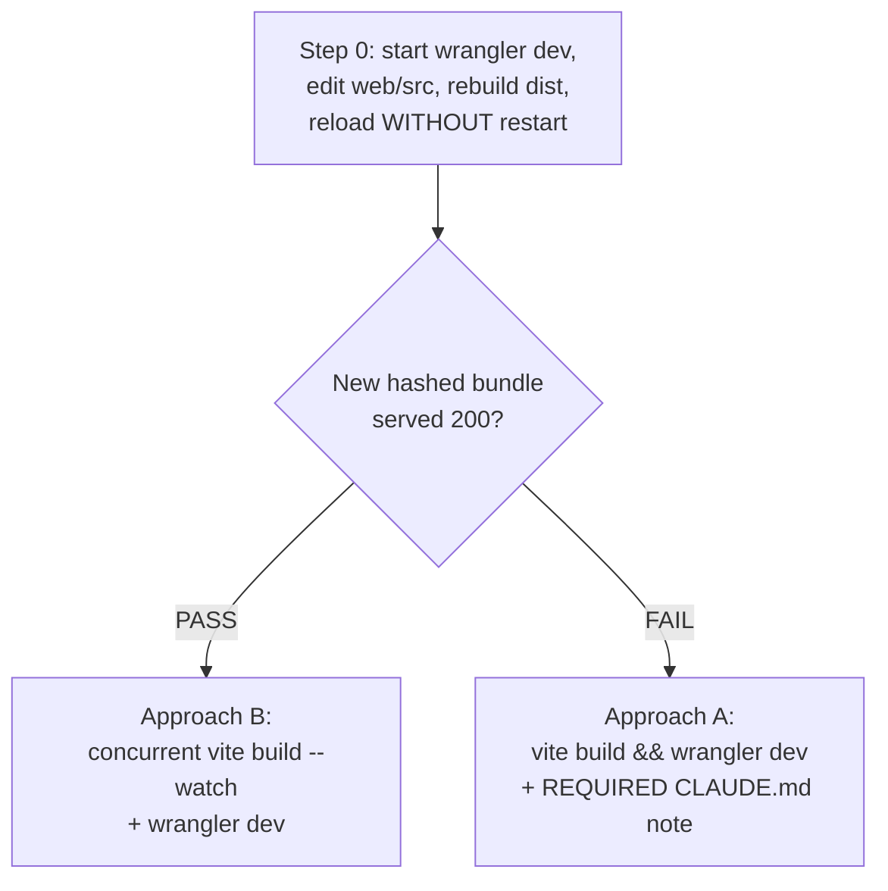
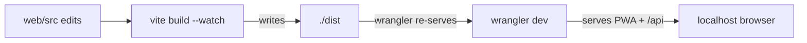

# Plan: Fix `npm run dev` serving stale `./dist` (local-dev papercut)

Slug: `fix-dev-stale-dist`
Type: dev-tooling papercut (no application code, no production change)
Confirmed by QA on 2026-06-30. Amended 2026-07-01 per plan-review (APPROVE WITH CHANGES).

## 1. Problem statement and goals

`wrangler dev` serves the **prebuilt** `./dist` bundle via Cloudflare Static Assets
(`wrangler.toml:5-7` → `[assets] directory = "./dist"`), and the `dev` script
(`package.json:6`) is just `wrangler dev` with **no build step**. So the frontend on
localhost is whatever `./dist` was last built from — not the current `web/src/` source.

Any local browser/manual QA of a frontend change silently tests STALE assets. The
`fix-list-selection-view-state` QA hit a false "bug still present" because `./dist` was
~9.6h stale until a manual `npm run build` + reload. This traps anyone doing local QA
(now common since the dev-auth shim unblocked local browser testing).

Goal: `npm run dev` should serve the CURRENT `web/src/` so edits are reflected without a
manual rebuild (approach B), or — if the runtime cannot support that — at minimum guarantee
fresh assets at each start plus a load-bearing doc note (approach A). Which one ships is
decided by an empirical check the Coder runs first (Step 0, section 4).

## 2. Non-goals

- No change to application code, the Worker, auth/reminder/push logic.
- No change to what gets DEPLOYED. `npm run build` must keep producing the same `dist`;
  the production serving path (Worker Static Assets from `dist`) stays identical. (There is
  no `deploy` script in `package.json`; deploy is `wrangler deploy` run manually/CI, which
  consumes the `build` output + `wrangler.toml [assets]` config — both left unchanged here.)
- No change to `wrangler.toml` asset/production semantics.
- Not introducing HMR / a separate Vite dev server (see approach C, rejected below).
- Not changing `vite.config.ts` build output (keeping the same `dist` = prod parity). The
  only permitted `vite build` tweak is a CLI-flag override on the *watch* invocation (does
  not touch the config file or the `build` script; see m3 mitigation in section 6).

## 3. Investigation findings (cited)

- **`package.json:5-15`** — scripts today:
  - `dev` = `wrangler dev` (no build). `build` = `vite build`.
  - `typecheck`, `lint`, `test` (`vitest run`), `test:e2e`, `preview` (`wrangler dev --local`).
  - devDeps (`:21-41`): `vite ^6.0.3`, `wrangler ^4.0.0`, `@vitejs/plugin-react`,
    `vitest`. **No `concurrently` / `npm-run-all`** present — a concurrency runner must be
    ADDED for approach B.
- **`wrangler.toml:5-7`** — `[assets] directory = "./dist"`, `binding = "ASSETS"`.
  Wrangler serves the prebuilt directory; it does **not** run Vite or build `web/src`.
  Whether `wrangler dev` re-serves updated `./dist` content WITHOUT a restart is the single
  load-bearing unknown that Step 0 resolves.
- **`vite.config.ts`** — `root: "web"` (`:6`), `build.outDir: "../dist"` (`:9`),
  `emptyOutDir: true` (`:10`); inputs `main` (`web/index.html`) and `sw` → emitted as
  root `sw.js` (`:19`); other chunks emitted as **content-hashed** `assets/[name]-[hash].js`
  (`:17-21`). The content hashing is why the Step 0 check is binary pass/fail (see M1,
  section 8). There is a leftover `server.proxy` mapping `/api` → `http://localhost:8787`
  (`:25-28`) — dead scaffolding for approach C, unused by the `dev` flow. Left in place;
  see nit follow-up in section 8.
- `vite build --watch` writes to the same `../dist` that wrangler serves, so a watch build
  flows straight into the served directory.

## 4. Step 0 — the decision gate (Coder runs this FIRST)

Assets are content-hashed (`vite.config.ts:17-21`): every `web/src` change produces NEW
hashed filenames and a rewritten `index.html` that references them. Therefore the whole
plan pivots on ONE empirical fact: **does `wrangler dev` re-serve updated `./dist` content
without being restarted?** This is not a "degrades gracefully" situation — it is binary
(see M1). Resolve it before writing any script:

**Step 0 procedure:**

1. `npm run build` once, then start plain `wrangler dev` (current `package.json:6` behavior).
   Open the localhost URL; confirm the app loads (note the hashed bundle name referenced by
   the served `index.html`, e.g. `assets/main-<hashA>.js`, returns 200).
2. WITHOUT stopping wrangler, make a visible change to a `web/src` file, then rebuild `dist`
   (`npm run build`). This regenerates `index.html` to reference a NEW hash
   (`assets/main-<hashB>.js`) and removes the old file.
3. WITHOUT restarting wrangler, reload the browser and inspect what is served:
   - **PASS** if the freshly served `index.html` references the NEW hash
     (`assets/main-<hashB>.js`) AND that new hashed bundle loads **200** (i.e. wrangler is
     serving current `./dist`, and the visible change appears).
   - **FAIL** if the served `index.html` still references the old hash, OR the new hashed
     bundle **404s** (wrangler snapshotted its asset manifest at boot and requires a
     restart to see new files).

**Decision rule:**

- **Step 0 PASS → implement Approach B** (section 6). Wrangler re-serves updated `dist`, so
  a concurrent watch build gives edit-while-running freshness.
- **Step 0 FAIL → implement Approach A + the REQUIRED CLAUDE.md note** (section 7). A watch
  cannot help if wrangler won't re-serve without a restart; the honest fix is fresh-at-start
  plus a documented manual-restart step.

Record which branch was taken and surface it to plan-review (workflow rule: Coder reports
the branch, does not silently redesign).



## 5. Rejected alternative (kept for the record)

**(C) Vite dev server + API proxy** (HMR, `server.proxy` already scaffolded at
`vite.config.ts:25-28`): best DX, but the PWA would be served by Vite, not by the Worker's
Static Assets — so local QA would NOT exercise the prod serving path (SPA fallback, `ASSETS`
binding, service-worker registration at root `sw.js`). SW/PWA behavior in a Vite dev server
diverges from prod and is exactly what QA needs to trust. Two processes + port wiring.
Over-scoped for a papercut and reduces prod parity. Rejected. Both A and B keep the exact
prod serving path (Worker serves `dist`).

## 6. Approach B (preferred — implement IF Step 0 PASSES)

Run `vite build --watch` (incrementally rebuilds `./dist` on every `web/src` change)
concurrently with `wrangler dev` (which — per a Step 0 PASS — re-serves that updated `./dist`).



**Concurrency runner:** add **`concurrently`** (devDependency, `^9.1.0`). Chosen over shell
`&` (orphans the `vite` watch when `wrangler` is Ctrl-C'd; not cross-platform) and over
`npm-run-all`. `-k` = kill-others-on-exit; `-n` = process name labels; `-c` = label colors.

### 6a. Scripts (`package.json:5-15`)

```jsonc
"scripts": {
  "dev": "vite build && concurrently -k -n web,worker -c cyan,magenta \"npm:dev:web\" \"npm:dev:worker\"",
  "dev:web": "vite build --watch --emptyOutDir false",
  "dev:worker": "wrangler dev",
  "build": "vite build",
  "typecheck": "tsc --noEmit -p tsconfig.worker.json && tsc --noEmit -p tsconfig.web.json",
  "lint": "eslint src/ web/src/ --ext .ts,.tsx",
  "test": "vitest run",
  "test:watch": "vitest",
  "test:e2e": "playwright test",
  "migrate:local": "wrangler d1 migrations apply family-scheduler --local",
  "preview": "wrangler dev --local"
}
```

### 6b. m3 mitigation — the empty-`dist` startup race (concrete pick + honest bound)

The problem the reviewer flagged: `dev` starts with a leading one-shot `vite build` (so
`./dist` exists for wrangler's `[assets] directory` at boot), but `dev:web` =
`vite build --watch` normally runs its FIRST build with `emptyOutDir: true`
(`vite.config.ts:10`), which **re-empties `./dist`** and then repopulates it. Because
`concurrently` launches `dev:web` and `dev:worker` in parallel, wrangler can boot racing an
empty `dist`.

**Concrete mitigation (picked):** disable emptying on the *watch* invocation only, via the
CLI override `--emptyOutDir false` (shown in 6a on `dev:web`). This does NOT touch
`vite.config.ts` or the `build` script — the deploy build still empties as before. With the
override, the watch does not wipe `./dist`; the leading one-shot build's output survives
continuously until the first incremental rebuild replaces individual files, so there is no
empty window for wrangler to boot into.

**Coder verification + honest fallback:** during Step 0 / B bring-up, confirm the installed
Vite (`^6.0.3`) actually honors the CLI negation (start `dev`, check the leading build's
files are NOT wiped at watch startup). If this Vite build ignores the flag and still empties:
that is acceptable and self-healing GIVEN B's precondition — B is only selected on a Step 0
PASS, which means wrangler re-serves updated `dist` without restart, so the transient empty
window resolves the instant the watch's first build emits (exactly like any later edit). In
that fallback case, note it and keep the leading build purely as the fresh-clone / missing-dir
guard. Do NOT claim deterministic ordering: the guarantee is either "watch does not empty"
(if the flag is honored) or "empty window self-heals via wrangler re-serve" (if it is not).

### 6c. devDependency (`package.json:21-41`)

Add (keep the list alphabetized where it already is):

```jsonc
"concurrently": "^9.1.0"
```

Then `npm install` to update the lockfile. `concurrently` is dev-only; it is not bundled
into the Worker or `dist`, so deploy output is unaffected.

### 6d. m4 — `concurrently -k` teardown resilience (confirm during bring-up)

With `-k`, if `dev:web` were to EXIT, wrangler would be killed too. Vite/Rollup watch mode
does NOT exit on a rebuild error — it prints the error and stays alive waiting for the next
change — so the edit-while-running loop should survive a transient syntax error. Because QA
relies on that loop, the Coder MUST confirm it during Step 0 / B bring-up: while `npm run
dev` is running, introduce a transient TS/JSX syntax error in a `web/src` file, confirm the
`concurrently` session stays up (wrangler not killed), then fix the error and confirm the
next successful rebuild flows through. If (unexpectedly) the watch exits and `-k` tears down
the session, keep the loop resilient by dropping `-k` in favor of an explicit signal that
still stops both on Ctrl-C (e.g. `--kill-others-on-fail` is NOT what we want; prefer
`concurrently` without `-k`, accepting that Ctrl-C still terminates both). Document whichever
variant is used.

### 6e. How a developer runs Approach B

- `npm run dev` — builds `dist` once, then starts `vite build --watch` + `wrangler dev`.
  Open the localhost URL wrangler prints.
- Edit any `web/src` file → `vite` rebuilds `dist` → wrangler serves current source. No
  manual `npm run build`.
- Ctrl-C stops BOTH processes.

## 7. Approach A (fallback — implement IF Step 0 FAILS)

If wrangler will not re-serve updated `dist` without a restart, a watch build cannot fix the
papercut mid-session. The honest fix is: fresh assets at every start, plus a REQUIRED doc
note that a manual restart is needed after `web/src` edits.

### 7a. Script (`package.json:6`)

```jsonc
"dev": "vite build && wrangler dev",
```

All other scripts (`build`, `preview`, etc.) UNCHANGED. No `concurrently` devDependency is
added in the A branch (remove it from the plan's install step if A is taken).

### 7b. REQUIRED CLAUDE.md note (verbatim)

Because approach A leaves a manual step, this note is REQUIRED (not optional). Add it to the
project `CLAUDE.md` under the `## Commands` → `### Dev server` area, verbatim:

> **Note:** `npm run dev` builds `./dist` once and then serves it via `wrangler dev` (the
> Worker's Static Assets path). It does NOT rebuild `web/src` while running. After editing
> anything under `web/src`, you MUST stop and re-run `npm run dev` (equivalently, run
> `npm run build` and restart `wrangler dev`) for the change to appear on localhost —
> otherwise you are testing stale assets.

### 7c. How a developer runs Approach A

- `npm run dev` — builds `dist` fresh, then serves it. Current at START.
- After editing `web/src`: Ctrl-C and re-run `npm run dev` (or `npm run build` + restart).
  This is the load-bearing manual step the CLAUDE.md note documents.

## 8. Risks, edge cases, and open questions

- **M1 — the Step 0 check is binary pass/fail, not a graceful degrade.** Assets are
  content-hashed (`vite.config.ts:17-21`), so a rebuild yields new filenames + a rewritten
  `index.html`. If wrangler snapshots its asset manifest at boot, the new hashed files are
  simply absent and **404** — a browser refresh does NOT serve stale, it fails. There is no
  stable "no reload but fresh bytes on refresh" middle state. Hence Step 0 selects A or B
  outright; the Coder implements the selected branch in the SAME pass (both are fully
  spec'd here), no re-plan round trip.
- **m3 (see 6b):** the watch's `emptyOutDir` re-empty race at startup — mitigated by
  `--emptyOutDir false` on the watch, with a self-healing honest fallback under B's Step 0
  PASS precondition. No deterministic-ordering claim is made.
- **m4 (see 6d):** `-k` teardown on a watch error — expected fine (Vite watch stays alive on
  rebuild errors); Coder confirms during bring-up and documents the resilient variant.
- Service worker (`sw.js`): served from `dist` exactly as in prod under BOTH A and B, so
  local PWA/SW QA stays faithful — a key reason both beat C.
- **Optional follow-up (out of scope here):** the dead `server.proxy` scaffolding at
  `vite.config.ts:25-28` is unused by the `dev` flow. Leave it in place for this fix; a
  separate one-line cleanup could remove it later to reduce confusion. Do NOT action it here.
- Open question: none blocking. Step 0 resolves the only unknown empirically.

## 9. Affected files and modules

- **Approach B:** `package.json` — `scripts` block + one devDependency (`concurrently`).
  Only file changed. No `wrangler.toml`, no `vite.config.ts`, no app code.
- **Approach A:** `package.json` — the single `dev` script line; AND `CLAUDE.md` — the
  REQUIRED note (7b). No devDependency added. No app code.

## 10. Done conditions

Which set applies depends on the Step 0 branch.

**Common:**

1. `npm run build` still produces the deployable `dist` the same way — the `build` script is
   unchanged, so deploy output is produced identically (production path untouched). (Not a
   byte-for-byte claim about output, which this change does not control; the guarantee is
   that `build` behavior/text is unchanged.)
2. `npm test` and `npm run typecheck` unaffected (those scripts unchanged).

**If Approach B (Step 0 PASS):**

3. `npm run dev` with NO manual `npm run build`: localhost reflects current `web/src` at
   start (make a visible source change beforehand, confirm it appears).
4. **Edit-while-running:** with `npm run dev` still running, edit a visible string in a
   `web/src` file; after the watch rebuild, a browser reload shows the new string with NO
   manual build and NO wrangler restart. (This is how QA confirms the papercut is gone.)
5. **Loop resilience (m4):** a transient syntax error in `web/src` does not tear down the
   `concurrently` session; fixing it and saving lets the next rebuild flow through.

**If Approach A (Step 0 FAIL):**

3. `npm run dev` serves current `web/src` at START (visible change appears after a fresh
   `npm run dev`).
4. **Restart-reflects:** after editing `web/src`, Ctrl-C and re-running `npm run dev` shows
   the change. (QA confirms fresh-at-start behavior, not mid-session.)
5. The REQUIRED CLAUDE.md note (7b) is present verbatim, documenting the manual restart step.

## 11. Step-by-step implementation checklist for the Coder

1. **Step 0 (decision gate, section 4):** build once, start `wrangler dev`, edit a `web/src`
   file, rebuild `dist`, reload WITHOUT restarting wrangler. Observe whether the served
   `index.html` references the NEW content hash and that bundle loads 200. PASS → B; FAIL → A.
   Record the branch and report it to plan-review.
2. **If B:**
   a. Add `"concurrently": "^9.1.0"` to `devDependencies`; run `npm install`; commit the
      lockfile change.
   b. Edit the `scripts` block per section 6a (replace `dev`, add `dev:web` with
      `--emptyOutDir false`, add `dev:worker`; leave `build`/`preview`/all others untouched).
   c. Verify the m3 mitigation (6b): confirm the watch does not wipe the leading build's
      output; if the flag is a no-op, confirm the empty window self-heals and note it.
   d. Verify m4 (6d): confirm a transient watch error does not tear down `concurrently`;
      document the resilient variant if `-k` had to be dropped.
   e. Verify B done-conditions 3, 4, 5.
3. **If A:**
   a. Change `dev` to `"vite build && wrangler dev"` (section 7a); do NOT add `concurrently`.
   b. Add the REQUIRED CLAUDE.md note verbatim (section 7b).
   c. Verify A done-conditions 3, 4, 5.
4. **Common:** run `npm run build` and confirm the `build` script is unchanged and produces
   the deploy `dist` the same way (done-condition 1). Run `npm run typecheck` and `npm test`
   (done-condition 2).

## 12. Process confirmation

This proceeds plan-review → Coder → QA. It touches ONLY `package.json` (and, in the A
branch, `CLAUDE.md`) with no production change and no application/Worker/auth/push code
change. The single unknown (does wrangler re-serve updated `dist` without restart) is
resolved by Step 0, which deterministically selects a fully-specified branch — so no re-plan
round trip is needed.

## 13. Amendment log

- **2026-07-01 (plan-review APPROVE WITH CHANGES):**
  - **Step 0 is now the explicit decision gate** (section 4): binary PASS/FAIL check on
    whether `wrangler dev` re-serves updated content-hashed `dist` without a restart; the
    result selects Approach A or B. (Addresses M1 / required change 2 — risk taxonomy is now
    pass/fail, dropping the illusory "fresh bytes on refresh" middle case.)
  - **Both approaches are first-class with exact scripts** (sections 6 and 7), including the
    verbatim REQUIRED CLAUDE.md note for the A fallback. (Addresses m2 / required change 1 —
    fallback is fully specified, no re-plan round trip.)
  - **m3 empty-`dist` startup race mitigated** (6b): `--emptyOutDir false` on the watch
    invocation, with an honest self-healing fallback bounded by B's Step 0 PASS precondition;
    the overstated "deterministic ordering" claim is removed. (Required change 3.)
  - **m4 teardown note added** (6d): Coder confirms a transient watch rebuild error does not
    trip `-k` into killing the session; documents a resilient variant if needed. (Required
    change 4.)
  - **Wording nits:** corrected "deploy untouched" to reference the absent `deploy` script /
    `build` + `wrangler.toml [assets]` config (n1); softened done-condition to "the `build`
    script is unchanged" instead of "byte-for-byte" output (n2); noted `server.proxy`
    (`vite.config.ts:25-28`) as an OPTIONAL out-of-scope cleanup follow-up (n3).
