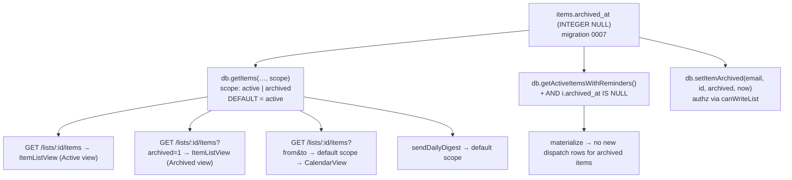

# Archived state for items

**Status:** v10 — **post-QA amendment, APPROVED** (2026-09-21, round-10 review, byte-exact APPROVE on the last line of docs/reviews/item-archive-review.md). Ready for the Coder. Round 9 closed with APPROVE WITH CHANGES; this revision folds those in. Status stays *in review* until a verdict exists — an author cannot approve their own plan (round-6 review, and I made that mistake again in v9 before catching it). v6 shipped to the Coder and passed
QA (`docs/qa/item-archive-report.md`, PASS WITH NITS) on branch `feat/item-archive` (`efe02fe`).
This revision adds §9, closing two of QA's three nits on the owner's decision. The third
(attachment-duplication) was **split into its own backlog item** — it needs a new authorized server
endpoint, which Decision 7 deliberately excluded, and adding one here would invalidate this
branch's authorization review and QA pass.
**Backlog entry:** `docs/backlog.md:147` ("NEW (2026-09-19) — Archived state for items")
**Branch:** `feat/item-archive`

**Owner decisions in force:**
- **(2026-09-19)** Archived is a separate axis from completed — a nullable `archived_at` alongside
  `completed_at`. Still in force.
- **(2026-09-19)** Recurring items are excluded entirely. Still in force.
- **(2026-09-20)** **Auto-archive is cut** from this branch; manual archive only.
- **(2026-09-20)** **Archived items appear only in the dedicated archived view** — hidden from both
  the list and the calendar grid.
- **(2026-09-20)** **Restore (unarchive) is in scope.** This *reverses* the 2026-09-19 "duplicate,
  not unarchive" decision. `archived_at` is reversible.
- **(2026-09-20)** Duplicate stays, and must reuse existing code rather than add server surface.

## Revision history

- **v6 (2026-09-20)** — round-5 review (2 required + 5 NITs, no blockers). **Final revision; goes to
  the Coder without a further review round.** Text about the artifact only; no decision changed.
  - **§5.7 now records the compile blast radius of the required-prop decisions (R5.3)** — **18**
    sites, split by cause (16 `<ItemDetails>` in `ItemDetails.test.tsx`, 2 `<ItemModal>` in
    `ItemModal.desktop.test.tsx`), with `tsconfig.web.json:17` as why test files are inside
    `typecheck`, and an explicit instruction **not** to resolve it by restoring optionality — the
    one-character fix that silently undoes N3 and N4.3. Decision 9's "exactly two hosts" corrected
    to name the production count as distinct from the typecheck obligation.
  - **Ownership table added (N5.3):** `ItemModal` owns the `setItemArchived` call and the duplicate
    modal transition; `ItemDetails`' three handlers raise intent only; `ItemEditor` keeps the
    duplicate `POST`. Each host gains exactly one prop.
  - **§8 gained its missing v5 sweep record (R5.5)**, plus the three files v5 newly leaned on
    (`App.tsx:229-244`, `ItemDetails.tsx:16-28`, `vitest.workspace.ts:30-49`) and the counts behind
    R5.3, verified directly rather than taken on trust.
  - NITs: N5.1 (blockquote no longer swallows T22's criterion), N5.2 (GUARD definition excepts the
    split label), N5.4 (`TZ` step moved before the step that needs it; tail renumbered), N5.5
    (v4's withdrawn `App.tsx:55-63` claim struck through in place rather than left to proximity).
- **v5 (2026-09-20)** — round-4 review (APPROVE WITH CHANGES, 5 required + 4 NITs, no blockers;
  reviewer states §§1–5 need no further architectural pass). Accuracy only.
  - **Decision 9's second assumption named the wrong mechanism.** The guarantee that a deep link
    cannot open a modal over the calendar is the **prop wiring** — `App.tsx:232` passes
    `CalendarView` only `lists`/`user`, and `initialOpenItem` goes to `ItemListView` alone
    (`:240`), which is unmounted while the grid shows. Removing `App.tsx:62` would open *nothing*.
    `:62` is a redundant third layer. Conclusion unchanged and stronger; trigger restated as
    "if `CalendarView` is ever wired to `initialOpenItem`".
  - **M1b step 4 (third revision):** the "No items in this list yet." placeholder renders
    **alongside** the error banner, not instead of it — the failed fetch never calls
    `onItemsChange`. Discriminator restated as **the banner's presence**.
  - **T22 gained a sampling caveat (R4.4)** — it inherits "archivable from ~01:00" from §6.2, and
    an assertion at exactly `+25 h` is red on correct code, inviting a "fix" to 24 h.
  - **§8's GUARD enumeration** said five and named three, omitting T30 — an unscoped count
    invalidated by its own revision, one paragraph from the standing note about that. Corrected to
    four, and **T30's label split**: live as to the refresh, GUARD as to the navigation.
  - NITs: M3's hour window was an hour short on the day after a spring-forward (**02:00**, per
    D1.2's own text); T29's `TZ` rationale replaced with one that is not self-defeating, plus its
    repo-wide blast radius and a new checklist step 12a; **`ItemDetails`' three handlers made
    required**, applying v4's own N3 argument one level down; T30's non-discriminating
    "heading unchanged" assertion dropped.
  - Status line corrected — it still read `v2` on a v4 document.
- **v4 (2026-09-20)** — round-3 review (APPROVE WITH CHANGES, 7 items, no blockers). Accuracy only;
  no design change.
  - **Decision 9's stated harm was unreachable, and T30 passed on the build it named.** From the
    grid, `startOfMonth(saved.start_at)` always already equals `currentMonth`, so the `onSaved`
    build navigates to the month it is on — a no-op, and behaviourally identical to
    `onArchiveChanged`. The separate prop is **kept, re-justified on hygiene**; T30 and M2c are
    re-scoped to what is observable, with the unobservable part stated plainly. *(Anyone told that
    reusing `onSaved` "would navigate the calendar on every archive" should treat that as
    withdrawn: the branch executes, the navigation does nothing.)*
  - **Two more day-key survivors**, both inside v3's declared sweep range: §6.2's "archivable from
    local midnight" row and §8's own "day-key branch". v3's term list was built from the
    *identifier* and was blind to prose stating its *answer* — §8 now records the rule that follows.
  - **T25 was red on correct code for one hour a day** (round-2 item 14, dropped in v3, worsened by
    `+25 h`). Clock pinned.
  - **M1b step 4 asked QA to read an error that never reaches the browser** — no `app.onError` is
    registered, so the text is console-only. Rewritten to say where to look.
  - **T5a/T6a had zero margin on a spring-forward fixture date** (N1) — 02:00 is exactly `+25 h`
    there, and the gate is strict. Moved to 03:00; T6a's anchor being a Sunday makes it the sharper
    case. **T29 pins `TZ`** (N2), which `vitest.workspace.ts` leaves unset.
    **`onArchiveChanged` is required, not optional** (N3), so `typecheck` enforces it rather than a
    forgetful host silently desyncing the UI from a successful write.
  - **"Restore is unreachable from the calendar" now names both assumptions it rests on** — the grid
    never shows an archived item, *and* ~~`App.tsx:55-63` forces deep links to the list view~~
    **[withdrawn in v5 — R4.1: the real guarantee is the prop wiring at `App.tsx:229-244`; removing
    `:62` would open nothing at all]**.
  - §8 gains a **standing note on how to write a corrections sweep**. Every sweep declaration in
    this plan was wrong on first writing; the note says why that is structural and what to do
    instead, and v3's wrong declaration is left standing with its correction attached.
- **v3 (2026-09-20)** — round-2 review (APPROVE WITH CHANGES, 14 items, no blockers). Two items
  changed a design decision rather than its wording:
  - **The all-day gate is now `ANCHOR_AT + ALL_DAY_GRACE_MS` (25 h), not a timezone day-key.**
    v2 refuted a candidate nobody proposed (materialising an end-of-day *instant*, which does need
    offset probing) and never compared against plain millisecond arithmetic, which needs no zone at
    all. Honest comparison is now D1.2. The arithmetic form **deletes two defects outright**: the
    `RangeError` that v2's `Intl` call could throw inside `ItemDetails`' render, and the cross-zone
    day error. `src/shared/archive.ts` is now dependency-free.
  - **`buildDuplicateDraft`'s all-day arm is deleted; the date rule is uniform.** v2's all-day
    duplicate landed on *today*, whose midnight has already passed — producing exactly the dead
    reminders date-shifting exists to prevent, and T23 pinned the bug. One rule now: the source's
    wall-clock time on the earliest day whose instant is strictly after `now`.
  - Corrected claims: Decision 3(i)'s `materialize` race is unreachable (contradicted 3(ii) — this
    was round-1 item 4, missed in v2); T15r's falsification statement was wrong and the
    "symmetrised into a bug" warning overstated a hazard that does not exist; R10's cross-zone
    error is **only ever early** and its real coupling is two hardcoded `DEFAULT_TIMEZONE` copies;
    R11's reachability sentence was false — a violating row is reachable through the UI today.
  - **M1b was theatre and is rewritten.** `rm -rf .wrangler/state` destroys migrations 0001–0006,
    so the new code failed with `no such table: items` — not the `no such column: archived_at` the
    rehearsal exists to demonstrate. R9 is the owner's requested section; its only substantiation
    now actually exercises it.
  - **New: the `onSaved` collision.** `CalendarView`'s `onSaved` was rewritten by `2afce988`
    (PR #25) and now **navigates the grid on save**. Archive must not route through it. Decision 9.
  - T6a did not pin R11 (it tests the reader, not the writer) — **T29** added for the writer.
    Folded in three round-1 items: `mapItem ?? null`, the 390 px check, `tagName` on Restore.
- **v2 (2026-09-20)** — four owner decisions folded in. Three of them invalidated arguments v1 had
  built on, so the affected sections were **re-derived, not patched**:
  - **Auto-archive cut.** The cron, `wrangler.toml`, `ARCHIVE_AFTER_DAYS` and
    `autoArchiveDueItems` are all gone from the build. The rule itself is **banked intact** in
    **Appendix A** — `N_ARCHIVE` = 30 days, the `ANCHOR_AT` definition and the
    completed-tasks-plus-past-events reasoning were all confirmed correct *if* auto-archive returns.
    Two things dissolved with it and are named rather than silently dropped: the SQL↔TS anchor
    parity test (v1 T15) has nothing left to compare, because the anchor now exists only in TS; and
    the digest **ordering** argument is void, though the digest **unreachability proof** survives on
    re-derived grounds (§5.6).
  - **Archived hidden from the calendar too.** v1's OQ2 is overruled. The exclusion is placed in
    **SQL, not render** (Decision 4), which also collapses `ItemScope` from three values to two.
    v1's calendar `data-archived` attribute, its muted styling and its test (v1 T27) are removed,
    and §7.1 states why no client-side calendar test replaces them.
  - **Restore in scope.** v1 justified several things from irreversibility; every one of those
    arguments is re-derived here. The manual-archive precondition survives, but on one of its three
    original arguments rather than two (Decision 5). The read-only guards survive, but as
    *invariant preservation* rather than historical-record sanctity (§5.5). Duplicate survives, but
    because it is a *different operation*, not because unarchive was unavailable (Decision 7). The
    restore↔reminder interaction is the new Decision 8, with an executable proof rather than prose.
  - **Duplicate's "reuse existing code" is now a stated constraint** with a named list of
    temptations to refuse (Decision 7), not an incidental observation.
  - Citation corrections folded into the body: `db.ts:473` / `db.ts:788` are the two P2-N1 purge
    **calls**; `:469` / `:786` are the comments above them.
- **v1 (2026-09-20)** — initial plan: manual archive, auto-archive on the daily cron, archive view,
  duplicate. Premise check identified auto-archive as the weakest of the three capabilities and the
  one to cut if scope shrank; the owner took that advice in v2.

---

## 0. Referent table — read this before trusting any number below

The most expensive defect available to this plan is a **correct number attached to the wrong
referent**. Two different quantities in this feature are both "30". Every figure in the body cites
a row here by symbol.

**Live** = used by code this branch ships. **Deferred** = defined in Appendix A only; **no shipped
code path reads it**, and nothing in §§1–8 may build on it.

| Symbol | Live? | What it measures | Units | Which artifact | Which extent / band | Threshold or method |
|---|---|---|---|---|---|---|
| `ANCHOR_AT` | **live** | The last instant the item's **own stored fields** describe | EpochMs (UTC) | per item row | `MAX(start_at, COALESCE(end_at, start_at))` — type-agnostic, **no `completed_at` term** | a raw value, **not** the archive gate — see `ARCHIVE_GATE` |
| `ARCHIVE_GATE` | **live** | Whether an item may be archived **now** | boolean predicate, not a quantity | `isArchivable(item, now)` in `src/shared/archive.ts` — the only exported gate | **timed:** `ANCHOR_AT < now`. **`all_day`: `ANCHOR_AT + ALL_DAY_GRACE_MS < now`** | §5.2; the all-day branch is Decision 1's blocker fix |
| `ALL_DAY_GRACE_MS` | **live** | How long after an all-day item's stored start-of-day instant the gate opens | milliseconds | module constant in `src/shared/archive.ts` | all-day items only; **no zone is consulted** | **25 h = `90_000_000`** — the longest possible local day (fall-back), so the gate is never early in any zone. D1.2 |
| `GRACE_MINUTES` | **live** | How far **back** `sendDue` reaches for pending dispatch rows | minutes | `DEFAULT_ENGINE_CONFIG`, `src/worker/config.ts:9` | reminder engine only | **30** `[measured — config.ts:9]` |
| `LOOKAHEAD_DAYS` | **live** | How far **forward** `materialize` expands occurrences | days | `DEFAULT_ENGINE_CONFIG`, `src/worker/config.ts:8` | reminder engine only | **60** `[measured — config.ts:8]` |
| `DIGEST_WINDOW` | **live** | Forward-only span the daily digest reports on | hours | `sendDailyDigest`, `src/worker/reminders/send.ts:222-224` | `[now, now + 2 days]`, never backwards | **48 h** `[measured — send.ts:224]` |
| `MIGRATION_NO` | **live** | Next migration ordinal | integer | `migrations/` | highest existing is `0006_attachments.sql` | **0007** `[measured — directory listing]` |
| `SUITE_BASE` | **live** | Green baseline before this work | tests / files / e2e specs | `npm test`, `npm run test:e2e` | whole repo | **312 / 35 / 6** `[quoted from the task brief — Coder must re-measure on branch before claiming a delta]` |
| `N_ARCHIVE` | *deferred* | Delay between an item becoming *settled* and becoming *auto-archivable* | whole days | Appendix A only — **no constant is added to `config.ts` in this branch** | would apply only to a future auto sweep, **never** to manual archive | **30** `[owner-confirmed 2026-09-20 as correct if auto-archive returns]` |
| `CUTOFF` | *deferred* | A future sweep's comparison point | EpochMs (UTC) | Appendix A only | `now − N_ARCHIVE × 86 400 000` | derived, not stored |
| `DAILY_CRON` | *unchanged* | When the existing daily digest fires | cron expr (UTC) | `wrangler.toml:20` | the branch at `src/worker/index.ts:78` — **this branch does not touch it** | `0 14 * * *` `[measured]` |

Reading notes. Each one is a mistake that was actually made — the first two during this plan's own
drafting.

- **`ANCHOR_AT` is a raw instant; `ARCHIVE_GATE` is the rule. Never use the first as the second.**
  v1 did, and that is exactly how the all-day blocker got in: for an all-day event `start_at` is
  **local midnight at the *start* of the day** (`ItemEditor.tsx:253`, `:273` — `new Date(value +
  "T00:00:00")`), and a single-day all-day event has `end_at = null` (`:65`), so
  `ANCHOR_AT` lands at *00:00 on the morning of the event itself*. Comparing that instant against
  `now` offers the Archive button at 00:00:00.001 on the day the event happens. Every reference to
  "may this be archived" must go through `ARCHIVE_GATE`.
- **`ANCHOR_AT` for manual archive is not the expression Appendix A uses for the deferred sweep.**
  Manual archive asks only "has this item ended?" — no `completed_at` term and no delay, because
  Decision 1 deliberately lets a human archive an *incomplete* past task. Appendix A's
  `SWEEP_ANCHOR` additionally requires a task to be completed and uses `MAX(start_at,
  completed_at)`. `src/shared/archive.ts` implements the **live** one only; `SWEEP_ANCHOR` is prose
  in Appendix A and is not code anywhere.
- `GRACE_MINUTES` = 30 **minutes** (live); `N_ARCHIVE` = 30 **days** (deferred). Numerically equal,
  causally unrelated, and only one of them exists in code today.
- `ANCHOR_AT` is **the item's own end instant**, not an occurrence instant. Recurring items have no
  single `ANCHOR_AT`, which is precisely why the 2026-09-19 recurring exclusion holds.
- **`ALL_DAY_GRACE_MS` is 25 hours, not 24.** The extra hour is not slack — it is what makes the
  gate's error **uniformly conservative** (never early) across DST. A 24 h form is early by an hour
  on the fall-back day, and "early" is the direction that re-opens the v1 blocker. D1.2 derives it.
- **`ARCHIVE_GATE` consults no timezone at all.** It compares instants, both of which are already
  UTC epoch-ms. This is deliberate and is what makes `src/shared/archive.ts` dependency-free and
  incapable of throwing — see D1.2 and R10.

---

## 1. Premise check

The owner asked for the feature directly, so *whether to do archiving* was never in question. What
was in question — and what the 2026-09-20 scoping decisions settled — is whether each capability
earns its cost. This section records the reasoning, because the scope this branch ships is its
conclusion.

### 1.1 The real problem, stated from the code

`getItems` is `SELECT * FROM items WHERE list_id = ? ORDER BY start_at` with **no time predicate**
(`src/worker/db.ts:585`), and `ItemListView` renders every returned row (`ItemListView.tsx:158-169`).
Completed tasks stay visible forever, dimmed (`ItemListView.tsx:217`); past events stay visible
forever, undimmed. So the list view is an append-only pile: the longer the family uses the app, the
deeper today's items are buried. **That** is the problem archiving solves, and it is real.

### 1.2 Capability (a) manual archive — **the load-bearing one; shipped**

This is the only capability not computable from data the client already has. "Archive *this* item,
because I say so" cannot be derived from `start_at`, `completed_at` or `rrule`. With auto-archive cut
(§1.4) it is now the *only* way anything enters the archive, which raises its importance rather than
lowering it: everything the deferred sweep would have caught, a human now catches, so the action has
to be cheap to reach and cheap to undo. Restore (Decision 8) is what makes it cheap to undo.
Cost: one column, one route, two buttons.

### 1.3 Capability (c) view archived + restore + duplicate — **shipped, and it is three things**

- **Viewing archived items** is a necessary consequence of hiding them, not an independent feature.
  If you hide things you must show where they went. Ships as the Archived view (Decision 4b).
- **Restore** was added by the owner on 2026-09-20 and is what converts archiving from a one-way
  door into a reversible filing action. It is the single largest reduction in this feature's risk
  (§6.1 R2).
- **Duplicate** is the highest-value, lowest-cost piece here, and it **does not depend on archiving
  at all**. It needs *no new endpoint*: `ItemEditor` already accepts a create-mode draft and
  `POST /api/items` already accepts `reminders` (`ItemEditor.tsx:58-71`, `:116`; `db.ts:646-672`).
  "Reuse existing code" is now an explicit constraint with a named refusal list — Decision 7.

### 1.4 Capability (b) auto-archive — **cut from this branch (owner, 2026-09-20)**

The analysis that led there, kept because it is the reason and not a footnote:

**As a display-hiding mechanism the auto rule is a stored duplicate of a predicate the client could
compute for free.** "Hide non-recurring items whose `ANCHOR_AT` is more than `N_ARCHIVE` old" is a
one-line filter over data `getItems` already returns. A pure client-side "hide old items" toggle
would deliver most of the visible benefit with zero schema, zero cron and zero API.

What argued *for* building it anyway — and what will argue for it again if it returns — is that a
stored column gives the reminder engine, the digest, the list and the archived view **one** predicate
(`archived_at IS NULL`) instead of a rule re-implemented per surface, and that manual-only archiving
of a household backlog is the kind of tidying nobody actually does.

What argued *against*, and won: it is **the only part of this feature that writes to the database
without a human in the loop**, on a rule the owner had not yet lived with. Restore blunts that
objection considerably — a bad sweep would now be undoable — but "undoable one item at a time" is
poor consolation for a sweep that touched fifty rows at once, and the cut removes the whole
first-run-blast-radius problem (v1 R1) rather than mitigating it.

**What the cut buys, concretely:** no cron change, no `wrangler.toml` change, no new constant, no
`autoArchiveDueItems`, and — because the archive rule no longer exists in SQL at all — no SQL↔TS
parity test and no drift risk between the two (v1's R5 and T15 both dissolve). The rule survives
intact in **Appendix A**; re-opening it is additive and needs no schema change, because the column
this branch ships is the same column a sweep would write.

### 1.5 Scope shipped

Manual archive, restore, an archived view, and duplicate. Auto-archive deferred to Appendix A.
The dependency runs one way: (a) and (c) stand alone without (b), but (b) without (a) would have no
escape valve for the cases its rule deliberately refuses.

---

## 2. Goals and non-goals

### 2.1 Goals

- G1. A non-recurring item whose time has passed can be **manually archived**, which removes it from
  the list view **and the calendar grid** and stops any reminder it still has pending.
- G2. An archived item can be **restored**, which returns it to both surfaces and provably neither
  resurrects a dead reminder nor fires a late one (Decision 8).
- G3. Archived items are **viewable** in a dedicated archived view of the list they belong to.
- G4. An archived item can be **duplicated** into a new, editable, future-dated item, using the
  existing create path and no new server surface.
- G5. No behaviour change for recurring items anywhere.
- G6. `start_at` cannot move while an item is archived. This is not cosmetic — it is the invariant
  §5.6 and Decision 8 both prove things from.

### 2.2 Non-goals

- NG1. **Auto-archive.** Cut 2026-09-20; banked in Appendix A. No cron change, no
  `wrangler.toml` change, no new config constant.
- NG2. **Recurring items.** Excluded by the 2026-09-19 decision. No `item_occurrence_state`
  analogue, no per-occurrence archiving, no per-occurrence restore.
- NG3. **Editing an archived item in place.** Restore first, then edit (§5.5). Archived items reject
  `PATCH` and `complete` with 409.
- NG4. **Copying attachments on duplicate.** R2 bytes, a cap re-check and a new endpoint — and a new
  endpoint is exactly what Decision 7 forbids.
- NG5. **Bulk archive / bulk restore / bulk duplicate.**
- NG6. **Archiving lists.** Items only.
- NG7. **A search or date-range filter over the archived view.** It is a plain reverse-chronological
  list. If it becomes unwieldy, that is a separate backlog entry.
- NG8. **Purging or expiring archived rows.** They stay until deleted by hand.
- NG9. **Provenance tracking on a duplicate** (a `source_item_id` column, a "copied from" link). Not
  asked for; would cost a column for nothing.

---

## 3. Proposed design

### 3.1 Lifecycle

```mermaid
stateDiagram-v2
    [*] --> Live : POST /api/items (archived_at = NULL)
    Live --> Live : PATCH / complete / reminders / attachments
    Live --> Archived : POST /api/items/:id/archive {archived:true}<br/>requires non-recurring AND ANCHOR_AT < now
    Archived --> Live : POST /api/items/:id/archive {archived:false}<br/>"Restore" — no date precondition
    Archived --> [*] : DELETE /api/items/:id (still allowed)
    Archived --> Copy : Duplicate → POST /api/items (a NEW Live item;<br/>the source stays archived)
    Copy --> Live
    note right of Archived
      archived_at IS NOT NULL
      • hidden from the list view AND the calendar grid
      • visible only in the Archived view
      • still point-readable (deep links)
      • PATCH / complete → 409 CONFLICT, so start_at cannot move (G6)
      • materialize skips it; pending dispatch purged on the way in
      • restore does NO dispatch work on the way out (Decision 8)
    end note
```



### 3.2 Where the predicate lives at each layer

Every exclusion is in **SQL**. Nothing filters on `archived_at` in a component (Decision 4).



**Design invariant (load-bearing):** `getItems`' new `scope` parameter **defaults to `"active"`**,
and **exactly one call site passes anything else** — the `?archived=1` branch of
`GET /lists/:id/items`. Every other call site (the plain list path, the `?from&to` occurrence path,
`sendDailyDigest`) keeps its existing signature *and* silently gets the safe behaviour. A call site
the Coder overlooks under-shows (an archived item stays hidden) rather than leaking archived rows
into a surface that must not have them. Under-showing is visible and recoverable; leaking is the
failure the owner ruled against on 2026-09-20.

---

## 4. Decisions

### Decision 1 — What may be archived: `ARCHIVE_GATE`, with an end-of-day branch for all-day items

**Rule.** An item may be archived when **both**:

```
rrule IS NULL            -- owner decision, 2026-09-19
AND ARCHIVE_GATE         -- "once its date has passed" (owner's own framing)

where ANCHOR_AT = MAX(start_at, COALESCE(end_at, start_at))
and   ARCHIVE_GATE =
        item.all_day  ?  ANCHOR_AT + ALL_DAY_GRACE_MS < now
                      :  ANCHOR_AT                    < now
      with ALL_DAY_GRACE_MS = 25 * 60 * 60 * 1000
```

Both arms compare UTC epoch-ms against UTC epoch-ms. **No timezone is read, so this cannot throw
and cannot disagree between the Worker and the browser.**

There is **no `completed_at` term and no delay**. Both belong to the deferred sweep (Appendix A) and
must not leak into the live rule — §0's second reading note exists for this.

#### D1.1 Why all-day needs its own branch (this was a blocker in v1)

All-day items do **not** store an end-of-event instant. `ItemEditor` parses an all-day date as
`new Date(value + "T00:00:00")` — local midnight at the **start** of that day — for both `start_at`
(`ItemEditor.tsx:251-256`) and `end_at` (`:270-276`), and a single-day all-day item leaves
`end_at` **null** (`:65`). So under a naive `ANCHOR_AT < now` gate:

| Item | Stored `ANCHOR_AT` | Naive gate offers Archive from | Ideal | **Chosen gate (C)** |
|---|---|---|---|---|
| All-day event on Wed | Wed 00:00 local | **Wed 00:00:00.001 — the morning of the event** | Thu 00:00 | Thu ~01:00 |
| All-day Fri→Sun | Sun 00:00 local (`end_at` is the *start* of the last day) | **Sun 00:00:00.001 — the first second of the last day** | Mon 00:00 | Mon ~01:00 |
| Timed event Wed 14:00–15:00 | Wed 15:00 | Wed 15:00:00.001 | same | same — timed arm is unchanged |

The ~1 h offset in the last column is `ALL_DAY_GRACE_MS`'s deliberate conservatism (D1.2), not
slack. It is always **late**, never early.

**Cutting auto-archive made this strictly worse, which is why it is a blocker and not a nit.** In
v1 the sweep's `N_ARCHIVE` (30 days) absorbed the one-day error completely — nothing was archived
until long after any plausible end-of-day. With the sweep gone, the manual gate is the *only* thing
between the owner and an Archive button on an event that has not happened yet.

#### D1.2 How the branch is computed — three candidates, compared honestly

**v2 chose a timezone day-key and defended it against the wrong alternative.** It argued that
materialising "the instant of midnight at the end of day D in zone Z" needs the wall-clock→instant
direction `Intl` does not provide, i.e. hand-rolled offset probing — the "error-prone" path decision
**D11** (`docs/plans/family-scheduler-design.md:571`) rejected. That argument is correct, and it
does not touch the candidate that matters: **adding a fixed number of milliseconds**, which needs no
zone conversion in either direction. Here is the comparison that should have been made.

| | **A. Naive** `ANCHOR_AT < now` (v1) | **B. Day-key** in `item.timezone` (v2) | **C. `ANCHOR_AT + ALL_DAY_GRACE_MS`** (chosen) |
|---|---|---|---|
| All-day, normal case | **wrong by a full day** — the v1 blocker | exact | ≤1 h late |
| DST fall-back day (25 h local day) | wrong by a day | exact | exact at 24 h… so **25 h** is used; see below |
| DST spring-forward (23 h local day) | wrong by a day | exact | ≤2 h late |
| Creating device east of the stored zone | wrong by a day | **wrong by a full day, and always EARLY** (R10) | unaffected — the writer's zone cancels out |
| Invalid `item.timezone` | unaffected | **throws `RangeError`** inside `ItemDetails`' render | unaffected — no zone is read |
| Dependencies of `src/shared/archive.ts` | none | `Intl.DateTimeFormat` + locale data | **none** |
| Worker/browser agreement | trivial | depends on ICU data in both runtimes | trivial |

**C wins on every axis except exactness, where it is inexact by ≤2 h in one direction.** That is the
right trade, because the two defects it deletes are both *day*-scale and one of them re-creates the
very blocker this section exists to fix:

- **It cannot throw.** `item.timezone` is unvalidated end to end — `routes/items.ts:132` and `:201`
  accept any string (`typeof b.timezone === "string"` is the entire check),
  `ItemEditor.tsx:284-289` is a free-text input, and `recurrence.ts:121`'s `isValidTimezone` has
  **zero call sites in the repo**. `Intl.DateTimeFormat` throws `RangeError` on an unknown zone, and
  §5.7 puts `isArchivable(item, Date.now())` inside `ItemDetails`' render — so under B a single bad
  zone string crashes the view modal. C reads no zone, so the failure mode does not exist. *(If a
  future version of this rule ever does need a zone, reuse `src/shared/itemLabels.ts:33-38`'s
  documented three-step fallback — supplied zone → schema default → UTC with an explicit suffix —
  rather than inventing one.)*
- **It is immune to the cross-zone error**, because it never re-interprets the stored instant in a
  different zone. `start_at` is already local midnight *in the writing device's zone*; adding a
  fixed duration to it keeps that frame. B mixes frames — it reads an instant written in the
  device's zone back through `item.timezone` — and the resulting error is **always early** (R10).

**Why 25 h and not 24 h.** The longest possible local day is 25 hours (a DST fall-back day; the
shortest is 23). With 24 h the gate opens one hour *early* on a fall-back day — a miniature version
of the v1 blocker, on an all-day event whose day is not quite over. With 25 h the error is
**uniformly conservative: never early, at most 2 h late**, in every zone and under every transition.
A 2 h delay costs nothing — nobody archives at 00:30 — while "early" is the failure direction that
put this section in the plan.

**What C gives up, stated plainly:** an all-day event is archivable from roughly 01:00–02:00 the
following day rather than exactly 00:00. If the owner ever wants exact midnight, B is the form to
return to, and it must come with the `itemLabels.ts` fallback chain and the R10 caveat.

**Unrelated finding, recorded because it was turned up here:** `recurrence.ts:121` exports
`isValidTimezone` described as "used in validation" and **nothing calls it**. Validating
`item.timezone` at the route layer would be a genuine small improvement, but it is **not in scope**
for this branch — C makes this rule independent of it, and adding validation now would change the
accept-behaviour of item create/edit for reasons unrelated to archiving. Worth its own entry.

#### D1.3 The rest of the rule

**A task does not have to be complete to be archived.** This is deliberate and is the piece most
likely to be "corrected" by someone who has read Appendix A. The deferred sweep refuses incomplete
past tasks precisely so a *human* decides their fate; requiring completion before manual archiving
would make "I am never doing this, get it off my list" into a two-step lie — tick a box for
something you did not do. Since the rule is now entirely human-driven, this arm carries more weight
than it did in v1.

**Why `ANCHOR_AT` is `MAX(start_at, COALESCE(end_at, start_at))`, not `start_at`.** A **timed**
multi-day event (Friday 09:00 → Sunday 17:00) stores `start_at` on Friday; keying on `start_at`
would let it be archived while it is still running. `COALESCE` handles the nullable `end_at`
(`0001_init.sql:26`). The outer `MAX` handles a row where `end_at < start_at`, which **is reachable
in stored data**: `routes/items.ts:179-183` only validates `end_at >= start_at` when `end_at` is
present *in the same PATCH body*, so a PATCH that moves `start_at` later, alone, sails past it.
Without the outer `MAX`, such a row could be archived while its `start_at` is still in the future —
which would break G6 and, through it, both proofs in §5.6 and Decision 8. (For **all-day** items
`ANCHOR_AT` is still only an input; D1.2's `ALL_DAY_GRACE_MS` arm is what actually gates them.)

**Two defects inherited from v1 and fixed here, recorded so neither change reads as drift:**
1. **All-day gating** — D1.1 above. v1 compared `ANCHOR_AT` to `now` for every item.
2. **`completed_at` in the live anchor** — v1 defined `itemAnchorAt` with a per-type split
   (`tasks: MAX(start_at, completed_at)`) while simultaneously stating that manual archive does not
   require completion. For an *incomplete* task that expression takes `MAX` over a `NULL`, so the
   live predicate was ambiguous on exactly the case the decision cared most about. The live anchor
   is now **type-agnostic** and mentions `completed_at` nowhere; the per-type split survives only in
   Appendix A, where a completed task is a precondition anyway and the ambiguity cannot arise.

**No configurability** — there is nothing to configure. The live rule has no tunable number.

### Decision 2 — Cron and `wrangler.toml`: **no change**

With auto-archive cut, this branch touches no scheduled code at all. `handleScheduled`
(`src/worker/index.ts:66-83`) and `wrangler.toml:20` are **untouched**, and no
`ARCHIVE_AFTER_DAYS` constant is added to `src/worker/config.ts`. The reasoning about *where* a
sweep would run, if one returns, is banked in Appendix A §A.3 — it is still correct and still worth
inheriting.

**One v1 argument is now void and one survives; both are named so neither is quoted onward by
mistake.** v1 argued for co-locating the sweep with the digest partly so the sweep ran *before* the
digest composed its entries. That **ordering argument is void** — there is no sweep. The
**unreachability proof** that made the ordering merely belt-and-braces is *not* void, and in fact
becomes the whole argument: §5.6 re-derives it under the new invariants (including restore) and it
is why no daily-digest test is written.

### Decision 3 — Reminders on an item being archived

Three separate mechanisms, deliberately not collapsed:

**(i) Pending dispatch is purged when an item is archived.** `setItemArchived`'s archive arm calls
the existing `deletePendingDispatchForItem` (`db.ts:1343`), in the order **set `archived_at` first,
then purge** — mirroring `completeItem` exactly (`db.ts:1077` then `db.ts:1081`).

**The order is a readability choice, not a correctness one — v1 and v2 claimed otherwise and were
wrong.** Both versions justified set-then-purge by a race: purge-then-set supposedly leaves a window
for a concurrent `materialize` to re-insert the row before the flag lands. **That race is
unreachable, and (ii) below is the proof** — `materialize` cannot insert a row for this item in
*either* order, because archiving requires `start_at < now` (Lemma 1) and `expandOccurrences`
returns `[]` for a non-recurring item whose start precedes the window (`recurrence.ts:37-39`). The
two paragraphs contradicted each other three apart. The real reason to set-then-purge is that
`completeItem` does, so the two functions read the same way; pick either order and the result is
identical.

**On P2-N1 — be precise about what carries over.** P2-N1 (`CLAUDE.md:83`) is an *ordering*
requirement: purge pending dispatch **before** an FK cascade delete, because the purge query joins
against rows the cascade is about to remove (`db.ts:473`, `db.ts:788`). Archiving performs **no
cascade and no delete**, so the ordering half of P2-N1 is vacuous here and claiming it applies would
be a true-sounding statement about the wrong thing. What *does* carry over is P2-N1's underlying
reason: `reminder_dispatch` has **no FK to `items`** (`0001_init.sql:44-46`), so nothing cleans it
up implicitly and every cleanup must be explicit. That is why the purge exists at all.

**Is (i) reachable, or is it a guard? Reachable — narrowly, and only for *timed* items.** The window
is worth deriving because it is the falsification answer for T2. `fire_at = occurrence_at −
offset_minutes` (`recurrence.ts:116-118`), so `fire_at ≤ start_at` always, and `sendDue` only
selects rows with `fire_at > now − GRACE_MINUTES` (`db.ts:1306-1312`). A timed item becomes
archivable at `ANCHOR_AT + ε`, so a pending row is still **live** at that moment exactly when the
reminder's `offset_minutes < GRACE_MINUTES` (30 **minutes**, §0) and the archive happens within
`(GRACE_MINUTES − offset_minutes)` minutes of `ANCHOR_AT`. Narrow, but a real window in which
omitting the purge fires a reminder for an item the user just archived.

**For `all_day` items this purge is inert**, and the all-day fix is what makes that true: Decision
1.2 means an all-day item cannot be archived until the *next calendar day*, by which point any
`fire_at ≤ start_at` (yesterday's midnight or earlier) is far outside `GRACE_MINUTES` and already
inert (`src/worker/types.ts:84-85` — aged-out rows are never re-selected). So T2 must be written
against a **timed** fixture; an all-day fixture would make it vacuous.

**(ii) `materialize` also skips archived items — but this is a GUARD, not a live mechanism.** Add
`AND i.archived_at IS NULL` to `getActiveItemsWithReminders`' WHERE clause (`db.ts:1242`), beside
the analogous `completed_at` exclusion it already carries, and in the SQL rather than in
`materialize.ts`'s loop so two sibling predicates cannot drift apart. The clause is unconditional
(not inside the existing `rrule IS NOT NULL OR …` disjunction): recurring items can never be
archived, so it is a no-op for them and correct for everything else.

**v1 claimed this was live, by transferring `completeItem`'s rationale onto a case where that
rationale's precondition fails. It does not hold, and the difference matters.** `completeItem` can
run on a **future-dated** task, so without its skip `materialize` would genuinely keep producing
dispatch rows for a completed item. Archiving **cannot** run on a future-dated item (Decision 1 ⟹
`start_at < now`, Lemma 1 in Decision 8), and `expandOccurrences` returns `[]` for a non-recurring
item whose `startAt` is before the window start (`recurrence.ts:37-39`). So **even with the clause
removed, `materialize` would create no rows for an archived item.** The clause is defence in depth.

**The coupling this creates, recorded because it is the thing that will be forgotten:**

> If the `updateItem` CONFLICT guard (§5.5, G6) is ever relaxed so that `start_at` can move while an
> item is archived, then **(a)** the `materialize` skip stops being a guard and becomes load-bearing,
> and **(b)** the daily-digest test that §5.6 declines to write must come back, because §5.6's
> unreachability proof rests on the same invariant. Neither consequence is local to the line being
> changed.

**(iii) (i) and (ii) do different jobs.** (i) removes rows that already exist with a live `fire_at`;
(ii) would prevent new ones if the invariant that makes them impossible were ever removed.

**This purge is asymmetric with restore, and the reason is "there is nothing to do" — not "doing it
would be a bug".** `setItemArchived(…, archived: false)` is a bare `UPDATE items SET archived_at =
NULL`. v2 warned that symmetrising it would "reintroduce a failure mode"; **that overstates a hazard
that does not exist.** At restore time the item has no pending dispatch rows — they were purged on
the way in, and Decision 8 proves none were re-created — so an added
`deletePendingDispatchForItem(itemId)` on the restore path would be a **scoped no-op**: harmless,
just noise.

The symmetrisation that *would* be harmful is the opposite one — making restore **schedule**
something (re-materialise, re-insert, "wake the reminders up"). That is a real temptation, because
"restore should bring the reminders back" sounds right until you notice the occurrence is in the
past. **T13r is what catches it**, by asserting zero rows after restore + `materialize`. The code
comment should therefore explain *why nothing is needed* and cite Decision 8, not warn about a
redundant purge.

**Precedent to cite in that comment:** `completeItem`'s *un*-complete arms already take no dispatch
action and say so (`db.ts:1071` and `db.ts:1087`, both reading "No dispatch purge — materialize
self-heals"). Restore is the same shape.

### Decision 4 — Visibility: hidden from the list **and** the calendar, and the exclusion lives in SQL

Owner decision, 2026-09-20; v1's OQ2 is closed. Archived items appear in the **Archived view and
nowhere else**. The open part was *where* the exclusion is enforced, and that is decided here.

**Chosen: SQL, inside `getItems`.** Rejected: a render-side filter in `CalendarView` (and
`ItemListView`).

1. **`dayOccs` drives four things at once, and a render-side filter desynchronises three of them.**
   In `CalendarView.tsx:103-130`, a single `dayOccs` array feeds: the `slice(0, 3)` visible cap
   (`:108`), the `hiddenCount` / `toggleLabel` / `toggleText` strings (`:111`, `:113-121`), the
   rendered chips, and the roving-tabindex focus id list `ids` (`:126-129`) that
   `web/src/lib/calendarFocus.ts` navigates. Filtering at render means choosing *which* of those
   four to filter. Filter only the render and "+2 more" counts invisible items and the arrow keys
   land on a chip that is not there; filter `dayOccs` itself and you have re-implemented the rule
   inside the component that the `calendar-show-more` and `calendar-roving-tabindex` plans both
   went several review rounds to get consistent. In SQL, all four stay consistent for free because
   the archived occurrence never exists.
2. **The cross-list merge argues for SQL too.** `CalendarView` fires one request per list and
   `flatMap`s the results (`CalendarView.tsx:64-68`). One endpoint-level rule covers every list;
   a render-side rule has to survive the merge and be correct for every list at once.
3. **SQL makes restore reappear on the grid for free.** `CalendarView` owns its own
   `useItemModal()` instance and its own `occurrences` state (`:45-49`, `:28`), deliberately
   separate from `ItemListView`'s. With the rule in SQL, a restored item simply comes back in the
   next fetch; with a render-side rule, the restore path would need to invalidate a second,
   independent copy of the predicate in a component that never issued the restore.
4. **A render-side filter still ships archived items over the wire.** The route expands each item
   into occurrence objects server-side (`routes/items.ts:65-85`) before serialising. In SQL an
   archived item never enters the pipeline; at render it is expanded, serialised, transferred and
   then discarded — visible to anyone reading the network tab, which is a weak but real form of
   "appears outside the archived view".
5. It keeps the rule in `db.ts`, where this project puts data-shaping rules —
   `getActiveItemsWithReminders` already carries the sibling `completed_at` exclusion in SQL
   (`db.ts:1242`), and `CLAUDE.md:82` sets the grain ("the DB layer enforces … routes are thin").
6. **It collapses `ItemScope` from three values to two.** v1 needed `"all"` solely to let the
   calendar see archived items. With the calendar excluded, nothing needs `"all"`, so the type is
   `"active" | "archived"` and the `?from&to` path simply takes the default.

**Belt-and-braces is explicitly declined**, and reason 1 is why it is not merely redundant but
harmful: a second copy inside `CalendarView` is a copy that must stay synchronised with `dayOccs`'
four consumers forever.

**v1 artefacts this decision removes**, listed so they are not half-removed: the calendar chip's
`data-archived="true"` styling hook, its muted classes, and the `"all"` scope.

**The criteria are inversions, not deletions** — this is the part of the reversal that costs work.
v1's T20 asserted the occurrence path *includes* an archived item; T20 now asserts it *excludes*
one, **and needs an anti-vacuity control** (the same response must still contain a live item's
occurrence, or an empty response passes). v1's T27 asserted the chip renders with
`data-archived="true"`; T27 inverts into a test that `CalendarView` does **not** filter — see §7.1,
where its framing is spelled out, because "assert the client renders what it is given" is easy to
misread. M2 inverts the same way. §7.1 carries the control for each.

### Decision 4b — The Archived view: a scope toggle on `ItemListView`

**Chosen:** an **Active / Archived** toggle at the top of `ItemListView`, scoped to the currently
selected list. **Rejected:** a fourth top-level nav view.

**Reading of the owner's wording, stated rather than assumed:** "a dedicated archived view" is taken
to mean *a surface that shows archived items and only archived items*, which the Archived toggle
state is. It is **not** read as requiring a fourth item in the primary nav. If the owner meant the
stronger thing, OQ2 records it as a one-question change; nothing else in the plan depends on which
way it goes.

1. Archive is a property of items *within a list*. Putting the recovery next to the loss is the
   discoverable placement, and it is where a user who just archived something will look.
2. A fourth nav entry costs space in a fixed mobile bottom bar that currently holds 2–3 items
   (`App.tsx:127-131`, `:254-274`) and would need its own cross-list merge story — i.e. exactly the
   complication Decision 4 just removed from the calendar.
3. Mechanically it is one query parameter on an endpoint `ItemListView` already calls
   (`ItemListView.tsx:70`).

**Implementation note:** use two plain `Button`s with `aria-pressed`, mirroring the existing nav
idiom (`variant={active ? "default" : "outline"}`, `App.tsx:168`). **Do not introduce
`web/src/components/ui/tabs.tsx`** — it is currently referenced only by `RadixSpike.test.tsx` and is
otherwise unused in the app; pulling a Radix primitive into first real use inside a feature branch
adds a focus-management surface this feature does not need. Use `aria-pressed` (a toggle), not
`aria-current="page"` (navigation).

### Decision 5 — The archive precondition survives, on one argument instead of two

**Enforced server-side.** `setItemArchived(…, archived: true)` rejects with `VALIDATION` unless
`ARCHIVE_GATE` holds — the full predicate from Decision 1, all-day branch included, via the shared
`isArchivable`. Not `ANCHOR_AT < now`, which is the raw instant and is wrong for all-day items.

v1 gave three reasons. Restore kills one of them outright, so the decision is re-derived rather than
carried over:

1. **SURVIVES, and is now the whole case.** It makes the archive's meaning exact and globally
   relied-upon: *archived ⇒ `start_at` is in the past, and stays there* (with G6 supplying the "stays
   there"). **Two separate proofs rest on this and on nothing else** — §5.6's proof that an archived
   item can never appear in the daily digest, and Decision 8's proof that restore can never fire a
   late reminder. Remove the precondition and both collapse from "impossible by construction" to
   "we filtered it, probably".
2. **VOID.** v1 argued that without the precondition, Archive becomes a permanent-hide button for a
   future obligation, since nothing could bring it back. Restore brings it back. This argument is
   dead and must not be quoted onward.
3. **SURVIVES (weakly).** It costs one branch and one test.

It is also, independently, what the owner asked for: "manually archive an item **once its date has
passed**". That is an owner statement, not an inference from it.

**Considered and rejected: dropping the precondition now that archiving is reversible.** "Put this
aside for now" on a *future* item is a snooze/defer feature, not archiving. It would break the
invariant both proofs use, and it would purge a live item's pending dispatch and rely on
`materialize` to rebuild it — recoverable, but a real behaviour with no requester. Out of scope.

**What the UI offers for an item whose date has not passed: nothing — the button is absent.**
Rejected: a disabled button with an explanatory `title`. Disabled buttons are not focusable, so the
tooltip is unreachable by keyboard and invisible on touch — and the owner's primary device is an
iPhone (`memory/MEMORY.md`). Absence matches the existing row-action idiom, where Edit/Delete are
conditionally rendered behind `canWrite` rather than disabled (`ItemListView.tsx:303-312`). Accepted
cost: a user may wonder where Archive went (§6.1 R-UX1).

### Decision 6 — Archive lives in the view modal, not on the list row

`ItemDetails` (the view modal's body) gains **Archive** for a live item and **Restore** +
**Duplicate** for an archived one. The list row's action stack (`ItemListView.tsx:299-313`) is
**unchanged** in the Active view, and reduced to **View only** in the Archived view.

1. A fourth stacked full-height button makes an already-tall mobile row taller.
2. Requiring the user to open the item first makes archiving a considered action rather than a
   mis-tap next to Delete. **Restore weakens this argument but does not remove it** — a mis-archive
   is now cheap to undo, but a mis-tap that silently removes a row from the list is still a
   confusing thing to do to someone, and the modal is where the user can see *what* they are
   archiving.
3. `ItemDetails` already has the `canWrite` + `onEdit` prop pattern to extend, and
   `ItemModal`/`useItemModal` already own the open/close/refresh plumbing.
4. Restore must live next to Archive or the pair is incoherent; putting Archive in the modal
   therefore fixes Restore's location too.

### Decision 7 — Duplicate: semantics, and "reuse existing code" as a hard constraint

Duplicate survives the reversal of the "duplicate, not unarchive" decision, but **its justification
has changed and the old one must not be repeated.** v1 (quoting the 2026-09-19 decision) justified
duplicate on the grounds that *the archive is a historical record and never changes*, so the only
way to get a live item out of it was to copy it. Restore makes that false. The surviving
justification is simply that **they are different operations**: Restore moves *one* item back to
live; Duplicate *creates a second* item from a template and leaves the source archived. The owner's
own words describe the template use — "take an old item and use it to create a new one" — and that
need is untouched by restore existing.

**Hard constraint (owner, 2026-09-20): no new server surface.** Duplicate is a client-side
`ItemDraft` prefill plus the existing `POST /api/items`. What this branch adds for it is exactly:
one pure module (`web/src/lib/duplicateItem.ts`), one optional prop (`ItemEditor`'s `initialDraft`),
and one arm on the modal state union. Everything else is existing code — `ItemEditor`'s create mode,
`createItem` in `apiClient.ts`, `POST /api/items` with its validators, and `_upsertReminders`.

**Named temptations, all forbidden** (a Coder will meet at least one of these):

| Tempting | Why it is refused |
|---|---|
| `POST /api/items/:id/duplicate` | Duplicates validation that `POST /api/items` already owns (`validateItemInput`, the RRULE check, `validateLocationKind` — `routes/items.ts:494-539`) and needs a *two-sided* authz story (read the source, write the target list) where `createItem`'s single `canWriteList` suffices. It also moves the date decision server-side, where the user cannot see or correct it before saving. |
| A `duplicateItem()` in `db.ts` | Same objection, plus it would re-implement the reminder copy `_upsertReminders` already performs via `createItem`. |
| Copying attachments (R2 `put`/copy) | NG4 — requires the server endpoint this constraint forbids, re-runs the per-item cap check, and silently consumes the new item's 25 MB budget. |
| A `source_item_id` provenance column | NG9. Additive-column cost for a feature nobody asked for. |
| Reusing `PATCH /api/items/:id` "because the form is already wired to it" | Writes the **source**. This is the one temptation that silently corrupts data rather than merely over-building, which is why T28 asserts the HTTP **method** and not just that a request fired. |

**Semantics:**

| Question | Answer | Why |
|---|---|---|
| Copies reminders? | **Yes** | `ItemDraft.reminders` is already part of the create payload and `createItem` calls `_upsertReminders` (`db.ts:672`). Free, and a copied soccer practice without its reminder is useless. |
| Copies attachments? | **No** (NG4) | See the refusal table above. The source's attachments remain reachable in the Archived view. The editor shows the existing `AttachmentsCreateHint` ("Save the item first, then add attachments", `AttachmentsEditor.tsx:154-161`), which is already the honest create-mode message. |
| Which list? | **The source item's list**, pre-selected and changeable in the editor's list picker before saving. `ItemEditor` already renders that picker and `draft.list_id` already drives it (`ItemEditor.tsx:59`). |
| Recurrence? | **Always `rrule: null`.** A duplicate is always a one-off. The branch is unreachable today (archived ⇒ non-recurring), so making the function *total* beats carrying a dead conditional — and it is the behaviour you would want anyway if Duplicate is later offered on live recurring items (OQ3). |
| Completed / archived state? | **Neither is copied.** `createItem` hardcodes `completed_at NULL` (`db.ts:651`) and `archived_at` must likewise be non-settable from the request body (§6.3). A duplicate of an archived item is **live**. |
| Does the source change? | **No.** It stays archived. That is the whole difference from Restore. |
| What date? | **The source's wall-clock time on the earliest day whose resulting instant is strictly after `now`** — one uniform rule for timed and all-day alike. Duration (`end_at − start_at`) preserved; a null `end_at` stays null. §5.7.1 |

**Why shift the date rather than copy it.** The two failure modes are asymmetric. Copying the source
date prefills a *past* date; if the user saves without noticing, they create an item whose reminders'
`fire_at` are already gone — a reminder that silently never fires, which is this app's core promise
broken invisibly. Shifting prefills a plausible near-future date the user still has to confirm; if
they don't change it, nothing is silently broken. Asymmetric risk, so shift.

**How the shift is computed (and why this way).** Read the source's **local** wall-clock hour and
minute and construct the target with `new Date(y, m, d, H, M)` for today, falling back to tomorrow if
that instant is `<= now`. This matches exactly how the editor already round-trips times
(`epochToDatetimeLocal`, `ItemEditor.tsx:36-40`, uses local getters), and because the `Date`
constructor resolves local wall time it is DST-correct for the user's zone by construction — unlike
adding `24 × 3600 × 1000` ms, which shifts the displayed hour across a DST boundary. Known
limitation: the item's stored IANA `timezone` is *not* consulted, so duplicating an item stored in a
non-local timezone prefills the local clock time. Every item today uses
`America/Los_Angeles` — sourced from the **client's** hardcoded default,
`web/src/components/ItemEditor.tsx:18`, consumed at `:68`, **not** from the Worker's `config.ts:13`
(R10 corrects that attribution) — and the family is in one zone; the value is visible in the form
before saving. Accepted, and recorded here rather than discovered later.

### Decision 8 — Restore: what it does, and what it deliberately does not do

**`setItemArchived(…, archived: false)` sets `archived_at = NULL` and stops.** It performs **no
dispatch work whatsoever** — it does not purge, and it does not schedule. That asymmetry with the
archive direction (Decision 3(i), which *does* purge) is the single most important thing in this
section, and it needs a `WHY` comment in the code or it will be "symmetrised" away.

**Precondition: none beyond authorization.** Any archived item is restorable by anyone who can write
its list. Guards are only `NOT_FOUND`, `FORBIDDEN`, and `archived_at IS NULL → CONFLICT` ("Item is
not archived"). There is deliberately **no** date precondition — the item's date is necessarily in
the past (Lemma 1 below), and "you may only restore recent things" would be a rule nobody asked for
that makes an accidental archive permanent after a delay. There is also **no `rrule` guard**: a
recurring item can never have been archived, so it can never be restored, and a guard for it would
be unreachable code.

#### 8.1 The two failure modes, which do pull in opposite directions

- **"Restore silently leaves reminders dead."** The item comes back but never notifies anyone.
- **"Restore resurrects a reminder that then fires late."** A stale reminder arrives for something
  in the past.

A naive fix for either causes the other. The resolution is that **neither is reachable**, and the
thing that makes that true is the archive precondition (Decision 5) — which is why that precondition
had to survive the reversal.

#### 8.2 Proof

**Lemma 1 — archived ⟹ `start_at` is in the past.** Archiving requires `ARCHIVE_GATE` (Decision 5),
and `ANCHOR_AT = MAX(start_at, COALESCE(end_at, start_at)) ≥ start_at` by construction. Both
branches give the result, and the all-day branch gives a stronger one:

- **Timed:** `ANCHOR_AT < now`, so `start_at ≤ ANCHOR_AT < now`.
- **All-day:** `ANCHOR_AT + 25 h < now` and `start_at ≤ ANCHOR_AT`, so `start_at < now − 25 h` —
  at least a day of margin, not an instant of it.

Therefore `start_at < now` at the moment of archiving, under either branch, and the all-day branch
gives the stronger result.

**Lemma 2 — it stays in the past.** While archived, `PATCH` returns 409 (§5.5, G6), so `start_at`
cannot move. Wall-clock time only increases. Therefore `start_at < now` still holds at restore, and
at every moment after it.

**Consequence A — restore creates no dispatch rows.** At the next 5-minute tick, `materialize` picks
the item up again (it is no longer excluded by `getActiveItemsWithReminders`) and calls
`expandOccurrences(q, now, now + LOOKAHEAD_DAYS)`. For a non-recurring item that function returns
`[q.startAt]` **only if `startAt >= windowStart`** and `[]` otherwise — `recurrence.ts:37-40`, which
also **ignores `allDay` entirely** (there is no midnight normalisation that could push a past instant
forward). By Lemma 2, `startAt < now = windowStart`, so it returns `[]`. The per-occurrence loop in
`materialize.ts:65-102` never executes, so **zero** rows are inserted.

**Consequence B — no late fire is possible.** Not because a late row would be filtered, but because
no row is created at all. (For completeness: `sendDue` would also refuse it — it only selects
`fire_at > now − GRACE_MINUTES`, `db.ts:1306-1312` — but that is a second line of defence, not the
argument.)

**Consequence C — "reminders stay dead" is correct, not a defect.** There is no future occurrence
left to remind anyone about. A notification for an event that finished last Tuesday is noise.

**Nothing is permanently lost.** Archiving purges `reminder_dispatch` rows; it never touches
`item_reminders`. The reminder *definitions* survive intact, so the moment the item has a future
occurrence again, `materialize` rebuilds dispatch from them.

#### 8.3 The reschedule path — where reminders come back, and why it is not special

Restore → edit the date to the future → `updateItem` is now permitted (the item is no longer
archived), its `timingChanged` branch purges pending dispatch (`db.ts:735-738` — a no-op here, there
is nothing pending) → the next `*/5` `materialize` tick expands the new, future occurrence and
inserts fresh rows. Reminders fire normally, with no archive-aware code involved.

**No UNIQUE collision.** `reminder_dispatch`'s key is
`(item_reminder_id, occurrence_at, channel, recipient_email)` (`0001_init.sql:57`). The new rows
carry the **new** `occurrence_at`, so they cannot collide with any surviving `'sent'` row from the
item's original date (`'pending'` rows were purged at archive time; `'sent'`/`'failed'` rows are
left alone by design, which is what keeps `INSERT OR IGNORE` idempotent).

This is byte-for-byte the same path a never-archived item takes when it is rescheduled. **There is
no archive-specific reminder handling anywhere in the restore direction**, and that is the point.

#### 8.4 Restoring an item whose date has since passed further

Nothing special happens, and nothing needs to. The item returns to the Active list and to the
calendar grid in **its original month**, not the current one. Two consequences worth stating because
they will look like bugs otherwise:

- The Active list is `ORDER BY start_at` **ascending** (`db.ts:585`), so a restored old item appears
  near the **top** of the list, not where the user was last looking. That is arguably the right
  place — it is visible — but it is a surprise.
- On the calendar, a restored item may be several months back, so restoring it produces **no visible
  change in the current month**. The Archived → Active move in the list is the only immediate
  feedback.

If the user wants the item live *and upcoming*, they restore and then edit the date (§8.3). OQ5 asks
whether Restore should drop the user straight into Edit mode to make that two-step obvious;
recommendation is no for v1.

#### 8.5 Decision 9 — Archive must NOT route through `ItemModal`'s `onSaved`

**This collides with code shipped five days ago, and the plan had not mentioned `onSaved` at all.**
`CalendarView`'s `onSaved` was rewritten by `2afce988` (PR #25, `feat/calendar-follow-saved-item`,
deployed 2026-09-19) and now **navigates the grid**:

```
onSaved={(saved) => {
  if (!saved.rrule) { setCurrentMonth(startOfMonth(new Date(saved.start_at))); }
  itemModal.close();
  setReloadToken((t) => t + 1);
}}                                            // CalendarView.tsx:287-297
```

Archiving **is** reachable from the calendar (a live past item's chip → view modal → Archive), and
the `!saved.rrule` guard is always satisfied by an archivable item, since recurring items cannot be
archived. So an `onSaved`-based build does execute `setCurrentMonth`.

**But the navigation it performs is a no-op, and v3 was wrong to call it harm.** Three facts
compose:

1. `CalendarView.tsx:247` is the **only** `openView` call in the component — a chip's `onClick`.
   There is no other route into the modal from the grid.
2. A chip is rendered only when its `occurrence_at` falls in the **displayed** month
   (`CalendarView.tsx:82-88`).
3. For a non-recurring item `occurrence_at === start_at` (`recurrence.ts:37-39`).

Therefore, whenever Archive fires from the calendar, `startOfMonth(saved.start_at)` **already equals
`currentMonth`**. The `onSaved` build allocates a fresh `Date` for the same month, which — because
the effect's dep is compared by reference (`CalendarView.tsx:72`) — re-fires the fetch and refetches
the grid. That is **behaviourally identical** to the proposed `onArchiveChanged`. (The remaining
route — a `?item=` deep link opening a modal over the calendar — is closed by **prop wiring**:
`App.tsx:232` renders `<CalendarView lists={lists} user={user} />` and passes it no
`initialOpenItem` at all. See the two assumptions below.)

This is exactly the reasoning `calendar-follow-saved-item.md` used for its own guard: a navigation
whose target is the month you are already on is a no-op.

**So the separate prop is justified on hygiene, not on preventing a harm.** One concern per
callback: `onSaved` means "an edit was persisted, follow it"; archiving is not a save, it does not
produce a `saved` item in the same sense, and Restore (from the list) has no navigation story at
all. Threading a state transition through a callback named for a different one is the kind of
coupling that becomes a real bug the moment either side changes — for instance if a future change
surfaced archived items on the grid, or made `openView` reachable from somewhere other than a
chip, at which point `startOfMonth(saved.start_at) === currentMonth` stops holding silently.

**`onArchiveChanged` is a REQUIRED prop, not optional (N3).** §3.2's design invariant is to make the
forgetful case safe by construction, and an optional callback fails that badly here: a host that
omits it leaves Archive succeeding **server-side** while the modal sits there and the surface never
refreshes — a silent divergence between database and screen, which is worse than a compile error.
Making it required puts `npm run typecheck` in charge. There are exactly two **production** hosts to
satisfy (`ItemListView` and `CalendarView`) — but that is not the typecheck obligation: test files
are inside `tsconfig.web.json:17`, so `ItemModal.desktop.test.tsx:77` and `:97` must be updated too.
§5.7 counts the full blast radius.
**Do not follow `triggerRef`'s optionality as precedent** (`ItemModal.tsx:72-75`, optional "so a
direct `<ItemModal>` usage … keeps compiling"): omitting `triggerRef` degrades focus restoration,
which is a nicety; omitting this one desynchronises persisted state from the UI.

**What this costs in verification, stated rather than papered over:** the choice is
**unobservable through the UI**, so no criterion can discriminate the two builds. T30 is therefore
a GUARD over the part that *is* observable (the grid refreshes), and §7.1 says so.

| Host | `onArchiveChanged` does | Notes |
|---|---|---|
| `CalendarView` | `itemModal.close()` then `setReloadToken(t => t + 1)` — **and NOT `setCurrentMonth`** | `reloadToken` is the grid's refresh path (`CalendarView.tsx:33`, dep at `:72`); the refetch is what makes the chip disappear |
| `ItemListView` | `itemModal.close()` then `refresh()` — **passing the current scope** (§5.7) | this is what moves the row between Active and Archived |

**Restore is unreachable from `CalendarView`, and it rests on TWO assumptions — both named, because
either one breaking is enough.**

1. **The grid never shows an archived item.** It renders only occurrences the server returned, which
   exclude archived items (Decision 4), so an archived item's modal cannot be opened from a chip —
   and `CalendarView.tsx:247` is the only `openView` call.
2. **A deep link cannot open one over the calendar — and the guarantee is the PROP WIRING, not the
   view switch.** `initialOpenItem` is passed to **`ItemListView` only** (`App.tsx:240`, inside the
   `:234-243` element), and `App.tsx:232` renders `CalendarView` with just `lists` and `user`.
   Since the two are mutually exclusive branches of the same ternary, `ItemListView` is unmounted
   whenever the grid is showing. So even with `activeView` left on `"calendar"`, a resolved
   deep-link item has **no component to open it** — `getItemForUser` would still resolve the row
   (it deliberately keeps no archive filter, §5.4), but nothing would render it.

   *(An earlier draft named `App.tsx:62`'s `setActiveView("list")` as this assumption. That was the
   wrong mechanism: removing `:62` would open **nothing**, not a modal over the grid, because of
   the wiring above. `:62` is a redundant third layer — useful, but it is not what makes the
   guarantee hold.)*

Restore therefore only ever fires from `ItemListView`'s Archived view, which is why
`CalendarView`'s handler needs no restore branch. **The trigger that would break this is
`CalendarView` ever being wired to `initialOpenItem`** (or otherwise gaining a second route into
`openView`) — at which point navigating to the restored item's month would actually be the
**right** behaviour, since a restored item does reappear there (§8.4).

---

## 5. Data model and API changes

### 5.1 Schema — `migrations/0007_item_archived.sql` (new)

```sql
-- Additive: archived state for items (feat/item-archive).
-- NULL = live / not archived (default for all existing rows); non-null = EpochMs the item was
-- archived. Reversible: Restore sets it back to NULL (plan Decision 8), so a non-null value is a
-- current state, not a historical record.
-- Separate axis from completed_at: an item can be archived-but-not-done (a past event, which
-- never had a completed_at), done-but-visible, or both.
-- Non-recurring only, matching completed_at's precedent (0001_init.sql:30).
ALTER TABLE items ADD COLUMN archived_at INTEGER;   -- NULL = not archived
```

The `-- NULL = …` line is not decoration: `migrations/0004_item_location_kind.sql:2-3` and
`0005_user_maps_provider.sql` both document their NULL semantics on the migration itself, so a
future reader never has to infer what an absent value means. This follows that pattern.

**Is `NULL` the right default? Yes — and no backfill is needed.** `ADD COLUMN … INTEGER` with no
`NOT NULL` and no `DEFAULT` gives every pre-existing row `NULL`; `NULL` means "not archived"; so
every item in the live database stays exactly as visible as it is today, with no data migration and
no rewrite. That is the whole reason the column is nullable rather than `NOT NULL DEFAULT 0`.

**But the safe default does not mitigate the deploy hazard, because the hazard is the column's
existence, not its contents.** See R9 — this is the first change in the repo where the runbook's
read-tolerance guarantee does not cover the new code.

The `ALTER` itself is additive and nullable, so existing rows get `NULL` with no backfill and no
data rewrite (`docs/runbooks/deploy.md:54`), and a code-only rollback stays safe (`deploy.md:80-81`).
**But the runbook's read-tolerance guarantee does not cover this branch's code — see R9, which is
not the routine "additive is safe" note it was in v1.**

**No new index.** The list query stays served by `idx_items_list` (`0001_init.sql:70`) with
`archived_at IS NULL` applied as a filter over a handful of rows. There is no sweep to scan for.
Adding an index for a single-family dataset would be cost without a measured problem.

### 5.2 Types and the shared predicate

| File | Change |
|---|---|
| `src/worker/types.ts` | `Item.archived_at: EpochMs \| null` (next to `completed_at`, `:53`); `ItemRow.archived_at: number \| null` (`:193`); new `export type ItemScope = "active" \| "archived";` |
| `web/src/types.ts` | `Item.archived_at: EpochMs \| null` (next to `completed_at`, `:45`) |
| `src/shared/archive.ts` **(new)** | `isArchivable(item, now)` — the **only** exported gate — plus `archiveBlockedReason(item, now): string \| null` for the server's error message |

`src/shared/` is already the worker↔web shared home (`deepLink.ts`, `itemLabels.ts`, `location.ts`,
all imported from both sides), and with auto-archive cut the rule now has exactly **two** call sites
— `setItemArchived` in the Worker and `ItemDetails`' button gate in the browser — both importing
this one module. There is no SQL copy of the rule anywhere, so there is nothing to drift against
and no parity test to write (v1's R5 and T15 are gone).

**`itemAnchorAt` is deliberately NOT exported.** `ANCHOR_AT` is an input to the gate, not the gate
(§0). Exporting it invites a call site to write `itemAnchorAt(item) < now` and silently reintroduce
the all-day blocker. Keep it module-private; tests reach the behaviour through `isArchivable`.

**The module has NO dependencies at all** — not luxon, not `Intl`, nothing (D1.2). It is arithmetic
over two numbers plus two boolean fields, which is why it cannot throw and why the Worker and the
browser cannot disagree. If a future change makes it need a timezone, that is a design change to be
argued, not a detail: it would reintroduce the `RangeError` surface D1.2 removed, and it must then
reuse `src/shared/itemLabels.ts:33-38`'s documented fallback chain rather than inventing one.

### 5.3 `src/worker/config.ts` — **no change**

No constant is added. The live rule has no tunable number (Decision 1.3), and `ARCHIVE_AFTER_DAYS`
belongs to the deferred sweep (Appendix A), where an unused exported constant would be dead code.

### 5.4 `src/worker/db.ts`

| Function | Change |
|---|---|
| `mapItem` (`:63`) | map `archived_at: row.archived_at ?? null`. **The `?? null` is not decoration** (round-1 item): `Item.archived_at` is typed `EpochMs \| null`, but a `SELECT *` against a table without the column yields `undefined`, and `undefined !== null` would make every item read as **archived**. R9 says such a read now throws before reaching here, so this is defence in depth — but it costs two characters and the failure it prevents is total |
| `getItems` (`:568`) | new 4th parameter `scope: ItemScope = "active"`; append `AND archived_at IS NULL` or `AND archived_at IS NOT NULL`. Archived scope orders `ORDER BY start_at DESC` (most recent first); active keeps `ASC` |
| `getItemForUser` (`:608`) | **unchanged, deliberately.** Point-reads must resolve archived items so a push deep-link to a since-archived item still opens, and so the Archived view can re-read a row. Stated because "add the filter everywhere" is the tempting wrong move |
| `getItemByIdUnchecked` (`:1429`) | **unchanged.** `sendDue` needs it; its `null` handling is already defensive |
| `setItemArchived` **(new)** | both directions — see below |
| `updateItem` (`:682`) | after the `canWriteList` check: `if (item.archived_at !== null) return { ok:false, code:"CONFLICT", … }`. **This is what enforces G6** |
| `completeItem` (`:1026`) | same guard, beside the existing recurring-item `VALIDATION` guard (`:1043-1049`) |
| `getActiveItemsWithReminders` (`:1234`) | add `AND i.archived_at IS NULL` to the WHERE at `:1242` — a guard, per Decision 3(ii) |

**`setItemArchived(db, email, itemId, archived: boolean, now) → Result<ItemWithReminders>`.**

One function with a boolean, not two functions — mirroring `completeItem(db, email, itemId,
occurrenceAt, completed, now)` (`db.ts:1026-1032`), which is this repo's existing shape for a
**reversible** state flag on `items`. v1 used two one-way functions because the flag was one-way;
with restore in scope, `completeItem` is the precedent that fits.

Shared guards (both directions):

1. resolve the item; absent → `NOT_FOUND`
2. `canWriteList` → `FORBIDDEN` (authz before any state leak, matching `updateItem:695`)

Archive direction (`archived === true`):

3. `item.rrule !== null` → `VALIDATION` "Recurring items cannot be archived"
4. `item.archived_at !== null` → `CONFLICT` "Item is already archived"
5. `!isArchivable(item, now)` → `VALIDATION` with `archiveBlockedReason`'s message
6. `UPDATE items SET archived_at = ? WHERE id = ?`
7. `await deletePendingDispatchForItem(db, itemId)` — **set-then-purge** (Decision 3(i))

Restore direction (`archived === false`):

3. `item.archived_at === null` → `CONFLICT` "Item is not archived"
4. `UPDATE items SET archived_at = NULL WHERE id = ?`
5. **stop.** No dispatch work. No `rrule` guard either — an archived item is non-recurring by
   construction, so a guard for it would be unreachable code.

Then both directions re-read and return `{ ...mapItem(row), reminders }`.

**The asymmetry at step 7-vs-5 is the single thing most likely to be "tidied" into a bug.** It needs
a `WHY` comment naming Decision 8 and citing `db.ts:1071` / `db.ts:1087`, where `completeItem`'s
un-complete arms already take no dispatch action for the same class of reason.

**`updated_at` is deliberately NOT touched in either direction.** `completeItem` — the closest
analogue, another state-flag write on `items` — does not touch it either (`db.ts:1077`). Following
the precedent keeps the two functions comparable. Recorded as R6 in §6.1, because it means
`updated_at` reflects neither archiving nor restoring.

### 5.5 `src/worker/routes/items.ts` — thin handlers only

**New: `POST /api/items/:id/archive`, carrying `{ archived: boolean }`.** One endpoint, both
directions, defaulting to `true` when the field is absent — mirroring
`POST /api/items/:id/complete`'s body handling exactly (`routes/items.ts:227-237`:
`body.completed !== undefined ? Boolean(body.completed) : true`). The UI labels the two directions
**Archive** and **Restore**; the wire shape is the boolean, as it already is for complete/uncomplete.

Rejected alternatives:
- **Two paths (`/archive` and `/restore`).** More readable in isolation, but it splits one state
  flag across two handlers that would share every guard, and it diverges from the repo's only
  existing reversible-flag endpoint.
- **`PATCH { archived: true }`.** The PATCH handler's job is the item's *field* patch, and
  `updateItem` now **rejects** archived items outright (G6). A field that is writable only when the
  rest of the handler refuses to run would be a contradiction at the same endpoint.

**Status ladder — this is the easy-to-miss bug.** Every handler in this file repeats
`result.code === "NOT_FOUND" ? 404 : result.code === "FORBIDDEN" ? 403 : 400` (`:42`, `:138`, `:208`,
`:220`, `:252`, …). That maps the new `CONFLICT` to **400**. The archive handler, the PATCH handler
and the complete handler each need an explicit `CONFLICT → 409` arm. T17 exists solely to catch a
build that forgets it, and it now covers **both** conflict directions (already archived / not
archived).

**`GET /api/lists/:id/items` gains `?archived=1`** → `scope: "archived"`. The `?from&to` occurrence
path takes the `"active"` default (Decision 4). Combining them is **rejected** with `VALIDATION`
("archived is not supported with from/to") rather than silently ignoring the parameter — silently
ignoring a parameter is how a caller concludes the feature is broken.

**Write-blocking on archived items is deliberately narrow: `updateItem` and `completeItem` only.**
The rationale is **not** that the archive is a historical record — restore makes that false. It is
**invariant preservation**:
- Blocking `PATCH` is what enforces **G6** (`start_at` cannot move while archived), and G6 is the
  sole basis for §5.6's digest proof and Decision 8's restore proof. This guard is load-bearing in
  a way it was not in v1, where it was merely tidy.
- Blocking `complete` is **defensive only** — `completed_at` is not an input to the live rule
  (Decision 1.3), so moving it while archived breaks no proof. It is kept for consistency with
  `PATCH` and because a task that is simultaneously archived and freshly ticked is an incoherent
  state to be able to reach. §7.1 labels its test a GUARD accordingly.
- `DELETE /api/items/:id` **stays allowed** on archived items: it is removal, not mutation, it
  already has a confirm and a full P2-N1-ordered cascade (`db.ts:771-808`), and forbidding it would
  make archived rows unremovable. The workflow for changing an archived item is **Restore, then
  edit** — two taps, and the invariant survives.
- Reminders (`PUT /items/:id/reminders`) and attachment routes are **not** gated. They are
  unreachable from the Archived view, and neither touches `start_at`, so neither can break G6.
  Gating them would be four more guards and four more tests for no reachable failure. Recorded here
  so the omission reads as a decision, not an oversight.

### 5.6 `src/worker/index.ts` and `wrangler.toml` — **no change at all**

This branch adds no scheduled work. `handleScheduled` (`index.ts:66-83`) and the cron list
(`wrangler.toml:20`) are untouched. What follows is about the digest only because the digest reads
items — not because anything schedules archiving.

**Daily digest: excluded by the `getItems` default, and unreachable by construction.**
`sendDailyDigest` calls `getItems` (`send.ts:232`), which now defaults to `scope: "active"`, so
archived items are excluded. That is the mechanism. The reason **no digest test is written** is
separate and stronger: an archived item could only *appear* in the digest if it fell inside
`DIGEST_WINDOW` = `[now, now + 48 h]` (`send.ts:223-224`), but archiving requires
`start_at < now` (Decision 8, Lemma 1), `PATCH` cannot move `start_at` while archived (G6), and
recurring items cannot be archived at all (NG2). **There is no reachable state in which an archived
item sits in the digest's forward window**, so a digest test would go green on every
implementation, including one with the filter deleted.

**v1's co-location/ordering argument for this is void** — there is no sweep to order against. The
unreachability proof above is what survives, and it now stands alone.

**This is a conditional omission, not a permanent one.** Per Decision 3's coupling note: if the
`updateItem` CONFLICT guard is relaxed, `start_at` becomes mutable while archived, the proof
collapses, and **this test must be written**. That dependency is recorded in both places on purpose.

### 5.7 Frontend

| File | Change |
|---|---|
| `web/src/apiClient.ts` | `getItems(listId, opts?: { archived?: boolean })` appends `?archived=1`; new `setItemArchived(id, archived: boolean): Promise<{ item: Item }>` → `POST /items/:id/archive` with `{ archived }` |
| `web/src/lib/duplicateItem.ts` **(new)** | pure `buildDuplicateDraft(item: Item, now: number): ItemDraft` (Decision 7) |
| `web/src/components/ItemListView.tsx` | `scope` state (`"active" \| "archived"`); toggle buttons with `aria-pressed`; **both fetch sites** must pass it — see below; in archived scope render rows with **View only** (no checkbox, no Edit, no Delete) |
| `web/src/components/ItemDetails.tsx` | new **required** `onArchive` / `onRestore` / `onDuplicate` — **not optional (N4.3)**, see below; `canEdit = canWrite && item.archived_at === null`; `canArchive = canWrite && item.archived_at === null && isArchivable(item, Date.now())` (the shared gate already covers `rrule`); `canRestore = canWrite && item.archived_at !== null`; an **Archived** `Badge` beside the existing Completed badge (`:58`, `:67`) |
| `web/src/components/ItemModal.tsx` | state union's create arm becomes `{ mode: "create"; draft?: ItemDraft }`; `openDuplicate(item)` on `useItemModal`; **new `onArchiveChanged` prop, separate from `onSaved`** (Decision 9 — reusing `onSaved` navigates the calendar); thread `onArchive`/`onRestore`/`onDuplicate`; **the `ItemEditor` `key` at `:158` must become `"create:" + sourceId`** for the duplicate arm — confirmed hazard: `ItemEditor`'s draft is an **initialiser-only** `useState` (`ItemEditor.tsx:58-71`), so without a changing key a remount inside Radix's ~300 ms close-animation window renders the previous form's values |
| `web/src/components/ItemEditor.tsx` | new optional `initialDraft?: ItemDraft`, used as the `useState` initialiser in create mode (`:58-71`) |
| `web/src/components/CalendarView.tsx` | **one change only:** pass `onArchiveChanged={() => { itemModal.close(); setReloadToken(t => t + 1); }}` to `<ItemModal>` (Decision 9). It must **not** learn about `archived_at` — Decision 4 puts the exclusion in SQL, and T27 exists to keep it that way — and it must **not** reuse `onSaved` (`:287-297`), which navigates the grid |
| `web/src/App.tsx` | no change expected — `items` state (`:26`) is a plain list of whatever the selected scope returned |

**Ownership — who calls the API, and who changes modal state (N5.3).** v5 said "thread" in the
`ItemModal` row and showed a host-side table in Decision 9, which implied two different answers.
The split is:

| Concern | Owner | Why |
|---|---|---|
| `setItemArchived()` HTTP call (both directions) | **`ItemModal`** | `ItemDetails` stays the bare presentational component it is today (`ItemDetails.tsx:1-5` — "no Dialog/Sheet wrapper lives here", mirroring `ItemEditor`'s BARE-form note). It raises intent; it does not fetch. This also keeps the `await` + error state in one place instead of two hosts. |
| `ItemDetails`' `onArchive` / `onRestore` | **raise intent only** — `() => void`, no arguments | They say "the user pressed this", nothing more. |
| Telling the host to refresh, after the call resolves | **`ItemModal` → `onArchiveChanged`** | One notification per host, fired **only on success**, which is why Decision 9's table is host-side. |
| Duplicate's modal transition (view → create-with-draft) | **`ItemModal`**, via `useItemModal`'s `openDuplicate` | Purely local modal state; no network. `ItemDetails`' `onDuplicate` likewise raises intent only. |
| Duplicate's `POST /api/items` | **`ItemEditor`**, unchanged (`:116`) | Decision 7's no-new-server-surface constraint — the existing create path already owns this. |

**Consequence for prop counts:** each host gains exactly **one** new prop (`onArchiveChanged`);
`ItemDetails` gains three. Neither host learns about `archived_at`, and `CalendarView` in
particular stays free of it (Decision 4).

**`ItemDetails`' three new handlers are REQUIRED props (N4.3) — the same argument as
`onArchiveChanged`, applied one level down.** v4 declared them optional ten lines after refusing
optionality for `onArchiveChanged` on silent-divergence grounds, and the shape here is identical:
`canArchive` has **no handler term**, so an omitted `onArchive` renders a live-looking Archive
button that does nothing. Their existing sibling `onEdit` is already required
(`ItemDetails.tsx:26`), so required is also the local convention.

Nothing reachable breaks today — `ItemModal` is the only production renderer — but **T25 and T26
render `ItemDetails` directly**, so under optional props both would pass on the dead-button build
they exist to police. The alternative fix, adding `&& onArchive !== undefined` to each gate, works
but defers to runtime what `npm run typecheck` can decide; dropping the `?` is one character and
makes the two test rows mean what they claim.

**`ItemListView` has TWO fetch sites, and both need the scope.** The `useEffect` at
`ItemListView.tsx:66-74` **and** `refresh()` at `:94-99` each call `getItems(listId)`. `refresh()` is
what runs after delete, complete, save — and now after archive and restore — so a build that threads
the scope into only the effect looks correct until the first mutation, at which point the Archived
view silently repopulates with **active** items. Add `scope` to the effect's dep array
(`[listId, scope]`) and pass it in `refresh()`.

**Mechanical fallout 1 — required props break 18 existing render sites, and that is the intended
cost (R5.3).** `tsconfig.web.json:17` includes `web/src/**/*`, so **test files are inside
`npm run typecheck`**. Two distinct causes, counted separately because they are fixed differently:

| Cause | Sites | Where |
|---|---|---|
| `ItemDetails`' three handlers become required (N4.3) | **16** | `ItemDetails.test.tsx`, `:67`–`:258` — direct `<ItemDetails …>` renders, **no shared helper**, and **none** currently passes any of the three |
| `ItemModal`'s `onArchiveChanged` becomes required (N3 / Decision 9) | **2** | `ItemModal.desktop.test.tsx:77`, `:97` |

**Do NOT resolve this by restoring optionality.** That is the tempting fix — it turns 18 compile
errors into zero with one character — and it **silently undoes N4.3 and N3**, reinstating exactly
the dead-button and silent-desync failures those decisions exist to prevent, while leaving T25/T26
passing on the broken build they are meant to police. The compile errors *are* the enforcement
mechanism working. Fix them by passing the handlers (a `vi.fn()` is fine where the test does not
exercise them); consider extracting a `renderDetails()` helper in `ItemDetails.test.tsx` while
touching 16 call sites, but that is the Coder's judgement, not a requirement.

**Mechanical fallout 2 — the `Item` type.** Adding a required `archived_at` to `web/src/types.ts`'s
`Item` (and `src/worker/types.ts`'s) breaks every `Item` object literal in the test fixtures. Known
sites at time of writing: `e2e/fixtures/api-mocks.ts:61`, `web/src/components/ItemEditor.test.tsx:63`,
`ItemDetails.test.tsx:51`, `ItemListView.test.tsx:53` and `:73`, `ItemModal.desktop.test.tsx:60`,
`App.deeplink.test.tsx:64`, `CalendarView.test.tsx:71`, `:192`, `:458`, `:819`,
`tests/unit/notification-content.test.ts:29`. **`npm run typecheck` is the authoritative list** — this
one may drift, and some of those sites are spreads of a base fixture that only needs the field once.

#### 5.7.1 `buildDuplicateDraft` — the complete field mapping

`ItemDraft` (`web/src/types.ts:67-81`) has twelve fields and **every one must be set explicitly**.
v1's description named only some of them, which would have silently dropped three:

| `ItemDraft` field | Value | Note |
|---|---|---|
| `list_id` | `item.list_id` | Decision 7 |
| `type` | `item.type` | |
| `title` | `item.title` | |
| `location` | `item.location ?? ""` | **`ItemDraft.location` is `string`, not `string \| null`.** The editor's own initialiser does this conversion (`ItemEditor.tsx:62`) and converts back on submit (`:89`, `draft.location \|\| null`). Passing `null` breaks the type and, if forced, renders a literal "null" in the input |
| `notes` | `item.notes ?? ""` | same convention (`ItemEditor.tsx:63`, `:90`) |
| `start_at` | shifted — see below. For an all-day source this is **tomorrow's** local midnight, never today's | |
| `end_at` | `item.end_at === null ? null : shiftedStart + (item.end_at − item.start_at)` | duration preserved |
| `all_day` | `item.all_day` | **was missing in v1**; dropping it silently converts an all-day event into a timed one at midnight |
| `rrule` | `null` | always — Decision 7 |
| `timezone` | `item.timezone` | |
| `reminders` | `item.reminders` | Decision 7 |
| `location_kind` | `item.location_kind` | **was missing in v1**; dropping it discards the user's explicit address/meeting override (migration 0004) and silently reverts the item to auto-detect |

**The date shift is ONE uniform rule.** Take the source's **local** wall-clock `H:M`, build today's
instant with `new Date(y, m, d, H, M)`, and use tomorrow's if that instant is `<= now`.

**v2 had a second, all-day arm that targeted *today*, and it contradicted the very reason
date-shifting exists.** The reasoning above says a past-dated copy is unacceptable because its
reminders' `fire_at` are already gone and never fire. An all-day item's wall-clock time is
**midnight**, which by definition has already passed whenever the user presses Duplicate — so
"all-day → today" produced exactly that outcome. Worse, it is not only the reminders:
`expandOccurrences` requires `startAt >= now` (`recurrence.ts:37-39`), so an all-day copy dated
today has **no occurrence in the materialise window at all** and would receive no dispatch rows even
in principle, as well as sitting outside the digest's forward window. **And v2's T23 pinned the
broken behaviour**, which is how a test can make a defect durable rather than catch it.

Under the uniform rule the all-day case simply falls into the "already passed" branch and lands on
**tomorrow**. That is the correct answer, not a compromise: the user is going to set the real date
anyway, and tomorrow is the earliest date at which the copy's reminders can actually fire.

Note this is deliberately **not** parallel to `ARCHIVE_GATE`'s two-arm shape (Decision 1). The gate
asks "has this day finished?", which genuinely differs for all-day items. Duplicate asks "is this
instant in the future?", which does not.

**Why local-wall-clock construction rather than adding 24 h in ms:** `new Date(y, m, d, H, M)`
resolves local wall time, so it is DST-correct by construction; adding `86 400 000` ms shifts the
displayed hour across a DST boundary. This also matches how the editor already round-trips times
(`epochToDatetimeLocal`, `ItemEditor.tsx:36-40`, uses local getters). Known limitation: the item's
stored IANA `timezone` is not consulted, so a duplicate of an item stored in a non-local zone
prefills the local clock time — this is R10's residual, and it applies to duplicate's prefill but
**not** to `ARCHIVE_GATE`, which reads no zone at all (D1.2). The value is visible in the form
before saving.

---

## 6. Risks, edge cases, and open questions

### 6.1 Risks

- **R1 — ~~First-sweep blast radius~~ — dissolved by the auto-archive cut.** Nothing is archived
  without a human pressing a button, so there is no mass first run and no preview query needed. The
  risk returns with the sweep; Appendix A §A.4 keeps the preview query for that day.
- **R2 — ~~No undo~~ — dissolved by Restore.** v1 spent a paragraph bounding the damage of an
  irreversible flag. `archived_at` is now reversible in one tap (Decision 8), archived items remain
  point-readable and deletable, and nothing is lost. What remains is not a data risk but a
  **discoverability** one: a user who archives something and does not know about the Archived view
  will believe it is gone. That is R-UX1.
- **R-UX1 — Archive and Restore are both one level deep**, inside the view modal (Decision 6), and
  the Archive button is *absent* rather than disabled when an item is too new (Decision 5). Two
  people could plausibly be confused: one who archives and cannot find the item, one who looks for
  Archive on a future item and finds nothing. Mitigations in this branch are the Archived toggle
  sitting directly above the list (Decision 4b) and the **Archived** badge in the view modal.
  M5/M6 are the manual checks; if either confuses the owner in QA, the fix is copy, not structure.
- **R3 — Incomplete past tasks accumulate.** With no sweep, *everything* accumulates until someone
  archives it. This is the direct cost of cutting (b) and the owner accepted it knowingly. Manual
  archive is the whole remedy.
- **R4 — ~~Calendar visibility may be vetoed~~ — decided 2026-09-20.** Archived items are hidden
  from the grid. No longer an open risk.
- **R5 — ~~SQL/TS anchor drift~~ — dissolved with the sweep.** There is no SQL copy of the rule; the
  only two call sites import `src/shared/archive.ts`. v1's parity test (T15) is deleted, not
  weakened. It returns with the sweep (Appendix A §A.5).
- **R6 — `updated_at` moves on neither archive nor restore** (mirroring `completeItem`,
  `db.ts:1077`). Nothing today keys off `updated_at` for change detection. If anything ever does,
  both transitions will be invisible to it.
- **R7 — Duplicate silently drops attachments.** Mitigated by the create-mode
  `AttachmentsCreateHint` (`AttachmentsEditor.tsx:154-161`), which already says attachments come
  after the first save. Not a perfect signal — it does not say "the original's files were not
  copied". Accepted; M7 puts it in front of the owner in situ.
- **R8 — ~~`archived_at = :now` row identification~~ — dissolved with the sweep.** Only the
  single-row `setItemArchived` writes the column now.
- **R9 — Deploy ordering is load-bearing for the first time in this repo.** Expanded below.
- **R10 — Cross-zone all-day storage. Narrowed, and the direction corrected.** v2 said the gate
  could be wrong "a day early or late" for an item stored in a non-local zone. Both halves were
  imprecise:
  - **The gate no longer depends on any zone** (D1.2 chose arithmetic over a day key), so this risk
    **no longer applies to `ARCHIVE_GATE` at all**. It survives only for
    `buildDuplicateDraft`, which reads the source's browser-local wall clock (§5.7.1), and for
    display (`formatOccurrenceTime`), which is pre-existing.
  - **The failing condition is narrower than stated, and the error is only ever EARLY.** v2 cited
    `config.ts:13` — the *Worker's* `DEFAULT_TIMEZONE` — as why every item stores
    `America/Los_Angeles`. That is the wrong source: items get their zone from a **second, hardcoded
    copy in the client**, `web/src/components/ItemEditor.tsx:18`, consumed at `:68`
    (`item?.timezone ?? DEFAULT_TIMEZONE`). So the condition is not "a zone different from the one
    it stores" in the abstract — it is **"the creating device was east of Pacific time"**, i.e. the
    family creating an item while travelling. And because a zone Z east of the stored zone puts the
    stored instant on the previous Pacific day, any zone-reading consumer lands on **D−1** — early,
    which is the direction that re-creates the v1 blocker. That is precisely why D1.2 chose a form
    that reads no zone.
  - **The real coupling is those two hardcoded copies** (`src/worker/config.ts:13` and
    `web/src/components/ItemEditor.tsx:18`) drifting apart. Nothing in this branch touches either;
    OQ6 files the underlying all-day storage fix.
- **R11 — All-day storage is a convention that nothing enforces, and it is violable through the UI
  today.** The gate assumes all-day `start_at` is *local midnight at the start of the day* and
  all-day `end_at` is *local midnight at the start of the last day* — what
  `ItemEditor.tsx:251-256` / `:270-276` write. **v2 claimed a violating row needed a direct
  `INSERT`; that is false.** The all-day checkbox at `ItemEditor.tsx:231-236` flips `all_day`
  **without normalising `start_at`/`end_at`**, so creating a timed item at 14:30 and then ticking
  "All day" stores `all_day = 1` with `start_at` at 14:30. Reachable in two clicks.
  - **Consequence for the gate: conservative, not dangerous.** `ANCHOR_AT + 25 h` on a 14:30 anchor
    opens the gate at ~15:30 the next day instead of ~01:00 — late, never early.
  - **T29 is what pins the convention**, because it tests the **writer**. T5a/T6a cannot: they build
    their own fixtures and exercise the *reader*, so changing `ItemEditor` to emit UTC midnight
    would leave both green while every real gate shifted.

#### R9 in full — why "migrate first" stops being advice and becomes a prerequisite

**The safe default value does not help, because the hazard is the column's *existence*, not its
contents.** Both halves matter:

1. **`NULL` is the right default and there is no backfill** (§5.1). Every pre-existing row gets
   `NULL`, `NULL` means "not archived", and every item stays exactly as visible as it is today.
2. **That is irrelevant to the deploy hazard.** The mechanism:
   - Today `getItems` runs `SELECT * FROM items WHERE list_id = ? ORDER BY start_at` (`db.ts:585`).
     **`SELECT *` is precisely what makes `docs/runbooks/deploy.md:13`'s "reads tolerate a missing
     column" guarantee true** — a column that is not there simply does not appear in the mapped row,
     and `mapItem` reads `undefined` where it expected `null`.
   - This change adds `archived_at IS NULL` to that **`WHERE` clause**. A `WHERE` on a non-existent
     column does not degrade — SQLite **errors**: `no such column: archived_at`.
   - **No default value can rescue that**, because there is no row to carry the default. The column
     is absent entirely, and the statement fails to compile before any row is considered.

**Blast radius if deployed in the wrong order:** `getItems` backs the list view, the calendar's
occurrence path **and** `sendDailyDigest` (`send.ts:232`), so all three fail together.
`getActiveItemsWithReminders` gains the same clause (`db.ts:1242`), so the `*/5` cron throws and
**reminders stop firing** too. This is a total read outage of the primary surfaces, not one user
hitting one error on one action.

**The comparison is what makes this land: every prior deploy in this repo would have survived the
wrong order with degraded behaviour.** Migrations `0004` and `0005` added columns that only
`SELECT *` reads and explicit `INSERT`/`UPDATE` writes touched, so code-before-migration broke
exactly one write path (`deploy.md:14`) and left reads working. **This is the first change where
that is not true.** Migrate-remote-before-deploy is therefore a **numbered prerequisite** (§7.3),
not a reference to the runbook.

**The asymmetry, which is genuinely reassuring:** the hazard runs **one way only**.
- Code before migration → **breaks**, as above.
- Migration before code → **fine**. The old code never mentions `archived_at`; a `SELECT *` simply
  returns an extra column that `mapItem` ignores.
- **Rollback stays safe.** After `wrangler rollback`, the old code again never references the
  column, so a leftover `archived_at` is inert. **No down-migration is needed or wanted** — this is
  `deploy.md:80-81`'s existing guarantee and it still holds unchanged.

### 6.2 Edge cases

All rows describe the **live** rule (Decision 1). Nothing here depends on Appendix A.

| Case | `ARCHIVE_GATE` behaviour |
|---|---|
| Timed event, `end_at IS NULL` | archivable from `start_at + ε` — `ANCHOR_AT = start_at` via `COALESCE` |
| Timed event, `end_at < start_at` (reachable — `routes/items.ts:179-183`) | archivable from `start_at + ε` — the outer `MAX` wins |
| Timed multi-day event still running | **not** archivable — `ANCHOR_AT` is its `end_at` |
| **All-day single-day event, on the day itself** | **not archivable** — this is the v1 blocker. `ANCHOR_AT + 25 h` is still ahead of `now` |
| **All-day single-day event, next day** | archivable from **~01:00** (`ANCHOR_AT + 25 h`), not from local midnight — D1.2's deliberate conservatism |
| **All-day Fri→Sun, on Sunday** | **not archivable** — `ANCHOR_AT` is Sunday 00:00 (`end_at` is the *start* of the last day), so the gate opens Monday ~01:00 |
| **All-day Fri→Sun, on Monday** | archivable |
| Task, incomplete, due last year | **archivable** — completion is not required (Decision 1.3) |
| Task, completed early, due next week | **not** archivable — `completed_at` is not an input to the live gate; the due date has not passed |
| `type='event'` row carrying a `completed_at` (API-reachable — `completeItem` does not check `type`) | ignored; the live gate never reads `completed_at` |
| Recurring item, any age | never archivable |
| Archived item in a list whose visibility flips private↔shared | unaffected; archiving is orthogonal to authz |
| Archived item's list is deleted | normal cascade (`db.ts:453-517`); no new ordering requirement, since archiving adds no child table |
| Deep link `?item=` to an archived item | resolves and opens read-only (Edit suppressed; Restore and Duplicate offered) — `getItemForUser` keeps no filter. **The underlying list stays on the Active view**, so closing the modal shows a list not containing the item. Accepted: pushing an initial scope down into `ItemListView` would entangle the NEW-1 one-shot guard (`ItemListView.tsx:21-29`), which has already caused one bug. The **Archived** badge in the modal is the explanation |
| Two family members archive the same item concurrently | first wins; second gets `CONFLICT` → 409 |
| Restore an item, then archive it again | allowed — `ARCHIVE_GATE` still holds (its date is further past), and `archived_at` takes a fresh timestamp |
| Restore an item whose date is now months past | succeeds; lands near the **top** of the ascending Active list and on the calendar in its original month (Decision 8.4) |

### 6.3 Security note

`archived_at` is **never** settable from a request body — not in `POST /api/items` (`createItem`
binds the column as `NULL`, alongside `completed_at`'s existing treatment at `db.ts:651`) and not in
`PATCH /api/items/:id` (the patch validator must not accept it, and `updateItem` refuses archived
items outright anyway). The **only** writer is `setItemArchived`, authorized via `canWriteList` in
`db.ts`. With the sweep cut there is no unauthenticated writer at all. This mirrors how
`completed_at` is handled and keeps `db.ts` the authorization owner (`CLAUDE.md:82`).

### 6.4 Open questions — all have a recommendation, none block implementation

- **OQ1 — ~~`N_ARCHIVE` value~~ — answered.** 30 days, owner-confirmed 2026-09-20 as correct *if*
  auto-archive returns. Banked in Appendix A; nothing in this branch reads it.
- **OQ2 — Is the Archived toggle a "dedicated archived view"?** Decision 4b reads the owner's
  wording as satisfied by the toggle state. If a fourth primary-nav entry was meant instead, say so
  — it changes Decision 4b and its two tests, and nothing else.
- **OQ3 — Should Duplicate be offered on *every* item, not just archived ones?** Recommended: yes
  eventually, no in this branch. `buildDuplicateDraft` and the modal plumbing are written so it is a
  one-line prop change later, so deferring costs nothing.
- **OQ4 — ~~Should incomplete past tasks ever auto-archive?~~ — moot.** Nothing auto-archives.
  Recorded in Appendix A §A.2 for the day it matters.
- **OQ5 — Should Restore drop the user straight into Edit mode?** The common follow-up to restoring
  an old item is re-dating it (Decision 8.4). Recommended: **no** for this branch — it makes Restore
  two things at once and complicates the modal state machine; the user can press Edit. Revisit if
  QA finds the two-step annoying.
- **OQ6 — All-day items are stored in browser-local time while carrying an IANA `timezone`.** The
  root cause behind R10 and behind a pre-existing round-trip bug at `ItemEditor.tsx:249` / `:267`
  (a local-midnight instant read back with `.toISOString().slice(0, 10)`, a **UTC** date
  extraction). **Out of scope here** — it touches create, edit, display and the calendar, and this
  branch is careful to work correctly under the existing convention rather than depend on it
  changing. Recommended: file as its own backlog entry.

---

## 7. Implementation checklist for the Coder

Run `npm run typecheck && npm run lint && npm test` after each numbered step. `npm run build` before
the PR. `npm run test:e2e` is **not** in the per-change loop (`CLAUDE.md:54-59`).

1. **Migration.** Create `migrations/0007_item_archived.sql` exactly as §5.1, **including the
   `-- NULL = not archived` comments** (house pattern, `0004`/`0005`). Apply locally:
   `npx wrangler d1 migrations apply family-scheduler --local`.
2. **Shared gate.** Create `src/shared/archive.ts`: module-private `itemAnchorAt` and
   `ALL_DAY_GRACE_MS = 25 * 60 * 60 * 1000`, exported `isArchivable(item, now)` and
   `archiveBlockedReason(item, now)`. Type the parameter as a structural subset of `Item`
   (`start_at`, `end_at`, `all_day`, `rrule`) so both the worker and web `Item` satisfy it —
   `src/shared/location.ts` already uses this pattern. **No imports at all**: no luxon, no `Intl`,
   no `timezone` field (D1.2). **Do not export `itemAnchorAt`** (§5.2).
3. **Types.** `src/worker/types.ts` (`Item`, `ItemRow`, new `ItemScope` with **two** members) and
   `web/src/types.ts` (`Item`). `npm run typecheck` now enumerates every fixture literal to fix
   (§5.7) — work through them; add `archived_at: null` to each base fixture.
4. **Predicate tests first.** `tests/unit/archive-rule.test.ts` (T22, plus the pure-level versions
   of T5a/T5b/T6a). This is the piece most likely to be got subtly wrong, and it is pure — write it
   before anything calls it.
5. **db.ts reads.** `mapItem`; `getItems`' `scope` parameter **with `= "active"` as the default**;
   `getActiveItemsWithReminders`' new clause. Confirm no existing call site needed editing — exactly
   one new call site passes a non-default scope (§3.2).
6. **db.ts writes.** `setItemArchived` (both directions, guard order exactly as §5.4, **with the
   asymmetry comment**), and the `CONFLICT` guards in `updateItem` and `completeItem`.
7. **Routes.** `POST /api/items/:id/archive` with the `{ archived }` body; `?archived=1`; the
   `archived` + `from/to` rejection; **and the `CONFLICT → 409` arm in all three affected status
   ladders** (§5.5).
8. *(No cron step. `src/worker/index.ts` and `wrangler.toml` are untouched — Decision 2.)*
9. **Worker tests.** T1–T11, T13r–T16r, T16–T21 below. New files: `tests/unit/archive-db.test.ts`,
   `tests/unit/items-archive-http.test.ts`. Follow `tests/unit/db.test.ts`'s `applyMigrations`
   pattern — **its inline DDL needs `archived_at INTEGER` adding to the `items` table** — and note
   its deliberate "FK enforcement stays OFF" comment (`db.test.ts:29-34`).
10. **apiClient + duplicate module.** `web/src/lib/duplicateItem.ts` with **all twelve `ItemDraft`
    fields** (§5.7.1) and its tests (T23).
11. **Components.** `ItemEditor` (`initialDraft`), `ItemModal` (union + `openDuplicate` + **the
    `key` change at `:158`** + **the new `onArchiveChanged` prop, separate from `onSaved`**),
    `ItemDetails` (Archive / Restore / Duplicate / `canEdit` / Archived badge), `ItemListView`
    (scope toggle + **both fetch sites** + archived-row variant), `CalendarView` (**`onArchiveChanged`
    only** — no `archived_at` awareness, and do **not** reuse `onSaved`; Decision 9).
12. **`vitest.workspace.ts` — pin `TZ` for the web project** (N4.2, required by T29). Add
    `env: { TZ: "America/Los_Angeles" }` to the web project's `test` block (`:39-48`). **This is a
    repo-wide change to every web spec, not a T29-local one** — run the full `npm test` immediately
    after and confirm no existing spec was relying on the runner's ambient zone. If `test.env` does
    not take effect, fall back to `TZ=America/Los_Angeles` on the `test` script (`package.json:12`)
    and say which was used in the PR. **Do this BEFORE step 13** (N5.4): the checklist runs
    `npm test` after every step, and T29 is written in the next one.
13. **Web tests.** T23–T30. Expect the 18 compile errors from §5.7's required-prop table here if
    step 11 did not already fix them — they are the intended cost, not a regression.
14. **e2e.** Extend `e2e/fixtures/api-mocks.ts` (an `archived` variant of the items route, plus
    `archived_at` on `buildItem`) and add `e2e/archive.spec.ts` (E1).
15. **PR description.** Carry §7.3's deploy prerequisites verbatim. There is no preview query to run
    — nothing is archived without a human (R1).

### 7.1 Tests — with the falsification statement each one owes

Every entry states **what a wrong implementation would still pass**
(`docs/plans/calendar-show-more.md` §5.2). Except where a row states a **split label** (T30 is the
only one), items explicitly labelled **GUARD** have no reachable
failure state and are kept for hygiene or localisation, not as proof of anything — that label is
deliberate and should not be "upgraded".

**`tests/unit/archive-db.test.ts`** (vitest-pool-workers, real D1)

| # | Assertion | What a wrong build would still pass |
|---|---|---|
| T1 | After archiving, the id is **absent** from `getItems(…, "active")` and **present** in `getItems(…, "archived")`. Assert by id, never by count | A build that writes the column but leaves `getItems` unfiltered passes the "archived scope contains it" half alone. The absence half is the one that bites. A count passes if the *wrong* item moved |
| T2 | Archiving deletes that item's pending dispatch row **and** an unrelated item's pending row survives. **Use a TIMED fixture** | Without the second row, an unscoped `DELETE FROM reminder_dispatch` passes. **With an all-day fixture the test is vacuous** — Decision 3 shows the purge is inert there, so it would pass on a build with no purge at all. The live window (timed, `offset_minutes < GRACE_MINUTES`) is derived in Decision 3 |
| T3 | Recurring item → `VALIDATION`, **and** `archived_at` re-read as `NULL` | An error-code-only assertion passes on a build that returns the error *after* writing |
| T4 | Future-dated timed item → `VALIDATION`, **and** `archived_at` still `NULL` | Same as T3 |
| T5 | Timed item, `start_at` past, `end_at` **future** → `VALIDATION` | A build anchoring on `start_at` alone archives it and fails only here. Without T5, `ANCHOR_AT = start_at` passes every other timed criterion |
| **T5a** | **All-day single-day event: evaluated at 09:00 on its own day → `VALIDATION`; evaluated at 03:00 the next day → success.** Inject `now`, and pick a fixture date that is **not** a DST transition | **This is the all-day mechanism test and the v1 blocker's regression guard.** A build comparing `ANCHOR_AT < now` for every item archives it at 00:00:00.001 on the event's own morning and fails only here. **Both halves are required:** the rejection half alone passes on a build that never allows all-day archiving at all. **Not 00:30** — that is inside `ALL_DAY_GRACE_MS` **by design** and would be red on correct code. **Not 02:00 either (N1):** local 03:00 on D+1 is normally `ANCHOR_AT + 27 h`, but if D is a **spring-forward** day it is only `+26 h` — whereas 02:00 would be exactly `+25 h`, and the gate is strict (`<`), so the success half would be red. Injecting `now` protects against the ambient clock, not against *choosing* a transition date |
| **T6a** | **All-day Fri→Sun (`end_at` = Sun 00:00 local): evaluated 12:00 Sunday → `VALIDATION`; evaluated Monday 03:00 → success** | A build that treats all-day `end_at` as the *end* of the last day archives it on Sunday. T5a cannot separate that, because its fixture has `end_at = null`. **N1 bites harder here than in T5a and the fixture must be chosen deliberately: US DST transitions always fall on a Sunday, and this fixture's `ANCHOR_AT` *is* a Sunday.** Pick a Sunday that is not a transition date |
| **T5b** | **`ALL_DAY_GRACE_MS` is 25 h, not 24 h:** an all-day item evaluated at exactly `ANCHOR_AT + 24.5 h` → `VALIDATION` | A 24 h implementation passes T5a and T6a — both sample well clear of the boundary — and fails only here. Without this, D1.2's whole "never early under DST" argument is unverified. State it as a boundary probe, not as a DST test: it does not simulate a transition, it pins the constant that makes transitions safe |
| T6 | `end_at < start_at` (raw `INSERT`), `start_at` future → `VALIDATION` | A build using `COALESCE(end_at, start_at)` without the outer `MAX` archives it. Distinguishes the two candidate anchors that T5 cannot separate |
| T7 | Already-archived → `CONFLICT`, **and** `archived_at` still equals its original exact value | Asserting only the error code passes on a build that rewrites the timestamp before returning |
| T8 | **GUARD** — non-writable list → `FORBIDDEN`; missing id → `NOT_FOUND`, in **both** directions | Duplicates `canWriteList` coverage already in `tests/unit/list-isolation-http.test.ts`. Kept because the call site is new; it proves wiring, not the rule |
| T9 | `updateItem` on an archived item → `CONFLICT` **and** the title is unchanged on re-read | Code-only assertion passes on a build that writes then errors. **This is the G6 guard** — the proofs in §5.6 and Decision 8 rest on it, so it is not a tidiness test |
| T10 | **GUARD** — `completeItem` on an archived item → `CONFLICT` **and** `completed_at` unchanged | API-reachable but not UI-reachable, and `completed_at` is not an input to the live rule (Decision 1.3), so no proof depends on it. Labelled honestly rather than dressed up as load-bearing like T9 |
| T11 | **GUARD** — `getActiveItemsWithReminders` omits an archived item **and** returns a live one with reminders | Without the second half, a query returning `[]` for everything passes. **Labelled GUARD because the skip is not a live mechanism** (Decision 3(ii)): archived ⟹ `start_at < now` ⟹ `expandOccurrences` returns `[]` anyway. It becomes live — and this label must be revisited — only if T9's guard is relaxed |
| ~~T12~~ | ~~materialize-level version of T11~~ **dropped; the numbering gap is deliberate.** Given Decision 3(ii) it has no failure mode T11 does not reach | |
| ~~T13~~ ~~T14~~ ~~T15~~ | **deleted with auto-archive.** v1's sweep table, sweep-purge guard and SQL↔TS parity test have nothing left to exercise: there is no sweep, and the rule exists only in TS (§5.2), so there are no two implementations to compare. Appendix A §A.5 keeps them for the day the sweep returns | |
| **T13r** | **Restore: the reminder proof, made executable.** Archive a past-dated item that has reminders; restore it; run `materialize`; assert **zero** `reminder_dispatch` rows for it. **Anti-vacuity control in the same run:** a live, future-dated item with reminders **does** get rows | The control is essential — a build where `materialize` is broken, or where the test DB has no reminders wired, produces zero rows for everything and passes the first half alone. This is Decision 8's Consequence A as a criterion rather than prose |
| **T14r** | **Restore then reschedule self-heals.** After T13r's restore, `updateItem` the `start_at` to `now + 2 days`, run `materialize`, assert dispatch rows **now exist** with the **new** `occurrence_at` | Proves Decision 8.3 and, with T13r, proves the pair are not the same test. A build that left `archived_at` set would produce none; a build that reused the old `occurrence_at` would collide with a surviving `'sent'` row and is caught by asserting the value, not the count |
| **T15r** | **Restore flips the flag and moves the scope.** `archived_at` becomes `NULL`, the item returns to `getItems(…, "active")` and leaves `"archived"` | **v2's falsification statement for this row was wrong** and is corrected here. It claimed the test guards against a "symmetrised" build that also purges dispatch on restore — but a *scoped* `deletePendingDispatchForItem(itemId)` passes every assertion listed, and is in any case a **no-op** (there is nothing pending to purge — Decision 3). The dispatch clause has been removed rather than left as decoration. The harmful symmetrisation is restore *scheduling* something, and **T13r** is what catches that |
| **T16r** | Restoring an item that is **not** archived → `CONFLICT`, and `archived_at` stays `NULL` | Code-only assertion passes on a build that writes `NULL` over `NULL` and then errors — harmless here, but the same sloppiness in the archive direction is T7's real bug |
| — | ~~daily-digest exclusion test~~ **not written, conditionally.** §5.6 proves no reachable state puts an archived item in `DIGEST_WINDOW`; such a test would go green on a build with the filter removed. **If T9's guard is ever relaxed, this test must be added** (Decision 3's coupling note) | |

**`tests/unit/items-archive-http.test.ts`** (HTTP layer, following `list-isolation-http.test.ts`)

| # | Assertion | What a wrong build would still pass |
|---|---|---|
| T16 | `POST /api/items/:id/archive` with `{archived:true}` → 200, body's `item.archived_at` is a number; with `{archived:false}` on that item → 200 and `archived_at` is `null` | A build returning the pre-write row passes a bare 200 check. Testing only the `true` direction leaves the whole restore route unexercised at the HTTP layer |
| T16b | Omitting the body field entirely defaults to `archived: true` | Mirrors `complete`'s documented default (`routes/items.ts:237`). A build that requires the field 400s only here |
| T17 | **Both** conflict directions → **409**, not 400: archiving an already-archived item, and restoring a live one | The copy-pasted ladder at `routes/items.ts:42` maps `CONFLICT` to 400. This is the *only* criterion that catches a forgotten `CONFLICT` arm, and testing one direction leaves the other's arm unchecked |
| T18 | Plain `GET /lists/:id/items` omits the archived id **and includes a live one**; `?archived=1` returns **only** the archived one. Assert by id in both directions | Asserting only the plain path passes on a build where `?archived=1` returns everything; omitting the live-item control passes on a build that returns nothing |
| T19 | `?from&to&archived=1` → 400 `VALIDATION` | A build that silently ignores `archived` returns 200 and passes any test that only checks "no crash" |
| **T20** | **`?from&to` EXCLUDES an archived item's occurrence — and INCLUDES a live item's occurrence in the same response** | **Inverted from v1, and the control is load-bearing.** This is where Decision 4's "the bytes never leave the Worker" coverage lives. Without the live-item control, an endpoint returning `{occurrences: []}` — or one that 500s and is caught — passes the exclusion half trivially |
| T20b | After restoring, the same `?from&to` request **includes** the occurrence again | Proves the calendar exclusion is a function of current state, not of something latched at creation. A build that filtered on a stale copy passes T20 and fails here |
| T21 | `GET /api/items/:id` still resolves an archived item (200) | A build that added the filter "everywhere" 404s only here. This is the deep-link path |

**T22 — `tests/unit/archive-rule.test.ts`** — the predicate's own table over `isArchivable`,
covering every row of §6.2's edge-case table, with `now` injected.

> **⚠ Sampling caveat for the all-day rows (R4.4) — read before enumerating §6.2.** That table now
> says an all-day event is "archivable from **~01:00** the next day". **Do not turn that into an
> assertion at 01:00, or at `ANCHOR_AT + 25 h`.** The gate is strict (`<`), so at exactly
> `+25 h` the predicate is `false`, and such a row would be **red on correct code** — whereupon the
> obvious "fix" is reducing the constant to 24 h, which is precisely the direction D1.2 chose 25 h
> to avoid. **Sample the all-day rows at 03:00 on the following day**, as T5a and T6a do, and pick
> fixture dates that are not DST transitions (N1). **T5b owns the boundary** and is the only row
> that should sit near it.

**Promoted from v1's "localisation aid" to a real test**, because with the SQL copy gone this is the
*only* direct exercise of the rule; T5/T5a/T6/T6a now serve a different purpose — they prove
`setItemArchived` **calls** the shared gate rather than re-deriving one inline, which a pure test
cannot see. Falsification: a table whose rows all expect `true` passes on `() => true`; at minimum
include the all-day-same-day row, the running-multi-day row and the future-dated row.

**Web (jsdom)**

| # | Assertion | What a wrong build would still pass |
|---|---|---|
| T23 | `buildDuplicateDraft`: **all twelve `ItemDraft` fields** per §5.7.1 — explicitly including `all_day`, `location_kind`, and `location`/`notes` as `""` (not `null`) when the source is null; `rrule: null` **even when the source has one**; duration preserved (`null` stays `null`); and the result's **full local calendar date**. Cases: timed-not-yet-passed → **today**; timed-already-passed → **tomorrow**; **all-day → tomorrow** | **Three traps.** (1) A build that copies `start_at` preserves the H:M *and* the duration and passes both — only the complete local Y-M-D catches it. (2) A build that omits `all_day` or `location_kind` passes every date assertion; v1's criterion did exactly this. (3) Test **all three** cases — any one alone passes on a build that always picks that branch. **v2's version of this row asserted all-day → *today*, which pinned a defect**: midnight has always passed, so the copy's reminders could never fire and `expandOccurrences` would not even see the occurrence (Decision 7). A test that enshrines the bug is worse than no test. Inject `now`; never the ambient clock |
| T24 | `ItemListView` toggle: (a) both buttons carry the correct `aria-pressed`; (b) switching to Archived issues a fetch whose **URL string** contains `archived=1`; (c) the archived fixture's titles render and the active fixture's do **not**; **(d) after an action that calls `refresh()` (archive or restore), the *next* fetch URL still carries the current scope** | (a) alone passes on a toggle that changes nothing. A build filtering client-side fails (b) and (c). **(d) is the §5.7 two-fetch-sites bug**: threading scope into the effect but not `refresh()` (`:94-99`) passes (a)–(c) and silently repopulates the Archived view with active items after the first mutation |
| T25 | `ItemDetails`: Archive present **only** for `canWrite && !archived && isArchivable`. Table over those dimensions including an **all-day item on its own day** (absent) and the next day (present); assert by accessible name **and** `tagName === "BUTTON"`. **Pin the clock with `vi.setSystemTime()`** and build every fixture relative to it | `getByRole("button")` matches `<div role="button">`, dead to Enter and Space — the defect `calendar-show-more.md` §5.2 records. A table with only positive rows passes on a build that always shows the button. The all-day rows stop the client re-deriving the gate wrongly while the server is right. **The clock pin is not hygiene — without it this row is red on correct code for roughly an hour a day** (round-2 item 14, which v3 dropped, and which `+25 h` made worse): `ItemDetails` calls `isArchivable(item, Date.now())` in render (§5.7), so a "yesterday, all-day → present" fixture evaluated between 00:00 and 01:00 local — **or before 02:00 on the day after a spring-forward, since day D is then only 23 h long** (N4.1, same correction as M3) — is still inside `ALL_DAY_GRACE_MS` and correctly returns `false`. **Pinning does not by itself remove this**: it removes the *ambient* clock, but the Coder still chooses `now`, so choose it at **03:00** and off a non-transition date, as T5a does. Dating the fixture several days back is an acceptable fallback for the non-boundary rows but leaves the boundary untested — T5b owns that |
| T26 | Archived item in view mode: `queryByRole("button", { name: "Edit" })` is **null**; **Restore is present and `tagName === "BUTTON"`**; Duplicate is present and likewise. And on a **live** item: Edit present, Restore **absent** | A *disabled* Edit still has role `button`, so this catches the tempting half-fix. The live-item half is the anti-vacuity control — without it, a build that shows Restore always passes. **`tagName` applies here for the same reason it does in T25** (round-1 item): computed role matches `<div role="button">`, which is dead to Enter and Space — and Restore is a destructive-ish action that must be keyboard-operable |
| T26b | Clicking Restore issues `POST /items/:id/archive` with `{archived:false}` — assert **method, URL and body** | A build that posts `{archived:true}`, or that calls `DELETE`, still "does something" and closes the modal. The body is the only thing distinguishing the two directions on a shared endpoint |
| **T27** | **`CalendarView` does NOT filter on `archived_at`.** Given a mocked occurrences response that contains an archived item (which production never sends), the chip **renders** — alongside a live one | **Inverted from v1, and it needs its framing read carefully:** this asserts the *absence of a second filter*, which is Decision 4's mechanism. It goes red exactly when someone adds belt-and-braces filtering to the component — the thing Decision 4 forbids because it desynchronises `dayOccs`' four consumers. It is **not** a claim that users see archived items; T20 is what proves they do not. The live chip is the anti-vacuity control |
| T28 | Duplicate flow: clicking Duplicate switches the modal to create mode with the title prefilled; saving issues **`POST /api/items`** (assert method **and** URL) with the prefilled title and `start_at >= now`; **and the source item is not re-requested for write** | A build that PATCHes the source instead would still show a prefilled form and still "save". Asserting only that a request fired, or only its body, misses the *direction* of the write — the one outcome that mutates the wrong row |
| **T29** | **The all-day storage convention, tested at the WRITER.** In `ItemEditor`, tick All day, enter a date, submit; assert the posted `start_at` equals **local midnight** of that date (`new Date(y, m, d).getTime()`), **not** UTC midnight (`Date.UTC(...)`). **Pin `TZ` for this spec** — see below | **T5a/T6a cannot reach this** — they construct their own fixtures and exercise the *reader*. Change `ItemEditor.tsx:251-256` to emit UTC midnight and both stay green while every real all-day gate shifts by the UTC offset (7–8 h here, enough to flip a day). This is the criterion R11 needs. **N2 — the criterion is environment-dependent and nothing currently pins the zone:** `vitest.workspace.ts:30-49`'s "web" project sets no `TZ`, so on a machine or CI runner at UTC offset zero, local midnight **is** UTC midnight, the two candidate values are equal, and the guard clause fails rather than skips. Failing loudly beats passing silently, but a criterion that means different things in different places is worse than one that does not. **Fix:** set `TZ=America/Los_Angeles` for the web project via the config's `test.env` (`vitest.workspace.ts:39-48`). **Reason, corrected (N4.2):** an earlier draft claimed "Node caches the zone once `Date` has been used" — that is doubtful on modern Node, and **if it were true it would defeat this fix too**, since vitest itself uses `Date` long before `test.env` is applied. The defensible reason is simpler: setting the variable in configuration applies it uniformly to every worker/thread before any spec module evaluates, whereas an in-spec `process.env.TZ = …` is ordering-dependent relative to imports and not guaranteed to be honoured on every platform/Node version. **Fallback if `test.env` misbehaves:** `TZ=America/Los_Angeles` on the `test` script in `package.json:12`, which sets it at process launch and removes the question entirely. **Blast radius, stated because it is not local to this row:** `test.env` on the web project applies to **every** web spec, not just this one. That is safe today — no existing web spec asserts an absolute timestamp — but it is a repo-wide environment change being introduced from inside a test criterion, and the Coder should treat it as such (§7 step 12a) |
| **T30** | **Archiving from the calendar refreshes the grid.** In `CalendarView`, Archive a past item via its chip; assert **the chip is gone** and a **live sibling chip on the same day remains**. Do **not** assert the month heading — see below | **Split label, because the two halves differ (R4.3):** **live criterion as to the refresh**, **GUARD as to the navigation choice.** *Live half:* the build it names — `onArchiveChanged={() => itemModal.close()}` with no `setReloadToken` — is reachable and goes red here, because the chip would sit on the grid until the next month-nav. *Guard half:* Decision 8.5 proves `startOfMonth(saved.start_at) === currentMonth` whenever Archive fires from the grid, so an `onSaved` build navigates to the month it is already on; "heading unchanged" is true of **both** builds and asserting it would add a line that can never go red (N4.4 — dropped in v5 for that reason). The navigation choice is **unobservable through the UI and has no criterion**, which Decision 8.5 states outright rather than disguising here. Anti-vacuity: the sibling chip, without which a build that broke the whole grid passes the disappearance assertion |

**e2e — `e2e/archive.spec.ts` (E1), mandatory per `CLAUDE.md:56-57`**

Full round trip against the real built bundle with `/api/*` route-mocked per the existing harness:
list → open view modal → **Archive** → gone from Active → **gone from the calendar grid** → present
under Archived → **Restore** → back in Active **and back on the grid** → archive again → **Duplicate**
→ editor opens prefilled → save → new item in Active **with the source still archived**.

Two anti-vacuity controls, because the mock harness makes it easy to assert nothing: a **live**
item's chip must remain on the grid throughout (so "the grid is empty" cannot pass the
disappearance step), and the duplicate's assertion must name the **new** item's title while the
source is still findable under Archived.

What this adds over jsdom: real CSS, the real mobile-Sheet vs desktop-Dialog branch, and real Radix
focus behaviour on close (a known hazard — `memory/MEMORY.md`, "Radix focus restore needs explicit
handling"; Archive/Restore close the modal from a programmatically-opened surface, which is exactly
that case). What it does **not** prove: anything about the Worker or D1, because nothing reaches
them (`CLAUDE.md:33-36`). Say so in the QA report.

### 7.2 Manual QA — what to check in a real browser

> **⚠ Read §9.4 before running M2 / M2b / M2c.** Archive and Restore now raise a native
> `confirm()` first (§9.2), so those steps are no longer a single click. **A QA engineer following
> them literally will report the feature as broken** — Playwright auto-dismisses an unhandled
> dialog, so the symptom is a silent cancel that reads as "the item is still in Active". §9.4 also
> adds a focus check on the cancel path.


Uses the dev-auth shim and real D1 (`docs/dev-fixtures.md`), which is the only path that exercises
the Worker at all.

- **M1** — Apply `0007` locally, then load the app with pre-existing items. They must render
  normally with `archived_at` NULL, and no backfill should have run. Proves §5.1's "NULL is the
  right default" half. **It does not test R9** — locally the migration is always applied first.
- **M1b — the R9 rehearsal. v2's version was accidental theatre and is rewritten.** v2 said
  `rm -rf .wrangler/state`, which destroys migrations **0001–0006** as well, so the new code fails
  with **`no such table: items`** — not the `no such column: archived_at` the rehearsal exists to
  demonstrate. It would have "passed" while proving nothing, in the section the owner explicitly
  asked for. The steps that actually exercise R9 keep the *old* schema intact and withhold only the
  new migration:
  1. `rm -rf .wrangler/state` (fresh), then **move `migrations/0007_item_archived.sql` out of the
     directory** (e.g. to `/tmp`).
  2. `npm run migrate:local` — applies 0001–0006 only. The database now has a complete `items`
     table **without** `archived_at`: exactly the production state at the moment of a
     wrong-order deploy.
  3. Move `0007` back into `migrations/` **without applying it**. (Wrangler tracks applied
     migrations in its own table, so the file's presence changes nothing.)
  4. Run the new code (`npm run dev`) and open the list. **Two observations, in two different
     places — v3 asked for a message that never reaches the browser:**
     - **In the browser: look for the red error banner.** `src/worker/index.ts` registers **no
       `app.onError`**, so Hono's default handler returns a bare 500 and `apiClient.request`
       surfaces it as `ApiError("UNKNOWN", "HTTP 500")`, which `ItemListView` renders in its
       `error` banner (`:64`, `:148-152`).
       **Do not read this as "error state *instead of* an empty list" — both render together.**
       The failed fetch never calls `onItemsChange` (`ItemListView.tsx:70-73`), so `items` stays
       `[]` and the "No items in this list yet." placeholder (`:154-155`) appears **underneath the
       banner**. The discriminator is therefore the **presence of the banner**, not the absence of
       the placeholder. A placeholder with **no** banner means the fetch succeeded and returned
       nothing — a *different* bug, and not a pass for this step.
     - **In the terminal:** the `no such column: archived_at` text appears only in the
       `wrangler dev` output (the `worker`-prefixed stream under `npm run dev`). **That is the
       observation that confirms R9's mechanism** — a 500 alone is consistent with any server
       error. Read it there, and paste it into the QA report.
     Then check the calendar shows the same failure. The digest needs no separate check; it calls
     the same `getItems` (§5.6).
  5. `npm run migrate:local` to apply 0007; reload; confirm full recovery with no other change.
  **If step 4 does not produce that error, R9's premise is wrong and the plan needs revisiting** —
  say so in the QA report rather than moving on. §8 records that I could not verify it myself.
- **M2** — Archive a real past item **on a day that also holds a second, live item**. Click Archive
  **and accept the confirmation** (§9.2/§9.4 — Archive now raises a native `confirm()` first; a
  literal single click leaves the dialog open and every assertion below will read as a failure).
  The archived one leaves the list, **disappears from the calendar grid**, and appears under
  Archived; its pending `reminder_dispatch` rows are gone (`wrangler d1 execute --local`).
  **Anti-vacuity control: the second item must still be on the grid afterwards** — otherwise "the
  day is empty" and a build that broke the whole grid would read as a pass. *(Inverted from v1,
  which expected the archived item to remain.)*
- **M2c** — Archive from the **calendar** specifically (not the list): click Archive **and accept
  the confirmation** (§9.2/§9.4, same as M2). The chip must disappear from the grid without a
  manual refresh, and a live sibling on the same day must remain. **Do not treat "the grid stayed
  on the current month" as a check** — Decision 8.5 proves it is true of the wrong build too, so it
  is an observation, not a falsifiable step.
- **M2b** — **Restore** it: click Restore **and accept the confirmation** (§9.2/§9.4, same as M2).
  It returns to both the list and the calendar grid in its **original month** — navigate back if
  needed; the current month may show no change (Decision 8.4). Confirm `reminder_dispatch` gains
  **no** rows, and that `item_reminders` still holds the reminder definitions.
- **M2d — cancel-path focus check (§9.4).** Open Archive or Restore's confirm and **dismiss it**
  (Cancel, not accept). Immediately check `document.activeElement`: it **must be the
  Archive/Restore button that opened the confirm**, and the item modal must still be open.
  **Both of the following are failures, not passes:** focus landing on the Radix dialog container
  (the `document.contains(trigger)` guard at `ItemModal.tsx:123` returning true for the wrong
  element is what would produce this), and focus falling to `<body>`. A pass is the button itself,
  nothing broader — see `docs/plans/item-view-mode.md`'s focus-restore decision for why this repo
  asserts focus return rather than assuming it.
- **M3 — all-day gating on a real device clock, which is the v1 blocker's live check.** Create an
  all-day event **for today**; confirm the Archive button is **absent** all day. Create an all-day
  event for **yesterday**; confirm Archive is **present**.
  **⚠ Do not run the "yesterday" half between 00:00 and 01:00 local — or before 02:00 on the day
  after a spring-forward.** This check reads the ambient clock (`ItemDetails` calls
  `isArchivable(item, Date.now())`, §5.7), and in that window yesterday's all-day event is still
  inside `ALL_DAY_GRACE_MS`, so Archive is **correctly** absent; reporting a bug there would be
  reporting the design. **The second clause is not pedantry (N4.1):** on a spring-forward day D is
  only 23 h long, so `ANCHOR_AT + 25 h` lands at **02:00** on D+1, not 01:00 — which is exactly the
  01:00–02:00 range D1.2 already states. An earlier draft of this warning said "00:00 to 01:00"
  flatly and so contradicted D1.2 one day a year, in the direction of a false bug report.
  This is the manual twin of T25's pinned clock (round-2 item 14): T25 can pin a clock, a human
  cannot, so the window is called out instead.
  If the owner's machine can be set forward past **02:00**, watching the button appear is the
  strongest version of this check — note ~01:00–02:00, not midnight (`ALL_DAY_GRACE_MS` is 25 h,
  D1.2). *(v1's M3 fired the daily cron — there is no cron to fire now.)*
- **M4** — Visual: the Active/Archived toggle reads unambiguously in **dark mode** as well
  (`tailwind.config.ts` uses `darkMode: "media"`), and the pressed state is distinguishable at a
  glance. `aria-pressed` is what T24 asserts; contrast is what only a human can see.
- **M5** — iPhone / **390 px viewport** (round-1 item — the iPhone 12–15 logical width, and the
  narrowest surface this app is used on): the Active/Archived toggle and the Archive / Restore /
  Duplicate buttons are comfortably tappable and **do not wrap or overflow** their container. The
  view modal now carries up to four actions where it carried two, so this is a real layout change,
  not a formality. Archive must be genuinely **absent** (not merely invisible) on a future item.
- **M6** — Discoverability (R-UX1): archive something, then — without being told — confirm the
  owner can find it again. If they cannot, the fix is copy, not structure.
- **M7** — Duplicate an archived item that **has attachments**. Confirm the new item has none, that
  the **source stays archived**, and judge whether the create-mode hint is honest enough (R7).
- **M8** — Confirm `npm run dev` is stopped before `npm run test:e2e` (`CLAUDE.md:37-42`).

### 7.3 Deploy prerequisites — numbered, because this one is load-bearing (R9)

The runbook states the ordering generically. This change needs it stated specifically, so it lives
here rather than as a cross-reference. **In this order, no exceptions:**

1. **Back up remote D1** — `wrangler d1 export family-scheduler --remote --output backup-$(git rev-parse --short HEAD).sql`
   (`deploy.md:43`). Belt-and-braces; the migration rewrites nothing.
2. **Apply the migration to REMOTE** — `wrangler d1 migrations apply family-scheduler --remote`.
   Confirm `0007_item_archived` is in the printed plan.
3. **Only then deploy the Worker** — `wrangler deploy`.

**Why the order is not negotiable here, unlike every previous deploy in this repo:** this is the
first change where the new code puts a new column in a **`WHERE` clause**, so
`deploy.md:13`'s "reads tolerate a missing column" guarantee does not cover it — SQLite errors with
`no such column: archived_at`, and the list, the calendar and the daily digest fail together, plus
the `*/5` reminder cron via `getActiveItemsWithReminders`. Full mechanism in R9.

**Rollback is unaffected and needs no down-migration**: after `wrangler rollback` the old code never
references `archived_at`, so the column sits inert (`deploy.md:80-81`). The hazard runs one way only.

---

## 8. Self-check manifest

What was verified, and how, so review budget goes to judgement rather than arithmetic.

**Re-read before citing** (every `file:line` below was opened in this session, not recalled):
`migrations/0001_init.sql` (items 18-34, `completed_at` :30, dispatch 44-58, indexes :70-72),
`migrations/0004_item_location_kind.sql`, `migrations/0006_attachments.sql`,
`src/worker/index.ts:66-83`, `wrangler.toml:20`, `src/worker/config.ts:7-13, 20-24`,
`src/worker/db.ts` (`mapItem` :63-85, `deleteList` :453-517, `getItems` :568-596, `getItemForUser`
:608, `createItem` :626-680 incl. the `NULL` bind at :651, `updateItem` :682-747, `deleteItem`
:771-808, `completeItem` :1026-1092 incl. :1043-1049/:1077/:1081, `getActiveItemsWithReminders`
:1234-1253 incl. the WHERE at :1242, `getDueDispatch` :1298-1315, `deletePendingDispatchForItem`
:1343, `getItemByIdUnchecked` :1418-1438), `src/worker/routes/items.ts` (status ladder :42, POST
:96-142, PATCH :159-212 incl. the `end_at` validation hole at :179-183, complete :227-256),
`src/worker/reminders/materialize.ts:33-106`, `src/worker/reminders/send.ts:38-60, 213-289`,
`src/worker/types.ts:41-61, 84-85, 181-198`, `web/src/types.ts:33-81`, `web/src/apiClient.ts:103-156`,
`web/src/App.tsx:26, 127-131, 168, 254-274`, `web/src/components/ItemListView.tsx:66-74, 158-169,
200-316`, `web/src/components/ItemModal.tsx:13-24, 34-65, 158`, `web/src/components/ItemEditor.tsx:36-40,
54-71, 116`, `web/src/components/ItemDetails.tsx:30-68`, `web/src/components/CalendarView.tsx:26-72,
103-131`, `web/src/components/AttachmentsEditor.tsx:154-161`, `web/src/lib/permissions.ts`,
`tests/unit/db.test.ts:1-80`, `tests/unit/authz-rule-parity.test.ts:1-60` (the self-documented SQL
gap is at `:38-41`), `docs/runbooks/deploy.md:13-16, 46, 54-56, 80-81`,
`docs/plans/calendar-show-more.md:302-361`, `docs/backlog.md:147-191`, `CLAUDE.md:37-42, 54-59, 76-83`,
`package.json:5-17`.

**Additional files opened for v5**, each load-bearing for a v5 change and **missing from the v5
record until round 5 caught it** (R5.5):
`web/src/App.tsx:229-244` — the ternary that renders `CalendarView` with only `lists`/`user`
(`:232`) and `initialOpenItem` to `ItemListView` alone (`:240`); this is now **the whole of**
Decision 9's second assumption, replacing the `App.tsx:62` claim it withdrew.
`web/src/components/ItemDetails.tsx:16-28` — the `Props` interface N4.3 rests on, confirming
`onEdit` is already required (`:26`).
`vitest.workspace.ts:30-49` — the "web" project that T29 and step 12a target, confirming **no `TZ`**
is set for either project.
Counts verified directly rather than taken on trust: **16** `<ItemDetails` render sites in
`ItemDetails.test.tsx`, **2** `<ItemModal` sites in `ItemModal.desktop.test.tsx` (`:77`, `:97`), and
`tsconfig.web.json:17`'s `include: ["web/src/**/*"]` putting both inside `npm run typecheck`.

**Additional files opened for v3**, each because a round-2 item turned on it:
`web/src/components/CalendarView.tsx:287-297` (the shipped `onSaved` navigation — Decision 9) and
`:31-33`/`:72` (`reloadToken` as the refresh path);
`web/src/components/ItemEditor.tsx:226-238` (the all-day checkbox that does **not** normalise
`start_at`/`end_at`, correcting R11's reachability claim) and `:18`/`:68` (the **client's** hardcoded
`DEFAULT_TIMEZONE`, correcting R10's attribution away from `config.ts:13`);
`src/shared/itemLabels.ts:1-60` (the three-step fallback chain at `:33-38`, `:44-60`);
and a repo-wide `grep` for `isValidTimezone` confirming **zero call sites** outside its own
definition at `recurrence.ts:121`.

**Additional files opened for v2**, because three of the v2 findings turned on them:
`src/worker/recurrence.ts` (whole file — the non-recurring early return is at `:37-39`, `computeFireAt`
at `:116-118`), `web/src/components/ItemEditor.tsx:236-280` (the all-day date parsing that made
Blocker 1 real: `:249`, `:251-256`, `:265-269`, `:270-276`), `src/shared/itemLabels.ts:5-6` (the
no-luxon norm), and a repo-wide `grep` for `luxon` confirming it appears only in
`src/worker/recurrence.ts` and documentation — i.e. it is **not** in the web bundle today, which is
what made v2's Intl-only requirement a real constraint rather than a preference. **v3 goes further
and requires no dependency at all** (D1.2), so the grep now supports a stronger claim than the one
it was run for.

**Citation corrections, declared rather than silently absorbed:**
- The original brief cites `db.ts:469` / `db.ts:786` for the two P2-N1 purge sites. Those lines are
  the *comments*; the calls are `db.ts:473` (`deletePendingDispatchForList`) and `db.ts:788`
  (`deletePendingDispatchForItem`). This plan cites the calls, in Decision 3 and here.
- v1 cited `db.ts:736-738` for `updateItem`'s `timingChanged` purge; the block including its comment
  is `:735-738`, which is what Decision 8.3 now uses.
- v1 cited `recurrence.ts:37-40`; `:40` is the closing brace. The load-bearing return is `:37-39`.

**Corrections sweep for v5 — range and terms, declared case-insensitive.**
Range: the **entire file**. No exclusion.
Term list, derived from v5's own diff: `App.tsx:62`, `App.tsx:55-63`, `initialOpenItem`,
`Status:`, `Five criteria`, `GUARD`, `onArchive?` / `onRestore?` / `onDuplicate?`, `00:00`,
`01:00`, `02:00`, `midnight`, `month heading`, `day-key` / `day key`.
**Run case-insensitively**, because v4's case-sensitive pass would have missed `B. Day-key`.
Results: two stale sites found and fixed — the `Status:` line (still `v4`) and §8's quotation of
M3's old flat window — plus one sibling the round-4 relay had not listed, **T25's copy of the same
flat window**, which is now corrected alongside M3's. The scoped `day-key` claim re-verified and
still holds: outside the revision history and §8's correction records, it survives only in D1.2's
comparison of rejected candidate B and R10's note.

> **⚠ This sweep was run during v5 but NOT written down, and that omission is what produced round
> 5's two findings.** With no declared record, three files this revision newly leans on were never
> added to the citation list below — which claims everything beneath it was opened this session —
> and §5.7's compile blast radius went uncounted because nothing forced the question "what else
> does this touch?". The pattern across five rounds is now unambiguous: **the sweeps that were
> declared held; the one that was not declared is the one that left a gap.** Declaring is not
> paperwork, it is the step that makes the author look.

**Corrections sweep for v4 — and the lesson about how v3's sweep failed.**
Range: the entire file. **Term list built differently this time**, because v3's was built from the
*identifier* `dayKey` and was therefore blind to prose stating that identifier's *result*. v3 fixed
"§6.2 edge table, two rows" and missed a third row in the same table reading "archivable **from
local midnight**" — the day-key answer, written out in words, contradicting D1.1's own table two
hundred lines earlier. It also missed "the all-day **day-key branch**" in §8's own criteria sweep.
Both are fixed. The v4 term list therefore includes the **answers** as well as the mechanism:
`local midnight`, `midnight`, `00:00`, `day-key`, `day key`, plus `onSaved`, `setCurrentMonth`,
`navigat`, `T30`, `M2c`, `ambient clock`, `Date.now`.
**Rule to carry forward: when a mechanism is replaced, grep for what the old mechanism *concluded*,
not only for what it was *called*.** A renamed constant is easy to find; its arithmetic written out
in prose is not.
Results: the two survivors above are fixed, plus `M3`'s "set the clock forward over midnight"
(now ~01:00) — the same class of error in the manual checks.

Re-grepped after fixing. **The enumeration is scoped, because an unscoped count is not stable:** an
earlier draft of this sentence said "exactly five places" and was invalidated within the same
revision by my own later additions to §8 (the standing note below quotes the old mechanism by name
several times, legitimately). Counting a document while still editing it is a claim with a short
shelf life. So: **outside the revision history and §8's own correction records — i.e. everywhere a
reader would take as current design — `day-key` / `day key` survives in exactly two places**,
D1.2's comparison of the rejected candidate B and R10's note that the gate no longer reads a zone,
both of which name it *as rejected*. `from local midnight` survives once, in §6.2's corrected row,
where it is the explicitly negated wrong answer.

**Corrections sweep for v3 — range and terms declared before results.**
Range: the **entire file**, §0 through §8 plus Appendix A. No exclusion.
Term list derived from this revision's own diff: `dayKey`, `Intl`, `formatToParts`, `tz`,
`item.timezone`, `ALL_DAY_GRACE_MS`, `all-day → today`, `onSaved`, `onArchiveChanged`,
`setCurrentMonth`, `race`, `symmetr`, `T15r`, `T23`, `T6a`, `§8.4`, `Decision 1.2`, `config.ts:13`.
Prose swept before tables.

**Results, including a correction to this manifest's own first draft.** I initially wrote that
`dayKey` survived "only inside D1.2's comparison table", then ran the grep to verify before
submitting and **found five survivors that claim did not cover** — the exact failure the sweep
discipline exists to prevent, caught only because the declaration was checked rather than asserted:

| Survivor | Where | Fixed to |
|---|---|---|
| `dayKey(now) == dayKey(start_at)` | §6.2 edge table, two rows | the `ANCHOR_AT + 25 h` form |
| `config.ts:13` as the source of every item's zone | Decision 7's duplicate note | `ItemEditor.tsx:18` / `:68`, per R10 |
| "same single-zone caveat as Decision 1.2" | §5.7.1 | R10's residual; the gate reads no zone |
| "the day-key treatment from Decision 1.2" | Appendix A §A.2 | the arithmetic form, with its SQL shape spelled out |
| "§5.2's Intl-only requirement" | §8's own v2 paragraph | v3 requires **no** dependency |

After those fixes: `dayKey`/`Intl`/`formatToParts` survive only inside D1.2's comparison table and
its "if a future version needs a zone" note, both of which describe the **rejected** candidate B
explicitly, plus §5.2's and step 2's "no `Intl`" prohibitions. `config.ts:13` survives only where
R10 names it as the wrong attribution. `all-day → today` survives only in T23's and Decision 7's
statements that v2 pinned it as a defect. `onSaved` now appears in Decision 9, §5.7, step 11, T30
and M2c — it appeared **nowhere** in v2, which was the collision. Two further stale references were
fixed in passing: Decision 1's closing note and Decision 8's Lemma 1 both still said "day-key
branch".

> **⚠ This v3 declaration was wrong when written, and is retained uncorrected as evidence.** It
> claimed the day-key sweep was complete. Round 3 found **two** survivors inside its declared range
> (§6.2's "archivable from local midnight" row and §8's own "day-key branch" in the criteria sweep),
> and re-sweeping for v4 turned up a **third** (M3's "set the clock forward over midnight"). All
> three are fixed in v4; the claim above is left standing rather than quietly edited, because the
> useful artefact is the failure, not a tidy record. See the standing note at the end of §8.

**Corrections sweep for v2 — range and terms declared before results.**
Range: the **entire file**, §0 through §8 plus Appendix A. No section excluded.
Term list derived mechanically from this revision's own diff (not from the review's list):
`ANCHOR_AT`, `irreversib`, `one-way`, `unarchive`, `never changes`, `historical record`,
`append-only`, `permanent`, `owner decision 3`, `NG1`, `OQ2`, `scope: "all"`, `data-archived`,
`autoArchiveDueItems`, `ARCHIVE_AFTER_DAYS`, `N_ARCHIVE`, `CUTOFF`, `sweep`, `cron`, `T13`/`T14`/`T15`.
Prose swept **before** tables, per the rule that a sentence slides past where a cell does not.
Results: every surviving occurrence of an irreversibility term is now either (a) explicitly marked
**VOID** / struck through as a retired argument, or (b) inside Appendix A, where auto-archive's
one-way character is still true of the *deferred* design. `ANCHOR_AT` survives only as a raw
instant, never as a gate; `scope: "all"`, `data-archived`, `ARCHIVE_AFTER_DAYS` and
`autoArchiveDueItems` appear only in strike-through or Appendix A.

**Settled, recorded so it is not re-raised (N4).** Round 2's `mapItem` concern is resolved and needs
no further change: `mapItem` maps `row.archived_at ?? null` (§5.4), and because it is the **single**
mapping function every read path flows through, the client-side gates can safely stay `=== null` /
`!== null` (§5.7) without any risk of failing open on an `undefined`.

**Criteria sweep for v4.** Four rows changed, none because the design moved:
- **T30 did not discriminate at all.** v3 specified it as the behavioural criterion for Decision 9,
  but the build it names passes both its assertions — Decision 8.5's composition proves the
  navigation is a no-op from the grid. Re-labelled **GUARD** over the part that is observable (the
  grid refreshes), with the unobservable part stated in Decision 8.5 instead of disguised as
  coverage. **M2c** had the identical defect and is now an observation, not a check.
- **T25 was red on correct code for one hour a day.** `ItemDetails` reads the ambient clock
  (`isArchivable(item, Date.now())`), and `+25 h` widened the window in which a "yesterday, all-day"
  fixture is legitimately not yet archivable. Clock now pinned with `vi.setSystemTime`. This was
  round-2 item 14, which v3 dropped without comment — recorded so the omission is not repeated
  silently. **M3 has the identical hazard and could not be fixed the same way** (a human cannot pin
  a clock), so it carries an explicit do-not-run-in-this-window warning instead *(v5: widened to
  02:00 on the day after a spring-forward — N4.1; a flat "00:00 to 01:00" contradicted D1.2 one day
  a year, in the direction of a false bug report)*.
- **T5a/T6a had zero margin on one fixture date (N1).** Their 02:00 sample is exactly
  `ANCHOR_AT + 25 h` — and so red on correct code, since the gate is strict — whenever the fixture
  date is a **spring-forward** day. Moved to 03:00. T6a is the sharper case: US transitions always
  fall on a Sunday and its `ANCHOR_AT` *is* a Sunday. Injecting `now` never protected against this;
  it guards the ambient clock, not the choice of fixture date, and §8's "cannot fail at a … DST
  boundary" claim has been corrected accordingly.
- **T29 was environment-dependent (N2).** `vitest.workspace.ts:30-49` sets no `TZ`, so at UTC offset
  zero its two candidate values are equal and its guard fails rather than skips. `TZ` now pinned via
  the web project's `test.env`.

**Criteria sweep for v3.** Four rows changed on their own merits, not just to track the design:
- **T15r's falsification statement was wrong** — the build it named (a scoped redundant purge on
  restore) passes every assertion it lists, and is a no-op besides. Clause removed, and Decision 3's
  matching "would reintroduce a failure mode" warning corrected to "there is nothing to do".
- **T23 pinned a defect** rather than catching one (all-day → today). Corrected, and flagged in the
  row itself, because a test that enshrines a bug is worse than no test.
- **T5a/T6a sampled at 00:30**, which is inside `ALL_DAY_GRACE_MS` **by design** — those assertions
  would have gone red on correct code. Moved to 02:00 *(superseded in v4: **03:00**, because 02:00
  still had zero margin on a spring-forward fixture date — N1)*, and **T5b added** as the boundary
  probe that actually pins 25 h vs 24 h (T5a/T6a sample far from the boundary and cannot).
- **T29 and T30 added** for two gaps that had no criterion at all: the all-day storage convention at
  the **writer** (T5a/T6a test the reader), and Decision 9's `onSaved` collision.

**Criteria sweep (§7.1), whole table at once.** For each criterion: which broken build reaches its
failure state; is that build reachable; is it already caught upstream.
- **Four criteria deleted, not weakened:** T13, T14, T15 (auto-archive has nothing to exercise) and
  v1's T27 (its `data-archived` attribute no longer exists). T12 stays deleted.
- **Two criteria inverted with a control added**, since a reversed assertion is where vacuity
  creeps in: **T20** (excludes archived — control: includes a live occurrence in the same response)
  and **T27** (now asserts `CalendarView` does *not* filter — control: a live chip alongside).
  **M2** inverts the same way, and **E1** carries two controls.
- **Four criteria carry a GUARD label** (corrected in v5 — R4.3; the previous text said "five" and
  then named three, and it sat **one paragraph from the standing note warning about exactly that**.
  The irony is the point: an unscoped count invalidated by the same revision's own edits):
  - **T8** — authz; duplicates `list-isolation-http.test.ts`, kept because the call site is new.
  - **T10** — `completeItem` block; API- but not UI-reachable, and no proof rests on it.
  - **T11** — re-labelled in v2, because v1 wrongly transferred `completeItem`'s rationale to a case
    whose precondition fails (Decision 3(ii)).
  - **T30** — **partial label only**, and the reason it was missed: it is a **live criterion as to
    the grid refresh** and a **GUARD only as to the navigation choice**. §7.1 carries the split.
  *(T14 also reads GUARD but lives in Appendix A, deferred with the sweep, and is not part of the
  shipped suite.)*
- **T22 promoted** from "localisation aid" to a real test: with the SQL copy gone it is the only
  direct exercise of the rule, and T5/T5a/T6/T6a now prove something different (that the call site
  *uses* the shared gate).
- **Mechanism vs output — four criteria test the chosen mechanism:** T5a/T6a separate the all-day
  `+25 h` branch from the naive instant comparison that passes everything else; **T5b is the only
  criterion in the plan that separates 25 h from 24 h**, and without it D1.2's entire
  "never early under DST" argument is unverified; T20 separates SQL-side exclusion from
  render-side; T27 separates "one filter" from "two filters".
- **Both directions.** Each criterion is stated to go red on the named broken build and green on a
  correct one. The ones most at risk of failing on *correct* code, and how each is defused:
  - T5a/T6a/T5b and T23 **inject `now`**, so the *ambient* clock cannot make them flaky — but
    **injection does not protect against choosing a bad fixture date**, which is a separate hazard
    and the reason for the DST caveat in each row. An earlier draft of this line claimed they
    "cannot fail at a midnight or DST boundary"; that was stronger than the criteria supported.
  - T25 and M3 read the ambient clock by construction (`ItemDetails` calls
    `isArchivable(item, Date.now())`), so T25 pins it with `vi.setSystemTime` and M3 carries an
    explicit hour caveat.
  - T29 depends on the host timezone and pins `TZ` (N2).
  - T13r carries a positive control so a broken harness fails loudly instead of passing;
    T7/T16r assert "unchanged", not "not written".

**Numbers recomputed:** `GRACE_MINUTES` 30 min and `LOOKAHEAD_DAYS` 60 d re-read from `config.ts:8-9`;
`DIGEST_WINDOW` 48 h re-derived from `send.ts:224`'s `now + 2 * dayMs`; `N_ARCHIVE` 30 days =
`2 592 000 000` ms (Appendix A only — **no live code path uses it**); next migration ordinal 0007
confirmed against the `migrations/` listing (highest existing `0006_attachments.sql`).

**What I did NOT check — stated so the gap is not silent:**
- **I did not run anything.** No `npm test`, no `typecheck`, no `lint`, no migration. `SUITE_BASE`
  (312 / 35 / 6) is `[quoted from the task brief]` and was **not** re-measured; the Coder must
  measure the baseline on branch before claiming any delta.
- **I did not verify the `no such column` failure mode empirically.** R9's mechanism is derived from
  SQLite semantics and `deploy.md:13-16`, not observed. **M1b is the rehearsal that would confirm
  it**, and it is written precisely because I could not. v2's M1b would not have confirmed it either
  — it destroyed the whole database and produced a different error — so this claim has now gone
  unverified across two revisions and M1b is the item I would most want QA to actually run.
- **I did not verify that moving a migration file out of `migrations/` leaves wrangler's applied-set
  intact** (M1b step 3). It follows from wrangler tracking applied migrations in a database table
  rather than by file presence, but I did not test it. If wrangler objects, applying 0001–0006 by
  hand via `wrangler d1 execute --local --file` is the fallback.
- **I did not measure `ALL_DAY_GRACE_MS` against a real DST transition.** 25 h is derived from "the
  longest local day is 25 hours"; T5b pins the constant, not the transition. A zone with a >1 h DST
  shift would break the guarantee — none is in use here.
- **The fixture-literal list in §5.7 is a `grep` for `completed_at:`, not a type-check.** Some sites
  are spreads that need no edit, and the list may drift. `npm run typecheck` is the authoritative
  enumeration, and §7 step 3 says so.
- *(v2 listed an `Intl`/`formatToParts` runtime uncertainty here. **It no longer applies** — D1.2
  chose a form that calls no `Intl` at all. Removed rather than left as a stale caveat.)*
- **I did not verify that all-day `end_at` is always the start of the last day** beyond reading the
  editor's two parse sites, and v2's claim that violating it required a direct `INSERT` was **wrong**
  (R11). Nothing enforces the convention; **T29** is what pins it, at the writer.
- **The cross-zone limitation (R10) is reasoned, not measured.** I did not construct an item from a
  non-Pacific device to observe the off-by-one-day. It no longer affects `ARCHIVE_GATE`, only
  duplicate's prefill and display.

---

### Standing note — how to write a corrections sweep (read this before declaring one)

Across v2, v3 and v4 of this plan, **every sweep declaration was wrong on first writing**, and each
was caught only because someone re-ran the grep after drafting the claim. That is a pattern, not
three accidents, and the cause is structural rather than careless:

**A sweep declaration is a claim about ABSENCE, and the author is the worst-placed person to assert
it** — because the grep is built from the vocabulary the author remembers using, which is exactly
the vocabulary that is *not* the problem. The survivors are always phrased in words the author did
not think to search for.

Three rules, each earned here:

1. **Grep the conclusions, not only the identifiers.** v3 swept `dayKey` — the mechanism's *name* —
   and missed "archivable **from local midnight**", which is the same mechanism's *answer* written
   out in prose. When a mechanism is replaced, list what it concluded (its constants, its boundary
   values, its timing words) and search for those too.
2. **Enumerate, and SCOPE the enumeration.** v4's first draft said `day-key` "now appears only in
   D1.2 and §8" and was wrong. Its second draft said "exactly five places" and was invalidated
   inside the same revision — by my own later edits to §8, which legitimately quote the old
   mechanism while describing its removal. **A raw count of a document you are still editing has a
   shelf life of minutes.** Name a stable region ("outside the revision history and §8's correction
   records") and enumerate within it, so the claim survives the rest of the edit.
3. **Sweep prose before tables, and sample the prose that will be quoted onward.** A table cell is
   scanned as data; a sentence is read as narrative and slides past. Both of v3's survivors were in
   passages a reader would naturally quote.

And the corollary the three rounds actually demonstrate: **do not edit a wrong declaration into a
right one silently.** v3's is left standing above with its correction attached, because the next
person writing a sweep learns more from a recorded miss than from a clean record.

---

## Appendix A — Auto-archive, deferred (owner, 2026-09-20)

**Nothing in this appendix is implemented by this branch.** No constant, no function, no cron entry,
no test. It exists so that whoever re-opens auto-archive inherits the analysis instead of redoing
it. Everything in §§1–8 stands without it; nothing in §§1–8 may cite it as justification.

**What was confirmed on 2026-09-20:** `N_ARCHIVE` = **30 days** is the right default *if the sweep
returns*. That number was reviewed and accepted; it is the analysis below, not the number alone,
that should be inherited.

### A.1 The rule

```
archived_at IS NULL
AND rrule IS NULL
AND (
      (type = 'event' AND SWEEP_ANCHOR_event < CUTOFF)
   OR (type = 'task'  AND completed_at IS NOT NULL AND SWEEP_ANCHOR_task < CUTOFF)
    )

SWEEP_ANCHOR_event = MAX(start_at, COALESCE(end_at, start_at))
SWEEP_ANCHOR_task  = MAX(start_at, completed_at)
CUTOFF             = now − N_ARCHIVE × 86 400 000
```

**`SWEEP_ANCHOR` is not `ANCHOR_AT` (§0).** The live gate is type-agnostic and has no `completed_at`
term; this one is per-type and requires completion for tasks. Both exist for good reasons and they
are not interchangeable.

### A.2 What it refuses, which is the point

**An incomplete non-recurring task is NEVER auto-archived, no matter how old.** An overdue task is
the single most important row on the list; auto-hiding it is the "quietly hides things they wanted"
failure. Events have no completion concept, so a past event is finished by definition and is safe to
archive on date alone — which is why archiving is on its own axis from completion in the first
place. So the answer to the backlog's question ("everything past, or only completed tasks plus past
events?") is **only completed tasks plus past events**.

The cost is that stale incomplete tasks pile up; manual archive is the remedy. v1's OQ4 asked
whether a much longer second horizon (e.g. 180 days) should eventually catch them too —
recommendation was no, and it is purely additive to the predicate if that changes.

**Why 30 days:** the calendar's unit is already a month, so "last month's stuff" is the intuition
the UI has trained; 30 days comfortably covers "what time was that appointment last week"; and it
sits between, without colliding with, the app's other time scales (`DIGEST_WINDOW` 48 h,
`LOOKAHEAD_DAYS` 60 d), so a future change to one cannot be mistaken for the other.

**Open, and unresolved at the time of the cut: the all-day question applies here too.** Decision 1.1
showed that all-day `ANCHOR_AT` is the *start* of a day. With `N_ARCHIVE` = 30 days the one-day
error is absorbed completely, which is why it was invisible in v1 — but a future sweep with a short
`N_ARCHIVE` would need the all-day treatment from D1.2 — which in SQL means
`MAX(start_at, COALESCE(end_at, start_at)) + 90000000 < CUTOFF` for `all_day = 1` rows, mirroring
`isArchivable`'s arithmetic rather than inventing a zone-aware SQL expression.

### A.3 Where it would run

**Append to the existing `0 14 * * *` branch** in `handleScheduled` (`src/worker/index.ts:78-82`)
rather than adding a third cron to `wrangler.toml:20`:

1. A third trigger is a third thing to verify in production, and the daily digest cron is *still* an
   unverified live check on `docs/qa/prod-verification-checklist.md`.
2. Ordering comes free when co-located — the sweep runs before the digest composes its entries.
   **Note honestly that this is belt-and-braces:** the digest window is forward-only, so §5.6's
   unreachability proof already covers it.
3. `handleScheduled` already dispatches on `event.cron` with a plain if/else, so it is one `await`
   inside an existing branch.

**Failure isolation:** wrap the sweep in `try/catch` with a `console.error` carrying a distinct
prefix. The digest is the family's daily user-visible artifact and must not be taken down by a
background tidy-up — but a swallowed error looks exactly like "nothing was eligible", so it must be
logged loudly.

### A.4 The first-run hazard, and its mitigation

On the first tick after deploy, every item eligible since the app went live archives at once. The
owner opens the app to a dramatically shorter list with no explanation. **Mitigation: run this
against remote D1 *before* deploying**, so the blast radius is known rather than discovered:

```sql
SELECT COUNT(*) AS n FROM items
WHERE archived_at IS NULL AND rrule IS NULL
  AND ( (type='event' AND MAX(start_at, COALESCE(end_at, start_at)) < :cutoff)
     OR (type='task'  AND completed_at IS NOT NULL
                      AND MAX(start_at, completed_at) < :cutoff) );
```

with `:cutoff = <now_ms> − 2592000000` (30 days in ms). Swap `COUNT(*)` for
`id, title, type, start_at` to see the actual titles.

**Restore (Decision 8) softens this considerably** — a bad sweep is now undoable — but one item at a
time, which is poor consolation for a sweep that touched fifty rows. This hazard was a material part
of the decision to cut.

### A.5 The criteria that come back with it

Three deleted criteria are restored verbatim-in-intent, plus one that becomes newly necessary:

- **T13** — the sweep's table: archives (a) a past event and (b) a past **completed** task; does not
  archive (c) an incomplete past task, (d) a recurring past item, (e) an item inside `N_ARCHIVE`,
  (f) an already-archived item, whose `archived_at` must be **unchanged**. Rows (a)+(b) alone pass
  on "archive everything non-recurring and past" — the rule A.2 rejects. Row (c) proves the refusal;
  row (e) proves the delay exists at all; row (f) proves idempotence without timestamp rewriting.
- **T14** — **GUARD.** The sweep purges pending dispatch and leaves other items' rows intact. No
  reachable live-fire consequence: a swept item's anchor is ≥ `N_ARCHIVE` old, so its dispatch rows
  are outside `GRACE_MINUTES` and already inert. Hygiene only.
- **T15** — the **SQL↔TS parity** test, which only exists because the sweep reintroduces a second
  expression of the rule (SQL) alongside `src/shared/archive.ts`. Assert that the set of ids the
  sweep selects equals the set the TS predicate predicts over a fixture matrix that **includes rows
  where the predicate is false** — at minimum the incomplete-past-task and inside-window rows, or
  two implementations that both return everything pass. This is aimed at the gap
  `tests/unit/authz-rule-parity.test.ts:38-41` documents about itself ("the SQL predicate … is not
  exercised here").
- **New:** an all-day sweep row, per A.2's open question.

### A.6 What re-opening costs

No schema change — the column this branch ships is the same column a sweep would write. Roughly:
`ARCHIVE_AFTER_DAYS` in `config.ts`, an `autoArchiveDueItems` in `db.ts` (engine-trusted, no authz,
with the trust-model comment `getItemByIdUnchecked` carries at `db.ts:1418-1428`), ~3 lines in
`handleScheduled`, and the four criteria above. The dependency runs one way: the sweep needs manual
archive's escape valve for the cases A.2 deliberately refuses, so it can only ever be added *after*
this branch, never instead of it.

---

## 9. Post-QA amendment (v7, 2026-09-21) — two of QA's three nits

QA returned **PASS WITH NITS** with three items. The owner decided each. This section is additive:
**nothing in §§1–8 changes.** The amendment touches `ItemListView` (§9.1's scope switch) and
**`ItemModal`** (§9.2's confirms).

> **Corrected in v8, and the correction is load-bearing.** v7 said "confined to `ItemListView` and
> `ItemDetails`". **`ItemDetails` never calls `setItemArchived`** — `ItemModal.tsx:187` does,
> exactly as v6's N5.3 ownership table specifies; `ItemDetails`' handlers are `() => void`
> intent-raisers. That matters beyond tidiness: `ItemDetails.test.tsx` is where T33's siblings live,
> and a T33 written there asserting *"`setItemArchived` was not called"* is **vacuously true on
> every build, including one with no confirm at all** — the component cannot call it. **The confirm
> goes in `ItemModal`, and T33/T34 go where `ItemModal` is rendered.**

### 9.1 Nit 1 — creating from the Archived scope switches to Active

**QA's finding:** "+ New Item" stays visible and enabled in the Archived scope; creating there makes
a new *live* item that is invisible in the tab you are looking at until you switch.

**Decision: switch the scope to Active on a successful create**, rather than hiding the button.
Hiding removes a capability to avoid a surprise; switching delivers what the user asked for and
shows the result. The button stays where it is.

**Mechanism.** `ItemListView` already owns the scope
(`useState<"active" | "archived">("active")`, `:67`) and refetches on it (`:73`, `:103`). On a
successful create, set `scope` to `"active"`. Because the fetch is keyed on scope, the new item
appears without any extra refresh call.

> **The switch goes in `onSaved` (`ItemListView.tsx:220`) — the single convergence point — and
> nowhere else. This is a placement requirement, not a style note.** There are **three** create
> entry points, not two, and they converge only at `onSaved`:
>
> | # | Entry point | Where |
> |---|---|---|
> | 1 | The list's **"+ New Item"** button | `ItemListView.tsx:150` |
> | 2 | The **mobile top-bar "+ New"**, via `createRequestToken` | `App.tsx:144-147` → `ItemListView.tsx:90-93` |
> | 3 | **Duplicate** | `ItemListView.tsx:219` |
>
> **A Coder patching handler-by-handler passes T31, T32 and T36 with entry point 2 still broken** —
> and on an iPhone that is plausibly the *primary* create affordance, so QA's original nit would
> survive on the surface the owner actually uses. **T31 is deliberately aimed at door 2 for exactly
> this reason** (see its row), so a door-1-and-3 patcher *is* caught — but only because a criterion
> was pointed at the door nobody patches, not because the doors are covered in general. *An earlier
> draft said "no criterion catches it, because T31 enters by door 1"; that was true before T31 was
> redirected and is left corrected rather than deleted, because it is a claim about **test
> coverage**, and this document has twice had withdrawn claims quoted onward.* **Putting the switch at the convergence point is what makes the three
> behave identically by construction**, and it is why a fourth criterion is the wrong fix here.

**A9.1 — switch on item *creation*, and on nothing else.**

**Restore** is the write this actually constrains: it is reachable from the Archived scope and must
leave the scope alone, so the user stays where they were working. **T32 pins it.**

*v7 also named Archive, Edit and Delete here; all three are unreachable from the Archived scope* —
Archive requires `archived_at === null`, and Edit and Delete are View-only there — *so listing them
described a harm that cannot occur, the same shape rounds 3–4 withdrew from Decision 9. Removed.*

**And v7 omitted the one other write that IS reachable: duplicate-save.** It shares `onSaved` with
"+ New Item" (`ItemListView.tsx:219-223`), so under the obvious implementation it switches and under
the other it does not — with no criterion either way. **Decision: duplicate-save switches**, for
exactly the reason create does: it produces a **new live item**, and leaving the user in Archived
hides the thing they just made. **T36 pins it**, and the shared `onSaved` means the two behaviours
cannot silently diverge.

| # | Criterion | Falsification — what a wrong build still passes |
|---|---|---|
| **T31** | From the **Archived** scope, create an item **via entry point 2** — bump `createRequestToken` by rerender, the mobile top-bar's path — and assert the scope control reads Active **and** the new item is in the list. *Deliberately not door 1: it is a prop, so it is easier to drive than the button; and it leaves door 1 uncovered instead of door 2, which is the better trade — door 1 is what a handler-patcher fixes first and what manual QA hits anyway, while door 2 is the one nobody thinks to patch and the one that matters on an iPhone.* | Asserting only the scope leaves a build that switches but does not refetch; asserting only the item's presence passes on a build that renders live items in the Archived scope, which is the §4 SQL exclusion breaking. **Both, together** |
| **T32** | **Guard on A9.1.** From the **Archived** scope, Restore an item; assert the scope is **still Archived** | A build that switches on every write passes T31 and fails here. This is the criterion that distinguishes "switch on create" from "switch on write" |
| **T36** | From the **Archived** scope, **Duplicate** an archived item and save; assert the scope reads Active **and** the new item is listed | The reachable write v7 missed. A build that switches only inside the explicit "+ New Item" handler — rather than in the shared `onSaved` — passes T31 and fails here |

### 9.2 Nit 2 — confirmation on Archive and Restore

**QA's finding:** both are single-click, immediate, no toast.

**Decision: a confirmation on both**, matching the repo's existing pattern rather than inventing one.
`ItemListView.tsx:109` and `ListSidebar.tsx:48` both use a bare `confirm()` for destructive actions;
this uses the same, so there is one dismissal idiom in the app rather than two.

**Stated honestly: Restore is not destructive**, and a confirm on a reversible action is unusual.
It is included because the owner asked for symmetry, and because Archive/Restore are a pair whose
controls sit in the same place — a confirm on one and not the other reads as an inconsistency
rather than as a considered asymmetry. If it proves annoying in use, **remove Restore's, keep
Archive's**; that is the asymmetry with the better argument.

**Copy must name the item and the direction**, since the two controls occupy the same position:
`Archive "<title>"?` and `Restore "<title>"?`.

**A9.2 — cancelling must be a true no-op.** No request, no optimistic UI, no scope change.

| # | Criterion | Falsification — what a wrong build still passes |
|---|---|---|
| **T33** | Archive with `confirm` stubbed **false**: assert `setItemArchived` was **not called** and the item is still listed | Asserting only that the item is still listed passes on a build that called the API and failed to refresh — the opposite defect. The **absence of the call** is the claim |
| **T34** | Restore with `confirm` stubbed **false**: same two assertions | Same reasoning, opposite direction |
| **T35** | Archive with `confirm` stubbed **true**: the existing archive path still works end to end | Pins that adding the guard did not break the happy path — the thing a `return` in the wrong place would do |

### 9.2.1 The `confirm()` blast radius — v7 understated it, and its reassurance was false

v7 said "the existing Delete flow has the same property, so the harness already copes." **It does
not.** Verified: `confirm` appears in `web/src` at exactly **two** production sites, **no spec stubs
it**, `e2e/` contains **no `page.on("dialog")` handler at all**, and no e2e spec clicks Delete. E1
will be the **first spec in this repo to meet a native dialog.**

**The failure mode is a misdiagnosis, not a hang.** Playwright **auto-dismisses** an unhandled
dialog rather than blocking it, so the symptom is a **silent cancel** presenting as *"the item is
still in Active"* — it reads as the feature being broken. This repo has already shipped one false
"bug still present" QA result from a comparable misread (`docs/plans/fix-dev-stale-dist.md`).

**Three currently-green sites change, and must be updated in the same commit as the confirm:**

| Site | What it asserts today |
|---|---|
| `ItemListView.test.tsx:339`, `:342` | clicks Restore, asserts `setItemArchived` was called |
| `CalendarView.test.tsx:1106` | **T30** — the live grid-refresh criterion |
| `e2e/archive.spec.ts:73`, `:101`, `:117` | the archive / restore round trip |

Stub `window.confirm` in the unit specs; add an explicit dialog handler to the e2e spec. **A build
that adds the confirm without these is not "a few red tests" — T30 is the criterion proving the grid
refreshes, so losing it silently removes a guard.**

### 9.3 Not in scope, recorded so it is not re-derived

**Attachment-duplication is split out.** Duplicate copies reminders and not attachments (Decision 7,
NG4). The owner wants a prompt offering to copy them when the source has any — that requires a
**new authorized server endpoint**: no R2 copy path exists anywhere in the Worker (the four
attachment routes are upload/list/download/delete), and `web/src/lib/duplicateItem.ts` is 90 lines
of pure client-side prefill. A new path that reads one item's objects and writes them against
another is new authorization surface, and this branch's review and QA both rest on duplicate having
none. Filed as its own backlog item.


### 9.4 Manual-check amendments (round-8 NITs)

- **M2 / M2b / M2c still describe a single click.** Archive and Restore now raise a native
  `confirm` first. Each of those steps needs "…and accept the confirmation" inserted, or a QA
  running them literally reports the feature as broken — the same misdiagnosis direction §9.2.1
  warns about. **This is an instruction to edit those steps in place, not a note about them:** a QA
  engineer enters at §7.2 and never reaches §9, which sits ~600 lines later. The pointer added at
  §7.2's head (below) is what makes this reach its reader.
- **Add a focus check on the cancel path, stated so it can fail.** After dismissing either confirm,
  **`document.activeElement` must be the Archive/Restore button that opened it**, with the item
  modal still open. *An earlier draft said "focus must return somewhere sensible rather than falling
  to `<body>`" — one named red outcome and a judgement word for green, so it could not fail. And
  `<body>` is not even the realistic failure:* after a native `confirm()` is dismissed the browser
  normally restores focus to the element that had it, so the likely **bad** outcome is focus landing
  on the **Radix dialog container** — which is "sensible" by the letter of the old wording, passes
  it, and leaves a keyboard user re-tabbing to the control they just used. **Container-focus and
  `<body>` must both fail.** See `docs/plans/item-view-mode.md`'s focus-restore decision and
  `ItemModal.tsx:123`'s `document.contains(trigger)` guard for why this repo treats focus return as
  something to assert rather than assume.
- *Not taken:* the "no §9 checklist step" NIT. §9 is small enough that §7's existing steps cover it,
  and adding a step would duplicate the criteria table. Declining explicitly rather than silently.

## 10. Post-QA amendment (v8, 2026-09-21) — footer button order

Owner request, after §9 passed QA: *"Where they appear, the order of the buttons should be in
this order: View, Close, Archive, Duplicate. In my view, the order in which I think they will be
clicked/used."*

### 10.1 What the request reduces to, and why it is smaller than it reads

Three of the four named buttons cannot be ordered against each other, because the gates at
`ItemDetails.tsx:75-81` are mutually exclusive:

```
canEdit      = canWrite && !isArchived
canArchive   = canWrite && !isArchived && isArchivable(...)
canRestore   = canWrite &&  isArchived
canDuplicate = canWrite &&  isArchived
```

`canArchive ∧ canDuplicate` is **unsatisfiable**, so Archive and Duplicate never render together
and their relative order is not observable. `canEdit ∧ canRestore` likewise. And `View` is a
list-row button that never appears in this footer at all.

So the footer has exactly **two** reachable shapes, and the whole request reduces to *moving
`Close` to the front*:

| State | Before | After |
| --- | --- | --- |
| Active, archivable | Edit · Archive · Close | **Close · Edit · Archive** |
| Archived | Restore · Duplicate · Close | **Close · Restore · Duplicate** |

The **list row is unchanged** — it already reads View · Edit · Delete and already led with View.

The request named none of Edit, Restore or Delete. Owner decided (2026-09-21): Close first, then
the primary action (Edit / Restore), then Archive / Duplicate.

### 10.2 The guard, and why one was needed

**Nothing in the repo pinned this footer's order.** `ItemListView.test.tsx`'s requirement-4 test
pins the *row*; the footer was a bare JSX sequence with no assertion anywhere. This is the same
shape of exposure as `calendar-show-more`'s toggle `className`, which silently lost three classes
precisely because no test held the complete literal.

`ItemDetails.test.tsx`'s new *"footer button order"* describe asserts the **complete** footer
contents with `toEqual`, not relative indices — a relative-index check (the row test's pattern)
would still pass if a button were added or dropped. Scoped to a new
`data-testid="item-details-actions"` so `AttachmentsView`'s buttons cannot drift into the list.

**Sabotage-verified:** restoring the old order fails **3 of the 4** cases. The 4th — read-only
viewer, `Close` alone — correctly stays green, because a single button has no order to violate.
That asymmetry is the anti-vacuity signal, not a gap.

### 10.3 Also folded in

- QA's cosmetic nit: the `onSaved` explanatory comment in `ItemListView.tsx` was **triplicated
  verbatim** (3 × 13 lines). Deduped to one. Its `:150` / `:90-93` / `:219` citations were
  re-checked after the deletion and still resolve — the removed lines all sat *below* them.

### 10.4 Declined

- **Giving `Restore` the filled `variant="default"`.** On the archived shape all three buttons are
  `outline`, so no action carries primary emphasis (the active shape still has `Edit` filled).
  Recorded in `docs/qa/item-archive-button-order/README.md` and left alone — it is a visual-weight
  question the owner did not ask, and changing it would outrun the request.
