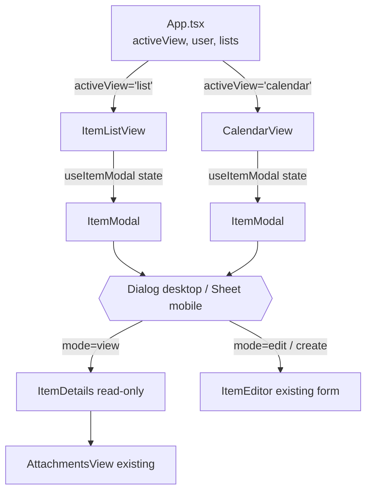
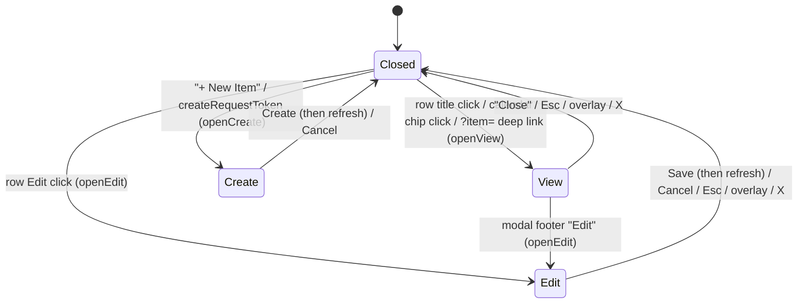

# Implementation Plan: `feat/item-view-mode` — shared item modal with view mode + stacked row actions

Status: REVISED (rounds 1 and 2 folded in — see §9 Revision history). Author: Architect. Date: 2026-08-21.
Slug: `item-view-mode`. Suggested branch: `feat/item-view-mode`.
Reviews folded in: `docs/reviews/item-view-mode-review.md` (round 1: 18 required changes; round 2: 10 required changes).

**D-OQ1 is settled.** The owner decided on 2026-08-21 in favour of **view** mode for the `?item=`
deep link (Decision 8). It is no longer a veto point and no revert path is maintained.

Related backlog entries: `docs/backlog.md` §3 (“Calendar item click opens details”, deferred out of `feat/ui-redesign`) and §2b (“Detection logic … used by both the in-app item view and the notification content” — the in-app half was never built because there was no in-app item view).
Prior art / constraints inherited: `docs/plans/ui-redesign.md` Decision 5 + B1 (editor state stays local to `ItemListView`), `docs/plans/fix-list-selection-view-state.md` (the `activeView` model), `docs/plans/notifications-and-location.md` (deep-link one-shot / NEW-1).

---

## 1. Problem statement and goals

### Problem

Today an item can only be *opened* by opening its **editor**:

- `web/src/components/ItemListView.tsx:294` — the row’s **Edit** button is the only way into an item’s details, and it lands the user in a live form.
- `web/src/components/CalendarView.tsx:126-134` — calendar chips are inert `<div>`s with a `title` attribute. Clicking a calendar event does nothing. `feat/ui-redesign` explicitly deferred this (`docs/plans/ui-redesign.md:55`).
- There is no read-only presentation of an item anywhere in the app, so “what time is this and where” requires entering an edit form and reading it out of input fields — and risks accidental edits.
- The per-item action buttons are a single horizontal row (`ItemListView.tsx:293`): `Edit` | `Delete`.

### Goals

1. Clicking an item’s **name/title in the list** opens a modal in **view mode** — a read-only presentation of the same underlying item the edit modal edits.
2. Clicking an event **in the calendar** opens the **same modal component** in view mode (one shared component, mounted in two places — not a second implementation).
3. **Edit** (row button, and a footer action inside the view modal) continues to open **edit mode**, i.e. the existing `ItemEditor` form, unchanged.
4. The per-item action buttons become a **vertical stack, one per row**, in the order **View, Edit, Delete**.
5. The notification deep link (`?item=<id>`) also lands in **view** mode, so every entry point into an item is consistent (Decision 8, settled by the owner).
6. No worker / API / data-model / auth changes. `web/src` (+ three pure helpers under `web/src/lib/`, plus reuse of existing `src/shared/*` helpers) only.
7. `npm run typecheck`, `npm run lint` (0 errors, no new warnings), and `npm test` stay green; new tests actually execute (see §7 — the `.test.ts` include gap).

### Definition of done

- Clicking a list item’s title opens a `role="dialog"` surface containing that item’s details **and no form controls**.
- Clicking a calendar chip opens the same component in the same view mode, showing **that occurrence’s** start *and* end.
- A `?item=<id>` deep link opens the same view-mode surface.
- Row buttons render stacked in DOM/visual order View → Edit → Delete, in light + dark, at 375px and desktop widths.
- The view modal offers **Edit** (switches the open modal to edit mode in place) and **Close**.
- `web/src/App.test.tsx` (DC1–DC4) passes **unmodified**. `web/src/App.deeplink.test.tsx` passes with **assertion, test-name, and comment changes only** — its NEW-1 structure (open → close → Calendar → List → assert not reopened), its mocks, and App’s one-shot ownership model are untouched (Decision 8, R1).

---

## 2. Non-goals

- **No worker, API, DB, migration, or auth changes.** Zero edits under `src/worker/`, `migrations/`, `wrangler.toml`. `web/src/apiClient.ts` is imported unchanged (no new endpoints; everything view mode needs is already on `Item` or reachable via `listAttachments`).
- **No new item fields**, no per-occurrence editing. Editing a recurring item from a calendar occurrence edits the **whole series** (that is what `PATCH /api/items/:id` does today); view mode only *labels* this, it does not add series/occurrence editing.
- **No Delete action inside the modal.** Delete stays on the list row (requirement 4 places it there). Calendar therefore has no delete affordance — deliberate; the calendar is a browsing surface.
- **No new deep-link parameter.** The deep link’s *mode* changes (Decision 8), but the link **shape** (`?item=<id>`) does not. A parallel `?view=<id>` param was considered and rejected — `?item=` links are already in the wild in sent emails and push payloads, and maintaining two link shapes forever to preserve a behavior nobody asked to keep is worse than changing the behavior once.
- **No lifting of modal state above the `activeView` view-swap.** `App.tsx`’s conditional render of `ItemListView` / `CalendarView` / `AdminPanel` is unchanged (B1 invariant — see Decision 2). No Context, no module-scoped store (hard constraint HC1).
- **No calendar layout work**: the `slice(0, 3)` + “+N more” truncation (`CalendarView.tsx:126,135`) stays as-is. Items 4+ on a day remain unreachable by click (D-OQ4 — deferred, but a backlog entry is now **required**, because clickable chips convert a display truncation into a functional dead end).
- **No Playwright bootstrap.** See §7.4 and D-OQ3 — there is currently no Playwright config or spec in this repo, so `npm run test:e2e` is a no-op and is **not** listed as a verification gate anywhere in this plan.
- **No per-occurrence *editing*.** View mode now renders the correct per-occurrence start **and end** (Decision 9), which is a display fix, not an editing capability.
- **No new runtime dependencies.**

---

## 3. Proposed design

### 3.1 Component shape

Two new presentational modules plus a controlled-state hook, mounted twice:



`ItemModal` is a **single component** rendered at two mount sites. It is *not* a singleton in `App` — see Decision 2 for why.

### 3.2 Decision 1 — mode handling: one component with a discriminated-union `state` prop (not separate view/edit modals)

**Chosen:** a single `ItemModal` whose open/mode/payload is one value:

```ts
export type ItemModalState =
  | { mode: "create" }
  | { mode: "view"; item: Item; occurrenceAt?: EpochMs; occurrenceEndAt?: EpochMs }
  | { mode: "edit"; item: Item };
// `null` = closed.
```

`occurrenceEndAt` is not decoration — see **Decision 9**; omitting it renders backwards time ranges.

**Alternatives considered:**

| Option | Pros | Cons |
| --- | --- | --- |
| **A. One `ItemModal`, union state (CHOSEN)** | One Dialog/Sheet responsive shell, one close/`onOpenChange` wiring, one place that decides desktop-vs-mobile. View→Edit is a single `setState` with no unmount/remount of the surface. Illegal combinations (view *and* create at once) are unrepresentable. | Slightly larger diff in `ItemListView` (replaces `showCreate` + `editingItem` with one state value). |
| B. Keep `showCreate`/`editingItem` booleans and add a third `viewingItem` | Smallest diff. | Three parallel `useState`s that must be mutually exclusive by convention only. Every open path must remember to clear the other two; a missed clear yields a modal whose title says one thing and whose body says another. Rejected: the existing two-state version already needs `closeEditor()` to clear both (`ItemListView.tsx:124-127`); a third multiplies that. |
| C. Two separate modal components (`ItemViewModal`, `ItemEditModal`) | Each is simpler in isolation. | Duplicates the Dialog-vs-Sheet responsive shell and the `onOpenChange` close wiring in two files (they already exist once, at `ItemListView.tsx:149-167`, and would need a third copy for calendar). View→Edit becomes a close-then-open with a visible flash on mobile. Directly contradicts requirement 2 (“one shared modal, not a duplicate implementation”). |
| D. **No modal at all** — an inline expanding detail panel in the row, mirroring the existing attachments expander (`ItemListView.tsx:276-289`) | By far the smallest diff: no shell move, no Radix portal semantics, no `lastStateRef`. | **Fatal to requirement 2:** there is nowhere sensible to expand inside an 80px calendar day cell (`CalendarView.tsx:117`), so the calendar would need a modal anyway — back to two implementations. |

**Tradeoff being accepted:** option A means the `create` mode also flows through the shared component even though creation has nothing to do with this feature. That is deliberate — it keeps exactly one Dialog/Sheet shell in the codebase. The alternative (leave create where it is, add a second shell for view/edit) is the duplication requirement 2 forbids.

### 3.3 Decision 2 — where the modal state lives: local to each view (B1 preserved)

`ui-redesign.md` B1 and the comment block at `ItemListView.tsx:48-53` make this load-bearing: the editor’s `open` state is `useState` **local to `ItemListView`**, and the Dialog/Sheet is rendered **inside `ItemListView`’s tree**, so switching `activeView` unmounts it. `App.deeplink.test.tsx:121-147` is the regression guard: Calendar → List round-trip must not resurrect a closed editor.

Therefore:

- `ItemListView` owns its own `useItemModal()` state (replacing `showCreate` + `editingItem`).
- `CalendarView` owns a **separate** `useItemModal()` state.
- `App.tsx` gains **no** modal state. Its only change is passing `user` to `CalendarView`.

Shared *code*, separate *state*. Hoisting a single `<ItemModal>` into `App` would break B1/NEW-1 and is explicitly rejected.

To avoid duplicating the four setter shapes in two files, `ItemModal.tsx` also exports a tiny hook:

```ts
export function useItemModal(): {
  state: ItemModalState | null;
  openCreate: () => void;
  openView: (item: Item, occurrenceAt?: EpochMs, occurrenceEndAt?: EpochMs) => void;
  openEdit: (item: Item) => void;
  close: () => void;
};
```

> **HC1 — HARD CONSTRAINT: `useItemModal` is plain per-instance `useState` and nothing else.**
> No module-scoped variable, no React Context, no `useSyncExternalStore`, no external store, no
> singleton. “Shared hook” means *shared code*, not *shared state*. Two independent `useState` cells
> in `ItemListView` and `CalendarView` cannot diverge, because `App.tsx:229-244` renders those two
> components in **mutually exclusive** branches — they are never mounted at the same time, so there
> is no sync problem to “solve” and no possibility of two modals open at once. The moment the state
> escapes the component instance, unmount-on-view-switch stops discarding it and B1/NEW-1 dies
> silently. `App.deeplink.test.tsx` guards this **only on the list side**; §7.2 therefore adds a
> `CalendarView`-side NEW-1 analogue (open a chip’s modal → unmount/remount the view → assert no
> dialog) so both mount sites are covered by a test rather than by prose.

**Lint requirement (scoped — read the exclusion):** wrap each callback in `useCallback` with an empty
dep array (only `setState` is captured, which React guarantees stable). The stable identities exist
so the **`createRequestToken` effect** (`ItemListView.tsx:86-90`) can list `openCreate` in its dep
array without a new `react-hooks/exhaustive-deps` warning.

> **HC2 — HARD CONSTRAINT: do NOT touch the deep-link effect’s dep array or its `eslint-disable`.**
> The deep-link effect (`ItemListView.tsx:76-84`) carries
> `// eslint-disable-next-line react-hooks/exhaustive-deps` with deps `[initialOpenItem]` because
> `onInitialOpenItemConsumed` is **deliberately** omitted — `App.tsx:241` passes it as an inline
> arrow, i.e. a fresh identity on every App render, so adding it to the deps makes the effect re-run
> on every App render. It would converge (the `if (initialOpenItem)` guard is false on the second
> pass), but it is fragile and sits directly on the NEW-1 machinery. In that effect, change **only
> the call** (`setEditingItem(...)` → `openView(...)`, per Decision 8). Leave `[initialOpenItem]` and
> the disable comment byte-for-byte as they are. “Cleaning up” that disable is a review-blocking
> change, not an improvement.

The repo currently has 4 lint warnings (`docs/backlog.md:78`); do not add a fifth. The impl notes
must list the four warning **sites**, not just the count — a ceiling with no diff can silently become
a *different* four.

### 3.4 Decision 3 — view-mode content is its own bare component

`ItemDetails` is a **bare, read-only** component (no Dialog wrapper), mirroring the pattern that makes `ItemEditor` unit-testable (`ItemEditor.tsx:2-6`: “This is the BARE form component — no Dialog/Sheet wrapper lives here”). `ItemModal` supplies the `DialogTitle`/`SheetTitle`; `ItemDetails` renders the field list + footer actions.

### 3.5 State/flow diagram



Note the absent transition **Edit → View**: on Save the modal closes (D-OQ2).

### 3.6 View-mode field rendering

Rendered from the `Item` shape at `web/src/types.ts:33-52`. Layout: a `<dl>` with `<dt>` labels (`text-xs font-medium uppercase tracking-wide text-muted-foreground`) and `<dd>` values (`text-sm`), `className="grid gap-3"` on the `<dl>`, `mt-0` on `<dd>` (reset UA margin). Rows for null/empty values are **omitted entirely**, except Reminders which renders “None”.

| Field | Source | Rendering |
| --- | --- | --- |
| Title | `item.title` | Rendered by `ItemModal` as the `DialogTitle`/`SheetTitle`. **Not** repeated inside `ItemDetails` (avoid a duplicate heading). `item.title` is `maxLength={200}` (`ItemEditor.tsx:181`) and the title styling is `text-lg font-semibold` (`sheet.tsx:84`), so a long title overflows a 375px Sheet header: add **`break-words`** to the title element. Do **not** use `truncate` — the title is the dialog’s accessible name and must not be visually elided. |
| Type + list + status | `item.type`, `lists.find(l => l.id === item.list_id)?.name`, `item.completed_at` | A meta line under the title: `<Badge variant="secondary">event|task</Badge>`, list name in `text-muted-foreground`, and — for a **non-recurring task** with `completed_at` — a `<Badge>Completed</Badge>`. |
| When | `occurrenceAt ?? item.start_at`, **`occurrenceEndAt ?? item.end_at`**, `item.all_day`, `item.timezone` | **Reuse `formatOccurrenceTime` from `src/shared/itemLabels.ts:39`** (already pure, Intl-only, framework-agnostic, documented as importable by the web bundle, and with a hardened timezone fallback chain — `items.timezone` is free text in the editor at `ItemEditor.tsx:284`, so an invalid IANA zone is genuinely reachable and must not throw). If the resolved end is non-null, render `start – end` using the same helper. All-day items already render date-only inside that helper. **The end must be sourced from `occurrenceEndAt ?? item.end_at`, never from `item.end_at` alone — see Decision 9.** Both endpoints render in full (`formatOccurrenceTime` always emits weekday + date + time + zone), so a same-day range repeats the date on both sides. **Do not add same-day collapsing** — it needs a date-equality check in the item’s timezone, and §7.5 already checks this row for overflow at 375px. |
| Recurrence | `item.rrule` | `describeRecurrence(rrule)` → e.g. “Every week on Mon, Wed · 10 occurrences”. See Decision 4. |
| Series hint | `item.rrule && occurrenceAt != null` | A muted `text-xs` line: “This is one occurrence of a repeating item. Editing changes the whole series.” Honest labelling of existing `PATCH /items/:id` behavior. |
| Location | `item.location`, `item.location_kind`, `user.maps_provider` | `item.location` is `string | null` (`web/src/types.ts:38`) — **null-check it, and reject whitespace-only, before calling the helper**: render the row only when `item.location != null && item.location.trim().length > 0`. (`ItemEditor.tsx:89` converts `""` → `null` on save, but `"   "` is truthy and is stored as-is; `resolveLocationRender("   ", …)` returns `text: ""` with no href, which would paint an empty Location row.) Otherwise **reuse `resolveLocationRender(raw, override, resolveMapsProvider(user.maps_provider))` from `src/shared/location.ts:146`.** `kind === "address"` → `<a href>` labelled with the address text plus “(open in maps)”; `kind === "meeting"` → `<a href>` “Tap to join”; otherwise plain text, or a plain `<a>` when the helper supplies a generic `href`. All external links get `target="_blank" rel="noopener noreferrer"` (matching `AttachmentsView.tsx:61-64`). Keeping this is **decided, not optional** — see R6. |
| Notes | `item.notes` | `<div className="whitespace-pre-wrap text-sm">` — preserves user line breaks; React already escapes the text. |
| Reminders | `item.reminders` (`ItemReminder[]`) | One line each: `describeReminder(r)` → “30 minutes before · Email, Push”. Empty → “None”. |
| Attachments | — | `<AttachmentsView itemId={item.id} />` (existing component, `web/src/components/AttachmentsView.tsx`). It fetches on mount; because Radix only mounts portal children while open, this costs one request per modal open. Acceptable and consistent with today’s lazy expander. |
| Provenance | `item.created_by`, `item.updated_at` | Muted `text-xs` footer line: “Added by {created_by} · Updated {formatOccurrenceTime(updated_at, item.timezone, false)}”. **Deliberate PII note:** `created_by` is a raw email address, and this is the first place the client renders *another* user’s email. That is acceptable here — this is an allowlisted family app, membership is mutually known, and the client has no user directory to resolve a display name from (`GET /api/lists` returns `owner_email`, not a member roster). Recorded as a conscious choice so it does not read as a side effect of “render everything on `Item`”. If the owner objects, the row is one line to drop. |
| Actions | — | Footer `<div className="mt-5 flex gap-2">`: **Edit** (`variant="default"`, only when `canWrite`) and **Close** (`variant="outline"`). Deliberately mirrors `ItemEditor.tsx:305-312`’s footer. **This footer stays side-by-side** — the one-button-per-row requirement applies to the list row, not the modal. |

`canWrite` = `canWriteList(list, user)` (Decision 5).

### 3.7 Decision 4 — recurrence + reminder wording helpers

View mode must not show a raw `FREQ=WEEKLY;BYDAY=MO,WE` string. The parse logic already exists but is **private** to `RecurrenceEditor` (`parseRRule` at `RecurrenceEditor.tsx:45`, `DAY_LABELS` at `:13`).

**Chosen:** move `Freq`, `Weekday`, `DAYS`, `DAY_LABELS`, `RRuleState`, `buildRRule`, `parseRRule` **verbatim** (no logic change) into a new `web/src/lib/rrule.ts`, have `RecurrenceEditor` import them, and add `describeRecurrence(rrule: string | null): string | null` built on the moved `parseRRule`.

**Tradeoff:** the alternative — writing a second, independent RRULE parser inside the display helper — avoids touching a working component, but duplicates fiddly parsing rules (BYDAY splitting, `UNTIL` YYYYMMDD slicing) that would then drift. The move is a pure relocation; the risk it carries is that **`RecurrenceEditor` has no test today** (there is no `RecurrenceEditor.test.tsx`; `tests/unit/recurrence.test.ts` covers the *worker’s* expansion, not this parser). Mitigation: the new `web/src/lib/rrule` test file covers `parseRRule`/`buildRRule` round-trips, which is net-new coverage for code that had none.

**Trim option — NOT taken.** (The alternative was to skip the move and render “Repeats {freq}”. Recorded for the audit trail; the move is what gets implemented.)

> **HC3 — HARD CONSTRAINT: all input hardening lives in `describeRecurrence`, never in the moved
> `parseRRule`.** `parseRRule` is a **verbatim** move (R5) — it is `RecurrenceEditor`’s live parser
> and has no component test. Adding validation *inside* it would change the editor’s behavior and is
> exactly the regression R5 exists to prevent. But `parseRRule` performs no validation, so
> `describeRecurrence` receives genuinely reachable garbage and must guard it itself:
>
> | Reachable input | Unguarded output | Required behavior |
> | --- | --- | --- |
> | `FREQ=DAILY;INTERVAL=abc` | `Number("abc")` → `NaN` → “Every NaN days” | treat a non-finite or `< 1` interval as `1` |
> | `FREQ=WEEKLY;BYDAY=XX` | `DAY_LABELS["XX"]` is `undefined` → “Every week on undefined” | drop unrecognised day tokens; if none survive, omit the “on …” clause entirely |
> | `FREQ=WEEKLY;BYDAY=` | **Not** the same case: `parts.BYDAY` is `""`, which is falsy, so `parseRRule` already returns `byday: []` (`RecurrenceEditor.tsx:65`) and `DAY_LABELS[""]` is never reached. Listed because the same “omit the clause” output is required. | omit the “on …” clause (falls out of the empty array; no extra guard needed) |
> | `FREQ=WEEKLY;COUNT=abc` | “· NaN occurrences” | omit the count clause when non-finite or `< 1` |
> | `UNTIL` unparseable | garbage date | omit the until clause. **Note `parseRRule` has already sliced and dashed it** — `RRuleState.until` is `"2026-12-31"` (`RecurrenceEditor.tsx:68-70`), not `20261231T000000Z`, so do **not** re-slice a `YYYYMMDD` prefix. Use `Date.parse(`${state.until}T00:00:00Z`)` and guard with `Number.isFinite`. |
>
> Every one of these is a §7.2 test case.

**BYDAY ordering:** `parseRRule` preserves BYDAY in the order the string supplies it, so
`BYDAY=WE,MO` would render “on Wed, Mon”. `describeRecurrence` must **sort the surviving day tokens
into `DAYS` order** before labelling. Test case required.

`describeRecurrence` output contract (drive these exact cases from tests):

| Input | Output |
| --- | --- |
| `null` / unparseable / `FREQ` not in daily,weekly,monthly | `null` (row omitted) |
| `FREQ=DAILY` | `Every day` |
| `FREQ=DAILY;INTERVAL=3` | `Every 3 days` |
| `FREQ=WEEKLY;BYDAY=MO,WE` | `Every week on Mon, Wed` |
| `FREQ=WEEKLY;BYDAY=WE,MO` | `Every week on Mon, Wed` (sorted into `DAYS` order) |
| `FREQ=WEEKLY;INTERVAL=2` | `Every 2 weeks` |
| `FREQ=WEEKLY;INTERVAL=2;BYDAY=MO` | `Every 2 weeks on Mon` (interval **and** BYDAY — the common case the round-1 table omitted; wording is fixed here so the Coder does not invent it) |
| `FREQ=MONTHLY;COUNT=5` | `Every month · 5 occurrences` |
| `FREQ=WEEKLY;UNTIL=20261231T000000Z` | `Every week · until Thu, Dec 31, 2026` (Dec 31 2026 is a **Thursday in UTC**) |
| `FREQ=DAILY;INTERVAL=abc` | `Every day` (interval coerced to 1) |
| `FREQ=WEEKLY;BYDAY=` / `BYDAY=XX` | `Every week` (no “on …” clause) |
| `FREQ=MONTHLY;COUNT=abc` | `Every month` (count clause omitted) |

**`UNTIL` rendering — format in UTC, and `describeRecurrence` takes NO timezone argument.**
`buildRRule` (`RecurrenceEditor.tsx:34-38`) encodes the picked date as **UTC midnight**
(`new Date("${until}T00:00:00Z")`) per RFC 5545, so `UNTIL` is a zone-independent calendar date.
Rendering it through `formatOccurrenceTime(ms, item.timezone, true)` would show the **previous day**
for every west-of-UTC user, including the schema default `America/Los_Angeles`. Render it as
`formatOccurrenceTime(ms, "UTC", /* allDay */ true)` → `"Thu, Dec 31, 2026"` (the `" UTC"` suffix at
`itemLabels.ts:55` is only reached on the final fallback branch). The signature stays
`describeRecurrence(rrule: string | null): string | null` — a pure display helper with no timezone
dependency. If the date does not parse, omit the clause (HC3).

Reminder wording lives in `web/src/lib/itemDisplay.ts`:

- `splitOffsetMinutes(minutes): { value: number; unit: "minutes" | "hours" | "days" }` — **moved verbatim** from `ReminderEditor`’s private `fromMinutes` (`ReminderEditor.tsx:24-32`); `ReminderEditor` imports it instead. `toMinutes` stays in `ReminderEditor` (editor-only).
- `describeReminder(r: { offset_minutes: number; channel_email: boolean; channel_push: boolean }): string` → `"30 minutes before · Email, Push"`; singularize at value 1 (`"1 hour before"`); no channels → `"…before · no channels"`.
- **`offset_minutes === 0` is an ordinary, reachable value** and must be special-cased *before* `splitOffsetMinutes` (which would otherwise yield “0 minutes before”): render **“At the time of the event”** plus the same `· channels` suffix. Test case required.

### 3.8 Decision 5 — the write-capability check

`ItemRow` computes it inline today (`ItemListView.tsx:233`): `selectedList?.visibility === "shared" || selectedList?.owner_email === user.email`. This mirrors the server (`src/worker/db.ts:538-551` `canWriteList`). The modal needs the same rule, and from calendar it must resolve the list from `item.list_id` (calendar items span lists).

Add a pure `canWriteList(list: List | undefined, user: User): boolean` to `web/src/lib/permissions.ts`, and use it in **both** `ItemRow` and `ItemDetails`. One expression, one place, unit-testable.

**It must be a *faithful* mirror, which the inline expression is not.** `src/worker/db.ts:538-551`
lowercases the caller’s email before comparing (`const norm = email.toLowerCase(); … return
list.owner_email === norm;`). Today’s inline `selectedList?.owner_email === user.email`
(`ItemListView.tsx:233`) is a case-**sensitive** comparison masquerading as the server’s
case-insensitive one. The helper must lowercase **both** sides:

```ts
list.visibility === "shared" || list.owner_email.toLowerCase() === user.email.toLowerCase();
```

Test case required: `owner_email: "Owner@Example.com"` + `user.email: "owner@example.com"` → `true`.

The server lowercases only the **caller’s** email and compares `list.owner_email` verbatim, so
lowercasing both sides is a strict superset. That extra `.toLowerCase()` on `owner_email` is
deliberate and cannot diverge: `owner_email` is already normalised at insert (`src/worker/db.ts:341`
binds `norm`), so a mixed-case `owner_email` is unreachable in stored data. Do **not** “fix” this
back into a case-sensitive comparison.

**Note for the Coder (so this doesn’t look like dead code):** `GET /api/lists` only ever returns lists that are shared **or** owned by the caller (`src/worker/db.ts:323-329`), so in practice `canWriteList` is `true` for every list the client can see. It is retained as defense-in-depth and to keep the client rule honest against the server rule — not because a false case is currently reachable. Do not “simplify” it away.

**Alternative not taken (backlog it):** have `GET /api/lists` return an explicit `can_write` boolean
per list, making client/server drift structurally impossible. That is the *right* long-term answer to
the awkward “currently unreachable but keep it anyway” note above — but it is a worker change, which
§2 forbids in this branch. File it as a backlog entry (§8 step 10c).

### 3.9 Decision 6 — clickable title/chip must be a real `<button>`

Both new click targets are native `<button type="button">` elements — this gives Enter/Space activation, focus order, and `role=button` for free, which an `onClick` on a `<div>` would not.

**List row title** (`ItemListView.tsx:255-264`): only the **title text** becomes the button. The `event` `<Badge>` and the recurring `<Repeat>` icon stay *outside* it, so the button’s accessible name is exactly the item title.

```tsx
<div className={cn("font-medium", completed && "line-through")}>
  <button
    type="button"
    onClick={onView}
    className={cn(
      // Hover affordance is COLOUR, not underline — see the text-decoration-line note below.
      "rounded-sm text-left font-medium hover:text-primary",
      // Hit box larger than the text line box (Decision 10's touch-target criterion).
      // THIS SNIPPET IS THE AUTHORITATIVE CLASS LIST for this element.
      "-my-0.5 py-0.5",
      "focus-visible:outline-none focus-visible:ring-2 focus-visible:ring-ring",
      "focus-visible:ring-offset-1 focus-visible:ring-offset-background",
      completed && "line-through"
    )}
  >
    {item.title}
  </button>
  {/* badge + repeat icon unchanged */}
</div>
```

**`line-through` must be repeated on the button** (the `completed && "line-through"` above is not a copy-paste slip). CSS `text-decoration` from a block parent does **not** propagate into an atomic inline-level box, and a `<button>` is `display: inline-block` by default (Tailwind preflight, enabled at `index.css:1`, resets `background`/`border`/`padding`/`color` but **not** `display`) — leaving it only on the parent silently drops the strike-through for completed tasks. `font-medium` is repeated for the same class of reason (belt-and-braces; `index.css:89-92` sets `button { font: inherit }`, so it would inherit, but the explicit class documents intent).

**No `hover:underline` on this element — HARD REQUIREMENT.** Tailwind’s `underline` and `line-through`
are the **same utility group**: both emit `text-decoration-line`. Putting `hover:underline` and
`line-through` on one element means that hovering a completed task’s title *replaces* the
strike-through with an underline — the strike vanishes exactly when the user points at it. That is
risk R2 reintroduced inside R2’s own fix. The affordance is therefore `hover:text-primary` (a
`color` change, a different property entirely, so it composes with `line-through` instead of
competing with it). If a future change wants an underline back, it must scope it to the
non-completed branch (`!completed && "hover:underline"`) — never both on one element.

**Focus-ring offset colour.** `focus-visible:ring-offset-1` alone inherits Tailwind’s default
`--tw-ring-offset-color: #fff`, which paints a white halo around the ring in dark mode. Pair it with
`focus-visible:ring-offset-background`. (`web/src/components/ui/button.tsx:8` has the same latent
issue, so this is not a new class of bug — but this change *adds* new focusable elements to a product
whose headline feature was light+dark parity, so fix it on the new elements. Retrofitting
`button.tsx` is out of scope; backlog it.)

**Calendar chip** (`CalendarView.tsx:127-133`): convert the `<div>` to a `<button type="button">`, keeping the existing `title={occ.item.title}` tooltip and adding block/width/left-align classes so the ellipsis truncation still works on a button box:

```tsx
<button
  type="button"
  key={`${occ.item_id}-${i}`}
  // The visible text is ellipsized by the day cell's width; `title` exists to reveal the
  // FULL text on hover. It duplicates the accessible name in some AT, which is the accepted
  // cost of keeping the existing reveal-on-hover behavior.
  title={occ.item.title}
  // Day context: the day number is a SIBLING <div> (CalendarView.tsx:118-125), so a screen
  // reader tabbing the grid would otherwise hear a flat list of titles with no date.
  aria-label={`${occ.item.title} — ${monthLabel} ${day}`}
  onClick={() => openView(occ.item, occ.occurrence_at, occ.end_at ?? undefined)}
  className="mb-0.5 block w-full overflow-hidden text-ellipsis whitespace-nowrap rounded-sm bg-accent px-1 py-0.5 text-left text-[11px] hover:bg-accent/80 focus-visible:outline-none focus-visible:ring-2 focus-visible:ring-ring focus-visible:ring-offset-1 focus-visible:ring-offset-background"
>
  {occ.item.title}
</button>
```

`monthLabel` **does not exist yet** — `CalendarView.tsx:81` is an inline JSX expression that also
includes the year (`{ month: "long", year: "numeric" }`), so reusing it would name the chip
“Team standup — August 2026 26”. Hoist a month-only const above the `return`:
`const monthLabel = currentMonth.toLocaleString("default", { month: "long" });` and leave the header
expression alone. `day` is the loop variable at `:112`. Do not fetch or format anything new.

**Note the third argument to `openView`** — `occ.end_at`, the server-computed per-occurrence end. It
is not optional garnish; see Decision 9.

**Conflicting-handler audit (all three surfaces read before writing this plan):**

- Day cell (`CalendarView.tsx:117`) — plain `<div>`, **no** `onClick`. No propagation guard needed today. If a future change adds a day-cell click (e.g. “create on this day”), the chip handler will need `e.stopPropagation()`; leave a one-line comment saying so rather than adding a no-op guard now.
- List row (`ItemListView.tsx:242`) — the `Card` has **no** row-level `onClick`; there is no drag behavior anywhere in the app (no drag handlers exist in `web/src`).
- Task complete checkbox (`ItemListView.tsx:245-252`) — a *sibling* of the title container, not an ancestor, so a title click cannot toggle completion. It stays a native `<input type="checkbox">` per `ui-redesign` M4; do not convert it.
- Attachments expander (`ItemListView.tsx:276-284`) — a sibling button inside the same content column; no interaction. It stays. (Yes, attachments are then reachable two ways — inline expander and inside the modal. That is intentional; removing the expander is a separate UX decision, not this change.)
- `<Badge>` / `<Repeat>` — non-interactive, and now explicitly outside the button.

### 3.10 Decision 7 — retain the last non-null state while the modal animates closed

`ItemModal` derives its title/body from `state`. When `state` flips to `null`, Radix plays a close animation (Sheet: `data-[state=closed]:duration-300`, `sheet.tsx:29`) before unmounting. Deriving directly from `state` would blank the title mid-animation. Today’s code has exactly this glitch in a milder form — `editorTitle = editingItem ? "Edit Item" : "New Item"` (`ItemListView.tsx:130`), so closing an edit sheet visibly flips the header to “New Item” while it slides out.

Fix inside `ItemModal`: keep `const lastStateRef = useRef<ItemModalState | null>(null)`, update it whenever `state` is non-null, and render from a single named local — `const effective = state ?? lastStateRef.current;` (type `ItemModalState | null`). Derive `const open = state !== null` (there is **no `open` prop** on `ItemModalProps` — see §5) and
pass it as `<Dialog open={open}>` / `<Sheet open={open}>`. **Return `null` only when `effective ===
null`** — i.e. never opened. Do **not** early-return on `!open`: that would unmount the moment
`state` goes null, deleting the very close animation `lastStateRef` exists to survive and making the
ref dead code. Everything below renders from `effective`, never from `state`.

**Write point (specified, not left to taste):** update the ref in a `useEffect` that depends on
`state`:

```ts
useEffect(() => {
  if (state !== null) lastStateRef.current = state;
}, [state]);
```

Writing during render would be an impure render side-effect (idempotent, but it trips the
StrictMode-double-render discipline the rest of the file follows). The effect ordering is safe
because on the first render *after* an open, `state` is already non-null and is what renders — the
ref is only ever consulted on the frames after `state` has gone back to `null`. Left unspecified,
“render from `state ?? lastStateRef.current`” plus an unstated write point is exactly the ambiguity
that produces a one-frame flash nobody can reproduce.

**Related, and cheap: `key` the editor by item id.** `ItemEditor`’s `useState` initializer
(`ItemEditor.tsx:58`) snapshots `item` at mount and never reacts to prop changes, and Radix keeps
portal children mounted for the 300ms close animation (`sheet.tsx:29`). Close item A’s editor and
click Edit on item B inside that window and you get **B’s title with A’s form values**. This is
pre-existing, but Decision 7 makes the stale-render window explicit and the new in-place View → Edit
transition adds a second path into it. Prophylactic, one line, no behavior change:

```tsx
<ItemEditor key={effective.mode === "edit" ? effective.item.id : "create"} … />
```

**Discriminate on the union tag — do not write `state.item?.id ?? "create"`.** `ItemModalState`’s
`create` arm is `{ mode: "create" }` with **no `item` property at all**, so `state.item` is TS2339
and `?.` does not rescue it (optional chaining guards `null`/`undefined` *values*, not properties
absent from a union member). The expression above narrows cleanly for all three arms: `edit` → the
item id; `create` and `view` → the literal `"create"` (harmless — `<ItemEditor>` is not rendered in
view mode). It also reads off `effective`, the possibly-`null` value actually being rendered, whose
`null` case is already gated above.

This is **not** observable to the existing tests: all modal content lives inside `DialogPortal`/`SheetPortal`, which unmounts its children when closed, so a post-close `queryByRole("dialog")` (`App.deeplink.test.tsx:134`, as revised) still resolves to `null`.

### 3.11 Decision 8 — the `?item=` deep link opens VIEW mode (SETTLED by the owner, 2026-08-21)

**Chosen:** the deep-link effect calls `openView(initialOpenItem)` instead of `openEdit(...)`.

**Why — the notification code says so itself.** Two pieces of evidence in the shipped reminder
builders, neither cited in either review round:

1. `src/worker/reminders/content.ts:116-119` documents the deep link’s purpose: *“Push is a
   glanceable nudge; the deep link is the affordance for everything else (notes + the full item live
   in the editor once opened).”* The payload is **deliberately lossy** — title truncated
   (`content.ts:132`), notes never included, location summary dropped first under byte pressure
   (`:120-121`). The deep link exists so the user can **read what did not fit**. It says “in the
   editor” only because the editor was historically the only viewer; view mode is what that sentence
   was always describing.
2. For a meeting location the push body is literally **`"Tap to join"`** (`content.ts:141-142`). In
   edit mode `location` renders as a **text input**, so the meeting URL is unclickable — edit mode
   defeats the notification’s own call to action. View mode renders it through
   `src/shared/location.ts` as a real link. This also retroactively justifies R6’s decision not to
   trim the smart-location work: the “Tap to join” push and the in-app link are one feature.

Secondary: §1’s problem statement is that opening an item today “lands the user in a live form” and
“risks accidental edits”, and a notification tap is the highest-traffic entry point into an item.

**Exact assertion changes in `App.deeplink.test.tsx` (assertions, test name, and comments — zero
structure):**

| Line | Today | Revised |
| --- | --- | --- |
| `:3-10` (header docblock) | “opens that item’s ItemEditor”, “does NOT reopen the **editor**” | say **view mode** / **the modal**. Comment only, no behavior. This docblock is NEW-1’s primary in-code documentation and must not be left describing behavior the code no longer has. |
| `:91` (`describe` title) | “…opens the item’s editor” | “…opens the item in view mode”. Name only. |
| `:92` (test name) | “…opens its ItemEditor…” | “…opens it in view mode…” |
| `:99` | `findByText("Edit Item")` | `findByRole("dialog")` |
| `:100` | `getByDisplayValue("Deep-linked birthday party")` | `within(await screen.findByRole("dialog")).getByText("Deep-linked birthday party")` **plus** `expect(screen.queryAllByRole("textbox")).toHaveLength(0)` — the one explicit view-mode assertion, in this test only. **The `within(...)` is load-bearing, not style:** the title now appears twice in the tree — the list row's title `<button>` (Decision 6) and the modal's `SheetTitle` (§3.6) — so an unscoped `getByText` throws `Found multiple elements`. The sibling `queryAllByRole("textbox")` assertion is safe unscoped only because Radix calls `hideOthers(content)` and `*ByRole` respects `aria-hidden`; **`*ByText` does not**, which is exactly the asymmetry that breaks this one assertion. |
| `:118` | `queryByText("Edit Item")` | `queryByRole("dialog")` |
| `:129`, `:132` (comments) | “Editor opens once on boot.”, “Close it via Cancel.” | “Modal opens once on boot.”, “Close it via Esc.” Comments only. |
| `:130` | `findByText("Edit Item")` | `findByRole("dialog")` |
| `:133` | clicks `/^cancel$/i` | **`await user.keyboard("{Escape}")`** — do **not** query a button named `/^close$/i`. Both shells already render a built-in dismiss whose accessible name is exactly “Close” (`sheet.tsx:59`, `dialog.tsx:44`), so with `ItemDetails`’s footer **Close** the query matches **two** elements and throws `Found multiple elements`. Esc routes through the same `close()` (edge case 9), so the dismiss path is unchanged. |
| `:134`, `:146` | `queryByText("Edit Item")` | `queryByRole("dialog")` |

**Untouched in that file:** the open→close→Calendar→List→assert structure, the `describe`/`it`
*sequencing* (titles may be reworded; order and nesting may not), the mock setup, `App`’s one-shot
ownership model, and the `getItem` called-exactly-once/point-read assertions (`:103-104`). See R1 for
what now counts as a red flag.

**One consequence to confirm:** in view mode the deep link mounts `ItemDetails` → `AttachmentsView`,
which fires `listAttachments` on mount, where today it mounts `ItemEditor` → `AttachmentsEditor`,
which already fires an unmocked attachment fetch. So this is unchanged *in kind*. The file’s
`vi.mock("./apiClient")` uses an `importActual` spread and does not mock `listAttachments`.
**Which rule wins:** §1’s DoD, §4 row 11 and §7.3 all say this file’s mocks are untouched, and that
rule **wins** — leave the mock factory alone. Today’s editor path already fires an unmocked
attachment fetch, so view mode is unchanged in kind and no act warning is *new*. The Coder must still
confirm no new act warnings appear; if any do, that is a **stop-and-report**, not a licence to edit
the mocks.

### 3.12 Decision 9 — occurrence times are threaded end-to-end (correctness fix)

**This is a real bug in the round-1 design, not a style point**, and it fires on exactly the flow this
feature exists to add: clicking a calendar chip for a repeating event.

`src/worker/routes/items.ts:77-81` builds each occurrence’s end from the item’s **duration**:

```ts
const duration = item.end_at !== null ? item.end_at - item.start_at : null;
occurrences.push({ item_id: item.id, occurrence_at, end_at: duration !== null ? occurrence_at + duration : null, item });
```

So `OccurrenceEntry.end_at` (`web/src/types.ts:57`) is the **per-occurrence** end, while the embedded
`item.end_at` is the **first** occurrence’s end and never moves. Round 1 carried only `occurrenceAt`
through `ItemModalState` / `ItemDetailsProps` and sourced the displayed range from
`occurrenceAt ?? item.start_at` plus a raw `item.end_at`. For a weekly meeting created Aug 5 and
opened from the Aug 26 chip, that renders:

> Wed, Aug 26, 2026, 10:00 AM PDT – Wed, Aug 5, 2026, 11:00 AM PDT

— a range ending three weeks before it starts. Every occurrence after the first is wrong.

**Chosen:** thread the value the **server already computed** through the whole path:

1. `ItemModalState`’s `view` arm gains `occurrenceEndAt?: EpochMs` (§3.2).
2. `useItemModal().openView` gains a third parameter: `openView(item, occurrenceAt?, occurrenceEndAt?)` (§3.3).
3. The `CalendarView` chip handler passes `occ.end_at ?? undefined` (§3.9).
4. `ItemDetailsProps` gains `occurrenceEndAt?: EpochMs` (§5).
5. **`ItemModal` forwards both fields into `<ItemDetails>`** — the one hop TypeScript cannot enforce, because both props are optional (§5, §8 step 6).
6. `ItemDetails` renders the range from `occurrenceAt ?? item.start_at` and `occurrenceEndAt ?? item.end_at` (§3.6 “When”).

**Alternative rejected:** deriving `occurrenceAt + (item.end_at - item.start_at)` inside the
component. It produces the same number today but re-implements server logic client-side, so the two
can drift the moment the expansion rules change. Pass the computed value.

**Non-calendar callers are unaffected:** the list row and the deep link pass neither occurrence
field, so both fall through to `item.start_at` / `item.end_at`, which is correct for them.

**Test guard (required):** a recurring item with a non-null `end_at`, opened at a **non-first**
occurrence, renders a range whose parsed end is **after** its start.

### 3.13 Decision 10 — touch targets, row height, and the calendar tab-stop cost (accepted tradeoffs, stated)

Round 1 left these to a vibe check. They are decided here so QA has a criterion and the owner sees
the costs as choices.

**Touch targets.** `Button size="sm"` is `h-8` = 32px (`button.tsx:21`), below the 44px iOS / 48dp
Android guidance. **Decision:** the three stacked row actions use `size="default"` (`h-9` = 36px)
plus the existing `gap-1.5`, and the **title button** gets explicit vertical padding
(`-my-0.5 py-0.5` or equivalent) so its hit box is not just the text line box. This is an
**accepted deviation** from 44px — going to full 44px would add ~36px more per row on top of the
stacking cost below, which is a worse trade on a list screen. QA’s criterion is therefore concrete:
*each row action’s rendered height ≥ 36px and no two adjacent targets closer than 6px*, not “tap
targets usable”.

**Row height cost of requirement 4.** Stacking three buttons vertically instead of two side-by-side
adds roughly **70px of height to every row**; a 15-item list gets ~1000px taller on mobile. The
stacked order is the owner’s explicit requirement, so this is **not** a blocker — but it is a real,
unquantified consequence that should be visible before implementation, not discovered in QA.
**Cheap alternative, offered as a choice:** `flex flex-col md:flex-row` on the action container —
stacked on desktop where there is room, horizontal on mobile where height is precious. This is
~3 characters of diff. **Default: implement the requirement as written (stacked everywhere).** If
the owner prefers the responsive variant after seeing the number, it is a one-line change.

**Calendar tab-stop explosion.** Up to 3 chips × 31 days = **~93 new tab stops** in the month grid,
and on mobile the bottom tab bar (`App.tsx:254-274`) comes *after* the grid in DOM order, so leaving
the calendar by keyboard becomes genuinely tedious. **Decision: accept and document.** A roving
`tabindex` within the grid is the correct fix but is real work (arrow-key handling, focus bookkeeping)
and keyboard-on-mobile is rare for this app. Recorded as an accepted tradeoff rather than shipped
silently; backlog it (§8 step 10e).

**Redundant per-row affordances.** Each row will have a clickable title *and* a **View** button doing
the same thing, plus the attachments toggle, plus Edit and Delete — five to six tab stops per row.
That is what requirement 4 asks for and discoverability favours both affordances. Noted, accepted.

---

## 4. Affected files and modules

> **§8 governs the implementation order, not this table.** The rows below are a *dependency-ordered
> inventory* of what gets touched; the row numbers are **not** step numbers and deliberately do not
> match §8’s numbering (most visibly: the `vitest.workspace.ts` edit is row 10 here but is **step 1**
> in §8, because nothing else can be verified until test collection works). Where the two disagree,
> follow §8. Two `web/src` files are also **merged into a single §8 step** (row 9 below) — see R10.

| # | File | Change |
| --- | --- | --- |
| 1 | `web/src/lib/permissions.ts` | **NEW.** Pure `canWriteList(list, user)` faithfully mirroring `src/worker/db.ts:538-551`, **including the `.toLowerCase()` on both emails** (Decision 5). |
| 2 | `web/src/lib/rrule.ts` | **NEW.** Verbatim move of `Freq`, `Weekday`, `DAYS`, `DAY_LABELS`, `RRuleState`, `buildRRule`, `parseRRule` out of `RecurrenceEditor`, plus new `describeRecurrence(rrule)` (**no timezone parameter** — `UNTIL` renders in UTC, §3.7) **with all hardening in the new function only** (HC3). |
| 3 | `web/src/lib/itemDisplay.ts` | **NEW.** `splitOffsetMinutes` (moved from `ReminderEditor.fromMinutes`) + `describeReminder` (incl. the `offset_minutes === 0` case). |
| 4 | `web/src/components/RecurrenceEditor.tsx` | Import the moved symbols from `@/lib/rrule`; delete the local copies. **No behavior change** — the component body, the `useEffect`, and its existing `eslint-disable` comment (`:85`) are untouched. |
| 5 | `web/src/components/ReminderEditor.tsx` | Import `splitOffsetMinutes` from `@/lib/itemDisplay`, delete local `fromMinutes`, update its one call site (`:41`). `toMinutes` stays. |
| 6 | `web/src/components/ItemDetails.tsx` | **NEW.** Bare read-only presentation + footer actions (§3.6), incl. the `occurrenceEndAt` range (Decision 9) and the null/whitespace location guard. |
| 7 | `web/src/components/ItemModal.tsx` | **NEW.** `ItemModalState` type, `useItemModal()` hook (**per-instance `useState` only** — HC1), and the responsive Dialog/Sheet shell that renders `ItemDetails` (view) or `ItemEditor` (create/edit). The shell markup is **copied** from `ItemListView.tsx:149-167` (row 8 deletes the original one step later — see R10). Includes `key={effective.mode === "edit" ? effective.item.id : "create"}` on `<ItemEditor>` (Decision 7), the `lastStateRef` effect (Decision 7), the `occurrenceAt`/`occurrenceEndAt` pass-through to `<ItemDetails>` (Decision 9), and `break-words` on the title (§3.6). |
| 8 | `web/src/components/ItemListView.tsx` | Replace `showCreate`/`editingItem`/`closeEditor`/`editorModal` with `useItemModal()` + `<ItemModal>`; wire `onView`; deep-link effect → `openView` (Decision 8, call site only — HC2); restack `ItemRow`’s buttons (View/Edit/Delete); make the title a button; switch `ItemRow`’s date line and `canWrite` to the shared helpers. |
| 9 | `web/src/components/CalendarView.tsx` **+** `web/src/App.tsx` | **One step, not two** (§8 step 8 — see §6 R10). `CalendarView` gains the required `user: User` prop, the chip becomes a `<button>` with `aria-label` + `occ.end_at`, plus `useItemModal()` + `<ItemModal>` and a `reloadToken` so an edit-save refetches occurrences. `App.tsx:232` passes `user={user}` **in the same step**, because the prop is non-optional and the tree would not typecheck otherwise. |
| 10 | `vitest.workspace.ts` | Widen the `web` project’s `include` to also match `web/**/*.test.ts` (see §7.1) — **or** name the lib tests `.test.tsx` and skip this. Pick one and say which in the impl notes. **§8 does this FIRST.** |
| 11 | `web/src/App.deeplink.test.tsx` | **MODIFIED — assertions, test names, and comments only** (Decision 8’s table). Structure, mocks, and ownership model untouched. Any structural edit is a review-blocking red flag (R1). |
| 12 | `web/src/components/ItemDetails.test.tsx` | **NEW** (§7.2). |
| 13 | `web/src/components/ItemListView.test.tsx` | **NEW** (§7.2). |
| 14 | `web/src/components/CalendarView.test.tsx` | **NEW** (§7.2) — mocks `getOccurrences` **and `listAttachments`**. |
| 15 | `web/src/components/ItemModal.desktop.test.tsx` | **NEW** (§7.2) — the `vi.mock("../hooks/useMediaQuery") → true` desktop-`Dialog`-branch test. Separate file because the hook mock is module-scoped and must not leak into the Sheet-path tests. |
| 16 | `web/src/lib/rrule.test.tsx` (or `.ts`, per #10) | **NEW** (§7.2). |
| 17 | `web/src/lib/itemDisplay.test.tsx` (or `.ts`) | **NEW** (§7.2). |
| 18 | `web/src/lib/permissions.test.tsx` (or `.ts`) | **NEW** (§7.2) — omitted from the round-1 table by oversight even though §7.2 specified it. |
| 19 | `docs/backlog.md` | **APPEND-ONLY.** Five deferral entries (§8 step 10): Playwright bootstrap, calendar “+N more” dead end, server-supplied `can_write`, View→Edit→Save returning to view mode, and the calendar roving-`tabindex` + `button.tsx` `ring-offset-background` retrofit. |

**Imported unchanged (do not edit):** `web/src/apiClient.ts`, `src/shared/itemLabels.ts`, `src/shared/location.ts`, `web/src/components/AttachmentsView.tsx`, `web/src/components/ItemEditor.tsx`, `web/src/components/ui/*`, `web/src/hooks/useMediaQuery.ts`, `tests/setup/jsdom.setup.ts`. (`useMediaQuery` is **mocked** in `ItemModal.desktop.test.tsx`, not edited. `ui/button.tsx`’s missing `ring-offset-background` is deliberately **not** retrofitted here — backlog, §8 step 10e.)

**Cross-bundle import note (verified in review):** `web/src/App.tsx:5` already imports from `../../src/shared/deepLink`, so web→`src/shared` imports are established. `src/shared/itemLabels.ts` type-imports `EpochMs` from `../worker/types`, a types-only module with **no** Workers globals and no imports at all, and `tsconfig.web.json` does not include `@cloudflare/workers-types` — safe for `tsc -p tsconfig.web.json`. `src/shared/location.ts` imports nothing. `npm run lint` is `eslint src web/src`, so both shared modules are already linted. If `npm run typecheck` nevertheless disagrees, the fallback is to re-declare `type EpochMs = number` locally rather than to copy the formatter.

---

## 5. Data model and API changes

**None.** No migrations, no new endpoints, no changes to request/response shapes, no new `apiClient` functions.

Client-side type additions only, all in `web/src`:

```ts
// web/src/components/ItemModal.tsx
export type ItemModalState =
  | { mode: "create" }
  | {
      mode: "view";
      item: Item;
      // Calendar only. BOTH are per-occurrence values computed by the server
      // (src/worker/routes/items.ts:77-81); item.start_at/item.end_at describe the FIRST
      // occurrence only. Omitting occurrenceEndAt renders a backwards range — Decision 9.
      occurrenceAt?: EpochMs;
      occurrenceEndAt?: EpochMs;
    }
  | { mode: "edit"; item: Item };

interface ItemModalProps {
  state: ItemModalState | null;   // null = closed
  lists: List[];
  user: User;
  defaultListId?: string;         // create mode only
  onClose: () => void;
  onEditRequested: (item: Item) => void;
  onSaved: (saved: Item) => void; // parent closes + refreshes
}
```

```ts
// web/src/components/ItemDetails.tsx
interface ItemDetailsProps {
  item: Item;
  // ItemModal MUST forward both of these from its view-arm state:
  //   <ItemDetails item={s.item} occurrenceAt={s.occurrenceAt} occurrenceEndAt={s.occurrenceEndAt} …/>
  // Both props are OPTIONAL, so forgetting them compiles and lints clean and silently restores the
  // round-1 backwards-range bug. This is the one hop in the chain the type system cannot guard.
  occurrenceAt?: EpochMs;    // calendar: the clicked occurrence, may differ from item.start_at
  occurrenceEndAt?: EpochMs; // calendar: THAT occurrence's end (Decision 9). Not item.end_at.
  lists: List[];
  user: User;
  canWrite: boolean;
  onEdit: () => void;
  onClose: () => void;
}
```

```ts
// web/src/components/CalendarView.tsx — prop added (required, not optional; see §8 step 8)
interface Props { lists: List[]; user: User; }
```

No change to `OccurrenceEntry` — `end_at: EpochMs | null` already exists at `web/src/types.ts:57`
and is simply consumed for the first time.

Existing API calls reused as-is: `getItems`, `getOccurrences`, `updateItem`, `replaceReminders`, `deleteItem`, `completeItem`, `listAttachments`.

---

## 6. Risks, edge cases, and open questions

### Risks

| # | Risk | Mitigation |
| --- | --- | --- |
| R1 | **Breaking the B1 / NEW-1 invariant.** Refactoring `ItemListView`’s modal state is exactly the code the deep-link one-shot depends on. | State stays per-instance `useState` (HC1 — no Context, no module scope, no external store) and `<ItemModal>` stays inside `ItemListView`’s returned tree (Decision 2). **`App.deeplink.test.tsx`’s assertion strings, test names, and comments WILL be edited — that is expected and enumerated in Decision 8’s table. The red flag is a *structural* change to NEW-1, not any edit to the file.** What must never change: the open→close→Calendar→List→assert-not-reopened sequence, the mock setup, App’s one-shot ownership, and the `getItem`-called-once point-read assertions. Any diff touching those requires explicit justification in the impl notes. Plus the new `CalendarView`-side NEW-1 analogue (§7.2), so the calendar mount site is guarded by a test rather than by prose. |
| R2 | **Strike-through silently lost** on completed task titles once the title is a `<button>` — twice over: (a) `text-decoration` does not enter an inline-block, and (b) `hover:underline` and `line-through` are the **same** `text-decoration-line` utility group, so an underline hover affordance *erases* the strike on hover. | Decision 6 repeats `line-through` on the button **and** bans `hover:underline` on it in favour of `hover:text-primary` (a `color` change, which composes rather than competes). Test guard: a **static** assertion that the title button’s class string carries `line-through` and matches no `hover:`-variant `text-decoration-line` utility (§7.2). jsdom does not evaluate CSS and cannot change a Tailwind `hover:` class, so the class-level guard is the ceiling in test — the visual check belongs in §7.5. |
| R3 | **A new test file that never runs.** The web Vitest project includes only `web/**/*.test.tsx` (`vitest.workspace.ts:42`) and the worker project only `tests/**/*.test.ts` + `src/worker/**/*.test.ts` (`:27`) — a `web/src/lib/foo.test.ts` would be collected by **neither**. | §7.1: widen the include or use `.test.tsx`, then **verify by reading `npm test`’s file list** that every new file executed. |
| R4 | **New lint warnings** from effects that call the `useItemModal` callbacks. | `useCallback`-stabilize the hook’s callbacks and add them to the dep arrays (Decision 2). Target: `npm run lint` = 0 errors and **no more than the current 4 warnings**. |
| R5 | **Regressing `RecurrenceEditor`/`ReminderEditor` during the pure moves.** Neither has a component test. | Move verbatim (no reformat, no “while I’m here” fixes); the new lib test files cover the moved functions directly; QA re-checks the repeat + reminder controls manually. |
| R6 | **Scope creep via smart-location rendering.** Reusing `resolveLocationRender` is new *behavior* (tappable maps/meeting links in-app), not just presentation. | **DECIDED: keep it. The trim option is withdrawn.** (1) `src/shared/location.ts:1-4` was written *for this consumer* — its header names “any future in-app read-only location render”, `docs/backlog.md` §2b names the gap, and Decision 8 shows the push payload’s “Tap to join” depends on it. This closes a deliberate seam rather than inventing new surface, at a cost of one call to an already-tested pure function, one `user` prop, and one line in `App.tsx`. (2) The security posture is already correct in the helper: `classifyLocation` only emits an `href` for `http:`/`https:` URLs (`location.ts:73`), so `javascript:`/`data:` URIs cannot become an href, and `buildMapsUrl` `encodeURIComponent`s the query; with `target="_blank" rel="noopener noreferrer"` there is no new XSS or tabnabbing surface. **Conditions:** the null/whitespace guard (§3.6) and the three `ItemDetails.test.tsx` location cases (address → maps link, Zoom → “Tap to join”, `"Home"` → plain text) are **required**, not optional — they are the only thing between this and a “Tap to join” label on a string with nothing to join. |
| R7 | **Stale snapshot in the modal.** `state.item` is a snapshot; a background refresh (e.g. `refresh()` after a complete-toggle) does not update the open modal. | The surface is modal (overlay blocks row interaction), so the window is effectively closed. Do **not** add re-lookup-by-id plumbing for this. |
| R8 | **Tailwind class extraction.** New classes must be in `content` globs. | `tailwind.config.ts` globs `./web/src/**/*.{ts,tsx}` — new files under `web/src` are covered. No dynamic/computed class strings are introduced (all `cn()` with literals). Still run `npm run build` once and eyeball the modal in a built preview, per the `ui-redesign` CSS-extraction lesson (`ItemEditor.tsx:20-30`). |
| R9 | **Backwards time ranges on recurring occurrences.** The round-1 design would have rendered every non-first occurrence with an end before its start. | Decision 9 threads `occurrenceEndAt` from `occ.end_at` through `openView` → `ItemModalState` → `ItemDetailsProps` → the “When” row. Required test: non-first occurrence of a series with a duration renders end > start. |
| R10 | **A numbered step that leaves the tree failing `typecheck`.** Round 1 added the required `CalendarView` `user` prop in step 8 and the `App.tsx` call site in step 9, so `tsc -p tsconfig.web.json` fails at the end of step 8 — violating the plan’s own per-step gate. The real damage is second-order: a Coder who hits a “broken tree” at a gate that is *supposed* to be green starts ignoring the gate, which is the protection this whole plan leans on. | The `CalendarView` prop and its single `App.tsx` call site land together in what is now **§8 step 8** (round-1 steps 8 and 9, merged). The same failure recurred once more in round 2 — §8 step 6 said to *move* the Dialog/Sheet shell while `ItemListView` still references `editorModal` at `:217` — so step 6 now **copies** the shell and step 7a does the deletion; the two coexist for exactly one step, deliberately. Every numbered step in §8 leaves `npm run typecheck && npm run lint` green. |
| R11 | **The desktop `Dialog` branch shipping untested.** §8 step 6 copies the Dialog/Sheet shell out of `ItemListView.tsx:149-167`, and under the jsdom `matchMedia` stub `useMediaQuery` returns `false`, so every other test exercises only the **Sheet** path. A dropped `onOpenChange`, a mis-wired title, or a missing body in the `isDesktop` branch would be caught by nothing but manual QA — the last gate before ship. In a plan that spends a whole section on “does this test actually run”, leaving half the moved code uncovered is inconsistent with its own standard. | New `ItemModal.desktop.test.tsx` with `vi.mock("../hooks/useMediaQuery", () => ({ useMediaQuery: () => true }))` (~20 lines): assert the Dialog path renders the same title and body and closes through the same path. This is the **condition** on which the Playwright deferral (D-OQ3) was accepted. |
| R12 | **Stale `ItemEditor` draft across a fast close/reopen.** `ItemEditor` snapshots `item` at mount (`ItemEditor.tsx:58`) and Radix keeps portal children mounted for the 300ms close animation (`sheet.tsx:29`) — close A’s editor, open B’s within that window, and you see B’s title with A’s values. Pre-existing, but Decision 7 makes the window explicit and View→Edit-in-place adds a second path into it. | `key={effective.mode === "edit" ? effective.item.id : "create"}` on `<ItemEditor>` inside `ItemModal` (Decision 7). One line, no behavior change, kills the class. |

### Edge cases the Coder must handle explicitly

1. **Invalid `item.timezone`.** Free-text input (`ItemEditor.tsx:284`) means an unknown IANA zone can be stored; `Intl` throws on it. Using `formatOccurrenceTime` (which has a three-step fallback chain, `itemLabels.ts:33-60`) is *required* — do not hand-roll `new Intl.DateTimeFormat(...)` in the component.
2. **All-day items.** `formatOccurrenceTime(..., allDay=true)` already renders date-only; do not append a time. If an end is set on an all-day item, render `start – end` with the same all-day formatting.
3. **End is null** (very common) — render start only, no dangling en-dash. The null check is on the **resolved** end (`occurrenceEndAt ?? item.end_at`), not on `item.end_at` alone.
4. **Recurring item opened from calendar:** `occ.occurrence_at !== item.start_at` — **and `occ.end_at !== item.end_at` too.** View mode shows the **occurrence’s** start *and* the **occurrence’s** end (matching what the chip represents and what notifications say), plus the series hint. Applying occurrence logic to the start but not the end is precisely the round-1 bug (Decision 9 / R9): the end must come from `occurrenceEndAt ?? item.end_at`, never from `item.end_at` directly. Editing still edits the whole series.
5. **Recurring task completion:** `item.completed_at` is *not* the per-occurrence state — the row already acknowledges this simplification (`ItemListView.tsx:111-114`). View mode therefore shows the “Completed” badge **only when `item.rrule === null`**. Do not invent per-occurrence completion display.
6. **Empty list of reminders / no attachments** — “None” for reminders; `AttachmentsView` already renders its own “No attachments.” empty state.
7. **`listId === null`** — `ItemListView` returns early (`:169-175`) before rendering the modal; keep that early return where it is so a create request with no list selected cannot open a listless form.
8. **Non-writable list** — `Edit` is hidden in the modal footer and the row still shows **View** (View must never be gated on write access, even though the gate is currently unreachable — see Decision 5).
9. **Closing paths must all be equivalent:** in-modal Close, the built-in `X`, Esc, and overlay click all route to the same `close()` (today’s `onOpenChange` wiring at `ItemListView.tsx:150,159` — preserve it verbatim in `ItemModal`).
10. **Calendar chip inside the `slice(0, 3)` cap** — items 4+ on a day are still not clickable (D-OQ4; backlog entry required).
11. **Whitespace-only `location`.** `ItemEditor.tsx:89` maps `""` → `null` on save, but `"   "` is truthy and is stored verbatim. Guard on `item.location != null && item.location.trim().length > 0` before calling `resolveLocationRender` — a truthiness check alone paints an empty Location row (§3.6).
12. **`offset_minutes === 0` reminders.** Ordinary and reachable. Render “At the time of the event”, not “0 minutes before” (§3.7).
13. **Garbage RRULE fields.** `INTERVAL=abc`, `BYDAY=`, `COUNT=abc`, malformed `UNTIL` — all reachable, all guarded **in `describeRecurrence`** and never in the verbatim-moved `parseRRule` (HC3).
14. **Long item titles.** `maxLength={200}` (`ItemEditor.tsx:181`) overflows the Sheet header at 375px. `break-words` on the modal title; never `truncate` (it is the dialog’s accessible name).
15. **Focus after a calendar edit-save.** `reloadToken` bumps → `getOccurrences` refetches → if the save moved the item’s date, the chip that opened the modal unmounts and reappears in a different day cell. Radix restores focus to a now-detached node, so focus lands on `document.body`. Not worth engineering around for a family app; call it out in the §7.5 QA sweep so it is a known behavior rather than a bug report.
16. **Mixed-case owner email.** `canWriteList` lowercases both sides (Decision 5); the round-1 inline expression did not.
17. **Two buttons named “Close” inside one dialog** (the shells’ built-in dismiss at `sheet.tsx:59` / `dialog.tsx:44`, plus `ItemDetails`’s footer). Not a runtime defect — both route to the same `close()` (edge case 9) — but it makes `getByRole("button", { name: /^close$/i })` throw. Handled as a **test-query** constraint (§7.2 scoping rule); do not relabel the footer button.

### Decisions on the round-1 open questions

Round 1 recorded five open questions with recommendations and no decisions. All five are **closed
here**, adopting the reviewer’s positions. “Reviewer’s call” left standing in a plan is how a Coder
ends up guessing.

- **D-OQ1 — the `?item=` deep link opens VIEW mode. SETTLED by the owner, 2026-08-21.** No revert
  path is maintained. Reasoning and the exact `App.deeplink.test.tsx` diff are in
  **Decision 8 (§3.11)**.
- **D-OQ2 — after View → Edit → Save, the modal CLOSES.** Matches today’s behavior
  (`ItemListView.tsx:137-140`) and keeps the diff and test surface small. Returning to view mode is a
  genuinely nicer flow, but it would change `ItemEditor`’s post-save contract for the **create** case
  too, so it deserves its own decision rather than riding along here. **Backlog it** as a UX
  follow-up (§8 step 10d); the change itself is one line (`onSaved(saved)` → `openView(saved)`).
- **D-OQ3 — Playwright stays deferred, conditionally.** Bootstrapping it here means a config, a
  dev-server harness, and `DEV_AUTH_IDENTITY` auth-shim plumbing (`docs/plans/dev-auth-shim.md`) —
  a plan of its own. jsdom-only coverage is acceptable **for this feature specifically** because it
  is almost entirely presentational; the genuine blind spots are (a) real CSS (caught by §7.5’s
  CSS-only items) and (b) the desktop-vs-mobile split, which **is** catchable by mocking the hook.
  Both conditions are mandatory: **(1)** add `ItemModal.desktop.test.tsx` (R11), and **(2)**
  `npm run test:e2e` is **removed from every gate list in this plan** and a Playwright-bootstrap
  backlog entry is filed (§8 step 10a). A documented script that silently does nothing is R3 one
  level up.
- **D-OQ4 — calendar “+N more” stays as-is, but the deferral is FILED.** Out of scope, agreed. The
  backlog entry is now **required** rather than optional, because clickable chips convert a cosmetic
  truncation into a functional dead end: the 4th item on a busy day becomes the only visible item a
  user cannot open. (The cheap fix — make “+N more” a button that drops `slice(0, 3)` for that day
  via local state, ~8 lines — is *permitted* if the Coder wants it, but is not required and must not
  expand into calendar layout work.)
- **D-OQ5 — the list row’s date line switches to `formatOccurrenceTime`. DECIDED: yes, and it is a
  BUG FIX, not cosmetic alignment.** `ItemListView.tsx:234` is
  `new Date(item.start_at).toLocaleString()`, which **ignores `item.all_day` entirely** — so every
  all-day row currently renders a spurious midnight time (“7/1/2026, 12:00:00 AM”) for an item that
  has no time at all. `formatOccurrenceTime(item.start_at, item.timezone, item.all_day)` renders
  date-only for all-day items and the item’s stored zone for timed ones, which also removes the
  device-vs-item timezone inconsistency between the row and the modal. Safe: no existing test asserts
  that string (`App.test.tsx` renders with `ITEMS = []`). **Two conditions:** the new string is
  materially longer and shares a line with `· {item.location}` (`ItemListView.tsx:265-268`), so §7.5
  checks wrapping at 375px; and `ItemListView.test.tsx` must assert the rendered row date explicitly,
  including one all-day case.

### Remaining open questions

**None.** All five round-1 questions are decided above, D-OQ1 is settled by the owner, and all ten
round-2 required changes are folded in (§9). Nothing blocks implementation.

---

## 7. Test plan

**Verification gates for this branch** (from `CLAUDE.md`, minus one): `npm run typecheck`,
`npm run lint`, `npm test`, `npm run build`. Run typecheck + lint after **every** numbered §8 step —
each step is designed to leave the tree green (R10). Run the full `npm test` + `npm run build` before
handoff.

> **`npm run test:e2e` is deliberately NOT a gate here and must not be treated as one.**
> `package.json:14` is literally `"playwright test"`, `@playwright/test` is in devDependencies
> (`package.json:39`), and there is **no `playwright.config.*` and no spec file anywhere in the
> repo**. Running it errors or no-ops; either way it proves nothing. Listing it would create a false
> impression of coverage — the same class of defect as R3 (a test file that never runs), one level
> up. See D-OQ3; a bootstrap backlog entry is required.

### 7.1 Harness prerequisite (do this first)

`vitest.workspace.ts:42` has `include: ["web/**/*.test.tsx"]`. Any new `.test.ts` under `web/` is collected by no project at all. Choose **one**:

- **(a) Preferred:** change that line to `include: ["web/**/*.test.ts", "web/**/*.test.tsx"]`. The worker project’s include (`:27`) is scoped to `tests/**` and `src/worker/**`, so there is no overlap and no double-collection.
- **(b) Zero-config fallback:** name every new lib test `.test.tsx`.

(`web/**/*.test.{ts,tsx}` is an equivalent, tidier spelling of (a) — the Coder’s choice. Note that
micromatch `*.test.ts` does **not** match `foo.test.tsx`, so if you spell it as two entries, **both
are genuinely required**; deleting either one re-opens the trap. Widening is also verified safe:
`web/**/*.test.*` currently matches eight `.tsx` files and **zero** `.ts` files, so it cannot
suddenly activate a dormant, failing test.)

Either way, **verify from `npm test`’s output that each new file actually ran** before declaring the
step done — and **paste that file list into the impl notes**. The failure mode here is *silence*, not
an error, so an unpasted “I checked” is unfalsifiable after the fact.

### 7.2 New Vitest tests (jsdom `web` project)

> **Query-scoping requirement (applies to every test below and to `App.deeplink.test.tsx`).**
> Once a modal is open the page holds duplicate accessible names, so unscoped `getByRole` queries
> throw `Found multiple elements`:
> - **Edit** — the row’s Edit *and* the modal footer’s Edit. Scope every in-modal query with
>   `within(screen.getByRole("dialog"))`. (For `getByRole` specifically this is belt-and-braces —
>   `hideOthers` makes the row’s Edit `aria-hidden` while the modal is open — but it is **load-bearing
>   for text queries**, and it stays robust if a future non-modal surface appears.)
> - **Text queries are the real hazard.** `*ByRole` respects `aria-hidden` and so is shielded by
>   Radix’s `hideOthers(content)`; **`*ByText` is not**. Any `getByText` for a value that also renders
>   in a list row behind the modal — the item **title** above all — MUST be scoped with
>   `within(await screen.findByRole("dialog"))`. This applies to `App.deeplink.test.tsx:100`
>   (Decision 8) as much as to the new specs.
> - **Row-level queries have no `listitem` role to scope to.** `ItemRow` renders a `<Card>` (a
>   `<div>`) inside the `<ul>` at `ItemListView.tsx:202`. Where a row-scoped query is needed, derive
>   the row with `getByText(title).closest("[data-testid=\"item-row\"]")` and add that `data-testid`
>   to `ItemRow`’s Card in step 7c — do not write `within(row)` with no `row` in scope.
> - **Close** — `within(dialog)` does **not** help here: the shells’ built-in dismiss is *also*
>   named “Close” (`sheet.tsx:59`, `dialog.tsx:44`) and is inside the dialog. Dismiss via
>   `user.keyboard("{Escape}")` (same `close()` path, edge case 9), or use `getAllByRole` and state
>   the index. Do not query a single button named `/^close$/i`.

**`web/src/lib/rrule.test.*`**
- `parseRRule`/`buildRRule` round-trip for: none, daily, daily+interval, weekly+BYDAY, monthly+COUNT, weekly+UNTIL. (Net-new coverage for previously untested code — proves the move in step 3 was faithful.)
- `describeRecurrence` for **every row** of the table in §3.7 — including the new `INTERVAL`+`BYDAY` combined row, the `BYDAY=WE,MO` → “Mon, Wed” sort case, and all four HC3 hardening rows (`INTERVAL=abc`, `BYDAY=`/`BYDAY=XX`, `COUNT=abc`, malformed `UNTIL`) — plus `null` and a garbage string → `null`.
- A guard that the hardening lives in `describeRecurrence`, not the parser: `parseRRule("FREQ=DAILY;INTERVAL=abc")` still returns whatever it returned before the move (i.e. the move stayed verbatim), while `describeRecurrence` of the same string returns “Every day”.

**`web/src/lib/itemDisplay.test.*`**
- `splitOffsetMinutes`: 30 → `{30, minutes}`; 60 → `{1, hours}`; 90 → `{90, minutes}`; 1440 → `{1, days}`.
- `describeReminder`: singular/plural, email-only, push-only, both, neither, **and `offset_minutes: 0` → “At the time of the event …”** (not “0 minutes before”).

**`web/src/lib/permissions.test.*`**
- `canWriteList`: shared list + non-owner → `true`; private + owner → `true`; private + non-owner → `false`; `undefined` list → `false`.
- **Mixed case:** `owner_email: "Owner@Example.com"` + `user.email: "owner@example.com"` → `true` (the faithful-mirror case the old inline expression got wrong — Decision 5).

**`web/src/components/ItemDetails.test.tsx`** (bare component, mirroring `ItemEditor.test.tsx`’s bare-render pattern; mock `../apiClient` for `listAttachments`)
- **Load-bearing “read-only” assertion:** renders **no** form controls — `queryAllByRole("textbox")` is empty, `queryAllByRole("checkbox")` is empty, and there is no button named `/save|create/i`.
- Renders the formatted start time (assert it is not a raw epoch and not the device-locale `toLocaleString` form).
- **Occurrence range (R9 guard, required):** a recurring item with `start_at`/`end_at` one hour apart, rendered with `occurrenceAt` and `occurrenceEndAt` set three weeks later, produces a range whose **parsed end is after its parsed start** — and specifically does **not** render `item.end_at`. Assert on parsed values (or on the presence of the occurrence-week date on both sides of the en-dash), not on an exact formatted string, so the test does not become a locale snapshot.
- **Occurrence fields absent** (list/deep-link path): falls back to `item.start_at` / `item.end_at`.
- Renders location as a maps link for an address-like `location` and as “Tap to join” for a Zoom URL; plain text for `"Home"`. **These three are required by R6, not optional.**
- **No Location row at all** for `location: null` and for `location: "   "` (edge case 11).
- Renders `describeRecurrence` output for a weekly BYDAY rule and the series hint when `occurrenceAt` is passed.
- Renders reminder lines; renders “None” with an empty `reminders` array.
- Shows the **Completed** badge for a non-recurring completed task and **not** for a recurring one.
- `Edit` calls `onEdit`; the footer `Close` calls `onClose`; `Edit` is absent when `canWrite === false`. (This file renders `ItemDetails` **bare**, with no shell, so there is no second “Close” here — the ambiguity is only in the tests that render through `ItemModal`.)

**`web/src/components/ItemListView.test.tsx`** (new file; mock `getItems`, `deleteItem`, `completeItem`, `listAttachments`)
- **Requirement 1:** clicking the item title button opens `role="dialog"`; within it the item title is present and `queryAllByRole("textbox")` is empty (view mode, not edit).
- **Requirement 3:** clicking the row’s **Edit** opens `role="dialog"` containing an input whose value is the item title (`getByDisplayValue`) — edit mode.
- **View → Edit in place:** click title, then the modal’s **Edit**; the dialog stays open (one `role="dialog"`) and now contains the title input.
- **Requirement 4:** within the row, the accessible names of the action buttons appear in the order `View`, `Edit`, `Delete` — assert by mapping `getAllByRole("button")` names and checking the relative index order (the row also contains the title button and the “Attachments ▼” toggle, so assert *relative order*, not exact array equality).
- **R2 guard — a STATIC `className` assertion, not a hover interaction.** For an item with `completed_at` set, the title button’s class string contains `line-through` **and matches no hover-variant `text-decoration-line` utility**: `expect(btn.className).not.toMatch(/hover:(underline|no-underline|line-through)/)`. Do **not** write `await user.hover(...)` and re-assert: Tailwind `hover:` variants live in the static `className`, so jsdom hovering changes nothing and the post-hover assertion is byte-identical to the at-rest one — a guard that cannot fail independently. This unit guard only proves the class string is clean; the real check is §7.5’s (CSS-only) visual item.
- **D-OQ5 guard:** the row’s date line renders the `formatOccurrenceTime` form for a timed item, **and renders date-only (no “12:00:00 AM”) for an `all_day: true` item** — the bug this change fixes.
- Keyboard: focusing the title button and pressing `Enter` opens the dialog (`user.keyboard("{Enter}")` after `.tab()`/`focus()`), proving real button semantics.

**`web/src/components/CalendarView.test.tsx`** (new file; mock `getOccurrences` **and `listAttachments`** — clicking a chip mounts `ItemDetails` → `AttachmentsView`, which fetches on mount (`AttachmentsView.tsx:20-37`); unmocked that is a real `fetch` in jsdom resolving after the assertion window, i.e. act warnings at best and a flaky test at worst)
- The chip renders as a `button`, and its **accessible name includes the day context** (`aria-label`, §3.9) — so query by `/Team standup/` rather than an exact-string name match.
- **Requirement 2:** clicking it opens `role="dialog"` in view mode (no textboxes) containing that item’s details.
- **R9 guard:** for a recurring occurrence whose `occurrence_at !== item.start_at` **and** whose `end_at !== item.end_at`, the dialog shows the **occurrence’s** start and end (end after start) plus the series hint. This is the end-to-end version of the `ItemDetails` unit case above — it is what proves the chip actually passes `occ.end_at`.
- **HC1 / calendar-side NEW-1 analogue (required):** open a chip’s modal, then unmount and remount `CalendarView` (rerender through an `activeView` switch, or `unmount()` + fresh `render()`), and assert **no** `role="dialog"` is present. Without this, only the list side of the B1 invariant is guarded by a test and the calendar side rests on prose — exactly the implementation-slip risk HC1 names.
- Month nav still works after the change (guards against a markup slip inside the day cell).

**`web/src/components/ItemModal.desktop.test.tsx`** (new file; `vi.mock("../hooks/useMediaQuery", () => ({ useMediaQuery: () => true }))` — R11 / D-OQ3 condition 1; ~20 lines. **Also mock `../apiClient` for `listAttachments`**, same as the other three new specs: this file renders `ItemModal` in **view** mode, which mounts `ItemDetails` → `AttachmentsView`, which fetches on mount (`AttachmentsView.tsx:20-37`).)
- With `isDesktop === true`, rendering `ItemModal` in view mode produces a `role="dialog"` containing the **same** title and the same body content as the Sheet path.
- Closing through `onOpenChange` (Esc) calls `onClose` exactly once — the wiring most likely to be dropped in the shell move.
- Keep this in its **own file**: `vi.mock` is module-scoped, so mocking the hook in a shared file would silently flip every other test in that file to the Dialog branch.

Note for all dialog assertions: both the Dialog (desktop) and Sheet (mobile) paths render Radix `Dialog.Content`, so `getByRole("dialog")` works for either. Under the jsdom `matchMedia` stub, `useMediaQuery` returns `false`, so every test **except `ItemModal.desktop.test.tsx`** exercises the **Sheet** path (`useMediaQuery.ts:3-8`).

### 7.3 Existing tests — expected impact

| File | Expected | Why |
| --- | --- | --- |
| `web/src/App.deeplink.test.tsx` | **Modified — assertions, test names, and comments only** (see the exact table in Decision 8 §3.11). | The deep link now opens **view** mode (D-OQ1), so the `"Edit Item"` probes become `getByRole("dialog")`, `getByDisplayValue(...)` becomes `getByText(...)` + one view-mode assertion, and the `Cancel` click becomes `Escape` (two buttons are named “Close”). **The NEW-1 guard itself is untouched:** same open→close→Calendar→List→assert-not-reopened sequence, same mocks, same App-owned one-shot, same `getItem`-called-once point-read assertions. Modal content still lives inside the portal so it vanishes on close; state is still per-instance `useState` in `ItemListView` (HC1) so the Calendar round-trip still discards it. **If this file needs a *structural* edit — a changed sequence, changed mocks, or a moved one-shot — stop and re-read Decision 2 and HC1.** |
| `web/src/App.test.tsx` | Passes unmodified. | DC1–DC4 touch nav/list selection only. `CalendarView` gains a `user` prop from `App` (App-level render, so no test change) and `getOccurrences` is mocked to `[]`, so no chips render. |
| `web/src/components/ItemEditor.test.tsx` | Passes unmodified. | `ItemEditor` is not edited; it is still rendered bare in that test, so the exactly-once `onCancel` property holds. |
| `web/src/components/AttachmentsView.test.tsx`, `AttachmentsEditor.test.tsx`, `NotificationSetup.test.tsx`, `InstallBanner.test.tsx`, `RadixSpike.test.tsx` | Pass unmodified. | Untouched components. |
| `tests/**` (worker project) | Pass unmodified. | No worker changes. |

### 7.4 E2E

There is no Playwright config or spec in the repo (D-OQ3), so **no E2E specs are added in this
branch** and `npm run test:e2e` is not a gate (§7 banner). A bootstrap backlog entry is required
(§8 step 10a). If the owner overrides D-OQ3, the flows to script are: (1) list → click title →
details visible → Close; (2) list → Edit → change title → Save → row updates; (3) Calendar → click
chip → details → Edit → Save → chip label updates; (4) row buttons stacked and in order at 375px.

### 7.5 Manual QA sweep (for the QA agent’s report)

jsdom cannot evaluate CSS, so **items marked (CSS-only) below are not covered by any test and this
sweep is their sole gate** — do not treat them as belt-and-braces.

- Light **and** dark (OS-level `prefers-color-scheme`; there is no in-app toggle) × mobile (375px) and desktop (≥768px).
- **(CSS-only) Completed-task title, hovered:** the strike-through must still be visible while the pointer is over it, and must not turn into an underline (R2, both halves).
- **(CSS-only) Focus rings in dark mode:** Tab to the row title button and to a calendar chip — the ring must not have a white halo (`ring-offset-background`, Decision 6).
- Row buttons: stacked, equal width, order View/Edit/Delete, not squeezed at 375px. **Concrete tap-target criterion (Decision 10), not a vibe check:** each of the **three row actions** renders ≥ 36px tall (`size="default"` = `h-9`) with ≥ 6px between adjacent targets, and the title button’s hit box extends beyond its text line box. The **Attachments toggle is explicitly exempt** — it stays `size="sm"` (`h-8`) and is unchanged by this branch; do not file it. Record the measured heights in the QA report.
- **Row height cost:** note the total list height at 375px versus `main` before the change (~70px added per row). This is the owner’s requirement, not a defect — the number exists so the owner can opt into the `flex-col md:flex-row` alternative if they dislike it.
- **(CSS-only) Row date line wrapping at 375px (D-OQ5):** the longer `formatOccurrenceTime` string shares a line with `· {item.location}`; check a long location + timed item, and check an all-day item renders **date-only** with no “12:00:00 AM”.
- **(CSS-only) Long title in the modal header:** a ~200-character title must wrap (`break-words`), not overflow or be elided, on a 375px Sheet.
- View modal: Sheet on mobile (full height, scrolls), Dialog on desktop; Esc / overlay / `X` / Close all dismiss it. **Exercise the desktop Dialog path in a real browser** — it is the branch the automated suite reaches only through `ItemModal.desktop.test.tsx`.
- Keyboard-only pass: Tab to the item title, Enter opens; Tab within the modal reaches Edit and Close; Esc closes; focus returns to the trigger (Radix default). **Then: click the modal’s Edit and confirm focus stays inside the dialog** — Radix’s `FocusScope` re-homes it to the dialog container when the focused node is removed (`@radix-ui/react-focus-scope` `handleMutations`), so this is a confirmation, not a feature. If focus lands on the page body, file it.
- Calendar: chip hover/focus ring visible in both themes; clicking a recurring occurrence shows **that occurrence’s start *and* end** (end after start — R9); the chip’s screen-reader name includes the day number.
- Calendar edit-save that changes the item’s date: expect focus to land on the page body afterwards (edge case 15) — **known and accepted**, record it rather than filing it.
- Spot-check `RecurrenceEditor` and `ReminderEditor` manually (R5): both had their internals moved and neither has a component test. Create/edit an item with a weekly BYDAY rule and a 1-hour reminder and confirm the controls round-trip.
- Run `npm run build` and check the modal renders correctly from the built assets (Tailwind extraction check, per R8).

---

## 8. Step-by-step implementation checklist for the Coder

Run `npm run typecheck && npm run lint` after each step. **Every numbered step below is designed to
leave the tree green** — if a gate fails at the end of a step, that is a defect in the step, not a
reason to skip the gate (R10). Do not batch steps 1–5 with 6–8. `npm run test:e2e` is **not** part of
any gate (§7).

1. **Harness fix (§7.1).** Widen `vitest.workspace.ts`’s `web` include to cover `.test.ts`, or commit to `.test.tsx` naming for lib tests. Record which in the impl notes. Confirm `npm test` still collects and passes everything it did before.
2. **`web/src/lib/permissions.ts`** — add pure `canWriteList(list: List | undefined, user: User): boolean`, **lowercasing both emails** (Decision 5). Header comment: it mirrors `src/worker/db.ts:538-551` *including the normalisation*, and note that the false branch is currently unreachable client-side but is retained deliberately. Add its test, including the mixed-case case.
3. **`web/src/lib/rrule.ts`** — move `Freq`, `Weekday`, `DAYS`, `DAY_LABELS`, `RRuleState`, `buildRRule`, `parseRRule` **verbatim** out of `RecurrenceEditor.tsx`; add `describeRecurrence(rrule)` per §3.7’s table (**no timezone parameter**; `UNTIL` formats in UTC, and `state.until` is already `"2026-12-31"` — do not re-slice a `YYYYMMDD` prefix). **All input hardening goes in `describeRecurrence` only — do not add validation to `parseRRule` (HC3).** Sort BYDAY into `DAYS` order in the display helper. Add its test (every table row, including the hardening rows). Then update `RecurrenceEditor.tsx` to import them (delete the local copies; change nothing else — leave the `useEffect` and its `eslint-disable` alone).
4. **`web/src/lib/itemDisplay.ts`** — move `fromMinutes` → `splitOffsetMinutes` verbatim; add `describeReminder`, **including the `offset_minutes === 0` → “At the time of the event” branch**. Add its test. Update `ReminderEditor.tsx` to import `splitOffsetMinutes` and delete the local `fromMinutes` (keep `toMinutes`).
5. **`web/src/components/ItemDetails.tsx`** — build the read-only presentation per §3.6, using `formatOccurrenceTime` (`src/shared/itemLabels.ts`), `resolveLocationRender` + `resolveMapsProvider` (`src/shared/location.ts`), `describeRecurrence`, `describeReminder`, and `<AttachmentsView>`. **Source the time range from `occurrenceAt ?? item.start_at` and `occurrenceEndAt ?? item.end_at` (Decision 9) — never `item.end_at` alone.** Null/whitespace-guard `item.location` before the helper call. Footer: `Edit` (when `canWrite`) + `Close`, side-by-side. Do **not** render the item title here (the modal supplies it). Add `ItemDetails.test.tsx`.
6. **`web/src/components/ItemModal.tsx`** — export `ItemModalState` (with `occurrenceEndAt` on the `view` arm), `useItemModal()` (**plain per-instance `useState`, HC1**; callbacks `useCallback`-stable; `openView(item, occurrenceAt?, occurrenceEndAt?)`), and the `ItemModal` component. **COPY — do not move — the Dialog/Sheet shell** out of `ItemListView.tsx:149-167` verbatim (same `max-w-2xl`, same `side="bottom" className="h-full w-full sm:max-w-full"`, same `onOpenChange` → close wiring, same `useMediaQuery("(min-width: 768px)")`). `ItemListView` keeps rendering its own copy — it still references `editorModal` at `:217` — until **step 7a** deletes it. The two coexist for exactly one step; that is deliberate and it is what keeps this step green (R10). Title: item title in view mode with `break-words`; `"Edit Item"` / `"New Item"` unchanged for the other two modes. Implement the retained-last-state rule (Decision 7) **in a `useEffect` keyed on `state`**, rendering everything from `const effective = state ?? lastStateRef.current`, with a WHY comment. Add `key={effective.mode === "edit" ? effective.item.id : "create"}` to `<ItemEditor>` (Decision 7 / R12) — **not** `state.item?.id`, which does not typecheck. **Forward `occurrenceAt` and `occurrenceEndAt` from the view arm into `<ItemDetails>`** — both props are optional, so omitting them compiles clean and silently restores the round-1 backwards-range bug (Decision 9 / R9). **Resolve `canWrite` here too** — `ItemDetails` takes a `canWrite: boolean` prop (§5) but `ItemModal` holds only the item, so it must do `canWriteList(lists.find(l => l.id === effective.item.list_id), user)` (§3.6). The `find` is required, not incidental: calendar items span lists, so the enclosing view's selected list is the wrong source. This is the same class of unenforced hop as `occurrenceEndAt`. Add `ItemModal.desktop.test.tsx` (R11) — its own file, because the `useMediaQuery` mock is module-scoped.
7. **`web/src/components/ItemListView.tsx`** —
   a. Delete `editingItem`/`showCreate`/`closeEditor`/`editorTitle`/`editorForm`/`editorModal` (**this is where the shell copied in step 6 stops being a duplicate**) and replace them with `useItemModal()` + `<ItemModal … />`. Keep the modal inside this component’s returned tree and keep the `!listId` early return where it is. Update the B1 comment block (`:48-53`) to say `useItemModal`’s state is still per-instance `useState` local to this component — **do not delete that comment**, it is the only in-code documentation of the invariant. Two mechanical edits in the same step: `:188`'s "+ New Item" `onClick={() => setShowCreate(true)}` becomes `openCreate()`, and the now-unused `Dialog`/`Sheet`/`useMediaQuery`/`ItemEditor` imports (`:6,11,12,13`) must go or `npm run lint` fails the step gate.
   b. Rewire the two effects — **and note the asymmetry, it is deliberate (HC2):**
      - **Deep-link effect (`:76-84`):** change **only the call** — `setEditingItem(initialOpenItem)` → `openView(initialOpenItem)` (Decision 8). It still calls `onInitialOpenItemConsumed?.()`. **Leave the dep array `[initialOpenItem]` and the `eslint-disable-next-line react-hooks/exhaustive-deps` comment exactly as they are.** Adding `onInitialOpenItemConsumed` to the deps makes the effect re-run on every App render (`App.tsx:241` passes an inline arrow), directly on the NEW-1 machinery. Do not "clean this up".
      - **Create-token effect (`:86-90`):** `setShowCreate(true)` → `openCreate()`, and list `openCreate` in the dep array. This is where the `useCallback` stability requirement applies, and it is safe here.
   c. `ItemRow`: add an `onView` prop; make the title a `<button type="button">` — **copy §3.9’s snippet, which is the authoritative class list** (repeated `line-through`; `hover:text-primary`, NOT `hover:underline`; `focus-visible:ring-offset-background`; `-my-0.5 py-0.5`); restack the actions as `<div className="flex shrink-0 flex-col gap-1.5">` with `View` (`variant="secondary"`), `Edit` (`variant="outline"`), `Delete` (`variant="destructive"`), all **`size="default"`** per Decision 10’s touch-target criterion (not `size="sm"`). Leave the Attachments toggle at `size="sm"` — it is out of scope and explicitly exempt (§7.5). Render `View` unconditionally; keep `Edit`/`Delete` behind `canWrite`. Column children stretch to the widest button automatically, so do not add per-button widths. Add `data-testid="item-row"` to `ItemRow`'s `<Card>` — §7.2's row-scoping rule depends on it, because the row is a `<div>` with no `listitem` role to query. **Note the `canWrite` restructure:** today the whole action container is wrapped in `{canWrite && …}` (`:292`); that guard moves off the container and onto the `Edit`/`Delete` buttons individually so `View` can render unconditionally.
   d. Swap the inline `canWrite` expression (`:233`) for `canWriteList(selectedList, user)`.
   e. Per D-OQ5 (**decided — do it**): swap `new Date(item.start_at).toLocaleString()` (`:234`) for `formatOccurrenceTime(item.start_at, item.timezone, item.all_day)`. This fixes the existing all-day bug, so treat it as a fix, not a cosmetic tweak.
   f. Add `ItemListView.test.tsx`.
   g. Update `App.deeplink.test.tsx` per Decision 8’s table — **assertions, the `describe`/`it` titles, the header docblock, and the two inline comments**. Do not touch its structure, mocks, or ownership model. (Same step as (b) because (b) is what changes the mode those assertions probe — splitting them would leave the suite red between steps.)
8. **`web/src/components/CalendarView.tsx` + `web/src/App.tsx` — ONE STEP (do not split; R10).** In `CalendarView`: add the **required** `user: User` prop; convert the chip `<div>` to a `<button type="button">` per Decision 6 (keep `title` with the WHY comment, keep the key, add the `aria-label` with day context, add the “no day-cell handler today; add `stopPropagation` if one is ever added” comment); pass `occ.end_at ?? undefined` as `openView`’s third argument (Decision 9); add `useItemModal()` + `<ItemModal>`; add `const [reloadToken, setReloadToken] = useState(0)` to the occurrences effect’s dep array and bump it from `onSaved` so an edit-save refetches. **In the same step**, `App.tsx:232` passes `user={user}` to `<CalendarView>`. The prop is non-optional, so landing the prop without the call site fails `tsc -p tsconfig.web.json` and breaks the per-step gate. Add `CalendarView.test.tsx` (mock `getOccurrences` **and `listAttachments`**; include the HC1 remount test and the R9 occurrence-end test).
9. **Full gate:** `npm run typecheck && npm run lint && npm test && npm run build`. Confirm: 0 type errors, 0 lint errors and no more than the pre-existing 4 warnings, **every new test file present by name in the Vitest output**, and a clean build.
10. **Backlog entries (required, append to `docs/backlog.md`):**
    a. Playwright bootstrap — config + dev-server harness + `DEV_AUTH_IDENTITY` plumbing (D-OQ3); note that `npm run test:e2e` is a no-op until then.
    b. Calendar “+N more” — clickable chips make the `slice(0, 3)` truncation a functional dead end for the 4th+ item on a day (D-OQ4).
    c. Server-supplied `can_write` on `GET /api/lists`, retiring the mirrored client rule (Decision 5).
    d. View → Edit → Save returning to view mode instead of closing (D-OQ2).
    e. Roving `tabindex` for the calendar grid (~93 tab stops, Decision 10) and the `ring-offset-background` retrofit on `web/src/components/ui/button.tsx:8`.
11. **Impl notes:** write `docs/plans/item-view-mode-impl-notes.md` recording: the §7.1 choice; **the pasted Vitest file list** proving every new test file ran; **the four lint-warning sites by file:line** (not just the count — a ceiling with no diff can silently become a different four); confirmation that `App.deeplink.test.tsx` changed **only** in the assertions, test names, and comments enumerated in Decision 8 — **no structural change** — with the diff quoted; and confirmation that HC1/HC2/HC3 were each honoured.

---

## 9. Revision history

**Round 1 → Round 2 (2026-08-21).** Revised against `docs/reviews/item-view-mode-review.md`
(round 1: 18 required changes). All 18 folded in, plus the non-blocking nits. **The per-change
landing map is not duplicated here** — the review file carries the authoritative disposition table
(“Round 1 — required changes, with round-2 disposition”), verified by the reviewer against the
revised text. Two of the 18 were altered by round 2 and are recorded below: #4 (focus management) was
**deleted outright**, and #16 (`key` on `<ItemEditor>`) had its literal corrected.

**Round-1 nits folded in:** `lastStateRef` write point specified as a `useEffect` (§3.10);
`break-words` on the modal title (§3.6, edge case 14); `created_by` recorded as a deliberate PII
surface (§3.6); the inline-expander alternative in Decision 1’s table (option D) and the
server-supplied `can_write` alternative to Decision 5; lint-warning **sites** (not just the count) in
the impl notes (§3.3, §8 step 11); the §7.1 glob notes; “paste the Vitest file list into the impl
notes”. Nothing in round 1 was declined; the optional “+N more” expander is permitted but not
required (D-OQ4).

**Explicitly preserved from round 1** (the review asked that revisions not strip these):
Decision 2’s B1/NEW-1 preservation and the instruction to *update, not delete*, the
`ItemListView.tsx:48-53` comment; Decision 6’s repeated `line-through` and the three-surface
conflicting-handler audit; edge case 1’s hard requirement to use `formatOccurrenceTime` rather than
hand-rolling `Intl`; edge case 5’s Completed-badge-only-when-`rrule === null` rule; edge case 9’s
single `close()` path; the whole R3 / §7.1 “does this test actually run” thread; and R5’s
move-verbatim discipline for `RecurrenceEditor` / `ReminderEditor`.

---

**Round 2 → Round 3 (2026-08-21).** Revised against the review’s **Round 2** section (10 required
changes). All 10 folded in. **This pass was net-subtractive by mandate** — two of round 2’s findings
were defects the round-1 revision itself introduced, and both were resolved by deletion rather than
repair.

**Deleted:**

- **The owner-veto banner.** D-OQ1 was settled by the owner in favour of view mode. Replaced by one
  line at the top; the reversal path and the “only product-level change” framing are gone from §1,
  §3.11, and D-OQ1.
- **Decision 10 (focus management on the View → Edit swap), its test guard, R13, its edge case, and
  its §4 / §8 mentions** — R2-4. **Radix handles this natively:** `@radix-ui/react-focus-scope`’s
  `handleMutations` (installed source, lines 52-57) already focuses the container when
  `activeElement === document.body` and a node was removed from the content subtree — exactly the
  case the decision claimed was unhandled — so its guard would have passed with zero implementation.
  All that remains is a confirmation line in §7.5. Decision 11 renumbered to **Decision 10** (§3.13);
  edge cases renumbered 15–17.
- **`describeRecurrence`’s `timezone` parameter** — R2-2. Scope added beyond round 1, and it
  introduced a bug: `buildRRule` encodes `UNTIL` as UTC midnight, so rendering it in `item.timezone`
  showed the previous day for every west-of-UTC user, including the schema default. Reverted to the
  one-argument signature; `UNTIL` formats in **UTC**; §3.7’s expected literal corrected
  (`20261231T000000Z` is **Thu**, Dec 31 2026 — “Wed” was the buggy Los-Angeles weekday). Resolves
  R2-9. HC3’s “harden in `describeRecurrence`, never in the verbatim-moved parser” split **still
  stands**; only its `UNTIL`-parsing instruction changed (`parseRRule` already returns
  `until: "2026-12-31"` — do not re-slice).
- **The `user.hover()` step in the R2 guard** — R2-7. Tailwind `hover:` variants live in the static
  `className`, so the post-hover assertion could never fail independently. Restated as a static
  `className` assertion; §7.5’s (CSS-only) item remains the real check.

**Changed:**

| Round-2 change | Landed in |
| --- | --- |
| R2-1 `Close` / `Edit` accessible-name ambiguity | §7.2 query-scoping requirement (`within(dialog)` for Edit; **Escape**, not a `/^close$/i` query, for dismiss — both Close buttons are inside the dialog); Decision 8’s `:133` row; edge case 17. The footer button is **not** relabelled. |
| R2-3 `key={state.item?.id ?? "create"}` does not compile (TS2339) | Replaced at all five sites (§3.10, §4 row 7, R12, §8 step 6, this table) with `key={effective.mode === "edit" ? effective.item.id : "create"}` — union-tag discrimination, read off `effective = state ?? lastStateRef.current` |
| R2-5 §8 step 6 “move” leaves the tree red | Step 6 now **copies** the shell; step 7a deletes the original. R10’s stale “steps 8 and 9” phrasing corrected. Steps 1–5 and 7–11 were confirmed green by round 2 and are unchanged. |
| R2-6 unwritten `ItemModal` → `ItemDetails` `occurrenceEndAt` hop | Named explicitly in §3.12 (now a six-step list), §5 (comment on `ItemDetailsProps`), and §8 step 6 |
| R2-8 title button’s class list specified twice | §3.9’s snippet is now the single authoritative list (padding folded in); §8 step 7c points at it |
| R2-10 stale `App.deeplink.test.tsx` docblock / `describe` title / comments | Added to Decision 8’s table as “comment/name only”; §4 row 11, §7.3, §1 DoD, and §8 step 11 widened to “assertions, test names, and comments only — no structural change” |
| R2-11.1 `monthLabel` does not exist | §3.9 now says to hoist a month-only `const` and leaves the header expression alone |
| R2-11.2 “When” range repeats the full date | §3.6 decides **not** to add same-day collapsing, with the reason |
| R2-11.3 Attachments toggle vs the ≥36px criterion | Explicitly **exempt** in §7.5 and §8 step 7c |
| R2-11.4 `canWriteList` lowercases one side more than the server | Kept as written, with the half-sentence explaining why it cannot diverge (`db.ts:341` normalises at insert) — §3.8 |

**Not adopted, deliberately:** R2-1’s suggestion to relabel the footer **Close** to **Done**. It is a
product-copy change, and the ambiguity is a test-query problem with a cheaper fix (Escape / `within`
scoping) that touches no shipped UI. R2-4’s “write the assertion first and confirm it fails” process
is moot — Decision 10 is deleted outright rather than re-based.

**Round 2 confirmed as correct and untouched by this pass:** the `occurrenceEndAt` thread (5 of 6
hops), the `hover:underline` removal, the completeness of the 13-assertion `App.deeplink.test.tsx`
enumeration, HC1, HC2, HC3’s split, R11’s desktop test, and the absence of scope creep.
