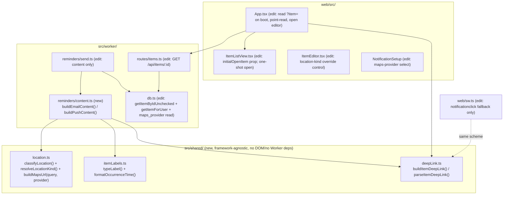

# Implementation Plan: Richer notifications + smart location (`feat/notifications-and-location`)

Status: REVISED post-review — addresses `docs/reviews/notifications-and-location-review.md` (APPROVE-WITH-CHANGES) + three owner rulings. Branch cut off `main`.
Author: Architect (read-only on application code; wrote to `docs/plans/` only).
Authoritative spec: `docs/notifications-location-brief.md`. Backlog framing: `docs/backlog.md` item #2.

---

## Revision changelog (what changed vs the DRAFT reviewed)

This revision folds in the plan-reviewer's 6-item punch-list and the Major/Minor findings, plus three owner rulings. Summary of amendments (details inline in the sections cited):

- **Ruling 1 / M1 — no detail view.** All "detail view" and "rich tappable location surfaced after tap-to-open" language is rescoped: the deep link opens the item's **`ItemEditor`** (a form — the only per-item affordance today). The smart-location "map link / Tap to join / plain" render now applies to **notification content (email/push) only**; there is no read-only in-app location surface to attach it to (verified — `ItemListView.tsx:181-184` is the only place `location` renders, as inert middot-separated text, and opening an item lands in `ItemEditor` where location is an `<input>`). In-app rich location render is a documented follow-up for `feat/ui-redesign`. `LocationDisplay.tsx` is **dropped** from this feature. (§1, §2, §3, §5, Decision 3, Decision 5)
- **Ruling 2 / M2 / M3 — add `GET /api/items/:id`.** Adopted the authorized point-read over the N-list `getItems` fan-out. New Hono route + new authorized `db.ts` helper `getItemForUser(db, email, itemId)` going through `canReadList`. The deep-link boot handler point-reads the item and passes the fetched `Item` down (no double-fetch). (§3.2, §5, §6, Decision 2)
- **Ruling 3 — maps provider is a user choice.** Not hardcoded, not UA-branched. New per-user preference `users.maps_provider` (additive migration `0005`), default Apple Maps. `buildMapsUrl(query, provider)` is provider-aware and consumed by the notification builders (server-side, reads the preference at send time). UI: a select in the notification setup area. (Decision 4, new §Decision 6, §5, §6)
- **M2 — one-shot open guard.** `initialOpenItemId` mechanic fully specified with a reconciling effect and a one-shot guard so it neither double-fetches nor fights the `activeView` single-source-of-truth model nor reopens after close. (§5.3)
- **M4 — SW fallback coherence.** Absolute `data.url` primary; reconstructed **relative** `"/?item="+id` fallback; zero change to push-receive/crypto. (Decision 2 consumer 3)
- **m2/m3 — override edge rules.** Editing `location` resets `location_kind` to `NULL`; override-address → maps search query on raw text; override-meeting with no parseable URL → degrade to plain. (Decision 3)
- **m5 — push byte cap** measured on UTF-8 serialized bytes via `TextEncoder`, not `.length`. (Decision 5)
- **Naming fix (surfaced during revision):** the engine-side unauthorized read and the new user-facing authorized read must not share a name. Engine helper = `getItemByIdUnchecked` (no email arg, cron-trusted); route helper = `getItemForUser` (email arg, authz'd). (§3.2, §5)
- **Two additive migrations now** (`0004_item_location_kind`, `0005_user_maps_provider`), both owner-sign-off-gated with declared fallbacks. (§6, Phase 0)

---

## 1. Problem statement and goals

### Problem
Reminder notifications are currently unusable to a human:

- `src/worker/reminders/send.ts:46-48` (email): subject `"Reminder: item due"`, body `"You have a reminder for item ID: <uuid>"`.
- `src/worker/reminders/send.ts:75-80` (push): title `"Family Scheduler Reminder"`, body `"You have an item coming up"`, and the deep-link `url` is just `env.APP_URL` (no item targeting).

Separately, the item `location` field is free text and always rendered as inert text (`web/src/components/ItemListView.tsx:181-184`), so an address is not tappable-to-maps and a Zoom/Teams/Meet link is not tappable-to-join in notifications.

### Goals
- **Part A — Notification content (email + push):** type-aware subject/title including the item name; human-readable date/time rendered in the item's stored `timezone` for the specific occurrence; location rendered per Part B; notes; a deep link that opens the specific item's **editor**. Never expose the raw UUID in user-facing content.
- **Part B — Smart location (notification content):** a single source-of-truth module that classifies a free-text location as `plain` | `address` | `meeting` and renders it appropriately in **email/push notification content** (plain text / maps link / "Tap to join"). The maps link honors a **per-user maps-provider preference** (Apple vs Google — Ruling 3). An override lets the user correct a wrong guess. (Per Ruling 1 there is no in-app read-only location surface to render into today; the shared classifier and maps builder are still used in-app only if such a surface is later added — see the follow-up note below.)
- **Deep link:** `${APP_URL}/?item=<id>` scheme, consumed identically by the email link, the push payload, the service-worker `notificationclick` handler, and a new frontend boot-time handler that opens the item's `ItemEditor`.
- **Do not regress** the just-fixed push crypto (VAPID JWT + aes128gcm) or the reminder engine control flow. Email + push delivery must still work after the content change.

### Explicit scope note on "open the item" (Ruling 1 / M1)
There is **no item detail view** in this codebase. `ItemListView.tsx` opens an item into the **edit form** (`ItemEditor`) via `setEditingItem(item)` (`ItemListView.tsx:120`, rendered `:73-90`). Therefore:
- "Open the item" throughout this plan = **open that item's `ItemEditor`**.
- The "notes + full tappable location surfaced after tap-to-open" promise from the DRAFT is **dropped**. `ItemEditor` is a form; its location is an `<input>`, not a "Tap to join" affordance. The smart-location render is scoped to **notification content only** for this feature.
- **Follow-up (not this feature):** a real read-only detail view with in-app tappable location belongs to `feat/ui-redesign` (`docs/backlog.md` #3), which will build detail surfaces. When it does, it consumes the same `src/shared/location.ts` classifier + `buildMapsUrl(query, provider)` — the shared module is designed so that adoption is drop-in.

---

## 2. Non-goals

- **Not fixing** "Push notification enablement doesn't persist across logins" or the iPhone-specific push-delivery gap (`docs/backlog.md`). Those are separate, pre-existing items. This feature must not depend on them and must not regress them. See §8 for how QA proceeds given this dependency.
- **No change** to the reminder engine's control flow: `materialize`, the dispatch ledger, the `UNIQUE` de-dup, purge-on-mutation, send classification (D13), grace-window logic. We only enrich the *content* built inside `sendDue`.
- **No change** to auth, Access verification, or the crypto signing/encryption path in `push.ts`.
- **No in-app rich location render** (Ruling 1). No `LocationDisplay` component in this feature. The list row keeps its current inert `{item.location}` render. Rich in-app render is deferred to `feat/ui-redesign`.
- **No UI redesign.** The only new UI is (a) the location-kind override control in `ItemEditor` and (b) a maps-provider select in the notification setup area — both minimal, inline, consistent with current styling.
- **No geocoding / address validation service.** Address detection is heuristic and string-based only.
- **No new item type, no interval recurrence, no attachments** (all backlog).

---

## 3. Proposed design

### 3.1 Component overview



The three `src/shared/` modules are the single sources of truth. They are pure, dependency-free (no `crypto.subtle`, no D1, no React, no DOM), so they are importable by both the Worker and the web bundle and are trivially unit-testable.

### 3.2 Where the Worker gets item data at send time (and the two distinct read helpers)

`getDueDispatch` returns `ReminderDispatch` rows which already include `occurrence_at` and `item_id` (`src/worker/types.ts:68-83`), but NOT title/type/location/notes/timezone. The send loop currently only references `row.item_id`.

There are now **two** by-id read helpers, deliberately named apart because they have different trust models:

**(a) Engine read — `getItemByIdUnchecked(db, itemId): Promise<Item | null>`** (used by `send.ts` at cron time).
- Raw lookup by id via the existing private `mapItem` (`db.ts:59`); returns `null` if the item no longer exists.
- Intentionally takes NO `email`/authorization argument: the dispatch row was already authorized when `materialize` created it, and the send path is the trusted cron context (not a user request). Mirrors the existing unauthenticated engine helper `getListById(db, listId)` (`db.ts:1081-1090`, confirmed no email arg).
- Comment the WHY, citing **P2-N1** (pending dispatch is purged BEFORE the FK cascade on item delete), so the "null is rare" claim is traceable.
- **Edge case — item deleted between materialize and send:** returns `null`. On `null`, mark the dispatch row `sent` (no-op, mirroring the zero-subscription push convention `send.ts:68-73`) so it is not retried, and skip the send. (Note for QA / n2: this counts as `summary.sent++` even though nothing was actually delivered — a `sent` with no email/push. Acceptable; QA's `wrangler tail` interpretation must account for it.)

**(b) Route read — `getItemForUser(db, email, itemId): Promise<Result<ItemWithReminders>>`** (used by the new `GET /api/items/:id` route — Ruling 2).
- This is the **authorized** point-read the deep-link boot handler calls. It must NOT leak private items.
- Behavior mirrors `getItems` authz semantics exactly (`db.ts:497-511`): resolve the item; if the item does not exist → `{ ok:false, code:"NOT_FOUND" }`; if it exists but the caller cannot read its list (`canReadList(db, email, item.list_id) === false`) → `{ ok:false, code:"FORBIDDEN" }`; otherwise `{ ok:true, value: mapItem(row) + reminders }`.
- **Ordering matters for non-leakage:** decide NOT_FOUND vs FORBIDDEN by first fetching the item row; then run `canReadList` on its `list_id`. (This mirrors `getItems`, which returns NOT_FOUND only when the list row is truly absent and FORBIDDEN when it exists but is private to another user. Same shape here: FORBIDDEN means "exists, not yours"; NOT_FOUND means "no such item".)
- Signature returns `ItemWithReminders` (same shape `getItems` returns per element) so the frontend can pass the fetched item straight into `ItemEditor` with reminders populated — no redundant per-list scan (resolves M2's double-fetch).

Signatures:
```ts
// db.ts — engine (trusted cron) raw read; no authz. WHY: dispatch already authorized at
// materialize; P2-N1 purges pending dispatch before FK cascade, so null is rare/defensive.
export async function getItemByIdUnchecked(db: D1Database, itemId: string): Promise<Item | null>;

// db.ts — user-facing authorized point-read for the deep link (GET /api/items/:id).
// Mirrors getItems() authz: NOT_FOUND if no such item; FORBIDDEN if exists but caller
// can't read its list; else the item + reminders.
export async function getItemForUser(
  db: D1Database, email: string, itemId: string
): Promise<Result<ItemWithReminders>>;
```

### 3.3 Occurrence time is authoritative, not `item.start_at`

For recurring items, the notification must show the **occurrence** time, not the item's first `start_at`. The dispatch row carries `occurrence_at`; the content builders receive `occurrenceAt` and format THAT in `item.timezone`. For non-recurring items `occurrence_at === item.start_at`, so this is correct in both cases. This is a WHY-worthy comment: "recurring items fire per-occurrence; format occurrence_at, never item.start_at."

### 3.4 Localized time formatting

Use `Intl.DateTimeFormat` with `timeZone: item.timezone` to render `occurrence_at` (EpochMs). Workers runtime and jsdom both support `Intl` with IANA zones. (Project CLAUDE.md mentions luxon on the client; the shared module stays luxon-free so it is Worker-safe — `Intl` alone suffices and is the single implementation used by both sides.)

- Signature: `formatOccurrenceTime(occurrenceAtMs: number, timezone: string, allDay: boolean): string`.
- All-day items render date only (e.g. "Fri, Jul 17, 2026"); timed items render date + time + zone abbreviation (e.g. "Fri, Jul 17, 2026, 3:30 PM PDT").
- **Fallback:** if `timezone` is falsy or `Intl` throws `RangeError` on an unknown zone, fall back to the schema default `America/Los_Angeles` (matches `items.timezone DEFAULT`) and, failing even that, to UTC with an explicit "UTC" suffix. Never emit a raw epoch number. Return type is always a non-empty string. (The schema guarantees `timezone TEXT NOT NULL DEFAULT 'America/Los_Angeles'`, verified `migrations/0001_init.sql:29` — so a populated per-item timezone is available; the fallback is purely defensive.)

---

## 4. Resolution of the open decisions

### Decision 1 — Type-label mapping for subjects/titles

The `items.type` enum is exactly `'event' | 'task'` (`types.ts:41`, `migrations/0001_init.sql:21`). Map by intent (an event is *coming up*; a task is *due*):

| `item.type` | Subject/title prefix | Example subject |
|-------------|----------------------|-----------------|
| `event`     | `Event reminder`     | `Event reminder: Alex football practice` |
| `task`      | `Task due`           | `Task due: Permission slip` |

- Implemented as a pure `typeLabel(type: string): string` in `src/shared/itemLabels.ts`, returning `"Event reminder"` / `"Task due"`, with a defensive default of `"Reminder"` for any unexpected value (never throws).
- Subject/title composition: `${typeLabel(item.type)}: ${item.title}`. Title is used verbatim (already validated 1–200 chars on write, `items.ts:229`).
- **Rationale:** matches the two examples the brief gives verbatim; keeps the mapping in one pure function so email, push, and any future channel stay consistent.

### Decision 2 — Deep-link format and consumption

**Format:** `${APP_URL}/?item=<id>` (query param, exactly as the brief suggests). Query param chosen over a path segment because the app is a single-page app served by Static Assets with no client router; a query param needs no server-side route and no SW navigation-fallback change.

**Producer:** `buildItemDeepLink(appUrl: string, itemId: string): string` in `src/shared/deepLink.ts`. Uses the `URL` API to set the `item` search param so encoding is correct and a trailing slash / existing query on `APP_URL` is handled safely.

**Consumers (all use the same scheme):**
1. **Email** — the builder embeds the link as an HTML `<a href>` ("Open in Family Scheduler") and as a plain-text URL line.
2. **Push payload** — `PushPayload.url = buildItemDeepLink(env.APP_URL, item.id)` and `PushPayload.item_id = item.id` (both fields already exist on `PushPayload`, `push.ts:14-19`, and are already forwarded by `sw.ts`).
3. **Service worker `notificationclick`** (`web/sw.ts:33-59`) — already reads `event.notification.data.url` (absolute) and `navigate()`-then-`focus()`s it (`:36-49`). Because we now populate `url` with the absolute deep link, the existing handler already does the right thing. **Minimal hardening (M4):**
   - **Primary stays absolute:** `data.url` (the full `${APP_URL}/?item=<id>`).
   - **Fallback is relative:** if `data.url` is absent but `data.item_id` is present (the SW already stores `item_id` in `data`, `sw.ts:25`), reconstruct `"/?item=" + encodeURIComponent(item_id)` — a **relative** path. Relative is correct here because `navigate()`/`openWindow()` resolve it against the SW scope (same origin), which is exactly the app origin.
   - The existing `navigate`-then-`focus` loop already handles either value; the change is a one-line `?? fallback`, with **zero change to the push-receive path or crypto**. Do not import the shared module into the SW bundle (compiled separately); the tiny inline fallback avoids a build-graph change.
4. **Frontend boot** (`web/src/App.tsx`) — on mount, parse `window.location.search` for `item`; if present, **point-read** it via `GET /api/items/:id` and open that item's `ItemEditor` (see §5.3). Use `parseItemDeepLink(search: string): string | null` from the shared module.

**Rationale:** one scheme, one producer, symmetric parse helper; the SW already consumes `data.url`, so the change there is additive hardening, not a rewrite.

### Decision 3 — Location classification storage: auto-detect-at-render with optional stored override

**Chosen approach: derive-at-render, with an OPTIONAL stored override field.**

Classification (`plain` / `address` / `meeting`) is computed every time from the raw `location` string by `classifyLocation()`. This keeps existing items working with zero backfill and guarantees the same string classifies identically wherever it is rendered (single source of truth).

The override is a small **nullable** field, `location_kind`, on `items`:
- `NULL` (default) → auto-detect via `classifyLocation()`. This is the case for every existing row and every item where the user never touches the toggle.
- `'plain' | 'address' | 'meeting'` → user's explicit override; used verbatim instead of the auto-detected kind.

Effective kind = `resolveLocationKind(location, override) = override ?? classifyLocation(location).kind`. Lives in the shared module.

**Override edge rules (m2/m3 — required, make explicit for the Coder):**
- **Editing `location` resets `location_kind` to `NULL`.** When the user changes the `location` input in `ItemEditor`, the override control resets to "Auto" (`null`) so a stale override can't mislabel a now-different string (e.g. changing a Zoom URL to "Home" must not leave a `meeting` override on "Home"). Implement in the editor: the `setField("location", …)` handler also clears `location_kind` to `null`. Document the WHY.
- **`href` derivation when an override forces a kind the raw string can't support:**
  - Override = `address` → always produce a maps href from the raw text: `buildMapsUrl(rawText, provider)` (search-query semantics). Acceptable because the user explicitly asked for a map; if the text is "Home", the map searches "Home".
  - Override = `meeting` but the raw text has no parseable URL → **degrade to plain** (render as plain text, no "Tap to join", no href). The builder must guard this: `kind === "meeting"` with no derivable URL from `classifyLocation(rawText).href` → treat as plain for rendering. This prevents a "Tap to join" with nowhere to go.
  - Override = `plain` → plain text, no href, regardless of what the string looks like.
- The content builders receive `item.location` AND `item.location_kind`, call `resolveLocationKind`, then apply the href rules above.

**This requires an ADDITIVE migration — flagged for explicit owner sign-off BEFORE the Coder runs**, same pattern as the earlier `item_occurrence_state` (0002) and `users.active` (0003) columns:

```sql
-- migrations/0004_item_location_kind.sql
-- Additive: optional user override for smart-location classification (feat/notifications-and-location).
-- NULL = auto-detect at render (default for all existing rows); non-null = explicit user override.
ALTER TABLE items ADD COLUMN location_kind TEXT;   -- NULL | 'plain' | 'address' | 'meeting'
```

Supporting code changes gated on sign-off:
- `types.ts`: add `location_kind: "plain" | "address" | "meeting" | null` to `Item`, `ItemRow`; add optional `location_kind` to `CreateItemInput` / `UpdateItemInput` and `ItemUpdatePatch`.
- `db.ts`: `mapItem`, the `INSERT` in `createItem`, and the `UPDATE` in `updateItem` handle the new column. Validate against the enum on write (reject unknown strings with `VALIDATION`).
- `ItemEditor.tsx` (web): a small select/toggle beside the location input, shown only when `location` is non-empty, letting the user pick "Auto / Plain text / Address (map) / Meeting link", defaulting to "Auto" (= `null`); AND the location-input handler resets it to `null` on change (edge rule above).

**Rationale for override-field over pure-derive-only:** the brief explicitly requires "a user toggle to override a wrong guess." A stored nullable override is the cleanest: fully additive, no backfill, defaults to the desired auto-detect UX, and the override travels with the item so notifications honor it. **If the owner declines migration 0004,** fall back to derive-only: ship `classifyLocation` + notification rendering everywhere, drop the `location_kind` column, the editor toggle, and the override plumbing; the toggle becomes a documented follow-up. The plan is structured so this fallback removes an isolated slice (Phase 4 `[D3]`) without touching Parts A/B core.

**Detection heuristics** (`classifyLocation(raw: string): { kind, href? }`, all pure, order matters). NOTE: `href` here uses `buildMapsUrl(raw, provider)` for `address`; since `classifyLocation` is provider-agnostic, it returns the classification + the raw query, and the **caller** (content builder / any future in-app render) applies `buildMapsUrl(query, provider)`. Concretely `classifyLocation` returns `{ kind, url? }` where `url` is a meeting/generic URL as-is, and address hrefs are built by the caller from `raw` + provider. This keeps provider out of the pure classifier.
1. Trim. Empty/whitespace → `plain` (no url).
2. **Meeting link** — matches a URL whose host is a known meeting provider. Detect by parsing with `URL` (accepting `http`/`https`, or prefixing `https://` if the string starts with a bare `www.`/host that parses). Host matches (case-insensitive, suffix match) any of: `zoom.us`, `zoom.com`, `teams.microsoft.com`, `teams.live.com`, `meet.google.com`, `webex.com`, `whereby.com`. → `meeting`, `url = the URL as-is`.
3. **Generic URL** — parses as `http`/`https` but host is not a known meeting provider → classify as `plain` but expose `url` so it can render as a plain link (kind `plain`, `url = url`). Rationale: avoids mislabeling a random URL as "Tap to join." (Document this WHY.)
4. **Address-like** — not a URL, but looks like a street address: matches a heuristic such as *starts with a street number followed by a word* (`/^\s*\d+\s+\S/`) OR contains a postal-code-like token (`/\b\d{5}(-\d{4})?\b/`) OR contains an explicit street-type token (case-insensitive word boundary on `st|street|ave|avenue|rd|road|blvd|dr|drive|ln|lane|way|ct|court|hwy|highway|suite|ste|#`). → `address` (no `url`; the caller builds a maps href via `buildMapsUrl(raw, provider)`).
5. **Otherwise** → `plain` (e.g. "Home", "Alex's school", "Grandma's"). No url.

Heuristics are intentionally conservative: false-negatives (an address left plain) are correctable via the override toggle; false-positives (a plain word linked to maps) are the more annoying failure, so the address rule requires a fairly strong signal.

### Decision 4 — Maps URL form is a per-user provider choice (Ruling 3)

**Superseded:** the DRAFT hardcoded a single `https://maps.google.com/?q=` URL. Per owner Ruling 3, the maps provider is a **user choice** (Apple Maps vs Google Maps), applied consistently everywhere the maps href is built (notification content now; any future in-app render later). No UA-branching.

The provider-aware builder is a pure function:

```ts
// src/shared/location.ts
export type MapsProvider = "apple" | "google";

// Pure. query = the raw location text (search-query semantics). Consumed by the notification
// content builder (server-side) and any future in-app render.
export function buildMapsUrl(query: string, provider: MapsProvider): string {
  const q = encodeURIComponent(query);
  return provider === "google"
    ? `https://maps.google.com/?q=${q}`
    : `https://maps.apple.com/?q=${q}`;  // default = apple
}
```

- **Apple form** `https://maps.apple.com/?q=<encoded>`: opens Apple Maps on iOS and a web map elsewhere (acceptable degradation on Android/desktop). Chosen over the `maps://` scheme because `maps://` does not render as a clickable link in email HTML on many clients; the `https://maps.apple.com` universal link both renders and hands off to Apple Maps on iOS. Use `https://maps.apple.com/?q=` for both email and push.
- **Google form** `https://maps.google.com/?q=<encoded>`: opens Google Maps app if installed, else web; on iOS without Google Maps installed it opens a web map (or Apple Maps in some contexts).
- The full provider decision (default, storage, UI, API) is specified in **Decision 6** below.

### Decision 5 — Push payload size limits: what goes in push vs "tap to open"

Web-push aes128gcm records have a practical safe ceiling well under 4 KB (`push.ts:225` `recordSize = 4096`; framing overhead salt(16)+rs(4)+idlen(1)+serverPubKey(65)+GCM tag(16) ≈ 102 bytes over plaintext plus the `0x02` delimiter). Keep the JSON payload comfortably small (target < ~1 KB).

**Push carries (compressed):**
- `title` = `${typeLabel(type)}: ${item.title}` (truncate title to ~80 chars with an ellipsis if longer).
- `body` = one line: localized occurrence time, then location summary if present. Location summary = for `meeting` (with a real URL) → "Tap to join"; for `address` → the address text (truncated ~60 chars); for `plain` (or degraded meeting/address per the override edge rules) → the text (truncated ~60 chars). Notes are NOT included in push (deferred to "tap to open" = opening the editor).
- `url` = deep link; `item_id` = id. Tapping opens the item's `ItemEditor`.

**Everything else ("tap to open"):** notes and the full item live in the editor after the deep link opens it. (Per Ruling 1 the editor is a form, not a rich detail render; the push body is intentionally self-sufficient for the glance — time + location summary — because the editor will show location as an input, not a tappable map/join affordance. Email carries the full tappable rendering.)

- **Byte cap (m5 — required):** the builder enforces a hard cap measured on the **UTF-8 serialized JSON bytes**, i.e. `new TextEncoder().encode(JSON.stringify(payload)).byteLength`, NOT the JS string `.length` (titles/locations may contain multibyte chars). Constant `PUSH_MAX_BYTES = 3000`. If exceeded after composing: drop the location summary first, then truncate the title further, guaranteeing a deliverable payload. Pure function, unit-tested with a long-multibyte-title/long-location fixture.
- **Rationale:** push is a glanceable nudge; the deep link is the affordance for the rest. Email (no size pressure) carries everything, fully tappable.

### Decision 6 — Maps-provider preference: storage, default, UI, API (Ruling 3)

Because email/push are rendered **server-side**, the provider preference must be readable at send time — so it needs server storage.

**Storage — additive nullable `users` column (owner-sign-off-gated, migration `0005`):**

```sql
-- migrations/0005_user_maps_provider.sql
-- Additive: per-user preferred maps provider for tappable addresses (feat/notifications-and-location).
-- NULL = default (Apple Maps). Non-null: 'apple' | 'google'.
ALTER TABLE users ADD COLUMN maps_provider TEXT;   -- NULL | 'apple' | 'google'
```

Follows the exact additive pattern already approved for `users.active` (0003) — no backfill, backward-compatible, existing rows read `NULL`.

**Default when unset:** **Apple Maps.** Rationale: the owner's primary device is an iPhone, where an `https://maps.apple.com` link hands off natively to Apple Maps; and there is no Google Maps app installed on that device per the push-reliability investigation. `NULL → 'apple'` is resolved by a pure helper `resolveMapsProvider(stored: string | null): MapsProvider` returning `stored === "google" ? "google" : "apple"` (unknown/null → apple).

**Where it is read at send time:** `send.ts` already has the recipient context per dispatch. The content builder needs the provider, so `send.ts` reads the recipient user's `maps_provider` (a small `getUserMapsProvider(db, email): Promise<MapsProvider>` helper in `db.ts`, or fold the read into the existing recipient/user fetch the send loop already does — Coder picks whichever avoids an extra query; note whichever is used). Pass the resolved `MapsProvider` into `buildEmailContent` / `buildPushContent`, which pass it to `buildMapsUrl`.

**UI — least-intrusive spot:** the app already has a notification setup surface (`NotificationSetup.tsx`, the push-enablement area). Add a small labeled `<select>` there: "Maps app for addresses: Apple Maps (default) / Google Maps". This is the natural home because it is a notification-affecting preference and that surface already exists — no new settings page, no new nav. (Verify the exact component name/path during Phase 4b; the brief/rulings state "there is a settings/notification setup area" — the Coder wires it into that existing component. If the exact component differs, wire it into whatever renders the push-enable toggle.)

**API to persist it:** reuse the existing user-preferences update path if one exists; otherwise add a minimal authorized `PATCH /api/me` (or `PATCH /api/me/prefs`) that accepts `{ maps_provider: 'apple' | 'google' }`, validates the enum (`400 VALIDATION` on unknown), and writes it for the Access-verified `user.email` (never from body — per project convention email comes from the JWT). The Coder checks whether a `me`/prefs mutation already exists before adding one; if it does, extend it. `GET /api/me` (the existing `getMe`) includes `maps_provider` so the UI can show the current selection.

- **If the owner declines migration 0005:** fall back to a fixed default provider (Apple Maps) with no user choice — drop the column, the UI select, and the API field; `buildMapsUrl` still takes a `provider` arg but callers pass the constant `'apple'`. The provider-choice UI becomes a documented follow-up. This keeps `buildMapsUrl` and the notification builders unchanged in shape.

**Unit tests:** `buildMapsUrl("123 Main St", "apple")` → `https://maps.apple.com/?q=123%20Main%20St`; `buildMapsUrl("123 Main St", "google")` → `https://maps.google.com/?q=123%20Main%20St`; `resolveMapsProvider(null|"apple"|"google"|"weird")` → `apple|apple|google|apple`.

---

## 5. Affected files and modules

### 5.1 New files

| File | Purpose |
|------|---------|
| `src/shared/location.ts` | `classifyLocation`, `resolveLocationKind`, `buildMapsUrl(query, provider)`, `resolveMapsProvider`, `LocationKind` + `MapsProvider` types. Pure, no DOM/Worker deps. |
| `src/shared/itemLabels.ts` | `typeLabel`, `formatOccurrenceTime`. Pure. |
| `src/shared/deepLink.ts` | `buildItemDeepLink`, `parseItemDeepLink`. Pure (uses `URL`/`URLSearchParams`). |
| `src/worker/reminders/content.ts` | `buildEmailContent(item, occurrenceAtMs, appUrl, mapsProvider)` → `{ subject, html, text }`; `buildPushContent(item, occurrenceAtMs, appUrl, mapsProvider)` → `{ title, body, url, item_id }`. Consumes the three shared modules. |
| `migrations/0004_item_location_kind.sql` | **Owner-sign-off-gated** additive column `location_kind` (Decision 3). |
| `migrations/0005_user_maps_provider.sql` | **Owner-sign-off-gated** additive column `maps_provider` (Decision 6). |
| `tests/unit/location.test.ts` | Detection + override edge rules + maps URL (both providers) + `resolveMapsProvider` unit tests. |
| `tests/unit/notification-content.test.ts` | Content-builder unit tests (subject, localized time, location per provider, deep link, no UUID, push byte cap, HTML escaping). |
| `tests/unit/items-get-by-id.test.ts` | `GET /api/items/:id` authz: owner reads own private item → 200; non-owner → 403; missing → 404. |
| `web/src/App.deeplink.test.tsx` | Frontend test: `?item=<id>` point-reads and opens the correct item's editor. |

**Removed vs DRAFT:** `web/src/components/LocationDisplay.tsx` is **not** created (Ruling 1 — no in-app location surface to render into this feature).

### 5.2 Edited files (Worker)

| File | Change | Constraint |
|------|--------|------------|
| `src/worker/reminders/send.ts` | Replace inline email content (`:46-48`) and push payload (`:75-80`) with `buildEmailContent` / `buildPushContent`. Fetch item via `getItemByIdUnchecked`; on `null`, mark `sent` no-op + `continue`. Read recipient `maps_provider` and pass the resolved provider into the builders. | Do NOT touch dispatch selection, `markDispatch` calls, classification branches, counting, or `sendDailyDigest`'s control flow. Content-only edit. |
| `src/worker/db.ts` | Add `getItemByIdUnchecked(db, itemId): Promise<Item \| null>` (engine, no authz; mirror `getListById`). Add `getItemForUser(db, email, itemId): Promise<Result<ItemWithReminders>>` (authorized; mirror `getItems` authz). Add `getUserMapsProvider(db, email)` (or extend existing user read). [D3] extend `mapItem`/`createItem`/`updateItem` for `location_kind`. [D6] read `maps_provider` in the user fetch. | New reads; engine helper mirrors `getListById`, route helper mirrors `getItems` authz exactly. |
| `src/worker/routes/items.ts` | **NEW route** `GET /api/items/:id` → `getItemForUser(c.env.DB, user.email, id)`; map `Result` codes to status exactly like the existing handlers (`NOT_FOUND→404`, `FORBIDDEN→403`, else 400), return `{ item }` on success. [D3] accept + validate `location_kind` enum on POST/PATCH. | Additive route + additive validation; mirrors existing handler shape. |
| `src/worker/types.ts` | (D3) add `location_kind` to `Item`, `ItemRow`, `CreateItemInput`, `UpdateItemInput`. (D6) add `maps_provider` to the user type/row as needed. | Additive. |
| `src/worker/routes/me.ts` (or wherever `GET /api/me` lives) | (D6) include `maps_provider` in the `me` response; add/extend the prefs mutation to persist `maps_provider` (enum-validated; email from JWT, not body). | Verify exact file during Phase 4b. |

### 5.3 Edited files (Web) and the deep-link open mechanic (M1/M2/M3)

| File | Change |
|------|--------|
| `web/src/App.tsx` | On mount, after `loadMe`, parse `parseItemDeepLink(window.location.search)`. If an id is present, **point-read** via `GET /api/items/:id`; on success set `selectedListId = item.list_id`, `activeView = "list"`, and pass the fetched `Item` down as `initialOpenItem`. On 403/404, fall back to normal load + subtle "That item is no longer available" notice. No N-list iteration. |
| `web/src/components/ItemListView.tsx` | Add `initialOpenItem?: Item` prop; a one-shot effect opens it in `ItemEditor` exactly once (details below). Location list-row render is UNCHANGED (Ruling 1 — no `LocationDisplay`). |
| `web/src/components/ItemEditor.tsx` | (D3) add the "Auto / Plain / Address / Meeting" `location_kind` override control next to the location field, shown only when `location` non-empty, default "Auto" (null); AND reset `location_kind` to `null` in the location-input `onChange` (edge rule). |
| `web/src/components/NotificationSetup.tsx` (or the component rendering the push-enable toggle) | (D6) add the "Maps app for addresses" `<select>` (Apple default / Google), wired to `maps_provider` via the `me`/prefs API. |
| `web/src/apiClient.ts` | Add `getItem(id): Promise<{ item: Item }>` for the deep-link point-read. (D3) include `location_kind` in `ItemUpdatePatch` and the create draft type. (D6) include `maps_provider` in the me/prefs types + a `setMapsProvider`/prefs call. |
| `web/src/types.ts` | (D3) add `location_kind` to the web `Item` type. (D6) add `maps_provider` to the web `User` type. |
| `web/sw.ts` | Harden `notificationclick` (`:36-37`): keep `data.url` (absolute) primary; add relative `"/?item="+encodeURIComponent(item_id)` fallback from `data.item_id`. No crypto/push-receive change. |

**Deep-link resolution on the frontend — concrete mechanic (M1/M2/M3):**

1. **Boot (App.tsx).** After `loadMe` resolves the user + lists, read `const deepId = parseItemDeepLink(window.location.search)`. If `deepId`:
   - `const res = await getItem(deepId)` (the new `GET /api/items/:id`).
   - **On success:** `setSelectedListId(res.item.list_id)`, `setActiveView("list")`, and store the fetched item in a new state `const [initialOpenItem, setInitialOpenItem] = useState<Item | null>(null)` → `setInitialOpenItem(res.item)`. Pass `initialOpenItem` down to `ItemListView`. Because we already have the full `Item` (with reminders), **no redundant per-list scan and no second fetch of that item is needed** (resolves M2/M3's double-fetch and N-fan-out).
   - **On 403/404 (ApiError):** do nothing special beyond normal load; optionally set a dismissible `deepLinkNotice` shown as a small banner ("That item is no longer available"). No data leak — server authz already gated it.
   - This runs once on mount (in/after `loadMe`), and is compatible with the `activeView` single-source-of-truth model (`App.tsx:14`, set via `:72/:78/:84/:96`): we set `activeView="list"` exactly once at boot, same as any user click.
2. **One-shot open (ItemListView.tsx).** `ItemListView` receives `initialOpenItem?: Item`. Add a one-shot effect + guard so it opens exactly once and never fights later user navigation:
   ```ts
   const openedRef = useRef(false);
   useEffect(() => {
     if (initialOpenItem && !openedRef.current) {
       openedRef.current = true;      // one-shot: never reopen after the user closes it
       setEditingItem(initialOpenItem); // open the editor with the already-fetched item (has reminders)
     }
   }, [initialOpenItem]);
   ```
   - The ref guard means: once opened, closing the editor (`setEditingItem(null)` via `onCancel`/`onSave`) does NOT reopen it, even though `initialOpenItem` is still set — because `openedRef.current` is now `true`. This is the "don't fight the user closing it" requirement.
   - We pass the **fetched `Item`** (not just an id), so `setEditingItem(initialOpenItem)` opens the editor with reminders already populated — the list's own `getItems` effect (`:21-29`) still runs to populate the list behind the editor, but the editor open does NOT depend on it and there is NO extra fetch of the deep-linked item itself.
   - **WHY the ref (not clearing `initialOpenItem`):** clearing the prop from the parent would require an upward callback and could race the list-load; a local one-shot ref is the minimal, self-contained guard and keeps `App.tsx` as the single owner of `initialOpenItem`.
3. **Compatibility note.** The list's existing `getItems(listId)` effect still fires for the selected list (to render the list). That is the list load, not a re-fetch of the deep-linked item — the editor already has the item. This is the only fetch of that list and is unavoidable/expected (it is how the list always loads). No double-fetch of the item.

---

## 6. Data model and API changes

### Data model
- **If Decision 3 approved:** additive nullable `items.location_kind TEXT` (migration `0004`). No backfill. Existing rows read `NULL` → auto-detect.
- **If Decision 6 approved:** additive nullable `users.maps_provider TEXT` (migration `0005`). No backfill. Existing rows read `NULL` → default Apple.
- All timestamps remain EpochMs UTC; display conversion happens in `formatOccurrenceTime` using `item.timezone`.

### API changes
- **NEW:** `GET /api/items/:id` — authorized point-read for the deep link. Returns `{ item }` (with reminders) on 200; `403 FORBIDDEN` for an existing item the caller can't read; `404 NOT_FOUND` if it doesn't exist. Authz mirrors `getItems` exactly (via new `getItemForUser` → `canReadList`). No new auth surface; `user.email` comes from the verified Access JWT.
- **If Decision 3 approved:** `POST /api/items` and `PATCH /api/items/:id` accept optional `location_kind ∈ {plain,address,meeting}` (or `null`), enum-validated; `GET` responses include `location_kind`.
- **If Decision 6 approved:** `GET /api/me` includes `maps_provider`; a `PATCH /api/me` (or existing prefs mutation) accepts `{ maps_provider: 'apple'|'google' }`, enum-validated, email from JWT.
- No change to any subscription, list, or reminder route.

### Env / secrets
- No new env vars. `env.APP_URL`, `env.EMAIL_FROM`, `env.VAPID_*`, `env.RESEND_API_KEY` all already exist (`src/worker/env.ts`).

---

## 7. Risks, edge cases, and open questions

### Locked crypto lines in `push.ts` (content vs crypto — for the Coder)
The Coder MUST NOT edit any of the following in `src/worker/channels/push.ts` (reviewer confirmed all ranges accurate):
- **Base64url helpers:** `b64urlToBytes`, `bytesToB64url`, `concatBytes` (`:32-56`).
- **VAPID JWT signing:** `signVapidJwt` (`:62-107`).
- **aes128gcm encryption:** `EncryptedPayload`, `encryptPayload` (`:113-222`) — ECDH, HKDF, CEK/nonce derivation, AES-GCM, the single-`0x00` info strings (guarded by `tests/unit/push-encrypt.test.ts`), the `0x02` record delimiter.
- **Record framing:** `buildPushBody` (`:224-231`).
- **The `fetch` in `sendPush`** including `Content-Encoding: aes128gcm`, `Authorization: vapid …`, `TTL`, and status classification (`:241-291`).

**What IS content and MAY change:** only the *value* of the `payload` object passed INTO `sendPush` from `send.ts` (`send.ts:75-80`). The `PushPayload` interface (`push.ts:14-19`) already has `title`, `body`, `url`, `item_id` — the Coder populates them differently; the interface shape does not change. **Nothing inside `push.ts` is edited (zero-edit assertion holds).**

### Reminder-engine invariants (must not regress)
- Do not alter dispatch selection, grace window, `markDispatch` semantics, sent/failed/pending classification, or `sendDailyDigest`'s control flow. The only `send.ts` edits are: (a) fetch the item, (b) read maps provider, (c) build content via the new module, (d) handle `item === null`. Keep the per-branch `summary` counting exactly as-is.
- **m6 follow-up (record for QA):** `sendDailyDigest` (`send.ts:203-222`) already renders `d.toUTCString()` (UTC, not item timezone). This feature deliberately does NOT touch it. It is pre-existing UTC output, not a regression introduced here; QA should not flag it. A follow-up could route the digest through `formatOccurrenceTime` — out of scope.

### Edge cases
- **Item deleted between materialize and send** → `getItemByIdUnchecked` returns `null` → mark `sent` no-op, skip (§3.2). Counts as `summary.sent++` with nothing delivered (n2 — QA note).
- **Deep-linked item deleted or not visible to the recipient** (e.g. forwarded email) → `GET /api/items/:id` returns 404/403 → frontend shows the "no longer available" notice; no data leak (authz mirrors `getItems`).
- **Recurring item** → format `occurrence_at`, not `start_at` (§3.3).
- **Unknown / missing timezone** → fallback chain, never emit epoch (§3.4).
- **Empty / whitespace location** → `plain`, no href; notification omits the location line.
- **Override edge rules** — editing location resets `location_kind=NULL`; override-address → maps search on raw text; override-meeting with no URL → degrade to plain (Decision 3).
- **Very long / multibyte title / location** → push truncation + hard byte cap measured via `TextEncoder` (Decision 5, m5).
- **HTML-injection in title/notes/location in the email `html`** → escape ALL item-derived strings before interpolating into HTML (the current code interpolates a UUID so escaping was moot; now titles/notes/location are user text). Use a small pure `escapeHtml` in `content.ts`. The plain-text and push variants do not need escaping. **Correctness AND light-security requirement — call out to the Coder;** the test must assert an injected `<script>`/`"` in title/notes is escaped in the `html` output.
- **Generic (non-meeting) URL in location** → rendered as a plain link, not "Tap to join" (Decision 3 heuristic step 3).

### Open questions (for owner sign-off before Coder — BLOCKING gates)
1. **Migration `0004` (`items.location_kind`) sign-off?** If declined → derive-only fallback (skip `[D3]` steps).
2. **Migration `0005` (`users.maps_provider`) sign-off?** If declined → fixed Apple-Maps default, no user choice (skip `[D6]` UI/API; `buildMapsUrl` callers pass constant `'apple'`).
3. **Maps default = Apple Maps** (Decision 6 rationale: iPhone primary, no Google Maps app installed). Confirm.
4. **Meeting-provider host list** (zoom/teams/meet/webex/whereby) sufficient for the family's use, or add others?

(Resolved by owner rulings, no longer open: detail-view rescope → editor only; deep-link resolution → `GET /api/items/:id`; maps provider → user choice.)

---

## 8. iPhone push-reliability dependency (critical)

Done-condition #4 in the brief is a **live-device re-test**: deploy → cron tick → confirm push lands on a real device, both channels send, deep link opens the item.

The owner has reported that **push has never been observed working on their iPhone**, and that **push enablement does not persist across logins** (`docs/backlog.md` + the nested iPhone QA investigation, which notes iOS only permits web push for a **Home-Screen-installed, standalone** PWA on iOS 16.4+).

This plan's position:
- **This feature does not depend on, and must not regress, the push delivery/subscription path.** We only change the *content* of the push payload passed into the untouched `sendPush`. No change to subscription storage, `getSubscription()`, or the crypto. (The maps-provider select is ADDED to the notification setup area but does not touch the push-enable/subscription logic there.)
- **The notification-content changes are fully testable independent of the iPhone.** Exercised by (a) the `email` channel end-to-end on any device (email carries the full enriched, tappable content and the deep link), and (b) the unit suites, which prove the builders produce correct subject/title, localized time, per-provider location rendering, deep link, no-UUID, and push byte cap — with zero dependency on whether a device can receive push.
- **How QA proceeds if the iPhone push-delivery item is still unresolved:**
  1. Unit-verify all content builders, location detection, both maps providers, `GET /api/items/:id` authz.
  2. Live-verify the **email** channel end-to-end at a real cron tick (`wrangler tail` for `send.sent`): enriched subject, full body, working deep link, correct location rendering (map link honoring the provider vs "Tap to join" vs plain).
  3. Verify push **encryption/dispatch does not error** at the cron tick (no `push crypto error`; push branch classifies `sent`, not `failed`) — proving no regression to the send path.
  4. If a **known-good push target exists** (desktop Chrome / Android install), verify on-device receipt + tap-opens-item's-editor there.
  5. **Defer ONLY the iPhone-specific on-device push confirmation** to the separate push-reliability backlog item. QA records this explicitly.

QA sign-off for THIS feature is: unit tests green + email live re-test green + push-send-doesn't-error at a live tick. The iPhone-specific on-device push receipt is tracked as a known blocker owned by the separate item, not a regression introduced here.

---

## 9. Step-by-step implementation checklist for the Coder

Run `npm run typecheck` and `npm run lint` after each meaningful change (per project CLAUDE.md). Note: `npm run lint` may be blocked by the pre-existing ESLint flat-config gap (`docs/backlog.md`); if so, record it and rely on `typecheck` + tests, do not attempt to fix ESLint here (out of scope).

### Phase 0 — Gate (BEFORE writing schema-dependent code)
- [ ] Confirm owner sign-off on **migration 0004** (`items.location_kind`). If declined → skip every `[D3]` step (derive-only fallback).
- [ ] Confirm owner sign-off on **migration 0005** (`users.maps_provider`). If declined → skip every `[D6]` UI/API step; `buildMapsUrl` callers pass constant `'apple'`.

### Phase 1 — Shared pure modules (no deps; fully unit-testable)
- [ ] `src/shared/itemLabels.ts`: `typeLabel(type)`, `formatOccurrenceTime(occurrenceAtMs, timezone, allDay)` with the timezone fallback chain (§3.4). Comments explain WHY (occurrence not start_at; never emit epoch).
- [ ] `src/shared/location.ts`: `LocationKind`, `MapsProvider`, `classifyLocation(raw)` (returns `{ kind, url? }`), `resolveLocationKind(raw, override)`, `buildMapsUrl(query, provider)`, `resolveMapsProvider(stored)`. Heuristics + override edge rules per Decision 3; comment "generic URL stays plain link" WHY.
- [ ] `src/shared/deepLink.ts`: `buildItemDeepLink(appUrl, itemId)`, `parseItemDeepLink(search)`.
- [ ] `tests/unit/location.test.ts`: "Home"→plain (no url); Zoom/Teams/Meet URL→meeting (+url); address-like→address (caller builds maps href); override forces kind (incl. override-meeting-no-URL→degrade-to-plain, override-address→maps search on raw); generic URL→plain w/ url; empty→plain; `buildMapsUrl` both providers; `resolveMapsProvider` null/apple/google/unknown. Run `npm test`.

### Phase 2 — Worker content builder
- [ ] `src/worker/reminders/content.ts`: `buildEmailContent(item, occurrenceAtMs, appUrl, mapsProvider)` (subject, escaped HTML body with title/localized time/location(per provider)/notes/deep link, plain-text variant) and `buildPushContent(item, occurrenceAtMs, appUrl, mapsProvider)` (compressed title/body + url + item_id + hard byte cap via `TextEncoder` per Decision 5/m5). Add pure `escapeHtml`.
- [ ] `tests/unit/notification-content.test.ts`: type-aware subject for event & task; localized time in a non-default zone (`America/New_York`) human-readable, not epoch; meeting→"Tap to join"+link in email; address→maps link with the passed provider (assert both apple and google produce the right host); "Home"→plain; deep link present/well-formed; **no raw UUID anywhere**; push payload within `PUSH_MAX_BYTES` even with a long multibyte title+location (assert `TextEncoder` byte length); HTML escaping of injected `<script>`/`"`. Run `npm test`.

### Phase 3 — Wire the Worker send path (content-only)
- [ ] `src/worker/db.ts`: add `getItemByIdUnchecked(db, itemId): Promise<Item | null>` (engine, no email arg; mirror `getListById`; comment WHY + cite P2-N1).
- [ ] `src/worker/db.ts`: add/extend the recipient user read to expose `maps_provider` (or `getUserMapsProvider(db, email)`), resolved via `resolveMapsProvider`.
- [ ] `src/worker/reminders/send.ts`: email branch fetches item via `getItemByIdUnchecked(db, row.item_id)`; if `null` → `markDispatch(sent)` no-op + `summary.sent++` + `continue`; else read the recipient's provider and build via `buildEmailContent(item, row.occurrence_at, env.APP_URL, provider)`. Push branch: same `null` handling, then `buildPushContent(...)` for the payload passed to `sendPush`. Do NOT touch selection, classification, counting, or `sendDailyDigest`.
- [ ] Confirm `push.ts` is untouched (diff shows zero changes). Run `npm test` — existing `push-encrypt`/`push-vapid` tests must stay green (crypto regression guard).

### Phase 3b — `GET /api/items/:id` (authorized point-read; Ruling 2)
- [ ] `src/worker/db.ts`: add `getItemForUser(db, email, itemId): Promise<Result<ItemWithReminders>>` mirroring `getItems` authz (NOT_FOUND if no item; FORBIDDEN if exists but `!canReadList`; else item+reminders).
- [ ] `src/worker/routes/items.ts`: add `GET /api/items/:id` → `getItemForUser` → map codes (`NOT_FOUND→404`, `FORBIDDEN→403`, else 400), return `{ item }`.
- [ ] `tests/unit/items-get-by-id.test.ts`: owner reads own **private** item → 200; non-owner (private list) → 403; missing id → 404; shared-list item readable by a member → 200. Run `npm test`.

### Phase 4 — [D3] Location override persistence (gated on Phase 0 sign-off)
- [ ] `migrations/0004_item_location_kind.sql` (additive nullable). Apply locally: `npx wrangler d1 migrations apply family-scheduler --local`.
- [ ] `src/worker/types.ts`: add `location_kind` to `Item`, `ItemRow`, `CreateItemInput`, `UpdateItemInput`.
- [ ] `src/worker/db.ts`: `mapItem`, `createItem` INSERT, `updateItem` UPDATE handle `location_kind`; validate enum on write.
- [ ] `src/worker/routes/items.ts`: accept + validate `location_kind` enum on POST/PATCH.
- [ ] `web/src/types.ts` + `web/src/apiClient.ts`: mirror the field.
- [ ] `web/src/components/ItemEditor.tsx`: "Auto/Plain/Address/Meeting" override control (shown only when location non-empty, default "Auto"/null); location-input `onChange` also resets `location_kind` to `null` (edge rule).

### Phase 4b — [D6] Maps-provider preference (gated on Phase 0 sign-off)
- [ ] `migrations/0005_user_maps_provider.sql` (additive nullable). Apply locally.
- [ ] `src/worker/types.ts`: add `maps_provider` to the user type/row.
- [ ] `src/worker/db.ts`: read/write `maps_provider`; expose in the `me` read.
- [ ] `src/worker/routes/me.ts` (verify path): include `maps_provider` in `GET /api/me`; add/extend a `PATCH` to persist it (enum-validated; email from JWT).
- [ ] `web/src/types.ts` + `web/src/apiClient.ts`: add `maps_provider` to `User`; add a prefs setter.
- [ ] `web/src/components/NotificationSetup.tsx` (or the push-enable component): add the "Maps app for addresses" `<select>` (Apple default / Google), wired to the prefs API. Do NOT touch the push-enable/subscription logic.

### Phase 5 — Frontend deep link (open the editor; Ruling 1/M2)
- [ ] `web/src/apiClient.ts`: add `getItem(id): Promise<{ item: Item }>`.
- [ ] `web/src/App.tsx`: on mount after `loadMe`, `parseItemDeepLink(window.location.search)`; if id, `getItem(id)` → on 200 set `selectedListId`+`activeView="list"`+`initialOpenItem`; on 403/404 optional "no longer available" notice. No N-list iteration.
- [ ] `web/src/components/ItemListView.tsx`: add `initialOpenItem?: Item`; one-shot `useRef` effect opens it in `ItemEditor` exactly once (§5.3). List-row location render UNCHANGED.
- [ ] `web/sw.ts`: harden `notificationclick` — `data.url` (absolute) primary; relative `"/?item="+encodeURIComponent(item_id)` fallback from `data.item_id`. No crypto/push-receive change.
- [ ] `web/src/App.deeplink.test.tsx`: mock `getMe` (visible lists) + `getItem` (returns the target item); render `App` with `window.location.search="?item=<id>"`; assert the item's `ItemEditor` opens (e.g. "Edit Item" heading + title value present). Also assert that closing the editor does NOT reopen it (one-shot). Mirror mock/`waitFor` patterns in `App.test.tsx` / `ItemEditor.test.tsx`. Run `npm test`.

### Phase 6 — Full gate + hand-off
- [ ] `npm run typecheck` clean.
- [ ] `npm test` all green (new + existing, especially push crypto guards).
- [ ] `npm run test:e2e` if deep-link/notification flows have E2E coverage (else note N/A).
- [ ] Commit at the boundary. Hand off to QA with the §8 live-re-test protocol (email live re-test is the load-bearing gate; iPhone on-device push receipt may defer to the separate push-reliability item).

---

## 10. Test plan → done-condition mapping

| Brief done-condition | Test artifact |
|----------------------|---------------|
| 1. Content builders (type subject, localized time, location per type + provider, deep link, no UUID, byte cap, escaping) | `tests/unit/notification-content.test.ts` (Phase 2) |
| 2. Location detection + override edge rules + maps providers | `tests/unit/location.test.ts` (Phase 1) |
| 3. `?item=<id>` deep link point-reads and opens the item's editor (one-shot) | `web/src/App.deeplink.test.tsx` (Phase 5) |
| — Deep-link authz (private→403, missing→404, owner→200) | `tests/unit/items-get-by-id.test.ts` (Phase 3b) |
| 4. Live-deploy re-test (both channels send, no push crypto error, email + deep link + location on a real device) | QA protocol §8: unit-verified + email live re-test + push-send-no-error at a live cron tick; iPhone on-device push receipt deferred to the separate push-reliability item |
