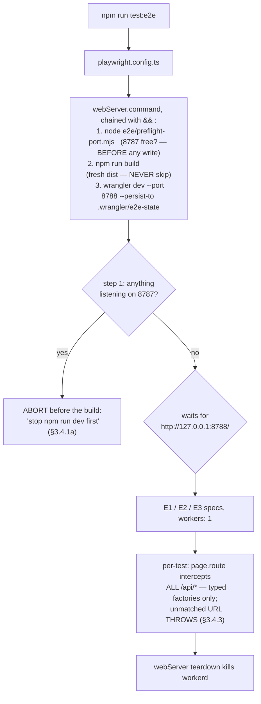

# Plan: Playwright bootstrap — a small, load-bearing browser suite

Slug: `playwright-bootstrap`
Source: `docs/backlog.md:161` ("Playwright bootstrap", deferred from `feat/item-view-mode`, D-OQ3).
Type: test/tooling. **No application-code changes** (see §4.3 for the audit that established this).
Process: this plan → plan-review → Coder → QA.

---

## 1. Problem statement and goals

### 1.1 The literal problem

`@playwright/test ^1.49.0` is a devDependency (`package.json:39`) and `package.json:14` defines
`"test:e2e": "playwright test"`, but **there is no `playwright.config.*` and no spec file anywhere
in the repo.** With no config, `playwright test` has no `testDir`, finds no tests, and exits with an
error. The script exists, reads like coverage in `CLAUDE.md:22-25`, and proves nothing.

The current state is therefore *worse than having nothing*: a reader of `package.json` or
`CLAUDE.md` reasonably concludes this project has end-to-end coverage. It does not.

### 1.2 Premise check — is a browser suite actually worth building here?

This repo has learned three times running (`fix-item-save`, `calendar-show-more`,
`calendar-roving-tabindex`) that broad shallow coverage is worse than a few sharp tests, so the
premise deserves a hostile look before any design.

**The case against.** There are already **300 passing tests across 34 files** (`vitest.workspace.ts`
`worker` + `web` projects), including HTTP-layer authorization guards
(`tests/unit/list-isolation-http.test.ts`, PR #19) and 30 `CalendarView` component tests. There is
**no CI** in this repo (no `.github/workflows`; deploys are manual — see the `deploys-are-manual`
project memory), so a browser suite runs only when a human remembers to run it. And QA already
drives the real app by hand competently: `docs/qa/calendar-roving-tabindex-report.md` is a
nine-check real-browser pass that covered focus rings in light and dark, Enter *and* Space
activation, focus restore on modal close, and a 390px mobile sweep. A suite that re-does what QA
already does, on a machine where nothing forces it to run, is pure maintenance cost.

**The case for, stated concretely rather than in principle.** Three defects have actually shipped or
nearly shipped in this repo, each in a class that jsdom **structurally cannot see**, and each is
cheap to guard in a browser:

| # | Defect (real, from this repo's history) | Why jsdom missed it | Guarded by |
|---|---|---|---|
| 1 | `button.tsx:8` focus ring painted a **white halo in dark mode** (`ring-offset-2` with no `ring-offset-background`). Shipped; fixed during `item-view-mode` re-QA. | jsdom resolves no Tailwind CSS and has no `prefers-color-scheme`. Every test passed. | E1 |
| 2 | A date string rendered into a `text-[10px]` calendar cell one-seventh of the grid wide, wrapping to ~three lines (`CalendarView.tsx:116-121` documents it). | jsdom has no layout: `toBeVisible()` is "near-useless against Tailwind" (`calendar-show-more.md` §5.2). | E2 |
| 3 | `:focus-visible` **does not match on a programmatic `.focus()`** in Chromium. A QA run nearly filed a false bug on this (`calendar-show-more-report.md:46-52`), and it is risk R2 of `calendar-roving-tabindex.md` — the one risk that "can invalidate the whole feature while the suite is green" (`calendar-roving-tabindex.md` §9). | jsdom has no `:focus-visible` heuristic at all. | E1 |

Class 3 is the decisive one. The roving-tabindex implementation moves focus with a *programmatic*
`next.focus()` (`CalendarView.tsx:173`) in response to a real arrow keypress. Whether Chromium's
focus-visible heuristic keeps the ring after that is a browser question with no jsdom analogue and
no static answer — and the entire keyboard-navigation feature is decorative if the answer is no.

**Verdict: build it, but at roughly one-fifth the size a "Playwright bootstrap" ticket normally
implies.** Three spec files, one config, one fixture module, zero application-code changes. Most of
the value is concentrated in E1; E2 and E3 are small and are justified individually in §3.2.

### 1.3 The alternative I am explicitly recommending against (but which is defensible)

**Delete the `test:e2e` script and the `@playwright/test` devDependency; close the backlog item as
"won't do."** This is a real option and it honestly fixes §1.1: the pretence stops, the repo shrinks,
and QA keeps driving the browser by hand with the Playwright/Chrome-DevTools MCPs as it does today.

Recommended against, for one reason: the three defect classes in §1.2 are **demonstrated and
recurring in this specific codebase**, not hypothetical, and the manual pass that catches them is
expensive, non-reproducible, and depends on the QA agent re-deriving the correct technique each time
(which it has already got wrong once). Encoding that technique once, in ~200 lines, is worth it.

If plan-review disagrees with §1.2's reasoning, **deletion is the correct fallback — not a
watered-down suite.** Say so explicitly rather than shipping half of this.

### 1.4 Goals

1. `npm run test:e2e` runs real specs against the real Worker + real built PWA, and fails
   informatively when the app is wrong.
2. Cover **only** what jsdom cannot see. Every spec must justify its existence against the 300
   existing tests.
3. Work on a **fresh clone with no `.dev.vars` at all** (it is gitignored, `.gitignore:4`) — a single
   deterministic outcome, not "works or fails helpfully."
4. Never touch the developer's local D1 data, and **refuse to run** rather than race a live
   `npm run dev` over the shared `dist/` (§3.4.1a).
5. Codify the setup gotchas QA currently rediscovers by hand (build-before-serve; stray `workerd`;
   the `dist/` collision) into the harness rather than into a doc nobody reads at the right moment.
6. Have a stated, honest answer for what stops this rotting back into a no-op.

---

## 2. Non-goals

- **No CI.** This plan does not add `.github/workflows` or any automation. Deploys stay manual
  (project memory `deploys-are-manual`). Adding CI is a separate, larger decision.
- **No visual regression / screenshot baselines** (`toHaveScreenshot`). Rejected in §3.3.
- **No application-code changes.** Not even a `data-*` test hook — §4.3 shows none is needed.
- **No duplication of the 300 existing tests.** No CRUD-flow specs, no authorization specs, no API
  contract specs. Explicit rejections with reasons in §3.3.
- **No push / service-worker *behavior* testing.** Web push needs real VAPID delivery and a
  home-screen-installed iOS PWA; it is verified in prod (`docs/qa/prod-verification-checklist.md`)
  and cannot be meaningfully faked in headless Chromium. E3 checks only that `sw.js` is *served and
  registrable*, which is a build-output claim (§3.2).
- **No claim that a Playwright WebKit pass means "works on iPhone."** See §3.5.
- **No change to `wrangler.toml`, `vite.config.ts`, or the deploy path.**

---

## 3. Proposed design

### 3.1 Shape at a glance

```
playwright.config.ts          # root, so `playwright test` finds it with no flags. No globalSetup.
e2e/
  preflight-port.mjs          # 8787 collision probe — runs BEFORE the build (§3.4.1a)
  fixtures/
    api-mocks.ts              # the whole mock contract: typed factories, the query-string
                              #   discriminator, and the throw-on-unmatched else (§3.4.3)
    dates.ts                  # pure current-month date helpers (no hardcoded months)
    assertions.ts             # containment + focus-ring helpers with informative failures
  calendar-keyboard.spec.ts   # E1 — focus-visible, rings (light+dark), Enter/Space, focus restore
  calendar-density.spec.ts    # E2 — layout containment / wrapping, 1280px and 390px
  boot.spec.ts                # E3 — build-output integrity: app boots, sw.js served at root
```

Three spec files. That is the whole suite, by design. **Nothing here touches D1, the dev-auth shim,
or any server state** — the §3.3a ruling removed all of it.

### 3.2 The central decision: what the specs cover, and what they do not

The rule applied throughout, taken from `docs/plans/calendar-show-more.md` §5.2: **"Never let a
derived property stand in for the thing itself. Ask of every assertion: what would this still pass
on?"** E2E is especially prone to hollow assertions — navigating and asserting a page loaded proves
almost nothing — so each spec below carries its falsification statement.

---

#### E1 — `calendar-keyboard.spec.ts` (the flagship; carries most of the suite's value)

**Covers:** classes 1 and 3 from §1.2. Roving-tabindex focus, `:focus-visible` matching under
programmatic focus, ring rendering in light *and* dark, real `Enter`/`Space` activation, and focus
restore after modal close.

**HARD INVARIANT, and the single most important line in this plan.** Focus in this spec is
established **only** by real key presses (`page.keyboard.press("Tab" | "ArrowDown" | ...)`). It must
**never** be established by `locator.focus()` or `element.focus()` from the test. A JS-triggered
focus does not reliably set `:focus-visible` in Chromium — this is exactly what nearly produced a
false bug report in `calendar-show-more-report.md:46-52`. A future maintainer "simplifying" a flaky
`keyboard.press` into a `.focus()` would silently convert this entire spec into a tautology that
passes on a completely unstyled app. **The Coder must put that sentence, with the `docs/qa/`
citation, as a comment at the top of the spec file** — the comment is load-bearing, not decoration.

**Reaching the Calendar view — there is no route for it (required change 7).** `activeView` is React
state (`App.tsx:25`, `:231-232`) with no URL, so every spec must *click* a nav control, and **the
selector differs by viewport**:

| Viewport | Control | Selector | Why the other one is not matched |
|---|---|---|---|
| ≥768px | desktop sidebar `Button` (`App.tsx:164-176`) | `getByRole("button", { name: "Calendar" })` | the bottom tab bar is `md:hidden` (`App.tsx:255`) |
| <768px | bottom tab (`App.tsx:258-273`) | `getByRole("button", { name: "Calendar (bottom tab)" })` | the `aside` is `hidden md:flex` (`App.tsx:154`) |

The two accessible names differ **deliberately** (`App.tsx:247-253` explains why), so there is no
ambiguous match even before visibility is considered. E2 runs at both viewports and needs both.

**Beats (one mocked list; days 5, 6, 12, 19 of the current month, mirroring the fixture geometry QA
used in `calendar-roving-tabindex-report.md:29-33` — those days share a Wednesday column and span
three week rows in most months, so arrow geometry is exercised):**

1. Install the route mocks per §3.4.3 **before** `page.goto` — one list from `GET /api/me`, and an
   occurrences payload with `A1` on day 5, `B1` on day 6, `E1`..`E5` on day 12 (five, to force
   `+N more`), `F1` on day 19. Navigate to the Calendar view per the table above. **Wait for the `Loading…` indicator
   (`CalendarView.tsx:190`) to clear** before the first chip assertion — `CalendarView.tsx:51-72`
   fires one `getOccurrences` per list on mount and only clears `loading` when all settle, so a
   cold-Worker first paint is the one place a raw 5s `expect` timeout would brush. This is the same
   settle-signal technique `calendar-show-more.md` §5.2 arrived at for jsdom after three revisions.
2. **Exactly one tab stop.** Press `Tab` repeatedly from the page start until `document.activeElement`
   is the month `›` button, then one more `Tab`. **The loop must be bounded** (40 presses) and throw
   with the current `activeElement`'s tag name and text on exhaustion — an unbounded `while` in a
   spec whose stated risk (R3) is focus-boundary flake is a hang waiting to happen, and the path
   walks the whole `ListSidebar` (`App.tsx:179-186`). Assert exactly **one** `[data-cal-id]` element
   has `tabindex="0"`, and it is the focused one.
3. **The R2 assertion.** Press `ArrowDown` (focus now moves via the app's programmatic
   `next.focus()`, `CalendarView.tsx:173`). On the newly focused chip assert
   **`el.matches(":focus-visible") === true`**. This is the direct, non-derived form of the claim;
   there is no jsdom equivalent.
4. **The ring actually renders.** On the same element parse `getComputedStyle(el).boxShadow` into
   comma-separated layers and assert `layers.length >= 2`, reading the **offset layer at index 0**
   and the **ring layer at index 1**.
   **Do not assert an exact layer count.** Tailwind v3 emits
   `box-shadow: var(--tw-ring-offset-shadow), var(--tw-ring-shadow), var(--tw-shadow)` and preflight
   sets `--tw-shadow: 0 0 #0000` on `*`, so Chromium serialises a **third**, fully transparent layer
   (`rgba(0, 0, 0, 0) 0px 0px 0px 0px`) on today's chips. A `variant="default"` Button would give
   **four**, because `shadow-soft` is itself a two-shadow token (`tailwind.config.ts:57`). Any
   hardcoded count fails on unmodified `main`. Likewise **do not hardcode a ring or offset width** —
   `button.tsx:8` uses `ring-offset-2` while the chips use `ring-offset-1` (`CalendarView.tsx:250`).
5. **The ring colour is the *right* colour (complete-value assertion).** Assert the **ring layer's**
   colour equals the resolved `--ring` token. Do **not** settle for "not equal to the element's own
   background" — swapping `focus-visible:ring-ring` for `focus-visible:ring-border` yields a
   near-invisible ring (`--border: 220 14% 91%` on a white `--card` cell) that passes every weaker
   form. This is the rung `calendar-show-more.md` §5.2 was rewritten around in v6, and it is cheap
   here.
   **Technique matters, and the obvious form is wrong.** `getComputedStyle(document.documentElement)
   .getPropertyValue("--ring")` returns the shadcn *HSL channel triplet* `"172 36% 44%"`
   (`index.css:31`), **not** a colour — comparing it against the `rgb(...)` string in `boxShadow`
   fails on a correct app. Resolve it through the browser instead: append a hidden probe element
   with `style.color = "hsl(var(--ring))"`, read `getComputedStyle(probe).color`, remove it. That
   yields the same `rgb(...)` serialisation the shadow layer uses, and it is scheme-agnostic — the
   token flips automatically under `colorScheme: "dark"` with no second expected value to maintain.
6. **The offset colour is the page background (defect class 1 — the halo guard).** Assert the
   **offset layer's** colour equals `getComputedStyle(document.body).backgroundColor`.
   `ring-offset-background` resolves to `--background`, and `index.css:63-65` applies
   `@apply bg-background` to `<body>`, so this is an exact match on a correct app.
   **Do not compare against the day cell.** The cell is `bg-card` (`CalendarView.tsx:224`), and
   `--background` ≠ `--card` in **both** schemes (`index.css:13,15` light; `:37,39` dark) — that
   comparison fails on unmodified `main`. Do not use "is not white" either: in **light** mode the
   day cell genuinely *is* `rgb(255,255,255)`, so "not white" is both a false alarm there and a mere
   proxy. The `document.body` form is a complete value, works in both schemes, and works for beat 7
   where there is no day cell at all.
7. **The `Button` primitive's ring — the only real regression guard in E1.** Beats 3-6 exercise
   calendar chips, which are raw `<button>`s whose class strings **already carry**
   `focus-visible:ring-offset-background` (`CalendarView.tsx:250`, `:270`). They were never affected
   by the halo defect and can never regress it. So E1 additionally **Shift+Tabs** back to the month
   `›` control — a real `<Button>` (`CalendarView.tsx:186`) — and repeats beats 4-6 against it.
   Two mechanical notes:
   - **Focus there is established by the Shift+Tab itself.** Beat 3's `ArrowDown` cannot be
     repeated: `handleGridKeyDown` is bound to the `Card` (`CalendarView.tsx:201-203`) and `›` sits
     outside it, so arrow keys do nothing. Shift+Tab is still a real key press, which is what beat 3
     was protecting.
   - **Scope, stated so nobody reads E1 as "the focus-ring suite":** this guards `button.tsx`
     through **one** call site. `ui/sheet.tsx`, `ui/dialog.tsx`, `ui/select.tsx` and `ui/tabs.tsx`
     were retrofitted alongside it (`docs/backlog.md:167`) and remain **unguarded**.
8. **Real `Enter` and real `Space` activation.** With a chip focused via arrows, `page.keyboard.press
   ("Enter")` → a `dialog` with that chip's title is visible. `Escape`. Arrow to a sibling chip,
   `page.keyboard.press(" ")` → that chip's dialog opens.
9. **Focus restore + ring after restore.** From beat 8's open dialog, press `Escape`. Assert focus
   returns to the originating chip **and** that it still `matches(":focus-visible")`. Radix does not
   auto-restore for a programmatically-opened Dialog with no `DialogTrigger` — `ItemModal.tsx:121-127`
   handles this by hand (and project memory `radix-focus-restore-needs-explicit-handling` records
   the lesson).

**Falsification — what a wrong implementation would still pass:**

- Beat 2 alone passes on an app with **no focus ring at all**, and it is weaker still than that:
  "exactly one `[data-cal-id][tabindex="0"]`" is guaranteed by construction in
  `calendarFocus.ts`'s `resolveRovingId` and is already asserted by the C-series in
  `CalendarView.test.tsx`. Beat 2 buys real-browser realism and the entry route for beat 3, and
  **nothing else — the impl notes must not count it as coverage.**
- Beats 4-6 together no longer have the "near-invisible ring" hole that v1 accepted: beat 5's
  complete-value comparison against the resolved `--ring` token fails on a `ring-border` swap.
  **What genuinely survives as a residual:** a ring that is the correct token but whose *contrast
  against the surrounding surface* is poor. Contrast is not asserted and would need a real
  colour-difference calculation to assert honestly. Pair with the manual eyeball check in
  `calendar-roving-tabindex.md` §9 check 1 — per `calendar-show-more.md` §5.2's third rung, a computed-value assertion
  cannot see how something looks.
- Beat 8 is the one that a `<div role="button">` cannot fake. `getByRole("button")` matches a
  `role`-mimicking div (`calendar-show-more.md` §5.2), and `locator.click()` fires its `onClick` happily — **only real
  `Enter` and `Space` key presses are dead against it.** This is the entire reason beat 8 uses key
  presses rather than clicks.
- Beat 9's `activeElement` half is **partly duplicative** of what jsdom can already assert (Radix
  fires `onCloseAutoFocus` in jsdom). Stated honestly: the non-duplicative half is
  `matches(":focus-visible")` after restore, plus the fact that Radix's real focus trap is running
  in a real browser. Kept because the incremental cost over beat 8 is two lines.
- The whole spec passes on an app whose calendar shows the **wrong items** — E1 asserts nothing
  about data correctness. That is correct scoping; item correctness is covered by the 300 unit
  tests and `list-isolation-http.test.ts`.

---

#### E2 — `calendar-density.spec.ts`

**Covers:** class 2 from §1.2 — text that does not fit the box it is rendered into.

**Beats:** mock five occurrences on day 12 of the current month (forcing `+2 more`) per §3.4.3,
navigate to the Calendar with the **viewport-appropriate selector** from E1's table above. Then, at
**1280×800 and 390×844** (the app's breakpoint is ~768px, `docs/dev-fixtures.md:24`), and in both the
collapsed and expanded state:

0. **Cardinality first — this beat is what makes the rest non-vacuous.** Collapsed: assert the
   target day cell contains **exactly 3** `[data-cal-id]` chips plus **exactly one** toggle whose
   visible text is exactly `+2 more`. Expanded: **exactly 5** chips plus a toggle reading exactly
   `Show less`. Without this, beat 1's "for every chip in the cell" loop passes **vacuously** when
   zero chips rendered — and a mock payload landing on the wrong day (an `occurrence_at` timezone
   slip is the realistic way) produces exactly that. Under B this beat does double duty: it is also
   what catches §3.4.3(a)'s path collision handing the calendar `{ items }` where `{ occurrences }`
   was expected, which renders an empty grid.
1. **Containment.** For every `[data-cal-id]` element inside the target day cell, assert its
   bounding box is inside the day cell's bounding box (1px tolerance on each edge). The day cell is
   reached as the chip's parent — `chip.locator("xpath=..")` — which requires no app change (§4.3).
2. **No unintended wrap.** The `+N more` toggle (`CalendarView.tsx:263-273`) has no ellipsis classes,
   so it is the element that wraps. Assert `box.height < 1.6 × computed line-height`, i.e. one line.
3. **Ellipsis contract for chips.** Chips *are* deliberately ellipsized
   (`overflow-hidden text-ellipsis whitespace-nowrap`, `CalendarView.tsx:250`), so `scrollWidth >
   clientWidth` is expected and must **not** be asserted against. Instead assert `computed.overflow
   === "hidden"` and `computed.whiteSpace === "nowrap"` — i.e. the containment in beat 1 is achieved
   by clipping, not by silently spilling.
4. **Expansion does not spill.** Click `+2 more`; re-run beats 0-3 with all five chips present, and
   additionally assert the day cell's bottom edge is within the calendar `Card`'s box.

> **ESCAPE HATCH — read before running E2 at 390px.** Beat 2 at mobile width is asserting something
> **genuinely unverified on today's app.** Rough arithmetic: 390 viewport − `main`'s `p-4` (32) = 358,
> − 6×1px grid gaps = 352, ÷ 7 ≈ 50px per cell, − the day cell's `p-1` (8) = 42px, − the toggle's
> `px-1` (8) ≈ **34px of content box** for the eight-character string `+2 more` at `text-[10px]`.
> That is marginal. Neither QA report covers it: `calendar-show-more-report.md:56-58` measured the
> toggle on one line at **desktop** width, and `calendar-roving-tabindex-report.md:84-90`'s 390px
> sweep checked tap targets and chrome, not line count.
>
> **If E2 beat 2 fails at 390px on unmodified `main`: file it as a defect and STOP.** Do not weaken
> the assertion, and do not fix `CalendarView.tsx` — §2 forbids application-code changes on this
> branch, and a real rendering defect found by the first run of a suite built to find rendering
> defects is a success, not a blocker. Report it to the operator and let it be scheduled.

**Falsification:**

- Beat 1 alone passes on an element rendered at **zero size**. So beat 1 is paired with a
  `toBeVisible()` **and** an explicit `box.height > 0 && box.width > 0` guard — and, per beat 0,
  can no longer pass on an empty set.
- Beat 2 passes on text that fits but is **illegibly small** — no font-size floor is asserted,
  because any threshold would be arbitrary and would fight the deliberate `text-[10px]`/`text-[11px]`
  design. **Accepted residual; explicitly paired** with the manual "text size and fit" check that
  `calendar-show-more-report.md:56-58` already performs.
- The whole spec passes on a calendar showing the wrong month or the wrong items. Again: correct
  scoping.
- **The load-bearing failure mode this catches** is precisely defect class 2: a change that puts a
  longer string into that cell, or bumps a font size, produces an out-of-box or multi-line box and
  fails here, whereas every jsdom test in the repo stays green.

---

#### E3 — `boot.spec.ts`

**Be honest about what this is** — and B forces that honesty further than v2 went.

v2 justified E3 on two reasons. **Under B the first one collapses and must not be carried forward.**
It read: *"is the app even up and authenticated?"* There is **no authentication in the harness at
all** now — `GET /api/me` is fulfilled by a mock — so beat 1 degrades to "does React render given a
canned payload," which the 300 jsdom tests already establish far more cheaply. Restated honestly:

1. **Beat 1 is a smoke check with a narrow residual value**, not a diagnosability guarantee. What it
   still proves is that the **built bundle** parses, mounts, and reaches an interactive state when
   served by `wrangler dev` — which no jsdom test can say, because none of them load build output.
   That is worth one line. **It is not coverage, and the impl notes must not count it as such.** If
   a reviewer would rather drop it, that is a defensible call; it is kept because it is one
   assertion and it does distinguish "harness broken" from "feature broken" in the report.
2. **Beat 2 is the only genuine claim in the file.** `vite.config.ts:22-27` uses a custom
   `entryFileNames` to emit the service worker at the **root** as `sw.js` while every other chunk
   gets `assets/[name]-[hash].js`. Nothing in the repo verifies that. jsdom tests never load build
   output; worker tests never serve assets. A Vite upgrade or a rollup-config edit could relocate
   `sw.js` and the only symptom would be push quietly breaking on the family's phones.
   It is **not**, however, the reason `wrangler dev` is in this harness — an earlier draft said so
   and was wrong. `src/worker/index.ts:58-61` routes every non-API request through Hono into the
   `ASSETS` binding, so the prod-parity value is consumed on **every page load in every spec**
   (§3.4.0). Trimming this beat therefore costs the `sw.js` guard and nothing else; it does **not**
   license swapping the server for a static one.

**Beats (two, not three — see the cut below):**

1. **Boot self-check.** `page.goto("/")` → `nav[aria-label="Primary"]` is visible. Assert the
   **positive** and let it carry the claim, because `App.tsx` has **four** non-app states, not two:
   `:93-99` "Loading Family Scheduler…", `:102-111` "Account deactivated", `:112-118` "Error: …",
   and `:119-125` "Signing in…". A naive "not Signing in / not Deactivated" check would pass on an
   app booted into the error banner. **Viewport-coupled — pin it:** `nav[aria-label="Primary"]` is
   inside the `md:flex` `aside` (`App.tsx:154`) and is `display: none` below 768px, so this beat is
   only valid at the pinned 1280×800 default (§3.7).
2. **`sw.js` is served at the root, and is actually the service worker.** Fetch `/sw.js` through
   `APIRequestContext` (deterministic; no service-worker lifecycle flake) and assert **200**, a
   JavaScript content type, **and that the body contains the literal `"notificationclick"`**
   (`web/sw.ts:33`; a string literal passed to `addEventListener`, so it survives minification).
   Status alone is not enough — a future `not_found_handling` change on `[assets]` could satisfy a
   200 with something that is not the service worker at all. Then, separately, **poll** for
   `navigator.serviceWorker.getRegistration("/")`: `main.tsx:8` registers on `window load`, so a
   single synchronous read races the registration.

**Cut from v1: the console-error allowlist beat.** It would have shipped with **3** allowlist
entries against its own documented kill threshold of ~5 — and two of the three
(`calendar-roving-tabindex-report.md:147-152`) are not console *errors* at all: the
`[dev-auth] shim active` line is a `warn`, and the `/favicon.ico` 404 is a network failure. That
leaves a rule whose entire allowlist exists to suppress one deprecation warning the rule already
ignores. A guard two entries from its own kill threshold on day one is not worth writing. (This
also deletes risk R6 entirely.)

**Mocking note.** E3 needs the **real** service-worker registration for beat 2, so it is the one
project where `serviceWorkers` is **not** blocked (§3.4.3(e)). Beat 2's `/sw.js` fetch goes through
`APIRequestContext`, which is outside the page, so no route mocking is involved either way. Beat 1
still needs the `/api/*` mocks installed — otherwise the app hits the real Worker and renders the
"Signing in…"/error state.

**Falsification:** beat 1 passes on an app that is completely broken below the nav; acknowledged,
which is why it is framed as a smoke check and why the impl notes must not count it as coverage.
Beat 2 fails if and only if the asset pipeline moves `sw.js` or serves something else in its place —
a narrow, real, otherwise-unguarded claim, and the only genuine coverage in this file.

---

### 3.3 Candidates evaluated and **rejected** (recorded so they are not re-litigated)

| Candidate | Verdict | Why |
|---|---|---|
| **Service-worker / push *behavior*** | **Reject** | Needs real VAPID delivery and an iOS home-screen-installed PWA. Verified in prod on a real iPhone (backlog `:151`). Headless Chromium proves nothing about it. Only the *asset served at root* claim survives, in E3. |
| **CRUD flow specs** (create item → appears in list → edit → delete) | **Reject** | Fully covered by the worker HTTP tests and `ItemListView`/`ItemEditor` component tests. Slow duplication with a browser-shaped flake surface. |
| **Authorization / private-list 403** | **Reject** | `tests/unit/list-isolation-http.test.ts` (10 tests, PR #19) covers this at the HTTP layer on every `npm test`. The one uncovered half — that Cloudflare **Access** resolves a second member's JWT to their own email — is a *production* check (`prod-verification-checklist.md` item 4) and is unreachable behind the loopback dev-auth shim by construction. E2E adds nothing. |
| **Visual regression snapshots** (`toHaveScreenshot`) | **Reject** | Highest-maintenance, flakiest feature in Playwright. Baselines are platform-specific; with no CI they would be committed from one macOS machine and break on any font/renderer change. The *specific* visual defects this repo has shipped (halo, overflow) are better caught by the targeted computed-style and geometry assertions in E1/E2, which fail with a reason rather than a pixel diff. |
| **Deep-link `?item=` opening view mode** | **Reject for E2E** | Covered by `App.deeplink.test.tsx`. The genuinely unverified half is *tapping a real push notification on a real iPhone*, which is item 3 of `docs/qa/prod-verification-checklist.md` and needs a real device. Chromium cannot stand in. |
| **Mobile Sheet vs desktop Dialog branching** | **Fold into E2, not a spec** | `ItemModal.desktop.test.tsx` covers the branch selection. The uncovered part is a *layout* claim, which is exactly E2's shape — hence E2 runs at 390px as well as 1280px. |
| **Accessibility scan (`@axe-core/playwright`)** | **Reject (for now)** | Adds a dependency and a large, noisy result set, and would immediately surface the two pre-existing sidebar issues from `calendar-roving-tabindex-report.md:133-143` that are already backlogged. Revisit only if a11y work is scheduled; a scanner is not a substitute for the targeted focus assertions in E1. |
| **Vitest browser mode** (`@vitest/browser` + Playwright provider, driving the existing `web` project in real Chromium) | **Reject — but it is close, and it exposed a real flaw.** | Full analysis in §3.3a. |

### 3.3a The two structural alternatives, and the ruling

Plan-review's sharpest structural finding, and it is correct: **v1's integration harness was roughly
60% of the plan's complexity serving close to 0% of its value.** All three defect classes in §1.2 are
*pure rendering claims* — real Tailwind CSS, real layout, real Chromium focus heuristics. **None of
them needs the Worker, D1, seeded API data, the dev-auth shim, or a stateful backend at all.** v1
nonetheless built one in service of about a dozen computed-style and geometry assertions.

> **RULING (round 2): Alternative B is adopted and is now the design in §3.4.** Alternative A
> (Vitest browser mode) stays rejected. The seeded-API harness v1 and v2 described is **withdrawn**
> — it is not a fallback and should not be resurrected without re-reading the reasoning below.
>
> The deciding argument was **not** simplicity. It was that the seeded design was never "reviewed
> and certain" versus B's "new and uncertain": it carried **two open empirical measurements that
> gate the Coder** — the `--var`/`.dev.vars` precedence direction, and whether
> `d1 migrations apply` blocks on a confirmation prompt without a TTY, which the plan itself said
> could produce "the least informative failure this harness could produce." B **deletes both
> rather than measuring them.** So the real comparison was "reviewed, with two open measurements
> and a large operational surface" against "new, with zero open measurements and a small one."

#### Alternative A — Vitest browser mode: **reject**, for four reasons that survive re-asking

Everything the reviewer says it could do, it could do: real CSS (Vite processes `index.css` through
PostCSS/Tailwind, whose `content` glob already covers `web/src/**`), real layout, real
`:focus-visible`, and real key input (the Playwright provider drives genuine CDP input, not
synthetic events). It would reuse the 30 existing `CalendarView.test.tsx` mocks and land inside
`npm test`. Those are real advantages and I am not going to minimise them.

1. **The dependency coupling makes it a bigger change than this entire plan.** `vitest ^2.0.5` is
   pinned in lockstep with `@cloudflare/vitest-pool-workers ^0.6.0`, and browser mode in Vitest 2 is
   explicitly experimental. Adopting it means either shipping on the experimental v2 implementation
   or upgrading Vitest — which drags the workers pool and the D1/R2 miniflare bindings with it. That
   upgrade is **already a scheduled, separate backlog item** (`docs/backlog.md:145` names "Vitest +
   `@cloudflare/vitest-pool-workers` (must stay compatible with the R2/D1 miniflare bindings)").
   Coupling a test-tooling bootstrap to a known-risky major-version sweep inverts the risk budget.
   `@playwright/test` by contrast is **already a devDependency** and adds nothing new.
2. **The gate argument has a real cost, though v2 overstated it — softened here so a future reader
   is not working from a bad record.** Its headline benefit is "runs inside `npm test`, which
   executes on every branch." That does carry a genuine cost: every `npm test` — the Coder's tight
   loop, worker-only branches, everything — would launch a browser, and `npm test` is currently 300
   fast tests whose speed has value in a loop that runs many times per branch. A flaky browser test
   *inside the gate everyone depends on* is worse than a flaky test in an occasional suite.
   **But v2 claimed this was a strict dilemma, and it is not.** Plan-review identified a third horn:
   a separate Vitest project attached to the documented **pre-PR gate but not the Coder loop** would
   be exactly as enforced as `npm run build` is today — a norm on a checklist people follow, paid
   once per branch instead of many times. So reason 2 is a **cost to weigh, not a trap**. It does
   not carry the rejection on its own; **reason 1 does**, and reason 1 is independently verified.
3. **Per-project, not per-test, environment granularity.** E1 needs light *and* dark; E2 needs
   1280 *and* 390. Playwright gives `colorScheme` and `viewport` per project *and* per test.
   Vitest 2's browser mode sets viewport and context options per **project**, so this matrix becomes
   multiple Vitest projects bolted onto a `vitest.workspace.ts` that already carries a carefully
   commented two-project split (`vitest.workspace.ts:6-13` warns against exactly this kind of
   accretion).
4. **It tests components, not the served app.** E3's `sw.js` claim is out of reach — though the
   reviewer is right that it does not need a browser (`existsSync("dist/sw.js")` would do). More
   substantively, browser mode resolves CSS through Vite's dev pipeline, not the `vite build` output
   that actually deploys, and it mounts components rather than the app as `wrangler dev` serves it.
   `fix-dev-stale-dist.md` §5 already rejected a Vite-served local flow for precisely this
   prod-parity reason.

**Verdict: reject.** Revisit if and when the dependency sweep lands Vitest 3+ — at that point
reasons 1 and 3 both weaken substantially, and this decision deserves re-asking rather than
inheriting.

#### Alternative B — Playwright with a **route-mocked** API: **ADOPTED. This is now the design (§3.4).**

E1 and E2 need *a calendar rendering known items on known days*. v1 got there by seeding real rows
through the real API into a real D1. B gets there with `page.route()` — intercepting `/api/*` **in
the browser**, so those requests never reach the Worker at all.

Critically, B keeps **both** of the things that made Playwright beat Alternative A in the first
place, so adopting it does not reopen that comparison: the **real `vite build` output served by the
real Static Assets path**, and **per-test viewport and `colorScheme`**. It also adds no dependency —
`@playwright/test` is already at `package.json:39`. Against A's four rejection reasons, B is
unaffected by 1, 3 and 4.

What it deletes, concretely:

| v1/v2 machinery | Under route-mocking |
|---|---|
| `--var DEV_AUTH_IDENTITY` + the unmeasured precedence question (R2b) | **Gone** — no `/api/*` request reaches the Worker, so no auth is involved |
| globalSetup auth preflight | **Gone** |
| `d1 migrations apply` in `webServer.command`, and its TTY/prompt hazard | **Gone** — no D1 query ever runs, so an unmigrated persist dir is fine |
| API seeding, fixture teardown, "what a failed run leaves in the DB" | **Gone** — replaced by one typed mock module |
| `e2e-` reserved prefix, globalSetup sweep, strict empty assertion | **Gone** |
| R7 (month-boundary seeding flake) | **Gone** — see the honest note in the ledger below |
| `--persist-to .wrangler/e2e-state` | **Kept, and now trivial** — `wrangler dev` still opens the D1 binding at boot so the lock still wants isolating; it needs no migrations and no cleanup |
| `npm run build` + `reuseExistingServer: false` + `wrangler dev` + §3.4.1a | **Kept verbatim** |
| `workers: 1` / `fullyParallel: false` | **Kept — but for a different reason.** See below. |

**`workers: 1` is retained, and v2's "parallelism returns" was the wrong instinct.** The shared-state
justification is gone, but a better one replaces it: E1 is a **focus- and geometry-sensitive suite
running in a headless browser with documented focus artifacts** (R3,
`calendar-roving-tabindex-report.md:104-131`). Competing browser processes perturb layout timing and
focus. Three spec files on one machine gain almost nothing from parallelism, and determinism is the
entire value of E1 and E2. Serial execution stays.

**The honest ledger — B is not strictly better.** Four things are lost:

1. **The incidental integration signal.** The seeded design would have caught a Worker route,
   authorization, or serialisation regression as a side effect of running. B cannot. Accepted: the
   worker HTTP tests and `tests/unit/list-isolation-http.test.ts` cover this on every `npm test`,
   and §3.3 already rejects CRUD and authz specs for exactly this reason.
2. **E3 beat 1's stated rationale collapses.** See the E3 rewrite in §3.2 — there is no
   authentication left in the harness for a boot check to self-check.
3. **The occurrence-range claim.** The mock ignores `from`/`to`, so E1/E2 no longer demonstrate that
   the app requests the right month range. Under the seeded design that was not *asserted* either,
   but it would have *failed* if the range were wrong. **So R7's disappearance is more honestly a
   small coverage reduction than a pure risk deletion** — recorded rather than counted as a win.
4. **~~`wrangler dev`'s justification narrows to a single beat.~~ Retracted — B books no such
   loss.** This ledger entry was written on a premise round-3 review disproved: the server is
   justified by the page-load path through `index.ts:58-61`, which B does not touch. See §3.4.0.
   Left visible rather than deleted so the ledger's arithmetic can still be audited.

**On mock drift, stated at its true strength and no stronger.** A mock factory typed
`(): OccurrenceEntry[]` fails `npm run typecheck` on shape drift — but only because §4.2 adds
`tsconfig.e2e.json` to the `typecheck` script, which **does not exist today** (`package.json:10` runs
only `tsconfig.worker.json` and `tsconfig.web.json`). The plan is allowed to lean on its own
deliverable, but the deliverable must actually ship or the defence is fiction. Three limits, all
addressed in §3.4.3:

- **(a) It is a norm until §4.2a makes it a mechanism.** `route.fulfill()` takes a `string` body, so
  an inline `JSON.stringify({ occurrences: [...] })` typechecks perfectly and is never compared to
  `OccurrenceEntry` at all. Fixed by a second `no-restricted-syntax` rule (§4.2a).
- **(b) `OccurrenceEntry` (`web/src/types.ts:54-59`) is a hand-maintained *client mirror*, not a
  server contract.** Nothing generates it from the Worker; `apiClient.ts:112-118` just asserts the
  JSON into it. So a typed mock proves it matches **what the client expects**, not **what the server
  sends** — if the Worker's shape drifts and `types.ts` is not updated, mock, client and type all
  stay consistent and all stay wrong together. Accepted residual, not fixed here: the server side of
  that seam is covered by the worker HTTP tests, and this is a risk the repo already carries
  everywhere it uses `types.ts`.
- **(c) Type-correct but behaviourally wrong is a real category**, and this repo supplies the
  counterexample rather than a hypothetical one — see §3.4.3(a)'s path collision, which two perfectly
  typed factories cannot prevent because what is wrong is the *routing*, not the shape.

**One point in B's favour worth recording:** the 300 existing tests mock `getOccurrences` at the
**module** boundary (`CalendarView.test.tsx`). B mocks at the **network** boundary, which is one
layer more real — it exercises `apiClient.ts`'s URL construction, `fetch`, JSON parsing and error
handling, none of which the jsdom tests touch. B's seam is strictly better than the one the repo has
already accepted.

### 3.4 The dev-server harness



No globalSetup, no auth, no migrations, no seeding, no sweep, no teardown — all deleted by the
§3.3a ruling. The only stateful thing left in the harness is `./dist`, which is why §3.4.1 and
§3.4.1a are the two surviving operational sections.

#### 3.4.0 What `wrangler dev` is still for — the page-load path, on every spec

Under B **no `/api/*` request reaches the Worker**, so it is easy to conclude the Worker is a mere
static file server here and could be swapped for `vite preview`. **That conclusion is wrong, and an
earlier draft of this section asserted it.** `src/worker/index.ts:58-61`:

```ts
app.all("*", async (c) => {
  return c.env.ASSETS.fetch(c.req.raw);
});
```

Every non-API request — `/`, the hashed JS chunk, the compiled CSS, `/sw.js` — is routed **through
Hono into the `ASSETS` binding**. That is the path production serves assets on. So `wrangler dev`'s
prod-parity value is consumed by **every `page.goto("/")` in every spec**, not by any single
assertion: E1's ring assertions depend on that stylesheet arriving through the same path production
uses. `fix-dev-stale-dist.md` §5 made the same call for the same reason when it rejected a
Vite-served local flow.

E3 beat 2 (`/sw.js` at the root) is one *additional* thing that path buys, not the justification.

**If beat 2 is ever dropped, the server still stands on the page-load path.** Do not swap it for a
static server on that basis without re-arguing this section from `index.ts:58-61` — doing so would
silently delete the Worker-fronts-assets parity E1 and E2 rest on.

> **Why this reads defensively:** v3 of this plan stated the justification as "E3 beat 2 alone" and
> instructed a future maintainer to swap in a static server when beat 2 goes. That was an
> under-claim turned into an instruction — a booby trap carrying the authority of a flagged
> decision. It was caught in round-3 review by reading `index.ts`.

#### 3.4.1 Build first, always — and never reuse a server

`wrangler dev` serves the **prebuilt** `./dist` via Static Assets (`wrangler.toml:5-7`). Skipping the
build means testing stale assets. This has already burned a QA run: `fix-dev-stale-dist.md` §1
records a false "bug still present" caused by a `dist` that was ~9.6 hours old.

Two config decisions follow directly, and they are a **pair**:

- `webServer.command` begins with `npm run build`. It deliberately does **not** use `npm run dev`,
  which additionally starts a `vite build --watch` under `concurrently -k` (`package.json:6-8`). The
  watcher is useless to a one-shot test run and adds a process-tree teardown failure mode between
  `concurrently`'s children and Playwright's process-group kill.
- `webServer.reuseExistingServer: false`. **This is not a default worth accepting.** With `true`
  (Playwright's default outside CI), a server left running from an earlier session would be reused —
  serving whatever `dist` it booted with, reintroducing the exact stale-asset bug the build step
  exists to prevent, through the back door.

**Chain the command parts with `&&`, never `;`** — so a failed port probe or build surfaces
immediately as a command failure, rather than as an opaque
`Timed out waiting 180000ms from config.webServer` three minutes later. Goal 6 ("fails
informatively") is decided here as much as anywhere.

#### 3.4.1a `dist/` is shared, and a concurrent `npm run dev` is NOT safe (required change 11)

v1 claimed a running `npm run dev` was "fine: different port and different persist dir." **That is
wrong, and it is wrong about this plan's own core concern.** Port and persist directory are indeed
isolated. **`dist/` is not** — both servers serve `./dist` (`wrangler.toml:6`):

- The e2e run's `npm run build` is `vite build` with `emptyOutDir: true` (`vite.config.ts:15`), so
  it **deletes and rebuilds the shared `dist/` out from under a live dev session**. The developer's
  browser then 404s on its content-hashed asset names.
- Worse in the other direction: `npm run dev`'s watcher is `vite build --watch --emptyOutDir false`
  (`package.json:7`). If the developer saves a `web/src` file mid-run, the watcher rebuilds `dist/`
  **during** the e2e suite — so E1 and E2 would be asserting against assets the harness did not
  build. That is precisely the failure `fix-dev-stale-dist.md` exists to prevent, arriving through a
  door an earlier draft of §3.4.2 held open by advertising coexistence. That advertisement is gone;
  this probe is what replaced it.

**Decision: drop the coexistence claim and detect the collision — BEFORE anything is written.**

> **v2 got the detection right and its placement wrong, and the placement was the whole point.**
> v2 put the probe in `globalSetup`, which runs **after** `webServer.command` has already executed
> `npm run build`. By the time it printed "stop `npm run dev` first", it had **already emptied and
> rebuilt the shared `dist/` and broken the dev session it was warning about.** The message was
> accurate; it arrived after the destructive act.

**The load-bearing copy of the probe must be the FIRST element of `webServer.command`**, chained
with `&&` **before** `npm run build`, so it aborts before a single byte is written:

```
node e2e/preflight-port.mjs && npm run build && npx wrangler dev --port 8788 --persist-to .wrangler/e2e-state
```

A small node script (portable, and it can carry the full message) rather than a shell `lsof`/`nc`
one-liner. This placement also makes the guard **independent of Playwright's
`globalSetup`/`webServer` ordering**, which has changed across Playwright versions — a safety guard
should not depend on a detail like that. Keeping a second copy in a `globalSetup` is fine as
belt-and-braces but must not be the only copy.

Message:

```
"Port 8787 is in use — `npm run dev` appears to be running. E2E rebuilds the shared ./dist
 (vite.config.ts emptyOutDir: true), so the two cannot run together: the e2e build would break
 your dev session, and your dev watcher could rebuild dist mid-suite. Stop `npm run dev` and
 re-run `npm run test:e2e`."
```

**Say plainly that this is a proxy, not a direct check.** It probes a *port*, not `dist/`. A
developer running the dev watcher on a non-default port yields a false negative; an unrelated
service on 8787 yields a false positive. Acceptable — it catches the overwhelmingly common case at
near-zero cost — but it should not be described as detecting the actual hazard.

Rejected alternative: giving the e2e build its own output directory and pointing the e2e
`wrangler dev` at it (via a second wrangler config or an assets override). Genuinely isolated, and
the better answer if coexistence ever becomes a requirement — but it forks the asset pipeline and
means e2e no longer tests the same `dist` that deploys, which is most of why `wrangler dev` was
chosen at all (§3.4.0). Not worth it for a convenience nobody has asked for.

#### 3.4.2 The `workerd` D1 lock — now a two-line concern

A stray `workerd` holding the local D1 lock produces `SQLITE_BUSY`. QA currently handles this by
running `pkill -f workerd` before every session (`calendar-roving-tabindex-report.md:25`,
`calendar-show-more-report.md:21`). The lock is on the **state directory**, not the port, so a
different port alone does not fix it.

`wrangler dev --persist-to .wrangler/e2e-state` gives the e2e server its own state directory, which
isolates the lock from a stray `workerd` left by a crashed earlier run. `.wrangler/` is already
gitignored (`.gitignore:3`).

**Under B this is nearly free, and almost everything v2 attached to it is gone.** No `/api/*`
request reaches the Worker, so **no D1 query ever runs** — which means:

- **no migrations step** (an unmigrated persist directory is fine, because nothing reads a table),
  and with it the entire TTY/confirmation-prompt hazard v2 flagged as potentially "the least
  informative failure this harness could produce";
- **no data to pollute**, so the "don't contaminate the developer's calendar" justification is moot;
- **no reset procedure to document** beyond `rm -rf .wrangler/e2e-state`, which nothing should ever
  need.

Port **8788** (not the default 8787) keeps the e2e server off the interactive dev port — which is
also the port §3.4.1a's pre-build probe watches. `pkill -f workerd` remains the documented recovery
for a genuinely wedged process, in the CLAUDE.md note (§8 step 11c).

**Host note.** Use `127.0.0.1` in `baseURL` for determinism (avoids macOS `localhost` → `::1`
resolution ambiguity between the browser and Wrangler's bind address). If `127.0.0.1` will not
connect, pass `--ip 127.0.0.1` to `wrangler dev`.

#### 3.4.3 The mock contract — the one piece of real machinery B introduces

All `/api/*` traffic is intercepted in the browser with `page.route()`. Nothing reaches the Worker.
This is where B's complexity budget goes, and it is small — but three parts of it are load-bearing
and are the reason this section is specific rather than "mock the API."

##### (a) The `getItems` / `getOccurrences` path collision — the trap that would cost an afternoon

**Two different calls resolve to the same URL path and return different shapes:**

```
apiClient.ts:104   getItems(listId)                  ->  GET /api/lists/{id}/items
apiClient.ts:117   getOccurrences(listId, from, to)  ->  GET /api/lists/{id}/items?from=…&to=…
                   {  items: Item[]  }        vs        {  occurrences: OccurrenceEntry[]  }
```

They are distinguished **only by the presence of the `from`/`to` query string**. A natural
`page.route("**/api/lists/*/items*")` glob matches both.

And this is not a dormant collision on a path nothing visits: **`App.tsx:25` initialises
`activeView` to `"list"`**, so `ItemListView` mounts and fires `getItems` **before any spec clicks
the Calendar nav**. Both requests happen, in that order, on every E1 and E2 run.

Get the branch wrong and the calendar receives `{ items: [...] }`; `r.occurrences` is `undefined`;
`flatMap` at `CalendarView.tsx:66` throws or yields nothing; the grid renders empty. E2's
cardinality beat 0 would catch that loudly, but **E1 beat 2 would fail as a confusing selector
timeout rather than as "your mock returned the wrong shape."**

**Requirement:** branch on the **query string**, not the path — `url.searchParams.has("from")`
selects the occurrences shape, its absence selects the items shape — and carry a comment in
`api-mocks.ts` naming the collision and both `apiClient.ts` line numbers. `getItems` must be mocked
explicitly; it is not optional.

##### (b) The complete mock set — an incomplete one is B's characteristic failure mode

Under the seeded design a missed endpoint simply worked. Under B it hits the real Worker and 401s.
Every request on the E1/E2 path must be enumerated:

| Call site | Request | Notes |
|---|---|---|
| `App.tsx:48` → `apiClient.ts:60` | `GET /api/me` | `{ user, lists }`. Drives `role`, and `lists` drives the calendar fan-out |
| `App.tsx:25` → `apiClient.ts:104` | `GET /api/lists/{id}/items` (no query) | Fires first on **every** run — see (a) |
| `CalendarView.tsx:64` → `apiClient.ts:117` | `GET /api/lists/{id}/items?from=&to=` | One per list |
| `AttachmentsView.tsx:24` → `apiClient.ts:192` | `GET /api/items/{id}/attachments` | Lazy, on modal mount — **E1 beat 8 opens a modal, so this fires.** Confirmed live in `calendar-roving-tabindex-report.md:158` |

##### (c) Unmatched `/api/*` must THROW — the single most important mechanical requirement

The route handler ends in an explicit `else` that **throws with the full method and URL**. Never
fall through to the network. Never fulfil an empty `200`.

Without this, B's characteristic failure is a **silently empty calendar** — precisely the
hollow-green outcome this whole plan exists to prevent. With it, adding a component that fetches
something new produces an immediate, named failure instead of a mystery.

##### (d) Determinism rules (unchanged from v2 — the mock payloads still describe the current month)

- **Never hardcode a month name or a year.** `CalendarView` renders the current month from
  `new Date()` (`CalendarView.tsx:27`), so mock `occurrence_at` values are computed from the current
  month at run time. `calendar-show-more.md` §5.2 records this exact trap for jsdom.
- **Use only days 1-28.** Days 29-31 do not exist in every month. Days 5, 6, 12, 19 are safe
  everywhere and reproduce QA's proven geometry.
- **Do not assert anything about "today."** `isToday` bolds the day number (`CalendarView.tsx:226`).
- **Clock mocking is no longer needed and is still rejected.** Under B nothing server-side expands
  a range, so the client/server mismatch argument is moot — but the mock still returns the same
  payload regardless of `from`/`to`, so freezing the clock would add nothing.

##### (e) Service workers and `page.route()`

Playwright's page routing is reliable only when a service worker is not controlling the page. This
app registers one (`main.tsx:7-18`), and E3 beat 2 asserts the registration exists — so the two
needs conflict.

**B is safe today for a reason that is not obvious and must not be relied on silently:**
`web/sw.ts` registers only `push`, `notificationclick`, `install` and `activate` — **there is no
`fetch` handler**, and a service worker without one does not interpose on navigation or fetch. That
is a hidden coupling: the day someone adds offline caching (an entirely plausible PWA feature),
page routing could start being bypassed and E1/E2 would begin testing something else.

**Remove the coupling rather than documenting it:** set `serviceWorkers` per project —
**`"block"` for E1/E2**, allowed for E3 (which needs the registration to assert on).

#### 3.4.4 Deleted by the §3.3a ruling — recorded so the deletion is deliberate, not an omission

v2 carried three further subsections that B removes entirely. They are named here so a reader
comparing revisions can see they were **cut on purpose**, and so nobody reintroduces one piecemeal:

| v2 subsection | Why it is gone |
|---|---|
| **Auth on a fresh clone (`--var DEV_AUTH_IDENTITY`)** | No `/api/*` request reaches the Worker, so the dev-auth shim is never exercised. The unmeasured `--var`/`.dev.vars` precedence question (R2b) goes with it. **Two rejections worth preserving as precedent:** the harness must never create or edit `.dev.vars` (it holds `RESEND_API_KEY` and `VAPID_PRIVATE_KEY`), and a committed root `.env` was rejected for switching the shim on for every `npm run dev` session. Both still apply to any future harness. |
| **globalSetup auth preflight** | Nothing to authenticate. Its diagnostic job is now done better by §3.4.3(c) — an unmatched `/api/*` URL throws with the method and URL, which is a *more* specific message than the preflight ever gave. |
| **Seeding / teardown / "what a failed run leaves in the DB" / the `e2e-` sweep** | No rows are written, so there is nothing to leave behind, nothing to sweep, and no reserved prefix. Done condition 2 becomes true by construction rather than by argument. |

`docs/dev-fixtures.md` is unaffected: it describes **manual QA**, which still uses the dev-auth shim
and still seeds through the real API. Only the automated harness stops doing so — a divergence
worth one line in that file (§8 step 11d) so nobody assumes the two paths match.

#### 3.4.6 The per-run cost, acknowledged as an adoption risk

`reuseExistingServer: false` plus an unconditional `vite build` means **every** invocation — including
"re-run the one spec I am debugging" — pays a full build and a cold Worker boot. v1 treated
this purely as a correctness question. It is also an **adoption** question, and for a suite whose
designated failure mode (§1.3, §6) is "nobody runs it," a fixed tens-of-seconds tax on every
iteration is a real risk.

**The default does not change** — the stale-asset argument (§3.4.1) wins, and it is not close. But
the cost is real, so provide a documented, debug-only escape hatch mirroring the `E2E_WEBKIT=1`
pattern: `E2E_REUSE=1` sets `reuseExistingServer: true` and **skips the leading build**. Its
CLAUDE.md line must say, in as many words, that it serves **whatever `dist` is already built** and is
therefore only valid when iterating on spec code, never when validating an app change. Anything less
explicit and it becomes the stale-dist bug with a flag on it.

### 3.5 Browsers: Chromium by default, WebKit one flag away

| | For | Against |
|---|---|---|
| **Chromium** | It is what the dev/QA loop and both MCP servers already use; has `colorScheme` emulation for the dark-mode beats; best trace/DevTools story. | Not the product's primary surface. |
| **WebKit** | The product's primary surface is **iOS Safari**. `:focus-visible` heuristics, `preventDefault` on arrow keydown, and dynamic-viewport layout genuinely differ between engines — exactly E1's and E2's risk classes. A `playwright-webkit` MCP is available. | Playwright's WebKit is **not Safari**: it is WebKit plus Playwright's own embedder, and it does not reproduce iOS Safari's visual-viewport, `-webkit-fill-available`, tap, or focus specifics. So a WebKit **pass does not license "works on iPhone"**, and a WebKit **failure may be a Playwright artifact** — the same category as the headless-Chromium Tab-destination artifact QA already had to reason around (`calendar-roving-tabindex-report.md:104-131`). Doubles browser install size and run time. |

**Decision:** default projects are `chromium` (light) and `chromium-dark` (`colorScheme: "dark"`).
A `webkit` project is **defined in the config but excluded from the default run**, gated on an env
var so it needs no `package.json` change:

```ts
const withWebkit = process.env.E2E_WEBKIT === "1";
projects: [chromiumLight, chromiumDark, ...(withWebkit ? [webkit] : [])]
```

Run it with `E2E_WEBKIT=1 npm run test:e2e` when a branch touches focus or layout.

The decisive argument for *not* making WebKit a default gate is that the `playwright-webkit` MCP
already gives QA WebKit on demand for exploratory work. Its existence is an argument for having the
project **defined and documented**, not for paying its flake and install cost on every run.

`npx playwright install chromium` (plus `webkit` if used) is a **prerequisite** — browsers are not
installed by `npm install`. It goes in the CLAUDE.md note (§8 step 11c), and the config's failure on
a missing browser is already clear enough not to need a custom preflight.

**A project definition that has never executed is a second no-op inside a plan about no-ops.** So
the `webkit` project must be **run once** during §8 step 12 and its result recorded in the impl
notes — either "passes" or a specific list of what differs. If it is not run, the plan must say
plainly that it is **untried**, rather than letting a config block imply coverage. Do not treat a
WebKit failure as a blocker for this branch (§3.5's "may be a Playwright artifact" caveat applies);
record it.

### 3.6 Failing informatively

- `use: { trace: "retain-on-failure", screenshot: "only-on-failure", video: "retain-on-failure" }`.
  Not `on-first-retry` — retries are 0 (§3.7), so there is no retry to capture on.
- `reporter: [["list"], ["html", { open: "never" }]]`. Both `test-results/` and `playwright-report/`
  are **already** gitignored (`.gitignore:17-18`) — nothing to add.
- `webServer: { stdout: "pipe", stderr: "pipe" }` so the `[dev-auth] shim active as <email>` line
  (`src/worker/auth.ts:215`) and any Worker error appear in the run output. That single line is the
  fastest confirmation the shim is live. **Cosmetic note, so nobody is surprised:** this prints
  `[dev-auth] shim active as juniwar.dev@gmail.com` into `playwright-report/`. Not a leak — that
  directory is gitignored (`.gitignore:18`) and the address is already committed at
  `wrangler.toml:25` — but do not paste raw run output into a `docs/qa/` report without noticing it.
- **Geometry and computed-style assertions must not fail as bare numbers.** `expect(box.bottom)
  .toBeLessThanOrEqual(cell.bottom)` produces `Expected: <= 412.5 / Received: 431` — unactionable.
  `e2e/fixtures/assertions.ts` provides two helpers that throw with full context:
  - `expectContainedIn(child, parent, label)` — reports both boxes, the offending edge and the
    overflow in px, and the element's `data-cal-id` and text.
  - `expectFocusRing(locator, { colorScheme })` — reports `matches(":focus-visible")`, the raw
    computed `boxShadow`, the parsed layer colours, and the element's `background-color`, and
    **attaches an element screenshot via `testInfo.attach`** so "boxShadow was none" arrives next to
    a picture of the unringed element.
- **Two implementation notes for the `--ring` colour probe** (§3.2 E1 beat 5), both cheap and both
  the kind of thing that costs an hour if missed:
  - **Attach the probe to `document.body`, not `documentElement`, and keep it in normal flow** with
    `position: absolute; visibility: hidden`. A probe inside a `display: none` subtree does still
    resolve `color`, but staying in flow removes any doubt about it.
  - **Remove it in a `finally`.** A throwing assertion must not be able to leave a stray node behind
    — E2's cardinality beat 0 and the geometry queries count elements, and a leftover probe is
    exactly the kind of debris that turns one real failure into two confusing ones.

### 3.7 Config summary

| Option | Value | Why |
|---|---|---|
| `testDir` | `"./e2e"` | **Required.** Playwright's default `testMatch` is `**/*.@(spec\|test).*`; without `testDir` it would sweep in the 34 vitest files and fail confusingly. Conversely `e2e/*.spec.ts` matches neither vitest project's `include` (`tests/**`, `src/worker/**`, `web/**`, all `.test.`), so the two runners cannot collide in either direction. |
| `fullyParallel` / `workers` | `false` / `1` | **Retained under B, with a new justification.** The shared-D1 reason is gone; the reason now is **determinism**: E1 is focus- and geometry-sensitive, running headless, in a browser with *documented* focus artifacts (R3, `calendar-roving-tabindex-report.md:104-131`). Competing browser processes perturb layout timing and focus. Three spec files on one machine gain almost nothing from parallelism, and determinism is the entire value of E1 and E2. |
| `use.serviceWorkers` | **`"block"` for E1/E2; default (allowed) for E3** | §3.4.3(e). `page.route()` is reliable only when a service worker is not controlling the page; E3 needs the registration to assert on. Blocking for E1/E2 removes a hidden coupling rather than documenting it. |
| `forbidOnly` | `true` (unconditionally, not `!!process.env.CI`) | With no CI, the standard CI-gated form is dead code. A stray `test.only` is the *specific* way this suite silently shrinks back toward a no-op. Cost: a developer debugging with `.only` must remove it before committing — that is the point. |
| `retries` | `0` | Flake should be visible, not papered over. This suite is small enough to debug. |
| `timeout` / `expect.timeout` | `30_000` / `5_000` | Generous enough for a cold Worker, tight enough that a genuine hang is not a two-minute wait. **Do not lean on `expect.timeout` for the calendar's first paint** — wait on the `Loading…` signal instead (E1 beat 1). |
| `webServer.timeout` | `180_000` | Covers the port probe + `vite build` + Worker boot on a cold cache. |
| `baseURL` | `http://127.0.0.1:8788` | §3.4.2. |
| `globalSetup` | **none** | Deleted with the auth preflight and the DB sweep (§3.4.4). The port probe moved into `webServer.command` (§3.4.1a) precisely so the guard does not depend on Playwright's `globalSetup`/`webServer` ordering. |
| **`use.viewport`** | **`{ width: 1280, height: 800 }`** | **Was missing in v1 and two specs silently depend on it.** E3 beat 1's `nav[aria-label="Primary"]` is inside the `md:flex` `aside` (`App.tsx:154`) and is `display: none` below 768px; E1's nav selector likewise differs by breakpoint. E2 overrides per-test to add 390×844. An unpinned viewport makes both silently environment-dependent. |
| `projects` | `chromium`, `chromium-dark`, (`webkit` behind `E2E_WEBKIT=1`) | §3.5. `chromium-dark` uses `testMatch` to run **E1 only** — it is the only spec making colour claims, and E2/E3 are scheme-independent, so running them twice buys nothing (resolves v1's open question 2). |

---

## 4. Affected files and modules

### 4.1 New files (all test/tooling)

| File | Purpose |
|---|---|
| `playwright.config.ts` | Root config (§3.7). Projects, `webServer`, artifacts. **No `globalSetup`.** |
| `e2e/preflight-port.mjs` | The 8787 collision probe. Runs as the **first** element of `webServer.command`, before `npm run build` (§3.4.1a). |
| `e2e/fixtures/api-mocks.ts` | The whole mock contract (§3.4.3): typed payload factories, the `getItems`/`getOccurrences` query-string discriminator, and the throw-on-unmatched `else`. **Every** fulfilled body originates here — enforced by §4.2b. |
| `e2e/fixtures/dates.ts` | Pure current-month date helpers. No hardcoded month/year (§3.4.3(d)). |
| `e2e/fixtures/assertions.ts` | `expectContainedIn`, `expectFocusRing` (§3.6). |
| `e2e/calendar-keyboard.spec.ts` | E1. |
| `e2e/calendar-density.spec.ts` | E2. |
| `e2e/boot.spec.ts` | E3. |
| `tsconfig.e2e.json` | See §4.2. |

### 4.2 Modified files (non-application)

| File | Change | Why |
|---|---|---|
| `package.json` | `typecheck` gains `&& tsc --noEmit -p tsconfig.e2e.json`; `lint` gains `e2e playwright.config.ts`. **No change to `test:e2e`** — `"playwright test"` is already correct and starts working the moment the config exists. | Neither tsconfig currently includes `e2e/` (`tsconfig.web.json:17` is `web/src/**/*`; `tsconfig.worker.json:6` is `src/**/*` + `tests/unit/**/*`), and `lint` is scoped to `src web/src`. Without this the specs are **untypechecked and unlinted** — which is precisely how test code rots, in a plan whose whole subject is rot. `tsc` catches `@playwright/test` API misuse (wrong option names, wrong fixture signatures) that would otherwise surface as a confusing runtime failure. |
| `eslint.config.js` | One block: `files: ["e2e/**/*.ts", "playwright.config.ts"]`, `globals.node`, **plus the two `no-restricted-syntax` rules in §4.2a and §4.2b**. | Otherwise `no-undef` fires on `process` — and §4.2a/§4.2b are where the suite's two most important invariants are actually enforced rather than merely asserted. |
| `CLAUDE.md` | Replace the bare `### E2E tests (Playwright)` block (`CLAUDE.md:22-25`) with the run command, the `npx playwright install chromium` prerequisite, the dedicated port + `.wrangler/e2e-state`, the "stop `npm run dev` first" rule (§3.4.1a), the `rm -rf .wrangler/e2e-state` reset, the `pkill -f workerd` recovery, the `E2E_WEBKIT=1` / `E2E_REUSE=1` flags, and the §6 gate rule. **No auth prerequisite** — under Alternative B the suite makes no authenticated request, so there is nothing to configure (§3.4.4). | §8 step 11c. These are the gotchas QA rediscovers every session. |
| `docs/backlog.md:161` | Mark resolved; link this plan; state the deliberate scope (3 specs, jsdom blind spots only) and the gate decision from §6. | Repo convention for closing backlog entries. |
| `docs/dev-fixtures.md` | Short section: the e2e harness owns `.wrangler/e2e-state`; `rm -rf` it to reset. | It is the file QA reads for local setup. |

`.gitignore` needs **no change**: `test-results/` and `playwright-report/` are at `:17-18`, and
`.wrangler/` (covering `.wrangler/e2e-state`) at `:3`.

**Two couplings to name rather than let someone discover:**

- `tsconfig.e2e.json` needs `"types": ["node"]` for `process` (`@types/node ^22` is already present,
  `package.json:44`).
- Adding `tsc -p tsconfig.e2e.json` to `typecheck` means **a type error in `e2e/` now fails the
  Coder loop and the pre-PR gate on every branch, including worker-only ones.** That is the intent —
  it is half of what keeps the suite from rotting (§6) — but a Worker developer wondering why a
  Playwright file is failing their build deserves to find this stated, not infer it.

#### 4.2a Enforcing the `.focus()` invariant mechanically (required change 6)

v1 relied on a file-header comment plus an argument that the invariant was self-defending. **The
self-defence argument is wrong and must be withdrawn.** v1's R2 claimed
`matches(":focus-visible")` "*fails* under `.focus()`, so the simplification breaks the test rather
than quietly hollowing it." Chromium's heuristic is not "was this focus call programmatic" — it is
approximately **"was the most recent user interaction a keyboard interaction."** E1 is a *sequence*:
beat 2 presses a real `Tab` **before** beat 3 arrows around. A maintainer who replaces beat 3's
`page.keyboard.press("ArrowDown")` with `chip.focus()` still has that preceding real `Tab` in the
same test, so Chromium can legitimately keep the focus-visible state and **beat 3 passes — silently,
with the browser-heuristic claim no longer tested at all.** The QA anecdote v1 leaned on
(`calendar-show-more-report.md:48-50`) is a `.focus()` with *no* preceding keyboard interaction,
which is a different case from the one that needs defending.

**The fix is mechanical and costs about six lines.** In §4.2's new `eslint.config.js` block, add a
`no-restricted-syntax` rule banning `.focus(` calls in `e2e/**/*.spec.ts`, with the message carrying
the `docs/qa/calendar-show-more-report.md:46-52` citation verbatim.

Why this is the highest-leverage change in the revision: **`npm run lint` is in the Coder's
per-change loop and the pre-PR gate; `test:e2e` is in neither** (§6). So the lint rule is enforced by
a gate that genuinely executes on every branch, while the comment is enforced by a suite that may go
un-run. For a plan whose §6 is a candid essay about the absence of enforcement, this converts the
suite's most important invariant from a **norm** into a **mechanism**.

**Keep the header comment as well** — it explains *why*, which a lint message can only gesture at.
The two are complements, not alternatives.

#### 4.2b The second lint rule: making the mock-drift defence a mechanism too

§3.3a claims that a mock typed `(): OccurrenceEntry[]` fails `npm run typecheck` on shape drift.
**As stated that is a norm, and it does not fire.** `route.fulfill()` takes a `string` body, so:

```ts
route.fulfill({ body: JSON.stringify({ occurrences: [{ /* anything at all */ }] }) })
```

typechecks perfectly and is **never compared to `OccurrenceEntry`**. The type check bites only if
every fulfilled body flows through a factory annotated with the real type. Nothing forces that.

This plan has just spent §6 drawing the mechanism/norm distinction and §4.2a converting its most
important invariant from one to the other. **The same move is available here for the same six
lines**, and not making it would be the plan making exactly the kind of over-claim §4.2a exists to
stop. Add a second `no-restricted-syntax` rule to the same `eslint.config.js` block:

- ban `JSON.stringify` inside `e2e/**/*.spec.ts` (the simple, robust form), so every fulfilled body
  must come from a typed factory in `e2e/fixtures/api-mocks.ts`. Message: *"E2E mock payloads must
  come from typed factories in e2e/fixtures/api-mocks.ts — an inline JSON.stringify typechecks
  against nothing and silently defeats the OccurrenceEntry drift check (plan §3.3a, §4.2b)."*

**And state the defence's true ceiling, so it is not read as stronger than it is.**
`OccurrenceEntry` (`web/src/types.ts:54-59`) is a **hand-maintained client mirror**, not a generated
server contract — `apiClient.ts:112-118` merely asserts the JSON into it. So even fully enforced,
this proves the mock matches **what the client expects**, not **what the server sends**. If the
Worker's response shape drifts and `types.ts` is not updated, the mock, the client and the type stay
consistent and stay wrong together. That is not fixed here: the server side of the seam is covered
by the worker HTTP tests, and the client-mirror risk is one this repo already carries everywhere it
uses `types.ts`.

### 4.3 Application-code audit — result: **zero changes required**

The constraint was to name and justify any application change. There are none. The one place a test
hook looked necessary was E2's need to locate a **day cell**, which has no stable selector
(`CalendarView.tsx:224` is a bare `<div key={day} className="relative min-h-[80px] bg-card p-1">`).

- **Considered:** adding `data-cal-day={day}` — a one-attribute, zero-behavior change.
- **Rejected as unnecessary:** chips and toggles already carry `data-cal-id`
  (`CalendarView.tsx:248, 268`), and E2 always mocks occurrences onto the day it inspects, so the
  cell is reachable as `chip.locator("xpath=..")`.
- **Tradeoff, recorded honestly:** the xpath-parent route breaks if the day cell's DOM nests further.
  Accepted, because it breaks as a **loud failure**, never as a false pass — and the alternative is
  editing application code to serve a test, which this plan is not willing to do for convenience
  alone. If a future refactor makes the parent hop genuinely fragile, `data-cal-day` is the right
  answer *then*.

---

## 5. Data model and API changes

**None.** No schema change, no migration, no route change, no request/response shape change — and
under B, **no server-side interaction at all.** The harness writes nothing and reads nothing from
D1.

### 5.1 The mock contract

This replaces v2's "endpoints the harness calls" table. These are the requests the **app** makes and
the harness **intercepts in the browser**; the Worker never sees them. All payloads come from typed
factories in `e2e/fixtures/api-mocks.ts` (§4.2b).

| Intercepted request | Fired by | Fulfilled with | Notes |
|---|---|---|---|
| `GET /api/me` | `App.tsx:48` → `apiClient.ts:60` | `{ user: User; lists: List[] }` | `user.role` drives the Admin tab's presence; `lists` drives the calendar fan-out, so **exactly one list** keeps E1/E2 geometry deterministic |
| `GET /api/lists/{id}/items` **without** `from`/`to` | `App.tsx:25` → `apiClient.ts:104` | `{ items: Item[] }` | Fires **first on every run** because `activeView` initialises to `"list"`. Not optional |
| `GET /api/lists/{id}/items` **with** `from`/`to` | `CalendarView.tsx:64` → `apiClient.ts:117` | `{ occurrences: OccurrenceEntry[] }` | **Same path as the row above** — discriminated only by the query string (§3.4.3(a)) |
| `GET /api/items/{id}/attachments` | `AttachmentsView.tsx:24` → `apiClient.ts:192` | `{ attachments: [] }` | Lazy, on modal mount. **E1 beat 8 opens a modal, so this fires.** Confirmed live in `calendar-roving-tabindex-report.md:158` |
| **anything else matching `/api/*`** | — | **THROW** with method + full URL | §3.4.3(c). Never fall through, never fulfil an empty 200 |

Not intercepted, because it is outside the page: `GET /sw.js`, fetched by `APIRequestContext` for
E3 beat 2, served by the real `wrangler dev` Static Assets path.

Conventions still observed in the mock payloads even though nothing validates them server-side: all
timestamps are `EpochMs` (`CLAUDE.md:44`), and IDs look like the `crypto.randomUUID()` values the
Worker would produce (`CLAUDE.md:45`) rather than readable placeholders that could mask an
id-handling bug.

### 5.2 Security posture — simpler than v2's

The dev-auth shim is **not used at all**. No `DEV_AUTH_IDENTITY` value is supplied, no `--var` flag
is passed, and no authenticated request is made. `src/worker/auth.ts` is untouched and unexercised
by this harness. The production-safety property is trivially unaffected: the loopback hostname
remains the sole security boundary (`dev-auth-shim.md` §3.1-3.2), and nothing here is reachable by
the deployed Worker.

One consequence worth noting for QA: **the automated suite and the manual QA path now differ.**
Manual QA still uses the shim and still seeds real rows through the real API per
`docs/dev-fixtures.md`. That divergence is deliberate — manual QA *wants* the real backend — but it
should be written down (§8 step 11d) so nobody assumes a green e2e run says anything about the
Worker.

---

## 6. Where `test:e2e` sits in the gates

**Stated plainly, as asked: it does NOT join the standard verification gate, and it IS mandatory for
QA on frontend branches.**

| Gate | Includes `test:e2e`? | Reasoning |
|---|---|---|
| **Coder's per-change loop** (`npm run typecheck && npm run lint`, per the global CLAUDE.md) | **No** | Runs many times per branch. E2E needs a build + a server + a browser, and adds a flake surface to the loop that must stay fast and trustworthy. |
| **Pre-PR gate** (`typecheck && lint && test && build`) | **No** | Same reason, plus `npm test`'s 300 tests already cover everything E2E does not. |
| **QA gate, branch touches `web/src/**`** | **Yes — mandatory** | This is the pass where a human/agent already boots a browser. E2E replaces the most error-prone parts of that manual pass with a repeatable one. |
| **QA gate, worker-only branch** | **No** | No spec here touches worker behavior. The QA report must **say** it was skipped and why — a silent skip is the rot. |
| **Deploy gate** (`docs/runbooks/deploy.md`) | **No** | Deploys are manual and prod verification is a separate, real-device checklist (`docs/qa/prod-verification-checklist.md`). |

**Honesty check on the table above.** "Yes — mandatory" in a table cell *reads* like a gate. It is
not one. There is no CI; it is a rule enforced by a QA agent reading `CLAUDE.md` and choosing to
comply, and by plan-review noticing a missing pass count. The table is a statement of intent, and
the row is worth keeping, but it should not be mistaken for machinery.

**What stops it rotting back into a no-op. Two of these are mechanisms; two are norms — and the
difference is the whole point:**

| | Anti-rot measure | Real mechanism, or norm? |
|---|---|---|
| 1 | **`no-restricted-syntax` ban on `.focus(` in `e2e/**/*.spec.ts`** (§4.2a) | **Mechanism.** Rides on `npm run lint`, which is in the Coder loop *and* the pre-PR gate. Fires on every branch whether or not anyone runs the suite. |
| 1b | **`no-restricted-syntax` ban on inline `JSON.stringify` in specs** (§4.2b), forcing every mock body through a typed factory | **Mechanism**, same ride. Without it the mock-drift defence is a claim, not a check. |
| 2 | **`typecheck` and `lint` cover `e2e/`** (§4.2) | **Mechanism.** Same reason — the specs cannot silently stop compiling against a renamed API. |
| 3 | **`forbidOnly: true`** (§3.7) blocks the silent-shrink mode where a committed `test.only` reduces the suite to one test that still exits 0 | **Norm.** Only fires when the suite is invoked. |
| 4 | **The QA report must quote the pass count** ("`N passed`", exactly as reports already quote "300/300 passing" — `calendar-roving-tabindex-report.md:34-37`) | **Norm.** Depends on someone choosing to run it and someone else choosing to notice. |

That mechanisms 1 and 2 both ride on `lint`/`typecheck` is not a coincidence — **the only anti-rot
measures with teeth in this repo are the ones attached to gates that actually execute.** That is
also the reason §4.2a matters more than its six lines suggest.

**And the honest limit, which should not be papered over: with no CI, measures 3 and 4 are not
*enforcement*.** They are convention backed by the multi-agent document trail. The only real
enforcement would be CI, which is out of scope (§2).

**The deletion trigger, made concrete (required change 15).** v1 said "if this suite is found un-run
for several consecutive frontend branches, delete it." That has no owner, no count, no date, and no
artefact that would ever surface the condition — nobody will "find" it. Replace it with a dated,
`grep`-checkable backlog entry in the style the repo already uses for
`docs/qa/prod-verification-checklist.md`, added to `docs/backlog.md` as part of §8 step 11e:

> **2026-11-22 — e2e keep-or-kill review.** If fewer than 2 QA reports dated after 2026-08-22 quote
> an `npm run test:e2e` pass count (`grep -rn "test:e2e" docs/qa/`), delete `playwright.config.ts`,
> `e2e/`, `tsconfig.e2e.json`, the `@playwright/test` devDependency, and the `test:e2e` script, and
> revert the `typecheck`/`lint` script additions. A suite nobody runs is worse than no suite — it is
> the §1.1 problem again, with more files.

Checkable by one `grep`, names the exact files, and lives in a document that gets read.

---

## 7. Risks, edge cases, and open questions

### Risks

- **R1 — DELETED, twice over.** v1 carried "`--var` may not exist." It does exist: a documented
  `wrangler dev` flag, already used successfully in this repo. Under Alternative B the question is
  moot regardless — the harness makes no authenticated request at all, so there is no identity to
  inject. See §3.4.4's deletion table for what went with it.
- **R2 — the `.focus()` regression.** The highest-probability way this suite becomes worthless is a
  future maintainer replacing a `keyboard.press` with `.focus()` to fix perceived flake, turning E1
  into a tautology. **v1's mitigation was wrong and has been withdrawn** — see §4.2a for why
  `matches(":focus-visible")` does *not* reliably self-defend (Chromium's heuristic keys on the last
  *user interaction*, and beat 2's real `Tab` precedes beat 3, so a `.focus()` substitution can
  still match). **Now mitigated by the `no-restricted-syntax` lint rule** (§4.2a), which fires in
  `npm run lint` — a gate that runs on every branch — plus the header comment for the *why*.
- **R2b — DELETED by the §3.3a ruling.** v2 carried the unmeasured `--var` vs `.dev.vars` precedence
  question. Under B no authenticated request is made, so there is nothing to measure. This was one of
  the two open empirical unknowns that decided the ruling.
- **R2c — NEW under B: the mock set goes stale.** A future component that fetches a new endpoint on
  the E1/E2 path is B's characteristic failure. **Mitigated by design rather than by vigilance:**
  §3.4.3(c)'s throw-on-unmatched turns it into an immediate named failure ("unmatched GET
  /api/foo") instead of a silently empty render. This is the single most important mechanical
  requirement in B.
- **R2d — NEW under B: `page.route()` is only reliable while `web/sw.ts` has no `fetch` handler.**
  Mitigated structurally by `serviceWorkers: "block"` on E1/E2 (§3.4.3(e)) rather than left as a
  documented coupling.
- **R3 — headless-focus artifacts.** `calendar-roving-tabindex-report.md:104-131` documents that in
  headless Chromium, `Tab` out of the grid lands inconsistently on `<body>` or on the first focusable
  element, because there is no browser chrome to receive focus at the page boundary. **E1 must
  therefore never assert *where* focus goes when it leaves the grid.** It asserts only the
  load-bearing negative: **no second grid element becomes focused** (which held in every QA trial).
  The Coder must read that QA section before writing beat 2.
- **R4 — Tailwind `box-shadow` string parsing.** E1 parses the computed `boxShadow` into layers.
  Format and colour-space serialisation (`rgb()` vs `oklch()` vs `color()`) can change with a
  browser or Tailwind version. **Mitigated:** the helper compares *parsed colour values* rather than
  matching a literal string, and on parse failure throws with the raw computed value in the message.
  A Tailwind v4 migration (a live backlog item, `docs/backlog.md:145`) is a plausible future breaker
  — it will fail loudly here, which is acceptable and arguably useful.
- **R5 — first-run cost.** `npx playwright install chromium` is a multi-hundred-MB download not
  covered by `npm install`. Documented as a prerequisite; not automated (a test command that
  silently downloads browsers is worse).
- **R6 — DELETED.** v1 carried "E3's console allowlist decays." That beat is cut (§3.2 E3), so the
  risk has no subject.
- **R7 — month-boundary flake: mostly gone, and the residual is a coverage note, not a risk.** v2's
  version (seeding against one month, asserting against another) disappears with seeding. What
  disappears with it is a small amount of *coverage*: the mock ignores `from`/`to`, so E1/E2 no
  longer demonstrate the app requests the right month range. Under the seeded design that was never
  asserted either, but it would have *failed* if wrong. **Counted honestly as a coverage reduction,
  not banked as a risk deletion** (§3.3a ledger item 3).
- **R8 — E2 may fail on unmodified `main` at 390px.** The `+2 more` toggle has roughly 34px of
  content box for an eight-character `text-[10px]` string at mobile width, and no QA pass has ever
  measured its line count there. This is a *feature* of the plan, not a defect in it — but it needs
  the escape hatch in §3.2 E2 so the Coder does not "fix" it by weakening the assertion.

### Edge cases

- **A developer's `npm run dev` is already running.** **NOT fine** — v1 said it was. `dist/` is
  shared and both sides rebuild it; §3.4.1a withdraws the coexistence claim and aborts **before the
  build** on a listener at 8787.
- **A genuinely stray `workerd` holding port 8788.** `reuseExistingServer: false` makes Playwright
  fail to bind rather than silently reuse. Recovery (`pkill -f workerd`) is in the CLAUDE.md note.
- **`.dev.vars` holds a member identity.** **No longer relevant.** Under B the shim is never
  exercised, so whatever is in `.dev.vars` has no effect on the suite.
- **Empty month.** Not applicable — every spec installs its own mock payload first.
- **Month with no Wednesday alignment.** E1's arrow-geometry beats use days 5/6/12/19, which are
  `day ± 7` apart and therefore share a column in **every** month regardless of the first weekday.
- **A crash mid-run.** Nothing to clean up — the harness writes no state.
- **A component starts fetching a new endpoint.** Throws by name (§3.4.3(c)) rather than rendering
  empty.

### Open questions

**None blocking.** v2's OQ1 (adopt Alternative B) was ruled on in round 2 and is now the design
(§3.3a). OQ2 (`--var` precedence) is deleted with the auth path. For the record:

1. **`chromium-dark` scope — RESOLVED.** Run **E1 only**, via `testMatch` on the dark project
   (recorded in §3.7's `projects` row). E2's geometry and E3's boot claims are scheme-independent;
   running them twice buys nothing. Plan-review concurred.
2. **If the premise is ever rejected**, the answer is §1.3 (delete `test:e2e` and the devDependency),
   not a smaller suite. Stated so the fallback is not improvised. Plan-review declined to take it and
   endorsed building — recorded so this is not re-litigated without new information.
3. **If E3 beat 2 is ever dropped**, `wrangler dev` **keeps** its justification — the page-load
   path through `index.ts:58-61`'s `ASSETS` fallback, which every spec exercises (§3.4.0). Do not
   swap in a static server on that basis. This entry previously said the opposite; it was wrong,
   and acting on it would have deleted the prod parity E1 and E2 depend on.

---

## 8. Step-by-step implementation checklist for the Coder

> Read first, before writing any code: `docs/plans/calendar-show-more.md` §5.2 (the falsification
> rule), `docs/qa/calendar-roving-tabindex-report.md` §"Issues found" (R3's headless-focus artifact),
> and §3.4.3(a) of this plan (the `getItems`/`getOccurrences` path collision — the one trap here
> that would otherwise cost an afternoon).

1. **No Step 0 measurements.** v2 had two (`--var` precedence, non-interactive `d1 migrations
   apply`); the §3.3a ruling deletes both by deleting auth and migrations. Start at step 2.
2. **Confirm the server command works, in the composed form with piped stdio** — not an interactive
   shell: `node e2e/preflight-port.mjs && npm run build && npx wrangler dev --port 8788 --persist-to
   .wrangler/e2e-state`. Chain with `&&`, never `;` (§3.4.1). Confirm `GET http://127.0.0.1:8788/`
   serves the app; if `127.0.0.1` will not connect, add `--ip 127.0.0.1`. **Do not test coexistence
   with `npm run dev`** — §3.4.1a establishes it is unsafe. Verify instead that the probe fires
   **and aborts before the build** when a dev server is up (check `dist/`'s mtime is unchanged).
3. **Write `playwright.config.ts`** per §3.7 and §3.4.1: `testDir: "./e2e"`, `workers: 1`,
   `fullyParallel: false`, `forbidOnly: true`, `retries: 0`, `baseURL`, **`use.viewport`
   `{1280, 800}`**, **`serviceWorkers: "block"` on E1/E2 and allowed on E3**, artifacts per §3.6,
   the `webServer` block (probe `&&` build `&&` serve; `reuseExistingServer: false` unless
   `E2E_REUSE=1` per §3.4.6; `stdout`/`stderr` piped), and the projects with `chromium-dark` scoped
   to E1 via `testMatch` and the `E2E_WEBKIT` gate (§3.5). **No `globalSetup`.** Verify
   `npx playwright test --list` shows only `e2e/` specs and **none** of the 34 vitest files.
4. **Write `e2e/preflight-port.mjs`** — the 8787 probe with §3.4.1a's exact message. It is the
   **first** element of `webServer.command`, so it must exit non-zero to abort the chain.
5. **Write `e2e/fixtures/dates.ts`:** current-month helpers. No hardcoded month name, year, or
   locale-dependent string anywhere in `e2e/` — grep for one before finishing.
6. **Write `e2e/fixtures/api-mocks.ts` — the highest-risk file in this plan (§3.4.3, §5.1).** In
   order of how badly each will bite:
   a. **The query-string discriminator.** `url.searchParams.has("from")` selects
      `{ occurrences }`; its absence selects `{ items }`. Both are `GET /api/lists/{id}/items`.
      **Carry a comment naming the collision and citing `apiClient.ts:104` and `:117`** — the next
      person to read this will not believe it without the citation.
   b. **The throw-on-unmatched `else`**, with method and full URL in the message. No network
      fall-through, no empty 200.
   c. **All four mocked requests** from §5.1's table, including the attachments fetch that E1
      beat 8 triggers. `GET /api/me` returns **exactly one list** so the calendar fan-out is
      deterministic.
   d. **Typed factories only** — every payload annotated with the real types from `web/src/types.ts`
      (`OccurrenceEntry`, `Item`, `List`, `User`). No inline `JSON.stringify` (§4.2b enforces this).
7. **Write `e2e/fixtures/assertions.ts`:** `expectContainedIn` and `expectFocusRing` per §3.6,
   including the `testInfo.attach` element screenshot on ring failure and the raw-computed-value
   fallback in the message (R4). `expectFocusRing` must implement §3.2 beats 4-6 exactly:
   **parse layers, index 0 = offset / index 1 = ring, `length >= 2` never `=== 2`**; ring colour
   compared to the `--ring` token resolved via the **hidden probe element** (not
   `getPropertyValue("--ring")`, which returns an HSL triplet, not a colour); offset colour compared
   to `getComputedStyle(document.body).backgroundColor`; **no hardcoded ring or offset widths.**
   The probe element attaches to `document.body` in normal flow (`position: absolute; visibility:
   hidden`) and is removed in a **`finally`**, so a throwing assertion cannot leave a stray node for
   E2's cardinality count to trip over (§3.6).
8. **Write `e2e/calendar-keyboard.spec.ts` (E1)** per §3.2. Put the **`.focus()` HARD INVARIANT
   comment with its `docs/qa/` citation at the top of the file** — required deliverable, and the
   lint rule from step 11b is its enforcement half. Honour R3: assert only that focus *left* the grid
   and that no second grid element is focused; never assert where it landed. Bound the Tab-walk loop
   (40 presses, throw with `activeElement`'s tag and text). Use the viewport-appropriate Calendar nav
   selector from §3.2's table.
9. **Write `e2e/calendar-density.spec.ts` (E2)** per §3.2, at both 1280×800 and 390×844, collapsed and
   expanded. **Beat 0 (exact cardinality) comes before the geometry loop** — without it the loop is
   vacuous on an empty grid, which under B is also how §3.4.3(a)'s collision manifests. Reach the day
   cell as `chip.locator("xpath=..")` — do **not** add a `data-*` attribute to `CalendarView.tsx`
   (§4.3). **If beat 2 fails at 390px on unmodified `main`, file a defect and STOP** — do not weaken
   the assertion, do not edit `CalendarView.tsx` (§3.2 E2's escape hatch).
10. **Write `e2e/boot.spec.ts` (E3)** per §3.2 — **two beats, not three.** No console-error
    allowlist. Beat 1 still needs the `/api/*` mocks installed. Beat 2 fetches `/sw.js` via
    `APIRequestContext`, asserts 200 + JS content type + body contains `"notificationclick"`, and
    **polls** for `getRegistration("/")` — this is the project where `serviceWorkers` is **not**
    blocked.
11. **Wire the tooling and docs (§4.2):**
    a. `tsconfig.e2e.json` including `e2e/**/*` and `playwright.config.ts`, with
       **`"types": ["node"]`**; add it to the `typecheck` script. Note in the impl notes that this
       couples `e2e/` type errors to **every** branch's gate, worker-only ones included (§4.2).
    b. eslint block for `e2e/**/*.ts` + `playwright.config.ts` with node globals, **plus BOTH
       `no-restricted-syntax` rules**: the `.focus(` ban carrying the
       `docs/qa/calendar-show-more-report.md:46-52` citation (§4.2a), and the inline
       `JSON.stringify` ban that forces mock bodies through typed factories (§4.2b). These are the
       two highest-leverage items in the plan, not optional extras. Add those paths to the `lint`
       script. **Verify BOTH rules actually fire**: temporarily write `chip.focus()` and an inline
       `JSON.stringify` into a spec, confirm `npm run lint` errors on each, remove them.
    c. `CLAUDE.md` — replace the bare `### E2E tests (Playwright)` block with: the run command, the
       `npx playwright install chromium` prerequisite, the dedicated port + `.wrangler/e2e-state`,
       the **"stop `npm run dev` first"** rule (§3.4.1a), the `pkill -f workerd` recovery,
       `E2E_WEBKIT=1`, and `E2E_REUSE=1` — whose wording must say it serves **whatever `dist` is
       already built and requires that one exist** (it skips the build, so on a fresh clone with no
       `dist/` every spec fails confusingly). Plus the gate rule from §6. **There is no auth
       prerequisite and no `.dev.vars` step** — the suite mocks the API.
    d. `docs/dev-fixtures.md` — one short paragraph recording that **manual QA and the automated e2e
       suite now take different paths**: manual QA still uses the dev-auth shim and seeds real rows
       (unchanged), while the e2e suite mocks `/api/*` in the browser and never touches the Worker,
       so a green e2e run says nothing about the backend (§5.2).
    e. `docs/backlog.md:161` — mark resolved, link this plan, record the deliberate 3-spec scope and
       the §6 gate decision. **Also add the dated keep-or-kill entry from §6 verbatim.**
12. **Verify, and record each result in the impl notes:**
    - `npm run typecheck` clean (now three projects).
    - `npm run lint` — **0 errors and no new warnings**; baseline is 0 errors / 2 warnings
      (`src/worker/channels/push.ts:150`, `web/src/components/ItemListView.tsx:74`).
    - `npm test` → **300/300 still passing across 34 files**, unchanged. Confirm Playwright specs were
      not collected by vitest.
    - `npm run test:e2e` → all specs pass; **quote the pass count**.
    - `npm run build` succeeds.
    - **Run the `webkit` project once** (`E2E_WEBKIT=1 npm run test:e2e`) and record the result, or
      state plainly that it is untried (§3.5). A never-executed project definition is a second no-op.
    - **The deliberate-break check — ORDER MATTERS (required change 10).** This is the proof the
      specs are not hollow, and it is required, not optional. Run it in exactly this order:
      1. **GREEN FIRST.** Confirm E1 passes on unmodified `main`, in **both** the `chromium` and
         `chromium-dark` projects. Skipping this is what makes the whole check worthless — without
         it the result cannot distinguish "caught the regression" from "was already red," which,
         given v1's two CSS errors, is exactly the state it would have been in.
      2. **BREAK.** Temporarily remove `ring-offset-background` from
         `web/src/components/ui/button.tsx:8`, reproducing the real shipped defect.
      3. **RED.** Confirm E1 **beat 7** fails with an informative message and an attached
         screenshot. Under §3.2 beat 6's `document.body` reference this should fail in **both**
         projects, not only dark — if it fails in dark only, the offset comparison was implemented
         against the wrong reference; fix it.
      4. **GREEN AGAIN.** Revert and re-confirm.
    - Confirm the application-code diff is **empty**. `git status` should show only the new `e2e/`
      files, `playwright.config.ts`, `tsconfig.e2e.json`, `package.json`, `eslint.config.js`,
      `CLAUDE.md`, and `docs/**`. Anything under `src/` or `web/src/` means the scope was misread —
      **stop and report** rather than proceeding. (The one legitimate exception is a temporary,
      reverted edit during the deliberate-break check.)
13. **Report to plan-review / QA:** the e2e pass count; the WebKit result (or "untried"); the
    four-stage deliberate-break result; confirmation that **both** lint rules fire (§4.2a, §4.2b);
    confirmation that the 8787 probe aborts **before** `dist/` is touched; and whether E2 passed at
    390px on unmodified `main` (§3.2 E2's escape hatch — a failure there is a defect report, not a
    blocker).

---

## 9. Done conditions

1. `npm run test:e2e` runs three spec files against a freshly built `dist` served by a real
   `wrangler dev`, and passes.
2. **It works on a fresh clone with no `.dev.vars` at all** — now true **by construction** rather
   than by argument, since the suite makes no authenticated request. (v1's version admitted two
   mutually exclusive outcomes and so could not be checked; v2 made it a single claim resting on
   `--var`; B removes the question.)
3. It writes nothing to any D1, does not touch `.wrangler/state`, and **aborts before `npm run
   build` runs** (with §3.4.1a's message) when `npm run dev` is up. Verified by confirming **both**
   that the run aborted **and** that `dist/`'s mtime is unchanged — mirroring §8 step 2; the mtime
   alone is not sufficient, and the message alone was v2's mistake (its probe printed the correct
   message *after* wiping `dist/`). **Must be verified in default mode:** `E2E_REUSE=1` skips the
   build entirely and would pass this vacuously.
4. `npm run typecheck` and `npm run lint` cover `e2e/` and `playwright.config.ts`, **and both lint
   bans demonstrably fire** — `.focus(` (§4.2a) and inline `JSON.stringify` (§4.2b), per step 11b.
5. **No `/api/*` request reaches the Worker — a corroborating tripwire, not the guarantee.** The
   property is made *structural* by §3.4.3(c)'s throw-on-unmatched-route; this condition only
   corroborates it from the other side.
   - **Where to look:** the **run's terminal output**, not `playwright-report/`. With
     `stdout: "pipe"` the `webServer` stream goes to the runner's process stdout, whereas the HTML
     report carries per-*test* output — so the report structurally cannot contain this evidence
     either way, and ticking it from there would be a false pass inside a plan about false passes.
     Capture with `npm run test:e2e 2>&1 | tee /tmp/e2e-run.log` and grep that.
   - **Scope: all three specs.** Structural for E1/E2 (`serviceWorkers: "block"`); **conditional**
     for E3, where service workers are allowed and the guarantee holds only per R2d.
   - **The `[dev-auth] shim active` half is a conditional tripwire only.** `auth.ts:182-183,215`
     never prints it when `DEV_AUTH_IDENTITY` is unset — which is the canonical fresh-clone case
     DC2 holds up. Its absence proves nothing there, and must not be read as evidence.
6. `npm test` is unchanged at 300/300 across 34 files; no Playwright spec is collected by vitest and
   no vitest test is collected by Playwright (`npx playwright test --list` confirms).
7. The four-stage deliberate-break check in step 12 completes in order: **green → red → green**, with
   the red stage failing in both Chromium projects.
8. Application-code diff is empty.
9. `CLAUDE.md`, `docs/dev-fixtures.md`, and `docs/backlog.md:161` reflect the new command, its
   prerequisites, and the §6 gate decision — **including the dated keep-or-kill backlog entry.**

---

## 10. Revision history

### v3 — 2026-08-22, round 2 (APPROVE WITH CHANGES, 10 required). **Alternative B adopted.**

Plan-review verified all 16 round-1 changes landed, confirmed the change-4 correction and withdrew
its own prescription (`tailwind.config.ts:16-48` wraps every token in `hsl()`, so **no** token in
this repo is directly comparable to a computed value), and **ruled to adopt Alternative B**.

**The structural change.** The seeded-API harness is withdrawn. `page.route()` now intercepts all
`/api/*` traffic in the browser; the Worker serves `dist/` and nothing else. Deleted: auth,
`--var`, the globalSetup preflight, migrations, seeding, teardown, the `e2e-` sweep, and R2b/R7.

**The deciding argument was not simplicity.** It was that the seeded design was never "reviewed and
certain" against B's "new and uncertain": it carried **two open empirical measurements that gated
the Coder** — `--var`/`.dev.vars` precedence, and whether `d1 migrations apply` blocks on a prompt
without a TTY, which the plan itself said could produce "the least informative failure this harness
could produce." B deletes both rather than measuring them. B also keeps **both** things that made
Playwright beat Vitest browser mode (real built `dist` via the real Static Assets path; per-test
viewport and `colorScheme`) and adds no dependency, so adopting it does not reopen that comparison.

**Change log against the 10 round-2 items:**

| # | Item | Where |
|---|---|---|
| 1 | Alternative B adopted; §3.4.3/3.4.4/3.4.5 deleted, §3.4.2 shrunk to the lock note, §5 rewritten as a mock contract, §8 and §9 updated. §3.4.1/3.4.1a/3.4.6/3.5/3.6/3.7/4.2/4.2a/6 retained | §3.3a ruling, §3.4, §5, §8, §9 |
| 2 | **Probe moved pre-build** — it ran in `globalSetup`, i.e. *after* `npm run build` had already emptied the shared `dist/` and broken the session it warned about. Now the first element of `webServer.command`, chained with `&&` before the build, so it also no longer depends on Playwright's `globalSetup`/`webServer` ordering | §3.4.1a, diagram, §8 steps 2/4, §9 DC3 |
| 3 | Unmatched `/api/*` **throws** with method + URL. No fall-through, no empty 200 | §3.4.3(c), §5.1, §7 R2c |
| 4 | Query-string discriminator for the `getItems`/`getOccurrences` collision, with the collision commented and both `apiClient.ts` lines cited. **Verified independently:** `:104` vs `:117`, same path, `{items}` vs `{occurrences}`, and `App.tsx:25` makes `getItems` fire first on every run | §3.4.3(a), §5.1, §8 step 6a |
| 5 | Complete mock set enumerated, including the attachments fetch E1 beat 8 triggers (`AttachmentsView.tsx:24` → `apiClient.ts:192`) | §5.1 table |
| 6 | Drift defence made a **mechanism** via a second `no-restricted-syntax` rule banning inline `JSON.stringify` — without it `route.fulfill({body: JSON.stringify(…)})` typechecks against nothing. Plus the honest ceiling: `OccurrenceEntry` is a hand-maintained **client mirror**, so agreement proves the mock matches what the *client expects*, not what the *server sends* | §4.2b (new), §3.3a, §6 row 1b |
| 7 | `serviceWorkers: "block"` for E1/E2, allowed for E3; recorded that routing works today only because `web/sw.ts` has no `fetch` handler | §3.4.3(e), §3.7, §7 R2d |
| 8 | `workers: 1` **kept**, re-justified by focus/geometry determinism under R3's headless artifacts rather than by shared state | §3.3a, §3.7 |
| 9 | E3 restated honestly — beat 1's "is the app up and authenticated" rationale is gone; recorded that `wrangler dev` is retained **solely** for beat 2. §3.3a reason 2 softened: a separate Vitest project on the *pre-PR* gate is a third horn, so reason 1 carries the rejection alone | §3.2 E3, §3.4.0, §3.3a |
| 10 | Round 3 scope stated below | this entry |

**Also folded in from the review's §2.2 (non-blocking):** `E2E_REUSE=1`'s CLAUDE.md wording must say it requires
an existing `dist/` (it skips the build, so a fresh clone fails confusingly); and §3.4.1a now states
that the 8787 check is a **port proxy**, not a `dist` check — a dev watcher on another port is a
false negative, an unrelated service on 8787 a false positive.

**One correction carried forward into the review's own §2.1 notes:** both hidden-probe refinements
are adopted — attach to `document.body` in normal flow, and remove in a `finally` so a throwing
assertion cannot leave a stray node for E2's cardinality count to trip over.

**Round 3 scope, as the reviewer directed:** limited to the §3.3a-derived delta plus the probe-order
fix. **E1 beats 2-9, all of E2, and §§3.4.1 / 3.4.1a / 3.4.6 / 3.5 / 3.6 / 3.7 / 4.2 / 4.2a / 6 are
verified in rounds 1-2 and must not be re-opened.**

### v2 — 2026-08-22, in response to `docs/reviews/playwright-bootstrap-review.md` (APPROVE WITH CHANGES, 16 required)

The premise survived: plan-review endorsed building over deleting, and independently verified the
plan's sharpest claim — that E1 beat 7 (the `Button` primitive) is the **only** real regression guard
in E1, because the calendar chips at `CalendarView.tsx:250,270` already carry
`focus-visible:ring-offset-background` and could never have regressed the `button.tsx:8` halo.

**Two v1 errors that would have made E1 fail on a correct app** — the worst available failure mode,
since the cheapest way to make a red spec green is to weaken the assertion carrying the suite's
value:

- **Beat 6 (was beat 5) compared the ring-offset colour to the day cell.** Wrong: `ring-offset-background`
  → `--background`, but the day cell is `bg-card`, and the two differ in **both** schemes
  (`index.css:13,15,37,39`). Now compared to `getComputedStyle(document.body).backgroundColor`
  (`index.css:63-65`), which is exact, scheme-agnostic, and also valid for beat 7 where no day cell
  exists.
- **Beat 4 asserted a two-layer `box-shadow`.** It is **three** (Tailwind v3 emits
  `--tw-ring-offset-shadow, --tw-ring-shadow, --tw-shadow`, and preflight sets `--tw-shadow: 0 0
  #0000`), and four on a `shadow-soft` Button. Now: index-based layer access with `length >= 2`.

**One correction to the review itself.** Required change 4 prescribed reading `--ring` via
`getComputedStyle(document.documentElement).getPropertyValue("--ring")`. That returns the shadcn
**HSL channel triplet** `"172 36% 44%"`, not a colour, so comparing it against the `rgb(...)` in
`boxShadow` would fail on a correct app — the same class of error the review caught in v1. The
intent (a complete-value assertion against the real token) is adopted; the mechanism is a hidden
probe element with `style.color = "hsl(var(--ring))"`, read back as `getComputedStyle(probe).color`.

**Change log against the 16 required items:**

| # | Item | Where |
|---|---|---|
| 1 | `--var` confirmed → probe ladder collapsed; A2/A3, R1, Step 0's branch-selection, and §8 step 13's "branch taken" all deleted; §9 DC2 made a single deterministic claim; precedence retained as the only Step 0 measurement | §3.4.3, §7 R1/R2b, §8 steps 1/11c/13, §9 DC2 |
| 2 | Layer count → index-based, `length >= 2`, no hardcoded widths | §3.2 E1 beat 4, §8 step 7 |
| 3 | Offset reference → `document.body` | §3.2 E1 beat 6 |
| 4 | Ring colour → complete-value vs resolved `--ring` (via probe element; see correction above) | §3.2 E1 beat 5, §8 step 7 |
| 5 | Beat 7 specified: focus via Shift+Tab, no ArrowDown, no hardcoded widths, one-call-site scope stated | §3.2 E1 beat 7 |
| 6 | `.focus()` enforced by `no-restricted-syntax` lint rule; v1's self-defence claim withdrawn as unreliable | §4.2a (new), §4.2, §7 R2, §8 step 11b |
| 7 | Per-viewport Calendar nav selectors + bounded Tab loop | §3.2 E1 (new table), beat 2, §8 step 8 |
| 8 | E2 cardinality beat 0 before the geometry loop | §3.2 E2 beat 0 |
| 9 | E2 390px escape hatch — file a defect and stop | §3.2 E2 (blockquote), §7 R8, §8 step 9 |
| 10 | Deliberate break re-ordered: green → red → green, red expected in both projects | §8 step 12 |
| 11 | `npm run dev` coexistence claim **withdrawn**; shared-`dist` collision explained; globalSetup probes port 8787 | §3.4.1a (new), §3.4.2, §7 edge cases, §8 steps 2/4 |
| 12 | Migration verified through the composed command with piped stdio; `&&` chaining | §3.4.1, §3.4.2, §8 step 2 |
| 13 | E3 beat 3 (console allowlist) **cut**; R6 deleted; beat 2 strengthened (body contains `"notificationclick"`, polled registration); beat 1's four non-app states enumerated | §3.2 E3, §7 R6, §8 step 10 |
| 14 | Vitest browser mode weighed and **rejected** with four reasons — plus a **third** option (route-mocked Playwright) that I now recommend, recorded as an open question rather than absorbed | §3.3 (table row), §3.3a (new), §7 OQ1 |
| 15 | Dated, `grep`-checkable keep-or-kill backlog entry; §6's four anti-rot measures split into 2 mechanisms / 2 norms | §6, §8 step 11e |
| 16 | `use.viewport` pinned at 1280×800; `typecheck` coupling named; `tsconfig.e2e.json` needs `"types": ["node"]` | §3.7, §4.2 |

**Advisory findings from review §9 also folded in:** wait on the `Loading…` settle signal rather than
`expect.timeout` for the calendar's first paint (E1 beat 1, §3.7); run the `webkit` project once or
declare it untried (§3.5, §8 step 12); the `[dev-auth]` line appearing in `playwright-report/` is not
a leak but should not be pasted into a QA report unnoticed (§3.6); v1's open question 2 resolved —
`chromium-dark` runs E1 only (§3.7, §7 OQ3); the mid-run sweep gap recorded (in the then-§3.4.5, since deleted with the rest of the seeded harness by the §3.3a ruling — the gap it described no longer exists, because there is no D1 state to sweep); the per-run
build cost acknowledged with an `E2E_REUSE=1` debug hatch (§3.4.6, new).

**Left deliberately unchanged**, with the review's agreement: the `chip.locator("xpath=..")` day-cell
hop instead of a `data-cal-day` app-code change (§4.3); `forbidOnly: true` unconditionally (§3.7);
the `.env` and `.dev.vars`-write rejections (§3.4.3); the `127.0.0.1` / `--ip` host note (§3.4.3);
and the `expectContainedIn` / `expectFocusRing` observability design (§3.6).

**The one open decision for the operator:** §7 OQ1 / §3.3a Alternative B. I recommend it; it is
recorded rather than absorbed because plan-review has not seen it.

### v1 — 2026-08-22

Initial plan.

- v4 (2026-08-22) — round-3's four documentation items, folded in by the orchestrating session. The substantive one: §3.4.0 claimed `wrangler dev` was justified by E3 beat 2 alone and told a future maintainer to swap in a static server when beat 2 goes. Reading `src/worker/index.ts:58-61` shows every non-API request routes through Hono into the `ASSETS` binding, so the parity value is consumed on every page load in every spec. The under-claim had been turned into an instruction that would have deleted what E1 and E2 rest on. Also: DC4b pointed at an evidence file that structurally cannot hold the evidence.
- v5 (2026-08-22) — the v4 retraction had reached only 2 of its 4 sites. §3.2 E3 still called beat 2 the "sole remaining justification" **while citing the rewritten §3.4.0 as its authority**, in the one section a maintainer reads before trimming E3; §3.3a's ledger still booked a loss B does not incur; and a §3.4.2 cite should have been §3.4.3(a). Found by re-deriving rather than by changelog review — the changelog was accurate and the fix was still incomplete.
