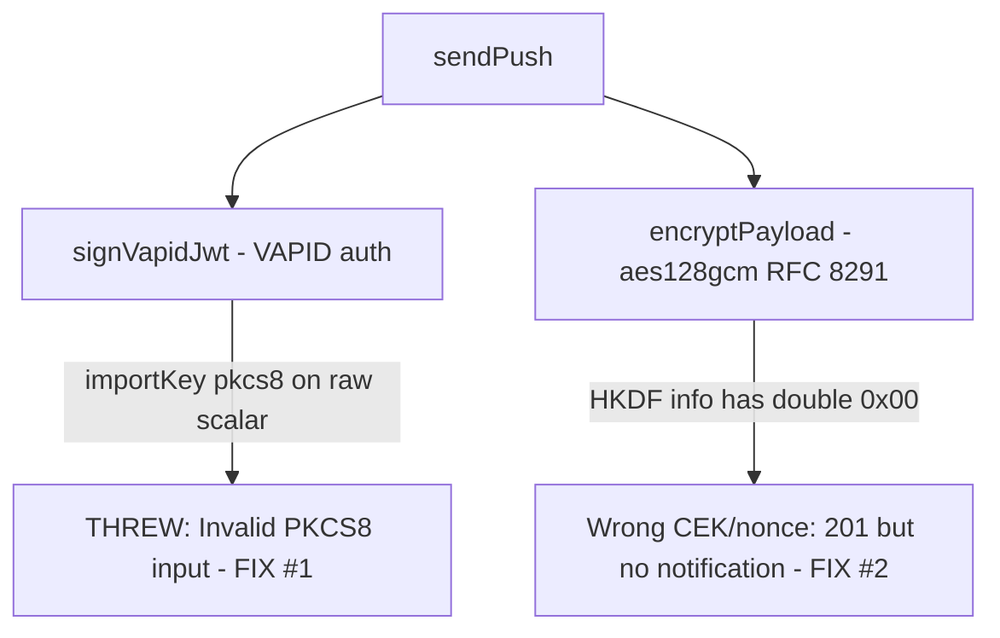

# Plan: Fix Web Push crypto (VAPID `Invalid PKCS8 input` + HKDF `info` double-null)

Slug: `push-crypto-fix`
Brief (source of truth): `docs/push-crypto-fix-brief.md`
Branch: `feat/family-scheduler`
Scope: two **implementation-level** fixes to Decision D2 (hand-rolled WebCrypto VAPID + aes128gcm), both inside `src/worker/channels/push.ts`: (1) the VAPID private-key import format, and (2) a double `0x00` in the aes128gcm HKDF `info` construction found during adversarial review. **No D2 redesign. No locked-code changes.**

> **Decision-gate up front:** Neither fix changes the D2 approach. Fix (1) is a one-function change to how the VAPID private key is imported. Fix (2) is a two-line byte correction to the HKDF `info` values in `encryptPayload` (removing an extra null byte) — it does not alter the RFC 8291 scheme, only implements it correctly. Both can proceed **Coder → QA** with new automated coverage. The only item that would require owner sign-off (retry-backlog reclassification, done-condition #4) is **explicitly recommended against** here and is NOT part of the implementation. See §6.

---

## 1. Problem statement and goals

### Confirmed root cause #1 — VAPID signing (with file:line evidence)

A production `*/5` cron run fired the reminder engine. Email delivered; push threw `DataError: Invalid PKCS8 input` from the VAPID signing step and was held as `transient`.

The offending code is in `src/worker/channels/push.ts`:

```
76    // VAPID private key is stored as base64url-encoded PKCS8 DER
77    const privateKeyBytes = b64urlToBytes(env.VAPID_PRIVATE_KEY);
78    const privateKey = await crypto.subtle.importKey(
79      "pkcs8",
80      privateKeyBytes, // Uint8Array is BufferSource
81      { name: "ECDSA", namedCurve: "P-256" },
82      false,
83      ["sign"]
84    );
```

The comment on line 76 is wrong about the stored format. The hypothesis in the brief is **confirmed**:

- `wrangler.toml:22` — `VAPID_PUBLIC_KEY = "BKLnMdiTqoADr1jc1-a9C_QD6H7PwW-F6xonI2JfzOiQao4Tu7jVq7z0y2E4YUHwzevba9Bel-a1pYMdr3haFNw"`. That is 87 base64url chars → **65 bytes**, and it decodes with a leading `0x04` byte (the `B` in base64url = `000001` → high nibble `0000`, i.e. `0x04` once combined). That is the canonical uncompressed P-256 point `0x04 || X(32) || Y(32)` emitted by `web-push generate-vapid-keys`.
- `src/worker/env.ts:13` — `VAPID_PRIVATE_KEY: string; // secret (base64url-encoded ES256 private key)`. Matching `web-push` output, this is the **raw 32-byte scalar `d`**, base64url-encoded — NOT a PKCS8 DER document.

So `b64urlToBytes(env.VAPID_PRIVATE_KEY)` yields ~32 raw bytes, and `importKey("pkcs8", ...)` rejects it because PKCS8 expects a full ASN.1/DER `PrivateKeyInfo` structure. That mismatch is the error. The `b64urlToBytes` helper itself is correct; the bug is the **import format**, not the decode.

### Confirmed root cause #2 — HKDF `info` double `0x00` in `encryptPayload` (found in adversarial review)

The review flagged, and byte-level inspection against RFC 8188/8291 **confirms**, a second, independent bug in the aes128gcm encryption path. This path has never executed end-to-end in production (VAPID signing at `push.ts:236` threw before `encryptPayload` at `push.ts:237` ever ran) and has zero automated coverage.

```
175   const cekInfo = concatBytes(enc.encode("Content-Encoding: aes128gcm\0"), new Uint8Array(1));
...
184   const nonceInfo = concatBytes(enc.encode("Content-Encoding: nonce\0"), new Uint8Array(1));
```

The string literals already encode a trailing `0x00` (the `\0`). `new Uint8Array(1)` is a **second** `0x00` byte. Reconstructed bytes as written:

- `push.ts:175` cekInfo → `"Content-Encoding: aes128gcm" || 0x00 || 0x00` (29 bytes)
- `push.ts:184` nonceInfo → `"Content-Encoding: nonce" || 0x00 || 0x00` (25 bytes)

Per **RFC 8188 §2.2**, the HKDF-Expand `info` is `cek_info = "Content-Encoding: aes128gcm" || 0x00` (a **single** null); the `0x01` counter byte is appended by HKDF-Expand itself (RFC 5869), which WebCrypto's `HKDF` `deriveBits` does internally. So the value passed to `crypto.subtle.deriveBits` must end in exactly **one** `0x00`. The extra `new Uint8Array(1)` makes it two, deriving the wrong CEK and nonce.

**Smoking gun that this is a copy error, not intentional:** the *first* HKDF in the same function, `push.ts:149-153`, builds `"WebPush: info\0" || recipientKey || serverKey` with a single `\0` and **no** trailing `new Uint8Array(1)` — that one is correct per RFC 8291 §3.4. Only the CEK and nonce infos got the stray extra byte.

**Consequence:** the push service (FCM et al.) validates only the aes128gcm framing, not the payload plaintext, so it returns **201 Created** while the browser silently fails to decrypt and **no notification is ever shown**. This is exactly the "returns 201 but nothing appears" failure mode the brief warned about ("push has two crypto ops … verify end-to-end delivery, not just that `importKey` stops throwing"). See §3.5 for the exact corrected byte layout.

This is an implementation bug within D2, **not** a design defect: RFC 8291 is unchanged; the code simply appends one byte too many. It stays Coder → QA.

### Goal (mirrors brief)

Web push is delivered end-to-end from the production deploy: the cron run logs a successful push send (no crypto error, `send.sent` includes the push), and a real notification appears on a device. The fix is not "done" when `importKey` stops throwing — it is done when a push is actually delivered (see §4 blast-radius and §5 done-conditions). Because the encryption path is now known to have its own bug and is executing for the first time, both fixes ship together with automated coverage that proves the derived CEK/nonce are correct **before** the manual production gate (§7).

---

## 2. Non-goals

- No change to Decision D2 (WebCrypto VAPID + aes128gcm) as an approach. Both fixes are implementation corrections to that decision.
- No change to the email channel, the reminder engine (materialize, dispatch ledger, UNIQUE de-dup, D7/M1 purge, **the `send` summary classification in `src/worker/reminders/send.ts`**), auth, the data model, or migrations. All locked per the brief.
- No DER↔JOSE signature conversion (WebCrypto ECDSA `sign` already returns raw `r||s`; see §3).
- No rotation/regeneration of the production VAPID keypair. The existing keys are valid raw material; only the code that consumes them is wrong.
- No reclassification of deterministic crypto failures from `transient` to `failed` (that touches locked engine logic — see §6).
- **No frontend change.** The `NotificationSetup.tsx` `getSubscription()` re-prompt fix is DEFERRED and OUT OF SCOPE per owner ratification (see §6.2). The Coder must not touch `web/src/components/NotificationSetup.tsx` in this change.

---

## 3. Proposed design

### 3.1 Chosen fix #1: JWK import (route 1 from the brief)

Replace the `importKey("pkcs8", ...)` call in `signVapidJwt` with a `importKey("jwk", ...)` call built from the raw key material we already have in `env`.

**Rationale for JWK over PKCS8-DER-wrapping:**

- We already hold **both** halves of the keypair in env: the public point (`VAPID_PUBLIC_KEY`, giving `x` and `y`) and the private scalar (`VAPID_PRIVATE_KEY`, giving `d`). A JWK needs exactly `{x, y, d}` — all directly available, no derivation of the public point from the scalar required.
- PKCS8 wrapping requires hand-constructing ASN.1/DER bytes (the `PrivateKeyInfo` + `ECPrivateKey` structure, OID for prime256v1, optional public-key bit string). That is exactly the kind of brittle byte-juggling that CLAUDE.md's "no clever one-liners that hurt readability / prefer explicit" guidance warns against, and it is harder to review for correctness.
- `importKey("jwk", ...)` for EC keys is well-supported in the Workers runtime (workerd).

### 3.2 Exact WebCrypto call shape (VAPID)

Inside `signVapidJwt` (replacing current lines 76–84), parameter by parameter:

```ts
// VAPID keys from `web-push generate-vapid-keys` are RAW base64url:
//   VAPID_PUBLIC_KEY  = 65-byte uncompressed P-256 point: 0x04 || X(32) || Y(32)
//   VAPID_PRIVATE_KEY = 32-byte raw scalar d
// Build a JWK from that raw material rather than treating it as PKCS8 DER.
// NOTE: the two secrets must be rotated as a matched pair — x/y here come from
// VAPID_PUBLIC_KEY and must correspond to d from VAPID_PRIVATE_KEY.
const pubBytes = b64urlToBytes(env.VAPID_PUBLIC_KEY); // 65 bytes, pubBytes[0] === 0x04
const x = bytesToB64url(pubBytes.slice(1, 33));
const y = bytesToB64url(pubBytes.slice(33, 65));
// Normalize d through the project's own decode/encode to guarantee
// unpadded base64url regardless of how the secret was stored.
const d = bytesToB64url(b64urlToBytes(env.VAPID_PRIVATE_KEY));

const privateKey = await crypto.subtle.importKey(
  "jwk",
  { kty: "EC", crv: "P-256", x, y, d, ext: true },
  { name: "ECDSA", namedCurve: "P-256" },
  false,            // extractable
  ["sign"]
);
```

The subsequent `crypto.subtle.sign({ name: "ECDSA", hash: "SHA-256" }, privateKey, sigInput)` (current lines 86–90) is **unchanged**. WebCrypto's ECDSA `sign` returns the raw `r||s` JOSE signature (64 bytes for P-256) that the VAPID JWT requires, so `bytesToB64url(new Uint8Array(sigBuf))` on line 92 is already correct. **Do not add a DER→JOSE step.**

The `Authorization: vapid t=${vapidJwt},k=${env.VAPID_PUBLIC_KEY}` header (line 254) is also unchanged — the `k=` parameter correctly uses the raw base64url public key as-is.

### 3.3 Optional safety hardening (recommended, small)

Add a one-line guard before slicing so a misconfigured key fails loudly instead of producing a malformed JWK:

```ts
if (pubBytes.length !== 65 || pubBytes[0] !== 0x04) {
  throw new Error("VAPID_PUBLIC_KEY is not a 65-byte uncompressed P-256 point");
}
```

Per the brief: **never log key material.** This guard logs only the shape, not bytes.

### 3.4 Two crypto paths — both are broken (one throws, one silently mis-derives)



- `signVapidJwt` runs first (`push.ts:236`), so it threw before `encryptPayload` (`push.ts:237`) ever ran. The encryption path has therefore **never executed against a real push service in production** and has **no automated coverage**.
- **Does the encryption path share the pkcs8 bug?** No — and that is the only thing "not affected" means here. `encryptPayload` (lines 105–208) imports the recipient public key with `importKey("raw", recipientKeyBytes, { name: "ECDH" }, ...)` (correct for a 65-byte public point) and generates its own ephemeral pair via `generateKey`. It does **not** call `importKey("pkcs8", ...)`, so it does not carry fix #1's bug.
- **But "doesn't share the pkcs8 bug" is NOT "is correct."** Adversarial inspection against RFC 8188/8291 found an independent defect: the double `0x00` in the HKDF `info` at lines 175 and 184 (see §1 root cause #2 and §3.5). This path is therefore unverified end-to-end and is corrected by fix #2 plus the round-trip test in §7. Do not treat this path as trusted.
- **Consequence for done-conditions:** because encryption is exercised for the first time and had a latent bug, "importKey stops throwing" is far from sufficient. The automated round-trip test (§7) proves the derived CEK/nonce and decryptability deterministically; the actually-delivered notification (§5) remains the final production gate exercising VAPID auth, ECDH/HKDF/AES-GCM encryption, `buildPushBody` framing, and the push-service HTTP contract together.

### 3.5 Chosen fix #2: correct the HKDF `info` double-null in `encryptPayload`

Remove the extra `new Uint8Array(1)` from both derivations so each `info` ends in exactly one `0x00`, matching RFC 8188 §2.2. WebCrypto appends the `0x01` HKDF-Expand counter internally; do not add it.

Replace `push.ts:175`:

```ts
// Before (WRONG — trailing 0x00 0x00):
// const cekInfo = concatBytes(enc.encode("Content-Encoding: aes128gcm\0"), new Uint8Array(1));
// After (single trailing 0x00):
const cekInfo = enc.encode("Content-Encoding: aes128gcm\0");
```

Replace `push.ts:184`:

```ts
// Before (WRONG — trailing 0x00 0x00):
// const nonceInfo = concatBytes(enc.encode("Content-Encoding: nonce\0"), new Uint8Array(1));
// After (single trailing 0x00):
const nonceInfo = enc.encode("Content-Encoding: nonce\0");
```

**Exact corrected byte layout the Coder must produce:**

- `cekInfo` — 28 bytes: `"Content-Encoding: aes128gcm"` (27 ASCII bytes) followed by a single `0x00`.
  `43 6F 6E 74 65 6E 74 2D 45 6E 63 6F 64 69 6E 67 3A 20 61 65 73 31 32 38 67 63 6D 00`
- `nonceInfo` — 24 bytes: `"Content-Encoding: nonce"` (23 ASCII bytes) followed by a single `0x00`.
  `43 6F 6E 74 65 6E 74 2D 45 6E 63 6F 64 69 6E 67 3A 20 6E 6F 6E 63 65 00`

Do **not** touch the first HKDF at `push.ts:149-153` (`WebPush: info\0 || recipientKey || serverKey`) — it is already correct (single `\0`, no extra byte). Do **not** change `salt`, key lengths (CEK 128 bits, nonce 96 bits), the `0x02` record delimiter (line 195), or `buildPushBody` framing — all of those are correct per RFC 8188/8291.

`concatBytes` remains used at line 149 and in `buildPushBody`; only its use at 175/184 is removed. If `concatBytes` becomes unused after this edit, it is still used elsewhere (lines 149, 195, 216) so leave it in place.

---

## 4. Affected files and modules

| File | Change | Locked? |
|------|--------|---------|
| `src/worker/channels/push.ts` | (1) Replace pkcs8 import with JWK import in `signVapidJwt`; fix the stale line-76 comment; add shape guard (§3.3). (2) Remove the extra `new Uint8Array(1)` from `cekInfo`/`nonceInfo` in `encryptPayload` (§3.5). **Export `signVapidJwt` and `encryptPayload`** (and `buildPushBody` if the encryption test needs the framed body) so the tests can call them. | No (this is the file under fix) |
| `tests/unit/push-vapid.test.ts` (new) | Real-crypto regression test for fix #1: import a test VAPID keypair via the JWK path and verify a signed sample JWT. | New |
| `tests/unit/push-encrypt.test.ts` (new) | Real-crypto round-trip test for fix #2: encrypt with `encryptPayload`, decrypt with a locally generated recipient keypair, assert the derived CEK/nonce and that plaintext round-trips. | New |
| `src/worker/env.ts` | OPTIONAL: correct the line-13 comment to "raw base64url 32-byte P-256 scalar (web-push format)". Comment-only. | No |

**Explicitly NOT touched:** `src/worker/reminders/send.ts` (locked classification), `channels/email.ts`, auth, migrations, data model, `wrangler.toml` key values, and `web/src/components/NotificationSetup.tsx` (frontend re-prompt fix is DEFERRED — see §6.2).

---

## 5. Data model and API changes

None. No schema, migration, route, or request/response contract changes. The VAPID secret format on disk is unchanged — only the code that consumes it (VAPID import) and the code that derives the aes128gcm CEK/nonce changes.

---

## 6. Risks, edge cases, and open questions

### 6.1 Retry-backlog (done-condition #4) — framed for decision

**Current behavior (traced through the code):**

1. `push.ts:238-243` — a crypto failure is caught and returns `{ ok:false, statusCode:0, gone:false, transient:true }`.
2. `send.ts:86-130` maps the per-endpoint result. For `statusCode:0` the row falls through to the `else` branch (line 106-110) → `anyTransient = true` → the dispatch row is **left pending for retry** (line 127-129). Note: the engine's mapping keys off `statusCode`, not the `transient` boolean — `statusCode:0` always maps to "transient" here regardless of the flag.
3. `getDueDispatch` selects `status='pending' AND fire_at <= now AND fire_at > now - GRACE_MINUTES` (send.ts docstring lines 30-31, P2-N3). **A stuck row only retries inside the GRACE window; once it ages out it is skipped and left inert as `pending`.**

**Implication:** the "retries forever" framing in the brief is bounded. A deterministic crypto failure retries only for `GRACE_MINUTES`, then goes inert (and is **not** re-delivered) — it does not loop indefinitely, and aged-out rows remain in the table as orphaned `pending` rows rather than disappearing. The stuck rows from the 4:25 PM run have almost certainly already aged out.

**Recommendation: option (a) — leave classification alone.**

- Once `push.ts` is fixed, **new** reminders deliver normally.
- Any still-in-window stuck rows will send on the next tick (the fix makes the previously-failing path succeed).
- Aged-out rows are already inert; no infinite loop exists to clean up. QA's done-condition #4 check should confirm they go inert / are not re-delivered, not that they disappear.

**Why NOT option (b) (reclassify crypto-fail as `failed`):** to make a `statusCode:0` result map to `failed`, you must change the mapping in `send.ts:103-110` (e.g. treat `statusCode:0` as permanent). That file's classification is on the **locked** list. Per the brief, do not silently change locked engine logic.

> **OPEN QUESTION for owner (do NOT implement without sign-off):** Should deterministic channel-level crypto/config errors be classified `failed` instead of `transient`, so a genuinely broken push never enters even a bounded retry window? This is a deliberate improvement but it edits locked engine classification in `send.ts`. Recommended answer for this defect: **no** — out of scope; the bounded-GRACE behavior plus the fix is sufficient. Track separately if desired.

This plan proceeds **without** touching that logic, so it stays Coder → QA.

### 6.2 Deferred follow-up (NOT in this change): frontend re-prompt fix

The brief notes the frontend re-prompts for push permission instead of checking existing subscription state (`web/src/components/NotificationSetup.tsx` — `subscribed` defaults to `false` and is only set `true` after a fresh `subscribe()`).

> **DEFERRED / OUT OF SCOPE — do NOT implement in this change.** Owner ratification places the `getSubscription()` mount-check fix in a separate follow-up. The Coder must not edit `NotificationSetup.tsx` as part of `push-crypto-fix`. It is mentioned here only so the re-review knows it was consciously deferred, not overlooked. (It also carries real regression surface — the component's early `return`s at lines 37/41 make a hooks insertion error-prone — which is another reason to isolate it.)

### 6.3 Other edge cases / risks

- **JWK `d` padding:** `web-push` emits unpadded base64url; normalizing via `bytesToB64url(b64urlToBytes(...))` (§3.2) guarantees a clean unpadded value even if the secret was stored with padding.
- **Matched-pair coupling:** sourcing `x`/`y` from `VAPID_PUBLIC_KEY` couples correct signing to both env vars being a matched pair. The §3.3 guard checks the public point's shape only; WebCrypto's EC JWK import validates point-vs-scalar consistency at runtime and the cron try/catch re-reports a mismatch as `push crypto error`. The §3.2 comment notes the rotate-as-a-pair requirement. (Deriving `x`/`y` from `d` via scalar multiplication would remove this coupling but needs EC point math and is more brittle — correctly not chosen.)
- **Encryption path now covered, but still verify on device:** if a real device push fails *after* both fixes, capture the new `wrangler tail` output. With the double-null corrected and a passing round-trip test, remaining failure would most likely be in `buildPushBody` framing or the HTTP contract — a distinct symptom, still within D2 implementation, triaged as a follow-up rather than a redesign.
- **iOS PWA:** real push on iPhone requires a home-screen-installed standalone PWA. Treat desktop-browser delivery as the required gate and iPhone as best-effort (matches brief done-condition #3).
- **Test runtime parity:** the Vitest suite runs under `@cloudflare/vitest-pool-workers` (`vitest.config.ts`), i.e. real workerd `crypto.subtle` — so both new tests exercise genuine WebCrypto, not a mock. This is exactly the gap that let both bugs ship.

---

## 7. Step-by-step implementation checklist for the Coder

> Run `npm run typecheck` and `npm run lint` after each meaningful change (per workflow rules). Do not log key material anywhere. Do NOT touch `web/src/components/NotificationSetup.tsx` (deferred — §6.2) or `src/worker/reminders/send.ts` (locked — §6.1).

1. **Confirm context.** Re-read `src/worker/channels/push.ts` lines 62–93 (VAPID) and 149–208 (encryption, especially the `info` construction at 175 and 184) and `docs/push-crypto-fix-brief.md`. Confirm both root causes match §1.

2. **Fix #1 — `signVapidJwt`:**
   - Delete the misleading comment on line 76.
   - Replace the `importKey("pkcs8", ...)` block (lines 77–84) with the JWK construction and `importKey("jwk", ...)` from §3.2.
   - Add the shape guard from §3.3.
   - Leave the `crypto.subtle.sign(...)` call and the `header.payload.signature` assembly unchanged (no DER→JOSE conversion).
   - **Export** `signVapidJwt` (change to `export async function signVapidJwt`) so it is unit-testable.

3. **Fix #2 — HKDF `info` in `encryptPayload`:**
   - At line 175, replace `concatBytes(enc.encode("Content-Encoding: aes128gcm\0"), new Uint8Array(1))` with `enc.encode("Content-Encoding: aes128gcm\0")` (single trailing `0x00`, 28 bytes — see §3.5).
   - At line 184, replace `concatBytes(enc.encode("Content-Encoding: nonce\0"), new Uint8Array(1))` with `enc.encode("Content-Encoding: nonce\0")` (single trailing `0x00`, 24 bytes — see §3.5).
   - Do NOT change the first HKDF at 149–153, the salt, key lengths, the `0x02` delimiter, or `buildPushBody`.
   - **Export** `encryptPayload` (and `buildPushBody` if the test asserts on the framed body) for the round-trip test.

4. **(Optional, comment-only)** Correct the `VAPID_PRIVATE_KEY` comment in `src/worker/env.ts:13` to describe raw base64url scalar format.

5. **Add VAPID regression test** `tests/unit/push-vapid.test.ts` (real crypto, no mocks). It must:
   - Define a fixed **test** VAPID keypair (a known-good `web-push`-format public point + private scalar — generate one locally and hard-code it in the test file; do NOT use the production secret).
   - Build a fake `Env` containing that keypair plus `VAPID_SUBJECT`.
   - Call the now-exported `signVapidJwt("https://fcm.googleapis.com/fcm/send/abc", env)` and assert it does not throw and returns a 3-segment JWT.
   - Verify the signature for real. Prefer importing the **public** key via `importKey("raw", <65-byte 0x04||X||Y>, { name:"ECDSA", namedCurve:"P-256" }, false, ["verify"])` — mirroring the `k=` server contract — then `crypto.subtle.verify({ name:"ECDSA", hash:"SHA-256" }, pubKey, sig, data)` over `header.payload`, asserting `true`. (Importing the public key as JWK is acceptable but raw better proves the published point validates the signature.)
   - Optionally assert the decoded payload has `aud` = endpoint origin and an `exp` in the future.

6. **Add encryption round-trip test** `tests/unit/push-encrypt.test.ts` (real crypto, no mocks). This is the deterministic proxy for the manual delivery gate. It must:
   - Generate a recipient ECDH keypair with `crypto.subtle.generateKey({ name:"ECDH", namedCurve:"P-256" }, true, ["deriveBits"])`; export its public key `raw` → base64url as `p256dh`.
   - Generate a random 16-byte `auth` secret → base64url.
   - Call the now-exported `encryptPayload(JSON.stringify({title:"t", body:"b"}), p256dh, auth)` and get `{ ciphertext, salt, serverPublicKeyBytes }`.
   - **Decrypt on the recipient side**, re-deriving per RFC 8291/8188 with the CORRECT single-`0x00` infos: import `serverPublicKeyBytes` as ECDH public; `deriveBits` with the recipient **private** key → shared secret; HKDF-extract with `salt=auth`, `info="WebPush: info\0"||p256dh||serverPublicKey` → PRK/IKM (32 bytes); then HKDF with `salt` and `info="Content-Encoding: aes128gcm\0"` → CEK (128 bits) and `info="Content-Encoding: nonce\0"` → nonce (96 bits); AES-GCM decrypt.
   - Assert the decrypted bytes equal `plaintext || 0x02`; strip the `0x02` delimiter and assert the remainder equals the original JSON string.
   - Rationale to record in a comment: because the test's decrypt uses the correct single-null `info`, it will FAIL against the buggy double-null encrypt and PASS once fix #2 is applied — deterministically catching the exact bug found in review. (An RFC 8291 §5 known-answer vector is not directly usable because `encryptPayload` generates the ephemeral/AS key randomly via `generateKey`; the self-consistent round-trip is the correct approach without changing production code to inject the ephemeral key.)

7. **Run the suite:** `npm test` — confirm both new tests and existing tests pass. Then `npm run typecheck` and `npm run lint`.

8. **Local verification:** `npm run dev` (wrangler dev), trigger the scheduled handler (e.g. the `/__scheduled` test endpoint / `wrangler dev --test-scheduled`), and confirm the push path runs with **no** `push crypto error` in logs. (Local has no controllable push service; a real subscription's endpoint would hit the live push service. The local assertion is "no crypto error," not "delivery completes.")

9. **Commit at the fix boundary** on `feat/family-scheduler` (e.g. `fix(push): import raw VAPID key as JWK and correct aes128gcm HKDF info (D2 impl fixes)`).

10. **Hand to QA for production verification** (done-condition #3, the real gate — QA, not Coder, runs this against the live deploy):
   - Deploy; create an event with a reminder a few minutes out.
   - `npx wrangler tail` at the cron tick — confirm: no `push crypto error`; the send summary shows the push under `sent` (not `transient`/`failed`).
   - Confirm an actual notification **appears** on at least a desktop browser (this is what catches an encryption/decrypt failure that returns 201 but shows nothing); iPhone installed-PWA if feasible.
   - Confirm previously-stuck `transient` rows either send (if still in GRACE window) or go inert / are not re-delivered (aged-out) — no permanent retry loop (done-condition #4, expected per §6.1).

### Done-conditions mapped to the brief

| Brief item | Where satisfied |
|---|---|
| #1 Regression test (real crypto key import + sign) | Step 5 |
| #1b Encryption coverage (round-trip decrypt / derived CEK+nonce) | Step 6 (added in amendment) |
| #2 Local verification (wrangler dev scheduled trigger) | Step 8 |
| #3 Production verification (tail + real notification appears) | Step 10 (QA) |
| #4 Retry backlog handled, no infinite loop | §6.1 (recommend option a, no locked change) + Step 10 |
| Secondary frontend UX | DEFERRED / out of scope (§6.2) — not implemented here |
| Respect locked list / D2 unchanged | §2, §4 |

---

## 8. Process recommendation

**Proceed Coder → QA. No new locked-decision changes are required.** Both fixes are implementation corrections to D2: the VAPID key import format and the aes128gcm HKDF `info` byte length. Neither changes the D2 design; RFC 8291 is implemented as specified. The only change that would require **owner sign-off** — reclassifying deterministic crypto failures as `failed` in the locked `send.ts` engine logic — is **recommended against** and excluded from this plan (§6.1). If, during production verification, push still fails after both fixes and a passing round-trip test, that is a separate symptom within D2 implementation (not a redesign) and should be triaged as a follow-up, not folded into this defect.

---

## 9. Amendment log

- **2026-06-30 — Major 1 (scope violation, frontend):** Removed the `NotificationSetup.tsx` `getSubscription()` re-prompt fix from in-scope work. Deleted it from the §4 affected-files table and from the implementation steps (former Step 7), added it to §2 non-goals, and downgraded §6.2 to an explicit "Deferred follow-up (NOT in this change)" note per owner ratification. The Coder must not touch `NotificationSetup.tsx`.
- **2026-06-30 — Major 2 (under-scoped encryption path):** Investigated `encryptPayload` against the actual code and RFC 8188/8291. Confirmed a **real second bug**: `push.ts:175` and `push.ts:184` build the HKDF `info` with a `"\0"` string terminator PLUS an extra `new Uint8Array(1)` = a double `0x00`, deriving the wrong CEK/nonce (push service returns 201 but no notification shows). The correct `info` is a single trailing `0x00` (WebCrypto appends the `0x01` counter itself); the first HKDF at 149–153 already does this correctly, confirming 175/184 are copy errors. Expanded fix scope (§3.5) with exact corrected byte layouts, added the fix and `encryptPayload` export to §4/§7 (Step 3), added a deterministic encrypt→decrypt round-trip unit test `tests/unit/push-encrypt.test.ts` (Step 6) under the vitest-pool-workers/workerd config, and rewrote §1/§3.4 to stop implying the path is "not affected"/correct. This is an implementation-level byte fix within D2 — no D2 redesign, no locked-decision change; still proceeds Coder → QA.
