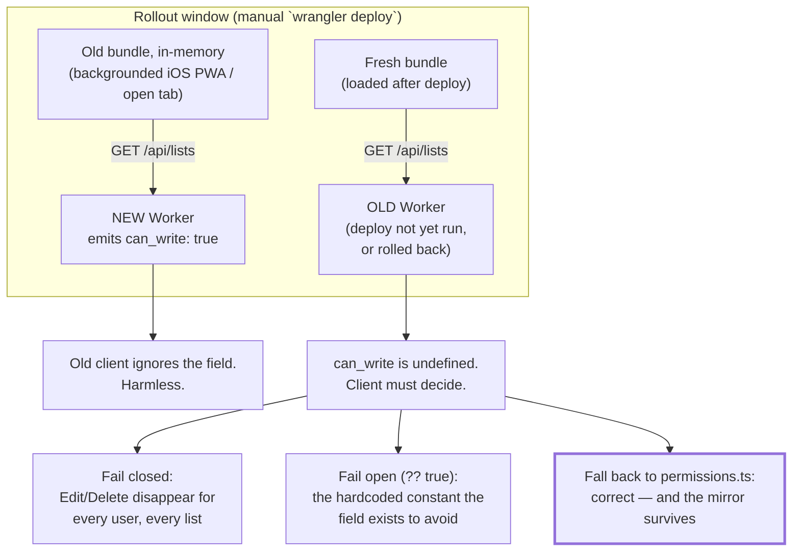

# Server-supplied `can_write` — premise check and disposition

**Status: RECOMMEND WONTFIX.** This document argues that the backlog item
(`docs/backlog.md:167`, deferred from `feat/item-view-mode` Decision 5) should be closed without
building it, and records the design decisions a future re-opener would need. §7 is a checklist for closing the item **and** for
building the approved parity test (steps 5-7). *It originally read "not for implementing it"; the
operator's 2026-09-19 decision superseded that — see §3.3.* Appendix A is the contingent design (do not build it
from this revision). Appendix B is a cheaper alternative serving the item's real goal; it was **approved by the operator on 2026-09-19** and is in scope for this branch (§3.3).

- v1 (2026-09-19) — first draft.

---

## 0. Referent table

Every figure in the body cites a row here. One value below was `[provisional]` — the cross-project import — and §7 step 5 now instructs the Coder to verify it before building on it, with a named fallback. Nothing else is.

| Symbol | What it measures | Units | Which artifact | Which extent | Method / tag |
|---|---|---|---|---|---|
| `N_endpoints` | Route handlers whose success body contains one or more `List` objects | count | `src/worker/routes/lists.ts`, `src/worker/routes/me.ts` | all routers mounted in `src/worker/index.ts`; `DELETE /api/lists/:id` excluded (204, empty body) | [measured] — read both files in full; `GET /api/lists` (`lists.ts:12-16`), `POST /api/lists` (`lists.ts:50`, 201), `PATCH /api/lists/:id` (`lists.ts:82`), `GET /api/me` (`me.ts:11-15`) = **4** |
| `N_interfaces` | Hand-maintained `List` interface declarations | count | `src/worker/types.ts:32-39`, `web/src/types.ts:16-23` | whole repo | [measured] — **2**; no shared/generated type, no import across the boundary |
| `N_construct` | Sites that build a complete `List` object and would fail `npm run typecheck` if `can_write` were a **required** field | count | `web/**`, `e2e/**` | test fixtures and factories only — production client code never constructs a `List`, it only receives one | [measured] — **10** (8 object literals + 2 factories); breakdown in §4.2 |
| `N_construct_files` | Distinct files containing those 10 sites | count | same | same | [measured] — **9** |
| `N_client_callsites` | Call sites of `canWriteList` in `web/src` production code | count | `web/src/components/` | excludes `permissions.ts` itself and its test | [measured] — **2**: `ItemListView.tsx:202`, `ItemModal.tsx:137` |
| `N_permissions_tests` | `it(...)` blocks in the client mirror's spec | count | `web/src/lib/permissions.test.ts` | whole file | [measured] — **5** (`:27, :32, :37, :42, :46`) |
| `N_isolation_tests` | `it(...)` blocks in the HTTP-layer authorization suite | count | `tests/unit/list-isolation-http.test.ts` | whole file | [measured] — **10** (`:226, :233, :242, :253, :258, :269, :276, :283, :298, :308`) |
| `reachable_false` | Number of `(caller, list)` pairs reachable through the public API for which `can_write` would be `false` | count | all 4 endpoints in `N_endpoints` | any D1 state reachable through the app's own writes, **plus** hand-seeded rows including mixed-case `owner_email` | [measured by proof] — **0**; proof in §1.2 |

Reading notes for two figures that could be read two ways:

- `N_construct` counts **construction** sites (a literal or factory that must name every required
  field), **not** `List`-typed annotations. `web/src/components/ListSidebar.tsx:12` declares
  `lists: List[]` and `web/src/types.ts:20` declares the field — neither constructs, so neither
  appears in the count.
- `reachable_false` is measured over **states the database can hold**, not over the *function's*
  input domain. `canWriteList`'s input domain plainly contains false cases; what is empty is the
  set of those cases that can co-occur with the list appearing in a response. That distinction is
  the whole argument and §1.2 makes it precisely.

---

## 1. Problem statement and goals

### 1.1 What the backlog item asks for

`docs/backlog.md:167`:

> The structurally-cleaner long-term answer is for `GET /api/lists` to return an explicit
> `can_write: boolean` per list, making client/server drift impossible by construction instead of
> by convention.

The thing it is reacting to is real. `web/src/lib/permissions.ts:21-25` restates, in the browser, a
rule that lives in `src/worker/db.ts:538-551`, and its own header comment admits the restatement is
currently unreachable-false and ends "Do not 'simplify' it away." That is an uncomfortable shape and
the discomfort is legitimate.

### 1.2 Premise check: `can_write` would be a constant, and this is provable, not merely observed

The operator's fact 1 is correct and is stronger than "currently `true` in practice". It is `true`
for **every** `(caller, list)` pair the API can emit, for **every** D1 state, including states that
bypass the app's own write paths.

**Claim.** For all callers `c` and list rows `L`: if any of the 4 endpoints in `N_endpoints`
emits `L` to `c`, then `canWriteList(db, c, L.id) === true`.

**Proof, endpoint by endpoint.**

*`GET /api/lists` and `GET /api/me`* — both call `getVisibleLists` (`lists.ts:14`, `me.ts:13`).
Its predicate (`db.ts:326`) is:

```sql
WHERE visibility = 'shared' OR owner_email = ?      -- ? bound to lower(c), db.ts:322/329
```

`canWriteList`'s predicate (`db.ts:549-550`) is:

```js
if (list.visibility === "shared") return true;
return list.owner_email === norm;                   // norm = lower(c), db.ts:543
```

These are the same two disjuncts over the same two column values with the same caller
normalisation. The two equality operators also agree: `migrations/0001_init.sql:13` declares
`owner_email TEXT NOT NULL REFERENCES users(email)` with **no** `COLLATE NOCASE` (grep for
`COLLATE`/`NOCASE` across `migrations/` returns nothing), so SQLite applies the default BINARY
collation — byte-exact, like JavaScript `===`. Membership therefore implies writability, and the
one input that could have split them — a mixed-case `owner_email`, which only a hand-written
`INSERT` can produce since `createList` binds the lowercased `norm` (`db.ts:341` computes it,
`db.ts:351` binds it) and `UPDATE lists SET` never touches the column (`db.ts:400-404`) — splits
them in the *safe* direction: a `'Owner@Example.com'` row is excluded by the SQL `WHERE` **and**
denied by `canWriteList`. Both say no. No counterexample exists.

*`POST /api/lists`* — `createList` binds the caller as `owner_email` (`db.ts:351`), so the caller
owns the returned row.

*`PATCH /api/lists/:id`* — `updateList` (`db.ts:372-426`) admits the caller only if owner, or if
the list is `shared` and the patch does not change visibility (`db.ts:388-393`). `owner_email` is
never updated (`db.ts:400-404` sets `name`, `color`, `visibility` only). So the post-update row is
still owned-by-caller or still `shared`; writable either way.

Hence `reachable_false = 0`. **`can_write` would be a field whose only possible value is `true`.**

### 1.3 So what does it buy? The three candidate answers, weighed

> **See §3.2's CORRECTION.** Candidate (a) below leans on the claim that the client mirror
> survives a rollout. Review round 1 showed that is a defense-in-depth *preference*, not an
> impossibility — there is a coherent design in which the mirror is deleted and the client
> falls back to `true`. The disposition rests on §1.2 and §1.4, not on this.

**(a) "It removes a rule that could drift if the server's rule changes."** This is the item's own
stated benefit, and it does not survive contact with the rollout window. §3.2 works it through; the
short version: the client cannot treat `can_write` as authoritative until every bundle in the wild
post-dates the deploy, and this app has no version gate that can establish that. So the client must
keep a fallback for `can_write === undefined`, and the only fallback that is neither
user-hostile (fail closed → Edit/Delete vanish for everyone on a stale tab) nor self-defeating
(fail open → a hardcoded `true`, i.e. the very drift the field exists to prevent) is *the existing
local rule*. `permissions.ts` survives the change. The mirrored rule is not removed; a server field
is added on top of it. **The item's stated benefit is not achieved by the item's proposed change.**

**(b) "It prepares for a future read-only share."** No such feature exists or is scheduled. It
would need a schema change — a `list_members` table or a role column — at which point `can_write`'s
semantics get designed *with* that schema (per-list or per-item? does read-only block completing a
task? does it block attachments?) rather than guessed a year early. `getVisibleLists` would change
in the same breath. The option value of guessing now is approximately zero, and a wrong guess left
in the contract is worse than no guess.

**(c) "It is speculative generality for a two-adult family app."** This is the accurate
description. Confirmed by the artifact: the change is unobservable (§1.2), its stated benefit is
unachievable (§3.2), its cost is `N_construct` = 10 fixture edits across `N_construct_files` = 9
files plus `N_interfaces` = 2 hand-mirrored interfaces, and — see §1.4 — the security-relevant
half of it cannot be tested.

### 1.4 The finding that decides it: the awkwardness is conserved, and it lands in the test suite

The backlog item's complaint is about an unreachable-false branch that must be kept anyway. Move
the rule to the server and ask what tests it can have.

An HTTP-level test can only observe the reachable domain, where the answer is always `true`
(§1.2). Such a test is **not** vacuous — it discriminates any implementation that is *under*-
permissive. `can_write: list.visibility === 'shared'` returns `false` for a caller's own private
list, and an HTTP test that includes a private-owned list goes red on it. What an HTTP test
**cannot** discriminate is anything *over*-permissive, including the degenerate `can_write: true`.
And over-permissive is the security-relevant direction — the direction a `can_write` field exists
to get right.

To catch an over-permissive rule you must call a pure `(list, email) -> boolean` directly with a
synthetic list that no D1 state can produce. That test is exactly "an unreachable-false case,
retained deliberately, which you must not simplify away" — the shape the backlog item set out to
eliminate, now living in `tests/unit/` instead of `web/src/lib/`. **The awkwardness is conserved.
It is relocated, and the relocation costs an API field, 2 interface edits, 10 fixture edits, and a
permanent rollout-compat branch in the client.**

### 1.5 Goals of this document

1. Answer the premise question honestly and with a proof rather than an observation. (§1.2)
2. Reach a disposition. (§1.4, §3)
3. Record the design decisions — the operator's five questions — so a future re-opener inherits
   them instead of re-deriving them. (Appendix A)
4. Name what would make the item right later, as re-open criteria. (§6.3)
5. Give the operator one clearly-costed alternative that serves the item's *real* goal
   (drift detection) without its costs, marked as needing separate approval. (Appendix B — **since approved; see §3.3**)

---

## 2. Non-goals

- **Not** changing `canWriteList`, `canReadList`, `getVisibleLists`, or any route. This branch
  touches `docs/` plus one new file, `tests/unit/authz-rule-parity.test.ts` (§3.3's operator
  decision). No existing test is modified and no production code is touched.
- **Not** deleting, simplifying, or rewording `web/src/lib/permissions.ts`. Its header comment's
  instruction stands and this document agrees with it.
- **Not** de-duplicating `canReadList` (`db.ts:523-536`) and `canWriteList` (`db.ts:538-551`),
  whose bodies are currently byte-identical. That is a real, present-tense duplication inside the
  worker and a better-founded refactor than the backlog item, but it is a different item; noted in
  §6.4, not scheduled here.
- **Not** designing read-only list membership.
- **Not** unifying the two `List` interfaces. Also a real issue (§6.4), also a separate item — and
  notably one that would have to land *first* for the backlog item's "by construction" framing to
  mean anything.

---

## 3. Proposed design — close the item

The proposed change to the system is: **none**. What follows is the reasoning that has to be on
the record for that to be a decision rather than an omission.

### 3.1 `can_write` is a property of a pair, and `List` is a property of a row

`mapList` (`db.ts:52-61`) has no caller email in scope, and cannot get one: it is also the mapper
for `getListById` (`db.ts:1407-1416`), which serves the **cron** path —
`materialize.ts:49-52` calls it with no user at all, from a trusted context that has no "caller".

So `can_write` cannot be computed in `mapList`, which is the one place that would make drift from
`canWriteList` structurally impossible. Every other location (in `getVisibleLists`, in the route)
is a second site that can be updated out of step with `canWriteList` — i.e. it swaps a
cross-codebase hand-mirrored rule for a same-file hand-mirrored rule. Appendix A.1 gives the least-
bad option and explains why even that one is only *unlikely* to drift, not structurally unable to.

This also sinks the "just add it to `List`" framing: a required `can_write` on `src/worker/types.ts`'s
`List` makes `getListById`'s return type unsatisfiable without inventing a value for a caller that
does not exist.

### 3.2 The rollout window is what turns "remove the mirror" into "keep the mirror plus a field"

> **CORRECTION (review round 1, folded in 2026-09-19). This section overstates its case, and the
> proof in §1.2 is what undermines it.** §3.2 rejects the "fail open" fallback (`can_write ?? true`)
> as "the hardcoded constant the field exists to avoid". But if `reachable_false = 0` — which §1.2
> proves — then `?? true` and `?? canWriteList(list, user)` are **observationally identical over the
> entire reachable domain**. And `canWriteList` gates only UI affordances (`ItemListView.tsx:202`,
> `ItemModal.tsx:137` → the `canWrite` prop at `:148`), with the server doing the actual enforcing
> (`CLAUDE.md:82`). So there **is** a coherent framing in which the client mirror genuinely goes
> away: ship the field, fall back to `true`, delete `permissions.ts`.
>
> That framing is rejected as a **defense-in-depth preference**, not as an impossibility — keeping a
> real rule beats keeping a constant when the constant's correctness depends on a proof about
> today's SQL. But the distinction matters: **the disposition rests on claims 1 and 3, not on this
> one.** A WONTFIX nobody revisits should not lean on an argument its own proof contradicts.

First, a correction to the operator's framing, because the mechanism matters for the size of the
window: **the service worker does not cache the app bundle.** `web/sw.ts` (77 lines, read in full)
registers `push`, `notificationclick`, `install` → `skipWaiting()`, and `activate` →
`clients.claim()`. There is **no `fetch` handler and no precache**; `vite.config.ts:13-29` uses
plain Rollup output with hashed asset names (`assets/[name]-[hash].js`) and no
`vite-plugin-pwa`/Workbox (`grep workbox|vite-plugin-pwa|precache package.json` → no matches). A
reload after a deploy therefore gets fresh JS.

The stale-client window is real but different: an **already-loaded** session holding the old bundle
in memory — a desktop tab left open, or the iOS Home-Screen PWA resumed from the background days
later — which keeps issuing API calls against the freshly-deployed Worker. Because deploys are
manual and unannounced (`wrangler deploy`, per project memory; no CI/CD), nothing tells that
session to reload.



Only `C3` is defensible, and `C3` keeps `web/src/lib/permissions.ts` and its
`N_permissions_tests` = 5 tests exactly as they are.

There is a second, quieter reason the fallback is unavoidable: **the client's types do not describe
the wire.** `apiClient.ts:54` is `return resp.json() as Promise<T>` — an unchecked cast, with no
runtime validation anywhere in the file. Declaring `can_write: boolean` (required) on
`web/src/types.ts`'s `List` would therefore produce a type that *lies* during the window: TypeScript
would report `boolean` while the value at runtime is `undefined`, and `if (!list.can_write)` would
silently fail closed with no compile error and no test failure. The only honest client declaration
is `can_write?: boolean`, which forces the `undefined` branch, which forces the fallback. The
"required field" option is not merely costly; against an unchecked cast it is unsound.

### 3.3 Disposition

> **OPERATOR DECISION (2026-09-19).** Junior accepted the WONTFIX recommendation **and approved
> Appendix B**, answering the Q2 go-ahead in §6.3. So this branch is no longer documentation-only:
> it closes the backlog item *and* adds `tests/unit/authz-rule-parity.test.ts`. Appendix B is
> promoted from "offered, not scheduled" to **in scope**; Appendix A remains DO NOT BUILD.
> §7 gains steps 5-7 (plus the gate steps 8-9) and §7.1 gains the matching done conditions.

Close `docs/backlog.md:167` as **WONTFIX**, with the reasoning above and with re-open criteria
(§6.3) attached so the decision is revisitable rather than merely forgotten.

---

## 4. Affected files and modules

### 4.1 What this branch touches

> **Updated by §3.3's operator decision:** this branch touches **three** paths, not two —
> the table below predates the Appendix B promotion. The third is the new file
> `tests/unit/authz-rule-parity.test.ts`. No existing file under `src/`, `web/src/`, `e2e/`
> or `tests/` is modified.

| File | Change |
|---|---|
| `docs/plans/server-can-write.md` | **New.** This document. |
| `docs/backlog.md` | Entry at `:167` rewritten to a WONTFIX record. Exact replacement text in §7 step 2. |

No file under `src/` or `web/src/` is touched. **`npm run test:e2e` is therefore not required for
QA on this branch** — `CLAUDE.md:54-59` makes it mandatory only for branches touching
`web/src/**`, and directs the QA report to say so explicitly when skipped. (Had the item been
built, it would touch `web/src/**` and `test:e2e` *would* be mandatory — see Appendix A.5.)

### 4.2 What a build *would* have touched — the cost figure behind `N_construct`

Recorded so a future re-opener does not have to re-measure, and so the §1.3(c) cost claim is
checkable. All counts are `[measured]` by grepping `owner_email` in construction position across
`web/src` and `e2e`, then reading each hit.

| File | Sites | Kind |
|---|---|---|
| `web/src/App.test.tsx:52` | 2 | two object literals in one `List[]` |
| `web/src/App.deeplink.test.tsx:41` | 1 | object literal |
| `web/src/components/CalendarView.test.tsx:32` | 1 | object literal |
| `web/src/components/ItemListView.test.tsx:30` | 1 | object literal |
| `web/src/components/ItemDetails.test.tsx:28` | 1 | object literal |
| `web/src/components/ItemEditor.test.tsx:40` | 1 | object literal |
| `web/src/components/ItemModal.desktop.test.tsx:37` | 1 | object literal |
| `web/src/lib/permissions.test.ts:14` | 1 | `makeList` factory |
| `e2e/fixtures/api-mocks.ts:27` | 1 | `buildList` factory |
| **Total** | **10** across **9** files | = `N_construct` / `N_construct_files` |

Plus, on the server: `src/worker/types.ts:32-39`, `web/src/types.ts:16-23` (`N_interfaces` = 2),
`db.ts:52-61` `mapList`, `db.ts:318-332` `getVisibleLists`, and up to 4 route handlers
(`N_endpoints`). And on the client: `apiClient.ts:60/77/85/92`, plus the fallback branch at both
of `N_client_callsites` = 2 (`ItemListView.tsx:202`, `ItemModal.tsx:137`) or inside
`permissions.ts` itself.

Note the asymmetry the "required field" option runs into: making it required costs all 10 edits
and still guarantees nothing about the wire (§3.2); making it optional costs 0 edits and
guarantees nothing about anything, since no new construction site is forced to supply it. Neither
branch delivers "impossible by construction".

---

## 5. Data model and API changes

**None.** No schema change, no migration, no new field, no response-shape change on any of the
`N_endpoints` = 4 endpoints. The existing contract stands:

| Method | Path | Success body | Change |
|---|---|---|---|
| `GET` | `/api/lists` | `{ lists: List[] }` | none |
| `GET` | `/api/me` | `{ user, lists: List[] }` | none |
| `POST` | `/api/lists` | `201 { list: List }` | none |
| `PATCH` | `/api/lists/:id` | `{ list: List }` | none |
| `DELETE` | `/api/lists/:id` | `204`, empty | none |

The contingent shape, if it is ever built, is in Appendix A.2.

---

## 6. Risks, edge cases, and open questions

### 6.1 Risks of closing

- **R1 — the client mirror stays un-mechanised.** Closing leaves `permissions.ts` correct by
  *convention* (a header comment) rather than by *mechanism*. This is the genuine cost of WONTFIX
  and it should not be glossed. Two things bound it: the rule is 3 lines guarded by
  `N_permissions_tests` = 5 tests, and for it to become wrong the server's visibility model must
  change — a change that cannot ship without touching the client anyway (new UI for whatever
  read-only means). Appendix B offers a cheap mechanism if the operator wants the risk retired
  properly. **ANSWERED YES (2026-09-19): it is in scope — §3.3, §7 steps 5-7.** *Original wording,
  "it is not part of this recommendation", retained for the record.* Note the parity test retires
  only the JS half of this risk; the SQL predicate stays unguarded.
- **R2 — the finding gets lost.** A closed backlog line is easy to reopen carelessly and rebuild
  the same thing. Mitigated by §7 step 2: the WONTFIX entry carries the §1.2 proof in one sentence
  and the §6.3 re-open criteria, so the next reader gets the reasoning, not just the verdict.
- **R3 — the proof ages.** §1.2's proof depends on two facts that a future change could
  invalidate silently: `getVisibleLists`'s predicate and `canWriteList`'s predicate being the same
  disjunction, and `owner_email` having no `COLLATE NOCASE`. Nothing in the repo asserts either.
  Accepted: if either changes, the change itself is a visibility-model change, which re-opens this
  item by §6.3 criterion 1 regardless.

### 6.2 Edge cases examined and found not to change the conclusion

> **Second hand-`INSERT` degree of freedom:** `visibility` has **no `CHECK` constraint**
> (`migrations/0001_init.sql:14`), so a raw INSERT can store an arbitrary string there, just as it
> can store a mixed-case `owner_email`. Both sides treat anything that is not `'shared'` as private,
> so the conclusion is unchanged — noted beside the mixed-case case because the parity test's raw
> INSERT now makes both reachable in tests.

- **Mixed-case `owner_email`.** Reachable only via a hand-written `INSERT` (`db.ts:351` binds the
  lowercased `norm`; `UPDATE lists SET` at `db.ts:400-404` never touches the column). Both the SQL
  filter and `canWriteList` reject such a row (BINARY collation vs `===`), so it does not produce a
  visible-but-unwritable list. It *is* the one input where the client mirror and the server rule
  genuinely disagree — `permissions.ts:24` lowercases both sides and returns `true` — which is the
  deliberate superset its comment describes, and which a server-supplied `can_write` would
  silently flip to `false`. A behaviour change on an unreachable input; noted for completeness, not
  load-bearing.
- **Deactivated users (`active = 0`).** `canWriteList` does not check `users.active`
  (`docs/process/family-scheduler-design-impl-notes.md:286` records this as a deliberate open
  question, out of scope). A `can_write` field derived from `canWriteList` would inherit the same
  gap, so this does not distinguish the options.
- **`PATCH` that privatises a shared list.** Owner-only (`db.ts:391-393`), and the owner can still
  write the now-private list. Covered by the §1.2 proof; does not create a false case.
- **The cron path.** `materialize.ts:49-52` reads a `List` with no caller. Covered in §3.1; it is
  the reason `mapList` cannot own the computation.

### 6.3 Open questions — and the re-open criteria

**Q1 (for the operator, decision required).** Accept WONTFIX, or overrule? This document
recommends WONTFIX; the operator asked for an honest answer and this is it. If overruled, build
from Appendix A, not from the backlog line — the backlog line's framing ("impossible by
construction") is not achievable and Appendix A says what is.

**Q2 — ANSWERED YES (2026-09-19); see §3.3 and §7 steps 5-7.** *Original question retained for the record:* does the operator want the drift *detector* in
Appendix B? It serves the item's real goal at a fraction of the cost, but it is net-new test code
and therefore net-new maintenance, and recommending it is not the same as scheduling it. Default
if unanswered: do not build it. Noting it here rather than folding it into §7 deliberately — it
would be scope expansion to absorb it unilaterally.

**Re-open criteria** (any one of these makes the item worth revisiting):

1. **A visibility-model change lands or is scheduled** — read-only membership, per-list roles, a
   guest/child tier, or anything that makes `getVisibleLists` return a list the caller cannot
   write. This is the criterion that actually matters: it is exactly the point at which
   `reachable_false` stops being 0, and at which a falsifiable HTTP-level test becomes possible.
2. **The two `List` interfaces (`N_interfaces` = 2) are unified** into one shared or generated
   type. That removes the largest chunk of the cost and makes "by construction" a meaningful
   phrase for the first time.
3. **A build-time version gate or forced-reload mechanism is added** to the client. That closes
   the §3.2 window and lets the fallback — and with it `permissions.ts` — actually be deleted.

Criteria 2 and 3 lower the cost; **only criterion 1 creates a benefit.** A re-opener who has 2 and
3 but not 1 is still building something unobservable.

### 6.4 Adjacent findings, logged not scheduled

> **Interaction with the approved parity test.** Appendix B pins `canWriteList` to the client
> mirror; `canReadList` is pinned to nothing. Since their bodies are byte-identical today, a future
> edit to one and not the other produces a silent read/write divergence with a green suite. Any
> dedup of these two must revisit what the parity test targets.

- `canReadList` (`db.ts:523-536`) and `canWriteList` (`db.ts:538-551`) have byte-identical bodies —
  two `SELECT`s and two copies of the same predicate, inside one file. Real duplication, today,
  with no rollout window and no type churn. If the operator wants the "one rule, one place"
  property this backlog item was reaching for, this is the cheaper and better-founded version of
  it. Needs its own backlog entry and its own decision about whether read and write *should* be
  the same rule (they are only incidentally equal today; collapsing them makes that equality load-
  bearing, which may be undesirable).
- `web/src/lib/permissions.ts:10` cites "db.ts:341 binds `norm`". `:341` *computes* `norm`; `:351`
  binds it. Harmless, but if anyone is editing that comment for another reason, `db.ts:341/351` is
  the accurate citation. Not worth a commit on its own.

---

## 7. Step-by-step implementation checklist for the Coder

~~This is a documentation-only change.~~ **Superseded by §3.3's operator decision.** Steps 1-4 are
the documentation close; steps 5-7 add the approved parity test, and 8-9 are the gates. **Do not touch `src/`,
`web/src/`, `e2e/`, or `migrations/`** — the only production-adjacent file this branch creates is
`tests/unit/authz-rule-parity.test.ts`. No existing test may be modified.

1. **Read this document's §1.2 and §1.4.** The backlog edit in step 2 asserts a proof; do not
   paste it without having read the proof.

2. **Rewrite `docs/backlog.md:167`** (the line beginning ``- **Server-supplied `can_write` on
   `GET /api/lists```) — replace the whole line with:

   > - **❌ WONTFIX (2026-09-19) — Server-supplied `can_write` on `GET /api/lists` (deferred from
   >   `feat/item-view-mode`, Decision 5).** Closed without building, per
   >   `docs/plans/server-can-write.md`. **Why:** `can_write` would be a constant. `getVisibleLists`'
   >   SQL predicate (`db.ts:326`) and `canWriteList`'s JS predicate (`db.ts:549-550`) are the same
   >   two disjuncts over the same two column values with the same caller normalisation and the same
   >   case-sensitivity (no `COLLATE NOCASE` in `migrations/0001_init.sql:13`; BINARY vs `===`), so
   >   membership in the response implies writability for **every** D1 state — including hand-seeded
   >   mixed-case `owner_email` rows, which both sides reject. The same holds for `POST` (caller is
   >   owner) and `PATCH` (`owner_email` is never updated, `db.ts:400-404`). **On the second
   >   argument, stated honestly:** the original plan claimed the client mirror must survive a
   >   rollout, so the field could only be added *on top of* `web/src/lib/permissions.ts` rather
   >   than replacing it. Review showed that is a defense-in-depth **preference**, not an
   >   impossibility — because `can_write` is constant, falling back to `true` and falling back to
   >   the local rule are observationally identical, and the rule gates only UI affordances with the
   >   server enforcing (`CLAUDE.md:82`). **The closure rests on the constant proof above and the
   >   cost below, not on that argument.** **Cost of the change that buys nothing:** 2 hand-mirrored
   >   `List` interfaces, 10 fixture construction sites across 9 files, 4 `List`-returning
   >   endpoints, and a permanent compat branch. **The awkwardness is conserved:** an HTTP-level
   >   test of the field can catch an under-permissive rule but never an over-permissive one
   >   (including hardcoded `true`), so the only real guard would be a unit test on a synthetic
   >   unreachable input — the exact "unreachable but keep it anyway" shape this item set out to
   >   eliminate, relocated to `tests/`. **Do not confuse that with
   >   `tests/unit/authz-rule-parity.test.ts`, which this same branch adds:** it also uses an
   >   unreachable input, but for a different purpose — detecting drift between the server rule and
   >   the client mirror, which is this item's *real* goal and is achievable without the field. Its
   >   presence in `tests/` is not evidence that the field's awkwardness was accepted. **Re-open
   >   if** (1) a visibility-model change lands (read-only membership / per-list roles) — the only
   >   one that creates a benefit; (2) the two `List` interfaces are unified; or (3) the client
   >   gains a version gate or forced reload. `web/src/lib/permissions.ts` stays exactly as it is,
   >   comment included.

   Keep it as a single `-` bullet at the same indentation as its neighbours so the list structure
   is unchanged. Do not renumber or reorder surrounding entries.

3. **Verify the edit landed where intended.** `grep -n "Server-supplied" docs/backlog.md` must
   return exactly one line, and it must now start with `- **❌ WONTFIX`. If the line number has
   drifted from 167 because an earlier entry changed, that is fine — the string anchor is
   authoritative, not the number.

4. **Confirm the diff scope.** `git diff --stat main...HEAD` must list exactly **three** paths:
   `docs/backlog.md`, `docs/plans/server-can-write.md`, and `tests/unit/authz-rule-parity.test.ts`
   (created in step 5). A **fourth** path is a defect — stop and report rather than reverting
   blind. Note especially that no file under `src/` or `web/src/` may appear: §6.4 dangles two
   tempting adjacent refactors, and this is the criterion that catches them.


5. **Create `tests/unit/authz-rule-parity.test.ts`** in the **worker** project. Import the real
   `canWriteList` from `src/worker/db.ts` and the client mirror from `web/src/lib/permissions.ts`
   — **alias one of them**, the two exports share a name.

   **Verify the cross-project import before building on it.** No existing file under `tests/`
   imports from `web/` at all, and `tsconfig.worker.json:6` includes `tests/unit/**/*`, so this
   pulls `web/src/*` into the no-DOM worker program for the first time. The import *should* be
   fine — `permissions.ts` imports only types, which erase, and `web/src/types.ts` is pure
   interfaces — but confirm it compiles and runs before writing the matrix. **If it does not**,
   copy the client rule into the test verbatim with a comment naming `permissions.ts` as the
   source of truth, and say so in the impl notes: a copied rule is weaker (it can drift from the
   file it mirrors) and that weakening must be visible, not silent.

   **Create the schema yourself.** The worker project's D1 is real but **empty** — every existing
   worker test hand-copies its DDL (see `tests/unit/list-isolation-http.test.ts:70`). Follow that
   precedent.

   Seed the *reachable* rows with the real `createList`.

6. **Build the matrix so it cannot pass vacuously.** Include **two** both-`false` rows:
   (a) a **private list owned by someone else**, and (b) a **missing list** — server
   `canWriteList(db, email, "no-such-id")` vs client `canWriteList(undefined, user)`, both `false`
   (`db.ts:548`, `permissions.ts:22`). Row (b) is the only branch where the two signatures
   genuinely differ (an id lookup versus an absent object), so it is worth asserting explicitly.
   Row (a) details: It must include a **private list owned by
   someone else**, queried through `canWriteList` directly — `getVisibleLists` cannot reach that
   case, which is exactly why the row is needed. Without it, every row is `true` on both sides and
   the test passes on two implementations that both hardcode `true`. Carry the same
   "unreachable through the API, deliberate" comment Appendix A's T1 specifies.

7. **Encode the deliberate divergence honestly — and note that `createList` cannot produce it.**
   `createList` lowercases `owner_email` (`db.ts:341`/`:351`), so the mixed-case row is
   **unreachable through it** and requires a raw `INSERT INTO lists`. Step 5's "seed with `createList`"
   applies to the reachable rows only. Miss this and there is no mixed-case row at
   all, D8's "fails on `main`" never happens, and D8 passes while documenting nothing.

   Assert parity over the *reachable* domain
   (lowercase `owner_email`, which `createList` guarantees), and assert the mixed-case input as a
   **known, intended disagreement** with a comment pointing at `permissions.ts:8-13`. Add the
   companion assertion that `createList` stores `owner_email` lowercased — that invariant is what
   justifies restricting the domain. A parity test that naively asserts agreement everywhere
   **fails on `main`**, and "fixing" it by lowercasing the server side in the test would silently
   delete the very divergence the test exists to document.

8. **Gates.** `npm run typecheck && npm run lint && npm test && npm run build` — the full
   pre-PR gate per `CLAUDE.md:54-56`. **Measure the baseline, do not quote one.** Run `npm test` on `main`
   *before* writing anything and record the number; as of 2026-09-19 it is **300 across 34 files**,
   measured, but treat that as a datum with a date, not a constant.

   Do **not** assert a specific post-change total. Steps 6-7 specify several `it()` blocks — two
   both-`false` rows, the reachable rows, the mixed-case divergence, D9's invariant — so a correct
   build lands well above 301, and an exact-number gate would fail on correct work and invite
   "fixing" it by deleting cases. The real criteria are: **every pre-existing test still passes
   unmodified**, the file count goes 34 → 35, and the total goes **up** by the number of `it()`
   blocks you actually wrote.

9. **Do not run `npm run test:e2e`.** No `web/src/**` file changes (`CLAUDE.md:54-59`); the QA
   report must say so explicitly rather than omitting it.

### 7.1 Done conditions, with the §2-style sweep applied

Every criterion below names the broken build it goes red on, confirms that build is reachable, and
confirms it is not already covered upstream. Two entries are labelled **guards** rather than tests
because their failure mode is not reachable given the rest of the checklist — saying so is more
honest than inventing a failure condition for them.

| # | Criterion | Goes RED on | Reachable? | Redundant with | Goes GREEN on a correct build? |
|---|---|---|---|---|---|
| D1 | `grep -n "Server-supplied" docs/backlog.md` returns exactly 1 line, starting `- **❌ WONTFIX` | A build that adds the WONTFIX text as a *new* bullet and leaves the original open entry in place — a plausible mis-edit, since the entry is one very long line and an append is easier than a replace | Yes | No | Yes — one line, correct prefix |
| D2 | `git diff --stat main...HEAD` (explicit base — a bare `git diff` shows only unstaged work and would go red on a correct, committed build) lists exactly `docs/backlog.md`, `docs/plans/server-can-write.md`, and the new `tests/unit/authz-rule-parity.test.ts` (**updated by §3.3's decision — was two paths when this branch was documentation-only**) | A build that "helpfully" also adds `can_write` to a type or a fixture, or that edits `permissions.ts`'s comment | Yes — §6.4 dangles two tempting adjacent refactors right in front of the Coder, which is precisely why this criterion exists | No | Yes — this branch produces exactly these three paths |
| D3 | `web/src/lib/permissions.ts` is byte-identical to `main` | A build that acts on the §6.4 comment nit | Yes (same reason as D2) | Partly — D2 catches it as an extra path. Retained anyway because it names the *specific* file this plan most wants left alone, and a reviewer scanning D2's output could wave a `permissions.ts` hit through as "just a comment" | Yes |
| D4 | The QA report states that `test:e2e` was skipped and why | A QA report that silently omits it | Yes | No | Yes |
| D5 | **Guard, not a test:** no migration file is added | — no reachable failure: §5 specifies no schema change and §7's scope line forbids touching `migrations/`, and D2 would catch the path anyway | No | Yes, by D2 | — |
| D6 | **Guard, not a test:** the 4 endpoint contracts are unchanged | — no reachable failure: nothing in the checklist opens a route file, and D2 catches it | No | Yes, by D2 | — |

| D7 | **Manual source inspection, not an automated gate** (its failure leaves `npm test` green — same honesty as D5/D6). The parity matrix contains **at least one row where both rules return `false`** — a private list owned by someone else, queried through `canWriteList` directly | A matrix built only from rows reachable via `getVisibleLists`, where both sides are always `true`: that version **passes on two implementations that both hardcode `true`** | Yes — and it is the single most likely way to write this test wrongly | No | Yes |
| D8 | The mixed-case `owner_email` input is asserted as a **known, intended disagreement**, with a comment citing `permissions.ts:8-13` | A test that naively asserts agreement everywhere — which **fails on `main`**, because the client deliberately lowercases both sides and the server does not | Yes | No | Yes |
| D9 | **Manual source inspection, not an automated gate** (same reason as D7). A companion assertion that `createList` stores `owner_email` **lowercased** | Removing it leaves D8's domain restriction unjustified — the parity claim would rest on an unstated invariant | Yes | No | Yes |
| D10 | `npm test` passes with the new file collected by the **worker** project (`vitest.workspace.ts:27`) | Placing it under `web/` — where the workers pool and real D1 are unavailable | Yes | No | Yes |

| D11 | **Manual inspection of the pasted register entry's body**, not just its first line: it renders as one well-formed bullet, **no stray `>` blockquote markers survive the paste** (the entry must be a plain `- ` bullet matching its neighbours at `backlog.md:160-171`; the `>` in this plan is the template's blockquote marker, not part of the text), and there is no dangling or duplicated clause | A faithful paste of a malformed template — which actually happened in v3: an edit left a dangling tail that re-asserted the very phrase the following sentence existed to disclaim | Yes, and it occurred | No — D1 checks only the first line's prefix and uniqueness, and cannot see the body | Yes |

**What the parity test does NOT cover.** It compares the two **JS** rules. §1.2's proof also rests
on the **SQL** predicate in `getVisibleLists` (`db.ts:326`) agreeing with them, and nothing here
pins that. §6.1 R3 is therefore unchanged by this branch — a future edit to the SQL `WHERE` clause
would not go red. Said plainly so the test is not mistaken for broader cover than it has.

**Can these criteria distinguish the chosen approach from the rejected one?** Yes, and this is the
sweep's sharpest question here. The rejected approach is "build the field". D2 + D3 go red on any
build that adds `can_write` anywhere, because such a build cannot produce a three-path diff. A
reviewer cannot confuse a WONTFIX branch with a half-built-field branch under these criteria. (D1
alone could not: a branch that both rewrote the entry *and* shipped the field would pass D1.)

---

## Appendix A — Contingent design (DO NOT BUILD from this revision)

If the operator overrules §3.3, these are the answers to the five questions, with rationale. They
are recorded so a re-opener inherits the analysis. Building them requires a fresh plan revision
with the operator's explicit go-ahead.

**A.1 — Where `can_write` is computed.** Not in `mapList` (no caller in scope; also serves the
cron path — §3.1). Not in the route (violates `CLAUDE.md:82`, "The DB layer (`db.ts`) enforces
authorization. Routes are thin Hono handlers"). The least-bad option: extract the shared predicate
out of `canWriteList` into a pure, exported

```
export function writeRule(list: Pick<List, "visibility" | "owner_email">, email: string): boolean
```

in `db.ts` (or a new `src/worker/authz.ts`); have `canWriteList` call it after its `SELECT`, and
have `getVisibleLists` call it per row with the already-normalised `norm`. **Be honest about the
guarantee:** this makes drift *unlikely* (one function body, two callers in one file), not
*impossible*. Nothing mechanically forces `getVisibleLists` to keep calling it. "Impossible by
construction" is not on the table without unifying the interfaces (§6.3 criterion 2) and even then
only for the *type*, never for the *rule*. A re-opener who repeats the backlog's phrasing without
this caveat is overselling the change.

**A.2 — Contract scope.** All 4 endpoints (`N_endpoints`), not just `GET /api/lists`. A field
present on one endpoint's `List` and absent on another's is a worse contract than either extreme,
and the client's `List` type cannot express it without splitting the type. `POST`/`PATCH` returning
a trivially-`true` value is an argument *for* including them, not against: an always-present field
is a simpler contract than a sometimes-present one, and the triviality is not specific to those two
endpoints — it is true everywhere (§1.2). On the wire, required. On the **client type**, optional
(`can_write?: boolean`) — mandatory, not stylistic: `apiClient.ts:54` casts without validating, so
a required client-side declaration is unsound during the window (§3.2).

**A.3 — Both `List` interfaces, or a response type?** A separate type. `List` is a row;
`can_write` is a property of `(row, caller)`. Adding it to `List` breaks `getListById`'s cron
contract (§3.1). Use `ListWithPermissions = List & { can_write: boolean }` on the worker (returned
by `getVisibleLists`/`createList`/`updateList` only), and `can_write?: boolean` on the web `List`
(the web type is never used in a caller-free context, so a second web type would be cost without
benefit — but note this asymmetry means the two files stop being parallel, which is a small ongoing
tax on `N_interfaces` = 2 hand-mirroring).

**A.4 — What happens to `permissions.ts`.** **Kept**, unchanged in behaviour, re-commented. It
becomes the `can_write === undefined` fallback required by §3.2, i.e.
`list.can_write ?? canWriteList(list, user)` at both `N_client_callsites` = 2 — better, inside
`permissions.ts` itself so the call sites do not each re-implement the precedence. Its
`N_permissions_tests` = 5 tests stay and gain a 6th and 7th: `can_write: false` on a list the local
rule would allow → `false` (proves the server field *wins* when present), and `can_write`
absent → falls through to the local rule. Nothing is deleted, so nothing needs replacing.

**A.5 — Rollout.** Deploy the Worker **first**, then the client — the order that makes the
old-client/new-server quadrant (harmless: the old bundle ignores the field) the only one that
occurs, leaving new-client/old-server as a rollback-only scenario. The `?? ` fallback covers it
either way. And because A.4 edits `web/src/**`, `npm run test:e2e` **would be mandatory for QA**
on such a branch (`CLAUDE.md:54-59`).

**A.6 — Tests, with the falsification rule from `docs/plans/calendar-show-more.md` §5.2 applied.**
That section's rule: *"Never let a derived property stand in for the thing itself. Ask of every
assertion: 'what would this still pass on?'"* The hazard the operator named is the governing one
here — because `reachable_false` = 0, any assertion of the form `expect(body.lists[0].can_write)
.toBe(true)` passes on a correct implementation, on `can_write: true`, and on several wrong rules.
So:

| Test | What it asserts | What a wrong implementation would still pass | How it avoids that |
|---|---|---|---|
| T1 — `writeRule` unit, private + non-owner → `false` | the pure rule directly, with a synthetic list | Nothing over-permissive: `true` and `visibility === 'shared' \|\| true` both go red | Bypasses the API entirely, which is the **only** way to reach a `false` case (§1.4). Pay the honesty cost: state in the test file that this input is unreachable in production — the same note `permissions.ts:15-18` already carries. Without T1 the whole change is untested in the security-relevant direction |
| T2 — `writeRule` unit, private + **owner** → `true` | the true branch | `return true` passes this | Deliberate. It is the control for T1 — without it, a rule that denies everything passes T1. Cite it as a control, never as evidence the rule is right (the same construction as `list-isolation-http.test.ts:226`, whose title says so out loud) |
| T3 — HTTP, `GET /api/lists` as owner with **one private-owned and one shared** list → both `can_write === true` | that the field is emitted on the real route, for both list kinds | `can_write: true` hardcoded passes. So does copying `canWriteList` wrongly in the over-permissive direction | **Does not claim to catch those** — say so in the test's title. What it *does* catch is the under-permissive family (`visibility === 'shared'` alone goes red on the private-owned list) and, more usefully, field **absence** on that route. Use `toHaveProperty("can_write", true)` on each list, not `toBe(true)` on a possibly-`undefined` read: `expect(undefined).toBe(true)` and "field missing" are the same failure text, and the distinction is the entire point during rollout |
| T4 — HTTP, the other 3 endpoints each emit the field | A.2's contract scope | same as T3 | Same scope limit, stated. Its real job is preventing the "added to `GET /api/lists`, forgot `GET /api/me`" split contract — the failure A.2 exists to prevent, and the one most likely in practice |
| T5 — client, `can_write: false` on a shared list → Edit/Delete hidden | that the server field **wins** over the local rule | An implementation that ignores `can_write` entirely passes any test using a fixture where both agree | The fixture is deliberately **contradictory** — local rule says writable, server says not. Only a client that reads the field can go green. This is the one client test that distinguishes "wired up" from "not wired up", and it is the reason A.4's fixture must not be a well-formed one |
| T6 — client, `can_write` **absent** → falls back to the local rule | §3.2's `C3` branch | An implementation that fails open (`?? true`) passes if the fixture's local rule also says `true` | Use a fixture where the local rule says **`false`** (private list, non-owner) and assert the controls are hidden. `?? true` then goes red. This is the only test that distinguishes `C3` from `C2` |

Note what T1–T6 collectively show: six tests, of which exactly one (T1) can catch an
over-permissive server rule, and it can only do so on an input production cannot produce. That is
§1.4's finding in tabular form, and a re-opener should read it as such before starting.

---

## Appendix B — APPROVED AND IN SCOPE (2026-09-19): the parity test

> **Status changed.** This was written as an unscheduled alternative needing separate approval.
> Junior approved it on 2026-09-19, so it is now the *build* half of this branch. The analysis
> below stands unedited; the paragraph at the end that reads "Not recommended and not scheduled"
> is superseded by this note and by §3.3's operator decision. Implementation steps are §7 steps
> 5-7.

The item's *real* goal is "the client rule must not silently diverge from the server rule". A
server field pursues that by removing the client rule — which §3.2 shows it cannot do. A test
pursues it by **detecting** divergence, which is achievable today, with no production code change,
no API change, no type change, and no rollout window.

**Shape.** One new file, `tests/unit/authz-rule-parity.test.ts`, in the **worker** project
(`vitest.workspace.ts:27` includes `tests/**/*.test.ts`, and that project has real D1). It imports
the real `canWriteList` from `src/worker/db.ts` *and* the client mirror from
`web/src/lib/permissions.ts` — the latter is pure and imports only types, so it loads in the
workers pool without a DOM. It seeds a matrix of list rows via `createList` (shared/private ×
owner/non-owner), and for each asserts the two rules return the **same** boolean.

**Why this is stronger than the backlog's proposal at its own goal:** it goes red if *either* side
changes, which is the actual drift event. A server field goes red if neither — it only ensures the
client follows *after* someone remembers to update the field's computation.

**What it must encode honestly, or it is worse than nothing:**

1. The **deliberate divergence** on mixed-case `owner_email` (§6.2). Parity must be asserted over
   the reachable domain (lowercase `owner_email`, as `createList` guarantees), and the mixed-case
   input asserted as a *known, intended* disagreement with a comment pointing at
   `permissions.ts:8-13`. A parity test that naively asserts agreement everywhere fails on `main`.
2. A companion assertion that `createList` stores `owner_email` **lowercased** — the invariant that
   makes the superset safe. Without it, the parity test's domain restriction is unjustified.

**Falsification, per `calendar-show-more.md` §5.2:** a parity test asserting `serverResult ===
clientResult` over rows where both are `true` passes on two implementations that both hardcode
`true`. The matrix must therefore include at least one row where **both** correctly say `false` —
a private list owned by someone else, checked with `canWriteList` directly (which, unlike
`getVisibleLists`, accepts any list id and so *can* reach the false case). That row is what makes
the test non-vacuous, and it needs the same "unreachable through the API, deliberate" comment as
Appendix A's T1. The cost is the same honesty cost as everywhere else in this problem — which is
itself evidence for §1.4's conclusion that the awkwardness is intrinsic to the rule's shape, not to
where it is written.

**Cost:** one test file, roughly 60–80 lines with its comments, no production change. *(Originally
marked "not recommended and not scheduled" — superseded by the operator decision in §3.3.)* The
reasoning for that original stance, kept for the record — it is net-new test maintenance for a risk §6.1 R1 bounds as
small. Offered because if the operator wants the risk retired, this retires more of it, more
cheaply, than the thing the backlog asked for.

---

## Self-check manifest

What I verified, and how, so review can spend its budget on judgment:

**Citations — every `file:line` below was re-read in this session before being written.**
`src/worker/db.ts` (52-61 `mapList`, 318-332 `getVisibleLists`, 326 the SQL predicate, 334-362
`createList`, 341/351 `norm` compute-vs-bind, 372-426 `updateList`, 388-393 the authz branches,
400-404 the `UPDATE` column list, 523-536 `canReadList`, 538-551 `canWriteList`, 549-550 the
predicate, 1407-1416 `getListById`); `src/worker/types.ts:32-39`; `web/src/types.ts:16-23`;
`web/src/lib/permissions.ts` (whole file, 25 lines); `web/src/lib/permissions.test.ts` (whole file);
`web/src/apiClient.ts` (whole file; 54, 60, 77, 85, 92); `src/worker/routes/lists.ts` and
`routes/me.ts` (both whole); `src/worker/reminders/materialize.ts:18-30, 49-52`;
`tests/unit/list-isolation-http.test.ts` (whole file); `migrations/0001_init.sql:9-16`;
`vitest.workspace.ts:27, 46`; `vite.config.ts` (whole); `web/sw.ts` (whole, 77 lines);
`web/src/main.tsx:7-15` (via grep); `e2e/fixtures/api-mocks.ts` (whole); `CLAUDE.md:54-59, 82`;
`docs/backlog.md:167`. Where a line could drift I also gave a string anchor (step 3 keys off
`grep -n "Server-supplied"`, not off `:167`).

**Counts — every number in §0 recomputed from primary sources, not quoted.** `N_endpoints` = 4 by
reading both route files end to end. `N_interfaces` = 2 by reading both type files.
`N_construct` = 10 / `N_construct_files` = 9 by grepping `owner_email` across `web/src` and `e2e`
(22 hits in 11 files), then classifying each hit as construction vs. read vs. declaration vs.
per-test override; the per-file breakdown is in §4.2 and the four excluded files are named there or
in §0's reading note. `N_client_callsites` = 2, `N_permissions_tests` = 5 (`it(` at 27/32/37/42/46),
`N_isolation_tests` = 10 (`it(` at 226/233/242/253/258/269/276/283/298/308) — all counted from the
files themselves.

**The §1.2 proof.** Checked in both directions for each of the 4 endpoints, including the
mixed-case input and the `PATCH`-privatises case. The BINARY-collation claim was verified by
grepping `COLLATE`/`NOCASE` across `migrations/` (zero hits) and by reading the `lists` DDL.

**The §3.2 service-worker claim.** Verified rather than assumed, because the operator's framing
("a client bundle can be cached and outlive a deploy") suggested a precache that does not exist:
`web/sw.ts` read in full — no `fetch` listener; `package.json` grepped for
`workbox|vite-plugin-pwa|precache` — no matches; `vite.config.ts` read — hashed assets, no PWA
plugin. The window is real but its mechanism is an in-memory session, not an SW cache, and §3.2
says so explicitly rather than inheriting the premise.

**Criteria sweep (§7.1).** All 11 done conditions (D1-D10; D7-D10 added by the v2 promotion) swept together, in one pass, not one at a time.
Result: D1–D4 name a reachable broken build and go green on a correct one; D5 and D6 have **no
reachable failure** given the rest of the checklist and are labelled **guards, not tests** rather
than being given invented failure conditions. D3 is partly redundant with D2 and is retained with
the reason stated. The mechanism-vs-output question is answered explicitly at the end of §7.1.

**Falsification.** Applied to every test this document specifies — Appendix A.6 (T1–T6) and
Appendix B — in the form `calendar-show-more.md` §5.2 requires ("what would this still pass on?"),
including the specific hazard the operator named. Two entries (T2, T3) state plainly that they
*cannot* catch an over-permissive rule; that limitation is the finding, not an oversight.

**What I did NOT check:**

- I did not run `npm test`, `npm run typecheck`, `npm run lint`, or `npm run test:e2e` — no shell
  access in this role. The `N_permissions_tests` and `N_isolation_tests` figures are counts of
  `it(` blocks in source, **not** observed pass counts, and are tagged as such. I quoted no repo-wide total, since I could not measure one. **Updated:** §7 step 8 now
  records **300 tests / 34 files**, measured by the orchestrating session on 2026-09-19 by
  running `npm test` on `main`, and explicitly framed there as a dated datum rather than a
  constant — an earlier revision quoted 300 from `docs/backlog.md:133`, a month-old narrative
  line, which review correctly flagged.
- I did not verify that `web/src/lib/permissions.ts` actually imports cleanly under the workers
  vitest pool (Appendix B's premise). It is pure and type-only in its imports, which is why I
  expect it to, but this is `[provisional]` — and **this is no longer true as of the operator decision** — Appendix B is now §7 steps 5-7, so step 5 instructs the Coder to verify the import before building on it and names the fallback. Formerly: nothing in §1–§7 was built on it; only Appendix B
  is, and Appendix B is explicitly gated on the operator answering Q2.
- I did not audit `src/worker/index.ts` for additional routers beyond those mounted in
  `routes/lists.ts` / `routes/me.ts`. `N_endpoints` = 4 is derived from a repo-wide grep for
  `: List` / `List[]` annotations (which surfaced only `apiClient.ts`, `db.ts`, `materialize.ts`,
  and component props) plus reading both list-returning route files; if a router elsewhere hand-
  builds a list-shaped JSON body without the `List` type, that grep would not have seen it. I
  consider this unlikely but have not proven it.
- I did not attempt to reproduce the rollout window empirically (no deploy, no device).

## Revision history

- v1 (2026-09-19) — initial. Recommended WONTFIX; Appendix B offered but unscheduled.
- v2 (2026-09-19) — Junior accepted WONTFIX **and** approved Appendix B, so the parity test moved
  into scope (promotion made by the orchestrating session, not the Architect — see §3.3). §7 gained
  the build steps and §7.1 gained D7-D10.
- v4 (2026-09-19) — round-2 and round-3 findings. The round-3 blocker was a **malformed register
  template**: a v3 edit left a dangling tail so the pasted backlog entry would have contradicted
  itself, and no done condition inspected the entry's body. The block was rewritten as a unit
  rather than patched again, and D11 now covers it. Also: step 8 stopped asserting an exact test
  total (it would have gone red on a correct build), and two stale claims survived three rounds
  of sweeps because they shared no vocabulary with the search terms.
- v3 (2026-09-19) — 13 review findings folded in. Two were blocking and both were introduced by the
  v2 promotion: a duplicate step 6 whose first copy still read "No new test is added by this
  branch", and a contradiction where step 6 said to seed with `createList` while step 8 required a
  mixed-case row `createList` **cannot** produce. Also conceded review's §2 finding — claim 2 was
  overstated; the disposition now rests on claims 1 and 3.
