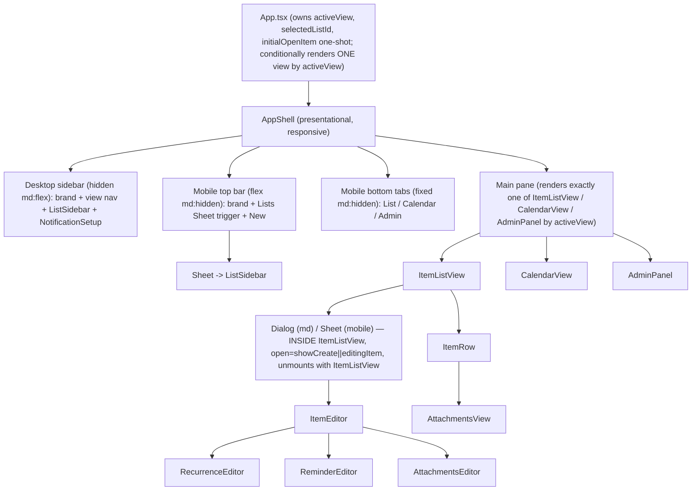
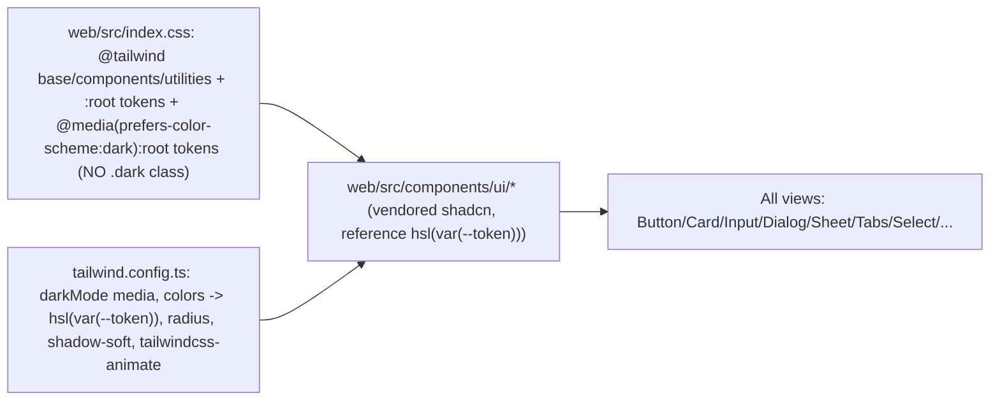

# Implementation Plan: `feat/ui-redesign` — Tailwind + shadcn/ui "clean & calm" migration

Status: REVISED post-review (APPROVE-WITH-CHANGES). Author: Architect. Date: 2026-07-11.
Source spec (authoritative): `docs/plans/ui-redesign-spec.md`. Backlog entry: `docs/backlog.md` §3 `feat/ui-redesign`.
Review addressed: `docs/reviews/ui-redesign-review.md` (2 Blocker, 5 Major, 4 Minor, 3 Nit).

This is a **presentation-only** migration of the entire PWA frontend (`web/src`) to Tailwind CSS + shadcn/ui with a semantic-token visual system, `prefers-color-scheme` dark mode, a responsive shell (desktop sidebar / mobile bottom-tabs), and the item form moved into a Dialog (desktop) / Sheet (mobile). No behavior, data, auth, engine, or API changes.

---

## Revision note (2026-07-11, post plan-review)

This revision folds in the plan-reviewer's punch-list and two LOCKED owner decisions. Changes are amendments in place; the structure is unchanged. Summary of what moved:

- **Owner decision — dependencies APPROVED.** The §5.1 dep list is greenlit; the "owner sign-off" gate on deps is removed (kept as an FYI note only). See §5.1.
- **Owner decision — OQ1 theme-color = TEAL accent (spec §2), light/dark pair.** Resolved and encoded in Decision 2; removed from open questions.
- **B1 (Blocker):** Decision 5 now pins the deep-link invariant unambiguously — `App` keeps swapping views by `activeView` exactly as today; the editor Dialog/Sheet AND its `open` state stay **inside `ItemListView`** and unmount with it. Removed the ambiguous "list always renders" phrasing.
- **B2 (Blocker):** Decision 5 + §8.1 now specify test-env exit-animation handling (Radix unmount must be state-driven, not `animationend`-gated) and confirm `ItemEditor.test.tsx` renders the bare component so `onCancel` stays exactly-once.
- **M1:** §8.1 is now a Phase-1 exit-gate spike (mount + interact Dialog+Select+Tabs), with `scrollTo` added to the polyfill list.
- **M2:** `@/` alias is now **three** places (mandatory), including the inline `web` project in `vitest.workspace.ts`.
- **M3:** Added a `grep` gate against raw `.dark` selectors leaking into vendored `ui/*` / `index.css`.
- **M4/M5:** Native-vs-Radix is now PRESCRIPTIVE — task-complete checkbox, all-day checkbox, Type radios, the `required` list `<select>`, and the empty→null location-kind `<select>` all stay native. `RadioGroup` dropped from v1.
- **m1:** theme-color routed to owner and now RESOLVED (teal).
- **m4:** Added a Phase-4 service-worker precache check for the new CSS asset.
- **n1:** Runtime shadcn deps moved to `dependencies`; Tailwind/postcss/autoprefixer stay `devDependencies`.
- OQ2 (Tailwind v3) stays as-is (proceed on v3); OQ3 (bottom-tab primitive) and OQ4 (AppShell extraction) remain the architect's call.

---

## 1. Problem statement and goals

### Problem
The current frontend is styled entirely with inline `style={{…}}` objects and a small hand-rolled `web/src/index.css` (a `.btn` family + a `#22aa66` bright-green accent). It is visually noisy, inconsistent, has no dark mode, and does not present well as an iPhone home-screen PWA. There is no shared component vocabulary, so every view re-implements buttons, inputs, cards, and spacing ad hoc.

### Goals
1. Replace inline styles across **every** frontend component with Tailwind utility classes + a small set of shadcn/ui primitives copied into `web/src/components/ui/`.
2. Establish a **semantic CSS-variable token layer** (shadcn convention) for light + dark, anchored to the spec's palette (teal/sage `#4a9d8e` primary replacing `#22aa66`).
3. **Dark mode via `prefers-color-scheme`** only — no toggle, no persistence, no `.dark` class.
4. Responsive shell: desktop left sidebar + main pane; mobile bottom-tab bar + slim top bar with a **Lists ▾** Sheet and a **+ New** action. Driven by the existing `activeView` state (single source of truth) — do NOT regress PR #4 (`activeView` model) or PR #6/#9 (`?item=` deep-link one-shot).
5. Move `ItemEditor` (with `ReminderEditor`, `RecurrenceEditor`, `AttachmentsEditor` nested) from inline rendering into a **Dialog (desktop) / Sheet (mobile)**, preserving the deferred-persistence submit flow and create-vs-edit modes.
6. Update PWA `theme-color` (both `web/index.html` meta and `web/manifest.webmanifest`) to the teal accent (light/dark pair), per spec §2 and the LOCKED owner decision on OQ1.
7. **Keep all existing web component tests green** and keep `npm run typecheck` / `npm run lint` clean.
8. Remain **offline-capable**: no external font or CDN requests (system font stack retained per spec §3).

### Definition of done
- Every view restyled; no `style={{…}}` inline objects remain in migrated components (Tailwind classes + `cn()` only), except where a genuinely dynamic value (e.g. a list's custom `color` hex) must be an inline `style` — those are explicitly allowed and enumerated in §6.
- `npm run typecheck` clean (both projects); `npm run lint` 0 errors; `npm test` all green (worker + web projects).
- QA visual sweep: every view in light + dark at mobile + desktop widths, no behavior regression.

---

## 2. Non-goals (explicit — restated from spec §7)

- **NO** worker/auth/engine/data/API changes. Zero edits under `src/worker/`, `src/shared/`, migrations, `wrangler.toml`, or `apiClient.ts` request logic. (`apiClient` is imported unchanged.)
- **NO** calendar-click-to-open item details (deferred → `feat/calendar-click-details`).
- **NO** custom-repeat / weekday-multiselect RRULE work beyond what `RecurrenceEditor` already does today (deferred → `feat/custom-repeat`). `RecurrenceEditor` is **restyled only**; its existing freq/interval/byday/end controls and RRULE build/parse logic are untouched.
- **No behavior changes.** Every handler, effect, state shape, API call, deep-link flow, deferred-persistence submit, and one-shot guard behaves identically. Only markup + classes change.
- **No E2E changes**, no worker-test changes.
- **No new runtime feature dependencies** beyond the UI toolkit listed in §5 (all are frontend/build-time).
- **No lifting of the item editor above the `activeView` view-swap** (see B1 / Decision 5). App's conditional render of `ItemListView`/`CalendarView`/`AdminPanel` by `activeView` is unchanged.
- Scope surface = `web/src/**` + frontend config: `web/index.html`, `web/manifest.webmanifest`, `tailwind.config.*`, `postcss.config.*`, `web/src/index.css`, `vite.config.ts`, `tsconfig.web.json`, `vitest.workspace.ts` (the inline `web` project's `resolve.alias` only — see M2), `tests/setup/jsdom.setup.ts`, `package.json` (deps only), `components.json`. Nothing else.

---

## 3. Resolved technical decisions

### Decision 1 — Tailwind version + shadcn setup in a Vite (non-Next) app → **Tailwind v3.4 (pinned), manual/CLI shadcn init, components vendored into `web/src/components/ui/`**

**Choice: Tailwind CSS v3 (pin `tailwindcss@^3.4`), NOT v4.** Rationale:

- **Media-based dark mode with an explicit token block is a first-class, well-documented v3 pattern.** The spec (Decision 2) requires the dark tokens to live under `@media (prefers-color-scheme: dark)` and `darkMode: 'media'`. In v3 this is the canonical, stable configuration. Tailwind v4 moves config to CSS-first (`@import "tailwindcss"` + `@custom-variant`/`@theme`), and shadcn's v4 story assumes the class-based `.dark` variant; wiring a pure media-query token block in v4 is less trodden and higher-risk for a "must stay green + offline" migration. v3 minimizes novelty.
- **shadcn/ui components target v3 by default** and the vendored component source (using `class-variance-authority` + `tailwind-merge` + `clsx`) is stable and battle-tested against v3. We avoid the v4 migration surface entirely.
- **PostCSS pipeline is already implied by Vite** and v3's `tailwindcss` + `autoprefixer` PostCSS plugins slot in with a standard `postcss.config.js` — no change to `vite.config.ts`'s build/rollup input wiring (SW entry, `web/` root) required.
- Tradeoff surfaced: v4 is newer and slightly faster to configure via `@tailwindcss/vite`. We deliberately trade that for the lower-risk, better-documented media-dark-mode path. **Owner decision (OQ2):** v3 is the accepted low-risk default; proceed on v3 unless the owner has a standing v4 mandate (no sign-off required — per review m2).

**Setup specifics:**

- **`components.json`** at repo root:
  ```json
  {
    "$schema": "https://ui.shadcn.com/schema.json",
    "style": "new-york",
    "rsc": false,
    "tsx": true,
    "tailwind": {
      "config": "tailwind.config.ts",
      "css": "web/src/index.css",
      "baseColor": "slate",
      "cssVariables": true,
      "prefix": ""
    },
    "aliases": {
      "components": "@/components",
      "utils": "@/lib/utils",
      "ui": "@/components/ui",
      "lib": "@/lib",
      "hooks": "@/hooks"
    },
    "iconLibrary": "lucide"
  }
  ```
  `baseColor: "slate"` is the CLI seed; the **actual token values are overwritten** by our hand-authored token block (Decision 2). We do not rely on the CLI's generated palette.

- **`@/` path alias → `web/src` must be declared in THREE places (M2 — all mandatory, none conditional).** The Vitest `web` project has its OWN inline config in `vitest.workspace.ts` (`plugins: [react()]` + its own `test` block) and does **NOT** load `vite.config.ts`, so it does **not** inherit `vite.config.ts`'s `resolve.alias`. Any `@/…` import reached by a `.test.tsx` (directly or transitively via a migrated component) will fail to resolve in the web project unless the alias is set on that project too. The three places:
  1. `tsconfig.web.json` → `compilerOptions.baseUrl: "."` + `paths: { "@/*": ["web/src/*"] }`. (Because `tsconfig.web.json` has no `baseUrl` today, add it. `include` already covers `web/src/**/*`.) Used by tsc for typecheck.
  2. `vite.config.ts` → `resolve.alias: { "@": resolve(__dirname, "web/src") }` (reuse the already-imported `resolve` from `path`). Used by the Vite dev/build.
  3. **`vitest.workspace.ts` → the inline `web` project block gets its OWN `resolve.alias: { "@": resolve(__dirname, "web/src") }`** (add a `resolve` block alongside `plugins`/`test`; import `resolve` from `path` in the workspace file). Used by the web Vitest project for module resolution in `.test.tsx`.
  **Phase-1 gate:** add/keep a test that imports `@/lib/utils` and runs green under the `web` project — this proves place #3 works and is a hard exit condition for Phase 1.

- **Tailwind/PostCSS config files** (repo root, so the CLI and both TS projects find them):
  - `tailwind.config.ts`: `darkMode: 'media'`, `content: ['./web/index.html', './web/src/**/*.{ts,tsx}']`, the shadcn `theme.extend` block (colors mapped to `hsl(var(--token))`, `borderRadius` from `--radius`, the soft shadow token, container). Include `tailwindcss-animate` in `plugins` (shadcn Dialog/Sheet/Tabs animations depend on it). See §8.1/B2 for the test-env animation handling.
  - `postcss.config.js`: `{ plugins: { tailwindcss: {}, autoprefixer: {} } }`.

- **`@tailwind` directives** live at the **top of `web/src/index.css`** (which `web/src/main.tsx` already imports):
  ```css
  @tailwind base;
  @tailwind components;
  @tailwind utilities;
  ```
  followed by the `@layer base { :root { … } @media (prefers-color-scheme: dark) { :root { … } } }` token blocks (Decision 2). The current bespoke `.btn`/`.sidebar`/`.app-layout` rules in `index.css` are **removed** as their consumers migrate (phased — see §7 removal note), leaving only tokens + a minimal base layer. **No `.dark` class selector is authored or copied in** (see Decision 2 / M3 grep gate).

- **shadcn components land in `web/src/components/ui/`** via `npx shadcn@latest add <name>` (CLI resolves `ui` alias → `@/components/ui` → `web/src/components/ui`). A `web/src/lib/utils.ts` `cn()` helper (clsx + tailwind-merge) is created by the CLI init. All vendored `ui/*` files are committed (self-contained frontend, per spec §1).

### Decision 2 — Dark mode = `prefers-color-scheme` (NOT `.dark` class) → **`darkMode: 'media'` + `@media` token block, full shadcn HSL token set for light + dark**

- `tailwind.config.ts`: `darkMode: 'media'`. This makes Tailwind's `dark:` variant respond to `@media (prefers-color-scheme: dark)`. We additionally (and primarily) rely on the **CSS token swap** below so shadcn components — which reference `hsl(var(--token))` — automatically recolor with the system theme without any `dark:` utilities or `.dark` class.
- **M3 — no raw `.dark` selectors.** Vendored `new-york` shadcn primitives sometimes ship `dark:` *utilities* baked into class strings; under `darkMode:'media'` Tailwind compiles those to `@media (prefers-color-scheme: dark)`, so they DO switch correctly — no action needed. The genuine hazard is a raw `.dark ` **CSS class selector** copied into `web/src/components/ui/*` or `index.css` (e.g. from a doc snippet or shadcn init scaffolding), which would never activate because there is no `.dark` class on `<html>`. **Gate (Phase 1 and again Phase 4):** `grep -rn "\.dark" web/src/components/ui web/src/index.css` must return nothing (or only an intentional, documented match). Remove any `.dark` scaffolding shadcn init writes into `index.css`.
- Tokens are authored as **HSL channel triplets** (shadcn convention: `--background: 220 20% 99%;` consumed as `hsl(var(--background))`). Mapping the spec's hex anchors (converted to HSL, values below are the intended targets — Coder computes exact HSL from the hex, these are the semantic assignments):

  | shadcn token | Light source | Dark source | Notes |
  |---|---|---|---|
  | `--background` | `#fbfbfd` | `#0f1417` | app bg |
  | `--foreground` | `#1f2933` | `#e6edf3` | body text |
  | `--card` / `--popover` | `#ffffff` | `#1a2126` | surfaces, Dialog/Sheet/Select panels |
  | `--card-foreground` / `--popover-foreground` | `#1f2933` | `#e6edf3` | |
  | `--primary` | `#4a9d8e` | `#5cb3a3` | teal/sage accent |
  | `--primary-foreground` | `#ffffff` | `#0f1417` | text on primary |
  | `--secondary` | derive: muted surface `#eef2f4` | `#232c33` | subtle button/badge bg |
  | `--secondary-foreground` | `#1f2933` | `#e6edf3` | |
  | `--muted` | `#f1f5f9`-ish | `#232c33` | muted backgrounds |
  | `--muted-foreground` | `#64748b` | `#8b97a3` | secondary text |
  | `--accent` | reuse muted surface `#eef2f4` | `#232c33` | hover/selected bg (e.g. selected list row) |
  | `--accent-foreground` | `#1f2933` | `#e6edf3` | |
  | `--border` | `#e5e7eb` | `#2b353c` | |
  | `--input` | `#e5e7eb` | `#2b353c` | input borders |
  | `--ring` | `#4a9d8e` | `#5cb3a3` | focus ring = primary |
  | `--destructive` | `#e05252` | `#f0716f` | delete/danger |
  | `--destructive-foreground` | `#ffffff` | `#0f1417` | |
  | `--radius` | `0.5rem` (8px base) | same | cards use `calc(var(--radius) + 2–4px)` per spec §3 |

  A single soft shadow token is added to `tailwind.config.ts` `theme.extend.boxShadow` (e.g. `soft: '0 1px 3px rgba(0,0,0,0.06), 0 1px 2px rgba(0,0,0,0.04)'`) rather than a CSS var, since shadows differ little between themes; if a dark-specific shadow is wanted it stays "barely there" per spec.

- **`theme-color` — RESOLVED to the TEAL accent (light/dark pair).** LOCKED owner decision on OQ1 (per spec §2, "update theme-color to the teal so the iOS status bar matches"). `web/index.html` currently has a single `<meta name="theme-color" content="#22aa66">`. Replace with a matched teal pair so the iOS status bar tracks the system theme:
  ```html
  <meta name="theme-color" content="#4a9d8e" media="(prefers-color-scheme: light)" />
  <meta name="theme-color" content="#5cb3a3" media="(prefers-color-scheme: dark)" />
  ```
  Manifest `theme_color` accepts only one value; set it to the light teal `#4a9d8e`. `background_color` stays the app background (`#fbfbfd` light) since it is the splash background, not the status bar. (Note: the earlier draft recommended matching `--background`; the owner has overridden that in favor of the teal accent per spec §2. This is no longer an open question.)

### Decision 3 — Radix-in-jsdom risk → **add jsdom polyfills in `tests/setup/jsdom.setup.ts`; keep accessible names/roles stable; prefer role/label queries**

shadcn's Dialog, Sheet, Select, Tabs, Tooltip, Checkbox wrap Radix primitives that call browser APIs jsdom does not implement. Without polyfills, mounting `ItemEditor` (now a Dialog/Sheet) or any Select/Tabs will **throw on render**, breaking `ItemEditor.test.tsx`, `App.test.tsx`, and `App.deeplink.test.tsx`.

**Polyfills to ADD to `tests/setup/jsdom.setup.ts`** (append; keep existing matchMedia/localStorage/Notification stubs, all gated):
1. `ResizeObserver` — `globalThis.ResizeObserver = class { observe(){} unobserve(){} disconnect(){} }` (Radix `useSize`).
2. `Element.prototype.hasPointerCapture` / `setPointerCapture` / `releasePointerCapture` — no-op `() => false` / `() => {}` (Radix Select/Dialog pointer handling).
3. `Element.prototype.scrollIntoView` — no-op (Radix Select scrolls the active option into view).
4. `Element.prototype.scrollTo` / `window.scrollTo` — no-op (Radix Select/ScrollArea + focus-restoration paths; added per review M1).
5. `Element.prototype.getBoundingClientRect` / `DOMRect` — provide a zero-rect fallback if absent (Radix positioning; jsdom returns zeros but ensure `DOMRect` global exists).
6. `PointerEvent` → alias to `MouseEvent` if `window.PointerEvent` is undefined (user-event pointer interactions inside Radix).
Each guarded with `if (!(...))` like the existing stubs so it never clobbers a real implementation. Gate them so they only install once. **Sufficiency of this list is not assumed** — it is proven by the Phase-1 spike gate (see §8.1 / M1); add any additional API the spike demands.

**Test-env exit-animation handling (B2 — required, not optional):** Radix Dialog/Sheet with `tailwindcss-animate` can keep content mounted during the exit transition, and jsdom never fires `transitionend`/`animationend`. `App.deeplink.test.tsx` (NEW-1) clicks Cancel then `waitFor`s the editor to LEAVE the DOM (`queryByText("Edit Item")` gone). If unmount were gated on `animationend`, that `waitFor` would hang. Mitigation, in priority order:
1. **Confirm the vendored shadcn Dialog/Sheet unmount is state-driven, not `animationend`-gated.** shadcn's default `Dialog`/`Sheet` (Radix `@radix-ui/react-dialog`) unmount their portal when `open` becomes `false` immediately; the animation is a CSS `data-state` transition that does NOT gate React unmount. So the default vendored primitives already satisfy the test. **Verify this in the Phase-1 spike** (mount a Dialog, set `open=false`, assert content leaves the DOM synchronously/`waitFor`-fast in jsdom).
2. **Belt-and-suspenders:** neutralize animations in the test env so there is zero chance of an `animationend`-gated path lingering — set `prefers-reduced-motion: reduce` via the existing `matchMedia` stub (make the stub return `matches:true` for that query) OR do not include the `tailwindcss-animate` classes' timing in jsdom (the classes are inert without a real compositor anyway). Document whichever is used in `jsdom.setup.ts`.

Do NOT choose a vendored Dialog/Sheet variant (or a custom `Presence`/`forceMount` wrapper) that defers unmount until `animationend`. If the spike shows any such gating, remove it or switch to the state-driven default.

**Query-stability rules (so existing tests survive with minimal edits):**
- Preserve **exact visible text** for load-bearing assertions: `"Edit Item"` / `"New Item"` heading text, `"Admin — User Roster"`, list names, `"No attachments yet."`, `"Push notifications enabled."`, `"+ Add reminder"`, `"Add to Home Screen"`, `"Save"`, `"Cancel"`, `"Remove"`, `"Dismiss"`, `"List"`, `"Calendar"`, `"Admin"`, month-nav `‹` / `›`. Map these onto the new components' `children`/`aria-label` verbatim.
- Radix renders Dialog/Sheet content in a **portal appended to `document.body`**, but RTL's `screen` queries search all of `document.body`, so `screen.findByText("Edit Item")` and `screen.getByRole("button", { name: /save/i })` **still resolve** — no query rewrite needed for portal scoping. (Confirm: use `Dialog`/`Sheet` from shadcn which portal into body by default.)
- Keep buttons as real `<button>` elements with accessible names = current text, so `getByRole("button", { name })` is stable.
- Keep the `ItemEditor` **heading** an element with text `New Item` / `Edit Item` (shadcn `DialogTitle`/`SheetTitle` renders text — put the same string there). The deep-link test asserts `findByText("Edit Item")`; that title text satisfies it.
- Keep the file `<input type="file">` present and query-able via `container.querySelector('input[type="file"]')` (AttachmentsEditor tests rely on it) — do NOT replace the native file input with a purely-custom control; style the native input or wrap it but keep it in the DOM.
- Keep Title as a text input reachable by `container.querySelector('input[type="text"]')` and Start as `input[type="datetime-local"]` (ItemEditor test helpers query by DOM structure, not label). shadcn `Input` renders a native `<input>` with a pass-through `type` — safe. **Do not** convert Title/Start to non-native controls.

**Per-test-file expected impact** — see §8 (Test-preservation strategy). One file (`App.test.tsx`) has a **genuine markup coupling** (`toHaveClass("btn-outline")`) that MUST be updated because the `.btn-outline` class is being removed; this is the only unavoidable test edit and is enumerated there.

### Decision 4 — Layout/nav implementation → **one responsive shell component; single `activeView` source of truth; CSS-breakpoint-driven show/hide (not JS width branching)**

- Build the shell in `App.tsx` (or extract a small `AppShell` presentational wrapper in `web/src/components/AppShell.tsx` that receives `activeView`, `onViewChange`, `user`, and the lists/sidebar props). **`activeView` state stays in `App.tsx`** — the shell is presentational, so the single-source-of-truth model (PR #4) is preserved. The deep-link one-shot logic in `App.tsx` (`initialOpenItem`, `onInitialOpenItemConsumed`) is **not moved or altered**. **Critically (B1):** the shell must NOT lift `ItemListView`/`CalendarView`/`AdminPanel` out of the `activeView` conditional render at `App.tsx:138-152`; it still renders exactly one of them based on `activeView`.
- **Responsive split via Tailwind breakpoints, not conditional JS rendering**, to avoid duplicating nav state or causing remounts on resize:
  - **Desktop (`md:` = ≥768px):** left `<aside>` sidebar (`hidden md:flex`) holding brand, the view nav (List/Calendar/Admin), the `ListSidebar`, and `NotificationSetup`. Main pane to its right.
  - **Mobile (`< md`):** a slim **top bar** (`flex md:hidden`) with brand, a **Lists ▾** button opening a shadcn `Sheet` (containing `ListSidebar`), and a primary **+ New** button; plus a **bottom tab bar** (`fixed bottom-0 md:hidden`) with List · Calendar · Admin tabs.
  - Both the desktop sidebar nav and the mobile bottom-tab bar render from the **same** `activeView` value and call the **same** `setActiveView`. They are two presentational renderings of one state — no duplicated state, no sync logic.
- **Admin tab visibility** gated by `user.role === 'admin'` in both renderings (matches current behavior and `App.test.tsx` DC4).
- **`+ New` action:** on mobile lives in the top bar; on desktop it lives as the primary button in the List view header (where `"+ New Item"` is today). Both call the same "open create editor" path (`setShowCreate(true)` in `ItemListView`, or a lifted callback). To keep the create trigger where the tests expect it (`ItemListView` renders `"+ New Item"`), keep the desktop create button inside `ItemListView`; the mobile top-bar `+ New` calls into the same open-create flow. **Design note:** simplest low-risk approach is to keep `showCreate` in `ItemListView` and have the mobile `+ New` button also route through List view — i.e. tapping `+ New` sets `activeView='list'` and triggers create. Coder confirms the exact wiring keeps `ItemListView`'s `"+ New Item"` control present for tests (see §8). This keeps the editor-open state ItemListView-local (B1).
- Nav buttons: use shadcn `Button` with `variant="ghost"` (inactive) vs `variant="secondary"`/`variant="default"` (active), or a shadcn `Tabs` for the bottom bar. Whichever is chosen, the **active state must be expressible as a class or `aria-current` the updated `App.test.tsx` can assert** (see §8, DC2 replacement). Reviewer preference (OQ3, non-blocking): a plain Button row over Radix `Tabs`, since bottom-tab selection is view-routing owned by `activeView` in App, not `TabsContent` panels — architect default; Coder may use either.

### Decision 5 — Item form as Dialog (desktop) / Sheet (mobile) → **`ItemEditor` becomes controlled by an `open`/`onOpenChange` responsive modal; deferred-persistence + create/edit modes preserved verbatim**

**B1 invariant (LOAD-BEARING — pins the deep-link NEW-1 one-shot):**
- **App's view-swap is unchanged.** `App.tsx:138-152` continues to conditionally render exactly one of `AdminPanel` / `CalendarView` / `ItemListView` based on `activeView`. The editor is NOT lifted above this swap. When `activeView !== 'list'`, `ItemListView` **unmounts** as it does today.
- **The editor's `open` state and its `showCreate`/`editingItem` source-of-truth stay INSIDE `ItemListView`** and unmount with it. The Dialog/Sheet lives inside `ItemListView`'s render tree.
- **Why this is required:** the NEW-1 regression test (`App.deeplink.test.tsx:121-147`) passes *precisely because* switching to Calendar unmounts `ItemListView` and discards its local `editingItem`/`showCreate`; App owns the one-shot (`initialOpenItem`), which is already `null` after first consume, so remounting `ItemListView` on return to List does NOT reopen the editor. Lifting the editor (or keeping `ItemListView` mounted across `activeView` changes) would keep `editingItem` alive across the Calendar round-trip and **reopen the editor**, failing the test. The earlier "the list always renders" phrasing is **removed**; the correct scope is: within List view, `ItemListView` no longer swaps its own body to the editor (`ItemListView.tsx:101-118`) — instead the list body always renders and the editor is a modal layered over it — but `ItemListView` as a whole still unmounts when `activeView !== 'list'`.

- **New model within List view:** the list body **always renders inside `ItemListView`** (no more swapping the list markup out for `<ItemEditor/>`), and `ItemEditor` renders **inside a Dialog (desktop) / Sheet (mobile)** whose `open` = `Boolean(showCreate || editingItem)`. Both `showCreate` and `editingItem` remain `useState` in `ItemListView`.
- **Responsive Dialog-vs-Sheet:** pick the surface with a CSS-media hook, not runtime width branching that could remount mid-edit. Options (Coder picks the cleaner one; both preserve behavior):
  1. A small `useMediaQuery('(min-width: 768px)')` hook (guarded for jsdom via the existing `matchMedia` stub which returns `matches:false` → Sheet in tests; fine, both expose the same title text/buttons) choosing `Dialog` vs `Sheet`; **or**
  2. Render both a `Dialog` (with `hidden md:block` wrapper) and `Sheet` (`md:hidden`) — heavier. **Recommend option 1** (single instance, no double-mount of the form + its effects/API-bound children like `AttachmentsEditor`). Note the jsdom implication: with the stubbed `matchMedia` returning `matches:false`, tests exercise the **Sheet** path; ensure Sheet also renders `SheetTitle` text `"Edit Item"`/`"New Item"` and the `Save`/`Cancel` buttons so all `ItemEditor.test.tsx` + deep-link assertions pass.
- **`ItemEditor` internals stay behavioral-identical:** the `useState` draft initializer, `setField`, `handleSubmit` (create → `createItem`; edit → `updateItem` then `replaceReminders`, merging the **fresh** reminders into `onSave`; the reminder-failure branch), the location-kind auto-reset, all-day date handling, timezone field, and the nested `RecurrenceEditor`/`ReminderEditor`/`AttachmentsEditor`/`AttachmentsCreateHint` — **all unchanged in logic**. Only the outer `<form>` wrapper and inner field markup are restyled, and the form is placed inside `DialogContent`/`SheetContent`.
  - Keep the `<form onSubmit=…>` so the submit path and the ReminderEditor `type="button"` regression (DC1) still hold: the "+ Add reminder" button stays `type="button"` inside a real `<form>`; the "Save" button stays `type="submit"`. This is **load-bearing** — do not convert Save to an `onClick`-only Dialog action that bypasses the form's `onSubmit`.
  - **Cancel / close wiring (B2):** `onCancel` maps to Dialog/Sheet `onOpenChange(false)` **and** the existing cancel handler (which clears `showCreate`/`editingItem`). Wire the modal as `onOpenChange={(o) => { if (!o) onCancel(); }}` so closing via the built-in close button/overlay/Escape ALSO runs the cancel path — no half-open state persists. `ItemEditor`'s `onCancel` (in `ItemListView`) is idempotent (only clears state), so even a double-invocation is harmless at the App level.
  - **B2 — `ItemEditor.test.tsx` renders the BARE component, so `onCancel` stays exactly-once.** The Dialog/Sheet wrapper lives in `ItemListView`, NOT in `ItemEditor`. `ItemEditor.test.tsx:140` renders `<ItemEditor lists=… item=… onSave=… onCancel=… />` with no modal around it; its Cancel button calls `onCancel` directly (once). Because there is no `onOpenChange→onCancel` path in that bare render, the `expect(onCancel).toHaveBeenCalledTimes(1)` assertion at `ItemEditor.test.tsx:148` is preserved. Do NOT move the Dialog wrapper into `ItemEditor` itself — keep it in `ItemListView` so this test's isolation holds.
  - The deep-link flow: `App` sets `initialOpenItem`; `ItemListView`'s effect sets `editingItem` and calls `onInitialOpenItemConsumed()`. That sets `open=true` on the Dialog/Sheet → editor appears. `App.deeplink.test.tsx` asserts `findByText("Edit Item")` + `getByDisplayValue("Deep-linked birthday party")` — both satisfied by the restyled editor inside the modal. The Cancel + view-switch remount NEW-1 assertions still hold because that logic lives in `App`/`ItemListView` state, untouched, AND because the modal unmount is state-driven (open=false), not `animationend`-gated (see §8.1/B2).

---

## 4. Proposed design

### 4.1 Component / layout structure



### 4.2 Token & styling flow



Dark mode requires **no per-component `dark:` classes**: components read `hsl(var(--token))`; the `@media` block swaps the variable values; the browser recolors automatically. (Any `dark:` utilities shipped inside vendored primitives compile to `@media (prefers-color-scheme: dark)` under `darkMode:'media'` and remain correct; a raw `.dark` class selector is forbidden — M3 grep gate.)

---

## 5. Affected files and modules

### 5.1 New dependencies (all frontend/build-time) — **APPROVED (LOCKED owner decision)**

The owner has **approved** this dependency list; it is greenlit for install. No further sign-off gate. (FYI: ~a dozen frontend packages — standard, MIT-licensed, bundle into the existing Vite build with no external network/runtime calls, offline-safe.)

Placement follows convention (per review n1): runtime shadcn deps (compiled into the shipped bundle) go in **`dependencies`**; the Tailwind/PostCSS toolchain (build-time only) goes in **`devDependencies`**.

**`dependencies`** (runtime — inlined into the bundle):
- `tailwindcss-animate@^1.0` (shadcn animation utilities for Dialog/Sheet/Tabs — a Tailwind plugin but referenced by shipped class strings; safe in either, kept with runtime for clarity)
- `class-variance-authority@^0.7` (shadcn variant API)
- `clsx@^2` and `tailwind-merge@^2` (the `cn()` helper)
- `lucide-react@^0.4xx` (icons, per spec §1)
- `@radix-ui/react-*` primitives — **pulled in transitively** by `npx shadcn add` per component (dialog, select, checkbox, label, separator, tooltip, tabs, slot). Listed for transparency; the CLI adds exact pinned versions into `dependencies`.

**`devDependencies`** (build-time only):
- `tailwindcss@^3.4`
- `autoprefixer@^10.4`
- `postcss@^8.4`

Dev-only tooling: none beyond the above. No changes to eslint/vitest/wrangler deps. `shadcn` CLI is invoked via `npx` (not added as a dep).

### 5.2 New files
- `components.json` (repo root)
- `tailwind.config.ts` (repo root)
- `postcss.config.js` (repo root)
- `web/src/lib/utils.ts` (`cn()` — created by shadcn init)
- `web/src/components/ui/*.tsx` (vendored primitives — enumerated in §5.4)
- `web/src/components/AppShell.tsx` (optional extract; may stay inline in `App.tsx`)
- `web/src/hooks/useMediaQuery.ts` (if Decision 5 option 1 is used)

### 5.3 Modified files
| File | Change |
|---|---|
| `web/src/index.css` | Replace bespoke CSS with `@tailwind` directives + token blocks (light + `@media` dark). Remove `.btn*`, `.sidebar`, `.app-layout`, `.error-banner`, `.loading` as consumers migrate. No `.dark` selector. |
| `web/index.html` | Replace single `theme-color` meta with teal light/dark pair (Decision 2). |
| `web/manifest.webmanifest` | `theme_color` → `#4a9d8e` (teal, Decision 2). |
| `vite.config.ts` | Add `resolve.alias { "@": web/src }`. (No change to build.rollupOptions / SW input.) |
| `tsconfig.web.json` | Add `baseUrl` + `paths { "@/*": ["web/src/*"] }`. |
| `vitest.workspace.ts` | Add `resolve.alias { "@": web/src }` to the inline `web` project (M2 — it does not inherit `vite.config.ts`). Import `resolve` from `path`. No other change. |
| `tests/setup/jsdom.setup.ts` | Append Radix jsdom polyfills + test-env animation neutralization (Decision 3 / §8.1). |
| `package.json` | Add deps (§5.1; runtime→`dependencies`, toolchain→`devDependencies`). No script changes. |
| `web/src/App.tsx` | Restyle shell + nav; introduce responsive sidebar/top-bar/bottom-tabs; preserve `activeView` view-swap (`App.tsx:138-152`) + deep-link logic verbatim. Add `aria-current="page"` to active nav control. |
| `web/src/components/ListSidebar.tsx` | Restyle to Card/Button/Input; list rows use `accent` bg for selection; keep dynamic list `color` as inline `style`. |
| `web/src/components/ItemListView.tsx` | Move editor into Dialog/Sheet (INSIDE ItemListView; `open=showCreate||editingItem`, `onOpenChange(false)→onCancel`); restyle rows (Card), badges (Badge), actions (Button); keep native task-complete `<input type=checkbox>`. Keep `showCreate`/`editingItem` state + handlers local. |
| `web/src/components/CalendarView.tsx` | Restyle month grid (Card + Tailwind grid); keep occurrence-fetch logic + `‹`/`›` labels. |
| `web/src/components/ItemEditor.tsx` | Restyle fields to Input/Textarea/Label + **native `<select>`/radio/checkbox where load-bearing** (see M4/M5); keep all submit/draft logic; render inside the Dialog/Sheet provided by `ItemListView` (no modal wrapper inside ItemEditor itself — B2). |
| `web/src/components/ReminderEditor.tsx` | Restyle rows to Input/Select(styled native)/Checkbox(native)/Button; keep `type="button"`, logic unchanged. |
| `web/src/components/RecurrenceEditor.tsx` | Restyle to Select/Input/Button toggles; **logic untouched** (deferred custom-repeat work is out of scope). |
| `web/src/components/AdminPanel.tsx` | Restyle table (Tailwind table classes), status → Badge, actions → Button; keep logic. |
| `web/src/components/NotificationSetup.tsx` | Restyle to Button/Select/Label; **do not touch** the on-mount subscription effect or `getSubscriptionSafely` (push-enable-persistence guard). |
| `web/src/components/InstallBanner.tsx` | Restyle the fixed banner (Card/Button + tokens); keep `safeGetItem`/`safeSetItem` guards + iOS/standalone logic verbatim. |
| `web/src/components/AttachmentsEditor.tsx` | Restyle; **keep native `<input type="file">` in DOM** (test dependency); keep validation logic. |
| `web/src/components/AttachmentsView.tsx` | Restyle thumbnails/links; keep `` and anchor text (test dependencies). |

### 5.4 shadcn primitives to add & consumers

| Primitive | `web/src/components/ui/` file | Consumed by |
|---|---|---|
| Button | `button.tsx` | App nav, ListSidebar, ItemListView, CalendarView (‹›), ItemEditor, ReminderEditor, RecurrenceEditor, AdminPanel, NotificationSetup, InstallBanner |
| Card | `card.tsx` | ItemListView rows, CalendarView container, AdminPanel container, ListSidebar container, InstallBanner |
| Input | `input.tsx` | ListSidebar (new list), ItemEditor (title/location/timezone/dates), ReminderEditor (value), RecurrenceEditor (interval/count/until), AdminPanel (name edit) |
| Textarea | `textarea.tsx` | ItemEditor (notes) |
| Select | `select.tsx` | ReminderEditor (unit), RecurrenceEditor (freq/end), NotificationSetup (maps provider) — **NOT** ItemEditor's `required` list select or empty→null location-kind select (those stay native — M5) |
| Label | `label.tsx` | ItemEditor, ReminderEditor, RecurrenceEditor, NotificationSetup field labels |
| Dialog | `dialog.tsx` | ItemEditor modal (desktop) — wrapper rendered by `ItemListView` |
| Sheet | `sheet.tsx` | ItemEditor modal (mobile) + mobile Lists ▾ selector |
| Tabs | `tabs.tsx` | mobile bottom-tab nav (optional; Buttons also acceptable — OQ3) |
| Badge | `badge.tsx` | ItemListView (event/shared/recurring markers), AdminPanel (active/inactive) |
| Separator | `separator.tsx` | sidebar / editor section dividers |
| Tooltip | `tooltip.tsx` | icon-only buttons (list visibility toggle, delete) |

> **NOT added in v1 (M4):** `Checkbox` (Radix) and `RadioGroup` (Radix). These are dropped from the primitives-to-add list because every checkbox/radio in this migration is behavior-load-bearing and stays native (see below).

> **Constraint (M4/M5 — PRESCRIPTIVE, not "Coder decides"):** the following controls **MUST stay native** (Tailwind-styled `<input>`/`<select>` elements), because converting them to a Radix primitive would change user-visible behavior (form participation, event semantics, or keyboard/focus roving) and violate "presentation-only":
> 1. **Task-complete checkbox** (`ItemListView.tsx:192-200`): native `<input type="checkbox" onChange>` — drives `onComplete` via a native change event. Radix `<button role="checkbox">` would change event semantics. **Stays native.**
> 2. **All-day checkbox** (`ItemEditor.tsx:201-210`): native `<input type="checkbox">`. **Stays native.**
> 3. **Type radios** (`ItemEditor.tsx:124-140`): native `<input type="radio" name="type">`. Radix `RadioGroup` adds arrow-key roving focus — a user-visible behavior change. **Stays native.**
> 4. **List `<select>`** (`ItemEditor.tsx:111-120`): native `<select required>` participating in the `<form>` submit. Radix `Select` has no native `required` form-participation and won't block submit on empty. **Stays native.**
> 5. **Location-kind `<select>`** (`ItemEditor.tsx:173-186`): native `<select>` whose `value=""` maps to `null`. Radix `Select` disallows empty-string item values and requires a placeholder, forcing a behavior rework. **Stays native.**
>
> Reserve shadcn `Select` for the non-form-critical dropdowns with no empty→null mapping and no `required` (ReminderEditor unit, RecurrenceEditor freq/end, NotificationSetup provider). All five native controls above are restyled with Tailwind classes only. Text/date/number inputs use shadcn `Input` (which renders a native `<input type>` and preserves DOM-structure queries + `getByDisplayValue`).

---

## 6. Data model and API changes

**None.** This is presentation-only. No schema, migration, `apiClient`, route, or type changes. `web/src/types.ts` is unchanged. The only "data" nuance: dynamic per-list `color` (a stored hex string) continues to be applied via an inline `style={{ background: list.color ?? undefined }}` on the color dot — Tailwind cannot express arbitrary runtime hex, so this single inline-style use is **explicitly retained** (and is the documented exception to "no inline styles"). Same for any occurrence/calendar cell that must reflect a list color, if added — but no new color logic is introduced.

---

## 7. Phasing, commit boundaries, and per-phase files

Big diff → four phases, each an independently-reviewable commit. Run `npm run typecheck` + `npm run lint` + `npm test` at the end of every phase (lint/typecheck after each meaningful change per project workflow).

### Phase 1 — Foundation: Tailwind + shadcn install, tokens, theme-color, jsdom spike
- **Files:** `package.json`, `components.json`, `tailwind.config.ts`, `postcss.config.js`, `web/src/index.css` (add `@tailwind` + token blocks; keep legacy classes temporarily so unmigrated views still render), `vite.config.ts` (alias), `tsconfig.web.json` (paths), `vitest.workspace.ts` (web-project alias — M2), `web/src/lib/utils.ts`, initial `web/src/components/ui/*` (button, card, input, label + dialog/select/sheet/tabs for the spike), `web/index.html` + `web/manifest.webmanifest` (theme-color teal), `tests/setup/jsdom.setup.ts` (Radix polyfills + animation neutralization — add now so later phases' tests are ready).
- **Exit gates (all must pass before committing Phase 1):**
  - **(M1 spike)** A throwaway/temporary test mounts a shadcn `Dialog` + `Select` + `Tabs`, interacts with each via `user-event`, and asserts a Dialog closes (open→false) with content leaving the DOM via `waitFor` (proves state-driven unmount, B2). Add whatever additional polyfills the spike demands (likely `scrollTo`). The spike test may be removed or kept as a smoke test after it passes.
  - **(M2 gate)** A test imports `@/lib/utils` and runs green under the `web` Vitest project (proves the third alias placement).
  - **(M3 gate)** `grep -rn "\.dark" web/src/components/ui web/src/index.css` returns nothing (or only a documented intentional match).
  - App builds; existing tests still green (legacy CSS retained); tokens resolve in both light/dark (spot-check via devtools). No visual migration yet.
- **Commit:** `chore(ui): add Tailwind + shadcn foundation, tokens, theme-color, jsdom polyfills`.

### Phase 2 — App shell + navigation
- **Files:** `web/src/App.tsx` (+ optional `web/src/components/AppShell.tsx`, `web/src/hooks/useMediaQuery.ts`), `web/src/components/ui/` (sheet, tabs, separator, tooltip as needed), `web/src/index.css` (remove `.app-layout`/`.sidebar` once App no longer uses them).
- **Behavior preserved:** `activeView` single source + the `App.tsx:138-152` conditional view-swap (unchanged — B1), deep-link one-shot, role-gated Admin, list selection resets to List view.
- **Test impact:** `App.test.tsx` — update the `toHaveClass("btn-outline")` assertions (see §8). Keep nav button accessible names `List`/`Calendar`/`Admin`.
- **Commit:** `feat(ui): responsive app shell — desktop sidebar + mobile bottom-tabs/top-bar`.

### Phase 3 — Per-view migration (one commit per view, or grouped)
Order (low-risk → high-risk): `ListSidebar` → `CalendarView` → `AdminPanel` → `InstallBanner` → `NotificationSetup` → `AttachmentsView` → `AttachmentsEditor` → `ItemListView` (rows) → `ItemEditor` + `ReminderEditor` + `RecurrenceEditor` (the Dialog/Sheet move — do these together since the editor + sub-editors are one surface).
- **Files:** the respective component + any new `ui/*` primitive it first introduces + `web/src/index.css` (delete the now-unused legacy class as its last consumer migrates).
- **Test impact:** `ItemEditor.test.tsx`, `App.deeplink.test.tsx`, `AttachmentsEditor.test.tsx`, `AttachmentsView.test.tsx`, `NotificationSetup.test.tsx`, `InstallBanner.test.tsx` — expected to pass **unchanged** if query-stability rules (§8) are honored; each is re-run as its component migrates.
- **B1/B2 verification gate (mandatory before the editor-move commit is done):** run `App.deeplink.test.tsx` **unchanged** and confirm (a) the deep-linked editor opens on boot, (b) Cancel closes it and it leaves the DOM (state-driven unmount, no `animationend` hang), and (c) the NEW-1 case (Calendar → List round-trip does NOT reopen) passes. Also run `ItemEditor.test.tsx` unchanged and confirm the exact-once `onCancel` assertion still holds (bare-component render, no modal wrapper).
- **Commits (suggested):** `feat(ui): restyle <View>` per view; a final `feat(ui): move item editor into responsive Dialog/Sheet`.

### Phase 4 — Consistency + dark-mode + responsive sweep
- **Files:** touch-ups across `web/src/components/*` and `web/src/index.css` (remove any remaining legacy CSS; ensure `index.css` contains only `@tailwind` + tokens + minimal base).
- **Work:** audit every view in light/dark at mobile (~375px) + desktop (~1280px); fix contrast, spacing, radius, focus-ring, shadow consistency; verify no `dark:`-only regressions; verify theme-color teal pair; re-run the M3 `.dark` grep gate.
- **(m4) Service-worker precache check:** confirm `web/sw.ts` (or the SW build/precache manifest) still covers the emitted CSS asset — the Tailwind build adds a new, differently-hashed (and larger) CSS bundle. Verify the precache list/glob picks up the new CSS filename so offline still serves styles. No SW logic change intended; this is a verification, and if the precache is hash-globbed it needs no edit — confirm either way.
- **Commit:** `polish(ui): dark-mode + responsive consistency sweep`.

**Legacy-CSS removal note:** `web/src/index.css`'s `.btn`, `.btn-*`, `.error-banner`, `.loading`, `.sidebar`, `.app-layout`, `.main-content` are removed incrementally as the last consumer of each migrates. Do not delete a class while any component still references it (would break intermediate commits). By end of Phase 4, `index.css` = directives + tokens + minimal base only.

---

## 8. Test-preservation strategy

### 8.1 jsdom polyfills + spike (add to `tests/setup/jsdom.setup.ts`, Phase 1)
`ResizeObserver`, `Element.prototype.hasPointerCapture`/`setPointerCapture`/`releasePointerCapture`, `Element.prototype.scrollIntoView`, `Element.prototype.scrollTo`/`window.scrollTo`, `DOMRect`/`getBoundingClientRect` zero-fallback, `PointerEvent`→`MouseEvent` alias. Each guarded (`if (!…)`), install-once, matching the existing stub style. These let Radix Dialog/Sheet/Select/Tabs/Checkbox mount without throwing.

**Sufficiency is proven, not assumed (M1).** Phase 1 includes an **exit-gate spike**: a temporary test that mounts a shadcn `Dialog` + `Select` + `Tabs` and drives each via `user-event`. The Phase-1 commit is not done until the spike passes; add any additional polyfill the spike demands (`scrollTo` is pre-listed as the likely first addition). If a `user-event` pointer sequence inside a Radix `Select` trigger needs a real `PointerEvent` constructor (for `pointerId`) rather than the `MouseEvent` alias, provide a minimal `PointerEvent` polyfill instead of the alias.

**Test-env exit-animation neutralization (B2).** The vendored shadcn `Dialog`/`Sheet` (Radix) unmount on `open=false` immediately — the animation is a CSS `data-state` transition that does NOT gate React unmount. The spike must confirm this (Dialog content leaves the DOM after `open=false` without waiting on `animationend`, which jsdom never fires). As belt-and-suspenders, neutralize animations in the test env (e.g. make the existing `matchMedia` stub report `prefers-reduced-motion: reduce` as `matches:true`, or otherwise ensure no `animationend`-gated unmount path is used). Do NOT adopt any `forceMount` + `Presence`-until-`animationend` variant.

### 8.2 Query-stability rules
Preserve exact accessible text/roles for all strings enumerated in Decision 3. Keep native `<input>`/`<select>` for file/text/datetime-local/checkbox/radio and the two behavior-coupled selects (M4/M5) tests query by DOM structure or that carry form/keyboard behavior. Rely on Radix portals rendering into `document.body` so `screen` queries still reach modal content.

### 8.3 Per-test-file expected impact

| Test file | Expected impact | Why |
|---|---|---|
| `web/src/components/ItemEditor.test.tsx` | **Pass unchanged** (after polyfills). | Renders the **bare** `ItemEditor` (no Dialog wrapper — the modal lives in `ItemListView`, B2), so Cancel calls `onCancel` exactly once (`toHaveBeenCalledTimes(1)` at L148 holds). Queries by DOM structure (`input[type=text]`, `input[type=datetime-local]`), by role/name (`/\+ add reminder/i`, `/^save$/i`, `/^cancel$/i`). All preserved: native inputs/selects/radios kept, `+ Add reminder` stays `type=button`, Save stays `type=submit` in the `<form>`, Cancel wired. Requires Radix polyfills only if a nested shadcn Select mounts; native controls kept per M4/M5 minimize even that. |
| `web/src/App.test.tsx` | **MUST update** (only unavoidable edit). | DC2 asserts `listTab.not.toHaveClass("btn-outline")` and Calendar/Admin `.toHaveClass("btn-outline")`. `.btn-outline` is being removed. Replace with the new active/inactive signal — recommend `aria-current="page"` on the active nav item (stable, semantic): assert `toHaveAttribute("aria-current","page")` on active, absent on inactive. Names `List/Calendar/Admin` + `findByText("Admin — User Roster")` + heading `/Groceries/`,`/Chores/` all preserved, so DC1/DC3/DC4 pass unchanged. Coder adds `aria-current` to nav buttons and updates the two DC2 class assertions. |
| `web/src/App.deeplink.test.tsx` | **Pass unchanged** (after polyfills; gated in Phase 3). | Asserts `findByText("Edit Item")`, `getByDisplayValue("Deep-linked birthday party")` (native Input preserves display value), Cancel closes it and it **leaves the DOM** (state-driven unmount, §8.1/B2), nav `Calendar`/`List`/`‹`, heading `/Groceries/`, and **NEW-1** (Calendar↔List round-trip does not reopen — preserved because `ItemListView` still unmounts on `activeView !== 'list'` and editor state is ItemListView-local, B1). |
| `web/src/components/NotificationSetup.test.tsx` | **Pass unchanged.** | Effect + `getSubscriptionSafely` untouched. Assertions on text `/Push notifications enabled\./i` and button `/enable push notifications/i` preserved. Only restyle. |
| `web/src/components/InstallBanner.test.tsx` | **Pass unchanged.** | `safeGetItem/safeSetItem` guards + iOS UA logic untouched; text `/Add to Home Screen/i`, button `/dismiss/i` preserved. |
| `web/src/components/AttachmentsEditor.test.tsx` | **Pass unchanged.** | Native `input[type=file]` kept; text `/no attachments yet/i`, `/not allowed/i`, filenames, `/remove/i` button preserved; validation logic untouched. |
| `web/src/components/AttachmentsView.test.tsx` | **Pass unchanged.** | `` + anchor text + `href` preserved; `queryByRole("img")` semantics unchanged (native ``). |

Net test edits: **exactly one file** (`App.test.tsx`, two assertions) — an unavoidable markup-coupling change caused by removing `.btn-outline`. Everything else is preserved by honoring query stability + the native-control mandate (M4/M5) + state-driven unmount (B2). This is the only sanctioned test change (owner-visible).

### 8.4 Worker tests
Untouched. The `worker` Vitest project (`tests/**`, `src/worker/**`) is out of scope; no file it covers is edited.

---

## 9. Risks, edge cases, and open questions

### Risks
- **R1 — Radix mount throws in jsdom** → mitigated by §8.1 polyfills added in Phase 1, and **proven** by the Phase-1 spike exit gate (M1). If a component still throws, add the specific missing API to the setup file (same pattern) before the Phase-1 commit.
- **R2 — Tailwind v3 vs v4 choice.** Plan picks v3 for media-dark-mode stability; per review m2 this is the accepted low-risk default and needs no owner sign-off (proceed on v3 unless a standing v4 mandate exists). If v4 were mandated, Decision 2 mechanics change (CSS-first `@theme` + a `@custom-variant dark` media shim).
- **R3 — `@/` alias not resolving in the Vitest `web` project.** RESOLVED into a mandatory three-place requirement (M2): the alias is added to the inline `web` project in `vitest.workspace.ts`. Verified in Phase 1 by importing a `@/`-aliased module in a web-project test.
- **R4 — shadcn CLI writes to unexpected paths.** The CLI derives paths from `components.json` aliases; if it targets `src/` instead of `web/src/`, correct the aliases and re-run (or hand-place the vendored files). Since worker code lives in `src/`, double-check nothing lands there.
- **R5 — Radix Checkbox/RadioGroup/Select are not native inputs.** RESOLVED into a prescriptive mandate (M4/M5): task-complete checkbox, all-day checkbox, Type radios, the `required` list `<select>`, and the empty→null location-kind `<select>` all stay **native** (Tailwind-styled). Radix `Checkbox`/`RadioGroup` are not added in v1. shadcn `Select` is used only for non-form-critical dropdowns.
- **R6 — Focus/scroll trap on mobile Sheet with nested async children.** `ItemEditor` inside a full-screen Sheet contains `AttachmentsEditor` (async fetch) and `ReminderEditor`. Radix focus-trap + our async content should coexist; verify the file input and selects are reachable/focusable inside the Sheet during QA.
- **R7 — Radix exit animation vs jsdom unmount.** RESOLVED (B2): the default vendored Dialog/Sheet unmount is state-driven, confirmed by the Phase-1 spike; animations are neutralized in the test env. No `animationend`-gated unmount path is used.
- **R8 — `useDefineForClassFields: true`** is set in `tsconfig.web.json`; ensure vendored shadcn/CVA code compiles under it (it does — no class-field decorators; confirmed against `tsconfig.web.json:11`, review m3). Low risk, noted.

### Edge cases
- Deep-link opens editor on boot → must appear inside the modal, and the NEW-1 one-shot (switch to Calendar and back does not reopen) must still hold. Covered by the B1 invariant: `ItemListView` still unmounts on `activeView !== 'list'` and editor state is ItemListView-local.
- Closing the editor via Escape/overlay (new affordances Radix adds) must run the same cancel path as the Cancel button (`onOpenChange(false) → onCancel`). Explicitly wired (Decision 5); idempotent at the App level.
- Empty states ("Select a list", "No items", "No attachments") — preserve exact copy (some are queried by tests) while restyling.
- Admin table on mobile — a wide `<table>` in a bottom-tab layout; ensure horizontal scroll or responsive stacking so it does not overflow (visual only; keep the `<th>`/`<td>` text tests may not query but AdminPanel logic unchanged).
- `NotificationSetup`'s early returns (iOS non-standalone, push-unsupported) render different subtrees — restyle each branch; do not reorder hooks (rules-of-hooks guard).

### Open questions
Resolved since the last revision:
1. ~~theme-color target~~ — **RESOLVED: teal accent** (`#4a9d8e` light / `#5cb3a3` dark meta pair; manifest `theme_color: #4a9d8e`), per spec §2 + LOCKED owner decision. (Was OQ1 / review m1.)
2. ~~Tailwind v3 vs v4~~ — **RESOLVED: v3** (accepted low-risk default; no sign-off needed — review m2). Proceed on v3 unless a standing v4 mandate exists.

Remaining (architect's call — either option fine, no owner sign-off needed):
3. **Bottom-tab nav primitive:** shadcn `Tabs` vs a row of `Button`s. Either satisfies tests via `aria-current`; reviewer leans Button row (view-routing owned by `activeView`, not `TabsContent`). Coder's choice.
4. **`AppShell` extraction** vs keeping the shell inline in `App.tsx` — either is fine; flagged only so the reviewer isn't surprised by a new file.

---

## 10. Step-by-step implementation checklist for the Coder

**Phase 1 — Foundation**
1. Add deps from §5.1 to `package.json` — runtime shadcn deps to `dependencies`, Tailwind/postcss/autoprefixer to `devDependencies`; `npm install`. (Dep list is owner-APPROVED; no sign-off gate.)
2. Create `postcss.config.js`, `tailwind.config.ts` (`darkMode:'media'`, `content` globs, color tokens → `hsl(var(--…))`, `--radius`, `boxShadow.soft`, `tailwindcss-animate`).
3. Run `npx shadcn@latest init`; ensure `components.json` matches §Decision 1 (aliases target `web/src`). Verify `web/src/lib/utils.ts` (`cn`) created. Remove any `.dark` scaffolding the init writes into `index.css`.
4. Add `resolve.alias { "@": web/src }` to **all three**: `vite.config.ts`, `tsconfig.web.json` (`baseUrl` + `paths`), and the inline `web` project in `vitest.workspace.ts` (M2). Verify by importing `@/lib/utils` in a web-project test that runs green.
5. Rewrite `web/src/index.css`: `@tailwind` directives + `:root` light tokens + `@media (prefers-color-scheme: dark) :root` dark tokens (HSL from the §Decision 2 table) + minimal base. **Keep** legacy `.btn*`/`.sidebar`/`.app-layout`/`.error-banner`/`.loading` for now. No `.dark` selector.
6. Update `web/index.html` theme-color to the **teal** light/dark pair; set `web/manifest.webmanifest` `theme_color` to `#4a9d8e` (Decision 2 — owner-resolved).
7. Append Radix jsdom polyfills to `tests/setup/jsdom.setup.ts` (§8.1) — including `scrollTo` — guarded + install-once; add the test-env animation neutralization.
8. `npx shadcn@latest add button card input label dialog select sheet tabs` (seed primitives + spike surface).
9. **Run the M1 spike gate:** temporary test mounts Dialog+Select+Tabs, interacts via `user-event`, asserts Dialog content leaves the DOM on `open=false`. Add any missing polyfill it demands. **Run the M3 gate:** `grep -rn "\.dark" web/src/components/ui web/src/index.css` returns nothing.
10. Run `npm run typecheck && npm run lint && npm test` → all green. Commit (Phase 1 boundary).

**Phase 2 — Shell + nav**
11. `npx shadcn@latest add separator tooltip` (sheet/tabs already added in Phase 1; add `tabs` usage if chosen for bottom bar).
12. Restyle `App.tsx`: responsive shell (desktop `hidden md:flex` sidebar; mobile `flex md:hidden` top bar + `fixed … md:hidden` bottom tabs). Wire desktop nav + bottom tabs to the **same** `activeView`/`setActiveView`. Add `aria-current="page"` to the active nav control. Lists ▾ Sheet on mobile wraps `ListSidebar`. **Keep the `App.tsx:138-152` conditional view-swap verbatim (B1)** and the deep-link/one-shot code untouched. Remove `.app-layout`/`.sidebar`/`.main-content` from `index.css`.
13. Update `App.test.tsx` DC2: replace the two `toHaveClass("btn-outline")` assertions with `aria-current` assertions (§8.3). Do not touch DC1/DC3/DC4.
14. `npm run typecheck && lint && test` green. Commit (Phase 2 boundary).

**Phase 3 — Views** (per component; `add` each new primitive on first use; run checks + commit per view)
15. `ListSidebar` → Card/Button/Input/Tooltip; selection via `accent` bg; keep dynamic list `color` inline style; keep `NotificationSetup` mount.
16. `CalendarView` → Card + Tailwind grid; keep `‹`/`›` labels + fetch logic.
17. `AdminPanel` → Tailwind table + Badge + Button; keep logic; ensure mobile overflow handling.
18. `InstallBanner` → tokens/Card/Button; keep guards + iOS logic.
19. `NotificationSetup` → Button/Select/Label; **do not touch** the on-mount effect/`getSubscriptionSafely`.
20. `AttachmentsView` → styled thumbnails/links; keep `` + anchor text + href.
21. `AttachmentsEditor` → styled list + **native `<input type=file>` kept**; keep validation.
22. `ItemListView` rows → Card/Badge/Button + **native task-complete `<input type=checkbox>`** (M4); **move the editor into a Dialog(md)/Sheet(mobile) rendered INSIDE `ItemListView`** with `open = showCreate||editingItem`, `onOpenChange(false)→onCancel`. Keep `showCreate`/`editingItem` state local (B1). Keep the `"+ New Item"` control in the List header; route the mobile top-bar `+ New` through the same open-create path.
23. `ItemEditor` (+ `ReminderEditor`, `RecurrenceEditor`) → Input/Textarea/Label; **native Type radios, native all-day checkbox, native `required` list `<select>`, native location-kind `<select>`** (M4/M5); shadcn `Select` only for ReminderEditor unit / RecurrenceEditor freq-end. Keep the `<form onSubmit>`, `+ Add reminder` `type=button`, Save `type=submit`, full draft/submit/merge logic, and DialogTitle/SheetTitle text `New Item`/`Edit Item`. **Do NOT put a modal wrapper inside `ItemEditor`** (bare component keeps `ItemEditor.test.tsx` `onCancel` exactly-once — B2). `RecurrenceEditor` logic untouched (no custom-repeat).
24. **B1/B2 gate:** run `App.deeplink.test.tsx` unchanged — confirm boot-open, Cancel→leaves-DOM, and NEW-1 no-reopen. Run `ItemEditor.test.tsx` unchanged — confirm `onCancel` exactly-once.
25. After each view: `npm run typecheck && lint && test` green; remove that view's now-dead legacy CSS class. Commit per view (or grouped editor commit for 22–23).

**Phase 4 — Sweep**
26. Audit every view light/dark × mobile(~375)/desktop(~1280); fix spacing/contrast/radius/focus-ring/shadow; verify theme-color teal pair; re-run the M3 `.dark` grep gate; verify no legacy CSS remains (only `@tailwind` + tokens + base in `index.css`).
27. **(m4)** Confirm `web/sw.ts` / SW precache still covers the emitted Tailwind CSS asset (offline styles). Edit only if the precache is not hash-globbed; otherwise confirm and note.
28. Final `npm run typecheck && lint && test` all green. Commit (Phase 4 boundary).
29. Hand off to QA: light+dark × mobile+desktop visual sweep of every view; confirm no behavior regression (create/edit/delete item, list selection, view switching, deep link, attachments upload/view, notification setup, admin roster).

---

## Verification summary
- `npm run typecheck` clean (worker + web projects).
- `npm run lint` 0 errors (watch new `react-hooks/exhaustive-deps` if any effect added — the shell/`useMediaQuery` hook must have correct deps).
- `npm test` all green: worker project untouched; web project green with exactly one intended edit (`App.test.tsx` DC2 → `aria-current`). Phase-1 M1 spike + M2 alias + M3 grep gates all pass; Phase-3 B1/B2 deep-link + `onCancel` gates all pass.
- QA: every view in light + dark at mobile + desktop; no behavior regression.

## Confirmation
Frontend-only (`web/src` + listed frontend config, incl. the `vitest.workspace.ts` web-project alias). No worker/auth/engine/data/API changes. No behavior changes (native controls preserved per M4/M5; view-swap + editor-locality preserved per B1; state-driven unmount per B2). Calendar-click and custom-repeat remain deferred (out of scope).

Sources consulted for setup mechanics:
- [shadcn/ui — Vite installation](https://ui.shadcn.com/docs/installation/vite)
- [shadcn/ui — Tailwind v4 notes](https://ui.shadcn.com/docs/tailwind-v4)
- [Using RadixUI with React Testing Library (jsdom polyfills)](https://www.luisball.com/blog/using-radixui-with-react-testing-library)
</content>
</invoke>
