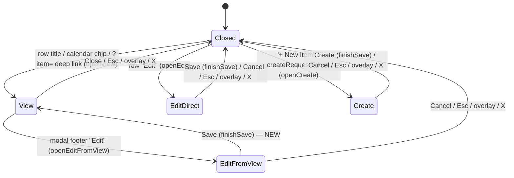

# Implementation Plan: `feat/view-edit-save-return` — returning to view mode after a save

**Backlog source:** `docs/backlog.md:168` ("View → Edit → Save returns to view mode instead of
closing", deferred from `feat/item-view-mode` as D-OQ2, `docs/plans/item-view-mode.md:705-709`).

**Scope constraint (owner):** `web/src` only. No Worker, API, or schema change.

---

> # ❌ VERDICT: WONTFIX — do not build this.
>
> **v1 of this plan said PROCEED. Round-1 review (`docs/reviews/view-edit-save-return-review.md`,
> F1) found that the single sentence carrying that verdict — "no cheaper fix exists inside
> `web/src`" — was asserted, not argued, and false. A guarded ~2-line calendar navigation closes
> the motivating hole better and ~5-10× cheaper (like-for-like: ~20-40 lines with its test, vs ~300) (§1.1.3). What remains for return-to-view is a
> nicety priced at two orders of magnitude over its estimate.**
>
> **What the Coder does with this document:** §9 only — close `docs/backlog.md:168` and file the
> two genuine defects this planning pass turned up. **Do not implement §3-§7.** Those sections are
> retained, and corrected against the review, as the vetted record of what was evaluated — so that
> an owner who overrules this verdict starts from a right design rather than a fresh one.

---

## 1. Problem statement and goals

### 1.1 Premise check — is returning to view actually better than closing?

The backlog is not assumed correct. The question is whether a user pressing **Save** means "I'm
done" (close) or "I'm done editing" (return to what I was reading).

**The case for closing (status quo), stated at full strength:**

1. Save is a terminal action. Every other dismissal path in this modal (Cancel, Esc, overlay, X)
   closes; making Save the one action that does not is a special case to learn.
2. **The list behind the modal already confirms the save.** `ItemListView.tsx:181-184` calls
   `refresh()`, and QA observed the row update immediately with no manual refresh
   (`docs/qa/item-view-mode-report.md:248-254`). On the list screen, closing gives the user
   confirmation *and* their place back, in zero extra clicks. Returning to view costs one extra
   dismissal to get the same information.
3. It is the pre-existing behavior, it is tested, and it is free.

**The case for returning, stated at full strength:**

1. On the **calendar**, point 2 above is false. `CalendarView.tsx:287-290` bumps `reloadToken`,
   which refetches *the currently displayed month*. If the user changed the date, the chip moves —
   and if it moved out of the displayed month, it vanishes with no replacement anywhere on screen.
   The modal closes onto a grid where the thing the user just saved is **not visible at all**. That
   is not a confirmation gap in theory; it is the single most common calendar edit (rescheduling).
2. Entering edit **from view** is an explicit statement of context: the user was reading the item,
   went to fix something, and expects to come back. Ejecting them means re-finding the row or chip.
3. The cost — one extra dismissal — is only paid in the case where the user demonstrably wanted to
   be in view mode.

**Where the two cases disagree is exactly where the design line goes.** Point 2 of the "closing"
argument holds for a **row Edit** click (the user never asked for a view; closing lands them back
on the list they came from, updated). It fails for a **view-originated** edit. That asymmetry is
real, not a compromise — see Decision 1.

> **v1 stopped here and concluded PROCEED. §1.1.3 is the step it skipped**, and it is the step that
> reverses the conclusion: returning-point-1 identifies a real hole but never asks whether
> *this* feature is the right fix for it.

### 1.1.1 The vanish hole is real — verified twice

`CalendarView.tsx:57-58` windows the fetch to `[startOfMonth(currentMonth), end-of-month]`, the
effect re-runs on `reloadToken` (`:72`), and the render filters to the displayed year/month
(`:82-89`). A save that moves an item out of the displayed month therefore refetches a grid in
which the item appears nowhere, and `onSaved` (`:287-290`) closes the modal onto exactly that.
Confirmed independently by review (`view-edit-save-return-review.md` F1, "Real — I traced it and
it holds"). Nothing below withdraws this; what changes is what should be done about it.

### 1.1.2 What this feature actually delivers against that hole: nothing

The plan's own §2 item 3 and R10 concede it: return-to-view does **not** put the item back on the
grid. After the user reads the new date and presses Esc, the chip is still missing. The hole is
**deferred by one Esc press**, not closed.

So the honest statement of the benefit is: **one screen of post-save confirmation** — which is
precisely the benefit §1.1's *closing* case dismisses as not worth a dismissal on the list. On the
calendar it is a genuine delta (the information is nowhere else on screen), but it is a far
narrower claim than "closes the hole", and v1 traded on the wider one.

### 1.1.3 The alternative v1 waved away, costed properly

Review F1 supplies it:

```tsx
// CalendarView.tsx, in onSaved
setCurrentMonth(startOfMonth(new Date(saved.start_at)));
```

`startOfMonth` already exists (`CalendarView.tsx:18-20`); `setCurrentMonth` is the existing
month-nav idiom (`:91-92`). No new module, no state-shape change, no type change.

**As written it is wrong, and v1 should have said why rather than waving.** It navigates on
*every* save. A recurring item seeded in August but browsed in December would yank the grid back
to August on a title-only edit — a new, worse surprise. `saved.start_at` is also the **series
seed**, not the occurrence the user was reading: in this repo's own fixture the seed is three
weeks before the clicked occurrence (`CalendarView.test.tsx:51-69`), so for a series it can land
the user in a *more* surprising month than staying put.

**Guarded, it is right, and it is still about two lines:**

```tsx
onSaved={(saved) => {
  itemModal.close();
  if (!saved.rrule) setCurrentMonth(startOfMonth(new Date(saved.start_at)));
  setReloadToken((t) => t + 1);
}}
```

For a **non-recurring** item, `saved.start_at` is the item's one and only occurrence, so the target
month is exact. For a **recurring** item there is no single correct target (a series occupies many
months, and the viewed occurrence may no longer exist), so it stays put — which is also the
behavior that avoids the December→August yank. The two `setState` calls batch into one effect run,
so there is no double fetch (`CalendarView.tsx:72`).

**This splits the motivating case in two, and the split is what decides the item:**

| Case | Guarded navigation (~2 app lines; ~20-40 with a window-aware test) | This plan (~60 app lines — module ~25 + changes ~35, per §1.1.4 — plus ~240 test lines = ~300) |
| --- | --- | --- |
| Non-recurring item moved to another month — *the vanish case* | **Closes it.** Modal closes onto a grid showing the item. | Shows the new date in the modal; the chip is still missing after Esc. |
| Recurring item, timing edited | No correct target; correctly does nothing. | Shows the series' new start/end and recurrence text. **Only this plan addresses it.** |
| Any item, timing unchanged | Correctly does nothing. | Shows the same view the user already had. |
| List view | N/A | The marginal confirmation §1.1's closing-case point 2 already dismisses. |

They are **complementary, not alternatives** — v1's framing of "no cheaper fix" was wrong in both
directions: a cheaper fix exists, *and* it does not subsume this one. But complementarity does not
confer worth. Once navigation takes the vanish case, the entire residual justification for
return-to-view is row 2 of that table — post-save confirmation for a recurring-item timing edit —
plus a nicety everywhere else.

### 1.1.4 The cost, corrected

**The backlog's cost estimate is wrong and that matters.** `docs/backlog.md:168` says "about one
line once decided." The literal one-line change (`onSaved(saved)` → `openView(saved)`) is
**incorrect**, for three independent reasons the retained design had to work around:

- `ItemModalState`'s edit arm (`web/src/components/ItemModal.tsx:24`) is `{ mode: "edit"; item: Item }`
  — it records nothing about how edit was entered, so a one-line change cannot distinguish the two
  cases in §1.1 and would apply return-to-view to row-Edit saves too.
- `openView` takes `occurrenceAt`/`occurrenceEndAt` (`ItemModal.tsx:51-57`). Feeding the *old*
  occurrence context back after an edit that moved the item is the R9 hazard
  (`docs/plans/item-view-mode.md:671`) wearing a different hat — see Decision 3.
- Both parents' `onSaved` handlers do `close()` **and** `refresh()`/`setReloadToken()`
  (`ItemListView.tsx:181-184`, `CalendarView.tsx:287-290`). Whatever replaces `close()` must not
  take the refresh with it — see Decision 4.

Actual cost — **COST_TOTAL**, the figure v1 got wrong:

| Deliverable | Lines `[estimate]` |
| --- | --- |
| `web/src/lib/occurrenceBasis.ts` (with the comments §9 makes mandatory) | ~25 |
| `ItemModal.tsx` + `ItemListView.tsx` + `CalendarView.tsx` changes | ~35 |
| 7 helper cases (`occurrenceBasis.test.ts`) | ~40 |
| L1-L5 (multi-assertion component tests; L5 adds a deferred-promise harness) | ~150 |
| C-S1, C-S2 (multi-assertion component tests) | ~80 |

**v1 said its cost was "one new pure module, ~35 lines across three existing `web/src` files, and
13 new tests… roughly 40× the estimate" — and `40 ≈ 35 / 1` silently excludes the module and the
tests named in the very same sentence** (review F8). Against an estimate of one line the honest figure
is **two to three hundred lines, i.e. two orders of magnitude**. The range is deliberately not
sharpened to a digit: test line counts are estimates, and **no argument below depends on the
precise multiplier — only on "two orders of magnitude"**, which the app-code lines alone (60×)
already establish and which the test lines only deepen.

This correction matters because §1.2 feeds the multiplier straight into a ship/close decision made
by a human. Understating it by 5× (60 app-only lines quoted where ~300 total is the real figure) biases the decision it exists to inform.

### 1.2 Verdict — **WONTFIX**. (v1 said PROCEED; the review reversed it.)

**Close `docs/backlog.md:168` without building.** The decision D-OQ2 deferred has now been made —
and the answer is that the current behavior is correct.

The reasoning, in the order it binds:

1. **The argument that carried v1's PROCEED does not survive §1.1.3.** v1's deciding sentence was
   "no cheaper fix exists inside `web/src`." A ~2-line guarded navigation exists, it is inside
   `web/src`, and on the vanish case it does what this plan only *defers* (§1.1.2). A verdict whose
   load-bearing premise is false does not survive by finding a new premise afterwards.
2. **What remains is a nicety.** Post-save confirmation for a recurring-item timing edit (§1.1.3
   table row 2), plus polish the plan's own §1.1 already concedes is weak on the list.
3. **Priced at two orders of magnitude over estimate** (§1.1.4), on the modal state machine that
   B1/NEW-1, R9 and the roving-tabindex focus work all lean on.
4. **It leaves a permanent maintenance coupling.** The four-field rule (§3.4) is tied to
   `src/worker/recurrence.ts`'s internals by a comment and nothing else. If a future Worker change
   makes `allDay` (or anything else) affect expansion, the client silently carries a stale
   occurrence — with no compile error and no test failure. Review §2 establishes that a
   cross-boundary parity test is the wrong instrument (Open question 1, now closed "no"). That is a
   real, permanent cost to carry for row 2 of a table.

**What this pass produced that is worth keeping** — filed as separate backlog items in §9, not
absorbed here:

- **Calendar does not follow a rescheduled non-recurring item out of the displayed month.** Real
  gap, real fix, ~2 lines guarded (§1.1.3). **Premise check ANSWERED** by round-2 review — it is a no-op unless the date actually
  changed (`CalendarView.tsx:82-89`, `recurrence.ts:39`), so it cannot move the grid out from
  under anyone. The *unguarded* one-liner remains wrong (§1.1.3). So: its own item, its own plan.
  Not smuggled in here.
- **`view → edit → Esc` drops focus to `<body>`.** A real, pre-existing accessibility defect,
  independently reproduced by review (§3 of the review, "The `triggerRef` pre-existing bug… Real,
  and I reproduced it by reading"). **not ~1 line** — it needs a *conditional* write: simply dropping the `triggerRef` overwrite breaks row-Edit → Esc restore, and no test covers that path, so the suite stays green while a working case regresses. Entirely independent of this feature.

**If the owner overrules this verdict**, §3-§7 are a design that has survived one adversarial
review and been corrected against it; §1.1.3's navigation should be built *as well*, not instead,
because the two cover different rows of the table.

### 1.3 Referent table — every quantity in this plan, defined once

Every figure in the body cites a row by symbol. Tags: `[measured]` = counted or read in the repo
during this planning pass; `[quoted]` = taken from another document, not re-derived; `[derived]` =
computed from cited code.

| Symbol | What it measures | Units | Which artifact | Which extent | Method / threshold |
| --- | --- | --- | --- | --- | --- |
| **B1..B4** | The occurrence-basis fields: `start_at`, `end_at`, `rrule`, `timezone` | field names | `Item` (`web/src/types.ts:40-44`) | **four** fields — **`all_day` is NOT one of them** (withdrawn in v2, review F2/F3) — and not `title`, `notes`, `location`, `type`, `reminders`, `list_id` | `[measured]` by reading the expansion **body**, `src/worker/recurrence.ts:30-109`: it references `q.timezone` (`:35`), `q.rrule` (`:37`, `:67`) and `q.startAt` (`:39`, `:43`) and **never `q.allDay`**, which is accepted into `OccurrenceQuery` at `:23` and dropped. `end_at` enters separately as the duration `end_at - start_at` (`src/worker/routes/items.ts:77-81`). |
| **COST_TOTAL** | Lines this feature would add | lines of source | `web/src` app code + test code | the 5-row table in §1.1.4 | `[estimate]` — ~60 app + ~240 test ≈ 300. Used only at order-of-magnitude resolution; see §1.1.4. |
| **N_CAL** | Tests in `CalendarView.test.tsx` **before** this change | tests | that file only | whole file, all `describe`s | `[measured]` — 30 `it(` blocks |
| **N_LIST** | Tests in `ItemListView.test.tsx` **before** this change | tests | that file only | whole file | `[measured]` — 10 `it(` blocks |
| **N_DESK** | Tests in `ItemModal.desktop.test.tsx` **before** this change | tests | that file only | whole file | `[measured]` — 2 `it(` blocks |
| **N_NEW** | Tests the §3-§7 design would add | tests | 3 files (1 new, 2 edited) | §7 only | `[derived]` — 7 helper + 5 list (L1-L5) + 2 calendar = **14**. (v1 said 13; v2 adds L5/AC12 per review F4.) |
| **LINT_BASE** | `npm run lint` baseline on a clean tree | errors / warnings | whole repo | `eslint src web/src` | `[quoted]` `docs/backlog.md:154` (dated 2026-08-22): 0 errors, 2 warnings. **Must be re-measured on the branch point before step 1 — do not pin this number.** An earlier plan's quoted baseline of 4 is stale. |
| **E2E_PASS** | `npm run test:e2e` pass count | specs | `e2e/*.spec.ts` | default projects (no `E2E_WEBKIT`) | `[quoted]` `docs/backlog.md:164` (2026-09-19): 6 passed. QA re-measures. |
| **EST_BACKLOG** | The backlog's own cost estimate | lines | `docs/backlog.md:168` | that sentence | `[quoted]` — "about one line once decided" |

### 1.4 Goals — **of the design in §3-§7, which the §1.2 verdict does not build**

- After a save that was reached **from view mode**, the modal stays open and shows the
  freshly-saved item in **view** mode.
- After a save reached any other way (row **Edit**, **create**), the modal closes — unchanged.
- The view returned to never displays an occurrence time that the save invalidated.
- Both parents keep refreshing their data; neither list nor grid goes stale.
- Focus behaves: closing the returned-to view restores focus to the row/chip that opened the
  modal **when that row/chip is still rendered**.

> **The focus goal is deliberately qualified (review F6), because v1's unqualified version was
> false on the motivating path.** On the calendar date-change case, `setReloadToken` refetches and
> the originating chip unmounts (different day cell, or out of the month). `handleCloseAutoFocus`'s
> `document.contains(trigger)` check (`ItemModal.tsx:123`) is then false, it does not
> `preventDefault()`, and focus falls back to Radix's default — `<body>`. That is pre-existing,
> deliberate behavior, pinned by `ItemListView.test.tsx:211-233`, and this design does not change
> it. **No planned test can see it** and the reason is structural, not an oversight: `renderList`
> holds `items` static with a no-op `onItemsChange` (`ItemListView.test.tsx:85`) and
> `getOccurrences` is mocked to return one fixture forever (`CalendarView.test.tsx:80`), so the
> trigger never detaches in any planned test. It is therefore a **documented residual**, covered by
> a QA note (§8, after check (d)) rather than by a criterion.

### 1.5 Definition of done

**Under the §1.2 WONTFIX verdict**, done is §9: `docs/backlog.md:168` closed with the reasoning,
and two new backlog entries filed. No code, no tests, no gate run, no QA pass — this branch
produces a documentation diff only.

**Had the verdict been PROCEED**, done would have been (retained for the overrule case):

- `npm run typecheck && npm run lint && npm test && npm run build` all green; lint at or below
  **LINT_BASE** as re-measured (not as quoted).
- **Every pre-existing test passes with no edit to any existing test's body or assertions.** The
  only edits to existing test files are additive: new `describe` blocks, and new keys in two
  `vi.mock` factories (§5). N_CAL, N_LIST and N_DESK test names all still appear in the
  `npm test` output.
- The **N_NEW** = 14 tests of §7 pass, and each one's named red build fails it (§7.3 sweep).
- QA's `npm run test:e2e` run is recorded in the report with its pass count (CLAUDE.md:54-59).

---

> **Round-2 finding R2.5, recorded rather than silently dropped.** The §1.1.3 comparison undersells
> return-to-view on one axis: the calendar chip renders only the title (`CalendarView.tsx:252`), so
> edits to notes, location, reminders or recurrence get **zero** grid confirmation either way — where
> the list's `ItemRow` already renders those (`:268-275`). So on the calendar, non-timing edits are a
> genuine confirmation gap that navigation does not close and return-to-view would have.
>
> **Judged not to flip the verdict, and the reason is worth stating:** that gap is a *confirmation*
> nicety, not a correctness hole — nothing is lost or hidden, the save succeeded — and it is the
> weakest of the three motivating cases at the full ~300-line cost. It is recorded here because an
> unanswered finding is the kind that disappears between rounds, and because it is the strongest
> surviving argument *for* the feature if this decision is ever re-taken.

> **Rule for every multiplier in this document (round-4 review).** A ratio is a derived quantity
> over **two** referents, so it detaches twice as easily as a count — and the referent table has a
> row for `COST_TOTAL` but has never had a row for any ratio. That gap is exactly where this
> document's cost figure drifted three times: `40×` was *app ÷ estimate*, `~100×` was
> *app+test ÷ app*, and `150-250×` was a stale pre-table *total ÷ estimate*. Each was correct
> against **some** pair of operands, and none of them named its pair.
>
> So: **every multiplier either cites a referent-table symbol pair, or writes both operands
> inline.** `~5-10× (2 app lines vs 300 app-plus-test lines)` is self-checking; a bare `~100×` is
> not. Applied as a sweep rather than a habit, this rule found the one site three rounds of greps
> had missed — `:121`, the only comparison stated as two bare parenthetical figures.

## 2. Non-goals

1. **No Worker, API, migration, or `src/shared` change.** Owner constraint.
2. **No new e2e spec.** `e2e/fixtures/api-mocks.ts:202` throws on any unmatched `/api/*` request,
   and the mock contract covers no write endpoints (no `PATCH /api/items/:id`, no
   `PUT .../reminders`). Adding this flow means extending the mock contract with write routes —
   a larger, separate change than the feature. The existing suite still runs as a regression gate
   (§8). Filed as a note, not built.
3. **The calendar does not navigate to follow a rescheduled item.** If a save moves an item to
   another month, the grid behind the modal will not show it. The modal shows the correct new
   date, but the chip stays missing. **In v1 this was a non-goal; in v2 it is the reason the
   feature is closed** — §1.1.2 and §1.1.3 promote this concession from a footnote to the
   deciding argument, and §9 spins the navigation fix out as its own backlog item.
4. **Cancel / Esc / overlay / X still close.** Decision 5b argues this rather than assuming it.
5. **No change to `ItemEditor`, `ItemDetails`, `App.tsx`, or `apiClient`.**
6. **No edit to `docs/plans/item-view-mode.md`.** Its §3.5 note ("Note the absent transition
   Edit → View: on Save the modal closes", `:182`) becomes historically superseded, not wrong.
   Plans in this repo are records; the backlog entry carries the resolution. Do not "fix" the old
   plan.

---

## 3. Proposed design

> **NOT TO BE IMPLEMENTED under the §1.2 verdict.** §3-§7 are retained as the vetted record of
> what was evaluated: a design that survived one adversarial review, with every correction that
> review required folded in. If the owner overrules §1.2, start here rather than from scratch —
> and read §1.1.3 first, because the navigation fix belongs alongside it, not instead of it.

### 3.1 State machine (the one added transition is tagged `NEW`)



Exactly one new transition (`EditFromView → View`) and one split of an existing state
(`Edit` → `EditDirect` | `EditFromView`). Everything else is as shipped.

### 3.2 Decision 1 — return to view **only** when edit was entered from view

**Chosen:** the edit arm records its origin; only the view-originated arm returns.

Rationale is §1.1: closing is *correct* for a row-Edit save (the user never asked to see a
detail view, and the updated row is right there), and it is the pre-existing behavior, so this
choice also keeps the blast radius off every existing test. Returning is correct for a
view-originated save because the user was reading the item and asked to come back to it.

Alternatives:

| Option | Why not |
| --- | --- |
| **A. Origin-aware (CHOSEN)** | — |
| B. Return from every edit-save | This is the backlog's literal one-liner. It changes behavior for a path nobody complained about (row Edit), adds a dismissal to it, and its only merit is a smaller diff. §7 AC3 exists specifically to fail on this build. |
| C. Never return; instead show a toast | No toast primitive exists in the app; adding one is a larger change than the feature and does not solve the calendar case (the item still isn't on screen). |

**The origin must be recorded on the state, not inferred.** Inferring it (e.g. "the previous
state was `view`, so this edit came from view") happens to be correct today only because the
modal overlay blocks row clicks while open — an invariant of Radix's modal behavior that nothing
in this repo asserts. Recording it makes the two entry points structurally different and
greppable.

**Shape:**

```ts
// web/src/components/ItemModal.tsx

/**
 * The occurrence context the modal was opened with in view mode, captured verbatim when the
 * user goes View -> Edit so a save can return to the SAME view. These are the exact values
 * openView() received (CalendarView.tsx:247 -> occ.occurrence_at / occ.end_at) — never
 * re-derived here. See Decision 3 for when they are carried back and when they are dropped.
 *
 * LOAD-BEARING INVARIANT (this is what makes R9's backwards range unreachable — NOT the
 * "both or neither" ternary, which is necessary but not sufficient):
 *
 *   occurrenceEndAt is undefined IF AND ONLY IF item.end_at is null.
 *
 * Established at the only two sites that can produce these values: CalendarView.tsx:247 passes
 * `occ.end_at ?? undefined`, and src/worker/routes/items.ts:77-81 computes occ.end_at as null
 * exactly when item.end_at is null. So a "partial" pair {occurrenceAt: number, occurrenceEndAt:
 * undefined} is not an error state — it is the NORMAL shape for an item with no end, and it
 * renders correctly because ItemDetails.tsx:43 then falls through to a null item.end_at and
 * prints a single time.
 *
 * The coupling is preserved across a save by comparing end_at (B2): any transition between null
 * and a number drops the whole context. A future openView caller that supplied an occurrence end
 * INDEPENDENTLY of item.end_at's nullity would reopen R9 without tripping AC5, AC6 or AC7.
 */
export interface ViewOrigin {
  occurrenceAt?: EpochMs;
  occurrenceEndAt?: EpochMs;
}

export type ItemModalState =
  | { mode: "create" }
  | {
      mode: "view";
      item: Item;
      occurrenceAt?: EpochMs;
      occurrenceEndAt?: EpochMs;
    }
  | {
      mode: "edit";
      item: Item;                      // the PRE-EDIT snapshot (Decision 3 compares against it)
      // REQUIRED, deliberately not optional and with no default:
      //   null  = edit was entered directly (row "Edit") -> Save closes.
      //   {}    = entered from a view that had no occurrence context (list row / deep link).
      //   {occurrenceAt, occurrenceEndAt} = entered from a calendar-chip view.
      // `{}` and `null` are NOT interchangeable. Making this required means TypeScript fails any
      // new construction site that does not state its intent — the mechanism that keeps a future
      // third entry point from silently inheriting one behavior or the other.
      returnToView: ViewOrigin | null;
    };
```

Required-not-optional is the enforcement mechanism: every construction site must state its intent
or fail to compile.

**Verify it with a property, not a count: `grep -rn 'returnToView' web/src` must return hits in
`ItemModal.tsx` and in NO other file.** Any hit elsewhere means a construction site escaped the
hook, which is exactly what the required field exists to prevent.

> **Why a property and not a count (review F5).** v1 specified `grep -n 'mode: "edit"' web/src`
> and asserted "one hit today, exactly two after" — **both numbers are wrong on a correct build**:
> the pattern also matches the type arm (`ItemModal.tsx:24`), so it returns **two** today, and
> **four** after the change, because `openEditFromView` has two literal construction expressions,
> one per ternary branch. A checklist step whose stated pass condition is unreachable teaches a
> Coder to ignore the step. Switching patterns does not fix it — `returnToView:` matches the type
> arm plus three constructions, and bare `returnToView` also matches `finishSave`'s three reads.
> **Any count here is hostage to formatting; the file-scoping property is not.**

### 3.3 Decision 2 — after a **create** save, the modal still closes

**Chosen:** unchanged. Create closes.

This is the question that got the item deferred (`docs/plans/item-view-mode.md:707-709`), so it
gets argued rather than inherited:

1. **"Return" presupposes somewhere to return to.** Create is not reached from a view; there is no
   prior state to restore. Opening a view of the new item is a *new* screen, not a return — a
   different feature with a different justification.
2. **Create is the batch operation.** "+ New Item" and the mobile `createRequestToken` path
   (`ItemListView.tsx:86-90`) are how a week of items gets entered. Adding a mandatory dismissal
   to every create is a real, repeated cost against a one-time confirmation benefit.
3. **The confirmation already lands.** `refresh()` puts the new row in the list immediately, and
   unlike the calendar-reschedule case there is no "where did it go?" problem: a newly created
   item is at a date the user just typed, on the screen they were already on.
4. It keeps `openCreate` and the create branch of `ItemEditor` completely untouched.

Rejected alternative: **open the new item in view mode after create.** Its best argument is
symmetry with Decision 1 ("saves show you the result"), and symmetry is not worth a dismissal on
the app's highest-frequency write. §7 AC11 is the test that fails on this rejected build, so the
decision is mechanically pinned rather than stated.

### 3.4 Decision 3 — the occurrence-context trap: carry the pair, or drop the pair

This is the correctness core of the plan.

**The hazard.** `openView(item, occurrenceAt, occurrenceEndAt)` is fed per-occurrence values the
*server* computed for the *pre-edit* item (`CalendarView.tsx:247` ← `src/worker/routes/items.ts:76-84`).
After an edit, those values may describe an occurrence that no longer exists. Returning to view
with them is the same defect class R9 was written for (`docs/plans/item-view-mode.md:671`): a true
number attached to a stale referent.

**What a "drop" actually renders — say it correctly, because v1 did not.** Dropping the context
does not fall back to "the item level"; `ItemDetails.tsx:42` falls back to `item.start_at`, which
is **the series' first occurrence** (`ItemModal.tsx:19-20` says so in as many words). So a drop on
a recurring item moves the displayed date to a *different occurrence* and removes the series hint
(`ItemDetails.tsx:51`). A drop is therefore never free — it is the lesser of two stale referents,
and only justified when the captured pair is genuinely invalid.

**Chosen rule — the occurrence basis test:**

> Carry the captured `{occurrenceAt, occurrenceEndAt}` pair back into view **verbatim, both or
> neither**, if and only if none of **B1..B4** (`start_at`, `end_at`, `rrule`, `timezone`) changed
> between the pre-edit item and the saved item. Otherwise pass **neither**, and let `ItemDetails`
> fall through to `saved.start_at` / `saved.end_at` (`ItemDetails.tsx:42-43`).

**Why B1..B4, and in exactly which direction the claim holds.** The expansion **body** —
`src/worker/recurrence.ts:30-109`, which v1 never opened — references `q.timezone` (`:35`),
`q.rrule` (`:37`, `:67`) and `q.startAt` (`:39`, `:43`), and nothing else; `q.allDay` is accepted
into `OccurrenceQuery` at `:23` and **never read**. The per-occurrence end is
`occurrence_at + (end_at - start_at)` (`src/worker/routes/items.ts:77-81`), which adds `end_at`.
Four fields.

The implication is **one-directional, and v1 overclaimed it**:

- **B1..B4 unchanged ⟹ the server would re-expand to an identical `occurrence_at`/`end_at` pair.**
  This holds, and it is all the rule needs.
- **The converse does not hold.** A changed field does not imply a moved occurrence — always false
  for `all_day` (never read by the expansion), and false for `timezone` on non-recurring items,
  where `recurrence.ts:39` returns `q.startAt` untouched. The drop in those cases is a
  conservative loss, not a correction.

v1 called this "provably what the server would say… rather than a judgment call", citing
`src/worker/routes/items.ts:66-75`. **Those lines are the argument list at the call site, not the
implementation** — a true statement about the wrong referent, which is precisely the failure mode
`docs/plans/calendar-show-more.md:333-334` and this repo's "assert the thing, not the derived
property" memory exist to catch. The forward implication survives; the word "provably" does not
extend to the field list's *minimality*, and that overclaim is what kept `all_day` alive.

**`all_day` is NOT in the set (review F2) — and including it was not a harmless over-drop.**
v1 justified B5 as "the safe direction" and as matching `src/worker/db.ts:698`. Both were wrong:

- **Not safe.** Toggling all-day does not normalise `start_at` (`ItemEditor.tsx:229-237` sets only
  the flag; the start input merely re-renders as a date, `:247-256`). So: recurring item, opened at
  occurrence #4 from a chip, user ticks "All day", saves → B5 is the only changed field → context
  dropped → **the view jumps to a date three weeks earlier and loses the series hint.** That is
  verbatim the harm §3.4 uses to reject option **3B** below. The same mechanism cannot be
  condemned in the table and blessed four paragraphs later.
- **Not required.** `all_day` does not move the epochs, so carrying is always correct:
  `formatOccurrenceTime(occurrenceAt, tz, saved.all_day)` renders that occurrence's own date in
  the new format. Including it was a **pure loss**.
- **The mirror was the wrong target.** `db.ts:698`'s `timingFields` decides when to purge pending
  reminder dispatch (`db.ts:735-738`) — a different question. The two sets coincided by accident,
  and `db.ts:699-701` additionally compares a boolean `patch.all_day` against the raw row's `0|1`,
  so `all_day` always reads as "changed" there. **The client set is not a mirror of anything**; it
  is derived from `recurrence.ts`. Record that divergence in a comment so a future reader does not
  "fix" the client to match the Worker.

**Why not the alternatives:**

| Option | Why not |
| --- | --- |
| **3A. Recompute the occurrence client-side** (`occurrenceAt + (end - start)`, or a client RRULE expansion) | Decision 9 already rejected exactly this: "it re-implements server logic client-side, so the two can drift the moment the expansion rules change" (`docs/plans/item-view-mode.md:513-515`). A client expansion does not exist in `web/src` and is not worth writing for a detail panel. Worse, it has no answer to "which occurrence is *the same* one after the rule changed?" |
| **3B. Always drop the occurrence context on return** | Simpler (no helper, no B1..B4). But a **title-only** edit from a calendar chip would silently jump the displayed date back to the series' first occurrence and drop the series hint, immediately after a save — a visible, unexplained change, and precisely the stale-referent failure mode this plan exists to avoid. §7 AC5 fails on this build. **v1's inclusion of `all_day` reproduced this exact harm on the all-day-toggle path; see the F2 paragraph above.** |
| **3C. Refuse to return to view for recurring items** | (i) "Recurring" is ambiguous when an edit can add or remove an `rrule` — you would have to pick before-or-after and defend it; (ii) it disables the feature precisely in the calendar case that motivates it (§1.1); (iii) it is a rule the user has to learn from behavior. |
| **3D. Refetch occurrences and re-derive the matching one** | Needs a request, and "matching" is undefined after a date or rule change. `ItemListView` has no occurrence fetch at all, so the two parents would diverge in behavior. Cost far above value. |

**Helper (new pure module):**

```ts
// web/src/lib/occurrenceBasis.ts
import type { Item } from "../types";

/**
 * The FOUR fields a per-occurrence value is derived from server-side.
 *
 * Read from the expansion BODY, not its call site: src/worker/recurrence.ts:30-109 references
 * only q.timezone (:35), q.rrule (:37, :67) and q.startAt (:39, :43). Each occurrence's end is
 * occurrence_at + (end_at - start_at) (src/worker/routes/items.ts:77-81), which adds end_at.
 *
 * all_day is DELIBERATELY ABSENT. expandOccurrences accepts it into OccurrenceQuery
 * (recurrence.ts:23) and never reads it, so it cannot move an occurrence; including it would
 * drop a still-valid context and send the view to the series' FIRST occurrence instead of the
 * one the user was reading (ItemDetails.tsx:42, :51).
 *
 * This set is NOT a mirror of src/worker/db.ts:698's `timingFields`, which looks identical but
 * answers a different question (when to purge pending reminder dispatch, db.ts:735-738) and
 * includes all_day for that reason. Do not "fix" this file to match it.
 */
export type OccurrenceBasis = Pick<
  Item,
  "start_at" | "end_at" | "rrule" | "timezone"
>;

/**
 * True when an edit left the occurrence basis untouched, i.e. a re-expansion by the server would
 * produce the SAME occurrence_at/end_at pair — so a captured occurrence context is still exactly
 * valid. False means the caller must drop the captured context entirely (never partially).
 *
 * ONE-DIRECTIONAL: true => still valid. false does NOT imply the occurrence moved (e.g. a
 * timezone change on a non-recurring item, where recurrence.ts:39 returns startAt untouched);
 * that is an accepted conservative drop.
 *
 * Fields deliberately NOT compared: title/notes/location/location_kind/type/reminders (no effect
 * on occurrence arithmetic), list_id (edit mode cannot change it — ItemEditor.tsx:135 renders the
 * list select for create only), and all_day (see the type's doc comment).
 */
export function occurrenceBasisUnchanged(
  before: OccurrenceBasis,
  after: OccurrenceBasis
): boolean {
  return (
    before.start_at === after.start_at &&
    before.end_at === after.end_at &&
    before.rrule === after.rrule &&
    before.timezone === after.timezone
  );
}
```

Taking `OccurrenceBasis` rather than `Item` keeps test fixtures small and states the contract in
the signature. `Item` satisfies it structurally, so call sites pass items unchanged.

**The residual this leaves, stated because it is one of the four reasons for the §1.2 verdict:**
the four-field set is coupled to `src/worker/recurrence.ts`'s internals by a **comment and nothing
else**. If a future Worker change makes the expansion read `allDay` — or any new field — the
client silently carries a stale occurrence, with no compile error and no failing test. Review §2
establishes that a cross-boundary parity test is the wrong instrument (Open question 1, closed
"no"), so there is no mechanism available, only vigilance. Tightening the set from five fields to
four (correct, per F2) *increases* this exposure: the conservative version was wrong but slack,
and the correct version is exact and therefore brittle.

### 3.5 Decision 4 — the `onSaved` contract: the **hook** owns the transition, the **parent** keeps the refresh

`ItemModalProps.onSaved: (saved: Item) => void` (`ItemModal.tsx:78`) **does not change shape.**
Only its comment changes (from "parent closes + refreshes"). `ItemModal` the component gains no
props and no logic; it stays a pure function of `state`.

The transition belongs in `useItemModal`, because that is already where the state machine lives
(`ItemModal.tsx:34-65`) and it is shared *code* across both mount sites without being shared
*state* (HC1). Putting the policy in the parents would duplicate it in two files and require each
parent to inspect `itemModal.state` to discover the origin.

**New hook members:**

```ts
// Entered from the OPEN view modal (ItemDetails' footer "Edit"). Captures the view's occurrence
// context so a save can return to the same view (Decision 3).
//
// Deliberately does NOT write triggerRef — see Decision 5. The element that opened the modal (row
// title button / calendar chip) is still the correct focus-restore target; document.activeElement
// here is the in-dialog Edit button, which is unmounted one render later.
const openEditFromView = useCallback((item: Item) => {
  setState((prev) => {
    // Never OPEN the modal from here (review F9). This method deliberately does not write
    // triggerRef, so opening from closed would leave the restore target pointing at whatever
    // the PREVIOUS open captured (ItemModal.tsx:42 is written only at :48/:53/:59) — and if
    // that element is still attached, Esc would focus an unrelated control. Unreachable today
    // (onEditRequested is wired only to ItemDetails' Edit button, ItemModal.tsx:149, which
    // renders only in view mode, :141), but an unreachable state should not be silently wrong.
    if (prev === null) return prev;

    // Defensive: if some future caller reaches here from create/edit, fall back to the closing
    // behavior rather than inventing an origin. triggerRef is valid in those states.
    return prev.mode === "view"
      ? {
          mode: "edit",
          item,
          returnToView: {
            occurrenceAt: prev.occurrenceAt,
            occurrenceEndAt: prev.occurrenceEndAt,
          },
        }
      : { mode: "edit", item, returnToView: null };
  });
}, []);

// Called by BOTH parents from onSaved. Decides close-vs-return; the parent still refreshes.
const finishSave = useCallback((saved: Item) => {
  setState((prev) => {
    // prev === null: the user dismissed the modal while the PATCH was in flight. Stay closed —
    // never resurrect a dialog the user has already dismissed (see §6 edge case 9 / R6).
    if (prev === null || prev.mode !== "edit" || prev.returnToView === null) return null;

    // Decision 3: BOTH captured values or NEITHER. Never mix a captured start with a derived end.
    const carry = occurrenceBasisUnchanged(prev.item, saved);
    return {
      mode: "view",
      item: saved,
      occurrenceAt: carry ? prev.returnToView.occurrenceAt : undefined,
      occurrenceEndAt: carry ? prev.returnToView.occurrenceEndAt : undefined,
    };
  });
}, []);
```

Both use **functional** `setState`, so the empty `useCallback` dep arrays stay honest and HC1
holds (per-instance `useState`, no Context, no module scope, no external store).

**Both parents keep their own refresh** — this is the requirement most easily lost:

```tsx
// ItemListView.tsx (replacing :181-184)
onSaved={(saved) => {
  itemModal.finishSave(saved);
  refresh();                       // ItemListView.tsx:94-99 — unchanged, still required
}}

// CalendarView.tsx (replacing :287-290)
onSaved={(saved) => {
  itemModal.finishSave(saved);
  setReloadToken((t) => t + 1);    // unchanged, still required
}}
```

Order is irrelevant (both are state updates React batches). §7 AC4 fails on any build that drops
the refresh.

**Naming note:** `finishSave`, not `completeSave` — `completeItem` already exists in `apiClient`
and means "mark a task done". Avoid the collision.

### 3.6 Decision 5 — focus, and whether `triggerRef` still holds

**5a. The mechanism is unchanged, and it is now *more* correct.**

`triggerRef` is written by each `open*` call (`ItemModal.tsx:48, 53, 59`) and read only by
`handleCloseAutoFocus` on Radix's `onCloseAutoFocus` (`:121-127`) — a **close**-time event. A
mode swap is not a close: `state` never becomes `null`, `open` stays `true` (`:114`), the portal
never unmounts, and `onCloseAutoFocus` never fires. So the existing logic still holds, and this
plan adds no focus code.

Focus *during* the swap is already a solved case in this codebase: the editor subtree is removed,
`document.activeElement` becomes `<body>`, and `@radix-ui/react-focus-scope`'s `handleMutations`
re-homes focus to the dialog container. That is the same mechanism that made the existing
View → Edit swap work, verified in review (`docs/plans/item-view-mode.md:957-962`) and observed by
QA (`docs/qa/item-view-mode-report.md:75`). The new Edit → View swap is its mirror image.

**The one real wrinkle, and the one-line fix.** Today `onEditRequested` routes to `openEdit`
(`ItemListView.tsx:180`, `CalendarView.tsx:286`), which **overwrites `triggerRef` with the
in-dialog Edit button**. That button is detached one render later, so `document.contains(trigger)`
is false at close time (`:123`) and focus falls back to `<body>`. This is pre-existing and today
it is nearly invisible, because the flow ends in a close either way. This plan makes it visible:
the user would be returned to a view modal and then, on closing it, dumped to `<body>` instead of
the chip they came from — a worse ending than the feature's whole premise.

**Decision: `openEditFromView` does not write `triggerRef`** (see §3.5). Consequences, stated
plainly because one of them is a behavior change outside the strict feature:

- New flow (view → edit → Save → view → Close): focus restores to the row title button / chip.
- **Pre-existing flow (view → edit → Esc/Cancel): focus now also restores to the row title button
  / chip, where today it lands on `<body>`.** This is an unrequested improvement riding along,
  declared here rather than discovered in review. It breaks no existing test (every existing
  focus-restore test — `ItemListView.test.tsx`'s "focus restore on modal close (QA nit 1)"
  describe, and `CalendarView.test.tsx`'s C13 — closes from **view** mode, never via edit).
  If the owner wants strictly-minimal scope, the alternative is to have `openEditFromView` write
  `triggerRef` like `openEdit` does and accept `<body>` at the end of the new flow; this plan
  rejects that because it ships a flow with a known-bad ending.

**5b. Cancel / Esc / overlay / X still CLOSE — they do not return to view.**

Symmetry says a cancelled edit should also return to the view it came from. Rejected, because
**Esc must close a dialog** (Radix wires Esc/overlay/X through one `onOpenChange` handler,
`ItemModal.tsx:170, 179`, and a dialog that swallows Esc is both a convention and an accessibility
violation). If Cancel returned to view while Esc closed, the two dismissals would diverge — a
worse inconsistency than the one symmetry was trying to fix. Keeping all four dismissal paths
identical leaves exactly one rule to learn: **Save returns; dismissal dismisses.** No code change.

**Pinned by AC12 (review F7).** Every other decision in this plan is pinned by a criterion that
fails on its rejected alternative — AC3 pins D1, AC11 pins D2, AC5/AC6 pin D3, AC4 pins D4, AC8
pins D5a — and v1 left 5b with nothing, so a build where a view-originated Cancel returns to view
would have passed every criterion v1 specified. Symmetry-with-Save is exactly what 5b argues against,
so the gap was not idle. The fix is one assertion appended to L1: view → Edit → **Cancel** →
dialog gone.

---

## 4. Affected files and modules

| # | File | Change |
| --- | --- | --- |
| 1 | `web/src/lib/occurrenceBasis.ts` | **NEW.** `OccurrenceBasis` type + `occurrenceBasisUnchanged` (§3.4). Pure, no React, no DOM — same shape as `web/src/lib/calendarFocus.ts`. |
| 2 | `web/src/lib/occurrenceBasis.test.ts` | **NEW.** 7 cases (§7.1). `.test.ts` under `web/**` is collected — `vitest.workspace.ts:46` includes both `web/**/*.test.ts` and `web/**/*.test.tsx`, so the item-view-mode R3 trap does not apply. (Review confirms `docs/plans/item-view-mode.md:665`'s R3 warning is now stale, not this row.) |
| 3 | `web/src/components/ItemModal.tsx` | `ViewOrigin` type + `returnToView` on the edit arm (§3.2); `openEditFromView` and `finishSave` added to `useItemModal`, both exported in its return object; `openEdit` gains `returnToView: null`. `onSaved`'s **comment** updated. No change to the `ItemModal` component body, its props, or its JSX. |
| 4 | `web/src/components/ItemListView.tsx` | Two lines: `onEditRequested={(item) => itemModal.openEditFromView(item)}` (`:180`) and the `onSaved` body (`:181-184`). `onEdit={() => itemModal.openEdit(item)}` at `:165` is **unchanged** — that is the direct path. |
| 5 | `web/src/components/CalendarView.tsx` | Same two lines (`:286`, `:287-290`). |
| 6 | `web/src/components/ItemListView.test.tsx` | **ADDITIVE.** Three keys added to the existing `vi.mock("../apiClient")` factory (`updateItem`, `replaceReminders`, `createItem`); **five** new `describe` blocks, one per test L1-L5 (§7.2). No existing test body touched. (v1 said "three" for four tests — review F10; v2 adds L5, so five.) |
| 7 | `web/src/components/CalendarView.test.tsx` | **ADDITIVE.** Two keys added to the `vi.mock` factory (`updateItem`, `replaceReminders`); one new **top-level** `describe` (§7.2). The file-level `beforeEach` (`:78-82`) and the two nested fixture `describe`s are **not** touched. |
| 8 | `docs/backlog.md` | **The only file §9 actually touches under the WONTFIX verdict:** close `:168`, and file the two spin-off entries. Not application code. |

**Imported unchanged (do not edit):** `ItemEditor.tsx`, `ItemDetails.tsx`, `App.tsx`,
`apiClient.ts`, `ui/*`, `web/src/lib/permissions.ts`, `docs/plans/item-view-mode.md` (§2 item 6).

---

## 5. Data model and API changes

**None.** No migration, no endpoint, no request/response shape change, no new `apiClient`
function. Client-side types only:

```ts
// web/src/components/ItemModal.tsx — added
export interface ViewOrigin { occurrenceAt?: EpochMs; occurrenceEndAt?: EpochMs }

// web/src/components/ItemModal.tsx — edit arm changed
- | { mode: "edit"; item: Item }
+ | { mode: "edit"; item: Item; returnToView: ViewOrigin | null }

// web/src/components/ItemModal.tsx — useItemModal() return object gains
  openEditFromView: (item: Item) => void;
  finishSave: (saved: Item) => void;

// web/src/lib/occurrenceBasis.ts — new
export type OccurrenceBasis = Pick<Item, "start_at" | "end_at" | "rrule" | "timezone">; // NOT all_day
export function occurrenceBasisUnchanged(before: OccurrenceBasis, after: OccurrenceBasis): boolean;
```

`ItemModalProps` is **unchanged** — which is why `ItemModal.desktop.test.tsx` (N_DESK) compiles
untouched.

The `Item` the view returns to is the server's response (`ItemEditor.tsx:86-104`: `updateItem`'s
item merged with `replaceReminders`' fresh reminder set), so the returned-to view also shows a
refreshed `updated_at` in its provenance line (`ItemDetails.tsx:142-144`). Free, and correct.

---

## 6. Risks, edge cases, and open questions

### Risks

| # | Risk | Mitigation |
| --- | --- | --- |
| R1 | **Stale occurrence context on return** — the R9 defect class in new clothes. Worst form: carrying `occurrenceAt` while the end falls through to `saved.end_at`, which is R9 verbatim (a range ending before it starts). | Decision 3's both-or-neither ternary pair, plus **the invariant that actually does the work (review F11): `occurrenceEndAt` is undefined iff `item.end_at` is null**, established at `CalendarView.tsx:247` / `src/worker/routes/items.ts:77-81` and preserved across the save by comparing `end_at` (B2). v1 credited "both or neither" alone, which is necessary but **not** sufficient: a partial pair is the *normal* shape for an item with no end, and it renders correctly. The nullity coupling is what makes the backwards range unreachable — and a future `openView` caller that supplied an occurrence end independently of `item.end_at`'s nullity would reopen R9 **without tripping AC5, AC6 or AC7**. Recorded in `ViewOrigin`'s doc comment (§3.2). §7 AC5/AC6 remain each other's red build. |
| R2 | **Breaking HC1 / NEW-1.** This edits the modal state machine that `App.deeplink.test.tsx` and `CalendarView.test.tsx:128-142` guard. | Both new members are `useCallback`-stable functional `setState` calls inside the same per-instance hook. No Context, no module scope, no store. Existing guards run unmodified. |
| R3 | **The parent's refresh gets absorbed into the hook and lost**, leaving the list behind the modal stale. | §3.5 keeps `refresh()`/`setReloadToken` in both parents' `onSaved`; §7 AC4 asserts the fetch count increases on both the returning and the closing path. |
| R4 | **Focus ends on `<body>`** at the end of the new flow. | Decision 5a: `openEditFromView` does not overwrite `triggerRef`. §7 AC8 fails on the build that reuses `openEdit`. |
| R5 | **A future third edit entry point silently inherits a behavior.** | `returnToView` is **required** with no default, so TypeScript fails the new construction site. Verification step in §9: `grep -rn 'returnToView' web/src` returns hits in `ItemModal.tsx` and **no other file** — a property, not a count (review F5; §3.2 explains why every count here is hostage to formatting). |
| R6 | **Resurrecting a dismissed modal.** The user presses Esc while the PATCH is in flight; `onSave` fires afterwards. A naive `setState({mode:"view", ...})` would pop the dialog back open. | `finishSave`'s `prev === null` early return, **plus AC12 — a real test, not a guard (review F4).** v1 declined the test on the grounds that Radix might unmount `ItemEditor` before the promise resolved, making it vacuous. **That is not the operative mechanism:** `ItemEditor.handleSubmit` (`ItemEditor.tsx:80-124`) has no cancellation guard — no flag, no `AbortController` (contrast `AttachmentsView.tsx:20-37`, which has one) — and the `await` chain holds `onSave` in a closure, so **`onSave` fires regardless of teardown timing**. Both parents also stay mounted throughout. See §7.2 AC12 for the anti-vacuity positive control. |
| R7 | **Derivation drift.** `occurrenceBasisUnchanged`'s four fields track `src/worker/recurrence.ts`'s internals via a comment and nothing else. If the expansion starts reading a field the client does not compare, the client silently carries a stale occurrence — no compile error, no failing test. | **Accepted, un-mechanised, and one of the four reasons for the §1.2 WONTFIX** (§3.4 closing note). Low blast radius (a wrong time in a detail panel; no correctness or security consequence, unlike the `permissions.ts` mirror). **v1 framed this as "mirror drift" against `db.ts:698` — wrong target**: that set answers when to purge reminder dispatch (`db.ts:735-738`), not whether an occurrence moved, and the two coincided by accident. A parity test against it is therefore the wrong instrument — Open question 1, now closed **"no"**. |
| R8 | **Additive test-mock edits leak into existing tests.** Adding `updateItem`/`replaceReminders`/`createItem` keys to two shared `vi.mock` factories. | No existing test in either file invokes those endpoints, and `vi.clearAllMocks()` (both files' `beforeEach`) clears calls, not implementations. Verification: run each file before and after the edit and compare the pass list (§9 step 2). |
| R9 | **Extra request on return.** `ItemDetails` mounts `AttachmentsView`, which fetches on mount, so returning to view costs one extra `GET /api/items/:id/attachments`. | Accepted and named. Identical in kind to the per-open cost the item-view-mode plan already accepted (its §3.6 Attachments row). Both new-test parents already mock `listAttachments`. |
| R10 | **The calendar grid behind the modal may no longer show the item** after a date-changing save. | Out of scope (§2 item 3). This is a *reduction* of today's harm, not an addition: today the user gets the same vanished chip **and** no modal. QA check (d) makes it visible. |

### Edge cases the Coder must handle explicitly

1. **Reminder PUT fails after the item PATCH succeeds.** `ItemEditor.tsx:105-114` sets an error and
   `return`s **without** calling `onSave`. Therefore no transition: the modal stays in edit mode
   showing the error. Unchanged, and correct — do not add a transition here.
2. **Save with nothing changed.** B1..B4 identical → context carried → the same view as before.
3. **`rrule` removed while editing from a chip.** B3 changed → context dropped → the view shows
   `saved.start_at`, i.e. **the former series' first occurrence**, and the series hint disappears
   (`ItemDetails.tsx:51` requires `occurrenceAt != null`). Correct here, because with no `rrule`
   there is only one occurrence and `saved.start_at` *is* it.
4. **`rrule` added while editing from a list row.** The captured origin was `{}` (no occurrence),
   so nothing is carried either way. The view shows the item-level range plus the new recurrence
   description, and no series hint. Correct.
5. **`all_day` toggled.** **Context is CARRIED** — `all_day` is not in B1..B4, because
   `expandOccurrences` never reads it (`recurrence.ts:23` vs `:30-109`). The view keeps showing the
   occurrence the user was reading, re-rendered date-only by
   `formatOccurrenceTime(occurrenceAt, tz, saved.all_day)`. **v1 said the opposite** (drop, framed
   as "the safe direction") — which would have jumped a recurring item's view back to the series'
   first occurrence on an all-day toggle, the exact harm §3.4 uses to reject option 3B. Review F2;
   §7.1 case 6 is the criterion, and it is now green on carry, not on drop.
6. **Deep-link (`?item=`) opened view → Edit → Save.** Origin `{}` → returns to an item-level view.
   Desired.
7. **Non-writable list.** Unreachable: no Edit button exists (`ItemDetails.tsx:147`), so no
   view-originated edit can start.
8. **Double submit.** `ItemEditor.tsx:306` disables Save while `saving`. Unchanged.
9. **Dismiss-during-save race.** See R6 — `finishSave` returns `null` when `prev === null`, and the
   parent's `refresh()` still runs, so the closed list is up to date.
10. **Radix close-animation window.** Irrelevant to this transition: `state` never becomes `null`,
    so `lastStateRef` (`ItemModal.tsx:101-104`) is never the render source here. The `<ItemEditor>`
    `key` (`:158`) also still holds — view mode unmounts the editor entirely, so a subsequent Edit
    mounts a fresh instance that snapshots the **saved** item.

### Open questions

1. ~~**Parity test for the B1..B4 rule.**~~ **CLOSED as "not at all"** (review §2), not deferred to
   the backlog as v1 proposed. Four reasons, all of which I accept:
   1. **Wrong target.** `db.ts:698`'s `timingFields` decides when to purge pending reminder
      dispatch (`db.ts:735-738`); the client set decides whether a captured occurrence pair is
      still valid. They coincided by accident. A test asserting equality would encode the
      coincidence as a requirement and go red on a legitimate change to *either* side.
   2. **It would pin a provably irrelevant field.** `expandOccurrences` ignores `allDay`, so parity
      would lock `all_day` back into the client set — the exact field F2 removes.
   3. **Drift has no correctness or security consequence** (R7), categorically unlike
      `permissions.ts` / `authz-rule-parity.test.ts`, where the mirror gates a UI affordance over
      an **authorization** rule (`docs/backlog.md:167` is explicit that drift detection there is
      about a security rule).
   4. **The in-scope guard already exists:** `occurrenceBasis.test.ts` case 7 fails a
      deep-equality helper, and AC5/AC6 exercise the rule end to end.
2. **Does the list-side case earn its keep?** Moot under the §1.2 verdict, and retained only for
   the overrule case: the code is shared in the hook, so narrowing to calendar-only saves nothing
   and makes two screens behave differently.

---

## 7. Test plan

`docs/plans/calendar-show-more.md:302-361` §5.2 governs. Its rule (`:333-334`): *"Never let a
derived property stand in for the thing itself. Ask of every assertion: what would this still pass
on?"*

**The specific weak assertion to avoid here** — named by the owner and repeated for the Coder:
**"the modal is still open after save" is not a test.** It passes on a modal that failed to close
for an unrelated reason, and it passes on a modal that returned to **edit** mode. Every criterion
below therefore asserts *which mode* is rendered and *which data* it holds, not mere presence.

Mode is asserted structurally, not by heading text: **view mode renders no `textbox` and no
`/^save$/i` button; edit mode renders both.** (`getByRole("dialog")` presence + `queryAllByRole("textbox")`
length is the pattern already used at `ItemListView.test.tsx:103`.)

### 7.1 `web/src/lib/occurrenceBasis.test.ts` — 7 cases (AC7)

A `BASE: OccurrenceBasis` fixture plus one spread per case.

| # | Case | Expect | What a wrong helper would fail |
| --- | --- | --- | --- |
| 1 | identical objects | `true` | a helper comparing object identity |
| 2 | `start_at` differs | `false` | — |
| 3 | `end_at` differs (incl. `null` → number) | `false` | a helper that only compares `start_at` |
| 4 | `rrule` differs (`null` → `"FREQ=WEEKLY"`) | `false` | ditto |
| 5 | `timezone` differs | `false` | ditto |
| 6 | **`all_day` differs — and nothing else** (passed as full `Item`s) | **`true`** | **a helper that includes `all_day` in the comparison** — i.e. v1's five-field rule, which this case now goes red on |
| 7 | only `title`/`notes`/`location`/`reminders` differ (passed as full `Item`s) | `true` | a `JSON.stringify(a) === JSON.stringify(b)` helper, and any helper that compares whole objects |

Cases 1, 6 and 7 go green only on a correct implementation; 2-5 each go red on a helper missing
that field. Case 7 kills the deep-equality shortcut.

> **Case 6 is inverted from v1, where it expected `false` (review F2).** As written in v1 it was
> worse than a wasted criterion: it made a known-wrong render — an all-day toggle sending a
> recurring item's view back to the series' first occurrence — into a **green** criterion, so a
> Coder who noticed the bug while implementing would have had to argue with a test to fix it.
> Naming it "`all_day` differs → `true`" states the claim that matters: `all_day` is not part of
> the basis.

### 7.2 Component tests — 7 new tests across two existing files

**`ItemListView.test.tsx`** (five new `describe`s appended — L1-L5; mock factory gains
`updateItem`, `replaceReminders`, `createItem`).

- **L1 — view-originated save returns to view with the SAVED data (AC1, AC2, AC4).**
  Click the title button → modal's **Edit** → `updateItem` mocked to resolve
  `{ item: { ...TIMED_ITEM, title: "Team standup (edited)" } }`, `replaceReminders` → `{ reminders: [] }`
  → click `/^save$/i`. Then, after `await waitFor(() => expect(updateItem).toHaveBeenCalledTimes(1))`:
  1. exactly one `role="dialog"` is present;
  2. `within(dialog).queryAllByRole("textbox")` is empty **and**
     `within(dialog).queryByRole("button", { name: /^save$/i })` is null — i.e. **view**, not edit;
  3. `within(dialog).getByText("Team standup (edited)")` — the **saved** title;
  4. `expect(apiClient.getItems).toHaveBeenCalledTimes(2)` — mount + post-save refresh (AC4);
  5. **then, in the same test, pin Decision 5b (AC13; review F7):** from the returned-to view,
     click **Edit** again → click `/^cancel$/i` → `await waitFor(() => expect(screen.queryByRole("dialog")).not.toBeInTheDocument())`.
     Red build: a `finishSave`-style transition wired to `onCancel` (the symmetry-with-Save
     temptation D5b argues against), which would leave a view-mode dialog standing. Without this,
     that build passes every other criterion in the plan.
- **L2 — direct row-Edit save still closes (AC3).** Click the **row's** Edit button (scoped with
  `within(row)`, as at `:113-114`) → Save → `await waitFor(() => expect(screen.queryByRole("dialog")).not.toBeInTheDocument())`,
  then `expect(apiClient.getItems).toHaveBeenCalledTimes(2)`.
- **L3 — create save still closes (AC11).** Click "+ New Item" → type a title → click `/^create$/i`
  with `createItem` mocked → dialog gone. (`list_id` defaults from `defaultListId` and `start_at`
  from `roundedNow`, `ItemEditor.tsx:58-71`, so only the title needs typing.)
- **L4 — focus restore across the whole round trip (AC8).** Title click → modal Edit → Save →
  (returned to view) → `{Escape}` → `await waitFor(...)` dialog gone → `expect(titleBtn).toHaveFocus()`.
  **Scope limit, stated so nobody reads more into a green than it carries (review F6):** this
  proves the restore only for a trigger that is *still attached*. `renderList` holds `items` static
  with a no-op `onItemsChange` (`ItemListView.test.tsx:85`), so the row cannot disappear here. The
  detached-trigger case (calendar date change) falls back to `<body>` by design and is a QA note
  (§8, after (d)), not a criterion.
- **L5 — dismiss during save does not resurrect the modal (AC12; review F4).**
  `updateItem` mocked to a **deferred** promise (`new Promise((res) => { resolveUpdate = res; })`),
  `replaceReminders` resolved. Title click → modal Edit → Save → `{Escape}` →
  `await waitFor(...)` dialog gone → resolve the deferral → flush. Assert:
  1. `expect(screen.queryByRole("dialog")).not.toBeInTheDocument()` — the claim;
  2. **anti-vacuity positive control:** `expect(apiClient.getItems).toHaveBeenCalledTimes(2)`.
     The parent's `refresh()` runs from the same `onSaved`, so if `onSave` never fired the count
     stays at 1 and the test **fails** rather than passing hollowly. This is the assertion that
     answers "what would this still pass on?" — without it, an `onSave` that never ran would
     produce the same green as a correct `prev === null` guard.
  Red build: `finishSave` without the `prev === null` early return returns a view state and the
  dialog reappears (or throws reading `prev.mode` — either way, red).

**`CalendarView.test.tsx`** (one new **top-level** `describe` — not nested inside the `+N more` or
roving-tabindex blocks, so it inherits only the file-level `beforeEach` at `:78-82` and its
`RECURRING_ITEM` / `OCCURRENCE` fixture, `:43-76`).

- **C-S1 — unchanged basis: the occurrence context survives (AC5, AC4).** Click the chip → modal
  **Edit** → `updateItem` resolves `{ item: { ...RECURRING_ITEM, title: "Team standup (edited)" } }`
  (B1..B4 untouched) → Save. Assert, following the existing R9 guard's shape (`:104-125`): the
  dialog is in view mode; the range text contains
  `formatOccurrenceTime(OCCURRENCE_AT, tz, false)` **and** `formatOccurrenceTime(OCCURRENCE_END_AT, tz, false)`;
  it does **not** contain `formatOccurrenceTime(RECURRING_ITEM.start_at, tz, false)`; the series
  hint `/one occurrence of a repeating item/i` is present; and `getOccurrences` call count has
  increased (AC4).
- **C-S2 — changed basis: the occurrence context is dropped, both halves (AC6).** Same flow, but
  `updateItem` resolves an item whose `start_at`/`end_at` are shifted (e.g. +1 day, same duration).
  Assert: the range contains the **saved** start and saved end; it does **not** contain
  `formatOccurrenceTime(OCCURRENCE_AT, tz, false)` (no stale carried start); the series hint is
  **absent** (proving `occurrenceAt` is `undefined`, `ItemDetails.tsx:51`); and
  `expect(saved.end_at).toBeGreaterThan(saved.start_at)` as the R9-shaped sanity anchor.

**Why the tests drive the API mock rather than the form.** The unit under test is the modal's
reaction to `onSave(saved)`; the form → API path is already covered by `ItemEditor.test.tsx`
(`:102-133`). Driving `datetime-local` inputs through `fireEvent.change` to produce the changed
basis would test `ItemEditor` a second time and make C-S2 depend on locale parsing. Stated as a
deliberate seam, not an oversight.

**A free bonus assertion in C-S1/C-S2:** the post-save `getOccurrences` refetch resolves with the
*unchanged* fixture, so if the modal were reading the refetched grid data instead of `saved`, C-S2
would fail. The modal reads `saved` by construction; this is a tripwire, not the claim.

### 7.3 Criteria sweep — every criterion, in both directions

Per §2 of the architecture process: for each criterion, which specific broken build reaches its
failure state, is that build reachable, and is it already caught upstream. Swept as a whole table,
not one at a time.

| AC | Claim | Red build (goes red) | Reachable? | Caught upstream? | Green on a correct build? |
| --- | --- | --- | --- | --- | --- |
| AC1 | view-origin save leaves the dialog in **view** mode | today's `close()` (closes → no dialog); and "return to **edit**" (textbox + Save present) | Yes — the first is `main`; the second is what a `setState(prev => ({...prev, mode:"view"}))` typo on a state that never re-renders the body would look like | No (first criterion) | Yes |
| AC2 | the returned view shows **`saved`**, not the pre-edit snapshot | `finishSave` keeping `prev.item` instead of `saved` | Yes — a plausible slip when writing a functional `setState` | No — AC1 asserts mode, AC2 asserts data; a stale-data build passes AC1 | Yes |
| AC3 | direct row-Edit save still **closes** | "return from every edit-save" (Decision 1 option B — the backlog's one-liner) | Yes — it is the rejected alternative, and the cheapest implementation | No | Yes |
| AC4 | the parent's refresh still fires on **both** paths | any build that moves close+refresh into the hook and drops the parent's `refresh()`/`setReloadToken` | Yes — Decision 4 exists because this is the tempting consolidation | No | Yes — mount(1) + post-save(2) |
| AC5 | unchanged basis ⇒ the **occurrence** range and the series hint survive | "always drop context" (Decision 3 option 3B) | Yes — it is the simpler design | No | Yes |
| AC6 | changed basis ⇒ **item-level** range, no stale start, no series hint | "always carry context" (the fingerprint-less implementation) | Yes — it is what you get by not writing the helper | No — AC5 passes on the always-carry build, so AC6 is not redundant with it. **AC5 and AC6 are each other's red build; together they pin the mechanism, not just the output.** | Yes |
| AC7 | `occurrenceBasisUnchanged` compares exactly B1..B4 — **and not `all_day`** | per-case: a single-field helper, a deep-equality helper, **and (case 6) v1's own five-field helper** (§7.1) | Yes — the five-field version was this plan's v1, so it is not hypothetical | Partially — AC5/AC6 exercise B1/B2 through the UI, but **B3/B4 (`rrule`, `timezone`) and the `all_day` exclusion have no UI-level test at all**; that gap is AC7's justification | Yes |
| AC8 | after the round trip, Esc restores focus to the **original** row/chip, **when it is still attached** | `openEditFromView` implemented as a call to `openEdit` (i.e. writing `triggerRef`) → detached trigger → `<body>` | Yes — reusing `openEdit` is the obvious first implementation | No | Yes. **Scope is real, not a hedge:** no planned test can detach the trigger (F6), so this criterion cannot speak to the calendar date-change case |
| AC11 | create save still **closes** | "create opens the new item in view mode" (Decision 2's rejected alternative) | Yes — it is the rejected alternative | No | Yes |
| AC12 | dismissing during an in-flight save does **not** resurrect the dialog | `finishSave` without the `prev === null` early return | Yes — it is the naive implementation | No | Yes — **and the `getItems`-count control makes the vacuous path fail rather than pass** (L5) |
| AC13 | a view-originated **Cancel** closes; it does not return to view | `onCancel` wired to the same transition as Save (the symmetry temptation D5b rejects) | Yes — D5b exists because it is tempting | No — this build passes **all** other criteria, which is why F7 called the gap out | Yes |

**Criteria considered and NOT included, with reasons:**

- ~~"The dialog element is not remounted across the swap"~~ — **no reachable red build.** A single
  functional `setState` cannot unmount the portal, and the only build that would (an explicit
  `close()` then `openView()` in two ticks) still ends with focus inside a dialog, so the
  assertion would not discriminate. Dropped rather than kept as a decorative pass.
- ~~**The R6 dismiss-during-save race is a GUARD, not a test.**~~ **WITHDRAWN in v2 (review F4) —
  it is AC12/L5, a real test.** v1 declined it on the grounds that Radix might unmount
  `ItemEditor` before the deferred promise resolved, so `onSave` would never fire and the "no
  dialog" assertion would pass vacuously. **That is not the operative mechanism.**
  `ItemEditor.handleSubmit` (`ItemEditor.tsx:80-124`) has no cancellation guard — no flag, no
  `AbortController`, in contrast to `AttachmentsView.tsx:20-37` which has one — and the
  `await updateItem` → `await replaceReminders` → `onSave(...)` chain holds `onSave` in a closure.
  **Unmounting a component does not cancel an in-flight promise chain**, so `onSave` fires
  regardless of teardown timing, and both parents stay mounted throughout. The vacuity risk that
  remains is handled directly, by a positive control rather than by omission (L5 assertion 2).
  **The lesson generalises:** v1 reached the right *caution* from the wrong *mechanism*, and an
  unverified mechanism is not a reason to drop a criterion — it is a reason to go read the code.
- **No desktop-`Dialog` variant of these tests.** The transition lives entirely in `useItemModal`,
  which `ItemModal.desktop.test.tsx` does not use (it passes a `state` prop directly). A desktop
  copy would exercise the same hook through a different shell and add nothing; R11's concern was
  the *shell*, which this plan does not touch.

---

## 8. QA in a real browser

> **Moot under the §1.2 verdict** — a documentation-only branch has nothing to QA in a browser,
> and §9 says so explicitly. Retained for the overrule case.

`npm run test:e2e` is **mandatory** for this branch — it touches `web/src/**` (CLAUDE.md:54-59).
No new spec is added (§2 item 2), so its role here is regression: `ItemModal.tsx` and
`CalendarView.tsx` are both on the path `e2e/calendar-keyboard.spec.ts` exercises (it opens a
view-mode modal). QA records the pass count in the report; last recorded was **E2E_PASS** = 6
(`docs/backlog.md:164`, `[quoted]` — re-measure, do not assume).

Manual checks (desktop + a real iPhone, light and dark):

- **(a) List, view-originated.** Row title → Edit → change the title → Save. The modal **stays
  open**, its heading is the new title, the body is read-only (no form), and the row behind it
  shows the new title.
- **(b) List, direct.** Row **Edit** → Save. The modal **closes**. (The contrast with (a) is the
  point; run them back to back.)
- **(c) Calendar, unchanged timing.** Open a **recurring** item from a **non-first** occurrence
  chip → Edit → change only the title → Save. The **When** row still shows *that occurrence's*
  date range (not the series' first occurrence), and the "one occurrence of a repeating item" hint
  is still there. **This is the R9-shaped check — read the two ends and confirm the end is after
  the start.**
- **(d) Calendar, changed date.** Same item → Edit → move the start to another day → Save. The
  **When** row shows the new date, the series hint is **gone**, and the range is still forwards.
  Behind the modal, the chip has moved (or left the month — expected, §2 item 3).
- **(d2) Focus after (d) — the case no test can reach (review F6).** Still on (d)'s returned-to
  view, press Esc, then Tab. **Focus will be at `<body>`/the top of the page, not on the chip**,
  because the refetch detached the originating chip and `ItemModal.tsx:123`'s
  `document.contains(trigger)` check correctly declines to focus a removed node. **This is
  expected, pre-existing (`ItemListView.test.tsx:211-233` pins it), and not a defect to file** —
  it is recorded here because §1.4's goal is qualified on exactly this case and because no planned
  test can observe it (fixtures never detach a trigger). Report what you see; do not "fix" it.
- **(e) Create.** "+ New Item" → fill → Create. The modal **closes** and the row appears.
- **(f) Focus, attached-trigger case.** After (a), press Esc and then Tab: the focus ring should be
  on/just after the row title button, not at the top of the page. Repeat after **(c)** — the
  *unchanged-timing* calendar case, where the chip is still on the grid. Contrast with (d2).
- **(g) Mobile Sheet at 390px.** Run (a) and (c) in the Sheet: no flash or unmount blink on the
  swap, and the sheet is not left scrolled past the end of the now-shorter view content.
- **(h) Dismiss during save (AC12, confirmatory only).** On a throttled connection, press Save then
  immediately Esc. The modal must stay closed — it must not pop back open when the request lands.
  **This is now backed by a real test (L5), so it is a confirmation, not the primary guard** (v1
  had it the other way round — review F4). If the network is too fast to hit the window, say so
  and move on.

---

## 9. Step-by-step implementation checklist for the Coder

### 9.1 Under the §1.2 verdict — this is the whole job (documentation only)

No application code. No new tests. No gate run (nothing compiles differently), no QA pass.

1. **Close `docs/backlog.md:168`.** Rewrite the entry as `❌ WONTFIX (2026-09-19) — View → Edit →
   Save returning to view mode (deferred from feat/item-view-mode, D-OQ2)`, recording, per
   `docs/backlog.md:167`'s house style for a closed-without-building item:
   - **The decision D-OQ2 actually deferred, now made:** create-save **closes** (§3.3), and the
     view-originated case would have been the only one to return (§3.2). The answer is that
     today's behavior is right.
   - **Why closed:** the motivating hole (a saved item vanishing from the calendar grid) is better
     and ~5-10× more cheaply (like-for-like; an earlier figure of ~100× compared 2 app lines against 300 app-plus-test lines — the same referent error F8 corrected) served by guarded month navigation (§1.1.3), which this feature does
     not do and does not subsume; what remains is a nicety at **COST_TOTAL** ≈ 300 lines against
     an **EST_BACKLOG** of one — two orders of magnitude (§1.1.4).
   - **Correct the estimate in place** so the next reader does not re-derive it: "about one line"
     was wrong for three named reasons (§1.1.4).
   - **Re-open if:** (1) the owner finds themselves reopening items after a save to check what
     they saved; (2) the calendar navigation ships and the recurring-timing-edit case still feels
     blind; or **(3) the guarded navigation turns out not to work at all** — this closure rests on
     an `[estimate]` that was never built, so if it proves unworkable the original premise is
     restored and the decision must be **re-taken, not inherited**. *(Round-3 review: this third
     condition is the one that gets dropped if anyone re-derives the backlog entry from this
     section, which is why it is here and not only there.)*
   - Point at this plan for the full analysis; do **not** restate §3-§7 in the backlog.
2. **File the two spin-offs as new backlog entries** (append, do not fold into the closed one):
   - **Calendar does not follow a rescheduled non-recurring item out of the displayed month.**
     Symptom, mechanism (`CalendarView.tsx:57-58`, `:72`, `:82-89`), and the candidate fix with
     its guard (§1.1.3) — **premise check ANSWERED by round-2 review, not open**: the guarded
     navigation is provably a no-op unless the user actually changed the date — chips render only
     for the displayed month (`CalendarView.tsx:82-89`) and a non-recurring item's occurrence *is*
     its `start_at` (`recurrence.ts:39`) — so it cannot move the grid out from under anyone. The
     **unguarded** one-liner is still actively wrong
     (December → August on a title-only edit).
   - **`view → edit → Esc` drops focus to `<body>`.** Pre-existing; `openEdit` overwrites
     `triggerRef` with the in-dialog Edit button (`ItemModal.tsx:58-61`), which detaches one
     render later, so `document.contains(trigger)` (`:123`) is false. **Not ~1 line** — the
     write must be *conditional*: simply dropping the `triggerRef` overwrite breaks
     row-Edit → Esc restore, and no test covers that path, so the suite stays green while a
     working case regresses. Independently
     reproduced in review (§3 of `view-edit-save-return-review.md`). Note that it is **distinct
     from** the detached-trigger fallback pinned by `ItemListView.test.tsx:211-233`, which is
     correct behavior and must not be "fixed".
3. **Do not edit `docs/plans/item-view-mode.md`** (§2 item 6) and do not touch any file under
   `web/src`.
4. **Commit as `docs`**, not `feat`. There is no branch to QA and no deploy.

### 9.2 Retained for the overrule case only — the build checklist

**Do not run these under the §1.2 verdict.** Every step leaves
`npm run typecheck && npm run lint` green.

0. **Re-measure the baselines before touching anything.** On the clean branch point run
   `npm run lint` and `npm test`; record errors/warnings (**LINT_BASE**) and the per-file pass
   counts for `CalendarView.test.tsx` (**N_CAL** = 30), `ItemListView.test.tsx` (**N_LIST** = 10),
   `ItemModal.desktop.test.tsx` (**N_DESK** = 2) in the impl notes. Do **not** copy
   `docs/backlog.md:154`'s numbers forward — measure.
1. **New pure module.** Create `web/src/lib/occurrenceBasis.ts` exactly as in §3.4, comments
   included — they carry the `recurrence.ts` derivation, the **four**-field set, and the explicit
   warning **not** to "fix" the client to match `db.ts:698`'s five.
2. **Its test.** Create `web/src/lib/occurrenceBasis.test.ts` with §7.1's 7 cases — **note case 6
   expects `true`** (`all_day` is not part of the basis). Run `npm test` and **confirm the file
   name appears in the output** (`vitest.workspace.ts:46` should collect it; verify rather than
   assume).
3. **Type change.** In `ItemModal.tsx`, add `ViewOrigin` (with the F11 nullity-invariant comment)
   and `returnToView: ViewOrigin | null` on the edit arm; add `returnToView: null` in `openEdit`
   (`:60`). Typecheck goes green again after that one line.
4. **Hook members.** Add `openEditFromView` and `finishSave` per §3.5 (import
   `occurrenceBasisUnchanged`), and add both to the returned object at `:64`. Keep both load-bearing
   comments: `// Deliberately does NOT write triggerRef` (Decision 5a) and the `prev === null`
   early-return rationale (F9). Then verify R5 **as a property, not a count**:
   `grep -rn 'returnToView' web/src` → hits in `ItemModal.tsx` and no other file. (§3.2 explains
   why every count form of this check is wrong on a correct build.)
5. **Comment-only edit** at `ItemModal.tsx:78`: `onSaved` is no longer "parent closes + refreshes"
   — it is "parent refreshes; useItemModal decides close-vs-return (see finishSave)". The
   signature does not change.
6. **`ItemListView.tsx`.** `:180` → `openEditFromView`; `:181-184` → `finishSave(saved)` +
   `refresh()`. Leave `:165` (`onEdit` → `openEdit`) alone. Run `npm test -- ItemListView` — all
   N_LIST still pass, unmodified.
7. **`CalendarView.tsx`.** `:286` → `openEditFromView`; `:287-290` → `finishSave(saved)` +
   `setReloadToken((t) => t + 1)`. Run `npm test -- CalendarView` — all N_CAL still pass,
   unmodified. (If any does not, stop: something in §4 was wider than planned.)
8. **List tests.** Add `updateItem`, `replaceReminders`, `createItem` to the `vi.mock` factory
   (`ItemListView.test.tsx:10-19`) and append L1-L5 (§7.2) as new `describe`s. Re-run the file:
   N_LIST + 5 passing, and the original N_LIST names unchanged.
9. **Calendar tests.** Add `updateItem`, `replaceReminders` to the `vi.mock` factory
   (`:14-21`) and append C-S1/C-S2 as **one top-level `describe` at the end of the file**. Do not
   touch the file-level `beforeEach` (`:78-82`) or either nested fixture `describe`. Re-run:
   N_CAL + 2 passing.
10. **Falsify every new test (§7.3), one at a time, reverting each sabotage immediately.** This is
    not optional — it is the step that distinguishes these criteria from decoration:
    - make `finishSave` always `return null` → **AC1** (L1) must fail;
    - make it keep `prev.item` → **AC2** (L1) must fail;
    - make it ignore `returnToView` and always return to view → **AC3** (L2) and **AC11** (L3)
      must fail;
    - delete `refresh()` from `ItemListView`'s `onSaved` → **AC4** (L1/L2) must fail;
    - hardcode `carry = false` → **AC5** (C-S1) must fail, AC6 must still pass;
    - hardcode `carry = true` → **AC6** (C-S2) must fail, AC5 must still pass;
    - add `all_day` back to `occurrenceBasisUnchanged` → **AC7 case 6** must fail (this is the
      v1-of-this-plan build; review F2);
    - make `openEditFromView` call `openEdit` → **AC8** (L4) must fail;
    - remove `finishSave`'s `prev === null` early return → **AC12** (L5) must fail — and check it
      fails on assertion 1, not on the `getItems` control, which should stay green;
    - wire `onCancel` to the same transition as Save → **AC13** (L1 step 5) must fail.
    Record each result in the impl notes. A sabotage that does **not** fail its test is a defect in
    the test — report it, do not adjust the assertion to suit.
11. **Full gate:** `npm run typecheck && npm run lint && npm test && npm run build`. Lint at or
    below the step-0 **LINT_BASE**; no new warning sites.
12. **Backlog.** Update `docs/backlog.md:168` to RESOLVED: the shipped rule (view-origin only;
    create closes; occurrence context carried iff **B1..B4** unchanged — **`all_day` excluded, and
    say why**), the **EST_BACKLOG** correction ("about one line" → **COST_TOTAL** ≈ 300 lines,
    and why), and the closure of the parity-test question as **"no"** (§6 Open question 1). File
    the §9.1 spin-offs regardless — they are independent of which verdict ships. Do **not** edit
    `docs/plans/item-view-mode.md` (§2 item 6).
13. **Hand to QA** with §8's list and the note that `npm run test:e2e` is mandatory on this branch.

---

## 10. Self-check manifest

> **v2 note.** The v1 manifest is retained below with its wrong entry **struck and replaced**
> rather than quietly rewritten, because the shape of that error is the most useful thing this
> pass produced.

What I verified, and how:

- **Every `file:line` citation was re-read**, not recalled. Files read in full across v1 and v2:
  `ItemModal.tsx`, `ItemListView.tsx`, `CalendarView.tsx`, `ItemDetails.tsx`, `ItemEditor.tsx`,
  `ItemListView.test.tsx`, `ItemModal.desktop.test.tsx`, `vitest.workspace.ts`,
  `e2e/fixtures/api-mocks.ts`, project `CLAUDE.md`, **`src/worker/recurrence.ts:1-115` (v2 —
  the file v1 should have opened)**, and `docs/reviews/view-edit-save-return-review.md`. Read in
  part: `CalendarView.test.tsx` (`:1-145`, `:720-780`, plus a full `describe`/`it` index),
  `docs/plans/item-view-mode.md` (§3.2, §3.5, §3.12, §4, §5, §6, D-OQ2, revision history),
  `docs/plans/calendar-show-more.md` §5.2, `docs/backlog.md:150-172`,
  `src/worker/routes/items.ts:40-93`, `src/worker/db.ts:686-745`, `web/src/types.ts:28-65`.
- **Test counts re-measured**, not quoted: N_CAL = 30 and N_LIST = 10 by counting `it(` blocks in
  a grep index of each file; N_DESK = 2 from a full read. Review re-counted all three and agreed.
- ~~**B1..B5 derived twice, independently** — once from the expansion inputs
  (`src/worker/routes/items.ts:66-81`) and once found already enumerated as `timingFields` at
  `src/worker/db.ts:698`. The two agree exactly.~~ **WITHDRAWN (review F2/F3). This claim was
  false in its load-bearing word: "independently".** Both "derivations" read the same five-name
  list for different reasons — the call site *passes* `allDay`, and `db.ts:698` *purges* on it —
  and **neither established that `allDay` affects an occurrence value**. It does not:
  `src/worker/recurrence.ts:30-109` never reads `q.allDay`. Two agreeing sources are not
  independent when neither is the implementation.
  - **What I did instead in v2:** read the expansion **body** and derived the set from what it
    references — `q.timezone` (`:35`), `q.rrule` (`:37`, `:67`), `q.startAt` (`:39`, `:43`) —
    plus `end_at` via the duration at `routes/items.ts:77-81`. Four fields. The forward
    implication (unchanged ⟹ identical pair) survives; the word "provably", applied to the set's
    minimality, does not and has been retired from §3.4.
  - **The `all_day` boolean-vs-`0|1` check I *did* do** (`src/worker/db.ts:73` → `row.all_day === 1`,
    `web/src/types.ts:42`) was sound but beside the point: I carefully verified that a field
    compared correctly, without checking whether it should be compared at all.
  - **This is the repo's own documented failure mode**, and worth naming as such: "assert the
    thing, not the derived property" (`~/.claude/.../memory`), and `calendar-show-more.md:333-334`'s
    *"ask of every assertion: what would this still pass on?"*. A call site's argument list is a
    derived property of the function's signature, not of its behavior. **It also survived two
    readers** — the coordinator independently checked this claim and endorsed it upstream before
    review caught it — which is the argument for "open the implementation" being a rule rather
    than a preference.
- **"No existing test needs editing" was checked, not assumed.** `grep -n 'mode: "edit"'` across
  the repo returns no test construction sites; every existing focus-restore test
  (`ItemListView.test.tsx`'s "focus restore on modal close (QA nit 1)" describe,
  `CalendarView.test.tsx` C13) closes from **view** mode, never through edit, so Decision 5a's
  `triggerRef` change cannot reach them.
- **The criteria sweep (§7.3) was done across the whole table at once**, in both directions. It
  removed one criterion with no reachable red build (the "not remounted" assertion) — review
  agreed that removal was correct — and AC5/AC6 were constructed so each is the other's red build,
  so the criteria distinguish Decision 3 from rejected option 3B and from the no-helper build.
  **Two sweep results were wrong and are corrected in v2:**
  - I reclassified R6 as a guard on an **unverified** mechanism (Radix teardown timing) when the
    operative one was three lines away in `ItemEditor.tsx:80-124` — no cancellation guard, so
    `onSave` fires regardless. It is now AC12/L5, with a positive control (review F4). *Correct
    caution, wrong reason; the fix for an unverified mechanism is to read the code, not to
    downgrade the criterion.*
  - I left **Decision 5b unpinned**, so a build where a view-originated Cancel returns to view
    would have passed every criterion v1 specified — in a plan whose stated method is to pin
    decisions mechanically (review F7). Now AC13.
- **Count claims are now properties where a count would drift.** v1's R5 check
  (`grep -n 'mode: "edit"'` → "one hit today, two after") was wrong in both numbers on a correct
  build (review F5). v2 re-derived them (2 today, 4 after), found that *every* pattern I tried had
  the same fragility — `returnToView:` matches the type arm plus three constructions; bare
  `returnToView` also matches three reads — and replaced the count with a file-scoping property
  that formatting cannot move.
- **Baselines deliberately NOT pinned.** LINT_BASE is tagged `[quoted]` from `docs/backlog.md:154`
  (0 errors / 2 warnings, 2026-08-22) and step 0 requires re-measurement; an earlier plan's
  baseline of 4 is stale, which is the precedent for not trusting it. E2E_PASS = 6 is likewise
  `[quoted]` and QA re-measures.
- **e2e feasibility checked against the actual mock contract**, not assumed: `api-mocks.ts` has no
  write routes and `:202` throws on unmatched requests, which is why §2 item 2 declines a new spec
  rather than hand-waving one.

**What I did NOT check:**

1. **I did not run anything** — no `npm test`, `lint`, `typecheck`, or `test:e2e`. All pass/fail
   claims about existing tests are reasoned from reading the test bodies and the code they touch,
   not observed. Step 0 and steps 6-7 exist to catch me being wrong.
2. **I still have not verified Radix's in-jsdom unmount timing** — but in v2 it no longer matters,
   and that is the point: `ItemEditor.tsx:80-124`'s missing cancellation guard makes `onSave` fire
   either way, so AC12/L5 is well-founded whichever way the teardown races. **v1 let an unchecked
   uncertainty decide a criterion's fate; v2 checked the thing that actually governed it.**
3. **I did not read `App.deeplink.test.tsx` or `App.test.tsx` in this session.** My claim that they
   are unaffected rests on this plan making no change to `App.tsx`, to `openView`, or to the
   deep-link effect (`ItemListView.tsx:76-84`, protected by HC2). If step 11's full `npm test`
   disagrees, that claim is the first thing to re-examine.
4. **I did not measure any layout, pixel, or timing quantity** — this change has none. The referent
   table therefore covers field sets, test counts, a line-count estimate and gate baselines only.
5. **I did not implement or measure the §1.1.3 navigation alternative.** Its ~2-line shape is read
   off existing idioms (`CalendarView.tsx:18-20`, `:91-92`, `:72`) and is tagged `[estimate]` like
   COST_TOTAL. **The §1.2 verdict does not depend on its exact size** — only on the fact that it is
   roughly two orders of magnitude smaller *and* strictly closer to the motivating symptom. If it
   turns out to cost 30 lines rather than 2, the verdict is unchanged; if it turns out not to work
   at all, **reopen this plan**, because that would restore v1's premise.
6. **COST_TOTAL's test-line figures are estimates, not counts of written code.** No test was
   written. This is why §1.1.4 refuses to quote a single multiplier and argues only at
   order-of-magnitude resolution.

---

## 11. Revision history

**v2 — 2026-09-19.** Round-1 review (`docs/reviews/view-edit-save-return-review.md`,
APPROVE WITH CHANGES: 2 blockers, 6 required, 3 nits). All ten required changes folded in; the
verdict **flipped from PROCEED to WONTFIX**.

| # | Finding | What changed |
| --- | --- | --- |
| 1 | **F1** (BLOCKER) — the PROCEED verdict rested on an unargued "no cheaper fix exists" | **Verdict reversed.** New §1.1.1-§1.1.3: the vanish hole is real, this feature only *defers* it by one Esc press (§1.1.2, reconciling §1.2 with §2 item 3 / R10), and the ~2-line guarded navigation closes it. The one-liner as the review wrote it is **wrong** (unconditional → December-to-August yank on a title-only edit); guarded, it is right for non-recurring items and correctly inert for series, where `saved.start_at` is the seed. The two are **complementary** — §1.1.3's table splits the motivating case — but once navigation takes the vanish row, the residue is a nicety at two orders of magnitude over estimate. §1.2 is now WONTFIX with four numbered reasons; navigation and the `triggerRef` focus defect are spun out as backlog items in §9.1. |
| 2 | **F2** (BLOCKER) — `all_day` in the comparison set ships a known-wrong render; §7.1 case 6 pinned it green | **Option (a) taken: `all_day` dropped.** Set is now **B1..B4**. §3.4 rewritten (incl. a new paragraph stating what a "drop" actually renders — the series' *first occurrence*, not "the item level"); the "conservative-by-design / safe direction" paragraph **deleted**; §6 edge case 5 inverted (context is now **carried**); §7.1 case 6 flipped to `true`, renamed, and annotated; helper code and §5 signature updated; option 3B's table row now cross-references the same harm. |
| 3 | **F3** (REQUIRED) — the derivation was read off a call site's argument list | Re-cited to `src/worker/recurrence.ts:30-109` (read in v2). "Provably… not a judgment call" **retired**; the implication is now stated as explicitly **one-directional**, with the converse's two failure cases named (`all_day` always; `timezone` on non-recurring items). Manifest entry struck and replaced with the root-cause analysis, including that it survived a second reader. |
| 4 | **F4** (REQUIRED) — R6's "guard, not a test" rested on the wrong mechanism | Reclassification **withdrawn**. R6 now cites the real mechanism (`ItemEditor.tsx:80-124` has no cancellation guard); new test **L5 / AC12** with the `getItems`-count anti-vacuity control; §7.3's "not included" entry rewritten as a withdrawal; QA (h) demoted to confirmatory. |
| 5 | **F5** (REQUIRED) — grep counts unreachable on a correct build | Counts re-derived (2 today, 4 after) and then **abandoned as a form**: every pattern is formatting-fragile. Replaced in §3.2, R5 and §9.2 step 4 with a property — `grep -rn 'returnToView' web/src` hits `ItemModal.tsx` and no other file. |
| 6 | **F6** (REQUIRED) — §1.4's focus goal is false on the motivating path | §1.4 goal qualified with a block quote naming the mechanism and the structural reason **no planned test can see it**; AC8's sweep row scoped; L4 given an explicit scope limit; new QA check **(d2)**, placed immediately after (d) where the gap actually sits, telling QA the `<body>` result is expected and not to "fix" it. |
| 7 | **F7** (REQUIRED) — Decision 5b had no pinning criterion | New **AC13**, appended to L1 as step 5 (view → Edit → Cancel → dialog gone), plus a pinning note in §3.6 5b and a sweep row recording that the red build passes every other criterion. |
| 8 | **F8** (REQUIRED) — "roughly 40×" excluded the module and tests it listed | §1.1.4 rewritten with a per-deliverable table and **COST_TOTAL** added to the referent table. Deliberately argued at **order-of-magnitude** resolution rather than a single multiplier, since the figure now feeds a WONTFIX recommendation. |
| 9 | **F9** (NIT) — `openEditFromView`'s fallback could open with a stale `triggerRef` | `if (prev === null) return prev;` added with the rationale in-comment. |
| 10 | **F10** (NIT) — describe-count inconsistency | §4 row 6 now says one `describe` per test; counts updated for L5 (five list tests). |
| 11 | **F11** (NIT) — the invariant making R9 unreachable was misidentified | `ViewOrigin`'s doc comment now records the **nullity coupling** (`occurrenceEndAt` undefined iff `item.end_at` null) as load-bearing, notes that a partial pair is the *normal* shape for an end-less item, and names the future `openView` caller that would reopen R9 without tripping AC5/AC6/AC7. R1 rewritten to match. |
| 12 | **Review §2** — the parity-test question | Open question 1 **closed "not at all"** with the review's four reasons, rather than deferred. R7 re-framed from "mirror drift" (wrong target) to "derivation drift", and promoted to reason 4 of the WONTFIX verdict. |

**Also changed, not required by any finding:** §1.5, §2 item 3, §3 and §8 carry banners marking
what the WONTFIX verdict moots; §9 splits into §9.1 (the actual job — documentation only) and
§9.2 (the retained build checklist); §9.2 step 10 gains three new sabotages (all-day re-added,
`prev === null` removed, `onCancel` rewired).

**v1 — 2026-09-19.** Initial plan. PROCEED, narrowed: view-originated saves return to view,
create closes, occurrence context conditionally carried on a five-field rule.
